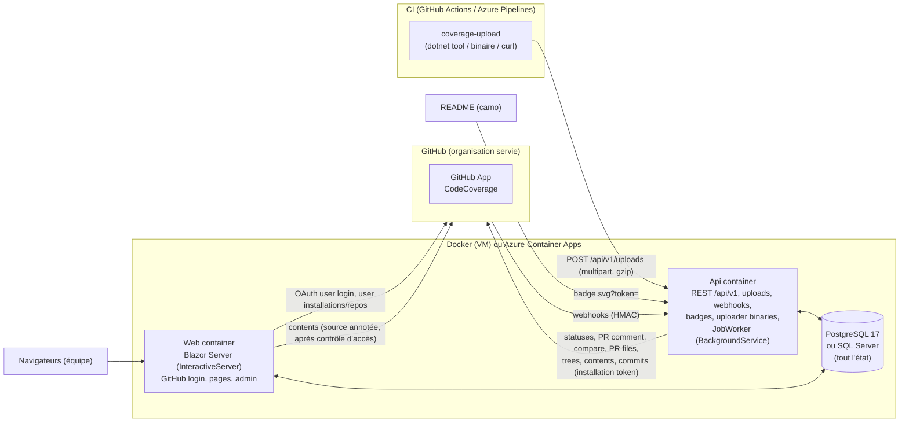

# Architecture : Codecov auto-hébergé

> **Produit :** `CodeCoverage`. **Dépôt :** `code-coverage`. **Destination :** `docs/ARCHITECTURE.md`.
> **Normes :** ce document applique `docs/CONVENTIONS.md` (§1 structure, §4 à §6 Domain/Application/Médiateur/Exceptions, §7 Mappers, §8 Infrastructure, §10 Api/OpenAPI, §11 Web, §12 Paramètres, §16.3 Lacunes). En cas de conflit, l'ordre de priorité donné en introduction de CONVENTIONS s'applique : les exigences utilisateur priment.
> **Base retenue :** l'architecture « MVP-first ». Elle intègre les meilleures idées des variantes « robustesse » et « parité Codecov », et corrige tous les défauts relevés par les juges.
> **Règle directrice :** un dépôt qui fonctionne aujourd'hui avec Codecov doit garder les mêmes `codecov.yml`, les mêmes noms de statuts après la bascule et les mêmes secrets (jetons importables). Côté pipeline, seule l'étape d'upload change. Toute différence de comportement avec Codecov est nommée, documentée et réglable.

---

## 1. Objectifs et périmètre

### 1.1 Objectif

Remplacer `codecov.io` par un service interne et pouvoir résilier l'abonnement à la fin du MVP. Le service ingère les rapports Cobertura, LCOV, OpenCover, JaCoCo et Clover produits par GitHub Actions et Azure Pipelines. Il publie sur GitHub des statuts de commit et un commentaire de PR, sert des badges SVG et affiche l'historique de couverture.

### 1.2 MVP : ce qui est livré avant la résiliation

| Besoin indispensable | Contenu du MVP | Reporté |
|---|---|---|
| **(1) Commentaire de PR** | Un seul commentaire par PR, mis à jour sur place. Il contient : couverture du patch (lignes ajoutées), delta projet par rapport à la base, tableau `diff`, tableau des flags, tableau des fichiers impactés (top N puis « … and N more »), et changements indirects calculés ligne à ligne. Clés supportées : `comment: false`, `layout` (sections `header`/`condensed_header`, `diff`, `flags`, `files`/`tree`, `footer`), `behavior` (`default`, `once`), `require_changes` (y compris les expressions `AND`/`OR`), `after_n_builds`, `hide_project_coverage`, `show_carryforward_flags`, `branches`. | `behavior: new`/`spammy`, sections `reach`/`components`/`sunburst`, annotations Checks API. |
| **(2) Statuts et seuils** | Statuts de commit GitHub `project`, `patch` et `changes` (désactivé par défaut, comme chez Codecov) : entrée `default`, entrées nommées, statuts définis par `flag_management`. Clés : `target`, `threshold`, `flags`, `paths`, `branches`, `only_pulls`/`base: pr`, `informational`, `if_not_found`, `if_ci_failed` (lu, sans effet), `removed_code_behavior` (`adjust_base`, `removals_only`, `fully_covered_patch`, `off`), `flag_coverage_not_uploaded_behavior`. Préfixe de contexte réglable (`coverage` pendant le pilote, `codecov` après la bascule). | Checks API (M5), `wait_for_ci`/`require_ci_to_pass` (M6). |
| **(3) Badges et historique** | Badges SVG/TXT par dépôt, branche et flag, avec des URL compatibles Codecov (`/gh/{owner}/{repo}/branch/{b}/graph/badge.svg?token=`). Jeton de badge pour les dépôts privés, avec import du « graphing token » Codecov. Graphique d'historique par branche et par flag. | Graphes `tree`/`sunburst`/`icicle`, import de l'historique Codecov (M5). |
| **(4) Monorepo et flags** | Plusieurs uploads par commit, une session par upload, fusion ligne à ligne, flags avec `paths`. Carryforward avec remontée d'au plus 10 ancêtres et décalage des numéros de ligne. `after_n_builds` global et par flag. Notification seulement quand tous les uploads sont traités, avec anti-rebond. | `component_management`, `carryforward_mode: labels`. |

Transverse MVP :
- un uploader `coverage-upload` (outil `dotnet tool`, plus binaires autonomes servis par l'Api) et une recette `curl` ;
- GitHub Actions et Azure Pipelines, y compris les clones superficiels (`fetchDepth: 1`) ;
- jetons d'upload organisation et dépôt, import des `CODECOV_TOKEN` existants, OIDC GitHub Actions ;
- connexion GitHub avec contrôle d'accès par dépôt ;
- paramètres stockés en base, rechargés à chaud et édités dans l'UI ;
- PostgreSQL et SQL Server ;
- source annotée (lignes couvertes, manquées ou partielles) lue en direct depuis GitHub.

### 1.3 Hors périmètre

Test analytics, bundle analysis, notifications Slack/Teams/e-mail, GraphQL, facturation et sièges, GitLab/Bitbucket, multi-tenant.

### 1.4 Principes non négociables

1. **Le diff est toujours calculé côté serveur, via l'API GitHub.** L'historique git de l'agent CI n'est jamais lu, donc les clones superficiels ne gênent pas.
2. **Le SHA attribué est toujours celui de la tête de PR, jamais celui du commit de merge synthétique.** L'uploader le détecte, et le serveur corrige ce que l'uploader aurait manqué (§6.2).
3. **Formule Codecov exacte :** `coverage = hits / (hits + misses + partials)`.
4. **Aucun travail lourd dans une requête HTTP.** Uploads et webhooks sont mis en file, puis traités par le worker.
5. **L'outillage de couverture ne casse jamais un build.** L'uploader sort en code 0 sauf avec `--fail-on-error`.

---

## 2. Vue d'ensemble



| Composant | Rôle |
|---|---|
| **Api** (`CodeCoverage.Api`) | API REST `/api/v1`, endpoint d'upload, webhooks GitHub, badges, téléchargement de l'uploader, Swagger/Scalar. Héberge le **JobWorker** (file de jobs en base) et applique les migrations au démarrage. Joignable par GitHub, par les agents CI et par camo. |
| **Web** (`CodeCoverage.Web`) | UI Blazor Server. Exécute **en process** les mêmes commandes et requêtes de l'Application que l'Api, via le médiateur. Pas de worker, pas de migrations. Peut rester limité au réseau interne. |
| **Base** | PostgreSQL 17 par défaut ; SQL Server 2022 et Azure SQL sont supportés. Elle contient tout l'état : rapports, uploads bruts (en morceaux), jobs, paramètres et clés Data Protection. |
| **GitHub App** | Une seule application privée, installée sur l'organisation servie (`<owner>`, paramètre `GitHub:Organization`). Elle porte l'identité serveur (statuts, commentaires, diff, webhooks) et la connexion des utilisateurs (user-to-server tokens). |
| **Uploader** | `coverage-upload` : détecte le contexte CI, envoie `git ls-files` et les rapports bruts compressés. |

Il n'y a ni Redis, ni MinIO, ni TimescaleDB, ni Hangfire, ni SPA séparée. Le Web et l'Api sont publiés sur **deux noms d'hôte** (choisis au déploiement, par exemple `coverage.example.com` pour le Web et `coverage-api.example.com` pour l'Api). Aucun routage par chemin n'est nécessaire.

**Cycle de vie d'un upload :**
1. `POST /uploads` : authentification, puis stockage brut en morceaux et `Upload(Received)`. Le job `ProcessUpload` est mis en file et la réponse est 202.
2. `ProcessUpload` : parsing, correction des chemins, puis écriture du blob propre à l'upload. Le job `FinalizeCommit` est mis en file (fusionné s'il existe déjà).
3. `FinalizeCommit` : reconstruction déterministe des sessions (uploads et carryforward), fusion, totaux, totaux par flag, mise à jour de la tête couverte de la branche. Passage par `NotificationGate`.
4. `NotifyCommit`, avec anti-rebond : résolution de la base, diff, comparaison, statuts, puis commentaire.

---

## 3. Structure de la solution .NET

### 3.1 Arborescence

```text
CodeCoverage.slnx
CodeCoverage.sln.DotSettings
.editorconfig  GitVersion.yml  global.json (10.0.403)  .gitignore  .gitattributes  .dockerignore   (propres au dépôt)
AGENT.md  CLAUDE.md  README.md  docs/ARCHITECTURE.md  docs/CONVENTIONS.md  docs/adr/*.md  docs/migration-from-codecov.md
Dockerfile.api  Dockerfile.web  docker-compose.yml  Caddyfile.example
.github/workflows/ci-cd.yml
action/action.yml                              (composite GitHub Action, M5; <owner>/code-coverage/action@v1)
pipelines/templates/coverage-upload.yml        (template Azure Pipelines, M5)
src/
  Directory.Build.props  default.ruleset
  CodeCoverage.Domain/
  CodeCoverage.Application/
  CodeCoverage.Infrastructure/
  CodeCoverage.Infrastructure.PostgreSql/   (migrations + DesignTimeDbContextFactory + dialecte SQL de la file)
  CodeCoverage.Infrastructure.SqlServer/    (migrations + DesignTimeDbContextFactory + dialecte SQL de la file)
  CodeCoverage.Api/
  CodeCoverage.Web/
  CodeCoverage.Uploader/                    (dotnet tool "coverage-upload", autonome)
tests/
  Directory.Build.props
  CodeCoverage.Domain.Tests/
  CodeCoverage.Application.Tests/
  CodeCoverage.Infrastructure.Tests/
  CodeCoverage.Api.Tests/
  CodeCoverage.Web.Tests/
  CodeCoverage.Uploader.Tests/
  CodeCoverage.Architecture.Tests/
  fixtures/reports/{cobertura,opencover,lcov,jacoco,clover}/…    fixtures/github/…    fixtures/ci-env/…
```

### 3.2 Dépendances entre couches (vérifiées par Architecture.Tests)

| Projet | Références autorisées |
|---|---|
| Domain | aucune (BCL seulement, aucun package) |
| Application | Domain |
| Infrastructure | Application, Domain |
| Infrastructure.PostgreSql / .SqlServer | Infrastructure |
| Api | Application ; Infrastructure, PostgreSql et SqlServer **pour la composition uniquement** (`Program.cs`, `Configuration/*`) |
| Web | idem Api |
| Uploader | **aucun projet de la solution**. Son seul couplage avec le serveur est le contrat HTTP. |

Règles NetArchTest, maintenues au vert et jamais assouplies :
- dépendances de couches ;
- cas d'usage rangés dans `Features/{F}/{Commands|Queries}/{UseCase}/` ;
- handlers `internal sealed` ;
- ports du Domain sans `IQueryable`, sans unité de travail et avec `CancellationToken` obligatoire ;
- aucun type `*Dto` ;
- **aucun type de `CodeCoverage.Domain` référencé** par un type des namespaces `Api.*` ou `Web.*`, sauf `Api.Mapping`, `Web.Mapping`, `Program` et `Configuration`. Cela couvre les contrôleurs, contrats, rendus, composants Razor et ViewModels ;
- l'Uploader ne référence rien ;
- en-tête de fichier présent et région `Ctors` (jamais `Constructors`), contrôlés par un test texte.

### 3.3 Packages NuGet

Version majeure flottante, sans CPM (§2.9 des conventions).

| Projet | Packages |
|---|---|
| Domain | — |
| Application | `Mediator.Abstractions` **3.\***, `Mediator.SourceGenerator` **3.\*** (PrivateAssets all, voir §3.4), `FluentValidation` 12.\*, `FluentValidation.DependencyInjectionExtensions` 12.\*, `Microsoft.Extensions.Logging.Abstractions` 10.\*, `Microsoft.Extensions.DependencyInjection.Abstractions` 10.\*, `Microsoft.Extensions.Options` 10.\* |
| Infrastructure | `Microsoft.EntityFrameworkCore` / `.Relational` / `.SqlServer` 10.\*, `Npgsql.EntityFrameworkCore.PostgreSQL` 10.\* (10.0.1 relevée), `Microsoft.AspNetCore.DataProtection.EntityFrameworkCore` 10.\*, `Azure.Extensions.AspNetCore.DataProtection.Keys` 1.\* + `Azure.Identity` 1.\* (`ProtectKeysWithAzureKeyVault`, identité managée), `Microsoft.Extensions.Diagnostics.HealthChecks.EntityFrameworkCore` 10.\*, `Microsoft.Extensions.Http.Resilience` 10.\*, `Microsoft.Extensions.Options.ConfigurationExtensions` 10.\*, `Microsoft.IdentityModel.JsonWebTokens` 8.\* (JWT de l'App, validation OIDC), `Microsoft.IdentityModel.Protocols.OpenIdConnect` 8.\* (JWKS OIDC GitHub), `YamlDotNet` 16.\*, `Npgsql` / `Microsoft.Data.SqlClient` (transitifs, utilisés en ADO.NET brut par le provider de paramètres) |
| Infrastructure.PostgreSql / .SqlServer | `Microsoft.EntityFrameworkCore.Design` 10.\* (PrivateAssets all) |
| Api | `Swashbuckle.AspNetCore` 10.\*, `Scalar.AspNetCore` 2.\*, `Serilog.AspNetCore` 10.\*, `Serilog.Sinks.Console` 6.\*, `Serilog.Sinks.File` 7.\*, `Serilog.Formatting.Compact` 3.\*, `Serilog.Enrichers.Environment` 3.\*, `Serilog.Enrichers.Thread` 4.\*, `OpenTelemetry.Extensions.Hosting` 1.\* + `OpenTelemetry.Instrumentation.AspNetCore` / `.Http` 1.\* + `OpenTelemetry.Exporter.OpenTelemetryProtocol` 1.\* |
| Web | (aucune librairie UI : composants maison `Web/Components/Ui`), `AspNet.Security.OAuth.GitHub` 10.\*, même lot Serilog et OpenTelemetry |
| Uploader | `System.CommandLine` 2.0.\*. Rien d'autre : `HttpClient`, `GZipStream` et `System.Text.Json` (source-gen) de la BCL. |
| Tests | Lot §2.9 des conventions (`xunit.v3` 3.2.\*, `Shouldly` 4.3.\*, `FakeItEasy` 9.0.\*, `Microsoft.NET.Test.Sdk` 18.\*), `NetArchTest.Rules` 1.3.\*, `Microsoft.CodeAnalysis.CSharp` 5.0.\* (Architecture.Tests : règles de conventions de source, **tests seulement**), `Microsoft.AspNetCore.Mvc.Testing` 10.\*, `Testcontainers.PostgreSql` / `.MsSql` 4.\*, `WireMock.Net` 1.\*, `Verify.XunitV3` 31.\*, `bunit` 2.\*, `ReportGenerator.Core` 5.\* (oracle de totaux, **tests seulement**) |

**Écartés volontairement :**
- MediatR ;
- Octokit et Octokit.Webhooks. Une quinzaine d'endpoints passe par un `HttpClient` typé avec des records `System.Text.Json` générés, ce qui donne le contrôle exact de la pagination, du champ `patch` et des en-têtes de rate limit ;
- AutoMapper, Mapster, Mapperly ;
- Hangfire, Redis, DiffPlex ;
- ReportGenerator à l'exécution.

### 3.4 Médiateur : martinothamar `Mediator` 3.x (ADR-001)

API vérifiée sur le README v3 :

```csharp
// Messages
public sealed record ProcessUploadCommand(long UploadId) : ICommand<Unit>;
public sealed record GetCommitQuery(string Owner, string Name, string Sha) : IQuery<Commit>;

// Handler (nom et retour imposés par la bibliothèque : Handle / ValueTask)
internal sealed class GetCommitQueryHandler(ICommitRepository commits) : IQueryHandler<GetCommitQuery, Commit>
{
  #region Implementation of IQueryHandler<GetCommitQuery,Commit>
  /// <inheritdoc />
  public async ValueTask<Commit> Handle(GetCommitQuery query, CancellationToken cancellationToken) { … }
  #endregion
}

// Behavior (ordre des paramètres v3 : message, next, cancellationToken)
internal sealed class ValidationBehavior<TMessage, TResponse>(IEnumerable<IValidator<TMessage>> validators)
  : IPipelineBehavior<TMessage, TResponse> where TMessage : IMessage
{
  public async ValueTask<TResponse> Handle(
    TMessage message, MessageHandlerDelegate<TMessage, TResponse> next, CancellationToken cancellationToken)
  { /* … throw ValidationException (400) */ return await next(message, cancellationToken).ConfigureAwait(false); }
}
```

Enregistrement dans `Application/DependencyInjection.AddApplication()` :

```csharp
services.AddMediator((MediatorOptions o) =>
{
  o.Namespace = "CodeCoverage.Application.Messaging";
  o.ServiceLifetime = ServiceLifetime.Scoped;              // DbContext scoped
  o.GenerateTypesAsInternal = true;
  o.PipelineBehaviors = [typeof(LoggingBehavior<,>), typeof(AuthorizationBehavior<,>), typeof(ValidationBehavior<,>)];
});
services.AddValidatorsFromAssembly(typeof(DependencyInjection).Assembly, includeInternalTypes: true);
```

- **Le générateur de source est référencé uniquement par Application.** C'est le seul projet qui le référence dans chaque artefact déployé (Api et Web), ce qui respecte la consigne du README : « ne pas l'installer dans chaque couche ».
  - Le code généré voit les handlers `internal sealed` sans `InternalsVisibleTo`.
  - Application.Tests dispose aussi d'un médiateur généré.
  - Un test de compilation dans Application.Tests fige la signature `IPipelineBehavior`.
  - Un spike M0 valide le montage ; le repli documenté consiste à référencer le générateur dans Api et Web avec `InternalsVisibleTo`.
- **Écart assumé, acté par l'ADR :** la méthode s'appelle `Handle` et renvoie `ValueTask`, au lieu de `HandleAsync`, parce que le nom est imposé par le framework. Les actions de contrôleur gardent le suffixe `Async` (`GetAsync`, `CreateAsync`).
- **Appelants :**
  - l'Api injecte `ISender` ;
  - le Web injecte `ScopedSender` (un scope DI par requête), enveloppé par `UiRequestRunner` ;
  - le worker utilise `ISender` dans un scope créé pour chaque job.
- **Événements de domaine :** il n'y en a pas dans le MVP. Les enchaînements passent par la file de jobs, mise en file dans la même transaction que la modification (méthode de repository unique). `IDomainEvent` et `IHasDomainEvents` sont créés dans le Domain pour l'avenir.

---

## 3bis. Domain, Application, mappers

### 3bis.1 Domain (`CodeCoverage.Domain`)

Le Domain est rangé par feature, avec `Ports/` et `Contracts/` séparés. Les entités suivent les conventions :
- `sealed`, constructeur privé dans `#region Ctors`, fabrique statique qui vérifie les invariants ;
- propriétés `{ get; private set; }`, collections exposées en `IReadOnlyList<T>`.

Tout le calcul de couverture est **pur et synchrone**, sans dépendance à `System.Net`, `System.IO.Compression` ou `Microsoft.*`.

```text
Ports/
  IRepositoryRepository, IInstallationRepository, IBranchRepository, IGitCommitRepository, ICommitRepository,
  IUploadRepository, ICommitReportRepository, IPullRequestRepository, IComparisonRepository, IPostedStatusRepository,
  ICommitConfigRepository, IUploadTokenRepository, IApiTokenRepository, IUserRepository, IUserRepositoryAccessRepository,
  IWebhookDeliveryRepository, IJobQueue, IJobMonitor, IRawUploadStore, IReportParserCatalog, IReportParser,
  ICoverageReportCodec, ICoverageConfigParser, IGitHubAppGateway, IGitHubUserGateway, IOidcTokenValidator,
  ISecretProtector, ITokenHasher, ISettingsStore, ICurrentUser, IClock, IAuditLog
Contracts/
  GitHub/   GitHubRepositoryInfo, GitHubCommitInfo (Sha, ParentShas, Message, AuthorLogin, CommittedAt),
            GitHubCompareResult (MergeBaseSha, AheadBy, BehindBy, Files, Truncated), GitHubChangedFile (Path, PreviousPath,
            Status, Patch?), GitHubPullInfo, GitHubTreeEntry (Path, BlobSha), GitHubUser, GitHubInstallationInfo,
            GitHubWebhookEvent (Event, Action, DeliveryId, payload fields)
  Uploads/  UploadPart (Kind Report|Network, FileName, Stream Content), UploadCredential (VO, redacted ToString),
            UploadMetadata (Slug, Sha, Branch, PullNumber, ParentSha, Flags, Name, Ci, Root, UploaderVersion), CiContext
  Jobs/     JobRequest (Type, LockKey, DedupKey?, PayloadJson, RunAfter, Coalesce, MaxDelay?)
  Identity/ GitHubOidcIdentity (Repository, RepositoryId, RepositoryOwner, Ref, EventName)
Coverage/      LineCoverage, LineKind, LineState, FileCoverage, CoverageReport, CoverageTotals, ParsedReport, ParsedFile,
               ReportFormat, CoverageMath, ReportMerger, ReportView (filtrage flags + paths)
Paths/         PathFixer, PathFixContext, PathFixResult, NetworkIndex, PathPattern, PathPatternSet, FixRule
Diffs/         FileDiff, FileDiffStatus, Hunk, UnifiedDiffParser, LineShifter, DiffSet (Complete/Truncated, Source)
Repositories/  TrackedRepository, Installation, Branch, RepositorySlug (VO : "owner/repo" et "owner::::repo")
Commits/       Commit, CommitState, GitCommit, Session, SessionKind, Upload, UploadState, ProcessingLog, CommitFlagTotals,
               CarryforwardBuilder, CarryforwardPlan
Comparisons/   BaseResolution, Comparison, PatchCoverage, ImpactedFile, IndirectChange, ChangeDetector, FlagComparison,
               ComparisonCalculator
Config/        CoverageConfig, ConfigNode, ConfigMerger, CoverageConfigDefaults, StatusRule, StatusType, Target,
               FlagRule, CommentRule, CommentSection, RequireChangesExpression, NotifyRule, ParserRule, CoverageRange,
               RoundingMode, RemovedCodeBehavior, NotUploadedBehavior, ConfigWarning
Notifications/ StatusEvaluator, CommitStatus (Context, State, Description), StatusState, PostedStatus, NotificationDecision,
               NotificationGate, CommentDecision
Badges/        Badge (Coverage?, Color), BadgeColorScale
PullRequests/  PullRequest, PullRequestState
Tokens/        UploadToken, UploadTokenScope, IssuedToken (valeur en clair, renvoyée une seule fois), ApiToken
Users/         AppUser, RepositoryPermission, RepositoryAccess
History/       CoveragePoint, CoverageSeries                          (read models)
Operations/    JobSummary, WebhookDeliverySummary, SystemStatus      (read models pour l'admin)
Source/        AnnotatedSource, AnnotatedLine                        (read model de la source annotée)
Settings/      SettingDefinition, SettingDefinitions (catalogue), SettingValue, SettingSource
IDomainEvent.cs, IHasDomainEvents.cs
```

Remarques :
- Les **read models** (`CoveragePoint`, `JobSummary`, `AnnotatedSource`, `FileTotals` intégré à `CoverageReport`) sont des types du Domain, comme le prévoit §4.3 des conventions. Aucune requête ne renvoie de type défini dans l'Application.
- `UploadCredential` est un value object. Il porte le type du jeton (`UploadToken`, `Jwt`) et la valeur. `ToString()` renvoie `"cvc_ab12…(redacted)"`, et la valeur n'est jamais sérialisée (voir LoggingBehavior).

### 3bis.2 Application (`CodeCoverage.Application`)

```text
Behaviors/   LoggingBehavior, AuthorizationBehavior, ValidationBehavior
Exceptions/  ApplicationException, BadRequestException, ValidationException, UnauthorizedException, ForbiddenException,
             NotFoundException, ConflictException, UnprocessableEntityException, BadGatewayException,
             RetryLaterException (interne au worker, jamais exposée en HTTP), ErrorCodes/GeneralErrors.cs
Security/    IRepositoryScoped (Owner, Name, RequiredPermission), IAdminOnly, ISystemOnly
Services/    UploadAuthenticator, CommitMerger, BaseResolver, DiffProvider, ComparisonBuilder, CommentComposer,
             NotificationService, ConfigResolver, BranchHeadTracker
Features/    (tableau ci-dessous)
DependencyInjection.cs
```

**Behaviors**, appliqués dans l'ordre Logging, puis Authorization, puis Validation (§5.6 et §5.7 des conventions) :

- **`LoggingBehavior`**
  - Journalise le nom du type de message, la durée, le résultat et l'`ErrorCode` éventuel.
  - **Ne sérialise jamais le message.** Ni le jeton, ni le flux d'upload ne peuvent donc fuir.
  - Niveaux : `Warning` pour un refus `ApplicationException`, `Error` pour le reste.
- **`AuthorizationBehavior`**
  - Messages `IRepositoryScoped` : `IRepositoryAccessService.CanAsync(user, repo, permission)` est appelé. Sans droit de lecture, le behavior lève `NotFoundException(Repository.NotFound)` pour ne pas révéler l'existence d'un dépôt privé. Sans droit d'administration, il lève `ForbiddenException`.
  - Messages `IAdminOnly` : `ICurrentUser.IsAdmin` est exigé.
  - Messages `ISystemOnly` (jobs, webhooks) : seul le principal système du worker peut les envoyer.
  - **Principal système :** le worker et le traitement des webhooks s'exécutent avec `ICurrentUser.IsSystem = true`, qui passe tous les contrôles. Les hôtes HTTP ne peuvent jamais produire ce principal.
  - Les commandes d'upload ne sont pas `IRepositoryScoped`. Leur identifiant est vérifié par `UploadAuthenticator` dans le handler.
- **`ValidationBehavior`** : FluentValidation 12. En cas d'échec, lève `ValidationException` (400, `General.ValidationFailed`, erreurs groupées par propriété).

**Exceptions (§6 des conventions)**

| Exception | HTTP | Usage |
|---|---|---|
| `ValidationException`, `BadRequestException` | 400 | Échec de validation, requête incohérente |
| `UnauthorizedException` | 401 | Jeton d'upload ou API absent ou invalide, utilisateur non connecté |
| `ForbiddenException` | 403 | Jeton non valable pour ce dépôt, rôle d'administrateur manquant |
| `NotFoundException` | 404 | Dépôt, commit ou upload inconnu (ou masqué) |
| `ConflictException` | 409 | Concurrence (`Version`), job non relançable |
| `UnprocessableEntityException` | 422 | Règle métier ou « BusinessRule » : dépôt désactivé, paramètre fourni par l'environnement, commit compacté |
| `BadGatewayException` | 502 | GitHub indisponible (5xx, timeout) |

Les codes d'erreur suivent le format `Feature.Reason` et sont rangés dans `Features/{F}/{F}Errors.cs` et `Exceptions/ErrorCodes/GeneralErrors.cs`. Le Web les traduit dans `Common.resx`.

**Features et cas d'usage**

| Feature | Commands | Queries |
|---|---|---|
| Uploads | `ReceiveUpload`, `ProcessUpload`, `CompleteUploads` (déclenchement manuel), `RetryUpload` | `AuthorizeUpload` (pré-contrôle avant lecture du corps), `GetUpload`, `ListCommitUploads` |
| Commits | `FinalizeCommit`, `ReprocessCommit` | `GetCommit`, `ListCommits`, `GetCommitFiles`, `GetFileCoverage`, `GetAnnotatedSource` |
| Notifications | `NotifyCommit`, `TriggerNotify` (re-notification manuelle), `SweepPendingCommits` | — |
| PullRequests | `SyncPullRequest` | `ListPullRequests`, `GetPullRequestComparison` |
| Comparisons | — | `CompareCommits` (base/head arbitraires) |
| GitHubEvents | `ReceiveWebhook` (enregistrement et mise en file), `HandleWebhookDelivery` (dans le worker), `SyncInstallations` | — |
| Repositories | `ActivateRepository`, `DeactivateRepository`, `RotateBadgeToken`, `ImportBadgeToken` | `ListRepositories`, `GetRepository`, `ListBranches`, `GetEffectiveConfig`, `GetCoverageHistory`, `GetBadge` |
| Configuration | — | `ValidateCoverageYaml` |
| UploadTokens | `CreateUploadToken` (génération ou import d'une valeur `CODECOV_TOKEN`), `RevokeUploadToken` | `ListUploadTokens` |
| Access | `SignInUser`, `RefreshUserAccess`, `CreateApiToken`, `RevokeApiToken` | `GetCurrentUser`, `ListApiTokens` |
| Settings | `UpdateSetting`, `ReplaceSecret`, `ResetSetting`, `CompleteGitHubAppManifest`, `CompleteSetup` | `GetSettings`, `GetSetupState` |
| Operations | `RetryJob`, `PurgeExpiredData` | `ListJobs`, `ListWebhookDeliveries`, `GetSystemStatus` |

Retours : objet du Domain, `IReadOnlyList<T>` du Domain, `Unit` ou identifiant. Il n'y a ni DTO ni `Result<T>`.

### 3bis.3 Mappers

- **Api (`Api/Mapping/{Feature}Mapper.cs`, `internal static`)** :
  - `Request` vers `Command`/`Query` : `ToCommand`, `ToQuery` ;
  - Domain vers `Response` : `ToResponse`, `ToResponses` ;
  - contrats dans `Api/Contracts/` : `{Verb}{Thing}Request`, `{Thing}Response`, `{Thing}PageResponse`, `{Thing}Model` (records positionnels documentés).
  - Le badge suit le même chemin : `GetBadgeQuery` renvoie `Badge`, `ToResponse()` produit `BadgeResponse`, puis `BadgeSvgRenderer` (namespace `Api.Rendering`) dessine à partir de `BadgeResponse`.
- **Web (`Web/Mapping/{Feature}Mapper.cs`)** :
  - Domain vers `ViewModel` : `ToViewModel`, `ToViewModels` ;
  - `ViewModel` de formulaire vers `Command` : `ToCommand`.
  - Les ViewModels sont dans `Web/ViewModels/{Feature}/{Thing}ViewModel.cs`.
- Le `CommentComposer` (Application) produit du markdown GitHub à partir de la `Comparison`. C'est une sortie technique vers GitHub, pas une vue.

---

## 4. Modèle de données

### 4.1 Règles communes (un seul modèle EF Core 10 pour les deux fournisseurs)

- **Clés :** `bigint` identity (`GENERATED BY DEFAULT AS IDENTITY` / `IDENTITY(1,1)`). Elles sont séquentielles et sans fragmentation sur les deux fournisseurs, contrairement à un `Guid` v7 sous SQL Server. Les identifiants publics sont `Uploads.PublicId uuid`, et les identités naturelles `owner/name`, `sha` et numéro de PR.
- **Dates :** `DateTimeOffset` UTC.
- **Énumérations :** stockées en texte (`HasConversion<string>()`).
- **Blobs :** `byte[]` (`bytea` / `varbinary(max)`).
- **Listes :** les petites listes (`Flags`, `ParentShas`) sont des colonnes JSON texte avec un value converter System.Text.Json, ce qui reste neutre vis-à-vis du fournisseur.
- **Concurrence optimiste :** colonne `Version int` gérée par l'application, portable, sur `Repositories`, `Commits`, `PullRequests`, `Branches` et `Users`.
- **Chemins :** aucun chemin de fichier n'est clé d'index. Les données par fichier vivent dans des blobs, ce qui évite la limite de 1700 octets des clés SQL Server.
- **Transactions :** chaque changement métier correspond à une méthode de repository dans une transaction, mise en file du job comprise (pattern outbox intégré).
- **Sous SQL Server :** `READ_COMMITTED_SNAPSHOT ON` est exigé et vérifié par le health check `ready`.
- Index uniques filtrés : PostgreSQL `WHERE "State" = 'Queued'`, SQL Server `WHERE [State] = 'Queued'`. Le filtre est écrit dans chaque assembly de migrations.

### 4.2 Tables

| Table | Colonnes principales (PK en gras) | Index et remarques |
|---|---|---|
| **Installations** | **Id** (id d'installation GitHub, bigint), AccountLogin, AccountType, SuspendedAt?, CreatedAt, UpdatedAt | — |
| **Repositories** | **Id**, GitHubId bigint, InstallationId FK, Owner, Name, DefaultBranch, IsPrivate, IsActive, BadgeTokenProtected (Data Protection, affichable dans le snippet README), DefaultBranchYaml?, DefaultBranchYamlSha?, CreatedAt, UpdatedAt, Version | UX(GitHubId) ; UX(Owner, Name). Owner et Name sont mis à jour lors d'un renommage ; GitHubId reste l'identité stable. |
| **Branches** | **RepositoryId, Name**, HeadSha, HeadUpdatedAt, CoveredCommitId? (FK Commits), CoveredAt?, Version | Source des badges et de la vue « dernier état ». La FK de `CoveredCommitId` est posée par la migration qui crée `Commits`. |
| **GitCommits** | **RepositoryId, Sha** char(40), ParentShas (json), Message (≤ 1000), AuthorLogin, CommittedAt (date committer GitHub), FetchedAt | Cache immuable des métadonnées GitHub, rempli par `GET /commits?sha=X&per_page=50` (une chaîne d'ancêtres par appel). |
| **Commits** | **Id**, RepositoryId, Sha, Branch?, PullNumber?, State (`Known`, `Pending`, `Complete`, `Error`, `Compacted`), UploadSequence int, Files, Lines, Hits, Misses, Partials, Branches, Methods, Coverage decimal(9,5)?, SessionCount, UploadedSessionCount, ReportRevision, CarryforwardStatus (`None`, `Applied`, `AncestorPending`, `NotFound`), ConfigSource (chaîne libre : `Source` de `CommitConfigs`, ou `codecov-import`), LastUploadAt?, CompletedAt?, NotifiedAt?, CreatedAt, UpdatedAt, Version | UX(RepositoryId, Sha) ; IX(RepositoryId, Branch, CompletedAt). `Known` désigne un commit vu par webhook, sans upload. |
| **Uploads** | **Id**, PublicId uuid, CommitId, Sequence int (numéro de session stable), IdempotencyKey varchar(128), State (`Received`, `Processing`, `Processed`, `Failed`), Flags (json), Name?, CiService?, BuildId?, JobId?, BuildUrl?, RepoRoot?, UploaderVersion?, TokenId?, PrincipalKind (`RepositoryToken`, `OrganizationToken`, `GitHubOidc`), ReportFileCount, ResolvedFileCount, UnresolvedFileCount, Lines, Hits, Misses, Partials, ErrorCode?, Error?, ProcessingLog (json, plafonné à 64 Ko), ReceivedAt, ProcessedAt?, LockedBy? | UX(PublicId) ; UX(CommitId, IdempotencyKey) ; IX(CommitId, State) |
| **UploadRawFiles** | **Id**, UploadId FK, Kind (`Report`, `Network`), FileName, DetectedFormat?, Sha256 binary(32), CompressedSize, UncompressedSize, ExpiresAt | IX(ExpiresAt) |
| **UploadRawChunks** | **RawFileId, ChunkIndex**, Data (gzip, ≤ 1 Mo) | Upload brut écrit en flux, morceau par morceau. Pas de matérialisation de 200 Mo, et la limite `bytea` de 1 Go n'est jamais approchée. |
| **UploadCoverages** | **UploadId** PK/FK, Codec tinyint, Data (blob CCR1 de l'upload, chemins corrigés, `ignore` appliqué) | Écrit uniquement par le `ProcessUpload` de cet upload : parallélisme sans conflit. |
| **CommitSessions** | **Id**, CommitId, Kind (`Uploaded`, `CarriedForward`), Number int, UploadId?, CarriedForwardFromSha?, SourceSessionId?, DataUploadId?, Data? (blob CCR1 si la session reportée a été décalée), Flags (json), Name, CiService?, BuildUrl?, Lines, Hits, Misses, Partials, Coverage? | IX(CommitId). Supprimées et réécrites à chaque finalisation. Une session reportée **non décalée** référence le blob d'origine via `DataUploadId` : pas de copie. |
| **CommitReports** | **CommitId** PK/FK, Revision, Codec tinyint, Data (rapport fusionné toutes sessions, sans détail par session), FileIndex (blob : chemin vers lignes, hits, misses, partials) | `FileIndex` permet de lister les fichiers sans décoder les lignes. |
| **CommitFlagTotals** | **CommitId, Flag** (`''` = projet), RepositoryId, Branch, CompletedAt (dénormalisés), Lines, Hits, Misses, Partials, Coverage?, IsCarriedForward, CarriedForwardFromSha? | IX(RepositoryId, Branch, Flag, CompletedAt) : historique et badges par flag. |
| **PullRequests** | **Id**, RepositoryId, Number, State (`Open`, `Closed`, `Merged`), Title, AuthorLogin, HeadSha, HeadBranch, BaseBranch, BaseShaGitHub, ForkPointSha?, ComparedToSha?, CommentId bigint?, CommentBodyHash binary(32)?, CommentedHeadSha?, UpdatedAt, Version | UX(RepositoryId, Number) ; IX(RepositoryId, HeadSha) ; IX(RepositoryId, ForkPointSha) |
| **Comparisons** | **Id**, CommitId, PullNumber?, ForkPointSha?, ComparedToSha?, HeadRevision, BaseRevision?, HeadCoverage?, BaseCoverage?, PatchLines, PatchHits, PatchMisses, PatchPartials, IndirectChangeCount, DiffSource (`PullFiles`, `Compare`), DiffIncomplete, Data (blob : fichiers impactés, flags, changements indirects ; sérialiseur Infrastructure versionné), ComputedAt | UX(CommitId, PullNumber). Cache pour la page PR et pour éviter les re-notifications identiques. |
| **PostedStatuses** | **CommitId, Context**, State, Description (≤ 140), TargetUrl, PostedAt | Évite de reposter un statut identique. |
| **CommitConfigs** | **RepositoryId, Sha**, Source (`Commit`, `RepositoryDefault`, `Organization`, `Builtin`), Path?, RawYaml?, Warnings (json), Errors (json), FetchedAt | YAML immuable par SHA, donc cache définitif. |
| **DiffCache** | **RepositoryId, BaseSha, HeadSha, Kind** (`Compare`, `PullFiles`), Data (gzip json des `FileDiff`), Incomplete, FetchedAt | Immuable ; purgé à 30 jours. |
| **RepositoryTrees** | **RepositoryId, Sha**, Data (gzip : chemin et SHA de blob), Truncated, FetchedAt | Repli pour la liste réseau ; vérification « fichier inchangé » du carryforward. |
| **UploadTokens** | **Id**, Scope (`Organization`, `Repository`), Owner, RepositoryId?, Label, Hint (préfixe ou 4 derniers caractères), Hash binary(32), Imported bool, CreatedBy, CreatedAt, ExpiresAt?, LastUsedAt?, RevokedAt? | UX(Hash). Format `cvc_` + 43 caractères base64url, ou UUID Codecov importé. |
| **ApiTokens** | **Id**, UserId FK, Name, Hint, Hash binary(32), CreatedAt, ExpiresAt?, LastUsedAt?, RevokedAt? | UX(Hash). Format `cvp_…`. |
| **Users** | **Id**, GitHubId, Login, AvatarUrl, AccessTokenProtected, RefreshTokenProtected, AccessTokenExpiresAt, RefreshTokenExpiresAt, IsAdmin (calculé), LastLoginAt, Version | UX(GitHubId). Jetons GitHub **côté serveur uniquement**. |
| **UserRepositoryAccess** | **UserId, GitHubRepositoryId**, Permission (`Read`, `Write`, `Admin`), RefreshedAt | Cache de 10 minutes. `GitHubRepositoryId` est l'identifiant GitHub du dépôt (`Repositories.GitHubId`), sans FK : le cache peut citer un dépôt pas encore suivi. |
| **WebhookDeliveries** | **DeliveryId** (X-GitHub-Delivery), Event, Action?, InstallationId?, RepositoryGitHubId?, Payload (gzip), ReceivedAt, ProcessedAt?, Error? | Idempotence des redélivrances ; 14 jours. |
| **Jobs** | **Id**, Type, PayloadJson, LockKey?, DedupKey?, State (`Queued`, `Running`, `Succeeded`, `Failed`, `Dead`), Attempts, MaxAttempts, RunAfter, FirstQueuedAt, LockedBy?, LockedUntil?, LastError?, CorrelationId, CreatedAt, CompletedAt? | IX(State, RunAfter, Id) ; **UX(DedupKey) filtré State='Queued'** ; **UX(LockKey) filtré State='Running'** |
| **Settings** | **Key**, Value?, IsSecret, UpdatedAt, UpdatedBy | Store de paramètres (§4bis) |
| **SettingsRevision** | **Id** (=1), Revision bigint | Incrémenté dans la transaction de chaque sauvegarde. |
| **DataProtectionKeys** | table EF standard | Partagée par les deux hôtes. |
| **AuditEntries** | **Id**, At, Actor, Action, Target, Details (json) | Jetons, paramètres, secrets, relances manuelles. |

### 4.3 Format de blob `CCR1` (`CcrCodec : ICoverageReportCodec`, Infrastructure)

```text
magic "CCR1", u8 formatVersion (=1), u8 flags
corps compressé Brotli (qualité 5) :
  varint stringCount ; strings UTF-8 (varint longueur + octets)        -- chemins
  varint fileCount
  par fichier : varint pathIndex, varint lineCount
    par ligne : varint deltaLine, u8 shape (bit0 branches, bit1 method, bit2 missing-ids), varint hits (borné à uint32),
                [varint covered, varint total], [varint missingCount, varint missingIdx…]
```

- Le même format sert à `UploadCoverages.Data`, à `CommitSessions.Data` et à `CommitReports.Data`.
- L'octet de version garantit que les anciens blobs restent lisibles indéfiniment.
- `ReprocessCommit` reconstruit tout depuis les uploads bruts tant qu'ils sont conservés.
- Taille attendue : quelques centaines d'octets par fichier, de 200 à 500 Ko pour un commit de monorepo de 5 000 fichiers.

### 4.4 Rétention (job `PurgeExpiredData`, quotidien, suppressions par lots de 5 000)

| Donnée | Durée |
|---|---|
| `UploadRawFiles` et `UploadRawChunks` | `Retention:RawDays` (30 jours). Au-delà, `ReprocessCommit` n'est plus possible. |
| `UploadCoverages`, `CommitSessions.Data` et `CommitReports` des commits **hors branche par défaut** | `Retention:BranchReportDays` (180 jours), sauf s'ils sont référencés par une PR ouverte ou comme origine de carryforward. Le commit passe à `Compacted` : un `FinalizeCommit` ultérieur est refusé (422 `Commit.Compacted`) et journalisé. |
| Branche par défaut | conservée indéfiniment |
| `Commits`, `CommitFlagTotals` | conservés indéfiniment (historique, badges) |
| `Jobs` Succeeded | 14 jours |
| `WebhookDeliveries` | 14 jours |
| `DiffCache`, `RepositoryTrees` | 30 jours |
| `Comparisons` | 90 jours |

---

## 4bis. Paramètres rechargeables à chaud

### 4bis.1 Mécanisme (§12 des conventions)

- **Domain :** `SettingDefinition(Key, Group, Type, Default, RequiresRestart, Min, Max, IsSecret)` et le catalogue `SettingDefinitions`.
- **Infrastructure :** `DatabaseSettingsConfigurationSource` et `DatabaseSettingsConfigurationProvider`, ajoutés comme **source la plus faible** par `AddCodeCoverageSettingsStore(connectionString, provider)`.
  - La lecture se fait en ADO.NET brut (`NpgsqlConnection` ou `SqlConnection` selon `CodeCoverage:Database:Provider`), parce que la configuration est construite avant la DI.
  - Si la table est absente, la source renvoie un jeu vide.
  - `ConfigurationSettingsStore` (EF) implémente `ISettingsStore` : valeur effective, source effective via `ConfigurationSourceInspector`, et sauvegarde.
- **Consommation :** `services.AddOptions<XxxOptions>().Bind(...).ValidateOnStart()`, lu uniquement par `IOptionsMonitor<T>`.
  - **Authentification OAuth :** un `IConfigureNamedOptions<OAuthOptions>` lit `IOptionsMonitor<GitHubOptions>`. Un changement déclenche `IOptionsMonitorCache<OAuthOptions>.TryRemove("GitHub")`.
  - **Rate limiter et taille de corps :** le partitionneur et `IHttpMaxRequestBodySizeFeature` lisent `IOptionsMonitor` à chaque requête, ce qui rend ces réglages rechargeables à chaud.
- **Propagation entre les deux hôtes (portable PostgreSQL et SQL Server, sans LISTEN/NOTIFY) :**
  1. `UpdateSetting` et `ReplaceSecret` écrivent la valeur **et** exécutent `UPDATE SettingsRevision SET Revision = Revision + 1` dans la même transaction.
  2. Dans chaque hôte, `SettingsChangeWatcher` (`BackgroundService`, `PeriodicTimer` de `Settings:PollSeconds`, 5 s par défaut) lit `SELECT Revision`. Si la valeur a changé, il appelle `DatabaseSettingsConfigurationProvider.RefreshAll(root)`, puis `OnReload()` : les consommateurs `IOptionsMonitor` sont notifiés.
  3. L'hôte qui sauvegarde se rafraîchit immédiatement. L'autre suit en 5 s au plus.
- **Secrets :**
  - Stockés chiffrés par Data Protection (purpose `CodeCoverage.Secrets`) via `ISecretProtector`.
  - Le provider n'expose **que la valeur protégée** dans `IConfiguration`. Les classes d'options ont un accesseur (`GitHubOptions.GetPrivateKeyPem(ISecretProtector)`) qui déchiffre à l'usage.
  - Un secret n'est jamais renvoyé à l'UI : l'écran propose « Remplacer » ou « Défini / non défini ».
- **Priorité :** ligne de commande, puis variables d'environnement, puis `appsettings.json`, puis le store. Une clé fournie par une source plus forte est en lecture seule dans l'écran (`Setting.ProvidedByEnvironment`, 422).

### 4bis.2 Amorçage (environnement uniquement)

| Variable | Rôle |
|---|---|
| `ConnectionStrings__CodeCoverage` | chaîne de connexion |
| `CodeCoverage__Database__Provider` | `PostgreSql` ou `SqlServer` |
| `CodeCoverage__Database__MigrateOnStartup` | lu par l'Api seulement (`true` par défaut) : seule l'Api enregistre le `DatabaseMigrator` ; le Web ne migre jamais et ignore cette variable |
| `Logging__FilePath` | fichier de log roulant |
| `Features__EnableApiDocs` | documentation en production |
| `Worker__Enabled` | `true` sur l'Api (par défaut), `false` sur un réplica purement public |
| `Settings__PollSeconds` | 5 |
| `DataProtection__CertificatePath` / `DataProtection__CertificatePassword` **ou** `DataProtection__KeyVaultKeyId` | **obligatoire en Production** : l'hôte refuse de démarrer sans protection du trousseau, sauf `DataProtection__AllowUnprotectedKeys=true` explicite |
| `ForwardedHeaders__KnownProxies` | adresses du reverse proxy |
| `CodeCoverage__Bootstrap__AdminLogins` | logins GitHub administrateurs initiaux |
| `GitHub__*` | surcharge optionnelle de tout réglage GitHub, qui devient alors en lecture seule dans l'UI (déploiement « infra as code ») |

### 4bis.3 Catalogue des paramètres stockés en base

`*` = secret, `R` = `RequiresRestart`.

| Groupe | Clé | Type | Défaut |
|---|---|---|---|
| GitHub | `GitHub:AppId`, `GitHub:ClientId`, `GitHub:AppSlug` | string | — |
| | `GitHub:ClientSecret`\*, `GitHub:PrivateKeyPem`\*, `GitHub:WebhookSecret`\*, `GitHub:WebhookSecretPrevious`\* (rotation) | string | — |
| | `GitHub:Organization` | string | — (aucun défaut, saisi dans la console web) |
| | `GitHub:ApiBaseUrl` | url | `https://api.github.com` |
| Urls | `Urls:ApiPublicUrl`, `Urls:WebPublicUrl` | url | — |
| Uploads | `Uploads:MaxRequestMegabytes` | int 1–1000 | 200 |
| | `Uploads:MaxDecompressedMegabytes` | int | 2048 |
| | `Uploads:MaxFilesPerUpload` | int | 50 |
| | `Uploads:RateLimitPerMinute` | int | 120 (par jeton et par dépôt) |
| | `Uploads:OidcAudience` | string | = `Urls:ApiPublicUrl` |
| | `Uploads:AllowedOwners` | csv | — (aucun défaut, saisi dans la console web) |
| Processing | `Processing:WorkerConcurrency` (R) | int 1–16 | 4 |
| | `Processing:MaxParallelParses` | int | 2 |
| | `Processing:JobMaxAttempts` | int | 8 |
| | `Processing:CarryforwardMaxDepth` | int | 10 |
| | `Processing:CarryforwardWaitMinutes` | int | 10 |
| | `Processing:BaseMaxAncestorWalk` | int | 30 |
| | `Processing:BaseWaitMinutes` | int | 15 |
| | `Processing:PendingTimeoutMinutes` | int | 60 |
| Notifications | `Notifications:StatusContextPrefix` | string | `coverage` (pilote), passe à `codecov` à la bascule |
| | `Notifications:StatusesEnabled`, `Notifications:CommentsEnabled` | bool | true / true |
| | `Notifications:DebounceSeconds` | int 0–600 | 20 |
| | `Notifications:MaxDelaySeconds` | int | 300 |
| | `Notifications:AfterNBuildsCountsCarryforward` | bool | true (parité Codecov) |
| | `Notifications:CommentTitle` | string | `Coverage` |
| Coverage | `Coverage:OrganizationYaml` | yaml | vide |
| | `Coverage:AllowFilenameOnlyMatch` | bool | false |
| Badges | `Badges:Label` | string | `coverage` |
| Access | `Access:AdminLogins` | csv | — |
| | `Access:CacheMinutes` | int | 10 |
| Retention | `Retention:RawDays` / `Retention:BranchReportDays` / `Retention:JobDays` / `Retention:WebhookDays` / `Retention:DiffCacheDays` | int | 30 / 180 / 14 / 14 / 30 |

---

## 5. Contrat d'upload, CLI uploader, exemples CI

### 5.1 `POST /api/v1/uploads` (Api, `UploadsController`)

Le corps est `multipart/form-data`. Chaque partie peut être compressée en gzip, ce qui est détecté par les octets magiques `1F 8B`.

**Authentification** : `Authorization: Bearer <credential>`, alias `Authorization: token <x>` et `X-Upload-Token: <x>`. Le credential peut être :
- un jeton `cvc_…` (organisation ou dépôt) ;
- un **jeton Codecov importé** (UUID), pour que le secret `CODECOV_TOKEN` existant reste valable ;
- un **JWT OIDC GitHub Actions**, reconnu à ses trois segments base64url.

**Champs** (les champs texte **doivent précéder** les parties `file` et `network`, ce qui est l'ordre naturel de `curl -F` et de l'uploader) :

| Champ | Obligatoire | Description |
|---|---|---|
| `slug` | oui | `owner/repo` |
| `sha` | oui | 40 caractères hexadécimaux. **Tête de PR, jamais le commit de merge** (corrigé côté serveur sinon, §6.2). |
| `branch` | non | branche de tête, `refs/heads/` retiré |
| `pr` | non | numéro de PR GitHub (indice ; la table des PR du serveur fait foi) |
| `parentSha` | non | fourni seulement si l'agent l'a résolu sans ambiguïté |
| `flags` | non | séparés par des virgules ; chacun respecte `^[^'"]{1,200}$` |
| `name` | non | nom de session, par exemple `backend-net10-linux` |
| `ciService` | non | `github-actions`, `azure-pipelines`, `local` ou `other` |
| `buildUrl`, `buildId`, `jobId` | non | affichés dans l'UI |
| `root` | non | racine absolue du dépôt sur l'agent |
| `uploaderVersion` | non | — |
| `network` | non | partie texte : sortie de `git ls-files`, une ligne par chemin |
| `file` | oui (1 à 50) | rapports ; le nom de fichier sert à la détection du format |

En-tête facultatif `Idempotency-Key` (128 caractères au plus). L'uploader en envoie toujours un. À défaut, le serveur le calcule : `sha256(slug|sha|flags|name|buildId|jobId|sha256 des fichiers)`.

**Réponses**

| Code | Signification |
|---|---|
| `202 Accepted` | `UploadAcceptedResponse(Guid UploadId, string State, string CommitUrl, string StatusUrl)` |
| `200 OK` | rejeu idempotent : même corps, upload existant |
| `400` | validation, ou `Upload.MetadataMustPrecedeFiles` |
| `401` | `Upload.TokenInvalid` |
| `403` | `Upload.TokenNotForRepository`, ou incohérence OIDC |
| `404` | `Repository.NotFound` : dépôt inconnu et App non installée |
| `413` | corps trop volumineux |
| `422` | `Repository.Inactive` |
| `429` | rate limit |

Les erreurs sont des ProblemDetails avec `errorCode`.

**Déroulement de la requête** (aucun parsing pendant la requête ; réponse en moins de 300 ms hors transfert) :

1. Le contrôleur lit le multipart en flux (`MultipartReader`, sans model binding) et accumule les champs texte.
2. À la première partie `file` ou `network`, il envoie `AuthorizeUploadQuery(credential, slug)`, qui renvoie `UploadAuthorization` (Domain). **Une requête non authentifiée est rejetée avant toute écriture du corps**, ce qui protège contre le DoS disque ou base.
3. Il envoie ensuite `ReceiveUploadCommand(UploadCredential, UploadMetadata, IAsyncEnumerable<UploadPart>)`. Les parties sont produites paresseusement, en flux. Le handler :
   1. ré-authentifie le credential via `UploadAuthenticator` (cache de 60 s par hash) ;
   2. **résout le dépôt**. S'il est inconnu, il appelle `GET /repos/{o}/{r}/installation` avec le JWT de l'App, puis `GetRepository`, et crée le `TrackedRepository` (actif, nouveau jeton de badge). Sans installation, il lève `NotFoundException(Repository.NotFound)` ;
   3. **commit** : `INSERT` puis relecture en cas de violation d'unicité (course entre uploads parallèles absorbée). Il passe à `Pending` s'il était `Known` ou nouveau, renseigne `Branch` et `PullNumber` s'ils sont vides, et met à jour `LastUploadAt` ;
   4. **numéro de session** : `UPDATE Commits SET UploadSequence = UploadSequence + 1 … RETURNING/OUTPUT`, atomique, sans conflit de `Version` ;
   5. **stockage brut** : chaque partie est écrite en flux dans `IRawUploadStore` (`UploadRawFiles` plus des morceaux de 1 Mo). Le SHA-256 est calculé à la volée. Le volume décompressé est contrôlé par `BoundedDecompressionStream` (2 Go par upload, 100 000 fichiers réseau) ;
   6. dans une transaction : `Upload(Received)` et job `ProcessUpload` (lock `commit:{id}:upload:{uploadId}`, sans clé de dédoublonnage). Un doublon sur `(CommitId, IdempotencyKey)` est un rejeu : le handler renvoie l'upload existant et supprime le brut orphelin ;
   7. il réveille le worker via le canal en process.

**`UploadAuthenticator`**, contrôles dans l'ordre :

1. **JWT** : `IOidcTokenValidator`.
   - Issuer `https://token.actions.githubusercontent.com`, JWKS par `ConfigurationManager<OpenIdConnectConfiguration>` (cache et rafraîchissement), audience `Uploads:OidcAudience`, tolérance d'horloge d'une minute.
   - Conditions exigées : `repository_owner ∈ Uploads:AllowedOwners`, **`repository_id == Repositories.GitHubId`** (résiste aux renommages) et `repository == slug`.
   - Le SHA du corps est accepté tel quel, car OIDC prouve l'identité du dépôt, pas le commit.
2. **Jeton** : recherche par `SHA-256(token)` dans `UploadTokens`, avec non révoqué et non expiré.
   - Portée `Repository` : `RepositoryId == repo.Id`.
   - Portée `Organization` : `Owner == slug.owner` et App installée sur le dépôt.
   - `LastUsedAt` est mis à jour au plus une fois par minute.
3. Aucun mode sans jeton (dépôts privés).

**Rate limiting** : fenêtre fixe de `Uploads:RateLimitPerMinute` (120) par paire (hash du credential, dépôt). Un jeton d'organisation partagé ne crée donc pas un goulot commun à tous les dépôts.

### 5.2 Autres endpoints côté upload

| Endpoint | Rôle |
|---|---|
| `POST /api/v1/repos/{owner}/{repo}/commits/{sha}/uploads-complete` (même authentification) | Déclenchement manuel : notifie dès que tous les uploads sont traités, en ignorant `after_n_builds` et l'anti-rebond. Équivalent de `upload-complete` chez Codecov. |
| `GET /api/v1/uploads/{id}` (credential d'upload ou jeton API) | État et journal de traitement (chemins non résolus ou ambigus, formats inconnus). Interrogé par `coverage-upload --wait`. |
| `GET /api/v1/uploader/{rid}` et `GET /api/v1/uploader/{rid}.sha256` (anonyme ; `linux-x64`, `linux-musl-x64`, `win-x64`, `osx-arm64`) | Uploader autonome mono-fichier embarqué dans l'image Api, avec sa somme SHA-256. Les mêmes binaires et sommes sont publiés dans la release GitHub du dépôt. Les templates CI épinglent une version et vérifient la somme. |
| **M5, optionnel :** `POST /upload/github/{owner::::repo}/upload-coverage` plus `PUT /upload/raw/{id}?exp=&sig=` | Shim de compatibilité codecov-cli (mode appel unique seulement ; ni v4, ni mode pas à pas). Les étapes `codecov/codecov-action@v5` existantes fonctionnent alors en ajoutant `url:`. |

### 5.3 Uploader `coverage-upload` (`CodeCoverage.Uploader`)

**Empaquetage :**
- `PackAsTool`, `ToolCommandName=coverage-upload`, `TargetFrameworks=net8.0;net10.0`, `RollForward=Major`.
- Package `CodeCoverage.Uploader`, publié sur un flux NuGet choisi en M5 (nuget.org public ou flux privé ; PLAN §11-11).
- Également publié en `-r {rid} --self-contained -p:PublishSingleFile=true -p:PublishTrimmed=true`. Ces binaires sont embarqués dans l'image Api sous `/app/uploader/` et joints aux releases GitHub.

**Options** (chacune lisible aussi depuis l'environnement) :

```text
coverage-upload --url $COVERAGE_URL [--token $COVERAGE_TOKEN|$CODECOV_TOKEN] [-f <glob|path>]... [--flags a,b] [--name n]
                [--slug o/r] [--sha s] [--branch b] [--pr n] [--parent-sha s] [--root dir] [--disable-search]
                [--no-network] [--wait] [--finalize] [--dry-run] [--fail-on-error] [--verbose]
```

**Comportement :**

1. **Recherche de fichiers.** Avec `-f`, les chemins donnés sont utilisés. Sinon, la recherche porte sur la racine du dépôt et sur `$AGENT_TEMPDIRECTORY` si elle est définie, avec les motifs :
   `**/coverage.cobertura.xml`, `**/*cobertura*.xml`, `**/coverage.opencover.xml`, `**/lcov.info`, `**/*.lcov`, `**/jacoco*.xml`, `**/clover.xml`.
   Exclusions : `node_modules`, `.git`, `vendor`, `.venv`, et `bin`/`obj` sauf `TestResults`. Si aucun fichier n'est trouvé : avertissement, puis code 0 (code 1 avec `--fail-on-error`).
2. **Contexte CI.**
   - **GitHub Actions** (`GITHUB_ACTIONS=true`) :
     - slug = `GITHUB_REPOSITORY` ;
     - événement `pull_request` ou `pull_request_target` : lecture du JSON de `GITHUB_EVENT_PATH`, puis **`sha = pull_request.head.sha`**, `pr = pull_request.number`, `branch = GITHUB_HEAD_REF`. Cela fonctionne en `fetch-depth: 1` ;
     - `merge_group` : `sha = GITHUB_SHA`, branche extraite de `gh-readonly-queue/<b>/…` ;
     - sinon : `sha = GITHUB_SHA`, `branch = GITHUB_REF_NAME` ;
     - `buildUrl = $GITHUB_SERVER_URL/$GITHUB_REPOSITORY/actions/runs/$GITHUB_RUN_ID/attempts/$GITHUB_RUN_ATTEMPT`, `buildId = GITHUB_RUN_ID`, `jobId = GITHUB_JOB`, `root = GITHUB_WORKSPACE`.
   - **Azure Pipelines** (`TF_BUILD=True`) :
     - slug = `BUILD_REPOSITORY_NAME` si `BUILD_REPOSITORY_PROVIDER=GitHub`, sinon `--slug` est obligatoire ;
     - **`sha = SYSTEM_PULLREQUEST_SOURCECOMMITID ?? BUILD_SOURCEVERSION`** ;
     - `pr = SYSTEM_PULLREQUEST_PULLREQUESTNUMBER ?? SYSTEM_PULLREQUEST_PULLREQUESTID` ;
     - `branch = strip("refs/heads/", SYSTEM_PULLREQUEST_SOURCEBRANCH ?? BUILD_SOURCEBRANCH)` ;
     - `buildUrl = $SYSTEM_TEAMFOUNDATIONCOLLECTIONURI$SYSTEM_TEAMPROJECT/_build/results?buildId=$BUILD_BUILDID`, `root = BUILD_SOURCESDIRECTORY`.
   - **Local ou autre** : `git rev-parse HEAD`, `git branch --show-current`, slug déduit de `git remote get-url origin`.
   - **Contrôle de cohérence** : si HEAD est un commit de merge dont le second parent vaut le SHA détecté, un message d'information est journalisé. Sur un build hors PR où le SHA détecté diffère de HEAD, un avertissement est émis.
3. **SHA parent** : envoyé seulement si `git rev-parse --is-shallow-repository` vaut `false` et que HEAD n'est pas un merge.
4. **Réseau** : `git ls-files -z` (fonctionne en profondeur 1), sauf avec `--no-network`.
5. **Envoi** : chaque rapport est compressé en gzip, puis envoyé en multipart (champs texte d'abord) avec un `Idempotency-Key`. Jusqu'à 5 tentatives sur erreur réseau, 5xx ou 429 (`Retry-After`, backoff exponentiel). L'URL du commit est affichée.
6. **Authentification** : `--token`, `COVERAGE_TOKEN` ou `CODECOV_TOKEN`. Sinon, si `ACTIONS_ID_TOKEN_REQUEST_URL` est défini, l'uploader fait un `GET $ACTIONS_ID_TOKEN_REQUEST_URL&audience=$COVERAGE_URL` avec `Authorization: bearer $ACTIONS_ID_TOKEN_REQUEST_TOKEN`.
7. **`--wait`** : interroge `GET /uploads/{id}` jusqu'à `Processed` ou `Failed` (timeout de 120 s) et affiche le journal (« resolved 412/415 files; unresolved: … »).
8. **`--finalize`** : appelle `uploads-complete`.
9. **Le build n'est jamais cassé** : code 0 sur toute erreur, sauf avec `--fail-on-error`.

### 5.4 Recette curl (sans .NET, par exemple un job JS sur Azure)

```bash
git ls-files > "$AGENT_TEMPDIRECTORY/network.txt"
curl -fsS --retry 5 -X POST "$COVERAGE_URL/api/v1/uploads" -H "Authorization: Bearer $COVERAGE_TOKEN" \
  -F slug="$BUILD_REPOSITORY_NAME" \
  -F sha="${SYSTEM_PULLREQUEST_SOURCECOMMITID:-$BUILD_SOURCEVERSION}" \
  -F pr="$SYSTEM_PULLREQUEST_PULLREQUESTNUMBER" \
  -F branch="${SYSTEM_PULLREQUEST_SOURCEBRANCH:-$BUILD_SOURCEBRANCH}" \
  -F flags=frontend -F root="$BUILD_SOURCESDIRECTORY" -F ciService=azure-pipelines \
  -F network=@"$AGENT_TEMPDIRECTORY/network.txt" -F file=@web/coverage/lcov.info || true
```

### 5.5 GitHub Actions (MVP : binaire servi par l'Api, OIDC sans secret)

```yaml
permissions: { contents: read, id-token: write }
jobs:
  backend:
    runs-on: ubuntu-latest
    steps:
      - uses: actions/checkout@v4                     # fetch-depth: 1 suffit
      - uses: actions/setup-dotnet@v5
        with: { dotnet-version: 10.0.x }
      - run: dotnet test -c Release --collect:"XPlat Code Coverage" -- DataCollectionRunSettings.DataCollectors.DataCollector.Configuration.Format=cobertura
      - name: Upload coverage
        if: ${{ !cancelled() }}
        env:
          COVERAGE_URL: https://coverage-api.example.com
          UPLOADER_VERSION: 1.0.0
          UPLOADER_SHA256: <sha256 publié dans la release>
        run: |
          curl -fsSL "$COVERAGE_URL/api/v1/uploader/linux-x64" -o coverage-upload
          echo "$UPLOADER_SHA256  coverage-upload" | sha256sum -c - && chmod +x coverage-upload
          ./coverage-upload --flags backend --name "backend-${{ runner.os }}" --wait
  frontend:
    runs-on: ubuntu-latest
    steps:
      - uses: actions/checkout@v4
      - run: npm ci && npx vitest run --coverage --coverage.reporter=lcov
        working-directory: web
      - run: |   # même téléchargement vérifié que ci-dessus
          ./coverage-upload --flags frontend -f web/coverage/lcov.info --wait
```

**M5 : action composite** `<owner>/code-coverage/action@v1`.
- Elle télécharge le binaire correspondant à `runner.os`/`runner.arch` et vérifie sa somme.
- **Les entrées passent par `env:`, jamais interpolées dans `run:`** (pas d'injection de script).
- Elle exécute `coverage-upload` avec un tableau d'arguments construit en bash.
- En cas d'échec d'installation, elle affiche un `::warning::` explicite et sort en 0.

### 5.6 Azure Pipelines (dépôt hébergé sur GitHub)

```yaml
variables:
  - group: code-coverage       # COVERAGE_TOKEN (secret : jeton d'organisation ou CODECOV_TOKEN importé), COVERAGE_URL, UPLOADER_SHA256_*
steps:
  - checkout: self
    fetchDepth: 1              # suffisant : SHA = SYSTEM_PULLREQUEST_SOURCECOMMITID, diff calculé côté serveur
  - task: DotNetCoreCLI@2
    inputs: { command: test, arguments: '-c Release --collect:"XPlat Code Coverage"' }
  - pwsh: |
      $rid = if ($IsWindows) { 'win-x64' } elseif ($IsMacOS) { 'osx-arm64' } else { 'linux-x64' }
      $exe = Join-Path $env:AGENT_TEMPDIRECTORY ('coverage-upload' + $(if ($IsWindows) { '.exe' } else { '' }))
      Invoke-WebRequest "$env:COVERAGE_URL/api/v1/uploader/$rid" -OutFile $exe
      $expected = (Invoke-RestMethod "$env:COVERAGE_URL/api/v1/uploader/$rid.sha256").Trim()
      if ((Get-FileHash $exe -Algorithm SHA256).Hash -ne $expected) { Write-Host '##vso[task.logissue type=warning]uploader checksum mismatch'; exit 0 }
      if (-not $IsWindows) { chmod +x $exe }
      & $exe --flags backend -f "$env:AGENT_TEMPDIRECTORY/**/coverage.cobertura.xml" --wait
    displayName: Upload coverage
    condition: succeededOrFailed()
    env:
      COVERAGE_TOKEN: $(COVERAGE_TOKEN)   # les secrets doivent être mappés explicitement
      COVERAGE_URL: $(COVERAGE_URL)
```

- La somme attendue est figée dans le groupe de variables (`UPLOADER_SHA256_*`). La comparaison avec le fichier `.sha256` servi par l'Api ne protège que contre la corruption ; la référence de confiance reste la valeur de la release.
- En M5, cette étape devient `pipelines/templates/coverage-upload.yml` (paramètres `flags`, `files`, `name`), fourni par ce dépôt.
- Statuts et commentaires partent du serveur via la GitHub App : **Azure n'a besoin d'aucun identifiant GitHub.**

---

## 6. Pipeline de traitement

### 6.1 File de jobs (Api uniquement, portable PostgreSQL et SQL Server)

`Infrastructure/Jobs/` contient `SqlJobQueue` (`IJobQueue`), `JobWorker` (`BackgroundService`), `JobDispatcher` (de `JobType` vers la commande), `LeaseSweeper`, `RecurringJobScheduler` et `JobWakeUpSignal` (`Channel<long>`).

**Mise en file** (`EnqueueAsync(JobRequest)`) :
- Insertion, toujours dans la transaction de la modification qui la déclenche.
- Avec `DedupKey` : une violation de l'index filtré `State='Queued'` signifie qu'un job identique attend déjà.
  - `Coalesce` : aucune action.
  - Anti-rebond : `RunAfter = min(now + debounce, FirstQueuedAt + maxDelay)`.
- Un job `Running` ne bloque jamais un nouveau job `Queued` : aucune mise à jour n'est perdue.

**Réclamation** (dialecte fourni par l'assembly de migrations) :

```sql
-- PostgreSQL
UPDATE "Jobs" SET "State"='Running', "LockedBy"=@me, "LockedUntil"=@lockedUntil, "Attempts"="Attempts"+1
WHERE "Id" = (SELECT j."Id" FROM "Jobs" j
              WHERE j."State"='Queued' AND j."RunAfter"<=@now
                AND (j."LockKey" IS NULL OR NOT EXISTS (SELECT 1 FROM "Jobs" r WHERE r."State"='Running' AND r."LockKey"=j."LockKey"))
              ORDER BY j."RunAfter", j."Id" FOR UPDATE SKIP LOCKED LIMIT 1)
RETURNING *;
-- SQL Server
WITH next AS (SELECT TOP (1) * FROM Jobs WITH (ROWLOCK, UPDLOCK, READPAST)
              WHERE State='Queued' AND RunAfter<=@now
                AND (LockKey IS NULL OR NOT EXISTS (SELECT 1 FROM Jobs r WHERE r.State='Running' AND r.LockKey=Jobs.LockKey))
              ORDER BY RunAfter, Id)
UPDATE next SET State='Running', LockedBy=@me, LockedUntil=@lockedUntil, Attempts=Attempts+1
OUTPUT inserted.*;
```

- **Horloge :** `@now` et `@lockedUntil` (`@now` + bail) viennent de l'horloge de l'application (`IClock`), jamais de celle du serveur : `RunAfter` et `LockedUntil` sont écrits partout ailleurs avec cette horloge, la comparaison reste donc cohérente.
- **Sérialisation par clé :** l'index unique filtré `UX(LockKey) WHERE State='Running'` garantit qu'un seul job d'une clé donnée tourne, sans verrou consultatif ni `sp_getapplock`. Une violation résiduelle (course) est interceptée, et la boucle passe au job suivant.
- **Clés de verrou :**
  - `commit:{id}` pour `FinalizeCommit`, `NotifyCommit` et `ReprocessCommit` ;
  - `pull:{repoId}:{n}` pour `SyncPullRequest` ;
  - `ProcessUpload` n'a pas de clé : les uploads d'un même commit sont traités en parallèle.
- **Bail :** 5 minutes, renouvelé toutes les 60 s par un heartbeat tant que le job tourne. Toute clôture est conditionnée au propriétaire (`WHERE Id=@id AND LockedBy=@me AND State='Running'`). Un worker qui a perdu son bail n'écrit donc rien.
- **`LeaseSweeper`** (chaque minute) : remet en `Queued` les `Running` dont le bail a expiré. **La remise en file tient compte du dédoublonnage :** si un jumeau `Queued` avec la même `DedupKey` existe, le job expiré passe à `Succeeded` (absorbé) au lieu d'être remis en file.
- **Échecs :**
  - `RunAfter = now + min(2^attempts × 10 s, 30 min) ± 20 %`. Après `MaxAttempts` (8), le job est `Dead`, visible dans `/admin/operations` avec un bouton Relancer.
  - `GitHubRateLimitedException(resetAt)` et `RetryLaterException(delay)` reprogramment **sans consommer de tentative** (`Attempts - 1`).
  - Les refus permanents (`NotFound`, `Validation`, `UnprocessableEntity`) passent directement à `Failed`.
- **Concurrence :** `Processing:WorkerConcurrency` boucles (4). Réveil immédiat par le canal en process, sinon scrutation toutes les 2 s. La scrutation couvre aussi les jobs mis en file par le Web (re-notification, relance).
- **Exécution :** chaque job s'exécute dans un nouveau scope DI, avec `ICurrentUser.IsSystem`, un `LogContext` (JobId, JobType, Repository, CommitSha, CorrelationId) et une `Activity` OpenTelemetry. Le timeout est de 10 minutes.

| Type | LockKey | DedupKey | Commande |
|---|---|---|---|
| `ProcessUpload` | — | — | `ProcessUploadCommand(uploadId)` |
| `FinalizeCommit` | `commit:{id}` | `finalize:{id}` (fusion) | `FinalizeCommitCommand(commitId)` |
| `NotifyCommit` | `commit:{id}` | `notify:{id}` (anti-rebond de 20 s, délai maximal de 300 s) | `NotifyCommitCommand(commitId, force)` |
| `HandleWebhook` | `repo:{githubRepoId}` | — | `HandleWebhookDeliveryCommand(deliveryId)` |
| `SyncPullRequest` | `pull:{repoId}:{n}` | `syncpr:{repoId}:{n}` | `SyncPullRequestCommand` |
| `ReprocessCommit` | `commit:{id}` | `reprocess:{id}` | `ReprocessCommitCommand` |
| `RefreshUserAccess` | `user:{id}` | `access:{id}` | `RefreshUserAccessCommand` |
| `SyncInstallations` | `installations` | `installations` | quotidien et sur webhook d'installation |
| `SweepPendingCommits` | `sweep` | `sweep` | toutes les 5 minutes |
| `PurgeExpiredData` | `purge` | `purge` | quotidien |

Les jobs récurrents sont insérés par `RecurringJobScheduler` avec leur `DedupKey`. Plusieurs réplicas ne les dupliquent donc jamais.

### 6.2 `ProcessUpload` (parallèle par upload, n'écrit que ses propres lignes)

1. **Transition gardée :** `UPDATE Uploads SET State='Processing', LockedBy=@me WHERE Id=@id AND State IN ('Received','Processing')`. Aucun compteur dénormalisé : le nombre d'uploads en attente est toujours **calculé** par `COUNT(*) WHERE State IN ('Received','Processing')`.
2. **Correction du commit de merge**, filet de sécurité côté serveur quel que soit l'uploader.
   - Condition : `PullNumber` est connu et le SHA reçu n'est pas `pr.head.sha`.
   - Le serveur lit le commit (cache `GitCommits`). Si `sha == pr.merge_commit_sha`, ou si le commit a deux parents avec `ParentShas[1] == pr.head.sha`, l'upload est rattaché au commit `pr.head.sha` et `Upload.MergeCommitRewritten` est journalisé.
   - Le rattachement se fait par une méthode de repository unique qui déplace l'upload vers le commit cible, créé au besoin.
3. Chargement du brut et de la **configuration effective** au SHA (§9, cache `CommitConfigs`).
4. **Liste réseau** : la partie `network` de l'upload. À défaut, `RepositoryTrees` au SHA (`GET /git/trees/{sha}?recursive=1`). Si l'arbre est tronqué, la liste partielle est utilisée et un avertissement est journalisé.
5. **Parsing** : pour chaque rapport, `IReportParserCatalog.Detect(4 premiers Ko, nom)` choisit le parseur, qui parse en flux. Un format inconnu, par exemple le JSON coverlet ou `coverage-final.json`, est journalisé `Upload.UnsupportedFormat` et ignoré, sans faire échouer l'upload. Au plus `Processing:MaxParallelParses` (2) parsings tournent en même temps (`SemaphoreSlim`).
6. **Correction des chemins** (§6.4) pour chaque fichier parsé. Les chemins non résolus ou ambigus vont dans `ProcessingLog` (200 premiers et total).
7. Fusion de tous les fichiers de l'upload (règle §6.5), puis application de `ignore`.
8. **Écriture**, en une transaction :
   - `UploadCoverages`, totaux, journal, `State=Processed` ;
   - mise en file de `FinalizeCommit` (fusion).
   - Si aucun fichier n'a été résolu : `State=Failed`, `ErrorCode=Upload.NoFileMapped`, et `FinalizeCommit` est quand même mis en file pour que le commit puisse notifier l'erreur.
   - Sur exception de parsing : `Failed` avec code, et `FinalizeCommit` est mis en file.

### 6.3 Parseurs (`Infrastructure/Reports/Parsers/*Parser`, `internal sealed`, `IReportParser`)

**Commun :**
- XML : `XmlReaderSettings { DtdProcessing = Ignore, XmlResolver = null, MaxCharactersFromEntities = 0, IgnoreComments = true }`. Pas de XXE, et le DOCTYPE JaCoCo n'est jamais récupéré.
- Nombres en culture invariante, hits en `long` (bornés à 0 au minimum).
- Les doublons de lignes au sein d'un même rapport sont fusionnés avec la règle §6.5.
- Sortie : `ParsedReport(Format, SourceRoots, Files[RawPath → LineCoverage[]])`.

**Détection** (sur les 4 premiers Ko) :

| Indice | Format |
|---|---|
| `<CoverageSession` | OpenCover |
| `<report` ou DOCTYPE JaCoCo | JaCoCo |
| `<coverage` avec un attribut `clover`, ou un enfant `<project` | Clover |
| `<coverage` avec `line-rate`, `lines-valid` ou `<packages` | Cobertura |
| texte contenant `SF:` et `end_of_record` | LCOV |

Règles par format, alignées sur le code Codecov (`services/report/languages/*`) :

| Format | Règles |
|---|---|
| **Cobertura** | Collecte des `<source>` dans `SourceRoots`. Pour chaque `class@filename`, lecture **des seuls `<lines>` de niveau classe** (les sous-arbres `<methods>` sont ignorés). Agrégation de toutes les classes et de tous les packages d'un même fichier. `line@number` > 0. Si `branch="true"` **et** `condition-coverage` correspond à `\((\d+)/(\d+)\)` : ligne de branche `c/t`, avec les branches manquantes prises dans les `<condition>` à moins de 100 %. Un `0/0`, que Codecov classe Hit, donne une ligne de hits avec `Hits = 1` (§6.5). **Sinon : hits = `hits`**, même avec `branch="true"` sans condition (comportement Codecov). `timestamp` et `max_report_age` ne sont appliqués que si la clé est explicitement définie dans le YAML. |
| **OpenCover** | Par `Module` (ignoré si `skippedDueTo`) : table `File@uid → fullPath`, **propre au module**. Par `Method` (ignorée si `skippedDueTo` ou sans `fileid`), pour chaque `SequencePoint` : si `bec ≠ 0`, ligne de branche `bev/bec`, sinon hits = `vc`. La valeur s'applique à chaque ligne de `sl..el` (maximum). Les `BranchPoint` avec `vc=0` donnent des identifiants manquants `"{offset}:{path}"`, rattachés à `sl`. |
| **LCOV** | `SF:` ouvre un fichier. `DA:ln,hits[,chk]` : ligne de hits ; les lignes `0`, `undefined` ou non numériques sont ignorées. `BRDA:ln,blk,br,taken` : `covered += taken ∉ {-,0}` et `total += 1`, avec identifiants manquants `"blk:br"`. **Une ligne `BRDA` remplace la valeur `DA` de la même ligne** : la ligne devient une branche `c/t`, donc `0/2` est un miss même si `DA > 0`. `BRDA` est ignoré sur la ligne 1 des fichiers `.ts`. **`FN` et `BRDA` sont ignorés pour les fichiers `.js`.** `FN` ne crée pas de ligne : il marque seulement la ligne de branche comme méthode. `TN`, `LF`, `LH`, `FNF`, `FNH`, `BRF`, `BRH` et `FNDA` sont ignorés. Les blocs `SF` répétés sont fusionnés. |
| **JaCoCo** | Chemin = `package@name + "/" + sourcefile@name` : la correspondance par suffixe sur la liste réseau est indispensable. Pour chaque `line nr mi ci mb cb` : si `mb > 0`, branche `cb/(mb+cb)` ; sinon si `cb > 0`, branche `cb/cb` ; sinon hits = `ci`. Une ligne n'est émise que si `mi+ci+mb+cb > 0`. Les agrégats `counter`, `class` et `method` sont ignorés. |
| **Clover** | Chemin `file@path ?? file@name`. `type="cond"` : branche `0/2` si `truecount = falsecount = 0`, `1/2` si l'un des deux vaut 0, sinon `2/2`. `type="method"` : ligne de type méthode avec hits = `count` (**comptée comme ligne, comme chez Codecov**). `type="stmt"` : hits = `count`. Les `metrics` sont ignorées. |

`parsers.{cobertura,lcov,jacoco}.partials_as_hits: true` convertit les lignes partielles en hits **au parsing**.

Fixtures de référence :
- coverlet Cobertura, OpenCover et LCOV (multi-cible, machines d'état async, chemins Linux, Windows et `/_/`) ;
- Cobertura fusionné par ReportGenerator ;
- LCOV Jest (chemins absolus) et LCOV Vitest (relatifs au sous-dossier) ;
- Clover istanbul ;
- JaCoCo avec DOCTYPE ;
- une tentative XXE.

### 6.4 Correction des chemins (`PathFixer`, Domain, pur)

Entrées :
- chemin brut ;
- `root` envoyé par l'uploader ;
- `SourceRoots` (Cobertura) ;
- répertoire du fichier de rapport ;
- `NetworkIndex` : `HashSet` des chemins plus un dictionnaire nom de fichier en minuscules vers chemins ;
- `fixes` ;
- `paths` des flags de l'upload ;
- `codecov.disable_default_path_fixes`.

Étapes :

1. **Normalisation.** Trim, suppression de `file://`, `\` remplacé par `/`, suppression de la lettre de lecteur `^[A-Za-z]:`, réduction des `//`, résolution de `./` et `../`, suppression des préfixes `/_/` et `/`.
2. **`fixes` utilisateur** (sémantique Codecov). Les règles `before::after` forment **une seule expression régulière par alternatives**, ancrée par `^`, où `**` devient `.*` et `*` devient `[^/]+`. Une seule substitution est faite : la première règle qui correspond l'emporte. Les règles `::prefix` ajoutent un préfixe.
3. **Retrait de la racine.** Si la racine normalisée est un préfixe, insensible à la casse, elle est retirée.
4. **Candidats :**
   - `p` ;
   - `normalise(source) + "/" + p` pour chaque racine Cobertura ;
   - `dirname(rapport) + "/" + p` ;
   - `p` débarrassé des préfixes CI connus : `^home/runner/work/[^/]+/[^/]+/`, `^__w/[^/]+/[^/]+/`, `^a/[^/]+/[^/]+/`, `^a/\d+/s/`, `^home/vsts/work/\d+/s/`, `^agent/_work/\d+/s/`, `^(Users|home)/[^/]+/`. Le dernier n'est tenté que si rien d'autre ne correspond.
5. **Avec une liste réseau :**
   1. Correspondance exacte sensible à la casse sur un candidat : retenue.
   2. Sinon, correspondance exacte insensible à la casse.
   3. Sinon, **correspondance par suffixe** : les fichiers réseau portant le même nom en minuscules sont notés par le nombre de segments terminaux égaux (insensible à la casse). Un score ≥ 2 est exigé, ce qui correspond à `ancestors=1` chez Codecov. Un score de 1 n'est accepté que si `Coverage:AllowFilenameOnlyMatch` est vrai et que le nom est unique dans le dépôt.
   4. Égalités départagées par : chemin sous les `paths` des flags de l'upload, puis chemin sous le répertoire du rapport, puis chemin le plus court. **Si l'égalité persiste, le chemin est ambigu : il est abandonné et journalisé.**
   5. Non résolu : **abandonné** (`Path.Unresolved: <raw>`).
6. **Sans liste réseau ni arbre :** le premier candidat sans préfixe CI est retenu, avec l'avertissement « no file list: paths not verified ».
7. Le résultat est un chemin relatif au dépôt, ou `null`.

`PathPattern` (utilisé par `ignore`, `paths` et `branches`) :
- un `!` initial inverse le motif ;
- `^…` ou `…$` désigne une expression régulière ;
- `*`, `**` ou `?` désigne un glob ancré ;
- sinon, c'est un préfixe.

Les motifs sont compilés avec `RegexOptions.CultureInvariant | NonBacktracking` et un timeout de 100 ms. Un ensemble inclut un chemin si un motif positif correspond (ou s'il n'y a aucun motif positif) et qu'aucun motif négatif ne correspond.

### 6.5 Modèle de ligne et fusion (Domain)

**`LineCoverage`** est un `readonly record struct (int Line, long Hits, int Covered, int Total, bool IsMethod, string[]? MissingBranches)`. Une ligne est de branche quand `Total > 0`.

**Classification (`LineState`, identique à `line_type`/`branch_type` de Codecov) :**
- ligne de branche : `Covered == Total` donne Hit, `Covered == 0` donne Miss, sinon Partial. **Les hits sont ignorés dès qu'il y a des données de branche**. Un `0/0`, que Codecov classe Hit, n'est pas une ligne de branche ici (`Total == 0`) : le parseur émet une ligne avec `Hits > 0`, ce qui donne le même Hit ;
- autre ligne : `Hits > 0` donne Hit, sinon Miss ;
- les lignes absentes ne sont pas couvrables.

**Fusion de deux valeurs** (doublons d'un même rapport, et sessions entre elles, d'après `merge_coverage`) :

| a \ b | Hits | Branche |
|---|---|---|
| **Hits** | `max(a, b)` | si hits > 0 : `t/t` (Hit) ; sinon la branche est conservée |
| **Branche** | symétrique | règle ci-dessous |

**Deux lignes de branche** (d'après `merge_line_session` et `merge_branch`), avec `t = max(ta, tb)` :

- **au moins un côté a `MissingBranches` :** avec les deux côtés, manquantes = **intersection**. Avec un seul côté, un autre côté Hit donne manquantes = ∅ ; un autre côté qui n'est pas Hit est ignoré, et les manquantes restent celles du côté qui les nomme (`0/3 [x,y,z]` et `1/3` donnent `0/3`). Puis `covered = max(t − |manquantes|, 0)` ;
- **aucun côté n'a d'identifiants :** si un côté est entièrement couvert, le résultat est `t/t`. Sinon, `covered = max(ca, cb)` : chaque composante est prise séparément, sans comparer les ratios (`1/2` et `1/6` donnent `1/6`).

Dans tous les cas, les hits du résultat sont le maximum des deux côtés et le drapeau de méthode est conservé dès qu'un côté le porte. Les fichiers sans aucune ligne sont retirés du rapport.

**Écarts assumés avec Codecov** (la fusion doit être commutative et associative pour que la reconstruction soit déterministe) :

- **Total d'une ligne de branche fusionnée :** toujours le plus grand. Codecov garde celui de la première session, ou celui du côté entièrement couvert, ce qui dépend de l'ordre quand les sessions ne comptent pas le même nombre de branches (`1/1` et `0/4` donnent `4/4` ici, `1/1` chez Codecov).
- **Type de ligne :** le drapeau de méthode l'emporte. Codecov garde le premier type non nul.
- **Règle des fichiers `.rb` non reprise :** Codecov écarte ou remplace un fichier Ruby entièrement à 0 %, contournement propre à ce langage et non commutatif quand les deux côtés sont à 0 %.
- **Formes non modélisées :** les lignes `-1`, booléennes et à partials de colonnes de Codecov n'existent pas ici, aucun parseur ne les émet.

**Sessions et carryforward** (`FinalizeCommit`, sérialisé par la clé `commit:{id}`, reconstruction **déterministe** complète à chaque passage) :

1. Chargement du commit, de la configuration, des uploads et de leurs `UploadCoverages`.
2. **Si un upload est encore `Received` ou `Processing` : arrêt.** Le prochain `ProcessUpload` remettra une finalisation en file.
3. **Sessions envoyées :** tous les uploads `Processed`, triés par `Sequence`. Numéro de session = `Sequence` (stable entre révisions).
4. **Sessions reportées (carryforward), reconstruites à chaque passage :**
   1. `cfFlags` = flags avec `carryforward: true` (§9.3), `uploaded` = union des flags des sessions envoyées, `missing = cfFlags − uploaded`. Si l'ensemble est vide, l'étape est sautée.
   2. **Ancêtres :** chaîne de parents prise dans `GitCommits` (premier parent), remplie par `GET /repos/{o}/{r}/commits?sha={sha}&per_page=50` (un appel pour 50 ancêtres), au plus `CarryforwardMaxDepth` (10). Pour chaque flag manquant F, l'origine est l'ancêtre `Complete` le plus proche qui a une session portant F.
   3. **Ancêtre `Pending` plus proche** (uploads en cours) : `RetryLaterException(30 s)`, jusqu'à `CarryforwardWaitMinutes` (10). Ensuite, l'ancêtre `Complete` suivant est utilisé et le commit passe à `CarryforwardStatus=AncestorPending`. Quand cet ancêtre se complète, il remet en file la finalisation de ses descendants dans cet état (10 au plus).
   4. **Copie** de chaque session S de l'origine A telle que `S.Flags ∩ missing ≠ ∅` et `S.Flags ∩ uploaded = ∅`, une seule fois. Les données sont restreintes à l'union des `paths` des flags concernés.
   5. **Décalage des lignes** avec le diff `A...commit` (§7.5), par fichier :
      - fichier non modifié : copié tel quel ;
      - fichier modifié avec `patch` : `LineShifter` (lignes supprimées retirées, lignes suivantes décalées du cumul +ajouts −suppressions) ;
      - fichier renommé : chemin déplacé ;
      - fichier supprimé : abandonné ;
      - **diff indisponible pour ce fichier, ou comparaison tronquée** : le fichier est conservé seulement si son SHA de blob est identique dans les arbres de A et du commit (`RepositoryTrees`). Sinon il est **abandonné** et journalisé. Des lignes mal alignées ne sont jamais conservées.
   6. Insertion avec `Kind=CarriedForward`, `Name = "CF[n] - " + S.Name`, `CarriedForwardFromSha = S.CarriedForwardFromSha ?? A.Sha` et `SourceSessionId`. Si aucun fichier n'a été décalé, `DataUploadId` pointe vers le blob d'origine au lieu d'une copie.
5. **Fusion** de toutes les sessions (règle ci-dessus), puis `ignore`. Les sessions des flags `joined: false` sont stockées mais exclues de la fusion.
6. **Totaux :** `CommitReports` (Revision + 1, `FileIndex`), totaux du commit, `SessionCount`, `UploadedSessionCount`, `State=Complete`. **L'état `Error` n'est posé que si tous les uploads ont échoué.**
7. **`CommitFlagTotals`** : la ligne `''` reprend le rapport fusionné. Pour chaque flag F vu dans les sessions ou déclaré dans la configuration, la ligne reprend `Merge(sessions portant F).Filter(paths(F))`. `IsCarriedForward` vaut vrai si toutes les sessions de F sont reportées.
8. Écriture en une méthode de repository (`ICommitReportRepository.SaveFinalizedAsync`, une transaction, contrôle de `Commit.Version`). La même transaction met à jour la branche via `BranchHeadTracker` (§11.1) et met en file `NotifyCommit` si `NotificationGate` l'autorise (§7.6).
9. **Dépendants :** les PR ouvertes dont `ForkPointSha` vaut ce SHA et dont `ComparedToSha` est différent reçoivent un `NotifyCommit` sur leur commit de tête (cas d'une base traitée après sa PR).

**Vue par flag à la demande** (`ReportView`). Sans flag, c'est le `CommitReport` fusionné. Avec des flags, seules les sessions qui en portent un sont fusionnées, puis l'union des `paths` des flags et les `paths` du statut sont appliqués. Le résultat est mis en cache dans `IMemoryCache` par `(commitId, revision, flagsKey, pathsKey)` pendant 10 minutes.

### 6.6 Idempotence et concurrence (récapitulatif)

| Risque | Parade |
|---|---|
| Requête d'upload rejouée | `Idempotency-Key` et `UX(CommitId, IdempotencyKey)` |
| Uploads parallèles d'une matrice | Création du commit par insertion puis relecture, `Sequence` par `UPDATE` atomique, `ProcessUpload` sans verrou, chaque upload écrit sa propre ligne |
| Finalisations concurrentes | `LockKey commit:{id}` (index filtré `Running`), fusion des jobs en file, `Commit.Version` |
| Ordre d'arrivée | Reconstruction déterministe depuis tous les uploads, test de propriété « sessions mélangées donnent un rapport identique » |
| Plantage en cours de job | Bail plus heartbeat, clôture conditionnée au propriétaire, sweeper qui tient compte du dédoublonnage |
| Webhook redélivré | `WebhookDeliveries.DeliveryId` |
| Statut identique reposté | `PostedStatuses` |
| Commentaire en double | `PullRequests.CommentId` en `Version` optimiste, marqueur caché et recherche paginée |

---

## 7. Calculs de couverture et résolution de la base

### 7.1 Formules (`CoverageMath`, identiques à `totals.py` et `ratio()` de Codecov)

```text
lines    = hits + misses + partials                      (lignes non couvrables exclues)
coverage = lines == 0 ? null
         : hits == lines ? 100
         : hits == 0 ? 0
         : decimal.Parse(((double)hits / lines * 100).ToString("F5"))      -- = round(float, 5) de Python
```

- **`F5` et non `Math.Round(double, 5, ToEven)`.** Python arrondit la valeur binaire exacte du double. `Math.Round` multiplie d'abord, et ce produit peut tomber sur une égalité que le double n'est pas : pour 2 lignes sur 64000, Python donne `0.00313` et `Math.Round` `0.00312`. Comparé à Python sur 3,1 millions de ratios, `F5` ne présente aucun écart, `Math.Round` en présente 4 487.
- **Les partials comptent au dénominateur, jamais au numérateur.** Une ligne avec une branche sur deux couverte compte pour 0 hit et 1 partial, pas 50 %.
- `branches` (nombre de lignes de type branche) et `methods` (nombre de lignes de type méthode) sont purement informatifs. Une ligne est d'un seul type : `FN` et `BRDA` sur la même ligne LCOV donnent une méthode, comme chez Codecov.
- La même formule s'applique au projet, au patch, aux flags, aux fichiers et aux sessions.
- **Comparaisons des statuts :** recalculées en `decimal` depuis les entiers `hits/lines`, jamais depuis une valeur arrondie.
- **Affichage :** `CoverageMath.Format(value, precision = coverage.precision ?? 2, round = coverage.round ?? down)`.
  - `down` : vers moins l'infini (`ROUND_FLOOR`) ; `up` : vers plus l'infini (`ROUND_CEILING`) ; `nearest` : au plus proche, une égalité allant au chiffre pair (`ROUND_HALF_EVEN`). Sur une valeur positive, `down` revient à une troncature ; sur un delta négatif, -0,015 donne -0,02.
  - Une valeur non nulle qui s'arrondit à 0 s'affiche `<0.01` (ou `+<0.01`, `-<0.01` pour un delta). Le seuil suit la précision : `<0.001` à 3 décimales, `<1` à 0.
  - Une valeur null s'affiche `∅` ; un impact nul s'affiche `ø`.
  - **Écart assumé :** la précision est limitée à 28 décimales (capacité de `decimal`, là où le schéma de Codecov accepte 99) et le texte reste toujours en notation positionnelle (Codecov passe à `0E-7` sur une valeur nulle au-delà de 6 décimales).

### 7.2 Couverture projet

`project(head, rule) = ReportView(head, rule.flags, rule.paths).Totals`, comparé à la même vue appliquée au rapport de base (`comparedTo`).

**Delta** : `Δ = head.Coverage − base.Coverage` (non arrondi), affiché avec un signe.

### 7.3 Couverture patch

Pour chaque `FileDiff` du **diff patch** (§7.4) au statut `added`, `modified`, `renamed` ou `copied`, avec un `patch` non nul (un patch null est marqué « diff unavailable ») :

```text
added    = UnifiedDiffParser(patch).AddedLines           -- numéros côté nouveau fichier
patch   += headView.TotalsOf(path, added)                -- seules les lignes couvrables présentes dans head comptent
patch%   = patch.Lines == 0 ? null : patch.Hits / patch.Lines × 100
```

`UnifiedDiffParser` :
- lit l'en-tête de bloc `@@ -os[,oc] +ns[,nc] @@` ;
- ` ` fait avancer les deux compteurs ;
- `-` enregistre l'ancienne ligne puis fait avancer l'ancien compteur ;
- `+` enregistre la nouvelle ligne puis fait avancer le nouveau compteur ;
- `\` est ignoré.

Les totaux de patch par fichier sont conservés pour la colonne `<patch%>` et la section « Files with missing lines ».

### 7.4 Résolution de la base (`BaseResolver`)

```text
Resolve(commit):
  pr = PullRequests(open, HeadSha == commit.Sha)
       ?? (commit.PullNumber → GetPullRequest(n), upsert)          -- l'API GitHub fait foi, les webhooks ne sont que des déclencheurs
  if pr != null:
     cmp        = Compare(pr.BaseShaGitHub ... commit.Sha)          -- un appel ; merge_base_commit = point de fourche
     forkPoint  = cmp.MergeBaseSha                                  -- = pull.base de Codecov
     patchDiff  = commit.Sha == pr.HeadSha
                  ? PullFiles(pr.Number)                            -- jusqu'à 3000 fichiers, per_page=50 ; repli cmp.Files
                  : Compare(forkPoint ... commit.Sha).Files         -- tête obsolète : diff propre à CE sha
     behindBy   = cmp.BehindBy
  else (build de push):
     forkPoint  = null
  comparedTo  = NearestReported(forkPoint ?? firstParent(commit), maxHops = Processing:BaseMaxAncestorWalk)
                -- premier ancêtre (GitCommits, rempli par lots de 50) en état Complete ;
                -- s'il est Pending : RetryLater jusqu'à Processing:BaseWaitMinutes, puis on continue la remontée ;
                -- désactivé si codecov.allow_pseudo_compare: false et comparedTo != forkPoint
  if pr == null: patchDiff = comparedTo != null ? Compare(comparedTo ... commit.Sha).Files : []
  comparisonDiff = comparedTo == forkPoint ? patchDiff : Compare(comparedTo ... commit.Sha).Files
  return BaseResolution(pr, forkPoint, comparedTo, patchDiff, comparisonDiff, behindBy, hops(forkPoint, comparedTo))
```

Usage des diffs :
- **Patch :** `patchDiff`, qui part du point de fourche (`use_original_base` de Codecov).
- **Statut projet, tableau `diff`, flags, delta et en-tête du commentaire :** `comparedTo`.
- **`adjust_base` et changements indirects :** `comparisonDiff`. Le patch, le projet et la base ajustée restent ainsi cohérents.
- **Build de push :** le patch couvre tous les commits non rapportés entre `comparedTo` et le SHA. C'est plus cohérent que le seul diff avec le parent.

Comportement observable :
- Quand `comparedTo ≠ forkPoint`, le commentaire indique « Base report from {comparedTo7}, N commits before the merge base ». Remonter l'ascendance réelle est plus strict que l'heuristique par date de Codecov : un commit hors historique n'est jamais choisi.
- **Aucun historique git n'est lu sur l'agent.** Les diffs sont mis en cache dans `DiffCache` (immuable par couple base/tête).
- Le diff de PR est plafonné à 3000 fichiers et le compare à 300 fichiers. Au-delà, `DiffIncomplete=true`, et le commentaire comme la page PR affichent l'avertissement.

### 7.5 Changements indirects (`ChangeDetector`, Domain, d'après `get_changes`)

- **Tout fichier présent dans `comparisonDiff` est exclu** (ajouté, supprimé, modifié, renommé), quelles que soient ses lignes couvrables.
- Pour chaque fichier présent dans la base et dans la tête et **absent du diff**, l'état de chaque ligne (Hit, Miss, Partial ou absente) est comparé entre la base et la tête. Comme le fichier n'est pas dans le diff, les numéros de ligne sont identiques. Toute différence produit `IndirectChange(path, Δhits, Δmisses, Δpartials, Δcoverage)`.
- Les fichiers qui apparaissent ou disparaissent du rapport sans être dans le diff sont aussi listés.
- Le statut `changes` échoue dès qu'un changement a `Δmisses + Δpartials > 0`.

### 7.6 Quand notifier (`NotificationGate`, Domain, pur)

Après `FinalizeCommit`, après un webhook PR, ou sur `uploads-complete`, `NotifyCommit` est mis en file (anti-rebond `DebounceSeconds`, plafonné à `MaxDelaySeconds` depuis la première mise en file) **si toutes ces conditions sont réunies** :

1. le commit est `Complete` ou `Error` et `COUNT(uploads Received|Processing) = 0` ;
2. `codecov.notify.manual_trigger` n'est pas vrai, sauf déclenchement forcé ;
3. `sessions ≥ codecov.notify.after_n_builds`. Sauf forçage, **`sessions` compte toutes les sessions, y compris reportées**, comme `len(report.sessions)` chez Codecov (`Notifications:AfterNBuildsCountsCarryforward=true`). Une PR qui ne touche que le front, avec carryforward du back, notifie donc bien.

`after_n_builds` par flag se vérifie statut par statut (§7.7). Le comptage par flag inclut les sessions reportées du flag.

**Commits bloqués** (`SweepPendingCommits`, toutes les 5 minutes) : un commit dont le dernier upload date de plus de `PendingTimeoutMinutes` (60) et qui n'a jamais été notifié est notifié de force. Le suffixe « (partial: n/m uploads) » est ajouté si `after_n_builds` n'est pas atteint. **Aucun statut `pending` n'est posté**, donc un contexte finalement supprimé ne reste jamais bloqué en attente.

**`notify_error`** : si tous les uploads ont échoué, un statut `error` est posté sur chaque contexte attendu (« Coverage upload processing failed, see {url} »).

### 7.7 Statuts (`StatusEvaluator`, Domain, pur)

Pour chaque règle (entrées `project`, `patch` et `changes`, plus les statuts de `flag_management`) :

```text
skip si : rule.enabled == false ; (rule.only_pulls || rule.base == pr) && pr == null (branches de merge queue acceptées) ;
          rule.branches défini && !match(commit.Branch) ; après_n_builds du flag non atteint
flag_coverage_not_uploaded_behavior (règle, sinon default_rules, défaut include) :
   si rule.flags non vide et aucun de ces flags n'a de session Uploaded sur ce commit :
      exclude → pas de statut ; pass → success + " [Auto passed due to carriedforward or missing coverage]"

PROJECT (contexte {prefix}/project ou {prefix}/project/{name})
  head == null || head.Coverage == null → if_not_found, "No coverage information found on head"
  target = rule.target numérique ? rule.target : base?.Coverage ;  threshold = rule.threshold ?? 0
  target == null → if_not_found, "No report found to compare against"
  state = head ≥ target − threshold ? success : failure
  desc  = auto ? $"{fmt(head)}% ({sign(head−base)}%) compared to {comparedTo7}" : $"{fmt(head)}% (target {fmt(target)}%)"
  si failure && auto :
     adjust_base (défaut) : removed = Σ fichiers de comparisonDiff : base.TotalsOf(previousPath ?? path, RemovedLines)
                            b' = base.Totals − removed ; adj = b'.Hits / b'.Lines × 100 − threshold
                            adj − head < 0.005 → success, desc += $", passed because coverage increased by {fmt(head−adj)}% when compared to adjusted base ({fmt(adj)}%)"
     removals_only        : success si le diff ne contient que des suppressions et aucun changement indirect
     fully_covered_patch  : success si aucun changement indirect et (patch == null || patch == 100)
     off / false          : rien

PATCH (contexte {prefix}/patch[/name])
  patch.Lines == 0 → success, $"Coverage not affected when comparing {forkPoint7 ?? comparedTo7}...{head7}"
  target = rule.target numérique ? rule.target : base?.Coverage (projet de la base)
  target == null → if_not_found, "No report found to compare against"
  cov ≥ target → success, $"{fmt(cov)}% of diff hit (target {fmt(target)}%)"
  cov ≥ target − threshold → success, $"{fmt(cov)}% of diff hit (within {threshold}% threshold of {fmt(target)}%)"
  sinon failure, même texte

CHANGES (contexte {prefix}/changes[/name], désactivé par défaut)
  aucun changement en échec → success "No indirect coverage changes found"
  sinon failure $"{n} files have indirect coverage changes not visible in diff"

informational: true → état envoyé = success, description conservée
```

- **Statuts de flag :** chaque entrée `statuses[]` de `flag_management` devient une règle `flags=[F]`, de contexte `{prefix}/{type}/{name_prefix}{F}`.
- **Publication :**
  - description tronquée à 140 caractères ;
  - `target_url` = page PR du Web, sinon page commit ;
  - pas de republication si `PostedStatuses` contient déjà le même état et la même description ;
  - `{prefix}` vient de `Notifications:StatusContextPrefix` (`coverage` pendant le pilote, `codecov` après la bascule), ce qui permet de garder les règles de protection de branche inchangées.

---

## 8. Intégration GitHub

### 8.1 Type d'application et permissions

**Une GitHub App** privée, « CodeCoverage », restreinte à « Only on this account » et installée sur l'organisation servie, `<owner>` (tous les dépôts). Pas de PAT, pas d'OAuth App séparée. Création en un clic via le **flux App Manifest** depuis `/setup` (§10bis). La saisie manuelle reste possible.

| Portée | Permission | Accès | Usage |
|---|---|---|---|
| Repository | Contents | Read | compare, PR files, trees, commits, `codecov.yml`, source annotée |
| Repository | Metadata | Read | obligatoire |
| Repository | Commit statuses | Read & write | statuts |
| Repository | Pull requests | Read & write | données de PR, commentaires (issue comments) |
| Repository | Checks | none (Read & write en M5) | annotations |
| Organization | — | none | — |
| Account | — | none | — |

**Webhook** : `https://coverage-api.example.com/api/v1/github/webhooks`, signé par le secret webhook. Événements : `installation`, `installation_repositories`, `pull_request`, `push`, `repository`, `delete`.

**Autorisation utilisateur** (même App) :
- URL de callback `https://coverage.example.com/signin-github` ;
- « Expire user authorization tokens » activé ;
- « Request user authorization during installation » désactivé.

### 8.2 Authentification serveur (`GitHubAppTokenProvider`)

- **JWT de l'App :** RS256, `iss = ClientId`, `iat = now − 60 s`, `exp = now + 9 min`. Construit avec `RSA.ImportFromPem(GetPrivateKeyPem())` et `JsonWebTokenHandler`. La rotation du PEM est prise en compte via `IOptionsMonitor`.
- **Jeton d'installation :** `POST /app/installations/{id}/access_tokens`. Mis en cache dans `IMemoryCache` jusqu'à expiration moins 10 minutes, avec un seul appel concurrent par installation (`SemaphoreSlim`). Jamais persisté.
- **Client HTTP :** `HttpClient` typé `github` (`GitHubAppGateway`, `GitHubUserGateway`, records `System.Text.Json` générés dans `GitHubJsonContext`).
  - En-têtes : `X-GitHub-Api-Version: 2022-11-28`, `User-Agent: CodeCoverage`.
  - `RateLimitHandler` : lit `x-ratelimit-remaining` et `x-ratelimit-reset`. Sur 403 ou 429 avec `retry-after`, ou sur message de limite secondaire, il lève `GitHubRateLimitedException(resetAt)` (job reprogrammé sans perte de tentative). Il publie la métrique de quota restant par installation.
  - `AddStandardResilienceHandler()` : 3 nouvelles tentatives sur 5xx et timeout, coupe-circuit ; 403 et 429 exclus.
  - Échec définitif : `BadGatewayException(GitHub.Unavailable)`.

**Endpoints utilisés :**
- `GET /repos/{o}/{r}/installation` (JWT de l'App) ;
- `GET /repos/{o}/{r}` ;
- `GET /repos/{o}/{r}/commits?sha=&per_page=50` et `GET /repos/{o}/{r}/commits/{sha}` ;
- `GET /repos/{o}/{r}/compare/{base}...{head}` ;
- `GET /repos/{o}/{r}/pulls/{n}` et `GET /repos/{o}/{r}/pulls/{n}/files?per_page=50&page=` ;
- `GET /repos/{o}/{r}/git/trees/{sha}[?recursive=1]` ;
- `GET /repos/{o}/{r}/contents/{path}?ref=` (média `raw`) ;
- `POST /repos/{o}/{r}/statuses/{sha}` ;
- `GET|POST /repos/{o}/{r}/issues/{n}/comments`, `PATCH|DELETE /repos/{o}/{r}/issues/comments/{id}` ;
- `GET /app/installations`, `GET /installation/repositories` ;
- côté utilisateur : `GET /user`, `GET /user/installations`, `GET /user/installations/{id}/repositories`.

### 8.3 Webhooks (`GitHubWebhooksController`, MVC, `[AllowAnonymous]`)

1. Lecture du corps brut (25 Mo au plus). Vérification de `X-Hub-Signature-256` (HMAC-SHA256, `CryptographicOperations.FixedTimeEquals`) contre le secret courant **et** le précédent (rotation). Signature invalide : 401 et métrique.
2. `ReceiveWebhookCommand` (système) insère `WebhookDeliveries`. Un `DeliveryId` déjà connu renvoie 200 sans action. Sinon, le job `HandleWebhook` est mis en file. **Réponse 202 en quelques millisecondes ; aucun appel GitHub dans la requête.**
3. `HandleWebhookDelivery`, dans le worker :
   - **`push`** :
     - met à jour `Branches.HeadSha` avec `after`. Si `deleted`, la branche est supprimée ;
     - crée les commits `Known` pour `head_commit` ;
     - **ne déduit jamais de parents de l'ordre de `commits[]`** : les parents viennent toujours de l'API commits (`GitCommits`) ;
     - si `forced`, ou plus généralement, `BranchHeadTracker` recalcule la tête couverte (§11.1) ;
     - sur la branche par défaut, si un chemin `codecov.yml` figure dans `added` ou `modified`, `DefaultBranchYaml` est rafraîchi.
   - **`pull_request`** :
     - `opened`, `synchronize`, `reopened`, `edited` (changement de base), `ready_for_review` : upsert de la PR, `SyncPullRequest`. Si le commit de tête est `Complete`, `NotifyCommit` est mis en file (le commentaire apparaît même si l'upload a précédé la PR) ;
     - `closed` : passage à `Closed` ou `Merged` ; plus aucun commentaire ensuite.
   - **`installation`, `installation_repositories`** : `SyncInstallations` (upsert des installations et des dépôts, désactivation des dépôts retirés).
   - **`repository`** (`renamed`, `transferred`, `deleted`, `privatized`, `publicized`) : mise à jour d'Owner, Name, IsPrivate et IsActive, avec GitHubId comme clé.
4. **Réconciliation** : `SyncInstallations` quotidien. L'écran Opérations affiche la dernière livraison par événement. Une redélivrance depuis GitHub est absorbée par l'idempotence.

### 8.4 Commentaire de PR (`CommentComposer` et `NotificationService`)

**Conditions :**
- PR ouverte et `pr.HeadSha == commit.Sha` : un commit obsolète ne commente jamais, mais ses statuts sont publiés avec son propre diff (§7.4) ;
- `comment != false` et `Notifications:CommentsEnabled` ;
- `comment.after_n_builds ≤ sessions` ;
- `comment.branches` correspond à la branche de base ;
- `require_changes`, évalué **seulement pour la première publication**. Une fois `CommentId` connu, le commentaire est toujours mis à jour.

| Valeur de `require_changes` | Condition de publication |
|---|---|
| `false` | toujours |
| `true` ou `any_change` | changements indirects, ou lignes couvrables dans le patch |
| `coverage_drop` | `head − base < 0` et `|Δ| ≥ project.default.threshold + 0.01` (donnée manquante = vrai) |
| `uncovered_patch` | lignes de patch > 0 et patch < 100 |
| combinaisons `AND` / `OR` | évaluées de gauche à droite (`RequireChangesExpression`) |

**Publication et mise à jour :**
- La première ligne du corps est le marqueur caché `<!-- code-coverage:comment -->`.
- `CommentId` connu : `PATCH`, sauté si `CommentBodyHash` est inchangé.
  - 404 (commentaire supprimé) avec `behavior: default` : un nouveau commentaire est créé.
  - 404 avec `once` : rien n'est fait.
- `CommentId` inconnu : **recherche paginée** de tous les commentaires de la PR portant le marqueur et écrits par `{AppSlug}[bot]` (récupération après restauration de base), puis création à défaut.
- Corps plafonné à 60 000 caractères : les lignes de fichiers sont tronquées d'abord, puis un lien vers le Web est ajouté.
- `CommentId`, `CommentBodyHash` et `CommentedHeadSha` sont enregistrés sous `PullRequest.Version`. Les notifications sont sérialisées par commit et les courses sont absorbées par la concurrence optimiste.

**Rendu.** L'ordre des sections suit `comment.layout` ; si aucune section d'en-tête n'est listée, `condensed_header` est forcée en tête. Défaut : `header, diff, flags, files, footer`.

```markdown
<!-- code-coverage:comment -->
## [Coverage](<web PR url>) Report
:x: Patch coverage is `72.50%` with `11 lines` in your changes missing coverage. Please review.
   (ou) :white_check_mark: All modified and coverable lines are covered by tests.
:white_check_mark: Project coverage is 81.23%. Comparing base ([`a1b2c3d`](url)) to head ([`e4f5a6b`](url)).
> Report is 3 commits behind head on main.                                  (si behindBy > 0)
> :warning: Please upload report for BASE (`main@a1b2c3d`).                 (si comparedTo == null)
> Base report from `9f8e7d6`, 2 commits before the merge base.             (si comparedTo != forkPoint)
> :warning: Diff incomplete (more than 3000 files); patch coverage is partial.

<details><summary>Additional details and impacted files</summary>

```diff
@@            Coverage Diff             @@
##             main     #123      +/-   ##
==========================================
+ Coverage   80.90%   81.23%   +0.33%
==========================================
  Files         210      212       +2
  Lines       15000    15100     +100
  Branches     3000     3010      +10
==========================================
+ Hits        12135    12266     +131
- Misses       2500     2480      -20
  Partials      365      354      -11
```

| Flag | Coverage Δ | |
|---|---|---|
| backend | `85.10% <80.00%> (+0.40%)` | :arrow_up: |
| frontend | `70.02% <ø> (ø)` | Carriedforward from [`9f8e7d6`](url) |

| [Files with missing lines](<web url>) | Coverage Δ | |
|---|---|---|
| [src/Api/Foo.cs](<web file url>) | `72.00% <60.00%> (-3.00%)` | :arrow_down: |
| ~~src/Old.cs~~ | | |
| ... and [3 more](<web url>) | | |
| ... and [2 files with indirect coverage changes](<web url>) | | |

</details>

<sub>Δ = absolute <relative> (impact), ø = not affected, ? = missing data · Last update a1b2c3d...e4f5a6b · 3 uploads (1 carried forward) · 1 upload failed</sub>
```

- Préfixes du tableau `diff` : `+` ou `-` selon que le sens est bon ou mauvais. Par exemple, une hausse des misses est préfixée `-` parce qu'elle est mauvaise.
- `hide_project_coverage` masque la ligne projet et le tableau `diff`.
- `show_carryforward_flags: false` (défaut) masque les flags reportés du tableau des flags.
- Tableau des fichiers : tri par lignes de patch manquantes décroissantes, puis par `|Δ|` décroissant. `files: N` règle la limite (10 par défaut). Les fichiers supprimés sont barrés.
- Les numéros suivent `coverage.precision` et `coverage.round`. Le titre vient de `Notifications:CommentTitle`.
- Le contenu est figé par des tests snapshot Verify.

### 8.5 Statuts plutôt que Checks

Les statuts de commit forment le MVP : ils sont simples, fonctionnent pour tout SHA (y compris les builds Azure) et peuvent être exigés par la protection de branche. Les Check Runs avec annotations des lignes non couvertes du patch arrivent en M5, avec les mêmes noms de contexte.

### 8.6 Budget de rate limit

Pour une notification de PR typique (cas chaud, caches remplis), environ 5 appels :
- 1 PR ;
- 1 compare ;
- 1 à 3 pages de PR files ;
- 1 lot de commits si l'ascendance n'est pas en cache ;
- N statuts (en général 2 ou 3) ;
- 1 commentaire.

`DiffCache`, `GitCommits`, `RepositoryTrees` et `CommitConfigs` sont immuables et absorbent les rejeux. Le quota d'installation (au moins 5 000 requêtes par heure) est très largement suffisant.

---

## 9. Fichier de configuration (compatibilité `codecov.yml`)

### 9.1 Recherche et fusion (`ConfigResolver` et `YamlCoverageConfigParser`)

1. **Au SHA du commit :**
   - lecture de l'arbre racine non récursif (`GET /git/trees/{sha}`, 1 appel), puis des sous-arbres `.github` et `dev` s'ils existent (2 appels au plus) ;
   - premier fichier trouvé parmi `codecov.yml`, `.codecov.yml`, `codecov.yaml` et `.codecov.yaml`, à la racine, puis dans `.github/`, puis dans `dev/` ;
   - contenu lu par `contents` ;
   - au total, 4 appels au plus, mis en cache **définitivement** dans `CommitConfigs`.
2. Si rien n'est trouvé : `Repositories.DefaultBranchYaml`, rafraîchi lors d'un push sur la branche par défaut. `codecov.strict_yaml_branch` est respecté.
3. **Configuration effective** = fusion profonde, dans l'ordre :
   1. défauts intégrés ;
   2. `Coverage:OrganizationYaml` (édité dans l'UI) ;
   3. YAML du dépôt ou du commit.

   Les maps sont fusionnées ; les scalaires et les listes sont remplacés (`merge_yamls`).
4. **YAML invalide** : repli sur l'étape 2, puis 3 ; l'erreur est stockée, affichée sur la page commit et signalée par une ligne dans le commentaire. Les clés inconnues ou non supportées produisent des `ConfigWarning` visibles dans l'UI et renvoyées par `POST /api/v1/validate`.

### 9.2 Défauts intégrés (défauts historiques de Codecov, ajustés à ce qui est implémenté)

```yaml
codecov:
  require_ci_to_pass: false        # non implémenté en v1 ; défaut honnête (pas d'avertissement fantôme)
  notify: { wait_for_ci: false, after_n_builds: 0, manual_trigger: false }
  max_report_age: off
coverage:
  precision: 2
  round: down
  range: [60, 80]                  # couleurs du commentaire et de l'UI ; le badge a sa propre règle (§11)
  status:
    project: { default: { target: auto, threshold: 0, removed_code_behavior: adjust_base } }
    patch:   { default: { target: auto } }
    changes: false
    default_rules: { flag_coverage_not_uploaded_behavior: include }
comment: { layout: "header, diff, flags, files, footer", behavior: default, require_changes: false, show_carryforward_flags: false }
parsers: { cobertura: { partials_as_hits: false }, lcov: { partials_as_hits: false }, jacoco: { partials_as_hits: false } }
```

### 9.3 Sous-ensemble supporté

| Clé | Support |
|---|---|
| `coverage.precision`, `round`, `range` | complet |
| `coverage.status.{project,patch,changes}` (bool, `default`, entrées nommées) : `target`, `threshold`, `base`, `flags`, `paths`, `branches`, `only_pulls`, `informational`, `if_not_found`, `removed_code_behavior`, `flag_coverage_not_uploaded_behavior` (alias `carryforward_behavior`), `enabled` | complet |
| `coverage.status.default_rules` | complet |
| `if_ci_failed`, `if_no_uploads`, `measurement` | lus, sans effet (avertissement) |
| `flags.<name>.{paths, ignore, carryforward, after_n_builds, joined}` | complet (`joined: false` exclut le flag de la fusion) |
| `flag_management.default_rules` et `individual_flags[].{name, paths, ignore, carryforward, after_n_builds, statuses[]}` (avec `name_prefix`) | complet. Résolution d'un flag : `default_rules`, puis l'entrée `individual_flags` (mise à jour de dictionnaire), puis `flags.<F>` historique qui l'emporte. Si un flag listé n'a pas de `paths`, le filtre couvre tous les chemins. |
| `ignore`, `fixes`, `codecov.disable_default_path_fixes`, `codecov.branch`, `codecov.max_report_age`, `codecov.allow_pseudo_compare` | complet |
| `codecov.notify.after_n_builds`, `manual_trigger`, `notify_error` | complet |
| `comment` (`false` ou objet) : `layout`, `behavior` (`default`, `once`), `require_changes`, `after_n_builds`, `hide_project_coverage`, `show_carryforward_flags`, `branches`, `files` | complet ; `new` et `spammy` en M5 (repli sur `default` avec avertissement) |
| `comment.require_base`, `require_head` | lus ; seul l'avertissement « upload report for BASE » s'affiche (comme le worker actuel) |
| `parsers.{cobertura,lcov,jacoco}.partials_as_hits`, `parsers.cobertura.handle_missing_conditions` | complet |
| `codecov.require_ci_to_pass`, `notify.wait_for_ci` | lus, sans effet (avertissement si `true`) ; M6 |
| `github_checks` | sans effet en v1 ; M5 |
| `component_management` | sans effet avec avertissement ; M6 |
| `slack_app`, `codecov.token`, `codecov.url`, `bundle_analysis`, `test_analytics`, `ai_pr_review`, `beta_groups` | ignorés silencieusement |

### 9.4 Exemple de monorepo recommandé

```yaml
coverage:
  status:
    project: { default: { target: auto, threshold: 1% } }
    patch:   { default: { target: 80% } }
flag_management:
  default_rules: { carryforward: true }
  individual_flags:
    - name: backend
      paths: [src/]
      after_n_builds: 1
      statuses: [{ type: project, target: auto, threshold: 1% }]
    - name: frontend
      paths: [web/]
      after_n_builds: 1
      statuses: [{ type: project, target: auto, threshold: 1% }]
comment: { require_changes: false }
```

Pour un monorepo avec carryforward, **ne pas utiliser `codecov.notify.after_n_builds` global**. Avec le carryforward, la tête d'un commit contient dès le premier upload une session réelle et les sessions reportées : le seuil global serait atteint immédiatement, comme chez Codecov. Il faut s'appuyer sur `after_n_builds` par flag et sur les statuts par flag, ou appeler `coverage-upload --finalize` dans le dernier job. Le guide d'intégration documente ce point.

---

## 10. API REST (`CodeCoverage.Api`)

### 10.1 Principes

- Contrôleurs MVC uniquement (§10.1 des conventions). `Name =` sur chaque route. `[ProducesResponseType<ProblemDetails>]` pour chaque statut d'erreur. JSON avec énumérations en texte.
- Contrats dans `Api/Contracts/`, mappers dans `Api/Mapping/`, routes construites sur `CodeCoverageApi.Route = "api/v1"`.
- Erreurs : `ApiExceptionHandler : IExceptionHandler` et ProblemDetails (§10.3 des conventions), avec `errorCode` et `errors`.
- **OpenAPI** (§10.5 des conventions) :
  - Swashbuckle génère le document `/openapi/v1.json` ;
  - Swagger UI sur `/swagger`, Scalar sur `/scalar/v1` (`/scalar` redirige) ;
  - XML doc des assemblies Api et Application (`GenerateDocumentationFile`, `<summary>` et `<remarks>` de style MSDN) ;
  - schémas de sécurité `Bearer` (jeton API ou d'upload) ;
  - documentation désactivée en Production sauf `Features:EnableApiDocs`.
- Pipeline HTTP : `UseForwardedHeaders`, `UseSecurityHeaders`, `UseExceptionHandler`, `UseRouting`, `UseRateLimiter`, `UseAuthentication`, `UseAuthorization`. Health probes : `/health/live` et `/health/ready` (base de données, migrations appliquées, RCSI sous SQL Server).

**Schémas d'authentification :**

| Schéma | Pour | Mécanisme |
|---|---|---|
| `ApiToken` (`AuthenticationHandler`) | Endpoints de gestion | `Authorization: Bearer cvp_…`. Jeton personnel créé dans le Web, haché, lié à un utilisateur. Les contrôles d'accès utilisent le **user-to-server token GitHub de cet utilisateur, stocké côté serveur** depuis sa connexion Web. Ce n'est jamais un `gh auth token`, qui n'a pas les droits sur `/user/installations`. |
| aucun au niveau du schéma | Endpoints d'upload | Credential vérifié par `UploadAuthenticator` dans l'Application |
| anonyme | Badges (jeton de badge), webhooks (HMAC), téléchargement de l'uploader, santé | — |

### 10.2 Endpoints

| Méthode et route | Contrôleur | Auth | Requête | Réponse | Cas d'usage |
|---|---|---|---|---|---|
| `POST /api/v1/uploads` | Uploads | upload | multipart (§5.1) | `UploadAcceptedResponse` 202/200 | `AuthorizeUpload`, `ReceiveUpload` |
| `GET /api/v1/uploads/{id:guid}` | Uploads | upload ou ApiToken | — | `UploadResponse(Id, State, Flags, Name, ResolvedFiles, UnresolvedFiles, Totals, Log, Error)` | `GetUpload` |
| `POST /api/v1/repos/{owner}/{repo}/commits/{sha}/uploads-complete` | Commits | upload | — | `UploadsCompleteResponse(Total, Processed, Processing, Failed)` | `CompleteUploads` |
| `GET /api/v1/repos` | Repositories | ApiToken | `?search=` | `IReadOnlyList<RepositoryResponse>` | `ListRepositories` |
| `GET /api/v1/repos/{owner}/{repo}` | Repositories | ApiToken | — | `RepositoryDetailResponse` (dernières valeurs, branches, flags) | `GetRepository` |
| `POST /api/v1/repos/{owner}/{repo}/activate` / `deactivate` | Repositories | ApiToken (admin) | — | 204 | `Activate`/`DeactivateRepository` |
| `GET /api/v1/repos/{owner}/{repo}/branches` | Repositories | ApiToken | — | `IReadOnlyList<BranchResponse>` | `ListBranches` |
| `GET /api/v1/repos/{owner}/{repo}/history` | Repositories | ApiToken | `?branch=&flag=&from=&to=&interval=commit\|day\|week` | `CoverageSeriesResponse` | `GetCoverageHistory` |
| `GET /api/v1/repos/{owner}/{repo}/config` | Repositories | ApiToken | `?sha=` | `EffectiveConfigResponse(Source, Yaml, Warnings, Errors)` | `GetEffectiveConfig` |
| `POST /api/v1/repos/{owner}/{repo}/badge-token` | Repositories | ApiToken (admin du dépôt) | — | `BadgeTokenResponse` | `RotateBadgeToken` |
| `PUT /api/v1/repos/{owner}/{repo}/badge-token` | Repositories | ApiToken (admin du dépôt) | `ImportBadgeTokenRequest` | 204 | `ImportBadgeToken` |
| `GET /api/v1/repos/{owner}/{repo}/commits` | Commits | ApiToken | `?branch=&page=&pageSize=` | `CommitPageResponse` | `ListCommits` |
| `GET /api/v1/repos/{owner}/{repo}/commits/{sha}` | Commits | ApiToken | — | `CommitResponse` (totaux, état, sessions, uploads, flags, statuts publiés) | `GetCommit` |
| `GET /api/v1/repos/{owner}/{repo}/commits/{sha}/files` | Commits | ApiToken | `?flag=&path=` | `IReadOnlyList<FileTotalsResponse>` | `GetCommitFiles` |
| `GET /api/v1/repos/{owner}/{repo}/commits/{sha}/files/{**path}` | Commits | ApiToken | `?flag=` | `FileCoverageResponse(Lines[{Line, State, Hits, Branches}])` | `GetFileCoverage` |
| `POST /api/v1/repos/{owner}/{repo}/commits/{sha}/notify` | Commits | ApiToken (admin du dépôt) | — | 202 | `TriggerNotify` |
| `POST /api/v1/repos/{owner}/{repo}/commits/{sha}/reprocess` | Commits | ApiToken (admin du dépôt) | — | 202 | `ReprocessCommit` |
| `GET /api/v1/repos/{owner}/{repo}/compare` | Comparisons | ApiToken | `?base=&head=` | `ComparisonResponse` | `CompareCommits` |
| `GET /api/v1/repos/{owner}/{repo}/pulls` | PullRequests | ApiToken | `?state=` | `IReadOnlyList<PullRequestResponse>` | `ListPullRequests` |
| `GET /api/v1/repos/{owner}/{repo}/pulls/{number}` | PullRequests | ApiToken | — | `ComparisonResponse` (patch, projet, fichiers impactés, flags, changements indirects, bases) | `GetPullRequestComparison` |
| `GET\|POST /api/v1/upload-tokens`, `DELETE /api/v1/upload-tokens/{id}` | UploadTokens | ApiToken (admin, ou admin du dépôt pour la portée dépôt) | `CreateUploadTokenRequest(Scope, Owner?, Repository?, Label, ImportValue?)` | `IssuedUploadTokenResponse` (valeur **une seule fois**) / liste | `Create`, `List`, `RevokeUploadToken` |
| `GET\|POST /api/v1/api-tokens`, `DELETE /api/v1/api-tokens/{id}` | ApiTokens | ApiToken | `CreateApiTokenRequest` | `IssuedApiTokenResponse` | `Create`, `List`, `RevokeApiToken` |
| `POST /api/v1/validate` | Configuration | anonyme (rate-limité) | corps YAML texte | `ValidationResultResponse(Valid, Normalized, Warnings, Errors)` | `ValidateCoverageYaml` |
| `GET /api/v1/settings` | Settings | ApiToken (admin) | — | `IReadOnlyList<SettingResponse>` (secrets masqués, source) | `GetSettings` |
| `PUT /api/v1/settings/{key}` | Settings | ApiToken (admin) | `UpdateSettingRequest(Value)` | 204 | `UpdateSetting` |
| `PUT /api/v1/settings/{key}/secret` | Settings | ApiToken (admin) | `ReplaceSecretRequest(Value)` | 204 | `ReplaceSecret` |
| `GET /api/v1/ops/jobs`, `POST /api/v1/ops/jobs/{id}/retry` | Operations | ApiToken (admin) | `?state=` | `JobPageResponse` / 202 | `ListJobs`, `RetryJob` |
| `GET /api/v1/ops/webhooks` | Operations | ApiToken (admin) | — | `IReadOnlyList<WebhookDeliveryResponse>` | `ListWebhookDeliveries` |
| `GET /api/v1/ops/status` | Operations | ApiToken (admin) | — | `SystemStatusResponse` (profondeur de file, âge du plus ancien job, jobs morts, quota GitHub, heartbeats) | `GetSystemStatus` |
| `POST /api/v1/github/webhooks` | GitHubWebhooks | HMAC | événement GitHub | 202 | `ReceiveWebhook` |
| `GET /api/v1/badges/{owner}/{repo}.{ext:regex(^(svg\|txt)$)}` | Badges | anonyme et jeton | `?branch=&flag=&token=&precision=` | SVG / texte | `GetBadge` |
| `GET /{service:regex(^(gh\|github)$)}/{owner}/{repo}/{graph:regex(^graphs?$)}/badge.{ext}` | Badges | idem | idem | idem | `GetBadge` |
| `GET /{service}/{owner}/{repo}/branch/{**branchAndSuffix}` (suffixe `/graph(s)/badge.{ext}`) | Badges | idem | idem | idem | `GetBadge` |
| `GET /api/v1/uploader/{rid}`, `GET /api/v1/uploader/{rid}.sha256` | Uploader | anonyme | — | binaire / texte | fichier statique |
| `/health/live`, `/health/ready` | framework | anonyme | — | — | — |

---

## 10bis. UI Web Blazor

### 10bis.1 Socle

- Blazor Server, `<Routes @rendermode="InteractiveServer"/>`, bibliothèque de composants **maison** dans `Web/Components/Ui` (préfixe `Cc`, CSS à tokens dans `wwwroot/css/tokens.css`, thèmes clair et sombre, identité visuelle propre au produit ; enregistrée par `AddCoverageUi()`). Référence visuelle : `docs/design/ui-mockup.html`. Style : fond gris clair, cartes blanches très arrondies, barre de navigation du haut en pilule (pas de sidebar), cartes KPI (la première en dégradé bleu), jauge segmentée, graphiques à barres arrondies, polices Plus Jakarta Sans et JetBrains Mono (SHA, chemins, code). Composants : `CcAppShell`, `CcTopNav`, `CcPillTabs`, `CcKpiCard`, `CcGauge`, `CcBarChart`, `CcHeader`, `CcUserMenu`, `CcPageContainer`, `CcStatCard`, `CcLineChart`, `CcBadge`, `CcFolderTabs`, `CcSearchBar`, `CcSelectField`, `CcTextField`, `CcEmptyState`, `CcLoadingSpinner`, `CcBanner`, `CcToast`, `CcErrorBoundary`.
- Préfixe CSS `cc-`. Libellés via `IStringLocalizer<Common>` (`Common.resx` et `Common.fr.resx`), y compris les traductions des codes d'erreur.
- Chaque page se compose de `Components/Pages/{Name}.razor` et `{Name}.razor.cs`. **Elle ne manipule que des ViewModels**, obtenus par `Web/Mapping/{Feature}Mapper.ToViewModel`, et envoie ses commandes via `UiRequestRunner`.

### 10bis.2 Authentification et accès

- **Cookie et `AddGitHub`** (`AspNet.Security.OAuth.GitHub`, ClientId et secret lus depuis les paramètres, rechargés à chaud par invalidation de `IOptionsMonitorCache`).
  - À la connexion, `SignInUserCommand` enregistre l'utilisateur, avec **jeton d'accès et jeton de rafraîchissement chiffrés dans `Users`, côté serveur**.
  - Le cookie ne contient que l'identifiant utilisateur et un horodatage de session.
- **Rafraîchissement** : quand le jeton d'accès expire (8 h), `IGitHubUserTokenProvider` utilise le refresh token (usage unique) sous un verrou par utilisateur (`SemaphoreSlim` en process et `Users.Version`) et stocke la nouvelle paire. Cela fonctionne à l'intérieur d'un circuit Blazor, sans réécriture de cookie. Si le rafraîchissement échoue, l'utilisateur est redirigé vers la connexion.
- **Autorisation d'entrée** : la liste `GET /user/installations/{installationId}/repositories` de l'utilisateur doit être non vide (membre ayant accès à au moins un dépôt de l'installation).
- **`IRepositoryAccessService`** :
  - lecture : `repo.GitHubId ∈ UserRepositoryAccess` (rafraîchi par le job `RefreshUserAccess` à la connexion, puis tous les `Access:CacheMinutes`), avec les permissions `admin`, `push` et `pull` renvoyées par GitHub ;
  - administration du dépôt : permission `admin` ;
  - administration globale : login présent dans `Access:AdminLogins` ou `CodeCoverage__Bootstrap__AdminLogins`.
- **Premier démarrage** :
  - tant que `GitHub:AppId` est vide, le Web journalise en `Warning` un **jeton de mise en place** à usage unique (stocké haché) et redirige vers `/setup?token=` ;
  - après la mise en place, le jeton est supprimé et l'OAuth normal s'applique ;
  - les variables `GitHub__*` d'environnement permettent aussi une configuration sans passer par l'assistant.

### 10bis.3 Inventaire des pages

| Route | But | Données affichées | Actions | Rôle |
|---|---|---|---|---|
| `/` | Accueil, liste des dépôts | Dépôts accessibles : nom, couverture de la branche par défaut, sparkline 30 jours, dernier commit (état, date), flags | Recherche, filtre actifs/inactifs | connecté |
| `/{owner}/{repo}` | Vue d'ensemble | Cartes projet et par flag (couverture, Δ 30 jours) ; graphique d'historique (`CcLineChart`, sélecteur de branche, multi-sélection de flags, plage 30, 90 ou 365 jours) ; commits récents ; PR ouvertes ; snippets Markdown et HTML du badge (avec jeton si privé) | Changer de branche ou de flag | lecture |
| `/{owner}/{repo}/commits` | Liste des commits | Paginé par branche : SHA, message, auteur, date, couverture, Δ, état, nombre de sessions | Filtrer par branche | lecture |
| `/{owner}/{repo}/commit/{sha}` | Détail d'un commit | Totaux ; tableau des flags (avec marqueur de report) ; uploads et sessions (lien CI, flags, état, origine du report, **journal de traitement : chemins non résolus ou ambigus, formats inconnus, erreurs**) ; statuts publiés ; source et avertissements de configuration ; arbre des fichiers triable (depuis `FileIndex`) | Re-notifier, retraiter (admin du dépôt) ; filtrer par flag | lecture |
| `/{owner}/{repo}/commit/{sha}/blob/{**path}` | **Source annotée** | Source lue en direct depuis GitHub (`contents?ref=`, jeton d'installation, **après contrôle d'accès**, cache mémoire borné de 100 Mo et 10 minutes, jamais persistée) ; marge Hit (vert), Miss (rouge), Partial (jaune) ; hits et `c/t` au survol ; lignes du patch surlignées si l'on vient d'une PR (`?pull=`) ; coloration syntaxique highlight.js (servie depuis `wwwroot`) | Filtre de flag ; aller à la prochaine ligne non couverte | lecture |
| `/{owner}/{repo}/pulls` | Liste des PR | Numéro, titre, auteur, état, couverture du patch, Δ projet | Filtrer par état | lecture |
| `/{owner}/{repo}/pull/{n}` | Comparaison de PR | Explication des bases (tête, point de fourche, `comparedTo`, retard) ; patch ; Δ projet ; tableau `diff` ; flags ; fichiers impactés (liens vers la source annotée) ; changements indirects ; avertissements (diff incomplet, base manquante) ; lien vers le commentaire GitHub | Re-notifier (admin du dépôt) | lecture |
| `/{owner}/{repo}/compare/{base}...{head}` | Comparaison libre | Même contenu que la page PR, sans commentaire | — | lecture |
| `/{owner}/{repo}/settings` | Réglages du dépôt | État actif ; jetons d'upload du dépôt (indice, création, dernière utilisation) ; jeton de badge ; YAML effectif (lecture seule) et validation | Activer ou désactiver ; créer un jeton (valeur affichée **une fois**) ou importer un `CODECOV_TOKEN` ; révoquer ; renouveler ou importer le jeton de badge ; retraiter un commit | admin du dépôt (GitHub) ou admin global |
| `/account/tokens` | Jetons API personnels | Liste (nom, indice, dates) | Créer (affiché une fois), révoquer | connecté |
| `/admin/settings` | Paramètres | Groupes du catalogue (§4bis.3), source effective (base, environnement, défaut), badge `RequiresRestart`, état « défini » des secrets | Modifier ; « Remplacer » un secret ; réinitialiser ; clés venant de l'environnement en lecture seule | admin global |
| `/admin/upload-tokens` | Jetons d'organisation | Liste | Créer ou importer (valeur Codecov), révoquer | admin global |
| `/admin/repositories` | Dépôts suivis | Tous les dépôts de l'installation, état, dernier upload | Activer ou désactiver, synchroniser les installations | admin global |
| `/admin/operations` | Exploitation | Profondeur de file, plus ancien job, jobs morts ou en échec (erreur), livraisons de webhooks (dernière par événement, erreurs), heartbeats du worker, quota GitHub restant, uploads échoués récents | Relancer un job, relancer un upload | admin global |
| `/admin/audit` | Journal d'audit | Jetons, paramètres, secrets, relances | Filtrer | admin global |
| `/setup` | Assistant de premier démarrage | État (App créée, installée, URL publiques, administrateurs) | Créer l'App par manifest (`CompleteGitHubAppManifest` reçoit `code`, puis `POST /app-manifests/{code}/conversions` stocke AppId, ClientId, secrets et PEM) ; ou saisie manuelle ; définir les URL et les administrateurs ; installer l'App | jeton de mise en place |
| `/error`, `/not-found`, `/access-denied` | Pages d'erreur | Message localisé, identifiant de corrélation | Retour | — |

**Navigation** (`CcTopNav`, barre du haut en pilule, onglet actif en pilule noire) :
- Dépôts ;
- dans un dépôt, onglets de second niveau `CcPillTabs` sous le titre : Vue d'ensemble, Commits, Pull requests, Réglages ; même principe pour les pages d'administration ;
- Mon compte (jetons API) ;
- Administration (Paramètres, Jetons, Dépôts, Opérations, Audit), visible uniquement par les administrateurs.

### 10bis.4 Gestion des erreurs dans l'UI (§11.4 des conventions)

- **`UiRequestRunner`** (scoped) enveloppe `ScopedSender`.
  - `ApplicationException` : toast `IToastService` localisé selon l'`ErrorCode`.
  - `ValidationException` : erreurs renvoyées au formulaire par propriété.
  - `NotFoundException` sur une page : `CcEmptyState` « introuvable ou inaccessible ».
  - Tout le reste remonte.
- **`CcErrorBoundary`** dans `MainLayout`, réinitialisé sur `NavigationManager.LocationChanged` (`_errorBoundary?.Recover()`).
- `UseExceptionHandler("/error", true)` pour le rendu serveur. `UseStatusCodePagesWithReExecute("/not-found")`.

---

## 11. Badges et historique

### 11.1 Tête couverte d'une branche (`BranchHeadTracker`)

`Branches.CoveredCommitId` désigne le commit `Complete` le plus proche de `HeadSha` dans l'ascendance. La recherche parcourt `GitCommits` depuis la tête, sur 50 ancêtres au plus.

Elle est recalculée :
- à chaque `push` sur la branche (y compris forcé) ;
- à chaque finalisation d'un commit de cette branche.

Après un force-push, l'ancienne tête n'est plus dans l'ascendance et n'est donc plus retenue. **Aucun tri par date** n'est utilisé.

### 11.2 Badge (`GetBadgeQuery` puis `Badge`, `BadgeSvgRenderer` dans Api)

- **Routes :** `/gh/...` et `/github/...`, `graph` ou `graphs`, `.svg` ou `.txt`, et `/api/v1/badges/{owner}/{repo}.{ext}`. Paramètres : `token`, `flag`, `branch`, `precision` (0, 1 ou 2, défaut 0).
- **Valeur :** `CommitFlagTotals` du `CoveredCommitId` de la branche (branche par défaut si aucune n'est donnée), pour le flag demandé (`''` sans flag).
- **Dépôt privé :** `token` doit égaler le jeton de badge (comparaison en temps constant). Un jeton importé depuis Codecov rend le changement d'URL du README possible en changeant seulement l'hôte.
- **Dépôt, branche, flag ou jeton inconnu :** badge gris « unknown » avec **200, jamais 404 ni 403**, pour ne rien révéler.
- **Couleur (`BadgeColorScale`) :**
  - dégradé de 101 pas `#e05d44 → #fe7d37 → #dfb317 → #a4a61d → #97CA00 → #4c1` ;
  - `≤ low` : rouge ; `≥ high` ou 100 : vert vif ; sinon l'indice vaut `(int)((cov − low) / (high − low) × 100)` ;
  - **plage :** `coverage.range` seulement si la clé est **explicitement présente dans le YAML du dépôt** (lu brut, hors configuration fusionnée), sinon `[70, 100]` comme pour les badges Codecov.
- **SVG :** gabarit shields.io « flat » écrit à la main. Libellé `Badges:Label` (ou nom du flag) sur fond `#555`. Largeur calculée avec une table des largeurs de caractères Verdana 11 px embarquée.
- **En-têtes :** `Content-Type: image/svg+xml`, `Cache-Control: no-cache, max-age=0, must-revalidate`, `ETag` = hash(valeur, couleur, libellé), 304 sur correspondance.

### 11.3 Historique (`GetCoverageHistoryQuery` puis `CoverageSeries`)

- Source : `CommitFlagTotals` filtrés par `(RepositoryId, Branch, Flag)`, avec jointure sur `GitCommits.CommittedAt` (date committer GitHub ; à défaut `CompletedAt`). Requête bornée par `from`/`to` et plafonnée à 10 000 lignes.
- Agrégation `commit`, `day` ou `week` (dernière valeur de la période) **calculée en C#** : portable sur les deux fournisseurs, sans `DISTINCT ON`.
- Un point par flag et par période. Le Web affiche plusieurs séries dans `CcLineChart`.
- Les totaux des commits sont conservés indéfiniment, donc l'historique survit aux purges.
- **M5 :** import facultatif de l'historique Codecov via son API v2, à faire avant la résiliation de l'abonnement (M4.08), tant que cette API reste accessible. Les commits importés passent en `State=Complete`, `ConfigSource=codecov-import`, sans blob. Ils servent aussi d'oracle de parité pendant le pilote.

---

## 12. Déploiement et exploitation

### 12.1 Images

- **`Dockerfile.api` et `Dockerfile.web`** (§14.3 des conventions) :
  - multi-étapes `mcr.microsoft.com/dotnet/sdk:10.0` puis `aspnet:10.0` ;
  - aucun flux NuGet privé : la restauration utilise uniquement nuget.org (ni `nuget.docker.config`, ni secret BuildKit) ;
  - utilisateur et groupe non root `codecoverage` (uid et gid 1001), volume `/app/data`, `ASPNETCORE_HTTP_PORTS=8080`.
- **L'étape de build Api** publie aussi l'uploader pour `linux-x64`, `linux-musl-x64`, `win-x64` et `osx-arm64` (`--self-contained -p:PublishSingleFile=true -p:PublishTrimmed=true`) dans `/app/uploader`, avec leurs fichiers `.sha256`.
- Images : `${IMAGE_PREFIX}-api` et `${IMAGE_PREFIX}-web`. `IMAGE_PREFIX` vaut `code-coverage` en local (`code-coverage-api:latest`) et `ghcr.io/<owner>/code-coverage` dans la CI (`ghcr.io/<owner>/code-coverage-api`, `ghcr.io/<owner>/code-coverage-web`).

### 12.2 `docker-compose.yml` (VM)

```yaml
name: code-coverage
services:
  db:
    image: postgres:17-alpine
    environment: { POSTGRES_DB: codecoverage, POSTGRES_USER: cc, POSTGRES_PASSWORD: "${DB_PASSWORD}" }
    volumes: [ "db:/var/lib/postgresql/data" ]
    healthcheck: { test: ["CMD-SHELL", "pg_isready -U cc -d codecoverage"], interval: 5s, retries: 10 }
    restart: unless-stopped
  api:
    image: ${IMAGE_PREFIX:-code-coverage}-api:${TAG}
    depends_on: { db: { condition: service_healthy } }
    environment:
      ConnectionStrings__CodeCoverage: "Host=db;Database=codecoverage;Username=cc;Password=${DB_PASSWORD}"
      CodeCoverage__Database__Provider: PostgreSql
      CodeCoverage__Database__MigrateOnStartup: "true"
      Worker__Enabled: "true"
      DataProtection__CertificatePath: /run/secrets/dp.pfx
      DataProtection__CertificatePassword: "${DP_CERT_PASSWORD}"
    secrets: [ dp.pfx ]
    volumes: [ "api-data:/app/data" ]
    ports: [ "127.0.0.1:8081:8080" ]
    restart: unless-stopped
  web:
    image: ${IMAGE_PREFIX:-code-coverage}-web:${TAG}
    depends_on: { api: { condition: service_started } }
    environment:
      ConnectionStrings__CodeCoverage: "Host=db;Database=codecoverage;Username=cc;Password=${DB_PASSWORD}"
      CodeCoverage__Database__Provider: PostgreSql
      DataProtection__CertificatePath: /run/secrets/dp.pfx
      DataProtection__CertificatePassword: "${DP_CERT_PASSWORD}"
    secrets: [ dp.pfx ]
    volumes: [ "web-data:/app/data" ]
    ports: [ "127.0.0.1:8080:8080" ]
    restart: unless-stopped
secrets: { dp.pfx: { file: ./secrets/dp.pfx } }
volumes: { db: {}, api-data: {}, web-data: {} }
```

- Caddy, ou tout autre reverse proxy, termine TLS pour deux hôtes choisis au déploiement, par exemple `coverage-api.example.com` vers `api:8080`, et `coverage.example.com` vers `web:8080`. Un `Caddyfile.example` est fourni.
- Le Web peut être limité au réseau interne ou au VPN. L'Api doit être joignable par GitHub (webhooks), par les agents CI et par camo (badges).

### 12.3 Azure

- Deux Container Apps (`api` et `web`, **au moins 1 réplica, l'Api ne passe jamais à zéro** à cause du worker), avec ingress et certificats gérés.
- Azure Database for PostgreSQL Flexible Server B1ms, ou Azure SQL S0 (RCSI activé par défaut).
- Data Protection : `ProtectKeysWithAzureKeyVault` (`DataProtection__KeyVaultKeyId`) et identité managée.

### 12.4 Migrations et mises à jour

- Seule l'Api migre au démarrage. Le verrou de migration d'EF Core empêche deux démarrages concurrents de migrer en même temps. Le `ready` du Web reste rouge tant que le schéma n'est pas à jour : **l'Api est déployée en premier**.
- Migrations rétrocompatibles sur une version (expand puis contract), pour qu'un ancien Web continue de fonctionner pendant un déploiement progressif.
- Un test par fournisseur échoue si le modèle change sans migration. Une `DesignTimeDbContextFactory` `internal sealed` par projet lit `CODECOVERAGE_DESIGN_CONNECTION`.
- Les formats de blob sont versionnés et lus indéfiniment. Une correction de parseur s'applique rétroactivement par `reprocess`, dans la limite de la rétention du brut.

### 12.5 Sauvegardes

- **PostgreSQL :**
  - sur Azure, PITR de Flexible Server (7 à 35 jours) ;
  - sur VM, `pg_dump -Fc` nocturne par un conteneur cron annexe vers un stockage hors machine, avec un test de restauration trimestriel.
- **SQL Server :** sauvegardes automatiques Azure SQL.
- **Tout l'état est en base**, y compris les uploads bruts.
- Sauvegarder **séparément** le certificat Data Protection ou la clé Key Vault. Sans elle, les secrets GitHub sont à ressaisir, mais les données de couverture survivent.

### 12.6 Observabilité

- **Serilog** (§8.4 des conventions) : logger de bootstrap, `CompactJsonFormatter`, fichier roulant, enrichisseurs. Chaque job journalise dans un `LogContext` (JobId, JobType, Repository, CommitSha, CorrelationId). Le `CorrelationId` de la requête d'upload est propagé au job.
- **OpenTelemetry** : traces ASP.NET Core, `HttpClient` (GitHub) et `ActivitySource("CodeCoverage.Jobs")`, exportées en OTLP si `OTEL_EXPORTER_OTLP_ENDPOINT` est défini.
- **Métriques** (`Meter "CodeCoverage"`) :
  - `uploads_received_total{repo,flag}`, `uploads_failed_total{reason}` ;
  - `parse_duration_seconds{format}` ;
  - `unresolved_paths_total` ;
  - `jobs_queued{type}`, `job_oldest_queued_age_seconds`, `jobs_dead_total` ;
  - `notify_latency_seconds` (du dernier upload au statut publié) ;
  - `github_ratelimit_remaining{installation}`, `github_requests_total{endpoint,status}` ;
  - `webhook_signature_failures_total`.
- **Alertes suggérées :**
  - jobs morts > 0 ;
  - plus ancien job en file > 10 minutes ;
  - pas de heartbeat du worker depuis 2 minutes ;
  - échecs de signature de webhook ;
  - quota GitHub < 10 %.
- Les mêmes indicateurs sont visibles dans `/admin/operations`.

### 12.7 Sécurité (récapitulatif)

- En-têtes de sécurité (§8.6 des conventions).
- `ForwardedHeaders` restreint aux proxies connus.
- Corps d'upload borné et rechargeable, décompression bornée, XML sans DTD.
- Jetons hachés (SHA-256) avec préfixes propices au secret scanning (`cvc_`, `cvp_`).
- Secrets chiffrés, trousseau Data Protection protégé obligatoirement en production.
- Jamais de jeton dans les logs (`LoggingBehavior` ne sérialise rien, `UploadCredential` est caviardé).
- Accès aux dépôts calqué sur GitHub.
- Badges et dépôts inexistants indiscernables.

### 12.8 CI du dépôt

`.github/workflows/ci-cd.yml` (§14.1 des conventions) :
1. `gitversion` ;
2. `build-and-test` (Testcontainers PostgreSQL et MsSql) ;
3. deux images poussées vers GHCR, job lancé seulement sur `main` et les tags `v*` (GitFlow : sur `develop` et les PR, le test de fumée compose construit déjà les images) ;
4. publication NuGet de l'outil ;
5. release GitHub avec les binaires de l'uploader et leurs `.sha256`.

Le dépôt utilise son propre service pour l'upload de sa couverture.

---

## 13. Risques et décisions ouvertes

### 13.1 Décisions actées (ADR rédigés dans `docs/adr/`)

| # | Décision |
|---|---|
| [ADR-001](adr/0001-mediator.md) | Médiateur martinothamar `Mediator` 3.x : générateur dans Application, `Handle`/`ValueTask` à la place de `HandleAsync`, pipeline Logging → Authorization → Validation. |
| [ADR-002](adr/0002-two-hosts.md) | Deux hôtes, worker uniquement dans l'Api (`Worker__Enabled`) ; le Web exécute l'Application en process. |
| [ADR-003](adr/0003-single-tenant.md) | Mono-tenant (pas de bibliothèque de multi-tenancy) : une organisation GitHub, un déploiement, isolation par dépôt via les droits GitHub. Plusieurs organisations restent possibles grâce à `Installations` et `Owner`. Ajouter un `TenantId` plus tard serait une migration mécanique. |
| [ADR-004](adr/0004-no-octokit.md) | Ni Octokit ni Octokit.Webhooks : `HttpClient` typé, HMAC maison, contrôleurs MVC. |
| [ADR-005](adr/0005-database-job-queue.md) | File de jobs en base, portable (SKIP LOCKED / READPAST, index filtrés `Queued`/`Running`), sans Hangfire. |
| [ADR-006](adr/0006-settings-revision-polling.md) | Paramètres propagés par interrogation de `SettingsRevision` (5 s), sans LISTEN/NOTIFY. |
| [ADR-007](adr/0007-commit-statuses.md) | Statuts de commit en v1, Checks en M5 ; préfixe `coverage` pendant le pilote, `codecov` à la bascule. |
| [ADR-008](adr/0008-flag-views-from-sessions.md) | Vues par flag calculées à partir des sessions ; seuls les totaux sont matérialisés. |
| [ADR-009](adr/0009-codecov-parity-defaults.md) | Parité Codecov par défaut sur les particularités (`after_n_builds` qui compte le carryforward, lignes méthode Clover, branches qui priment sur les hits en LCOV, pas de correspondance sur le seul nom de fichier), chacune réglable. |
| [ADR-010](adr/0010-bigint-keys-chunked-raw.md) | Clés `bigint` identity ; brut en base par morceaux. |
| [ADR-011](adr/0011-two-public-hostnames.md) | Deux noms d'hôte publics (Api et Web) ; aucun routage par chemin. |
| [ADR-012](adr/0012-uploader-distribution.md) | Uploader distribué en binaires servis par l'Api avec SHA-256 épinglé ; outil dotnet en complément. |

### 13.2 Décisions encore ouvertes

1. **Shim codecov-cli (M5).** Accepter `upload-coverage` et un `PUT` signé permettrait de migrer certains pipelines en ajoutant seulement `url:`, au prix d'un couplage à un protocole tiers mouvant (épinglage de la version et tests de rejeu). À décider selon l'effort réel de migration constaté pendant le pilote.
2. **Exposition du Web** : public avec connexion GitHub, ou réseau interne uniquement.
3. **Profil de défauts** : historique (projet et patch activés, retenu) ou centré patch (défauts Codecov post-2024).
4. **Rétention** : 30 jours de brut et 180 jours de rapports hors branche par défaut, à ajuster après mesure de la volumétrie réelle.
5. **Hébergement** : VM Docker ou Azure Container Apps (les deux sont décrits).

### 13.3 Risques

| Risque | Impact | Parade |
|---|---|---|
| Écarts de chiffres avec Codecov pendant le pilote | Perte de confiance, bascule retardée | Parseurs alignés sur le code Codecov (§6.3), oracle ReportGenerator, script de parité (totaux à ±0,01 %, lignes de patch identiques) sur N commits, différences expliquées une par une |
| `Mediator` 3.x : montage du générateur dans une bibliothèque | Blocage en M0 | Spike M0 et test de compilation ; repli : générateur dans Api et Web avec `InternalsVisibleTo` |
| Limites de diff GitHub (3000 et 300 fichiers, `patch` absent) | Patch partiel sur de très grosses PR | `DiffIncomplete` signalé ; carryforward abandonné plutôt que mal aligné ; vérification par SHA de blob |
| Monorepo : statuts publiés avant le second upload | Statuts qui changent d'état | Anti-rebond, `after_n_builds` par flag, `--finalize`, guide d'intégration |
| Statuts requis jamais publiés | PR bloquées | `SweepPendingCommits` (60 minutes) et `notify_error` ; aucun `pending` laissé en suspens |
| Volumétrie en base | Coût, sauvegardes | Blobs Brotli, références au lieu de copies pour le carryforward, purge par lots, totaux seuls conservés indéfiniment |
| Deux fournisseurs de base | Coût de tests | Un seul modèle EF, SQL brut limité au dialecte de la file, Testcontainers pour les deux en CI |
| Protection du trousseau Data Protection oubliée | Secrets exposés par une fuite de sauvegarde | Démarrage refusé en Production sans certificat ou Key Vault |
| Effort de migration des pipelines | Bascule retardée | Templates GitHub Actions et Azure, import des `CODECOV_TOKEN` et des jetons de badge, PR d'une ligne scriptées avec `gh` ; shim en option |
| Sous-estimation | Abonnement prolongé | Estimation réaliste : **12 à 15 semaines** pour 2 développeurs jusqu'à la bascule (§14) ; le périmètre MVP est figé |

---

## 14. Jalons de livraison

Le détail des tâches fait l'objet d'un plan séparé. L'estimation est donnée pour 2 développeurs.

| Jalon | Contenu | Critère de sortie |
|---|---|---|
| **M0 – Socle** (2 sem.) | Fichiers racine du dépôt (`.slnx`, props, ruleset, en-têtes) ; projets Domain, Application, Infrastructure, Api et Web ; `Mediator` 3 avec ses behaviors (spike du générateur) ; exceptions ; `ApiExceptionHandler` ; `UiRequestRunner` ; modèle EF v1 et migrations PostgreSQL et SQL Server ; store de paramètres et `SettingsRevision` ; Data Protection en base (protection obligatoire en production) ; Swagger et Scalar ; health checks ; Serilog ; file de jobs et worker (tests concurrents sur les deux fournisseurs) ; Dockerfiles et compose ; CI ; tests d'architecture | `docker compose up` donne une Api et un Web sains sur PostgreSQL et sur SQL Server ; Swagger visible ; tests d'architecture au vert |
| **M1 – Ingestion** (3 sem.) | Uploader (détection GitHub Actions et Azure, `ls-files`, multipart gzip, `--wait`) et binaires servis par l'Api ; `POST /uploads` en flux ; jetons d'organisation et de dépôt (avec import) ; OIDC ; stockage brut par morceaux ; les 5 parseurs ; `PathFixer` ; `ProcessUpload` ; `FinalizeCommit` avec flags, carryforward et décalage de lignes ; `CommitFlagTotals` ; passerelle GitHub minimale (installation, commits, trees, compare) ; correction du commit de merge | Uploads réels coverlet et Vitest depuis 3 dépôts pilotes (GitHub Actions et Azure) : totaux à ±0,01 % de Codecov sur 20 commits |
| **M2 – Notification GitHub** (3 sem.) | Webhooks (livraisons, installation, push, pull_request, repository) ; `BaseResolver` ; `DiffProvider` et caches ; patch ; `ChangeDetector` ; `StatusEvaluator` (projet, patch, changes, flags, `adjust_base` et variantes, `informational`, `if_not_found`) ; `NotificationGate`, anti-rebond et `SweepPendingCommits` ; `CommentComposer` (sections, `behavior`, `require_changes`) ; résolution YAML et `/validate` | Les PR pilotes reçoivent `coverage/project`, `coverage/patch` et un commentaire, identiques à Codecov aux arrondis près |
| **M3 – Web, badges, historique** (3 sem.) | Connexion GitHub, jetons serveur et rafraîchissement, accès par dépôt ; jetons API ; toutes les pages (§10bis), dont la source annotée et l'assistant `/setup` (manifest) ; badges (routes compatibles, jeton, import) ; historique ; administration (paramètres, jetons, opérations, audit) ; rétention | L'équipe utilise l'UI ; badges des README basculés en changeant l'hôte |
| **M4 – Pilote et bascule** (2 à 3 sem.) | Tous les dépôts envoient leurs uploads aux deux services ; script de parité quotidien ; ajustements ; passage de `StatusContextPrefix` à `codecov` (protection de branche inchangée) ; retrait de l'App et des étapes Codecov ; **résiliation** | Codecov désinstallé, abonnement résilié |
| **M5 – Confort et compatibilité** (2 à 3 sem.) | Action composite et template Azure ; outil dotnet sur le flux ; `behavior: new`/`spammy` ; Check Runs avec annotations des lignes de patch non couvertes ; import de l'historique Codecov ; shim codecov-cli si la décision 13.2-1 est prise | — |
| **M6 – Plus tard** | `wait_for_ci`/`require_ci_to_pass` (webhooks `check_suite`/`status`) ; `component_management` ; notifications Teams/Slack ; graphes `tree`/`sunburst` ; GitHub Enterprise | — |
