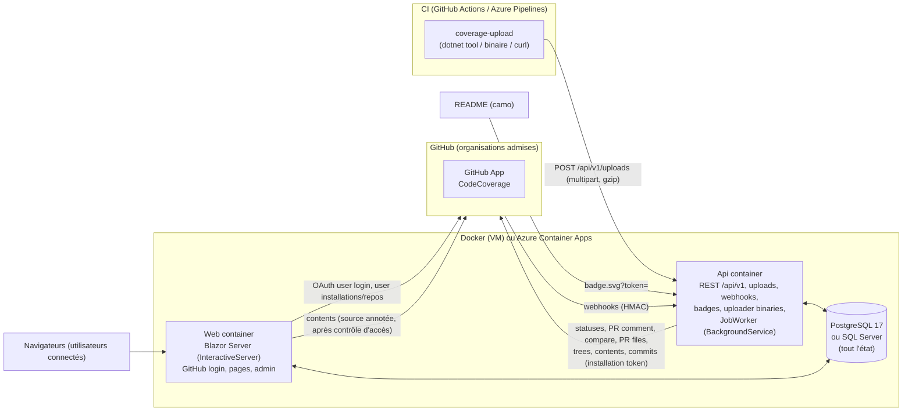

# Architecture : Codecov auto-hébergé

> **Produit :** `CodeCoverage`. **Dépôt :** `code-coverage`. **Destination :** `docs/ARCHITECTURE.md`.
> **Normes :** ce document applique `docs/CONVENTIONS.md` (§1 structure, §4 à §6 Domain/Application/Médiateur/Exceptions, §7 Mappers, §8 Infrastructure, §10 Api/OpenAPI, §11 Web, §12 Paramètres, §16.3 Lacunes). En cas de conflit, l'ordre de priorité donné en introduction de CONVENTIONS s'applique : les exigences utilisateur priment.
> **Base retenue :** l'architecture « MVP-first ». Elle intègre les meilleures idées des variantes « robustesse » et « parité Codecov », et corrige tous les défauts relevés par les juges.
> **Règle directrice :** un dépôt qui fonctionne aujourd'hui avec Codecov doit garder les mêmes `codecov.yml`, les mêmes noms de statuts après la bascule et les mêmes secrets (jetons importables). Côté pipeline, seule l'étape d'upload change. Toute différence de comportement avec Codecov est nommée, documentée et réglable.

---

## 1. Objectifs et périmètre

### 1.1 Objectif

Remplacer `codecov.io` par un service auto-hébergé et pouvoir résilier l'abonnement à la fin du MVP. Une même instance héberge plusieurs organisations, isolées les unes des autres (ADR-013). Le service ingère les rapports Cobertura, LCOV, OpenCover, JaCoCo et Clover produits par GitHub Actions et Azure Pipelines. Il publie sur GitHub des statuts de commit et un commentaire de PR, sert des badges SVG et affiche l'historique de couverture.

### 1.2 MVP : ce qui est livré avant la résiliation

| Besoin indispensable | Contenu du MVP | Reporté |
|---|---|---|
| **(1) Commentaire de PR** | Un seul commentaire par PR, mis à jour sur place. Il contient : couverture du patch (lignes ajoutées), delta projet par rapport à la base, tableau `diff`, tableau des flags, tableau des fichiers impactés (top N puis « … and N more »), et changements indirects calculés ligne à ligne. Clés supportées : `comment: false`, `layout` (sections `header`/`condensed_header`, `diff`, `flags`, `files`/`tree`, `footer`), `behavior` (`default`, `once`), `require_changes` (y compris les expressions `AND`/`OR`), `after_n_builds`, `hide_project_coverage`, `show_carryforward_flags`, `branches`. | `behavior: new`/`spammy`, sections `reach`/`components`/`sunburst`, annotations Checks API. |
| **(2) Statuts et seuils** | Statuts de commit GitHub `project`, `patch` et `changes` (désactivé par défaut, comme chez Codecov) : entrée `default`, entrées nommées, statuts définis par `flag_management`. Clés : `target`, `threshold`, `flags`, `paths`, `branches`, `only_pulls`/`base: pr`, `informational`, `if_not_found`, `if_ci_failed` (lu, sans effet), `removed_code_behavior` (`adjust_base`, `removals_only`, `fully_covered_patch`, `off`), `flag_coverage_not_uploaded_behavior`. Préfixe de contexte réglable (`coverage` pendant le pilote, `codecov` après la bascule). | Checks API (M5), `wait_for_ci`/`require_ci_to_pass` (M6). |
| **(3) Badges et historique** | Badges SVG/TXT par dépôt, branche et flag, avec des URL compatibles Codecov (`/gh/{owner}/{repo}/branch/{b}/graph/badge.svg?token=`). Jeton de badge pour les dépôts privés, avec import du « graphing token » Codecov. Graphique d'historique par branche et par flag. | Graphes `tree`/`sunburst`/`icicle`, import de l'historique Codecov (M5). |
| **(4) Monorepo et flags** | Plusieurs uploads par commit, une session par upload, fusion ligne à ligne, flags avec `paths`. Carryforward avec remontée d'au plus 10 ancêtres et décalage des numéros de ligne. `after_n_builds` global et par flag. Notification seulement quand tous les uploads sont traités, avec anti-rebond. | `component_management`, `carryforward_mode: labels`. |

Transverse MVP :
- un uploader `coverage-upload` (outil `dotnet tool`, plus binaires autonomes servis par l'Api) et une recette `curl` ;
- GitHub Actions et Azure Pipelines, y compris les clones superficiels (`fetchDepth: 1`) ;
- jetons d'upload organisation et dépôt, import des `CODECOV_TOKEN` existants, OIDC GitHub Actions ;
- connexion GitHub avec contrôle d'accès par dépôt ;
- plusieurs organisations sur une instance, admises une à une par un administrateur d'instance (ADR-013) ;
- paramètres stockés en base, rechargés à chaud et édités dans l'UI ;
- PostgreSQL et SQL Server ;
- source annotée (lignes couvertes, manquées ou partielles) lue en direct depuis GitHub.

### 1.3 Hors périmètre

Test analytics, bundle analysis, notifications Slack/Teams/e-mail, GraphQL, facturation et sièges. GitLab auto-hébergé et les versions serveur des forges restent hors portée.

L'identité, les adresses et le port principal sont indépendants de la forge (ADR-014), mais seul GitHub est implémenté avant la bascule. Azure DevOps Services, Bitbucket Cloud et GitLab.com sont des jalons ultérieurs (M7, M8 et M9).

### 1.4 Principes non négociables

1. **Le diff est toujours calculé côté serveur, via l'API de la forge.** L'historique git de l'agent CI n'est jamais lu, donc les clones superficiels ne gênent pas.
2. **Le SHA attribué est toujours celui de la tête de PR, jamais celui du commit de merge synthétique.** L'uploader le détecte, et le serveur corrige ce que l'uploader aurait manqué (§6.2).
3. **Formule Codecov exacte :** `coverage = hits / (hits + misses + partials)`.
4. **Aucun travail lourd dans une requête HTTP.** Uploads et webhooks sont mis en file, puis traités par le worker.
5. **L'outillage de couverture ne casse jamais un build.** L'uploader sort en code 0 sauf avec `--fail-on-error`.

---

## 2. Vue d'ensemble



| Composant | Rôle |
|---|---|
| **Api** (`CodeCoverage.Api`) | API REST `/api/v1`, endpoint d'upload, webhooks GitHub, badges, téléchargement de l'uploader, Swagger/Scalar. Héberge le **JobWorker** (file de jobs en base) et applique les migrations au démarrage. Joignable par GitHub, par les agents CI et par camo. |
| **Web** (`CodeCoverage.Web`) | UI Blazor Server. Exécute **en process** les mêmes commandes et requêtes de l'Application que l'Api, via le médiateur. Pas de worker, pas de migrations. Public, avec connexion GitHub (ADR-013). |
| **Base** | PostgreSQL 17 par défaut ; SQL Server 2022 et Azure SQL sont supportés. Elle contient tout l'état : rapports, uploads bruts (en morceaux), jobs, paramètres et clés Data Protection. |
| **GitHub App** | Une seule application publique, partagée par les organisations, installable par tout compte et inerte tant que ce compte n'est pas admis (ADR-013). Elle porte l'identité serveur (statuts, commentaires, diff, webhooks) et la connexion des utilisateurs (user-to-server tokens). |
| **Uploader** | `coverage-upload` : détecte le contexte CI, envoie `git ls-files` et les rapports bruts compressés. |

Il n'y a ni Redis, ni MinIO, ni TimescaleDB, ni Hangfire, ni SPA séparée. Le Web et l'Api sont publiés sur **deux noms d'hôte** (choisis au déploiement, par exemple `coverage.example.com` pour le Web et `coverage-api.example.com` pour l'Api). Aucun routage par chemin n'est nécessaire.

**Organisations (ADR-013) :** une organisation est un compte d'une forge, admis par un administrateur d'instance. Ses données sont isolées par une colonne `OrganizationId` sur les tables d'organisation (§4.2), et une portée DI n'entre dans une organisation que par la porte décrite au §3bis.2.

**Cycle de vie d'un upload :**
1. `POST /uploads` : authentification, puis stockage brut en morceaux et `Upload(Received)`. Le job `ProcessUpload` est mis en file et la réponse est 202.
2. `ProcessUpload` : parsing, correction des chemins, puis écriture du blob propre à l'upload. Le job `FinalizeCommit` est mis en file (fusionné s'il existe déjà).
3. `FinalizeCommit` : reconstruction déterministe des sessions (uploads et carryforward), fusion, totaux, totaux par flag, mise à jour de la tête couverte de la branche. Passage par `NotificationGate`.
4. `NotifyCommit`, avec anti-rebond : résolution de la base, diff, comparaison, statuts, puis commentaire.

---

## 3. Structure de la solution .NET

### 3.1 Arborescence

```text
CodeCoverage.slnx
CodeCoverage.sln.DotSettings
.editorconfig  GitVersion.yml  global.json (10.0.403)  .gitignore  .gitattributes  .dockerignore   (propres au dépôt)
AGENT.md  CLAUDE.md  README.md  docs/ARCHITECTURE.md  docs/CONVENTIONS.md  docs/adr/*.md  docs/migration-from-codecov.md
Dockerfile.api  Dockerfile.web  docker-compose.yml  Caddyfile.example
.github/workflows/ci-cd.yml
action/action.yml                              (composite GitHub Action, M5; <owner>/code-coverage/action@v1)
pipelines/templates/coverage-upload.yml        (template Azure Pipelines, M5)
src/
  Directory.Build.props  default.ruleset
  CodeCoverage.Domain/
  CodeCoverage.Application/
  CodeCoverage.Infrastructure/
  CodeCoverage.Infrastructure.PostgreSql/   (migrations + DesignTimeDbContextFactory + dialecte SQL de la file)
  CodeCoverage.Infrastructure.SqlServer/    (migrations + DesignTimeDbContextFactory + dialecte SQL de la file)
  CodeCoverage.Api/
  CodeCoverage.Web/
  CodeCoverage.Uploader/                    (dotnet tool "coverage-upload", autonome)
tests/
  Directory.Build.props
  CodeCoverage.Domain.Tests/
  CodeCoverage.Application.Tests/
  CodeCoverage.Infrastructure.Tests/
  CodeCoverage.Api.Tests/
  CodeCoverage.Web.Tests/
  CodeCoverage.Uploader.Tests/
  CodeCoverage.Architecture.Tests/
  fixtures/reports/{cobertura,opencover,lcov,jacoco,clover}/…    fixtures/github/…    fixtures/ci-env/…
```

### 3.2 Dépendances entre couches (vérifiées par Architecture.Tests)

| Projet | Références autorisées |
|---|---|
| Domain | aucune (BCL seulement, aucun package) |
| Application | Domain |
| Infrastructure | Application, Domain |
| Infrastructure.PostgreSql / .SqlServer | Infrastructure |
| Api | Application ; Infrastructure, PostgreSql et SqlServer **pour la composition uniquement** (`Program.cs`, `Configuration/*`) |
| Web | idem Api |
| Uploader | **aucun projet de la solution**. Son seul couplage avec le serveur est le contrat HTTP. |

Règles NetArchTest, maintenues au vert et jamais assouplies :
- dépendances de couches ;
- cas d'usage rangés dans `Features/{F}/{Commands|Queries}/{UseCase}/` ;
- handlers `internal sealed` ;
- ports du Domain sans `IQueryable`, sans unité de travail et avec `CancellationToken` obligatoire ;
- aucun type `*Dto` ;
- **aucun type de `CodeCoverage.Domain` référencé** par un type des namespaces `Api.*` ou `Web.*`, sauf `Api.Mapping`, `Web.Mapping`, `Program` et `Configuration`. Cela couvre les contrôleurs, contrats, rendus, composants Razor et ViewModels ;
- l'Uploader ne référence rien ;
- en-tête de fichier présent et région `Ctors` (jamais `Constructors`), contrôlés par un test texte.

### 3.3 Packages NuGet

Version majeure flottante, sans CPM (§2.9 des conventions).

| Projet | Packages |
|---|---|
| Domain | — |
| Application | `Mediator.Abstractions` **3.\***, `Mediator.SourceGenerator` **3.\*** (PrivateAssets all, voir §3.4), `FluentValidation` 12.\*, `FluentValidation.DependencyInjectionExtensions` 12.\*, `Microsoft.Extensions.Logging.Abstractions` 10.\*, `Microsoft.Extensions.DependencyInjection.Abstractions` 10.\*, `Microsoft.Extensions.Options` 10.\* |
| Infrastructure | `Microsoft.EntityFrameworkCore` / `.Relational` / `.SqlServer` 10.\*, `Npgsql.EntityFrameworkCore.PostgreSQL` 10.\* (10.0.1 relevée), `Microsoft.AspNetCore.DataProtection.EntityFrameworkCore` 10.\*, `Azure.Extensions.AspNetCore.DataProtection.Keys` 1.\* + `Azure.Identity` 1.\* (`ProtectKeysWithAzureKeyVault`, identité managée), `Microsoft.Extensions.Diagnostics.HealthChecks.EntityFrameworkCore` 10.\*, `Microsoft.Extensions.Http.Resilience` 10.\*, `Microsoft.Extensions.Options.ConfigurationExtensions` 10.\*, `Microsoft.IdentityModel.JsonWebTokens` 8.\* (JWT de l'App, validation OIDC), `Microsoft.IdentityModel.Protocols.OpenIdConnect` 8.\* (JWKS OIDC GitHub), `YamlDotNet` 16.\*, `Npgsql` / `Microsoft.Data.SqlClient` (transitifs, utilisés en ADO.NET brut par le provider de paramètres) |
| Infrastructure.PostgreSql / .SqlServer | `Microsoft.EntityFrameworkCore.Design` 10.\* (PrivateAssets all) |
| Api | `Swashbuckle.AspNetCore` 10.\*, `Scalar.AspNetCore` 2.\*, `Serilog.AspNetCore` 10.\*, `Serilog.Sinks.Console` 6.\*, `Serilog.Sinks.File` 7.\*, `Serilog.Formatting.Compact` 3.\*, `Serilog.Enrichers.Environment` 3.\*, `Serilog.Enrichers.Thread` 4.\*, `OpenTelemetry.Extensions.Hosting` 1.\* + `OpenTelemetry.Instrumentation.AspNetCore` / `.Http` 1.\* + `OpenTelemetry.Exporter.OpenTelemetryProtocol` 1.\* |
| Web | (aucune librairie UI : composants maison `Web/Components/Ui`), `AspNet.Security.OAuth.GitHub` 10.\*, même lot Serilog et OpenTelemetry |
| Uploader | `System.CommandLine` 2.0.\*. Rien d'autre : `HttpClient`, `GZipStream` et `System.Text.Json` (source-gen) de la BCL. |
| Tests | Lot §2.9 des conventions (`xunit.v3` 3.2.\*, `Shouldly` 4.3.\*, `FakeItEasy` 9.0.\*, `Microsoft.NET.Test.Sdk` 18.\*), `NetArchTest.Rules` 1.3.\*, `Microsoft.CodeAnalysis.CSharp` 5.0.\* (Architecture.Tests : règles de conventions de source, **tests seulement**), `Microsoft.AspNetCore.Mvc.Testing` 10.\*, `Testcontainers.PostgreSql` / `.MsSql` 4.\*, `WireMock.Net.Minimal` 2.\*, `Verify.XunitV3` 31.\*, `bunit` 2.\*, `ReportGenerator.Core` 5.\* (oracle de totaux, **tests seulement**) |

**Écartés volontairement :**
- MediatR ;
- Octokit et Octokit.Webhooks. Une quinzaine d'endpoints passe par un `HttpClient` typé avec des records `System.Text.Json` générés, ce qui donne le contrôle exact de la pagination, du champ `patch` et des en-têtes de rate limit ;
- AutoMapper, Mapster, Mapperly ;
- Hangfire, Redis, DiffPlex ;
- ReportGenerator à l'exécution ;
- `WireMock.Net` 1.\*, dont les dépendances (`Scriban.Signed` 5.5.0, `OpenTelemetry` 1.14) portent des avis de sécurité critiques : les tests emploient `WireMock.Net.Minimal` 2.\*.

### 3.4 Médiateur : martinothamar `Mediator` 3.x (ADR-001)

API vérifiée sur le README v3 :

```csharp
// Messages
public sealed record ProcessUploadCommand(long UploadId) : ICommand<Unit>;
public sealed record GetCommitQuery(string Owner, string Name, string Sha) : IQuery<Commit>;

// Handler (nom et retour imposés par la bibliothèque : Handle / ValueTask)
internal sealed class GetCommitQueryHandler(ICommitRepository commits) : IQueryHandler<GetCommitQuery, Commit>
{
  #region Implementation of IQueryHandler<GetCommitQuery,Commit>
  /// <inheritdoc />
  public async ValueTask<Commit> Handle(GetCommitQuery query, CancellationToken cancellationToken) { … }
  #endregion
}

// Behavior (ordre des paramètres v3 : message, next, cancellationToken)
internal sealed class ValidationBehavior<TMessage, TResponse>(IEnumerable<IValidator<TMessage>> validators)
  : IPipelineBehavior<TMessage, TResponse> where TMessage : IMessage
{
  public async ValueTask<TResponse> Handle(
    TMessage message, MessageHandlerDelegate<TMessage, TResponse> next, CancellationToken cancellationToken)
  { /* … throw ValidationException (400) */ return await next(message, cancellationToken).ConfigureAwait(false); }
}
```

Enregistrement dans `Application/DependencyInjection.AddApplication()` :

```csharp
services.AddMediator((MediatorOptions o) =>
{
  o.Namespace = "CodeCoverage.Application.Messaging";
  o.ServiceLifetime = ServiceLifetime.Scoped;              // DbContext scoped
  o.GenerateTypesAsInternal = true;
  o.PipelineBehaviors = [typeof(LoggingBehavior<,>), typeof(AuthorizationBehavior<,>), typeof(ValidationBehavior<,>)];
});
services.AddValidatorsFromAssembly(typeof(DependencyInjection).Assembly, includeInternalTypes: true);
```

- **Le générateur de source est référencé uniquement par Application.** C'est le seul projet qui le référence dans chaque artefact déployé (Api et Web), ce qui respecte la consigne du README : « ne pas l'installer dans chaque couche ».
  - Le code généré voit les handlers `internal sealed` sans `InternalsVisibleTo`.
  - Application.Tests dispose aussi d'un médiateur généré.
  - Un test de compilation dans Application.Tests fige la signature `IPipelineBehavior`.
  - Un spike M0 valide le montage ; le repli documenté consiste à référencer le générateur dans Api et Web avec `InternalsVisibleTo`.
- **Écart assumé, acté par l'ADR :** la méthode s'appelle `Handle` et renvoie `ValueTask`, au lieu de `HandleAsync`, parce que le nom est imposé par le framework. Les actions de contrôleur gardent le suffixe `Async` (`GetAsync`, `CreateAsync`).
- **Appelants :**
  - l'Api injecte `ISender` ;
  - le Web injecte `ScopedSender` (un scope DI par requête), enveloppé par `UiRequestRunner` ;
  - le worker utilise `ISender` dans un scope créé pour chaque job.
- **Événements de domaine :** il n'y en a pas dans le MVP. Les enchaînements passent par la file de jobs, mise en file dans la même transaction que la modification (méthode de repository unique). `IDomainEvent` et `IHasDomainEvents` sont créés dans le Domain pour l'avenir.

---

## 3bis. Domain, Application, mappers

### 3bis.1 Domain (`CodeCoverage.Domain`)

Le Domain est rangé par feature, avec `Ports/` et `Contracts/` séparés. Les entités suivent les conventions :
- `sealed`, constructeur privé dans `#region Ctors`, fabrique statique qui vérifie les invariants ;
- propriétés `{ get; private set; }`, collections exposées en `IReadOnlyList<T>`.

Tout le calcul de couverture est **pur et synchrone**, sans dépendance à `System.Net`, `System.IO.Compression` ou `Microsoft.*`.

```text
Ports/
  IRepositoryRepository, IInstallationRepository, IBranchRepository, IGitCommitRepository, ICommitRepository,
  IUploadRepository, ICommitReportRepository, IPullRequestRepository, IComparisonRepository, IPostedStatusRepository,
  ICommitConfigRepository, IUploadTokenRepository, IApiTokenRepository, IUserRepository, IUserRepositoryAccessRepository,
  IWebhookDeliveryRepository, IJobQueue, IJobMonitor, IRawUploadStore, IReportParserCatalog, IReportParser,
  ICoverageReportCodec, ICoverageConfigParser, IGitHubAppGateway, IGitHubUserGateway, IOidcTokenValidator,
  ISecretProtector, ITokenHasher, ISettingsStore, ICurrentUser, IClock, IAuditLog, ICurrentOrganization, IOrganizationScope,
  IOrganizationDirectory, IOrganizationSettingsProvider, IOrganizationSettingRepository, IOrganizationMembershipRepository,
  IOrganizationRoleResolver, IForgeGateway, IForgeGatewayProvider
Contracts/
  GitHub/   GitHubRepositoryInfo, GitHubCommitInfo (Sha, ParentShas, Message, AuthorLogin, CommittedAt),
            GitHubCompareResult (MergeBaseSha, AheadBy, BehindBy, Files, Truncated), GitHubChangedFile (Path, PreviousPath,
            Status, Patch?), GitHubPullInfo, GitHubTreeEntry (Path, BlobSha), GitHubUser, GitHubInstallationInfo,
            GitHubWebhookEvent (Event, Action, DeliveryId, payload fields)
  Uploads/  UploadPart (Kind Report|Network, FileName, Stream Content), UploadCredential (VO, redacted ToString),
            UploadMetadata (Slug, Sha, Branch, PullNumber, ParentSha, Flags, Name, Ci, Root, UploaderVersion), CiContext
  Jobs/     JobRequest (Create, ForInstance, ForOrganization ; Type, LockKey, DedupKey?, PayloadJson, RunAfter, Coalesce, MaxDelay?)
  Identity/ GitHubOidcIdentity (Repository, RepositoryId, RepositoryOwner, Ref, EventName)
Coverage/      LineCoverage, LineKind, LineState, FileCoverage, CoverageReport, CoverageTotals, ParsedReport, ParsedFile,
               ReportFormat, CoverageMath, ReportMerger, ReportView (filtrage flags + paths)
Paths/         PathFixer, PathFixContext, PathFixResult, NetworkIndex, PathPattern, PathPatternSet, FixRule
Diffs/         FileDiff, FileDiffStatus, Hunk, UnifiedDiffParser, LineShifter, DiffSet (Complete/Truncated, Source)
Organizations/ Organization, OrganizationState, OrganizationAccountType, OrganizationRole, SuspensionReason, Forge, ReservedLogins
Repositories/  TrackedRepository, Installation, Branch, RepositorySlug (VO : "owner/repo" et "owner::::repo")
Commits/       Commit, CommitState, GitCommit, Session, SessionKind, Upload, UploadState, ProcessingLog, CommitFlagTotals,
               CarryforwardBuilder, CarryforwardPlan
Comparisons/   BaseResolution, Comparison, PatchCoverage, ImpactedFile, IndirectChange, ChangeDetector, FlagComparison,
               ComparisonCalculator
Config/        CoverageConfig, ConfigNode, ConfigNodeKind, ConfigPatterns, ConfigMerger, CoverageConfigDefaults, StatusRule, StatusType, Target,
               FlagRule, CommentRule, CommentSection, RequireChangesExpression, NotifyRule, ParserRule, CoverageRange,
               RoundingMode, RemovedCodeBehavior, NotUploadedBehavior, ConfigWarning
Notifications/ StatusEvaluator, CommitStatus (Context, State, Description), StatusState, PostedStatus, NotificationDecision,
               NotificationGate, CommentDecision
Badges/        Badge (Coverage?, Color), BadgeColorScale
PullRequests/  PullRequest, PullRequestState
Tokens/        UploadToken, UploadTokenScope, IssuedToken (valeur en clair, renvoyée une seule fois), ApiToken
Users/         AppUser, RepositoryPermission, RepositoryAccess
History/       CoveragePoint, CoverageSeries, HistoryEntry, HistoryInterval (read models)
Operations/    JobSummary, WebhookDeliverySummary, SystemStatus      (read models pour l'admin)
Source/        AnnotatedSource, AnnotatedLine                        (read model de la source annotée)
Settings/      SettingDefinition, SettingDefinitions (catalogue), SettingValue, SettingSource, SettingScope,
               OrganizationSettingsSnapshot
IDomainEvent.cs, IHasDomainEvents.cs
```

Remarques :
- Les **read models** (`CoveragePoint`, `JobSummary`, `AnnotatedSource`, `FileTotals` intégré à `CoverageReport`) sont des types du Domain, comme le prévoit §4.3 des conventions. Aucune requête ne renvoie de type défini dans l'Application.
- `UploadCredential` est un value object. Il porte le type du jeton (`UploadToken`, `Jwt`) et la valeur. `ToString()` renvoie `"cvc_ab12…(redacted)"`, et la valeur n'est jamais sérialisée (voir LoggingBehavior).

### 3bis.2 Application (`CodeCoverage.Application`)

```text
Behaviors/   LoggingBehavior, AuthorizationBehavior, ValidationBehavior
Exceptions/  ApplicationException, BadRequestException, ValidationException, UnauthorizedException, ForbiddenException,
             NotFoundException, ConflictException, UnprocessableEntityException, BadGatewayException,
             RetryLaterException (interne au worker, jamais exposée en HTTP), ErrorCodes/GeneralErrors.cs
Security/    IRepositoryScoped (Forge, Owner, Name, RequiredPermission), IOrganizationScoped (Forge, Login, RequiredRole),
             IPublicOwnerAddressed (Forge, Owner), IAnonymousEntry, IUserScoped, IAdminOnly, ISystemOnly, SecurityErrors
Services/    UploadAuthenticator, CommitMerger, BaseResolver, DiffProvider, ComparisonBuilder, CommentComposer,
             NotificationService, ConfigResolver, BranchHeadTracker
Features/    (tableau ci-dessous)
DependencyInjection.cs
```

**Behaviors**, appliqués dans l'ordre Logging, puis Authorization, puis Validation (§5.6 et §5.7 des conventions) :

- **`LoggingBehavior`**
  - Journalise le nom du type de message, la durée, le résultat et l'`ErrorCode` éventuel.
  - **Ne sérialise jamais le message.** Ni le jeton, ni le flux d'upload ne peuvent donc fuir.
  - Niveaux : `Warning` pour un refus `ApplicationException`, `Error` pour le reste.
- **`AuthorizationBehavior`**
  - **Porte d'entrée dans une organisation (ADR-013).** Elle s'exécute à chaque envoi, avant les validateurs : l'owner reçu est donc brut, et un owner nul ou mal formé ne produit qu'une entrée refusée, jamais une erreur serveur.
  - **Marqueurs.** `MessageMarkerTests` exige que chaque message de l'Application déclare exactement un marqueur d'accès de `Application/Security` :

    | Marqueur | Entrée dans l'organisation | Refus |
    |---|---|---|
    | `IRepositoryScoped` | par `IOrganizationScope`, à partir de ce qui précède le premier `:` de l'owner | `NotFoundException(Repository.NotFound)` |
    | `IOrganizationScoped` | par `IOrganizationScope`, à partir du login | `NotFoundException(Organization.NotFound)` |
    | `IPublicOwnerAddressed` | si l'organisation est `Active` ; sinon la portée reste non posée | aucun ici : le handler authentifie le credential |
    | `IAnonymousEntry` | aucune | aucun |
    | `IUserScoped` | aucune | `UnauthorizedException(Access.Unauthenticated)` sans utilisateur connecté |
    | `IAdminOnly` | aucune : une lecture filtrée y lève | `UnauthorizedException(Access.Unauthenticated)`, puis `ForbiddenException(Access.Forbidden)` |
    | `ISystemOnly` | celle du job | `ForbiddenException(Access.Forbidden)` pour tout autre expéditeur |

  - **Contrôle d'accès (M3.04).** Après l'entrée, un message `IRepositoryScoped` exige un utilisateur connecté et un dépôt suivi et actif, puis `IRepositoryAccessService.CanAsync(user, repo, permission)` décide : sans droit de lecture, le behavior lève `NotFoundException(Repository.NotFound)`, avec le même message quelle que soit la cause (organisation inconnue ou non active, dépôt inconnu ou inactif, anonyme, aucun droit), pour ne pas révéler l'existence d'un dépôt privé ; sans la permission demandée (`Write` satisfaite par `Write` ou `Admin`), il lève `ForbiddenException`. Un message `IOrganizationScoped` exige un rôle (`IOrganizationRoleResolver`) : sans rôle, `NotFoundException(Organization.NotFound)` ; un participant face à un message d'administrateur, `ForbiddenException`. L'administrateur d'instance n'a aucun passe-droit.
  - **Principal système :** le worker, donc aussi le traitement des webhooks, s'exécute avec `ICurrentUser.IsSystem = true`. Ce principal passe tous les contrôles et garde la portée du job : le behavior n'y entre dans aucune organisation. `CurrentUserContext.SetSystem` est `internal` : les hôtes HTTP ne peuvent jamais produire ce principal (`SetSystem_ShouldNeverBeVisibleFromTheHosts`). La seule exception est la CLI d'administration, qui n'est pas une requête HTTP : `AdminCommandLine` (`dotnet CodeCoverage.Api.dll admin …`, M1.23) exécute une liste nommée de commandes par `SystemCommandRunner` (M1.22a), et `Source_SystemCommandRunner_ShouldStayInAdminCommandLine` réserve ce type à ce fichier. Ce que la CLI exécute est audité sous l'acteur `[command-line]`, distinct du `[system]` des jobs. Une valeur importée est lue sur l'entrée standard, jamais dans un argument, et n'est jamais réécrite.
  - Les commandes d'upload sont `IPublicOwnerAddressed`, et non `IRepositoryScoped`. Leur identifiant est vérifié par `UploadAuthenticator` dans le handler.
- **`ValidationBehavior`** : FluentValidation 12. En cas d'échec, lève `ValidationException` (400, `General.ValidationFailed`, erreurs groupées par propriété).

**Une seule porte (ADR-013).** Une portée DI n'entre dans une organisation que par l'un de ces chemins, et une seule fois : `OrganizationContext.Enter` est sans effet pour la même organisation et lève pour une autre.

| Chemin | Source de l'organisation | État |
|---|---|---|
| `AuthorizationBehavior`, par `IOrganizationScope.TryEnterAsync` (organisations `Active` seulement) | forge et login portés par le message | livré |
| `JobWorker`, par `OrganizationContext.Enter` | colonne `Jobs.OrganizationId`, jamais le payload | livré |
| `SystemCommandRunner` (CLI d'administration) | organisation facultative du verbe d'administration | M1.22a |

`OrganizationIsolationTests` réserve `IOrganizationScope` à `AuthorizationBehavior` et interdit `IgnoreQueryFilters` sans exception. Aucune règle de build ne couvre en revanche les appelants d'`OrganizationContext.Enter`, employé par `OrganizationScope` et `JobWorker` : `internal` les tient hors de l'Application et des hôtes, mais rien n'empêcherait un autre appelant dans l'Infrastructure. Ce risque résiduel est consigné dans ADR-013.

**Exceptions (§6 des conventions)**

| Exception | HTTP | Usage |
|---|---|---|
| `ValidationException`, `BadRequestException` | 400 | Échec de validation, requête incohérente |
| `UnauthorizedException` | 401 | Jeton d'upload ou API absent ou invalide, utilisateur non connecté |
| `ForbiddenException` | 403 | Jeton non valable pour ce dépôt, rôle d'administrateur manquant |
| `NotFoundException` | 404 | Dépôt, commit ou upload inconnu (ou masqué) |
| `ConflictException` | 409 | Concurrence (`Version`), écriture d'une table d'organisation qui n'a touché aucune ligne (`General.ConcurrentChange`, §4.2), job non relançable |
| `UnprocessableEntityException` | 422 | Règle métier ou « BusinessRule » : dépôt désactivé, paramètre fourni par l'environnement, commit compacté |
| `BadGatewayException` | 502 | GitHub indisponible (5xx, timeout) |

Les codes d'erreur suivent le format `Feature.Reason` et sont rangés dans `Features/{F}/{F}Errors.cs` et `Exceptions/ErrorCodes/GeneralErrors.cs`. Le Web les traduit dans `Common.resx`.

**Features et cas d'usage**

| Feature | Commands | Queries |
|---|---|---|
| Uploads | `ReceiveUpload`, `ProcessUpload`, `CompleteUploads` (déclenchement manuel), `RetryUpload` | `AuthorizeUpload` (pré-contrôle avant lecture du corps), `GetUpload`, `ListCommitUploads` |
| Commits | `FinalizeCommit`, `ReprocessCommit` | `GetCommit`, `ListCommits`, `GetCommitFiles`, `GetFileCoverage`, `GetAnnotatedSource` |
| Notifications | `NotifyCommit`, `TriggerNotify` (re-notification manuelle), `SweepPendingCommits` | — |
| PullRequests | `SyncPullRequest` | `ListPullRequests`, `GetPullRequestComparison` |
| Comparisons | — | `CompareCommits` (base/head arbitraires) |
| GitHubEvents | `ReceiveWebhook` (enregistrement et mise en file), `HandleWebhookDelivery` (dans le worker), `SyncInstallations` (coordinateur), `SyncInstallationRepositories`, `ReconcileRepositoryTransfer` | — |
| Repositories | `ActivateRepository`, `DeactivateRepository`, `RotateBadgeToken`, `ImportBadgeToken` | `ListRepositories`, `GetRepository`, `ListBranches`, `GetEffectiveConfig`, `GetCoverageHistory`, `GetBadge` |
| Configuration | — | `ValidateCoverageYaml` |
| UploadTokens | `CreateUploadToken` (génération ou import d'une valeur `CODECOV_TOKEN`), `RevokeUploadToken` | `ListUploadTokens` |
| Access | `SignInUser`, `RefreshUserAccess`, `CreateApiToken`, `RevokeApiToken` | `GetCurrentUser`, `ListApiTokens` |
| Settings | `UpdateSetting`, `ReplaceSecret`, `ResetSetting`, `CompleteGitHubAppManifest`, `CompleteSetup` | `GetSettings`, `GetSetupState` |
| Operations | `RetryJob`, `PurgeExpiredData` | `ListJobs`, `ListWebhookDeliveries`, `GetSystemStatus` |

Retours : objet du Domain, `IReadOnlyList<T>` du Domain, `Unit` ou identifiant. Il n'y a ni DTO ni `Result<T>`.

### 3bis.3 Mappers

- **Api (`Api/Mapping/{Feature}Mapper.cs`, `internal static`)** :
  - `Request` vers `Command`/`Query` : `ToCommand`, `ToQuery` ;
  - Domain vers `Response` : `ToResponse`, `ToResponses` ;
  - contrats dans `Api/Contracts/` : `{Verb}{Thing}Request`, `{Thing}Response`, `{Thing}PageResponse`, `{Thing}Model` (records positionnels documentés).
  - Le badge suit le même chemin : `GetBadgeQuery` renvoie `Badge`, `ToResponse()` produit `BadgeResponse`, puis `BadgeSvgRenderer` (namespace `Api.Rendering`) dessine à partir de `BadgeResponse`.
- **Web (`Web/Mapping/{Feature}Mapper.cs`)** :
  - Domain vers `ViewModel` : `ToViewModel`, `ToViewModels` ;
  - `ViewModel` de formulaire vers `Command` : `ToCommand`.
  - Les ViewModels sont dans `Web/ViewModels/{Feature}/{Thing}ViewModel.cs`.
- Le `CommentComposer` (Application) produit du markdown GitHub à partir de la `Comparison`. C'est une sortie technique vers GitHub, pas une vue.

---

## 4. Modèle de données

### 4.1 Règles communes (un seul modèle EF Core 10 pour les deux fournisseurs)

- **Clés :** `bigint` identity (`GENERATED BY DEFAULT AS IDENTITY` / `IDENTITY(1,1)`). Elles sont séquentielles et sans fragmentation sur les deux fournisseurs, contrairement à un `Guid` v7 sous SQL Server. Les identifiants publics sont `Uploads.PublicId uuid`, et les identités naturelles `owner/name`, `sha` et numéro de PR.
- **Dates :** `DateTimeOffset` UTC.
- **Énumérations :** stockées en texte (`HasConversion<string>()`).
- **Blobs :** `byte[]` (`bytea` / `varbinary(max)`).
- **Listes :** les petites listes (`Flags`, `ParentShas`) sont des colonnes JSON texte avec un value converter System.Text.Json, ce qui reste neutre vis-à-vis du fournisseur.
- **Concurrence optimiste :** colonne `Version int` gérée par l'application, portable, sur `Repositories`, `Commits`, `PullRequests`, `Branches` et `Users`.
- **Chemins :** aucun chemin de fichier n'est clé d'index. Les données par fichier vivent dans des blobs, ce qui évite la limite de 1700 octets des clés SQL Server.
- **Transactions :** chaque changement métier correspond à une méthode de repository dans une transaction, mise en file du job comprise (pattern outbox intégré).
- **Sous SQL Server :** `READ_COMMITTED_SNAPSHOT ON` est exigé et vérifié par le health check `ready`.
- Index uniques filtrés : PostgreSQL `WHERE "State" = 'Queued'`, SQL Server `WHERE [State] = 'Queued'`. Le filtre est écrit dans chaque assembly de migrations.

### 4.2 Tables

**Classement des 32 tables (ADR-013).** Chaque table du modèle appartient à une seule classe, listée dans `TableClassification`. `Model_EveryEntity_ShouldBeClassifiedOnce` fait échouer le build pour une table non classée.

| Classe | Tables |
|---|---|
| **D'organisation, filtrées (22)** | `Repositories`, `RepositoryFlags`, `Branches`, `GitCommits`, `Commits`, `CommitFlagTotals`, `PullRequests`, `CommitConfigs`, `DiffCache`, `RepositoryTrees`, `Uploads`, `CommitSessions`, `CommitReports`, `Comparisons`, `PostedStatuses`, `UploadRawFiles`, `UploadRawChunks`, `UploadCoverages`, `UploadTokens`, `UserRepositoryAccess`, `OrganizationSettings`, `CodecovImports` (à partir de M5.06) |
| **Opérationnelles, sans filtre (5)** | `Jobs`, `AuditEntries`, `WebhookDeliveries` (`OrganizationId` nullable) ; `WorkerHeartbeats`, `GitHubQuotas` (sans colonne d'organisation, M3.13a) |
| **Globales, sans donnée métier (8)** | `Organizations`, `Installations`, `OrganizationMemberships`, `Users`, `ApiTokens`, `Settings`, `SettingsRevision`, `DataProtectionKeys` |

**État à ce jour.** Ce classement et le tableau des colonnes décrivent le modèle cible. Seules `Organizations`, `OrganizationSettings`, `Jobs`, `AuditEntries`, `Settings`, `SettingsRevision` et `DataProtectionKeys` existent en base, et `TableClassification` ne liste que celles-là : chaque micro-feature y ajoute ses tables (M1.17 pour `Repositories`, `Branches` et `Installations`).

**Isolation par construction.** Ces règles sont prouvées sur PostgreSQL et SQL Server par `Infrastructure.Tests/Persistence/Organizations`, sur `OrganizationSettings`, seule table d'organisation à ce jour.

- **Filtre.** `IsOrganizationOwned` ajoute la colonne fantôme `OrganizationId` non nulle et marque l'entité, et `OnModelCreating` installe dans une boucle l'unique filtre nommé `Organization`. Il couvre les requêtes, `ExecuteUpdate` et `ExecuteDelete`, lit l'organisation du contexte à chaque requête et lève si la portée n'en a pas : il n'a aucune clause pour le principal système.
- **Estampille et garde.** `SaveChanges` et `SaveChangesAsync` estampillent une ligne ajoutée et lèvent `InvalidOperationException`, sans rien écrire, sur une ligne modifiée, supprimée ou ajoutée au nom d'une autre organisation. La colonne fantôme ne voyage pas avec une instance : une ligne d'organisation doit être lue par le contexte qui l'écrit.
- **Jeton de concurrence.** `IsOrganizationOwned` fait aussi de la colonne un jeton de concurrence : chaque `UPDATE` et chaque `DELETE` d'une sauvegarde la porte dans son `WHERE`, à côté de la clé primaire. Une instance dont la colonne a été écrite à la main passe la garde, mais n'atteint aucune ligne d'une autre organisation.
- **Refus.** Une instruction d'une table d'organisation qui n'affecte aucune ligne lève `ConflictException` (`General.ConcurrentChange`, 409), que le worker rejoue. Le message est le même pour une ligne supprimée entre-temps, une clé inconnue et une clé d'une autre organisation, que la base ne distingue pas. `Organizations`, table globale, garde `DbUpdateConcurrencyException` pour la reprise de son upsert.
- **Clés étrangères.** Seules `Repositories`, `UploadTokens`, `OrganizationSettings` et `UserRepositoryAccess`, dont l'index unique commence par `OrganizationId`, ont une clé étrangère vers `Organizations`. Les clés étrangères composites ne sont pas utilisées.

La colonne `OrganizationId` n'est pas répétée dans le tableau ci-dessous pour les tables d'organisation.

| Table | Colonnes principales (PK en gras) | Index et remarques |
|---|---|---|
| **Organizations** | **Id**, Forge, ExternalAccountId (texte, ≤ 40, en minuscules), Login (≤ 255), NormalizedLogin, AccountType, State (`Pending`, `Active`, `Suspended`), SuspensionReason?, AdmittedBy?, CreatedAt, UpdatedAt, Version | UX(Forge, ExternalAccountId) ; UX(Forge, NormalizedLogin), sans filtre. Un login repris par un autre compte de la même forge devient `~stale-{ExternalAccountId}` sur l'ancienne ligne. |
| **OrganizationMemberships** | **Id**, UserId, OrganizationId, Role (`Participant`, `Admin`), RefreshedAt | UX(OrganizationId, UserId) : il sert aussi la clé étrangère vers l'organisation. Une ligne plus ancienne que `Access:HardExpiryMinutes` n'accorde rien. |
| **OrganizationSettings** | **Id**, Key, Value, UpdatedAt, UpdatedBy | UX(OrganizationId, Key). Valeurs des 4 clés de portée `Organization` (§4bis.1). |
| **Installations** | **Id** (id d'installation GitHub, bigint), OrganizationId FK, AccountType, SuspendedAt?, CreatedAt, UpdatedAt | Table propre à GitHub (ADR-014). Le login du compte est dans `Organizations`. |
| **Repositories** | **Id**, ExternalId (texte), InstallationId FK, Namespace (≤ 512, chaîne vide hors projet Azure DevOps et sous-groupes GitLab), NormalizedNamespace, Owner, Name, NormalizedName, DefaultBranch, IsPrivate, IsActive (servi par l'installation), DisabledAt? (désactivé par un administrateur, M3.07 ; jamais touché par la synchronisation ni les webhooks ; « suivi » = `IsActive && DisabledAt is null`), TransferredAt? (ligne close par un transfert, §8.3), BadgeTokenProtected (Data Protection, affichable dans le snippet README), DefaultBranchYaml?, DefaultBranchYamlSha?, CreatedAt, UpdatedAt, Version | UX(OrganizationId, ExternalId) ; UX(OrganizationId, NormalizedNamespace, NormalizedName). Owner et Name sont mis à jour lors d'un renommage ; ExternalId reste l'identité stable. Owner n'est qu'une copie d'affichage, jamais employée pour résoudre, autoriser ou appeler la forge. |
| **Branches** | **RepositoryId, Name**, HeadSha, HeadUpdatedAt, CoveredCommitId? (FK Commits), CoveredAt?, Version | Source des badges et de la vue « dernier état ». La FK de `CoveredCommitId` est posée par la migration qui crée `Commits`. |
| **GitCommits** | **RepositoryId, Sha** char(40), ParentShas (json), Message (≤ 1000), AuthorLogin, CommittedAt (date committer GitHub), FetchedAt | Cache immuable des métadonnées GitHub, rempli par `GET /commits?sha=X&per_page=50` (une chaîne d'ancêtres par appel). |
| **Commits** | **Id**, RepositoryId, Sha, Branch?, PullNumber?, State (`Known`, `Pending`, `Complete`, `Error`, `Compacted`), UploadSequence int, Files, Lines, Hits, Misses, Partials, Branches, Methods, Coverage decimal(9,5)?, SessionCount, UploadedSessionCount, ReportRevision, CarryforwardStatus (`None`, `Applied`, `AncestorPending`, `NotFound`), ConfigSource (chaîne libre : `Source` de `CommitConfigs`, ou `codecov-import`), LastUploadAt?, CompletedAt?, NotifiedAt?, CreatedAt, UpdatedAt, Version | UX(RepositoryId, Sha) ; IX(RepositoryId, Branch, CompletedAt). `Known` désigne un commit vu par webhook, sans upload. |
| **Uploads** | **Id**, PublicId uuid, CommitId, Sequence int (numéro de session stable), IdempotencyKey varchar(128), State (`Received`, `Processing`, `Processed`, `Failed`), Flags (json), Name?, CiService?, BuildId?, JobId?, BuildUrl?, RepoRoot?, UploaderVersion?, TokenId?, PrincipalKind (`RepositoryToken`, `OrganizationToken`, `GitHubOidc`), ReportFileCount, ResolvedFileCount, UnresolvedFileCount, Lines, Hits, Misses, Partials, ErrorCode?, Error?, ProcessingLog (json, plafonné à 64 Ko), ReceivedAt, ProcessedAt?, LockedBy? | UX(PublicId) ; UX(CommitId, IdempotencyKey) ; IX(CommitId, State) |
| **UploadRawFiles** | **Id**, UploadPublicId, Kind (`Report`, `Network`), FileName, DetectedFormat?, Sha256 binary(32), CompressedSize, UncompressedSize, ExpiresAt | IX(UploadPublicId), IX(ExpiresAt). Le brut est écrit avant la ligne `Uploads` (§5.1, étapes 5 et 6) : il la désigne par `Upload.PublicId`, sans clé étrangère, et `ExpiresAt` purge le brut d'un upload jamais enregistré. |
| **UploadRawChunks** | **RawFileId, ChunkIndex**, Data (gzip, ≤ 1 Mo) | Upload brut écrit en flux, morceau par morceau. Pas de matérialisation de 200 Mo, et la limite `bytea` de 1 Go n'est jamais approchée. |
| **UploadCoverages** | **UploadId** PK/FK, Codec tinyint, Data (blob CCR1 de l'upload, chemins corrigés, `ignore` appliqué) | Écrit uniquement par le `ProcessUpload` de cet upload : parallélisme sans conflit. |
| **CommitSessions** | **Id**, CommitId, Kind (`Uploaded`, `CarriedForward`), Number int, UploadId?, CarriedForwardFromSha?, SourceSessionId?, DataUploadId?, Data? (blob CCR1 si la session reportée a été décalée), Flags (json), Name?, CiService?, BuildUrl?, Lines, Hits, Misses, Partials, Coverage? | IX(CommitId). Supprimées et réécrites à chaque finalisation. Une session reportée **non décalée** référence le blob d'origine via `DataUploadId` : pas de copie. |
| **CommitReports** | **CommitId** PK/FK, Revision, Codec tinyint, Data (rapport fusionné toutes sessions, sans détail par session), FileIndex (blob : chemin vers lignes, hits, misses, partials) | `FileIndex` permet de lister les fichiers sans décoder les lignes. |
| **CommitFlagTotals** | **CommitId, Flag** (`''` = projet), RepositoryId, Branch, CompletedAt (dénormalisés), Lines, Hits, Misses, Partials, Coverage?, IsCarriedForward, CarriedForwardFromSha? | IX(RepositoryId, Branch, Flag, CompletedAt) : historique et badges par flag. `Flag` est limité à 446 caractères (Codecov : 1024), plafond d'une clé cluster SQL Server de 900 octets ; écart non configurable. `Flag` est sensible à la casse comme sur Codecov : collation `Latin1_General_100_BIN2` sur SQL Server ; sur PostgreSQL, la collation par défaut est déterministe, donc l'égalité y est exacte, mais son `ORDER BY` suit la locale. |
| **PullRequests** | **Id**, RepositoryId, Number, State (`Open`, `Closed`, `Merged`), Title, AuthorLogin, HeadSha, HeadBranch, BaseBranch, BaseShaGitHub, ForkPointSha?, ComparedToSha?, CommentId bigint?, CommentBodyHash binary(32)?, CommentedHeadSha?, UpdatedAt, Version | UX(RepositoryId, Number) ; IX(RepositoryId, HeadSha) ; IX(RepositoryId, ForkPointSha) |
| **Comparisons** | **Id**, CommitId, PullNumber (0 pour un build de push : les deux moteurs ne traitent pas un null de la même façon dans un index unique), ForkPointSha?, ComparedToSha?, HeadRevision, BaseRevision?, HeadCoverage?, BaseCoverage?, PatchLines, PatchHits, PatchMisses, PatchPartials, IndirectChangeCount, DiffSource (`PullFiles`, `Compare`), DiffIncomplete, Data (blob : fichiers impactés, flags, changements indirects ; sérialiseur Infrastructure versionné), ComputedAt | UX(CommitId, PullNumber). Cache pour la page PR et pour éviter les re-notifications identiques. |
| **PostedStatuses** | **CommitId, Context**, State, Description (≤ 140), TargetUrl, PostedAt | Évite de reposter un statut identique. |
| **RepositoryFlags** | **RepositoryId, Flag** (sensible à la casse, comme `CommitFlagTotals.Flag`), CreatedAt | Les flags pour lesquels le dépôt a reçu de la couverture : ce sont eux qui reçoivent un statut de flag (§7.7). Alimentée par `FinalizeCommit`, avant l'enregistrement du rapport. La migration qui crée la table y reprend les flags des sessions déjà enregistrées (`CommitSessions.Flags`), pour qu'un dépôt garde les statuts des flags reçus avant elle ; elle ne lit pas `CommitFlagTotals`, qui contient aussi les flags seulement déclarés. |
| **CommitConfigs** | **RepositoryId, Sha**, Source (`Commit`, `RepositoryDefault`, `Organization`, `Builtin`), Path?, RawYaml?, Warnings (json), Errors (json), FetchedAt | YAML immuable par SHA, donc cache définitif. |
| **DiffCache** | **RepositoryId, BaseSha, HeadSha, Kind** (`Compare`, `PullFiles`), Data (gzip json des `FileDiff`), Incomplete, FetchedAt | Immuable ; purgé à 30 jours. |
| **RepositoryTrees** | **RepositoryId, Sha**, Data (gzip : chemin et SHA de blob), Truncated, FetchedAt | Repli pour la liste réseau ; vérification « fichier inchangé » du carryforward. |
| **UploadTokens** | **Id**, Scope (`Organization`, `Repository`), RepositoryId?, Label, Hint (préfixe ou 4 derniers caractères), Hash binary(32), Imported bool, CreatedBy, CreatedAt, ExpiresAt?, LastUsedAt?, RevokedAt?, RotationAdvisedAt? | UX(OrganizationId, Hash), car une valeur importée est choisie par l'appelant. Format `cvc_` + 43 caractères base64url, ou UUID Codecov importé. |
| **ApiTokens** | **Id**, UserId FK, OrganizationId? (fixée à la création, nulle pour un jeton d'instance), Name, Hint, Hash binary(32), CreatedAt, ExpiresAt?, LastUsedAt?, RevokedAt? | UX(Hash), UX(OrganizationId, Id) qui sert la FK. Format `cvp_…` ; un jeton d'organisation n'entre que dans son organisation (`OrganizationScope`), un jeton d'instance dans aucune, et `IAdminOnly` refuse un jeton d'organisation. |
| **Users** | **Id**, Forge, ExternalId, Login, AvatarUrl, AccessTokenProtected, RefreshTokenProtected, AccessTokenExpiresAt, RefreshTokenExpiresAt, IsAdmin (calculé : administrateur d'instance), LastLoginAt, Version | UX(Forge, ExternalId). Jetons GitHub **côté serveur uniquement**. |
| **UserRepositoryAccess** | **Id**, UserId, RepositoryExternalId, Permission (`Read`, `Write`, `Admin`), RefreshedAt | UX(OrganizationId, UserId, RepositoryExternalId). Cache de `Access:CacheMinutes` ; une ligne plus ancienne que `Access:HardExpiryMinutes` n'accorde rien. `RepositoryExternalId` est l'identifiant externe du dépôt (`Repositories.ExternalId`), sans FK : le cache peut citer un dépôt pas encore suivi. |
| **WebhookDeliveries** | **DeliveryId** (X-GitHub-Delivery), OrganizationId?, Event, Action?, InstallationId?, RepositoryGitHubId?, Payload (gzip), ReceivedAt, ProcessedAt?, Error? | Idempotence des redélivrances ; 14 jours. |
| **Jobs** | **Id**, OrganizationId?, Type, PayloadJson, LockKey?, DedupKey?, State (`Queued`, `Running`, `Succeeded`, `Failed`, `Dead`), Attempts, MaxAttempts, RunAfter, FirstQueuedAt, LockedBy?, LockedUntil?, LastError?, CorrelationId, CreatedAt, CompletedAt? | IX(State, RunAfter, Id) ; **UX(DedupKey) filtré State='Queued'** ; **UX(LockKey) filtré State='Running'** ; `LockKey` et `DedupKey` sont préfixées par la voie du job (§6.1) |
| **Settings** | **Key**, Value?, IsSecret, UpdatedAt, UpdatedBy | Store de paramètres (§4bis) |
| **SettingsRevision** | **Id** (=1), Revision bigint | Incrémenté dans la transaction de chaque sauvegarde. |
| **DataProtectionKeys** | table EF standard | Partagée par les deux hôtes. |
| **AuditEntries** | **Id**, OrganizationId?, At, Actor, Action, Target, Details (json) | Jetons, paramètres, secrets, relances manuelles. |
| **WorkerHeartbeats** (M3.13a) | **Host** (machine et processus), StartedAt, LastBeatAt | Écrite toutes les 15 s par le worker de l'Api ; lignes de plus de 24 h supprimées. Lue par `GetSystemStatus` depuis n'importe quel processus. |
| **GitHubQuotas** (M3.13a) | **Installation** (`app` pour l'App), Remaining, Limit?, ResetAt?, ObservedAt | Quotas changés écrits toutes les 15 s, jamais une écriture par requête GitHub. |
| **CodecovImports** (M5.06) | **Id**, credential Codecov chiffré par Data Protection | Référencée par identifiant depuis le payload de `ImportCodecovHistory`, supprimée en fin d'import. |

### 4.3 Format de blob `CCR1` (`CcrCodec : ICoverageReportCodec`, Infrastructure)

```text
magic "CCR1", u8 formatVersion (=1), u8 flags
corps compressé Brotli (qualité 5) :
  varint stringCount ; strings UTF-8 (varint longueur + octets)        -- chemins
  varint fileCount
  par fichier : varint pathIndex, varint lineCount
    par ligne : varint deltaLine, u8 shape (bit0 branches, bit1 method, bit2 missing-ids), varint hits (borné à uint32),
                [varint covered, varint total], [varint missingCount, varint missingIdx…]
```

- Le même format sert à `UploadCoverages.Data`, à `CommitSessions.Data` et à `CommitReports.Data`.
- L'octet de version garantit que les anciens blobs restent lisibles indéfiniment.
- `ReprocessCommit` reconstruit tout depuis les uploads bruts tant qu'ils sont conservés.
- Taille attendue : quelques centaines d'octets par fichier, de 200 à 500 Ko pour un commit de monorepo de 5 000 fichiers.

### 4.4 Rétention (job `PurgeExpiredData`, quotidien, suppressions par lots de 5 000)

| Donnée | Durée |
|---|---|
| `UploadRawFiles` et `UploadRawChunks` | `Retention:RawDays` (30 jours). Au-delà, `ReprocessCommit` n'est plus possible. |
| `UploadCoverages`, `CommitSessions.Data` et `CommitReports` des commits **hors branche par défaut** | `Retention:BranchReportDays` (180 jours), sauf s'ils sont référencés par une PR ouverte ou comme origine de carryforward. Le commit passe à `Compacted` : un `FinalizeCommit` ultérieur est refusé (422 `Commit.Compacted`) et journalisé. |
| Branche par défaut | conservée indéfiniment |
| `Commits`, `CommitFlagTotals` | conservés indéfiniment (historique, badges) |
| `Jobs` terminés (`Succeeded`, `Failed`, `Dead`) | `Retention:JobDays` (14 jours) ; jamais `Queued` ni `Running` |
| `WebhookDeliveries` | 14 jours |
| `DiffCache`, `RepositoryTrees` | 30 jours |
| `Comparisons` | 90 jours |

---

## 4bis. Paramètres rechargeables à chaud

### 4bis.1 Mécanisme (§12 des conventions)

- **Domain :** `SettingDefinition(Key, Group, Type, Scope, Default, RequiresRestart, Min, Max, IsSecret)` et le catalogue `SettingDefinitions`.
- **Infrastructure :** `DatabaseSettingsConfigurationSource` et `DatabaseSettingsConfigurationProvider`, ajoutés comme **source la plus faible** par `AddCodeCoverageSettingsStore(connectionString, provider)`.
  - La lecture se fait en ADO.NET brut (`NpgsqlConnection` ou `SqlConnection` selon `CodeCoverage:Database:Provider`), parce que la configuration est construite avant la DI.
  - Si la table est absente, la source renvoie un jeu vide.
  - `ConfigurationSettingsStore` (EF) implémente `ISettingsStore` : valeur effective, source effective via `ConfigurationSourceInspector`, et sauvegarde.
- **Consommation :** `services.AddOptions<XxxOptions>().Bind(...).ValidateOnStart()`, lu uniquement par `IOptionsMonitor<T>`.
  - **Authentification OAuth :** un `IConfigureNamedOptions<OAuthOptions>` lit `IOptionsMonitor<GitHubOptions>`. Un changement déclenche `IOptionsMonitorCache<OAuthOptions>.TryRemove("GitHub")`.
  - **Rate limiter et taille de corps :** le partitionneur et `IHttpMaxRequestBodySizeFeature` lisent `IOptionsMonitor` à chaque requête, ce qui rend ces réglages rechargeables à chaud.
- **Deux portées (`SettingScope`) :**
  - Une clé `Instance` suit le mécanisme de cette section et se lit par `IOptionsMonitor<T>`. `UpdateSetting`, `ResetSetting` et `GetSettings` n'acceptent que ces clés.
  - Une clé `Organization` (4 clés, §4bis.3) se lit par `IOrganizationSettingsProvider`, à portée et mémorisé une fois par portée DI, avec la précédence ligne de `OrganizationSettings`, puis défaut du catalogue. Une modification vaut à la portée suivante, sans redémarrage et sans `SettingsRevision`.
- **Propagation entre les deux hôtes (portable PostgreSQL et SQL Server, sans LISTEN/NOTIFY) :**
  1. `UpdateSetting` et `ReplaceSecret` écrivent la valeur **et** exécutent `UPDATE SettingsRevision SET Revision = Revision + 1` dans la même transaction.
  2. Dans chaque hôte, `SettingsChangeWatcher` (`BackgroundService`, `PeriodicTimer` de `Settings:PollSeconds`, 5 s par défaut) lit `SELECT Revision`. Si la valeur a changé, il appelle `DatabaseSettingsConfigurationProvider.RefreshAll(root)`, puis `OnReload()` : les consommateurs `IOptionsMonitor` sont notifiés.
  3. L'hôte qui sauvegarde se rafraîchit immédiatement. L'autre suit en 5 s au plus.
- **Secrets :**
  - Stockés chiffrés par Data Protection (purpose `CodeCoverage.Secrets`) via `ISecretProtector`.
  - Le provider n'expose **que la valeur protégée** dans `IConfiguration`. Les classes d'options ont un accesseur (`GitHubOptions.GetPrivateKeyPem(ISecretProtector)`) qui déchiffre à l'usage.
  - Un secret n'est jamais renvoyé à l'UI : l'écran propose « Remplacer » ou « Défini / non défini ».
- **Priorité :** ligne de commande, puis variables d'environnement, puis `appsettings.json`, puis le store. Une clé fournie par une source plus forte est en lecture seule dans l'écran (`Setting.ProvidedByEnvironment`, 422).

### 4bis.2 Amorçage (environnement uniquement)

| Variable | Rôle |
|---|---|
| `ConnectionStrings__CodeCoverage` | chaîne de connexion |
| `CodeCoverage__Database__Provider` | `PostgreSql` ou `SqlServer` |
| `CodeCoverage__Database__MigrateOnStartup` | lu par l'Api seulement (`true` par défaut) : seule l'Api enregistre le `DatabaseMigrator` ; le Web ne migre jamais et ignore cette variable |
| `Logging__FilePath` | fichier de log roulant |
| `Features__EnableApiDocs` | documentation en production |
| `Worker__Enabled` | `true` sur l'Api (par défaut), `false` sur un réplica purement public |
| `Settings__PollSeconds` | 5 |
| `DataProtection__CertificatePath` / `DataProtection__CertificatePassword` **ou** `DataProtection__KeyVaultKeyId` | **obligatoire en Production** : l'hôte refuse de démarrer sans protection du trousseau, sauf `DataProtection__AllowUnprotectedKeys=true` explicite |
| `ForwardedHeaders__KnownProxies` | adresses du reverse proxy, lues par l'Api **et** le Web (le Web en déduit le schéma `https` de l'URL de rappel de la connexion GitHub) ; derrière la publication de ports de Docker, l'adresse vue est la passerelle du réseau bridge (par exemple `172.18.0.1`), pas `127.0.0.1` ; avec Caddy en conteneur, son adresse sur le réseau compose |
| `CodeCoverage__Bootstrap__AdminUserIds` | identifiants GitHub numériques des administrateurs d'instance initiaux |
| `GitHub__*` | surcharge optionnelle de tout réglage GitHub, qui devient alors en lecture seule dans l'UI (déploiement « infra as code ») |

### 4bis.3 Catalogue des paramètres stockés en base

Le catalogue compte 41 clés. `*` = secret, `R` = `RequiresRestart`, `O` = portée `Organization` ; toute autre clé est de portée `Instance`. Aucune clé secrète n'est de portée `Organization`.

| Groupe | Clé | Type | Défaut |
|---|---|---|---|
| GitHub | `GitHub:AppId`, `GitHub:ClientId`, `GitHub:AppSlug` | string | — |
| | `GitHub:ClientSecret`\*, `GitHub:PrivateKeyPem`\*, `GitHub:WebhookSecret`\*, `GitHub:WebhookSecretPrevious`\* (rotation) | string | — |
| | `GitHub:ApiBaseUrl` | url | `https://api.github.com` |
| Urls | `Urls:ApiPublicUrl`, `Urls:WebPublicUrl` | url | — |
| Uploads | `Uploads:MaxRequestMegabytes` | int 1–1000 | 200 |
| | `Uploads:MaxDecompressedMegabytes` | int | 2048 |
| | `Uploads:MaxFilesPerUpload` | int | 50 |
| | `Uploads:RateLimitPerMinute` | int | 120 (par jeton et par dépôt) |
| | `Uploads:OidcAudience` | string | = `Urls:ApiPublicUrl` |
| Processing | `Processing:WorkerConcurrency` (R) | int 1–16 | 4 |
| | `Processing:MaxParallelParses` | int | 2 |
| | `Processing:JobMaxAttempts` | int | 8 |
| | `Processing:CarryforwardMaxDepth` | int | 10 |
| | `Processing:CarryforwardWaitMinutes` | int | 10 |
| | `Processing:BaseMaxAncestorWalk` | int | 30 |
| | `Processing:BaseWaitMinutes` | int | 15 |
| | `Processing:PendingTimeoutMinutes` | int | 60 |
| Notifications | `Notifications:StatusContextPrefix` (O) | string | `coverage` ; chaque organisation passe à `codecov` à sa propre date |
| | `Notifications:StatusesEnabled` (O), `Notifications:CommentsEnabled` (O) | bool | true / true |
| | `Notifications:DebounceSeconds` | int 0–600 | 20 |
| | `Notifications:MaxDelaySeconds` | int | 300 |
| | `Notifications:AfterNBuildsCountsCarryforward` | bool | true (parité Codecov) |
| | `Notifications:CommentTitle` | string | `Coverage` |
| Coverage | `Coverage:OrganizationYaml` (O) | yaml | vide |
| | `Coverage:AllowFilenameOnlyMatch` | bool | false |
| Badges | `Badges:Label` | string | `coverage` |
| Access | `Access:AdminUserIds` (identifiants GitHub numériques des administrateurs d'instance) | csv | — |
| | `Access:CacheMinutes` | int 1–60 | 10 |
| | `Access:HardExpiryMinutes` | int 60–1440 | 60 |
| Retention | `Retention:RawDays` / `Retention:BranchReportDays` / `Retention:JobDays` / `Retention:WebhookDays` / `Retention:DiffCacheDays` | int | 30 / 180 / 14 / 14 / 30 |

---

## 5. Contrat d'upload, CLI uploader, exemples CI

### 5.1 `POST /api/v1/uploads` (Api, `UploadsController`)

Le corps est `multipart/form-data`. Chaque partie peut être compressée en gzip, ce qui est détecté par les octets magiques `1F 8B`.

**Authentification** : `Authorization: Bearer <credential>`, alias `Authorization: token <x>` et `X-Upload-Token: <x>`. Le credential peut être :
- un jeton `cvc_…` (organisation ou dépôt) ;
- un **jeton Codecov importé** (UUID), pour que le secret `CODECOV_TOKEN` existant reste valable ;
- un **JWT OIDC GitHub Actions**, reconnu à ses trois segments base64url.

**Champs** (les champs texte **doivent précéder** les parties `file` et `network`, ce qui est l'ordre naturel de `curl -F` et de l'uploader) :

| Champ | Obligatoire | Description |
|---|---|---|
| `slug` | oui | `owner/repo` |
| `forge` | non | `github` par défaut (ADR-014) : un uploader qui ne l'envoie pas continue de fonctionner |
| `sha` | oui | 40 caractères hexadécimaux. **Tête de PR, jamais le commit de merge** (corrigé côté serveur sinon, §6.2). |
| `branch` | non | branche de tête, `refs/heads/` retiré |
| `pr` | non | numéro de PR GitHub (indice ; la table des PR du serveur fait foi) |
| `parentSha` | non | fourni seulement si l'agent l'a résolu sans ambiguïté |
| `flags` | non | séparés par des virgules ; chacun respecte `^[^'"]{1,200}$` |
| `name` | non | nom de session, par exemple `backend-net10-linux` |
| `ciService` | non | `github-actions`, `azure-pipelines`, `local` ou `other` |
| `buildUrl`, `buildId`, `jobId` | non | affichés dans l'UI |
| `root` | non | racine absolue du dépôt sur l'agent |
| `uploaderVersion` | non | — |
| `network` | non | partie texte : sortie de `git ls-files`, une ligne par chemin |
| `file` | oui (1 à 50) | rapports ; le nom de fichier sert à la détection du format |

En-tête facultatif `Idempotency-Key` (128 caractères au plus). L'uploader en envoie toujours un. À défaut, le serveur le calcule : `sha256(slug|sha|flags|name|buildId|jobId|sha256 des fichiers)`.

**Réponses**

| Code | Signification |
|---|---|
| `202 Accepted` | `UploadAcceptedResponse(Guid UploadId, string State, string CommitUrl, string StatusUrl)` |
| `200 OK` | rejeu idempotent : même corps, upload existant |
| `400` | validation, `Upload.MetadataMustPrecedeFiles`, ou `Upload.InvalidPart` (nom de partie trop long, gzip corrompu, plus d'une partie `network`, corps multipart mal formé) |
| `401` | `Upload.TokenInvalid`, y compris pour un jeton présenté à un owner qui n'est pas une organisation `Active` |
| `403` | `Upload.TokenNotForRepository`, ou `Upload.OidcMismatch` |
| `404` | `Repository.NotFound` : JWT valide présenté à un owner qui n'est pas une organisation `Active`, ou dépôt inconnu dont l'installation n'appartient pas à l'organisation |
| `413` | corps trop volumineux |
| `422` | `Repository.Inactive` |
| `429` | rate limit |

Les erreurs sont des ProblemDetails avec `errorCode`.

**Déroulement de la requête** (aucun parsing pendant la requête ; réponse en moins de 300 ms hors transfert) :

1. Le contrôleur lit le multipart en flux (`MultipartReader`, sans model binding) et accumule les champs texte.
2. À la première partie `file` ou `network`, il envoie `AuthorizeUploadQuery(credential, slug)` (`IPublicOwnerAddressed`), qui renvoie `UploadAuthorization` (Domain). **Une requête non authentifiée est rejetée avant toute écriture du corps**, ce qui protège contre le DoS disque ou base.
3. Il envoie ensuite `ReceiveUploadCommand(UploadCredential, UploadMetadata, IAsyncEnumerable<UploadPart>)`. Les parties sont produites paresseusement, en flux. Le handler :
   1. ré-authentifie le credential via `UploadAuthenticator` (cache de 60 s par hash, clé préfixée par l'organisation, qui ne garde que l'identité du credential) ;
   2. **résout le dépôt** par son nom dans l'organisation courante. S'il est inconnu, il appelle `GET /repos/{o}/{r}/installation` avec le JWT de l'App, exige que le compte de l'installation soit celui de l'organisation courante, puis appelle `GetRepository` et crée le `TrackedRepository` (actif, nouveau jeton de badge). Sinon, il lève `NotFoundException(Repository.NotFound)` ;
   3. **commit** : `INSERT` puis relecture en cas de violation d'unicité (course entre uploads parallèles absorbée). Il passe à `Pending` s'il était `Known` ou nouveau, renseigne `Branch` et `PullNumber` s'ils sont vides, et met à jour `LastUploadAt` ;
   4. **numéro de session** : `UPDATE Commits SET UploadSequence = UploadSequence + 1 … RETURNING/OUTPUT`, atomique, sans conflit de `Version` ;
   5. **stockage brut** : chaque partie est écrite en flux dans `IRawUploadStore` (`UploadRawFiles` plus des morceaux de 1 Mo). Le SHA-256 est calculé à la volée. Le volume décompressé est contrôlé par `BoundedDecompressionStream` (2 Go par upload, 100 000 fichiers réseau) ;
   6. dans une transaction : `Upload(Received)` et job `ProcessUpload` (lock `commit:{id}:upload:{uploadId}`, sans clé de dédoublonnage). Un doublon sur `(CommitId, IdempotencyKey)` est un rejeu : le handler renvoie l'upload existant (200) et supprime le brut orphelin. Exception : un upload déjà déplacé du commit de merge vers la tête de la pull request (§6.2, étape 2) n'est plus sur le commit nommé ; son rejeu est reçu comme un nouvel upload (202), puis son traitement le termine `Failed` avec le code `Upload.Duplicate`, sans le compter deux fois ;
   7. il réveille le worker via le canal en process.

**`UploadAuthenticator`**, contrôles dans l'ordre (ADR-013 : avant qu'un credential soit prouvé, la réponse ne dépend jamais de l'état de l'organisation) :

1. **JWT**, s'il y en a un : `IOidcTokenValidator`.
   - Issuer `https://token.actions.githubusercontent.com`, JWKS par `ConfigurationManager<OpenIdConnectConfiguration>` (cache et rafraîchissement), audience `Uploads:OidcAudience`, tolérance d'horloge d'une minute.
   - `repository == slug`, sinon 403 `Upload.OidcMismatch`.
2. **Porte.** Si la portée n'est pas entrée dans l'organisation de l'owner, un jeton reçoit 401 `Upload.TokenInvalid` et un JWT valide 404 `Repository.NotFound`.
3. **Compte OIDC** : `repository_owner_id` égal au compte de l'organisation et **`repository_id == Repositories.ExternalId`** (résiste aux renommages), ou à l'identifiant renvoyé par GitHub pour un dépôt inconnu. Le SHA du corps est accepté tel quel, car OIDC prouve l'identité du dépôt, pas le commit.
4. **Jeton** : recherche par `SHA-256(token)` dans `UploadTokens`, sous le filtre d'organisation, avec non révoqué et non expiré ; 401 s'il est absent.
   - Portée `Repository` : `RepositoryId == repo.Id`.
   - Portée `Organization` : le filtre suffit à lier le jeton à l'organisation, et l'App doit être installée sur le dépôt.
   - `LastUsedAt` est mis à jour au plus une fois par minute.
5. Aucun mode sans jeton (dépôts privés).

**Rate limiting** : fenêtre fixe de `Uploads:RateLimitPerMinute` (120) par paire (hash du credential, dépôt). Un jeton d'organisation partagé ne crée donc pas un goulot commun à tous les dépôts.

### 5.2 Autres endpoints côté upload

| Endpoint | Rôle |
|---|---|
| `POST /api/v1/repos/{owner}/{repo}/commits/{sha}/uploads-complete` (même authentification) | Déclenchement manuel : notifie dès que tous les uploads sont traités et fusionnés dans le rapport, en ignorant `after_n_builds` et l'anti-rebond. Équivalent de `upload-complete` chez Codecov. Sur le SHA d'un commit de merge synthétique, dont les uploads ont été déplacés vers la tête de la PR (§1.4-2), la requête ne peut pas interroger la forge : elle répond avec les compteurs du commit nommé (zéro une fois les uploads déplacés) et met le job en file ; c'est le job qui retrouve la tête et lui remet la notification forcée. |
| `GET /api/v1/repos/{forge}/{owner}/{repo}/uploads/{id}` (credential d'upload, ou jeton API d'un lecteur du dépôt ; un jeton API refusé répond 401 sans essayer le credential) | État et journal de traitement (chemins non résolus ou ambigus, formats inconnus). Interrogé par `coverage-upload --wait`. |
| `GET /api/v1/uploader/{rid}` et `GET /api/v1/uploader/{rid}.sha256` (anonyme ; `linux-x64`, `linux-musl-x64`, `win-x64`, `osx-arm64`) | Uploader autonome mono-fichier embarqué dans l'image Api, avec sa somme SHA-256. Les mêmes binaires et sommes sont publiés dans la release GitHub du dépôt. Les templates CI épinglent une version et vérifient la somme. |
| **M5, optionnel :** `POST /upload/github/{owner::::repo}/upload-coverage` plus `PUT /upload/raw/{id}?exp=&sig=` | Shim de compatibilité codecov-cli (mode appel unique seulement ; ni v4, ni mode pas à pas). Les étapes `codecov/codecov-action@v5` existantes fonctionnent alors en ajoutant `url:`. |

### 5.3 Uploader `coverage-upload` (`CodeCoverage.Uploader`)

**Empaquetage :**
- `PackAsTool`, `ToolCommandName=coverage-upload`, `TargetFramework=net10.0`, `RollForward=Major`. L'outil est réservé aux agents disposant de .NET 10 ou ultérieur ; les autres utilisent les binaires autonomes (ADR-012).
- Package `CodeCoverage.Uploader`, publié sur un flux NuGet choisi en M5 (nuget.org public ou flux privé ; PLAN §11-11).
- Également publié en `-r {rid} --self-contained -p:PublishSingleFile=true -p:PublishTrimmed=true`. Ces binaires sont embarqués dans l'image Api sous `/app/uploader/` et joints aux releases GitHub.

**Options** (chacune lisible aussi depuis l'environnement) :

```text
coverage-upload --url $COVERAGE_URL [--token $COVERAGE_TOKEN|$CODECOV_TOKEN] [-f <glob|path>]... [--flags a,b] [--name n]
                [--slug o/r] [--sha s] [--branch b] [--pr n] [--parent-sha s] [--root dir] [--disable-search]
                [--no-network] [--wait] [--finalize] [--dry-run] [--fail-on-error] [--verbose]
```

**Comportement :**

1. **Recherche de fichiers.** Avec `-f`, les chemins donnés sont utilisés. Sinon, la recherche porte sur la racine du dépôt et sur `$AGENT_TEMPDIRECTORY` si elle est définie, avec les motifs :
   `**/coverage.cobertura.xml`, `**/*cobertura*.xml`, `**/coverage.opencover.xml`, `**/coverage.xml`, `**/lcov.info`, `**/*.lcov`, `**/jacoco*.xml`, `**/clover.xml`.
   Exclusions : `node_modules`, `.git`, `vendor`, `.venv`, et `bin`/`obj` sauf `TestResults`. Si aucun fichier n'est trouvé : avertissement, puis code 0 (code 1 avec `--fail-on-error`).
2. **Contexte CI.**
   - **GitHub Actions** (`GITHUB_ACTIONS=true`) :
     - slug = `GITHUB_REPOSITORY` ;
     - événement `pull_request` ou `pull_request_target` : lecture du JSON de `GITHUB_EVENT_PATH`, puis **`sha = pull_request.head.sha`**, `pr = pull_request.number`, `branch = GITHUB_HEAD_REF`. Cela fonctionne en `fetch-depth: 1` ;
     - `merge_group` : `sha = GITHUB_SHA`, branche extraite de `gh-readonly-queue/<b>/…` ;
     - sinon : `sha = GITHUB_SHA`, `branch = GITHUB_REF_NAME` ;
     - `buildUrl = $GITHUB_SERVER_URL/$GITHUB_REPOSITORY/actions/runs/$GITHUB_RUN_ID/attempts/$GITHUB_RUN_ATTEMPT`, `buildId = GITHUB_RUN_ID`, `jobId = GITHUB_JOB`, `root = GITHUB_WORKSPACE`.
   - **Azure Pipelines** (`TF_BUILD=True`) :
     - slug = `BUILD_REPOSITORY_NAME` si `BUILD_REPOSITORY_PROVIDER=GitHub`, sinon `--slug` est obligatoire ;
     - **`sha = SYSTEM_PULLREQUEST_SOURCECOMMITID ?? BUILD_SOURCEVERSION`** ;
     - `pr = SYSTEM_PULLREQUEST_PULLREQUESTNUMBER ?? SYSTEM_PULLREQUEST_PULLREQUESTID` ;
     - `branch = strip("refs/heads/", SYSTEM_PULLREQUEST_SOURCEBRANCH ?? BUILD_SOURCEBRANCH)` ;
     - `buildUrl = $SYSTEM_TEAMFOUNDATIONCOLLECTIONURI$SYSTEM_TEAMPROJECT/_build/results?buildId=$BUILD_BUILDID`, `root = BUILD_SOURCESDIRECTORY`.
   - **Local ou autre** : `git rev-parse HEAD`, `git branch --show-current`, slug déduit de `git remote get-url origin`.
   - **Contrôle de cohérence** : si HEAD est un commit de merge dont le second parent vaut le SHA détecté, un message d'information est journalisé. Sur un build hors PR où le SHA détecté diffère de HEAD, un avertissement est émis.
3. **SHA parent** : envoyé seulement si `git rev-parse --is-shallow-repository` vaut `false` et que HEAD n'est pas un merge.
4. **Réseau** : `git ls-files -z` (fonctionne en profondeur 1), sauf avec `--no-network`.
5. **Envoi** : chaque rapport est compressé en gzip, puis envoyé en multipart (champs texte d'abord) avec un `Idempotency-Key`. Jusqu'à 5 tentatives sur erreur réseau, 5xx ou 429 (`Retry-After`, backoff exponentiel). L'URL du commit est affichée.
6. **Authentification** : `--token`, `COVERAGE_TOKEN` ou `CODECOV_TOKEN`. Sinon, si `ACTIONS_ID_TOKEN_REQUEST_URL` est défini, l'uploader fait un `GET $ACTIONS_ID_TOKEN_REQUEST_URL&audience=$COVERAGE_URL` avec `Authorization: bearer $ACTIONS_ID_TOKEN_REQUEST_TOKEN`.
7. **`--wait`** : interroge l'adresse `statusUrl` renvoyée par le serveur avec l'upload, jusqu'à `Processed` ou `Failed` (timeout de 120 s), puis affiche le journal (« resolved 412/415 files; unresolved: … »).
   - L'uploader **ne construit jamais cette adresse** : le serveur reste libre de ses routes et de son hôte public. Sans `statusUrl`, ou si elle n'est pas une adresse HTTP absolue, ou si elle quitte HTTPS alors que l'upload est parti en HTTPS (elle reçoit le credential), `--wait` est ignoré avec un avertissement.
   - Intervalle de 1 s, doublé jusqu'à 5 s. Un 429, un 5xx, une erreur réseau ou une réponse illisible sont réessayés jusqu'au timeout ; un autre refus (401, 403, 404) arrête l'attente.
   - Résultat : `Processed` réussit ; `Failed`, un refus ou le timeout échouent, donc code 1 seulement avec `--fail-on-error`. Sans `--verbose`, les 10 premiers chemins non résolus sont affichés, suivis du nombre des autres.
   - **`--dry-run`** n'envoie rien : il affiche ce que l'upload contiendrait (champs, nombre de chemins de la liste réseau, rapports et leur taille, origine du credential, jamais sa valeur). **`--verbose`** ajoute le contexte détecté, la requête envoyée, le code de la réponse et chaque état lu pendant l'attente.
8. **`--finalize`** : appelle `uploads-complete`.
9. **Le build n'est jamais cassé** : code 0 sur toute erreur, sauf avec `--fail-on-error`.

### 5.4 Recette curl (sans .NET, par exemple un job JS sur Azure)

```bash
git ls-files > "$AGENT_TEMPDIRECTORY/network.txt"
curl -fsS --retry 5 -X POST "$COVERAGE_URL/api/v1/uploads" -H "Authorization: Bearer $COVERAGE_TOKEN" \
  -F slug="$BUILD_REPOSITORY_NAME" \
  -F sha="${SYSTEM_PULLREQUEST_SOURCECOMMITID:-$BUILD_SOURCEVERSION}" \
  -F pr="$SYSTEM_PULLREQUEST_PULLREQUESTNUMBER" \
  -F branch="${SYSTEM_PULLREQUEST_SOURCEBRANCH:-$BUILD_SOURCEBRANCH}" \
  -F flags=frontend -F root="$BUILD_SOURCESDIRECTORY" -F ciService=azure-pipelines \
  -F network=@"$AGENT_TEMPDIRECTORY/network.txt" -F file=@web/coverage/lcov.info || true
```

### 5.5 GitHub Actions (MVP : binaire servi par l'Api, OIDC sans secret)

```yaml
permissions: { contents: read, id-token: write }
jobs:
  backend:
    runs-on: ubuntu-latest
    steps:
      - uses: actions/checkout@v4                     # fetch-depth: 1 suffit
      - uses: actions/setup-dotnet@v5
        with: { dotnet-version: 10.0.x }
      - run: dotnet test -c Release --collect:"XPlat Code Coverage" -- DataCollectionRunSettings.DataCollectors.DataCollector.Configuration.Format=cobertura
      - name: Upload coverage
        if: ${{ !cancelled() }}
        env:
          COVERAGE_URL: https://coverage-api.example.com
          UPLOADER_VERSION: 1.0.0
          UPLOADER_SHA256: <sha256 publié dans la release>
        run: |
          curl -fsSL "$COVERAGE_URL/api/v1/uploader/linux-x64" -o coverage-upload
          echo "$UPLOADER_SHA256  coverage-upload" | sha256sum -c - && chmod +x coverage-upload
          ./coverage-upload --flags backend --name "backend-${{ runner.os }}" --wait
  frontend:
    runs-on: ubuntu-latest
    steps:
      - uses: actions/checkout@v4
      - run: npm ci && npx vitest run --coverage --coverage.reporter=lcov
        working-directory: web
      - run: |   # même téléchargement vérifié que ci-dessus
          ./coverage-upload --flags frontend -f web/coverage/lcov.info --wait
```

**M5 : action composite** `<owner>/code-coverage/action@v1`.
- Elle télécharge le binaire correspondant à `runner.os`/`runner.arch` et vérifie sa somme.
- **Les entrées passent par `env:`, jamais interpolées dans `run:`** (pas d'injection de script).
- Elle exécute `coverage-upload` avec un tableau d'arguments construit en bash.
- En cas d'échec d'installation, elle affiche un `::warning::` explicite et sort en 0.

### 5.6 Azure Pipelines (dépôt hébergé sur GitHub)

```yaml
variables:
  - group: code-coverage       # COVERAGE_TOKEN (secret : jeton d'organisation ou CODECOV_TOKEN importé), COVERAGE_URL, UPLOADER_SHA256_*
steps:
  - checkout: self
    fetchDepth: 1              # suffisant : SHA = SYSTEM_PULLREQUEST_SOURCECOMMITID, diff calculé côté serveur
  - task: DotNetCoreCLI@2
    inputs: { command: test, arguments: '-c Release --collect:"XPlat Code Coverage"' }
  - pwsh: |
      $rid = if ($IsWindows) { 'win-x64' } elseif ($IsMacOS) { 'osx-arm64' } else { 'linux-x64' }
      $exe = Join-Path $env:AGENT_TEMPDIRECTORY ('coverage-upload' + $(if ($IsWindows) { '.exe' } else { '' }))
      Invoke-WebRequest "$env:COVERAGE_URL/api/v1/uploader/$rid" -OutFile $exe
      $expected = (Invoke-RestMethod "$env:COVERAGE_URL/api/v1/uploader/$rid.sha256").Trim()
      if ((Get-FileHash $exe -Algorithm SHA256).Hash -ne $expected) { Write-Host '##vso[task.logissue type=warning]uploader checksum mismatch'; exit 0 }
      if (-not $IsWindows) { chmod +x $exe }
      & $exe --flags backend -f "$env:AGENT_TEMPDIRECTORY/**/coverage.cobertura.xml" --wait
    displayName: Upload coverage
    condition: succeededOrFailed()
    env:
      COVERAGE_TOKEN: $(COVERAGE_TOKEN)   # les secrets doivent être mappés explicitement
      COVERAGE_URL: $(COVERAGE_URL)
```

- La somme attendue est figée dans le groupe de variables (`UPLOADER_SHA256_*`). La comparaison avec le fichier `.sha256` servi par l'Api ne protège que contre la corruption ; la référence de confiance reste la valeur de la release.
- En M5, cette étape devient `pipelines/templates/coverage-upload.yml` (paramètres `flags`, `files`, `name`), fourni par ce dépôt.
- Statuts et commentaires partent du serveur via la GitHub App : **Azure n'a besoin d'aucun identifiant GitHub.**

---

## 6. Pipeline de traitement

### 6.1 File de jobs (Api uniquement, portable PostgreSQL et SQL Server)

`Infrastructure/Jobs/` contient `SqlJobQueue` (`IJobQueue`), `JobWorker` (`BackgroundService`), `JobDispatcher` (de `JobType` vers la commande), `LeaseSweeper`, `RecurringJobScheduler` et `JobWakeUpSignal` (`Channel<long>`).

**Mise en file** (`EnqueueAsync(JobRequest)`) :
- Insertion, toujours dans la transaction de la modification qui la déclenche.
- Avec `DedupKey` : une violation de l'index filtré `State='Queued'` signifie qu'un job identique attend déjà.
  - `Coalesce` : aucune action.
  - Anti-rebond : `RunAfter = min(now + debounce, FirstQueuedAt + maxDelay)`.
- Un job `Running` ne bloque jamais un nouveau job `Queued` : aucune mise à jour n'est perdue.

**Organisation d'un job (ADR-013)** : chaque job appartient à une voie, choisie par la fabrique de son `JobRequest`.
- `JobRequest.Create` prend l'organisation de la portée courante et lève sans elle.
- `JobRequest.ForInstance` reste hors de toute organisation : `Jobs.OrganizationId` est nul, et une lecture d'une table d'organisation y lève.
- `JobRequest.ForOrganization` nomme une organisation par identifiant. Ses sources sont limitées à une liste nommée (`OrganizationIsolationTests`) : la réception d'un webhook (`ReceiveWebhookCommandHandler`), les coordinateurs (`SyncInstallationsCommandHandler`, `SweepPendingCommitsCommandHandler`, `PurgeExpiredDataCommandHandler`) et le rafraîchissement des appartenances (`RefreshUserMembershipsCommandHandler`), qui met en file `RefreshUserAccess` dans chaque organisation active de l'utilisateur.
- `SqlJobQueue` préfixe `LockKey` et `DedupKey` par la voie, `o{id}:` ou `i:`, en tête d'`EnqueueInTransactionAsync`. Une même clé métier dans deux voies ne fusionne ni ne sérialise. `KeyMaxLength` vaut 178 pour que la clé préfixée tienne dans la colonne de 200 caractères.
- **Coordinateurs** : le travail inter-organisations ne lit jamais plusieurs organisations dans une portée. Un job `ForInstance` lit `Organizations` et met en file un enfant par organisation (`SyncInstallations`, `SweepPendingCommits`, `PurgeExpiredData`).

**Réclamation** (dialecte fourni par l'assembly de migrations) :

```sql
-- PostgreSQL
UPDATE "Jobs" SET "State"='Running', "LockedBy"=@me, "LockedUntil"=@lockedUntil, "Attempts"="Attempts"+1
WHERE "Id" = (SELECT j."Id" FROM "Jobs" j
              WHERE j."State"='Queued' AND j."RunAfter"<=@now
                AND (j."LockKey" IS NULL OR NOT EXISTS (SELECT 1 FROM "Jobs" r WHERE r."State"='Running' AND r."LockKey"=j."LockKey"))
              ORDER BY j."RunAfter", j."Id" FOR UPDATE SKIP LOCKED LIMIT 1)
RETURNING *;
-- SQL Server
WITH next AS (SELECT TOP (1) * FROM Jobs WITH (ROWLOCK, UPDLOCK, READPAST)
              WHERE State='Queued' AND RunAfter<=@now
                AND (LockKey IS NULL OR NOT EXISTS (SELECT 1 FROM Jobs r WHERE r.State='Running' AND r.LockKey=Jobs.LockKey))
              ORDER BY RunAfter, Id)
UPDATE next SET State='Running', LockedBy=@me, LockedUntil=@lockedUntil, Attempts=Attempts+1
OUTPUT inserted.*;
```

- **Horloge :** `@now` et `@lockedUntil` (`@now` + bail) viennent de l'horloge de l'application (`IClock`), jamais de celle du serveur : `RunAfter` et `LockedUntil` sont écrits partout ailleurs avec cette horloge, la comparaison reste donc cohérente.
- **Sérialisation par clé :** l'index unique filtré `UX(LockKey) WHERE State='Running'` garantit qu'un seul job d'une clé donnée tourne, sans verrou consultatif ni `sp_getapplock`. Une violation résiduelle (course) est interceptée, et la boucle passe au job suivant.
- **Clés de verrou** (écrites ici sans le préfixe de voie) :
  - `commit:{id}` pour `FinalizeCommit`, `NotifyCommit` et `ReprocessCommit` ;
  - `pull:{repoId}:{n}` pour `SyncPullRequest` ;
  - `ProcessUpload` n'a pas de clé : les uploads d'un même commit sont traités en parallèle.
- **Bail :** 5 minutes, renouvelé toutes les 60 s par un heartbeat tant que le job tourne. Toute clôture est conditionnée au propriétaire (`WHERE Id=@id AND LockedBy=@me AND State='Running'`). Un worker qui a perdu son bail n'écrit donc rien.
- **`LeaseSweeper`** (chaque minute) : remet en `Queued` les `Running` dont le bail a expiré. **La remise en file tient compte du dédoublonnage :** si un jumeau `Queued` avec la même `DedupKey` existe, le job expiré passe à `Succeeded` (absorbé) au lieu d'être remis en file.
- **Échecs :**
  - `RunAfter = now + min(2^attempts × 10 s, 30 min) ± 20 %`. Après `MaxAttempts` (8), le job est `Dead`, visible dans `/admin/operations` avec un bouton Relancer.
  - `GitHubRateLimitedException(resetAt)` et `RetryLaterException(delay)` reprogramment **sans consommer de tentative** (`Attempts - 1`).
  - Les refus permanents (`NotFound`, `Validation`, `UnprocessableEntity`) passent directement à `Failed`. Une `ConflictException` (`General.ConcurrentChange`, §4.2) est rejouée.
- **Concurrence :** `Processing:WorkerConcurrency` boucles (4). Réveil immédiat par le canal en process, sinon scrutation toutes les 2 s. La scrutation couvre aussi les jobs mis en file par le Web (re-notification, relance).
- **Exécution :** chaque job s'exécute dans un nouveau scope DI, avec `ICurrentUser.IsSystem`, un `LogContext` (JobId, JobType, Repository, CommitSha, CorrelationId, OrganizationId) et une `Activity` OpenTelemetry. Le worker entre dans l'organisation à partir de `Jobs.OrganizationId`, jamais du payload, et un job dont l'organisation n'est plus active échoue sans s'exécuter (`InvalidJobException`). Le timeout est de 10 minutes.

| Type | LockKey | DedupKey | Commande |
|---|---|---|---|
| `ProcessUpload` | — | — | `ProcessUploadCommand(uploadId)` |
| `FinalizeCommit` | `commit:{id}` | `finalize:{id}` (fusion) | `FinalizeCommitCommand(commitId)` |
| `NotifyCommit` | `commit:{id}` | `notify:{id}` (anti-rebond de 20 s, délai maximal de 300 s) ; `notify:{id}:forced` (fusion, sans délai) pour `uploads-complete` et la re-notification manuelle ; `notify:{id}:sweep` (fusion, sans délai) pour un commit bloqué | `NotifyCommitCommand(commitId, force, partial)` |
| `HandleWebhook` | `repo:{githubRepoId}` | — | `HandleWebhookDeliveryCommand(deliveryId)` |
| `SyncPullRequest` | `pull:{repoId}:{n}` | `syncpr:{repoId}:{n}` | `SyncPullRequestCommand` |
| `ReprocessCommit` | `commit:{id}` | `reprocess:{id}` (fusion) | `RequeueCommitUploadsCommand(commitId)` |
| `RefreshUserAccess` | `user:{id}` | `access:{id}` | `RefreshUserAccessCommand` |
| `RefreshUserMemberships` | `memberships:{userId}` | `memberships:{userId}` (fusion) | `RefreshUserMembershipsCommand(userId)`, sur la voie d'instance : les appartenances d'un utilisateur couvrent plusieurs organisations |
| `SyncInstallations` | `installations` | `installations` (quotidien), `installations:event` (événement d'installation), `installations:transfer:{githubRepoId}:{compte d'origine}` (transfert), tous fusionnés | `SyncInstallationsCommand`, coordinateur de la voie d'instance |
| `SyncInstallationRepositories` | `installation:{installationId}` | `sync:installation:{installationId}` (fusion) | `SyncInstallationRepositoriesCommand(installationId)`, dans l'organisation |
| `ReconcileRepositoryTransfer` | `repo:{githubRepoId}` | `transfer:{githubRepoId}` (fusion) | `ReconcileRepositoryTransferCommand(githubRepoId)`, dans l'organisation d'origine |
| `RewriteRepositoryOwner` | `owner-rewrite` | `owner-rewrite` (fusion) | `RewriteRepositoryOwnerCommand`, dans l'organisation dont le compte a été renommé, par `installation_target` ou par le listage de `SyncInstallations` : réécrit `Repositories.Owner` par lots, lignes inactives comprises, avec le login lu dans `Organizations` à l'exécution |
| `SweepPendingCommits` | `sweep` | `sweep` (fusion) | `SweepPendingCommitsCommand`. Sur la voie d'instance, toutes les 5 minutes : coordinateur, qui met en file un job du même type par organisation `Active`. Dans l'organisation : met en file `NotifyCommit` (`notify:{id}:sweep`) pour ses commits bloqués |
| `PurgeExpiredData` | `purge` | `purge` (fusion) | `PurgeExpiredDataCommand`. Sur la voie d'instance, quotidien : coordinateur, qui supprime les `Jobs` terminés (`Succeeded`, `Failed`, `Dead`) après `Retention:JobDays` et les `WebhookDeliveries` après `Retention:WebhookDays`, puis met en file un job du même type par organisation `Active`. Dans l'organisation : fichiers bruts expirés, compactage des commits hors branche par défaut, `DiffCache` et `RepositoryTrees` après `Retention:DiffCacheDays`, par lots de 5 000 |

Les jobs récurrents sont insérés par `RecurringJobScheduler` avec leur `DedupKey`. Plusieurs réplicas ne les dupliquent donc jamais.

### 6.2 `ProcessUpload` (parallèle par upload, n'écrit que ses propres lignes)

1. **Transition gardée :** `UPDATE Uploads SET State='Processing', LockedBy=@me WHERE Id=@id AND State IN ('Received','Processing')`. Aucun compteur dénormalisé : le nombre d'uploads en attente est toujours **calculé** par `COUNT(*) WHERE State IN ('Received','Processing')`.
2. **Correction du commit de merge**, filet de sécurité côté serveur quel que soit l'uploader.
   - Condition : `PullNumber` est connu et le SHA reçu n'est pas `pr.head.sha`.
   - Le serveur lit le commit (cache `GitCommits`). Si `sha == pr.merge_commit_sha`, ou si le commit a deux parents avec `ParentShas[1] == pr.head.sha`, l'upload est rattaché au commit `pr.head.sha` et `Upload.MergeCommitRewritten` est journalisé.
   - Le rattachement se fait par une méthode de repository unique qui déplace l'upload vers le commit cible, créé au besoin, et lui donne le numéro de session suivant de ce commit.
3. Chargement du brut et de la **configuration effective** au SHA (§9, cache `CommitConfigs`).
4. **Liste réseau** : la partie `network` de l'upload ; vide (git a échoué sur l'agent), elle compte comme absente. À défaut, `RepositoryTrees` au SHA (`GET /git/trees/{sha}?recursive=1`). Si l'arbre est tronqué, la liste partielle est utilisée et un avertissement est journalisé.
5. **Parsing** : pour chaque rapport, `IReportParserCatalog.Detect(4 premiers Ko, nom)` donne le format, et `Find(format)` son parseur, qui parse en flux. Un format inconnu, par exemple le JSON coverlet ou `coverage-final.json`, est journalisé `Upload.UnsupportedFormat` et ignoré, sans faire échouer l'upload. Au plus `Processing:MaxParallelParses` (2) parsings tournent en même temps (`SemaphoreSlim`).
6. **Correction des chemins** (§6.4) pour chaque fichier parsé. Les chemins non résolus ou ambigus vont dans `ProcessingLog` (200 premiers et total).
7. Fusion de tous les fichiers de l'upload (règle §6.5), puis application de `ignore`.
8. **Écriture**, en une transaction :
   - `UploadCoverages`, totaux, journal, `State=Processed` ;
   - mise en file de `FinalizeCommit` (fusion).
   - Si aucun fichier n'a été résolu : `State=Failed`, `ErrorCode=Upload.NoFileMapped`, et `FinalizeCommit` est quand même mis en file pour que le commit puisse notifier l'erreur.
   - Sur exception de parsing : `Failed` avec le code `Upload.ParseFailed`, et `FinalizeCommit` est mis en file. Une panne du stockage pendant la lecture d'un rapport (`DbException` ou `TimeoutException`, même enveloppée par la stratégie d'exécution du fournisseur) n'en est pas une : elle remonte au job, qui est retenté.

### 6.2bis Retraitement d'un commit et relance d'un upload

Les deux remettent des uploads terminés en file, pour qu'ils soient parsés de nouveau depuis leur brut. Ils sont réservés à
l'administrateur du dépôt et audités (`Commits.Reprocess`, `Uploads.Retry`).

- **`ReprocessCommitCommand`** (`IRepositoryScoped(Admin)`) ne traite rien dans la requête. Il refuse un commit inconnu (404
  `Commit.NotFound`), sans upload (422 `Commit.NoUpload`) ou dont le brut d'un upload n'est plus conservé (422
  `Commit.RawExpired`), puis met en file le job `ReprocessCommit` (`LockKey commit:{id}`, `DedupKey reprocess:{id}`, fusion) :
  deux demandes en attente donnent un seul retraitement.
- **Le job** envoie `RequeueCommitUploadsCommand` (`ISystemOnly`). Il tient le verrou du commit : aucune finalisation ne lit
  les uploads pendant qu'ils repassent à `Received`. Il revérifie le brut des uploads terminés (la rétention a pu passer
  entre-temps) : s'il en manque un, il échoue sans rien toucher (`Failed`, `Commit.RawExpired`). Sinon il remet en file
  **tous** les uploads `Processed` ou `Failed`, en une transaction, avec un job `ProcessUpload` chacun. Un upload `Received`
  ou `Processing` a déjà son job et n'est pas touché.
- **`RetryUploadCommand`** (`IRepositoryScoped(Admin)`) remet en file un upload `Failed` du dépôt adressé. Un upload d'une
  autre organisation ou d'un autre dépôt est introuvable (404 `Upload.NotFound`) ; un upload qui n'est pas `Failed` est
  refusé (409 `Upload.NotFailed`) ; un brut expiré aussi (422 `Upload.RawExpired`).
- **Transition gardée** (`ICommitReportRepository.RequeueUploadsAsync`) : la ligne n'est prise que dans l'état où elle a été
  lue, par un `UPDATE ... WHERE Id=@id AND State=@lu` qui la verrouille jusqu'à la fin de la transaction. De deux demandes
  qui lisent le même upload, la seconde attend, le trouve `Received` et le laisse : un seul job. La remise à zéro (compteurs,
  totaux, erreur, journal, `ProcessedAt`) et les jobs sont écrits dans la même transaction.
- **Ce qui est gardé.** L'identité de l'upload, son commit, sa séquence et ce que l'uploader a envoyé. Du journal, seul le
  message `Upload.MergeCommitRewritten` survit : le déplacement n'est pas refait. La ligne `UploadCoverages` reste jusqu'à
  ce que le nouveau traitement la remplace ; aucune finalisation ne la lit entre-temps, puisqu'elle s'arrête tant qu'un
  upload du commit n'est pas terminé.
- **Résultat.** Le dernier upload retraité met en file `FinalizeCommit`, qui reconstruit le rapport dans une nouvelle
  révision. Si les parseurs n'ont pas changé, le rapport, l'index des fichiers, les sessions et les totaux sont identiques
  à l'octet près (`Worker_ReprocessedCommit_ShouldRebuildTheSameReport`).
- **Brut expiré** : un upload sans aucun rapport brut dont `ExpiresAt` est encore à venir. La date compte, même si la purge
  n'a pas encore supprimé les lignes.

### 6.3 Parseurs (`Infrastructure/Reports/Parsers/*Parser`, `internal sealed`, `IReportParser`)

**Commun :**
- XML : `XmlReaderSettings { DtdProcessing = Ignore, XmlResolver = null, MaxCharactersFromEntities = 0, IgnoreComments = true, Async = true }`. La protection réelle est `DtdProcessing.Ignore` avec `XmlResolver = null` : le DOCTYPE, celui de JaCoCo compris, est sauté sans être récupéré (pas de XXE, aucun accès réseau ni fichier), et une référence à une entité, jamais déclarée, lève une `XmlException`. `MaxCharactersFromEntities = 0` signifie « aucune limite » en .NET : ce réglage ne protège de rien et reste sans effet tant qu'aucune DTD n'est traitée.
- Nombres en culture invariante, hits en `long` (bornés à 0 au minimum).
- Les doublons de lignes au sein d'un même rapport sont fusionnés avec la règle §6.5.
- Sortie : `ParsedReport(Format, SourceRoots, Files[RawPath → LineCoverage[]])`.

**Détection** (sur les 4 premiers Ko) :

| Indice | Format |
|---|---|
| racine `CoverageSession` | OpenCover |
| racine `report` | JaCoCo |
| racine `coverage` avec un attribut `clover`, ou un enfant `project` | Clover |
| racine `coverage` avec `line-rate`, `lines-valid` ou un enfant `packages` | Cobertura |
| texte contenant une ligne `SF:` et `end_of_record` | LCOV |

Sur une racine `coverage`, les attributs priment sur les enfants. Le nom de fichier ne sert qu'à départager ce que la fenêtre de 4 Ko ne dit pas : une racine `coverage` muette (nom contenant `clover` ou `cobertura`), ou un `SF:` sans `end_of_record` (nom contenant `lcov` ou finissant par `.info`). À lui seul, il ne fait jamais un rapport.

Règles par format, alignées sur le code Codecov (`services/report/languages/*`) :

| Format | Règles |
|---|---|
| **Cobertura** | Collecte des `<source>` dans `SourceRoots`. Pour chaque `class@filename`, lecture de **toutes les `<line>` de la classe, celles de `<methods>` comprises** (`_class.iter("line")` de Codecov) : les doublons se fusionnent, et Istanbul n'écrit la ligne de déclaration de ses fonctions que là. Agrégation de toutes les classes et de tous les packages d'un même fichier. `line@number` > 0. Si `branch="true"` **et** `condition-coverage` correspond à `\((\d+)/(\d+)\)` : ligne de branche `c/t`, avec les branches manquantes prises dans les `<condition>` à moins de 100 %. Un `0/0`, que Codecov classe Hit, donne une ligne de hits avec `Hits = 1` (§6.5). **Sinon : hits = `hits`**, même avec `branch="true"` sans condition (comportement Codecov). `timestamp` et `max_report_age` ne sont appliqués que si la clé est explicitement définie dans le YAML. |
| **OpenCover** | Table `File@uid → fullPath` **sur tout le rapport** (`xml.iter("File")` de Codecov) : le dernier `File` d'un `uid` l'emporte, et coverlet numérote les `uid` sur toute la session. `skippedDueTo` n'est pas lu, ni sur `Module` ni sur `Method`, comme chez Codecov. Par `Method` ayant un enfant `FileRef` (les autres sont ignorées), pour chaque `SequencePoint` ayant `sl` et `el` : si `bec` est présent et `≠ 0`, ligne de branche `bev/bec`, sinon hits = `vc`. La valeur s'applique à chaque ligne de `sl..el`, ou à `sl` seule si `el ≤ sl` ; les doublons se fusionnent (§6.5), donc maximum des hits. Un `sl < 1` fait échouer le rapport, comme chez Codecov. Les `BranchPoint` avec `vc="0"` et un `sl` donnent des identifiants manquants `"{offset}:{offsetend}"` (`"{offset}"` sans `offsetend`), rattachés à leur ligne `sl`. **Écart protecteur, non configurable :** les lignes ajoutées par les `SequencePoint` multilignes sont limitées à 1 000 000 par rapport, au-delà le rapport échoue. |
| **LCOV** | Le rapport est coupé en enregistrements à chaque ligne commençant par `end_of_record`, le dernier pouvant s'en passer. Une entrée sans `:` est ignorée, et une entrée malformée ne fait jamais échouer le parsing. `SF:` ouvre un fichier ; un second `SF:` dans un même enregistrement abandonne les lignes du premier, mais pas ses branches. Avant tout `SF:`, une entrée autre que `TN`, `LF`, `LH`, `FNF`, `FNH`, `BRF`, `BRH` et `FNDA` (toujours ignorées) fait abandonner l'enregistrement. `DA:ln,hits[,chk]` : ligne de hits, fusionnée si elle est répétée ; un numéro commençant par `0`, ou un champ non numérique, fait ignorer l'entrée ; les hits acceptent la notation scientifique et sont tronqués (`1e+0`, `2.9`). `BRDA:ln,blk,br,taken` : branche `"blk:br"` couverte si `taken ∉ {-,0}`, la dernière valeur d'une même branche l'emportant, avec identifiants manquants `"blk:br"`. **Une ligne `BRDA` remplace la valeur `DA` de la même ligne** : la ligne devient une branche `c/t`, donc `0/2` est un miss même si `DA > 0`. `BRDA` est ignoré sur la ligne 0, et sur la ligne 1 des fichiers `.ts`. **`FN` et `BRDA` sont ignorés pour les fichiers `.js`** (extension exacte : `.jsx` et `.mjs` les gardent). `FN` ne crée pas de ligne : il marque seulement la ligne de branche comme méthode ; dans un fichier `.cpp`, un `FN` dont le nom commence par `_Z` ou `_G` retire au contraire les branches de sa ligne. Les enregistrements répétés d'un même fichier sont fusionnés (§6.5). Écarts avec Codecov, sur des rapports malformés uniquement et sans réglage : une ligne de 1 048 576 caractères ou plus est ignorée sans être chargée en mémoire ; un numéro de ligne négatif ou hors `int`, et des hits `Infinity`, font ignorer l'entrée là où Codecov échoue ou épuise sa mémoire ; une marque d'ordre des octets est respectée, comme à la détection, là où Codecov perd le premier enregistrement. |
| **JaCoCo** | Chemin = `package@name + "/" + sourcefile@name`, ou `sourcefile@name` seul pour le package par défaut : la correspondance par suffixe sur la liste réseau est indispensable. `report@name`, sauf s'il contient une espace (Maven y met un titre), donne deux `SourceRoots`, `name` et `name/src/main/java`, les modules que Codecov essaie (§6.4). Pour chaque `line nr ci mb cb`, `nr` > 0 : si `mb > 0`, branche `cb/(mb+cb)` ; sinon si `cb > 0`, branche `cb/cb` ; sinon hits = `ci`. Une ligne dont tous les compteurs sont nuls est **émise**, en miss, comme chez Codecov : JaCoCo n'en écrit jamais. **Ligne de méthode** quand une `method` à `line` > 0 porte un compteur `COMPLEXITY`, dans la `class` de même nom que le fichier (`package/Source`, sans `$`) : ni une classe imbriquée, ni `SourceKt`, ni le package par défaut, dont la clé garde son `/` initial chez Codecov. La valeur de la complexité n'est pas conservée : `LineCoverage` n'a que le drapeau. Les autres agrégats `counter` sont ignorés. |
| **Clover** | Chemin `file@path`, ou `file@name` si `path` est absent ou vide. Un `file` est ignoré si son chemin contient `{`, si c'est un `.php` sous un répertoire `vendor/`, ou s'il n'a aucun enfant direct `line` ; sinon, toutes ses `<line>` sont lues, même imbriquées. `line@num` < 1 : ligne ignorée. Sur un `.php`, ligne ignorée aussi au-delà du premier `metrics@loc` valide du fichier, s'il n'est pas nul (les rapports PHP dépassent la fin du source) ; les autres `metrics` sont ignorées. `type="cond"` : branche `0/2` si `truecount = falsecount = 0`, `1/2` si l'un des deux vaut 0, sinon `2/2`. Istanbul y écrit les branches couvertes et non couvertes : un `if` entièrement couvert (`2`, `0`) vaut donc `1/2`, comme chez Codecov. `type="method"` : ligne de type méthode avec hits = `count` (**comptée comme ligne, comme chez Codecov**) ; sa `complexity` n'est pas conservée. Tout autre type, dont `stmt` : hits = `count`, 0 s'il est absent ou vide. `generated` et `max_report_age` suivent la règle de Cobertura. |

`parsers.{cobertura,lcov,jacoco}.partials_as_hits: true` convertit les lignes partielles en hits **au parsing**.

Fixtures de référence :
- coverlet Cobertura, OpenCover et LCOV (multi-cible, machines d'état async, chemins Linux, Windows et `/_/`, sauf OpenCover pour `/_/` : coverlet refuse `DeterministicReport` sur ce format) ;
- Cobertura fusionné par ReportGenerator ;
- LCOV Jest (chemins absolus) et LCOV Vitest (relatifs au sous-dossier) ;
- Clover istanbul ;
- JaCoCo avec DOCTYPE ;
- une tentative XXE.

### 6.4 Correction des chemins (`PathFixer`, Domain, pur)

Entrées :
- chemin brut ;
- `root` envoyé par l'uploader ;
- `SourceRoots` (Cobertura, et le nom du rapport pour JaCoCo) ;
- répertoire du fichier de rapport ;
- `NetworkIndex` : `HashSet` des chemins plus un dictionnaire nom de fichier en minuscules vers chemins ;
- `fixes` ;
- `paths` des flags de l'upload ;
- `codecov.disable_default_path_fixes`.

Étapes :

1. **Normalisation.** Trim, suppression de `file://`, `\` remplacé par `/`, suppression de la lettre de lecteur `^[A-Za-z]:`, réduction des `//`, résolution de `./` et `../`, suppression des préfixes `/_/` et `/`.
2. **`fixes` utilisateur** (`FixRule`, d'après `UserPathFixes` et `CustomFixPathSchemaField` de Codecov, écarts nommés plus bas). Les entrées forment **une seule expression régulière par alternatives**, chacune ancrée au début du chemin. Une seule substitution est faite : la première règle qui correspond, dans l'ordre du fichier, l'emporte.
   - `before::after` : `before` passe par la détection de `PathPattern` (préfixe `^value` non échappé, glob ou expression régulière).
   - `before::` (remplacement vide) : `before` est toujours une expression régulière brute, dont le `/` initial est retiré.
   - `**` devient `.*`. Un `*` non précédé de `.` exige **au moins 2 caractères** hors `/` dans un glob `before::after` (`[^/][^/\n]+`, donc `before/tests-*::after/` ne correspond pas à `before/tests-a/x`), et au moins 1 dans une règle `before::` (`[^/\n]+`). Comme chez Codecov, cette expansion touche aussi le `*` d'une expression régulière.
   - Un préfixe qui commence par `/` et porte un remplacement ne correspond jamais, le chemin normalisé ayant perdu son `/` : `/opt/x/::project/` est sans effet, alors que `/opt/x/::` s'applique.
   - Les règles `::prefix` ne s'appliquent **pas** ici : elles sont ajoutées au chemin retenu (étape 7).
3. **Retrait de la racine.** Si la racine normalisée est un préfixe, insensible à la casse, elle est retirée.
4. **Candidats :**
   - `p` ;
   - avec une liste réseau et pour un chemin brut relatif seulement, chaque répertoire de base joint au **chemin brut**, le tout repassé par les étapes 1 à 3 : `dirname(rapport)` d'abord, puis chaque racine de `SourceRoots` ;
   - `p` débarrassé des préfixes CI connus : `^home/runner/work/[^/]+/[^/]+/`, `^__w/[^/]+/[^/]+/`, `^a/[^/]+/[^/]+/`, `^a/\d+/s/`, `^home/vsts/work/\d+/s/`, `^agent/_work/\d+/s/`, `^(Users|home)/[^/]+/`. Le dernier n'est tenté que si rien d'autre ne correspond.

   Avec une liste réseau et `codecov.disable_default_path_fixes`, `p` est le seul candidat, conservé tel quel même s'il est inconnu de la liste.
5. **Avec une liste réseau :**
   1. Correspondance exacte sensible à la casse sur un candidat : retenue.
   2. Sinon, correspondance exacte insensible à la casse.
   3. Sinon, **correspondance par suffixe** : les fichiers réseau portant le même nom en minuscules sont notés par le nombre de segments terminaux égaux (insensible à la casse). Un score ≥ 2 est exigé, ce qui correspond à `ancestors=1` chez Codecov. Un score de 1 n'est accepté que si `Coverage:AllowFilenameOnlyMatch` est vrai et que le nom est unique dans le dépôt.
   4. Égalités départagées par : chemin sous les `paths` des flags de l'upload, puis chemin sous le répertoire du rapport, puis chemin le plus court. **Si l'égalité persiste, le chemin est ambigu : il est abandonné et journalisé.**
   5. Non résolu : **abandonné** (`Path.Unresolved: <raw>`).
6. **Sans liste réseau ni arbre :** le premier candidat sans préfixe CI est retenu, avec l'avertissement « no file list: paths not verified ».
7. **Second passage des `fixes`** sur le chemin retenu, résolu ou non vérifié : `ApplyFixes(chemin, addPrefixes: true)` ajoute les `::prefix`, jointes par `/` dans l'ordre du fichier, **puis refait la substitution**, comme Codecov (« applied pre and post »). `src::src/main` donne donc `src/main/main/…`, et `::src` sur `x/a.c` trouvé en `src/x/a.c` donne `src/src/x/a.c`. Le résultat est un chemin relatif au dépôt, ou `null`.

`PathPattern.Parse` (`ignore` et `paths`, d'après `PathPatternSchemaField` de Codecov) retire les `!` initiaux, qui rendent le motif négatif, puis un `./` initial, et reconnaît le motif dans cet ordre :
1. aucun des caractères `*`, `$`, `[`, `]` : **préfixe** ;
2. contient `**` ou `/*` : **glob** ;
3. contient `*`, sans `]*` ni `.*` : **glob** ;
4. sinon, **expression régulière** si elle compile, **glob** dans le cas contraire.

Ni `?` ni un `^` initial ne décident du type ; `src/*.cs$` est un glob dont le `$` est littéral.

| Type | Ancrage | Particularités |
|---|---|---|
| Préfixe | au début | Non échappé, donc interprété comme une expression régulière (`a.b` correspond à `axb`). Aucune limite de segment (`src/foo` correspond à `src/foobar`). |
| Expression régulière | au début seulement (`re.match`) | `src/.*\.cs` correspond à `src/a.cshtml`. |
| Glob | aux deux bouts | `**` donne `.*`, `*` donne `[^/]*`, `?` donne `.` (franchit `/`), `[!a]` donne `[^a]`. `**/x` exige un `/` : il ne correspond pas à un `x` à la racine, et `a/**/b` pas à `a/b`. |

Une entrée de `ignore` est inversée (`Invert`), puis jointe aux `paths` du flag dans un seul ensemble : `!src` dans `ignore` devient donc un motif positif.

`PathPattern.ParseBranch` (`branches`, d'après `UserGivenBranchRegex`) ne produit ni préfixe ni glob : `*`, `.*` ou une chaîne vide acceptent tout ; ailleurs, un `*` non précédé de `.` devient `.*` (il franchit `/`), puis `^` et `$` sont ajoutés sauf si le motif commence ou finit déjà par `.*`, ou par l'ancre correspondante. `main` ne correspond donc qu'à `main`, et `apple*` à `apple/x`. Un motif de branche est négatif s'il commence par `!` ou `^!`.

Les motifs sont compilés avec `RegexOptions.CultureInvariant | NonBacktracking`, sans timeout de correspondance : le moteur lit l'horloge pendant qu'il construit son automate, si bien qu'un timeout transformerait un fil préempté en mauvaise réponse, et Codecov n'en a pas. Le coût reste linéaire en la longueur de la valeur, et le plafond est le timeout de 10 minutes du job. Un ensemble inclut une valeur si un motif positif correspond (ou s'il n'y a aucun motif positif) et qu'aucun motif négatif ne correspond.

`NonBacktracking` refuse les références arrière, les assertions avant et arrière, les groupes atomiques, les conditionnelles, les groupes d'équilibrage, `\G` et les automates de plus de 10 000 nœuds. Un motif refusé, ou un glob impossible à compiler (`[z-a]`), n'est jamais une erreur : il reste dans son ensemble, ne correspond à rien et porte `IsSupported = false` pour que la lecture de la configuration émette un avertissement. Un `paths` réduit à un motif refusé n'inclut donc rien, au lieu de tout inclure.

Écarts avec Codecov :
- les expressions sont interprétées par le moteur .NET et non par celui de Python ; une syntaxe propre à Python comme `(?P<x>…)` ne compile pas et fait du motif un glob, comme toute erreur de syntaxe ;
- un préfixe qui ne compile pas (`a(b`) est pris littéralement, là où Codecov échoue au traitement ;
- un motif de branche invalide est refusé, là où Codecov rejette le YAML ;
- seuls les `!` initiaux sont retirés d'un motif négatif, là où `Matcher` retire tous ses `!` ;
- la comparaison littérale de la valeur avec le texte compilé des motifs (`s in self._patterns`) n'est pas reproduite ;
- `!.*` exclut tout. Dans `UserPathIncludes`, sa présence annule au contraire **toutes** les exclusions, de sorte que `ignore: ['.*', 'x']` n'ignore rien chez Codecov. Ce comportement n'existe pas pour les branches et n'est pas reproduit par `PathPatternSet`.

Écarts de `PathFixer` avec Codecov, délibérés et non configurables à ce jour :
- **Ordre des règles :** celui du fichier. Codecov le tire d'un `set` Python, qui change d'un processus à l'autre : un même rapport y donne des chemins différents selon l'exécution. Il en va de même pour la jointure des `::prefix`.
- **Ancrage :** chaque alternative est ancrée. Codecov n'ancre que la première de cet ordre aléatoire (`^(a)|(b)`), si bien qu'une autre règle peut s'appliquer au milieu d'un chemin.
- **Groupes capturants :** chaque règle garde son remplacement. Chez Codecov, un groupe capturant écrit par l'utilisateur décale `zip(groups, replacements)` et applique le remplacement d'une autre règle.
- **Règles refusées :** une entrée que `NonBacktracking` ne sait pas exécuter (références arrière, assertions) ou qui ne compile pas, syntaxe propre à Python comprise, est écartée, listée dans `FixRule.RefusedFixes` et reportée dans le journal de traitement de chaque upload, là où Codecov accepte ce que `re` accepte. Un `codecov.yml` ne doit pas pouvoir provoquer un retour arrière catastrophique.
- **Correspondance vide :** une alternative qui correspond à la chaîne vide ne substitue rien, là où Codecov lève une `AssertionError`.
- **Normalisation (étape 1) :** `.github/a` garde son point, que le `lstrip("./")` de Codecov retire ; la lettre de lecteur, `file://` et `/_/` sont retirés, là où Codecov les garde et compte sur la résolution par suffixe. La lettre de lecteur est aussi retirée du `before` d'une règle, sans quoi `C:/Users/x::y` ne correspondrait plus ; en contrepartie, un `before` qui commence par une classe de lecteur (`[A-Z]:/x`) ne correspond jamais.
- **Retrait de la racine (étape 3) et préfixes CI (étape 4) :** propres à ce projet, absents du worker de Codecov.

### 6.5 Modèle de ligne et fusion (Domain)

**`LineCoverage`** est un `readonly record struct (int Line, long Hits, int Covered, int Total, bool IsMethod, string[]? MissingBranches)`. Une ligne est de branche quand `Total > 0`.

**Classification (`LineState`, identique à `line_type`/`branch_type` de Codecov) :**
- ligne de branche : `Covered == Total` donne Hit, `Covered == 0` donne Miss, sinon Partial. **Les hits sont ignorés dès qu'il y a des données de branche**. Un `0/0`, que Codecov classe Hit, n'est pas une ligne de branche ici (`Total == 0`) : le parseur émet une ligne avec `Hits > 0`, ce qui donne le même Hit ;
- autre ligne : `Hits > 0` donne Hit, sinon Miss ;
- les lignes absentes ne sont pas couvrables.

**Fusion de deux valeurs** (doublons d'un même rapport, et sessions entre elles, d'après `merge_coverage`) :

| a \ b | Hits | Branche |
|---|---|---|
| **Hits** | `max(a, b)` | si hits > 0 : `t/t` (Hit) ; sinon la branche est conservée |
| **Branche** | symétrique | règle ci-dessous |

**Deux lignes de branche** (d'après `merge_line_session` et `merge_branch`), avec `t = max(ta, tb)` :

- **au moins un côté a `MissingBranches` :** avec les deux côtés, manquantes = **intersection**. Avec un seul côté, un autre côté Hit donne manquantes = ∅ ; un autre côté qui n'est pas Hit est ignoré, et les manquantes restent celles du côté qui les nomme (`0/3 [x,y,z]` et `1/3` donnent `0/3`). Puis `covered = max(t − |manquantes|, 0)` ;
- **aucun côté n'a d'identifiants :** si un côté est entièrement couvert, le résultat est `t/t`. Sinon, `covered = max(ca, cb)` : chaque composante est prise séparément, sans comparer les ratios (`1/2` et `1/6` donnent `1/6`).

Dans tous les cas, les hits du résultat sont le maximum des deux côtés et le drapeau de méthode est conservé dès qu'un côté le porte. Les fichiers sans aucune ligne sont retirés du rapport.

**Écarts assumés avec Codecov** (la fusion doit être commutative et associative pour que la reconstruction soit déterministe) :

- **Total d'une ligne de branche fusionnée :** toujours le plus grand. Codecov garde celui de la première session, ou celui du côté entièrement couvert, ce qui dépend de l'ordre quand les sessions ne comptent pas le même nombre de branches (`1/1` et `0/4` donnent `4/4` ici, `1/1` chez Codecov).
- **Type de ligne :** le drapeau de méthode l'emporte. Codecov garde le premier type non nul.
- **Règle des fichiers `.rb` non reprise :** Codecov écarte ou remplace un fichier Ruby entièrement à 0 %, contournement propre à ce langage et non commutatif quand les deux côtés sont à 0 %.
- **Formes non modélisées :** les lignes `-1`, booléennes et à partials de colonnes de Codecov n'existent pas ici, aucun parseur ne les émet.
- **`joined: false` :** la session est écartée en entier de la fusion du projet. Chez Codecov (`merge_line(joined=False)`), elle ne change pas la couverture des lignes déjà présentes, mais ajoute celles qui manquent, ce qui dépend de l'ordre d'arrivée. Une session est non jointe dès qu'un de ses flags le dit, comme chez Codecov. Sa vue de flag la compte toujours.

**Sessions et carryforward** (`FinalizeCommit`, sérialisé par la clé `commit:{id}`, reconstruction **déterministe** complète à chaque passage) :

1. Chargement du commit, de la configuration, des uploads et de leurs `UploadCoverages`.
2. **Si un upload est encore `Received` ou `Processing` : arrêt.** Le prochain `ProcessUpload` remettra une finalisation en file.
3. **Sessions envoyées :** tous les uploads `Processed`, triés par `Sequence`. Numéro de session = `Sequence` (stable entre révisions).
4. **Sessions reportées (carryforward), reconstruites à chaque passage :**
   1. `cfFlags` = flags avec `carryforward: true` (§9.3), `uploaded` = union des flags des sessions envoyées, `missing = cfFlags − uploaded`. Si l'ensemble est vide, l'étape est sautée.
   2. **Ancêtres :** chaîne de parents prise dans `GitCommits` (premier parent), remplie par `GET /repos/{o}/{r}/commits?sha={sha}&per_page=50` (un appel pour 50 ancêtres), au plus `CarryforwardMaxDepth` (10). Pour chaque flag manquant F, l'origine est l'ancêtre `Complete` le plus proche qui a une session portant F.
   3. **Ancêtre `Pending` plus proche** (uploads en cours) : `RetryLaterException(30 s)`, jusqu'à `CarryforwardWaitMinutes` (10). Ensuite, l'ancêtre `Complete` suivant est utilisé et le commit passe à `CarryforwardStatus=AncestorPending`. Quand cet ancêtre se complète (état précédent autre que `Complete`), il remet en file la finalisation de ses descendants dans cet état (10 au plus) ; un commit déjà `Complete` qu'on refinalise ne réveille personne, sans quoi deux commits en attente se remettraient en file l'un l'autre sans fin. Un commit qui finit `AncestorPending` verrouille, par une mise à jour neutre, les lignes des ancêtres `Pending` qu'il a passés, une à une et du plus proche au plus lointain (toutes les transactions prennent ainsi les lignes d'une chaîne dans le même ordre, sans interblocage), relit leur état, et remet sa propre finalisation en file si l'un d'eux s'est terminé entre-temps. Ces réveils sont mis en file par `SaveFinalizedAsync`, dans la transaction de la finalisation et après l'écriture de la ligne du commit : quel que soit l'ordre des deux transactions, l'ancêtre attend le verrou du commit en attente puis le voit, ou le commit en attente attend l'ancêtre puis le voit terminé.
   4. **Copie** de chaque session S de l'origine A telle que `S.Flags ∩ missing ≠ ∅` et `S.Flags ∩ uploaded = ∅`, une seule fois. Les données sont restreintes à l'union des `paths` des flags concernés.
   5. **Décalage des lignes** avec le diff `A...commit` (§7.5), par fichier :
      - fichier non modifié : copié tel quel ;
      - fichier modifié avec `patch` : `LineShifter` (lignes supprimées retirées, lignes suivantes décalées du cumul +ajouts −suppressions) ;
      - fichier renommé : chemin déplacé ;
      - fichier supprimé : abandonné ;
      - **diff indisponible pour ce fichier, ou comparaison tronquée** : le fichier est conservé seulement si son SHA de blob est identique dans les arbres de A et du commit (`RepositoryTrees`). Sinon il est **abandonné** et journalisé. Des lignes mal alignées ne sont jamais conservées.
   6. Insertion avec `Kind=CarriedForward`, `Name` comme `carriedforward_session_name` de Codecov (`Carriedforward` sans nom, `CF[1] - nom`, puis `CF[n+1] - nom` à chaque copie), `CarriedForwardFromSha = S.CarriedForwardFromSha ?? A.Sha` et `SourceSessionId`. Si aucun fichier n'a été décalé, `DataUploadId` pointe vers le blob d'origine au lieu d'une copie.
5. **Fusion** de toutes les sessions (règle ci-dessus), puis `ignore`. Les sessions des flags `joined: false` sont stockées mais exclues de la fusion.
6. **Totaux :** `CommitReports` (Revision + 1, `FileIndex`), totaux du commit, `SessionCount`, `UploadedSessionCount`, `State=Complete`. **L'état `Error` n'est posé que si tous les uploads ont échoué.**
7. **`CommitFlagTotals`** : la ligne `''` reprend le rapport fusionné. Pour chaque flag F vu dans les sessions ou déclaré dans la configuration, la ligne reprend `Merge(sessions portant F).Filter(paths(F))`. `IsCarriedForward` vaut vrai si toutes les sessions de F sont reportées.
8. Écriture en une méthode de repository (`ICommitReportRepository.SaveFinalizedAsync`, une transaction, contrôle de `Commit.Version`). La même transaction met à jour la branche via `BranchHeadTracker` (§11.1) et met en file `NotifyCommit` si `NotificationGate` l'autorise (§7.6).
9. **Dépendants :** les PR ouvertes dont `ForkPointSha` vaut ce SHA et dont `ComparedToSha` est différent reçoivent un `NotifyCommit` sur leur commit de tête (cas d'une base traitée après sa PR).

**Vue par flag à la demande** (`ReportView`). Sans flag, c'est le `CommitReport` fusionné. Avec des flags, seules les sessions qui en portent un sont fusionnées, puis l'union des `paths` des flags et les `paths` du statut sont appliqués. Le résultat est mis en cache dans `IMemoryCache` par `(commitId, revision, joinedKey, flagsKey, pathsKey)` pendant 10 minutes. `joinedKey` nomme les sessions que `joined: false` écarte d'une vue sans flag : la base d'une comparaison est lue avec la configuration de sa tête, et deux têtes qui ne joignent pas les mêmes sessions ne partagent pas la vue de leur base.

### 6.6 Idempotence et concurrence (récapitulatif)

| Risque | Parade |
|---|---|
| Relance ou retraitement demandés deux fois | Transition gardée sur l'état lu de l'upload (§6.2bis), `DedupKey reprocess:{id}` pour le job du commit |
| Requête d'upload rejouée | `Idempotency-Key` et `UX(CommitId, IdempotencyKey)` ; après le déplacement d'un upload vers la tête d'une pull request, le rejeu est reçu (202) puis terminé `Failed` / `Upload.Duplicate` au traitement |
| Uploads parallèles d'une matrice | Création du commit par insertion puis relecture, `Sequence` par `UPDATE` atomique, `ProcessUpload` sans verrou, chaque upload écrit sa propre ligne |
| Finalisations concurrentes | `LockKey commit:{id}` (index filtré `Running`), fusion des jobs en file, `Commit.Version` |
| Ordre d'arrivée | Reconstruction déterministe depuis tous les uploads, test de propriété « sessions mélangées donnent un rapport identique » |
| Plantage en cours de job | Bail plus heartbeat, clôture conditionnée au propriétaire, sweeper qui tient compte du dédoublonnage |
| Webhook redélivré | `WebhookDeliveries.DeliveryId` |
| Statut identique reposté | `PostedStatuses` |
| Commentaire en double | `PullRequests.CommentId` en `Version` optimiste, marqueur caché et recherche paginée |

---

## 7. Calculs de couverture et résolution de la base

### 7.1 Formules (`CoverageMath`, identiques à `totals.py` et `ratio()` de Codecov)

```text
lines    = hits + misses + partials                      (lignes non couvrables exclues)
coverage = lines == 0 ? null
         : hits == lines ? 100
         : hits == 0 ? 0
         : decimal.Parse(((double)hits / lines * 100).ToString("F5"))      -- = round(float, 5) de Python
```

- **`F5` et non `Math.Round(double, 5, ToEven)`.** Python arrondit la valeur binaire exacte du double. `Math.Round` multiplie d'abord, et ce produit peut tomber sur une égalité que le double n'est pas : pour 2 lignes sur 64000, Python donne `0.00313` et `Math.Round` `0.00312`. Comparé à Python sur 3,1 millions de ratios, `F5` ne présente aucun écart, `Math.Round` en présente 4 487.
- **Les partials comptent au dénominateur, jamais au numérateur.** Une ligne avec une branche sur deux couverte compte pour 0 hit et 1 partial, pas 50 %.
- `branches` (nombre de lignes de type branche) et `methods` (nombre de lignes de type méthode) sont purement informatifs. Une ligne est d'un seul type : `FN` et `BRDA` sur la même ligne LCOV donnent une méthode, comme chez Codecov.
- La même formule s'applique au projet, au patch, aux flags, aux fichiers et aux sessions.
- **Comparaisons des statuts :** recalculées en `decimal` depuis les entiers `hits/lines`, jamais depuis une valeur arrondie.
- **Affichage :** `CoverageMath.Format(value, precision = coverage.precision ?? 2, round = coverage.round ?? down)`.
  - `down` : vers moins l'infini (`ROUND_FLOOR`) ; `up` : vers plus l'infini (`ROUND_CEILING`) ; `nearest` : au plus proche, une égalité allant au chiffre pair (`ROUND_HALF_EVEN`). Sur une valeur positive, `down` revient à une troncature ; sur un delta négatif, -0,015 donne -0,02.
  - Une valeur non nulle qui s'arrondit à 0 s'affiche `<0.01` (ou `+<0.01`, `-<0.01` pour un delta). Le seuil suit la précision : `<0.001` à 3 décimales, `<1` à 0.
  - Une valeur null s'affiche `∅` ; un impact nul s'affiche `ø`.
  - **Écart assumé :** la précision est limitée à 28 décimales (capacité de `decimal`, là où le schéma de Codecov accepte 99) et le texte reste toujours en notation positionnelle (Codecov passe à `0E-7` sur une valeur nulle au-delà de 6 décimales).

### 7.2 Couverture projet

`project(head, rule) = ReportView(head, rule.flags, rule.paths).Totals`, comparé à la même vue appliquée au rapport de base (`comparedTo`).

**Delta** : `Δ = head.Coverage − base.Coverage` (non arrondi), affiché avec un signe.

### 7.3 Couverture patch

Pour chaque `FileDiff` du **diff patch** (§7.4) au statut `added`, `modified`, `renamed` ou `copied`, avec un `patch` non nul (un patch null est marqué « diff unavailable ») :

```text
added    = UnifiedDiffParser(patch).AddedLines           -- numéros côté nouveau fichier
patch   += headView.TotalsOf(path, added)                -- seules les lignes couvrables présentes dans head comptent
patch%   = patch.Lines == 0 ? null : patch.Hits / patch.Lines × 100
```

`UnifiedDiffParser` :
- lit l'en-tête de bloc `@@ -os[,oc] +ns[,nc] @@` ;
- ` ` fait avancer les deux compteurs ;
- `-` enregistre l'ancienne ligne puis fait avancer l'ancien compteur ;
- `+` enregistre la nouvelle ligne puis fait avancer le nouveau compteur ;
- `\` est ignoré.

Les totaux de patch par fichier sont conservés pour la colonne `<patch%>` et la section « Files with missing lines ».

### 7.4 Résolution de la base (`BaseResolver`)

```text
Resolve(commit):
  pr = PullRequests(open, HeadSha == commit.Sha) ?? commit.PullNumber
       → GetPullRequest(n), upsert                                  -- l'API GitHub fait foi, les webhooks ne sont que des déclencheurs :
                                                                    -- la ligne trouvée est toujours relue (un appel), car les fichiers
                                                                    -- d'une PR sont ceux de la tête que GitHub a maintenant
  if pr != null:
     cmp        = Compare(pr.BaseShaGitHub ... commit.Sha)          -- un appel ; merge_base_commit = point de fourche
     forkPoint  = cmp.MergeBaseSha                                  -- = pull.base de Codecov
     patchDiff  = commit.Sha == pr.HeadSha
                  ? PullFiles(pr.Number)                            -- jusqu'à 3000 fichiers, per_page=50 ; repli cmp.Files
                  : Compare(forkPoint ... commit.Sha).Files         -- tête obsolète : diff propre à CE sha
     behindBy   = cmp.BehindBy
  else (build de push):
     forkPoint  = null
  comparedTo  = NearestReported(forkPoint ?? firstParent(commit), maxHops = Processing:BaseMaxAncestorWalk)
                -- premier ancêtre (GitCommits, rempli par lots de 50) en état Complete ;
                -- s'il est Pending : RetryLater jusqu'à Processing:BaseWaitMinutes, puis on continue la remontée ;
                -- désactivé si codecov.allow_pseudo_compare: false et comparedTo != forkPoint (seule la base exacte est alors lue ;
                -- la clé est absente des défauts intégrés et vaut vrai sans elle, comme chez Codecov)
  if pr == null: patchDiff = comparedTo != null ? Compare(comparedTo ... commit.Sha).Files : []
  comparisonDiff = comparedTo == forkPoint ? patchDiff : Compare(comparedTo ... commit.Sha).Files
  return BaseResolution(pr, forkPoint, comparedTo, patchDiff, comparisonDiff, behindBy, hops(forkPoint, comparedTo))
```

Usage des diffs :
- **Patch :** `patchDiff`, qui part du point de fourche (`use_original_base` de Codecov).
- **Statut projet, tableau `diff`, flags, delta et en-tête du commentaire :** `comparedTo`.
- **`adjust_base` et changements indirects :** `comparisonDiff`. Le patch, le projet et la base ajustée restent ainsi cohérents.
- **Build de push :** le patch couvre tous les commits non rapportés entre `comparedTo` et le SHA. C'est plus cohérent que le seul diff avec le parent.

Comportement observable :
- Quand `comparedTo ≠ forkPoint`, le commentaire indique « Base report from {comparedTo7}, N commits before the merge base ». Remonter l'ascendance réelle est plus strict que l'heuristique par date de Codecov : un commit hors historique n'est jamais choisi.
- **Aucun historique git n'est lu sur l'agent.** Les diffs sont mis en cache dans `DiffCache` (immuable par couple base/tête).
- Le diff de PR est plafonné à 3000 fichiers et le compare à 300 fichiers. Au-delà, `DiffIncomplete=true`, et le commentaire comme la page PR affichent l'avertissement.

### 7.5 Changements indirects (`ChangeDetector`, Domain, d'après `get_changes`)

- **Tout fichier présent dans `comparisonDiff` est exclu** (ajouté, supprimé, modifié, renommé), quelles que soient ses lignes couvrables.
- Pour chaque fichier présent dans la base et dans la tête et **absent du diff**, l'état de chaque ligne (Hit, Miss, Partial ou absente) est comparé entre la base et la tête. Comme le fichier n'est pas dans le diff, les numéros de ligne sont identiques. Toute différence produit `IndirectChange(path, Δhits, Δmisses, Δpartials, Δcoverage)`.
- Les fichiers qui apparaissent ou disparaissent du rapport sans être dans le diff sont aussi listés.
- Le statut `changes` échoue dès qu'un changement a `Δmisses + Δpartials > 0`.

### 7.6 Quand notifier (`NotificationGate`, Domain, pur)

Après `FinalizeCommit`, après un webhook PR, ou sur `uploads-complete`, `NotifyCommit` est mis en file (anti-rebond `DebounceSeconds`, plafonné à `MaxDelaySeconds` depuis la première mise en file) **si toutes ces conditions sont réunies** :

1. le commit est `Complete` ou `Error`, `COUNT(uploads Received|Processing) = 0`, et son rapport contient tous les uploads traités : `COUNT(uploads Processed) = UploadedSessionCount`. Un commit déjà `Complete` le reste quand un nouvel upload arrive ; tant que la finalisation mise en file par cet upload n'a pas tourné, le rapport est celui d'une partie des uploads et rien n'est notifié, même de force (une notification forcée attend alors cette finalisation, comme elle attend les uploads en cours) ;
2. `codecov.notify.manual_trigger` n'est pas vrai, sauf déclenchement forcé ;
3. `sessions ≥ codecov.notify.after_n_builds`. Sauf forçage, **`sessions` compte toutes les sessions, y compris reportées**, comme `len(report.sessions)` chez Codecov (`Notifications:AfterNBuildsCountsCarryforward=true`). Une PR qui ne touche que le front, avec carryforward du back, notifie donc bien.

`after_n_builds` par flag se vérifie statut par statut (§7.7). Le comptage par flag inclut les sessions reportées du flag.

**Commit déjà notifié** (différence nommée avec Codecov) : un commit notifié une fois, à la main, par le balayage ou par son pipeline sous `manual_trigger`, est notifié de nouveau sans les conditions 2 et 3, à chaque finalisation et quand sa base reçoit son rapport ou que sa pull request s'ouvre ; la condition 1 tient toujours. Une notification écartée parce que des uploads sont en cours est reprise par la finalisation de ces uploads. Sous `after_n_builds` non atteint, ses statuts gardent le suffixe partiel. Codecov, sous `manual_trigger`, ne notifie qu'au déclenchement suivant.

**Commits bloqués** (`SweepPendingCommits`, toutes les 5 minutes) : un commit dont le dernier upload date de plus de `PendingTimeoutMinutes` (60) et qui n'a jamais été notifié est notifié de force. Le suffixe « (partial: n/m uploads) » est ajouté si `after_n_builds` n'est pas atteint. **Aucun statut `pending` n'est posté**, donc un contexte finalement supprimé ne reste jamais bloqué en attente. Le commit est marqué notifié après la publication, ou quand la forge la refuse définitivement (404, 403 hors limite de débit, 422) : le balayage ne le force plus. Une limite de débit ou une panne de la forge le laisse au balayage suivant ; une notification déjà en file (en attente de sa reprise) ne compte pas dans les 200 commits d'un balayage.

**`notify_error`** : si tous les uploads ont échoué, un statut `error` est posté sur chaque contexte attendu (« Coverage upload processing failed, see {url} »).

### 7.7 Statuts (`StatusEvaluator`, Domain, pur)

Pour chaque règle (entrées `project`, `patch` et `changes`, plus les statuts de `flag_management`) :

```text
skip si : rule.enabled == false ; (rule.only_pulls || rule.base == pr) && pr == null (branches de merge queue acceptées) ;
          rule.branches défini && !match(commit.Branch), où match est celui d'un ensemble de motifs (§6.4 : aucun motif
          négatif ne correspond, et un positif correspond ou il n'y en a aucun) ; après_n_builds d'un flag de la règle
          non atteint, que ce flag ait une session, une entrée propre ou seulement `default_rules`
flag_coverage_not_uploaded_behavior (règle, sinon default_rules, défaut include) :
   si rule.flags non vide et aucun de ces flags n'a de session Uploaded sur ce commit :
      exclude → pas de statut ; pass → success + " [Auto passed due to carriedforward or missing coverage]"

PROJECT (contexte {prefix}/project ou {prefix}/project/{name})
  head == null || head.Coverage == null → if_not_found, "No coverage information found on head"
  base == null → if_not_found, "No report found to compare against" ; base sans ligne couvrable → if_not_found,
     "No coverage information found on base report". La base est cherchée avant la lecture de la cible, comme dans
     `_get_project_status` de Codecov : une cible numérique ne dispense pas d'un rapport de base.
  target = rule.target numérique ? rule.target : base.Coverage ;  threshold = rule.threshold ?? 0
  state = head ≥ target − threshold ? success : failure
  desc  = auto ? $"{fmt(head)}% ({sign(head−base)}%) compared to {comparedTo7}" : $"{fmt(head)}% (target {fmt(target)}%)"
  si failure, avec une base (comme `get_project_status` de Codecov) :
     adjust_base (défaut, cible auto seulement) :
                            removed = Σ fichiers de comparisonDiff : base.TotalsOf(previousPath ?? path, RemovedLines)
                            b' = base.Totals − removed ; adj = b'.Hits / b'.Lines × 100 − threshold
                            round5(adj) − head < 0.005 → success, desc += $", passed because coverage increased by {max(0, fmt(head−adj))}% when compared to adjusted base ({fmt(adj)}%)"
                            (une différence nulle ou négative s'écrit « 0 », sans décimale, comme le `max(0, …)` de Codecov)
     removals_only        : success si le diff retire des lignes couvertes, n'ajoute aucune ligne couvrable et s'il n'y a aucun changement indirect ;
                            desc += ", passed because this change only removed code"
     fully_covered_patch  : success s'il n'y a aucun changement indirect et que le patch n'a aucune ligne couvrable
                            (desc += ", passed because coverage was not affected by patch") ou vaut 100
                            (desc += ", passed because patch was fully covered by tests, and no indirect coverage changes")
     off / false          : rien
     removals_only et fully_covered_patch valent aussi avec une cible numérique ; adjust_base non.

PATCH (contexte {prefix}/patch[/name])
  patch.Lines == 0 → success, $"Coverage not affected when comparing {forkPoint7 ?? comparedTo7}...{head7}" ("Coverage not affected" sans base)
  target = rule.target numérique ? rule.target : base?.Coverage (projet de la base)
  target == null → if_not_found, "No report found to compare against"
  cov ≥ target → success, $"{fmt(cov)}% of diff hit (target {fmt(target)}%)"
  cov ≥ target − threshold → success, $"{fmt(cov)}% of diff hit (within {fmt(threshold)}% threshold of {fmt(target)}%)"
  sinon failure, même texte

CHANGES (contexte {prefix}/changes[/name], désactivé par défaut)
  PR sans rapport de base (base ≠ parent) → success "Unable to determine changes, no report found at pull request base"
  aucun changement en échec → success "No indirect coverage changes found"
  sinon failure $"{n} files have indirect coverage changes not visible in diff" ("1 file has …" pour un seul fichier)
  un changement est en échec si le fichier est dans les deux rapports et que Δmisses + Δpartials > 0 ; un fichier
  qui apparaît ou disparaît est listé sans faire échouer (`is_a_change_worth_noting` de Codecov)

informational: true → état envoyé = success, description conservée

fmt et sign dans une description de statut sont ceux de `round_number` de Codecov : le nombre arrondi selon
`coverage.precision` et `coverage.round`, « 0.00 » compris, jamais `<0.01` ni `ø` (réservés au commentaire et aux pages).
```

- **Statuts de flag :** chaque entrée `statuses[]` de `flag_management` devient une règle `flags=[F]`, de contexte `{prefix}/{type}/{name_prefix}{F}`. Les flags `F` sont ceux que le dépôt connaît (`RepositoryFlags`), comme `repository.flags` chez Codecov : un flag déjà envoyé garde son statut sur un commit qui ne le porte pas (success « No coverage information found on head » par défaut), et un flag seulement déclaré dans le fichier, jamais envoyé, n'en a pas. `FinalizeCommit` y ajoute les flags des sessions du commit avant d'enregistrer le rapport, donc avant de mettre la notification en file. Écart nommé, sans réglage : Codecov permet de supprimer un flag d'un dépôt (`deleted`), ce qui lui retire ses statuts ; ici un flag connu le reste.
- **Publication :**
  - description tronquée à 140 caractères ;
  - `target_url` = page PR du Web, sinon page commit ;
  - pas de republication si `PostedStatuses` contient déjà le même état et la même description ;
  - `{prefix}` vient de `Notifications:StatusContextPrefix` (`coverage` pendant le pilote, `codecov` après la bascule), ce qui permet de garder les règles de protection de branche inchangées.

---

## 8. Intégration GitHub

L'Application appelle une forge par `IForgeGateway`, résolu par `IForgeGatewayProvider` (ADR-014), dont seul l'adaptateur GitHub est implémenté. Restent propres à GitHub : `IGitHubAppGateway` (installations, manifest, Check Runs), la réception des webhooks, `IGitHubUserGateway` et `IGitHubUserTokenProvider`. Cette section décrit l'adaptateur GitHub.

### 8.1 Type d'application et permissions

**Une GitHub App** publique, « CodeCoverage », partagée par toutes les organisations : tout compte peut l'installer, et elle reste inerte tant que ce compte n'est pas admis (ADR-013). Pas de PAT, pas d'OAuth App séparée. Création en un clic via le **flux App Manifest** depuis `/setup` (§10bis). La saisie manuelle reste possible. Les secrets `GitHub:*` restent au niveau de l'instance.

**Admission :** `installation.created` crée une organisation `Pending` qui ne suit rien, et un administrateur d'instance l'admet. Avant M2, le verbe `admin admit-organization` crée directement une organisation `Active`. Une réinstallation par le même compte le rattache.

| Portée | Permission | Accès | Usage |
|---|---|---|---|
| Repository | Contents | Read | compare, PR files, trees, commits, `codecov.yml`, source annotée |
| Repository | Metadata | Read | obligatoire |
| Repository | Commit statuses | Read & write | statuts |
| Repository | Pull requests | Read & write | données de PR, commentaires (issue comments) |
| Repository | Checks | none (Read & write en M5) | annotations |
| Organization | Members | Read | rôles d'organisation (`OrganizationMemberships`) |
| Account | — | none | — |

**Webhook** : `https://coverage-api.example.com/api/v1/github/webhooks`, signé par le secret webhook. Événements : `installation`, `installation_repositories`, `installation_target`, `organization`, `member`, `membership`, `pull_request`, `push`, `repository`, `delete`.

**Autorisation utilisateur** (même App) :
- URL de callback `https://coverage.example.com/signin-github` ;
- « Expire user authorization tokens » activé ;
- « Request user authorization during installation » désactivé.

### 8.2 Authentification serveur (`GitHubAppTokenProvider`)

- **JWT de l'App :** RS256, `iss = ClientId`, `iat = now − 60 s`, `exp = now + 9 min`. Construit avec `RSA.ImportFromPem(GetPrivateKeyPem())` et `JsonWebTokenHandler`. La rotation du PEM est prise en compte via `IOptionsMonitor`.
- **Jeton d'installation :** `POST /app/installations/{id}/access_tokens`. Mis en cache dans `IMemoryCache` jusqu'à expiration moins 10 minutes, avec un seul appel concurrent par installation (`SemaphoreSlim`). Jamais persisté.
- **Client HTTP :** `HttpClient` typé `github` (`GitHubAppGateway`, `GitHubUserGateway`, records `System.Text.Json` générés dans `GitHubJsonContext`).
  - En-têtes : `X-GitHub-Api-Version: 2022-11-28`, `User-Agent: CodeCoverage`.
  - `RateLimitHandler` : lit `x-ratelimit-remaining` et `x-ratelimit-reset`. Il lève `GitHubRateLimitedException(resetAt)` sur tout 429, et sur un 403 portant `retry-after`, `x-ratelimit-remaining: 0` ou un corps mentionnant « rate limit » (limites primaire et secondaire, comme GitHub le documente) ; tout autre 403 reste une réponse pour l'appelant. `resetAt` vient de `retry-after`, sinon de `x-ratelimit-reset` si le quota est vide, sinon de l'heure courante plus une minute. Le job doit alors être reprogrammé sans perte de tentative (§6.1), ce que `JobWorker` ne fait pas encore (PLAN §11, « Manques connus »). Il publie la métrique de quota restant par installation.
  - `AddStandardResilienceHandler()` : 3 nouvelles tentatives sur 5xx et timeout, coupe-circuit ; 403 et 429 exclus.
  - Échec définitif : `BadGatewayException(GitHub.Unavailable)`.

**Endpoints utilisés.** Un dépôt suivi s'adresse par son identifiant, sous `/repositories/{id}/…` : un renommage ne casse aucune lecture. Seul le suivi d'un dépôt inconnu emploie owner et nom. La forme par identifiant reste à vérifier sur chaque endpoint, sur deux comptes réels (M4.02a).
- `GET /repos/{o}/{r}/installation` (JWT de l'App) et `GET /repos/{o}/{r}`, pour un dépôt inconnu ;
- `GET /repositories/{id}` ;
- `GET /repositories/{id}/commits?sha=&per_page=50` et `GET /repositories/{id}/commits/{sha}` ;
- `GET /repositories/{id}/compare/{base}...{head}` ;
- `GET /repositories/{id}/pulls/{n}` et `GET /repositories/{id}/pulls/{n}/files?per_page=50&page=` ;
- `GET /repositories/{id}/git/trees/{sha}[?recursive=1]` ;
- `GET /repositories/{id}/contents/{path}?ref=` (média `raw`) ;
- `POST /repositories/{id}/statuses/{sha}` ;
- `GET|POST /repositories/{id}/issues/{n}/comments`, `PATCH|DELETE /repositories/{id}/issues/comments/{comment}` ;
- `GET /app/installations`, `GET /installation/repositories` ;
- côté utilisateur : `GET /user`, `GET /user/installations`, `GET /user/installations/{id}/repositories`.

### 8.3 Webhooks (`GitHubWebhooksController`, MVC, `[AllowAnonymous]`)

1. Lecture du corps brut (25 Mo au plus). Vérification de `X-Hub-Signature-256` (HMAC-SHA256, `CryptographicOperations.FixedTimeEquals`) contre le secret courant **et** le précédent (rotation). Signature invalide : 401 et métrique.
2. `ReceiveWebhookCommand` (`IAnonymousEntry`, authentifiée par la signature dans son handler, **jamais** `ISystemOnly`) insère `WebhookDeliveries`. Un `DeliveryId` déjà connu renvoie 200 sans action. **Filtre à la réception :** une seule lecture de `installation.id` dans `Installations`, sans appel GitHub. Pour une organisation `Active`, la livraison est stockée et le job `HandleWebhook` mis en file par `ForOrganization`. Sinon, seuls `installation`, `installation_repositories` et `installation_target` sont stockés, sur la voie d'instance, et le reste est abandonné avec 202. **Réponse 202 en quelques millisecondes ; aucun appel GitHub dans la requête.**
3. `HandleWebhookDelivery`, dans le worker :
   - **`push`** :
     - met à jour `Branches.HeadSha` avec `after`. Si `deleted`, la branche est supprimée ;
     - crée les commits `Known` pour `head_commit` ;
     - **ne déduit jamais de parents de l'ordre de `commits[]`** : les parents viennent toujours de l'API commits (`GitCommits`) ;
     - si `forced`, ou plus généralement, `BranchHeadTracker` recalcule la tête couverte (§11.1) ;
     - sur la branche par défaut, si un chemin `codecov.yml` figure dans `added` ou `modified`, `DefaultBranchYaml` est rafraîchi.
   - **`pull_request`** :
     - `opened`, `synchronize`, `reopened`, `edited` (changement de base), `ready_for_review` : upsert de la PR, `SyncPullRequest`. Si le commit de tête est `Complete`, `NotifyCommit` est mis en file (le commentaire apparaît même si l'upload a précédé la PR) ;
     - `closed` : passage à `Closed` ou `Merged` ; plus aucun commentaire ensuite.
   - **`installation`, `installation_repositories`** : `SyncInstallations` (upsert des installations et des dépôts, désactivation des dépôts retirés). `installation.created` crée une organisation `Pending`, `deleted` et `suspend` la suspendent, et une réinstallation la rattache. Aucun événement n'admet une organisation.
   - **`organization`, `member`, `membership`** : `RefreshUserMemberships`.
   - **`installation_target`** renommé : met à jour le login par identifiant de compte.
   - **`repository`** (`renamed`, `deleted`, `privatized`, `publicized`) : mise à jour d'Owner, Name, IsPrivate et IsActive, avec ExternalId comme clé.
   - **`repository.transferred`** : **aucune donnée n'est déplacée.** Le destinataire reçoit une nouvelle ligne. Une réconciliation de la voie d'instance désactive l'ancienne ligne, révoque ses jetons de dépôt, fait tourner son jeton de badge, marque `RotationAdvisedAt` sur les jetons d'organisation de l'origine et audite ces actions. Elle ferme la ligne une seule fois, et le note dans `TransferredAt` : une ligne seulement inactive, parce que l'installation de l'origine a cessé de servir le dépôt avant que le transfert ne soit connu, n'a perdu aucun jeton et est fermée comme une ligne active. Un dépôt qui revient rouvre sa ligne (`TransferredAt` est effacé).
4. **Réconciliation** : `SyncInstallations` quotidien. L'écran Opérations affiche la dernière livraison par événement. Une redélivrance depuis GitHub est absorbée par l'idempotence.

### 8.4 Commentaire de PR (`CommentComposer` et `NotificationService`)

**Conditions :**
- PR ouverte et `pr.HeadSha == commit.Sha` : un commit obsolète ne commente jamais, mais ses statuts sont publiés avec son propre diff (§7.4) ;
- `comment` n'est pas un booléen (`true` désactive aussi le commentaire, comme `CommentNotifier.is_enabled` de Codecov) et `Notifications:CommentsEnabled` ;
- `comment.after_n_builds ≤ sessions` ;
- `comment.branches` correspond à la branche de base ;
- `require_changes`, évalué **seulement pour la première publication**. Une fois `CommentId` connu, le commentaire est toujours mis à jour.

| Valeur de `require_changes` | Condition de publication |
|---|---|
| `false` | toujours |
| `true` ou `any_change` | changements indirects, ou lignes couvrables dans le patch |
| `coverage_drop` | `head − base < 0` et `|Δ| ≥ project.default.threshold + 0.01` (donnée manquante = vrai) |
| `uncovered_patch` | lignes de patch > 0, patch connu et `100 − patch ≥ 0.01` |
| combinaisons `and` / `or` | groupes `or` joints par `and` (`RequireChangesExpression`, d'après `CoverageCommentRequirementSchemaField` de Codecov) : `a and b or c` vaut `a and (b or c)` |

Le `0.01` est le double `Decimal(0.01)` de Codecov, légèrement supérieur à un centième : un écart d'exactement 0,01 ne compte ni pour `coverage_drop` ni pour `uncovered_patch`, et un patch à 99,99 n'est donc pas « non couvert ». Point ouvert : Codecov lit `coverage.status.project.threshold`, clé qu'un fichier valide n'a pas (seuil nul en pratique), là où ce document retient `project.default.threshold`. `RequireChangesFacts.ProjectThreshold` laisse le choix à l'appelant.

**Publication et mise à jour :**
- La première ligne du corps est le marqueur caché `<!-- code-coverage:comment -->`.
- `CommentId` connu : `PATCH`, sauté si `CommentBodyHash` est inchangé.
  - 404 (commentaire supprimé) avec `behavior: default` : un nouveau commentaire est créé.
  - 404 avec `once` : rien n'est fait.
- `CommentId` inconnu : **recherche paginée** de tous les commentaires de la PR portant le marqueur et écrits par `{AppSlug}[bot]` (récupération après restauration de base), puis création à défaut.
- Corps plafonné à 60 000 caractères : les lignes de fichiers sont tronquées d'abord, puis un lien vers le Web est ajouté.
- `CommentId`, `CommentBodyHash` et `CommentedHeadSha` sont enregistrés sous `PullRequest.Version`. Les notifications sont sérialisées par commit et les courses sont absorbées par la concurrence optimiste.

**Rendu.** L'ordre des sections suit `comment.layout` ; si aucune section d'en-tête n'est listée, `condensed_header` est forcée en tête. Défaut : `header, diff, flags, files, footer`.

```markdown
<!-- code-coverage:comment -->
## [Coverage](<web PR url>) Report
:x: Patch coverage is `72.50%` with `11 lines` in your changes missing coverage. Please review.
   (ou) :white_check_mark: All modified and coverable lines are covered by tests.
:white_check_mark: Project coverage is 81.23%. Comparing base ([`a1b2c3d`](url)) to head ([`e4f5a6b`](url)).
> Report is 3 commits behind head on main.                                  (si behindBy > 0)
> :warning: Please upload report for BASE (`main@a1b2c3d`).                 (si comparedTo == null)
> Base report from `9f8e7d6`, 2 commits before the merge base.             (si comparedTo != forkPoint)
> :warning: Diff incomplete (more than 3000 files); patch coverage is partial.

<details><summary>Additional details and impacted files</summary>

```diff
@@            Coverage Diff             @@
##             main     #123      +/-   ##
==========================================
+ Coverage   80.90%   81.23%   +0.33%
==========================================
  Files         210      212       +2
  Lines       15000    15100     +100
  Branches     3000     3010      +10
==========================================
+ Hits        12135    12266     +131
- Misses       2500     2480      -20
  Partials      365      354      -11
```

| Flag | Coverage Δ | |
|---|---|---|
| backend | `85.10% <80.00%> (+0.40%)` | :arrow_up: |
| frontend | `70.02% <ø> (ø)` | Carriedforward from [`9f8e7d6`](url) |

| [Files with missing lines](<web url>) | Coverage Δ | |
|---|---|---|
| [src/Api/Foo.cs](<web file url>) | `72.00% <60.00%> (-3.00%)` | :arrow_down: |
| ~~src/Old.cs~~ | | |
| ... and [3 more](<web url>) | | |
| ... and [2 files with indirect coverage changes](<web url>) | | |

</details>

<sub>Δ = absolute <relative> (impact), ø = not affected, ? = missing data · Last update a1b2c3d...e4f5a6b · 3 uploads (1 carried forward) · 1 upload failed</sub>
```

- Préfixes du tableau `diff` : `+` ou `-` selon que le sens est bon ou mauvais. Par exemple, une hausse des misses est préfixée `-` parce qu'elle est mauvaise.
- `hide_project_coverage` masque la ligne projet et le tableau `diff`.
- `show_carryforward_flags: false` (défaut) masque les flags reportés du tableau des flags.
- Tableau des fichiers : tri par lignes de patch manquantes décroissantes, puis par `|Δ|` décroissant. La limite vient du jeton `files:N` ou `tree:N` de `comment.layout`, sinon de `comment.files` (§9.3), sinon vaut 10. Les fichiers supprimés sont barrés.
- Les numéros suivent `coverage.precision` et `coverage.round`. Le titre vient de `Notifications:CommentTitle`.
- Le contenu est figé par des tests snapshot Verify.

### 8.5 Statuts plutôt que Checks

Les statuts de commit forment le MVP : ils sont simples, fonctionnent pour tout SHA (y compris les builds Azure) et peuvent être exigés par la protection de branche. Les Check Runs avec annotations des lignes non couvertes du patch arrivent en M5, avec les mêmes noms de contexte.

### 8.6 Budget de rate limit

Pour une notification de PR typique (cas chaud, caches remplis), environ 5 appels :
- 1 PR ;
- 1 compare ;
- 1 à 3 pages de PR files ;
- 1 lot de commits si l'ascendance n'est pas en cache ;
- N statuts (en général 2 ou 3) ;
- 1 commentaire.

`DiffCache`, `GitCommits`, `RepositoryTrees` et `CommitConfigs` sont immuables et absorbent les rejeux. Le quota d'installation (au moins 5 000 requêtes par heure) est très largement suffisant.

---

## 9. Fichier de configuration (compatibilité `codecov.yml`)

### 9.1 Recherche et fusion (`ConfigResolver` et `YamlCoverageConfigParser`)

1. **Au SHA du commit :**
   - lecture de l'arbre racine non récursif (`GET /git/trees/{sha}`, 1 appel), puis des sous-arbres `.github` et `dev` s'ils existent (2 appels au plus) ;
   - premier fichier trouvé parmi `codecov.yml`, `.codecov.yml`, `codecov.yaml` et `.codecov.yaml`, à la racine, puis dans `.github/`, puis dans `dev/` ;
   - contenu lu par `contents` ;
   - au total, 4 appels au plus, mis en cache **définitivement** dans `CommitConfigs`.
2. Si rien n'est trouvé : `Repositories.DefaultBranchYaml`, rafraîchi lors d'un push sur la branche par défaut. Comme chez Codecov, `codecov.strict_yaml_branch` décide seulement quelle branche peut rafraîchir cette valeur (M2.04) : il ne change pas la recherche au SHA.
3. **Configuration effective** = fusion profonde, dans l'ordre :
   1. défauts intégrés ;
   2. `Coverage:OrganizationYaml` de l'organisation du dépôt, lu par `IOrganizationSettingsProvider` (édité dans l'UI) ;
   3. YAML du dépôt ou du commit.

   Les maps sont fusionnées ; les scalaires et les listes sont remplacés (`merge_yamls`).
4. **YAML invalide** : repli sur l'étape 2, puis 3 ; l'erreur est stockée, affichée sur la page commit et signalée par une ligne dans le commentaire. Les clés inconnues ou non supportées produisent des `ConfigWarning` visibles dans l'UI et renvoyées par `POST /api/v1/validate`.

**Lecture du YAML.** `YamlCoverageConfigParser` type les scalaires selon YAML 1.1, comme `safe_load` de PyYAML : `off` est un booléen, `0x10` un nombre, `<<` fusionne une map et une valeur entre guillemets reste un texte. Il applique les déplacements de `pre_process_yaml` (par exemple `coverage.flags` vers la racine) et change en nombres les `target` et `threshold` écrits `80%` ou `"80"`.

### 9.2 Défauts intégrés (défauts historiques de Codecov, ajustés à ce qui est implémenté)

```yaml
codecov:
  require_ci_to_pass: false        # non implémenté en v1 ; défaut honnête (pas d'avertissement fantôme)
  notify: { wait_for_ci: false, after_n_builds: 0, manual_trigger: false }
  max_report_age: off              # Codecov : "12h ago" ; ici, aucune limite sans valeur explicite (§6.3)
coverage:
  precision: 2
  round: down
  range: [60, 80]                  # couleurs du commentaire et de l'UI ; le badge a sa propre règle (§11)
  status:
    project: true                  # jamais une map : elle se fusionnerait avec les entrées du dépôt
    patch: true
    changes: false
    default_rules: { flag_coverage_not_uploaded_behavior: include }
comment: { layout: "header, diff, flags, files, footer", behavior: default, require_changes: false, show_carryforward_flags: false }
parsers: { cobertura: { partials_as_hits: false }, lcov: { partials_as_hits: false }, jacoco: { partials_as_hits: false } }
```

`project` et `patch` valent `true`, comme chez Codecov (`LEGACY_DEFAULT_SITE_CONFIG`) : un dépôt qui écrit `project: { backend: {…} }` remplace ce `true` et n'obtient que `backend`. Une map dans les défauts serait fusionnée avec ses entrées et ajouterait un statut `default` qu'il n'a pas demandé. `target: auto`, `threshold: 0` et, pour `project`, `removed_code_behavior: adjust_base` s'appliquent donc à la lecture d'une règle, et ne figurent pas dans les défauts.

Écarts avec Codecov :
- seuls les défauts historiques sont repris ; Codecov applique aux organisations créées après le 30 avril 2024 `PATCH_CENTRIC_DEFAULT_CONFIG` (`status.project: false`, disposition condensée, `hide_project_coverage: true`) ;
- `require_ci_to_pass` et `wait_for_ci` valent `false` au lieu de `true`, faute d'implémentation en v1 ;
- `comment.layout` remplace `reach,diff,flags,tree,reach` : la section `reach` n'existe pas ici ;
- `max_report_age` vaut `off` au lieu de `"12h ago"`.

### 9.3 Sous-ensemble supporté

| Clé | Support |
|---|---|
| `coverage.precision`, `round`, `range` | complet |
| `coverage.status.{project,patch}` (bool, `default`, entrées nommées) : `target`, `threshold`, `base`, `flags`, `paths`, `branches`, `only_pulls`, `informational`, `if_not_found`, `removed_code_behavior`, `flag_coverage_not_uploaded_behavior` (alias `carryforward_behavior`), `enabled` | complet |
| `coverage.status.changes` (mêmes formes) : mêmes clés, sans `target` ni `threshold` | complet ; ces deux clés, absentes du schéma de Codecov pour `changes`, donnent `Config.UnknownKey` |
| `coverage.status.default_rules` | complet |
| `if_ci_failed`, `if_no_uploads`, `measurement` | lus, sans effet (avertissement) |
| `flags.<name>.{paths, ignore, carryforward, after_n_builds, joined}` | complet (`joined: false` exclut le flag de la fusion) |
| `flag_management.default_rules` et `individual_flags[].{name, paths, ignore, carryforward, after_n_builds, statuses[]}` (avec `name_prefix`) | complet. Résolution d'un flag (`FlagRule`, d'après `get_flag_configuration`) : une entrée `flags.<F>`, même vide, est utilisée seule, sans aucune fusion ; sinon `default_rules`, dont les clés sont remplacées par celles de la première entrée `individual_flags` de ce nom (mise à jour superficielle) ; un flag non listé reçoit `default_rules`. Seul `carryforward` (d'après `flag_has_carryfoward`) traverse une entrée `flags.<F>` vide, et `joined` n'est lu que dans `flags.<F>`. Si ni l'entrée résolue ni `default_rules` ne définissent `paths`, le filtre couvre tous les chemins. |
| `ignore`, `fixes`, `codecov.disable_default_path_fixes`, `codecov.branch`, `codecov.strict_yaml_branch`, `codecov.max_report_age`, `codecov.allow_pseudo_compare` | complet |
| `codecov.notify.after_n_builds`, `manual_trigger`, `notify_error` | complet |
| `comment` (objet ; `false` et `true` le désactivent) : `layout` (avec les limites `files:N`, `tree:N`), `behavior` (`default`, `once`), `require_changes`, `after_n_builds`, `hide_project_coverage`, `show_carryforward_flags`, `branches`, `files` (extension, voir plus bas) | complet ; `new` et `spammy` en M5 (repli sur `default` avec avertissement) |
| `comment.require_base`, `require_head` | lus ; seul l'avertissement « upload report for BASE » s'affiche (comme le worker actuel) |
| `parsers.{cobertura,lcov,jacoco}.partials_as_hits`, `parsers.cobertura.handle_missing_conditions` | complet |
| `codecov.require_ci_to_pass`, `notify.wait_for_ci` | lus, sans effet (avertissement si `true`) ; M6 |
| `github_checks` | sans effet en v1 ; M5 |
| `component_management` | sans effet avec avertissement ; M6 |
| `slack_app`, `codecov.token`, `codecov.url`, `bundle_analysis`, `test_analytics`, `ai_pr_review`, `beta_groups` | ignorés silencieusement |
| Autres clés du schéma de Codecov (`codecov.ci`, `codecov.bot`, `comment.flags`, `comment.paths`, `coverage.status.no_upload_behavior`, `flags.<F>.carryforward_mode`, `parsers.gcov`…) | non appliquées, avertissement `Config.IgnoredKey` |

Une valeur dont la forme est invalide (`range: 90..60`, une entrée de `fixes` sans `::`, `precision: abc`) produit un `ConfigWarning` et la valeur par défaut de cette seule clé, ou l'entrée est écartée. C'est un écart assumé : Codecov refuse le fichier entier, alors qu'une clé erronée ne doit pas priver un dépôt de toute sa configuration. Autre écart : `precision` accepte 0 à 99 comme Codecov, mais une valeur supérieure à 28 (la limite de `decimal`) est ramenée à 28 avec un avertissement.

Autres écarts avec Codecov, délibérés et non configurables à ce jour :
- **Clés inconnues :** un avertissement `Config.UnknownKey`, là où Codecov refuse le fichier, pour la même raison que les valeurs invalides.
- **`carryforward_behavior` :** appliqué comme alias de `flag_coverage_not_uploaded_behavior`, sur la demande du plan (M2.06) : le schéma de Codecov accepte la clé, et ce que le fichier demande est appliqué. D'après son code, qui n'a pas été exécuté, le worker de Codecov ne lit que le nom courant : un dépôt qui n'écrit que l'alias se comporte donc autrement ici. Le nom courant prime dans une règle ; dans `default_rules`, l'alias prime, car les défauts intégrés définissent toujours le nom courant.
- **`enabled: false` sur un statut de flag :** le statut n'est pas publié, comme toute règle désactivée (§7.7). `get_statuses` de Codecov ne filtre cette clé que pour les composants : la désactivation demandée y serait ignorée.
- **`coverage.status: true` :** avertissement et statuts intégrés. Le schéma de Codecov l'accepte, puis `get_statuses` échoue en appelant `items()` sur le booléen ; ici, une clé mal écrite ne fait pas taire tous les statuts.
- **`comment.files` :** extension absente du schéma de Codecov, qui refuserait le fichier, donc sans effet pour un dépôt qui fonctionne avec Codecov. Une limite écrite dans `layout` l'emporte.
- **Fichiers hostiles :** une profondeur supérieure à 64, plus de 100 000 nœuds (un alias compte pour la taille de ce qu'il répète) ou un alias qui se référence lui-même rendent le fichier invalide. Ces limites sont propres à ce projet : le fichier vient de l'extérieur, sans authentification sur `POST /api/v1/validate`.

### 9.4 Exemple de monorepo recommandé

```yaml
coverage:
  status:
    project: { default: { target: auto, threshold: 1% } }
    patch:   { default: { target: 80% } }
flag_management:
  default_rules: { carryforward: true }
  individual_flags:
    - name: backend
      paths: [src/]
      after_n_builds: 1
      statuses: [{ type: project, target: auto, threshold: 1% }]
    - name: frontend
      paths: [web/]
      after_n_builds: 1
      statuses: [{ type: project, target: auto, threshold: 1% }]
comment: { require_changes: false }
```

Pour un monorepo avec carryforward, **ne pas utiliser `codecov.notify.after_n_builds` global**. Avec le carryforward, la tête d'un commit contient dès le premier upload une session réelle et les sessions reportées : le seuil global serait atteint immédiatement, comme chez Codecov. Il faut s'appuyer sur `after_n_builds` par flag et sur les statuts par flag, ou appeler `coverage-upload --finalize` dans le dernier job. Le guide d'intégration documente ce point.

---

## 10. API REST (`CodeCoverage.Api`)

### 10.1 Principes

- Contrôleurs MVC uniquement (§10.1 des conventions). `Name =` sur chaque route. `[ProducesResponseType<ProblemDetails>]` pour chaque statut d'erreur. JSON avec énumérations en texte.
- Contrats dans `Api/Contracts/`, mappers dans `Api/Mapping/`, routes construites sur `CodeCoverageApi.Route = "api/v1"`.
- Erreurs : `ApiExceptionHandler : IExceptionHandler` et ProblemDetails (§10.3 des conventions), avec `errorCode` et `errors`.
- **OpenAPI** (§10.5 des conventions) :
  - Swashbuckle génère le document `/openapi/v1.json` ;
  - Swagger UI sur `/swagger`, Scalar sur `/scalar/v1` (`/scalar` redirige) ;
  - XML doc des assemblies Api et Application (`GenerateDocumentationFile`, `<summary>` et `<remarks>` de style MSDN) ;
  - schémas de sécurité `Bearer` (jeton API ou d'upload) ;
  - documentation désactivée en Production sauf `Features:EnableApiDocs`.
- Pipeline HTTP : `UseForwardedHeaders`, `UseSecurityHeaders`, `UseExceptionHandler`, `UseRouting`, `UseRateLimiter`, `UseAuthentication`, `UseAuthorization`. Health probes : `/health/live` et `/health/ready` (base de données, migrations appliquées, RCSI sous SQL Server).

**Schémas d'authentification :**

| Schéma | Pour | Mécanisme |
|---|---|---|
| `ApiToken` (`AuthenticationHandler`) | Endpoints de gestion | `Authorization: Bearer cvp_…`. Jeton personnel créé dans le Web, haché, lié à un utilisateur. Les contrôles d'accès utilisent le **user-to-server token GitHub de cet utilisateur, stocké côté serveur** depuis sa connexion Web. Ce n'est jamais un `gh auth token`, qui n'a pas les droits sur `/user/installations`. |
| aucun au niveau du schéma | Endpoints d'upload | Credential vérifié par `UploadAuthenticator` dans l'Application |
| anonyme | Badges (jeton de badge), webhooks (HMAC), téléchargement de l'uploader, santé | — |

### 10.2 Endpoints

**Règle d'entrée (ADR-013, ADR-014).** Toute route qui adresse une donnée d'organisation contient la forge et l'owner, ou la forge et l'organisation, et ce couple décide de l'entrée (§3bis.2) : aucune donnée d'organisation n'est adressée par un seul identifiant. `POST /api/v1/uploads` lit l'owner et la forge dans ses champs, et les badges compatibles Codecov gardent leur forme. `/api/v1/settings` et `/api/v1/ops` restent au niveau de l'instance et ne renvoient aucune donnée métier. Un jeton API appartient à une seule organisation, choisie à la création, ou est réservé à l'instance. Seules les routes de santé, `GET /api/v1/diagnostics/ping` et `POST /api/v1/validate` existent à ce jour : les autres sont construites par leur micro-feature.

| Méthode et route | Contrôleur | Auth | Requête | Réponse | Cas d'usage |
|---|---|---|---|---|---|
| `POST /api/v1/uploads` | Uploads | upload | multipart (§5.1) | `UploadAcceptedResponse` 202/200 | `AuthorizeUpload`, `ReceiveUpload` |
| `GET /api/v1/repos/{forge}/{owner}/{repo}/uploads/{id:guid}` | Uploads | upload ou ApiToken | — | `UploadResponse(Id, State, Flags, Name, ResolvedFiles, UnresolvedFiles, Totals, Log, Error)` | `GetUpload` |
| `POST /api/v1/repos/{forge}/{owner}/{repo}/commits/{sha}/uploads-complete` | Commits | upload | — | `UploadsCompleteResponse(Total, Processed, Processing, Failed)` | `CompleteUploads` |
| `GET /api/v1/orgs/{forge}/{org}/repos` | Repositories | ApiToken | `?search=&active=` (comme `repos?active=` de Codecov API v2) | `IReadOnlyList<RepositoryResponse>` (avec `Active` : un dépôt désactivé reste listé) | `ListRepositories` |
| `GET /api/v1/repos/{forge}/{owner}/{repo}` | Repositories | ApiToken | — | `RepositoryDetailResponse` (dernières valeurs, branches, flags) | `GetRepository` |
| `POST /api/v1/repos/{forge}/{owner}/{repo}/activate` / `deactivate` | Repositories | ApiToken (admin du dépôt) | — | 204 (sans effet ni audit dans l'état déjà tenu) ; un dépôt désactivé refuse les uploads (422 `Repository.Inactive`), n'est plus notifié, et reste lisible (historique, API, badge) | `Activate`/`DeactivateRepository` |
| `GET /api/v1/repos/{forge}/{owner}/{repo}/branches` | Repositories | ApiToken | — | `IReadOnlyList<BranchResponse>` | `ListBranches` |
| `GET /api/v1/repos/{forge}/{owner}/{repo}/history` | Repositories | ApiToken | `?branch=&flag=&flag=…&from=&to=&interval=commit\|day\|week` (branche par défaut, projet entier, 30 derniers jours, `commit` par défaut) | `IReadOnlyList<CoverageSeriesResponse>`, une série par flag demandé | `GetCoverageHistory` |
| `GET /api/v1/repos/{forge}/{owner}/{repo}/config` | Repositories | ApiToken | — | `EffectiveConfigResponse(Source, Sha, IsResolvedAtSha, Path, Yaml, Config, Warnings, Errors)` : configuration gardée pour la tête couverte de la branche par défaut, sinon YAML de la branche par défaut et de l'organisation (`IsResolvedAtSha=false`) ; `Yaml` est le YAML du dépôt trouvé, tel qu'écrit, `Config` la fusion en JSON ; aucun appel à la forge, aucune écriture | `GetEffectiveConfig` |
| `POST /api/v1/repos/{forge}/{owner}/{repo}/badge-token` | Repositories | ApiToken (admin du dépôt) | — | `BadgeTokenResponse` | `RotateBadgeToken` |
| `PUT /api/v1/repos/{forge}/{owner}/{repo}/badge-token` | Repositories | ApiToken (admin du dépôt) | `ImportBadgeTokenRequest` | 204 | `ImportBadgeToken` |
| `GET /api/v1/repos/{forge}/{owner}/{repo}/commits` | Commits | ApiToken | `?branch=&page=&pageSize=` | `CommitPageResponse` | `ListCommits` |
| `GET /api/v1/repos/{forge}/{owner}/{repo}/commits/{sha}` | Commits | ApiToken | — | `CommitResponse` (totaux, état, sessions, uploads, flags, statuts publiés) | `GetCommit` |
| `GET /api/v1/repos/{forge}/{owner}/{repo}/commits/{sha}/files` | Commits | ApiToken | `?flag=&path=` | `IReadOnlyList<FileTotalsResponse>` | `GetCommitFiles` |
| `GET /api/v1/repos/{forge}/{owner}/{repo}/commits/{sha}/files/{**path}` | Commits | ApiToken | `?flag=` | `FileCoverageResponse(Lines[{Line, State, Hits, Branches}])` | `GetFileCoverage` |
| `POST /api/v1/repos/{forge}/{owner}/{repo}/commits/{sha}/notify` | Commits | ApiToken (admin du dépôt) | — | 202 | `TriggerNotify` |
| `POST /api/v1/repos/{forge}/{owner}/{repo}/commits/{sha}/reprocess` | Commits | ApiToken (admin du dépôt) | — | 202 | `ReprocessCommit` |
| `GET /api/v1/repos/{forge}/{owner}/{repo}/compare` | Comparisons | ApiToken | `?base=&head=` (SHA complets) | `ComparisonResponse` stocké pour `head` contre `base` (celui du build de push d'abord), sinon 404 `Comparison.NotComputed` ; jamais calculé dans la requête | `CompareCommits` |
| `GET /api/v1/repos/{forge}/{owner}/{repo}/pulls` | PullRequests | ApiToken | `?state=open\|closed\|merged\|all&page=&pageSize=` (défaut `open`, 25, au plus 100) | `PullRequestPageResponse` (couverture de la tête et du patch, Δ projet de la comparaison stockée) | `ListPullRequests` |
| `GET /api/v1/repos/{forge}/{owner}/{repo}/pulls/{number}` | PullRequests | ApiToken | — | `ComparisonResponse` (patch par fichier, projet, fichiers impactés, flags, changements indirects, bases, `DiffIncomplete`, `IsStale`) stockée pour la tête courante, sinon 404 `Comparison.NotComputed` | `GetPullRequestComparison` |
| `GET\|POST /api/v1/orgs/{forge}/{org}/upload-tokens`, `DELETE …/{id}` ; `GET\|POST /api/v1/repos/{forge}/{owner}/{repo}/upload-tokens`, `DELETE …/{id}` | UploadTokens | ApiToken (admin de l'organisation ; admin du dépôt pour la portée dépôt) | `CreateUploadTokenRequest` | `IssuedUploadTokenResponse` 201 (valeur **une seule fois**) / `UploadTokenResponse` (sans valeur ni hash) / 204 | `Create`, `List`, `Revoke` × `Organization`, `Repository`UploadToken (six messages de M1.22) |
| `GET\|POST /api/v1/api-tokens`, `DELETE /api/v1/api-tokens/{id}` | ApiTokens | ApiToken | `CreateApiTokenRequest(Name, Forge?, Organization?, ExpiresAt?)` | `IssuedApiTokenResponse` 201 / `ApiTokenResponse` / 204, filtrés par utilisateur et par le jeton de la requête | `Create`, `List`, `RevokeApiToken` |
| `GET /api/v1/orgs` | Organizations | ApiToken | — | organisations de l'utilisateur ; un jeton d'organisation ne liste que la sienne | `ListMyOrganizations` |
| `GET /api/v1/orgs/{forge}/{org}/settings`, `PUT\|DELETE …/settings/{key}` | Organizations | ApiToken (admin de l'organisation) | — / `UpdateOrganizationSettingRequest(Value)` / — | liste des 4 clés `Organization` / 204 / 204 (retour au défaut), sans route de secret | `GetOrganizationSettings`, `UpdateOrganizationSetting`, `ResetOrganizationSetting` |
| `POST /api/v1/validate` | Configuration | anonyme (rate-limité) | corps YAML texte | `ValidationResultResponse(Valid, Normalized, Warnings, Errors)` | `ValidateCoverageYaml` |
| `GET /api/v1/settings` | Settings | ApiToken (admin d'instance) | — | `IReadOnlyList<SettingResponse>` (clés `Instance`, secrets masqués, source) | `GetSettings` |
| `PUT /api/v1/settings/{key}` | Settings | ApiToken (admin d'instance) | `UpdateSettingRequest(Value)` | 204 | `UpdateSetting` |
| `PUT /api/v1/settings/{key}/secret` | Settings | ApiToken (admin d'instance) | `ReplaceSecretRequest(Value)` | 204 | `ReplaceSecret` |
| `DELETE /api/v1/settings/{key}` | Settings | ApiToken (admin d'instance) | — | 204 (retour au défaut ; un secret enregistré depuis la console est effacé) | `ResetSetting` |
| `GET /api/v1/ops/jobs`, `POST /api/v1/ops/jobs/{id}/retry` | Operations | ApiToken (admin d'instance) | `?state=` | `JobPageResponse` / 202 | `ListJobs`, `RetryJob` |
| `GET /api/v1/ops/webhooks` | Operations | ApiToken (admin d'instance) | — | `IReadOnlyList<WebhookDeliveryResponse>` | `ListWebhookDeliveries` |
| `GET /api/v1/ops/status` | Operations | ApiToken (admin d'instance) | — | `SystemStatusResponse` (profondeur de file, âge du plus ancien job, jobs morts, quota GitHub, heartbeats ; `Workers` et `GitHubQuotas` ajoutés en M3.13a, lus dans les tables opérationnelles) | `GetSystemStatus` |
| `POST /api/v1/github/webhooks` | GitHubWebhooks | HMAC | événement GitHub | 202 | `ReceiveWebhook` |
| `GET /api/v1/badges/{forge}/{owner}/{repo}.{ext:regex(^(svg\|txt)$)}` | Badges | anonyme et jeton | `?branch=&flag=&token=&precision=` | SVG / texte | `GetBadge` |
| `GET /{service:regex(^(gh\|github)$)}/{owner}/{repo}/{graph:regex(^graphs?$)}/badge.{ext}` | Badges | idem | idem | idem | `GetBadge` |
| `GET /{service}/{owner}/{repo}/branch/{**branchAndSuffix}` (suffixe `/graph(s)/badge.{ext}`) | Badges | idem | idem | idem | `GetBadge` |
| `GET /api/v1/uploader/{rid}`, `GET /api/v1/uploader/{rid}.sha256` | Uploader | anonyme | — | binaire / texte | fichier statique |
| `/health/live`, `/health/ready` | framework | anonyme | — | — | — |

**`POST /api/v1/validate`.** Le corps est le fichier, quel que soit son type de contenu (`curl --data-binary @codecov.yml`). L'action ne lie donc aucun paramètre, pas même le `CancellationToken`, sinon MVC consommerait un corps de formulaire avant elle. Seul le fichier posté est lu, sans les défauts ni le YAML d'organisation. La réponse est 200 si le fichier est utilisable (une valeur que Codecov rejette, comme `comment: 123`, donne un avertissement, §9.3), 400 avec le même corps sinon. La profondeur JSON de toute l'API est de 128 niveaux, car l'analyseur YAML en accepte 64 et le writer de MVC s'arrête à 32 par défaut.

Écarts avec Codecov, non configurables à ce jour :
- **`{}` est refusé** (400), alors que Codecov l'accepte : l'analyseur donne la même map vide pour `{}` et pour un fichier vide ou réduit à des commentaires, que Codecov refuse.
- **Limite de débit :** 60 requêtes par minute et par adresse cliente (fenêtre fixe, 429 avec `Retry-After`), constante dans le code. La route est anonyme, et Codecov n'a pas de limite applicative sur `/validate`. Aucun paramètre du catalogue ne la porte encore.
- **Taille du corps :** 2 621 440 octets au plus (413 au-delà), constante dans le code, parce que la route est anonyme. C'est la valeur par défaut de `DATA_UPLOAD_MAX_MEMORY_SIZE` chez Codecov.

---

## 10bis. UI Web Blazor

### 10bis.1 Socle

- Blazor Server, `<Routes @rendermode="InteractiveServer"/>`, bibliothèque de composants **maison** dans `Web/Components/Ui` (préfixe `Cc`, CSS à tokens dans `wwwroot/css/tokens.css`, thèmes clair et sombre, identité visuelle propre au produit ; enregistrée par `AddCoverageUi()`). Référence visuelle : `docs/design/ui-mockup.html`. Style : fond gris clair, cartes blanches très arrondies, barre de navigation du haut en pilule (pas de sidebar), cartes KPI (la première en dégradé bleu), jauge segmentée, graphiques à barres arrondies, polices Plus Jakarta Sans et JetBrains Mono (SHA, chemins, code). Composants : `CcAppShell`, `CcTopNav`, `CcPillTabs`, `CcKpiCard`, `CcGauge`, `CcBarChart`, `CcHeader`, `CcUserMenu`, `CcPageContainer`, `CcStatCard`, `CcLineChart`, `CcBadge`, `CcFolderTabs`, `CcSearchBar`, `CcSelectField`, `CcTextField`, `CcEmptyState`, `CcLoadingSpinner`, `CcBanner`, `CcToast`, `CcErrorBoundary`.
- Préfixe CSS `cc-`. Libellés via `IStringLocalizer<Common>` (`Common.resx` et `Common.fr.resx`), y compris les traductions des codes d'erreur.
- Chaque page se compose de `Components/Pages/{Name}.razor` et `{Name}.razor.cs`. **Elle ne manipule que des ViewModels**, obtenus par `Web/Mapping/{Feature}Mapper.ToViewModel`, et envoie ses commandes via `UiRequestRunner`.

### 10bis.2 Authentification et accès

- **Cookie et `AddGitHub`** (`AspNet.Security.OAuth.GitHub`, ClientId et secret lus depuis les paramètres, rechargés à chaud par invalidation de `IOptionsMonitorCache`).
  - À la connexion, `SignInUserCommand` enregistre l'utilisateur, avec **jeton d'accès et jeton de rafraîchissement chiffrés dans `Users`, côté serveur**.
  - Le cookie ne contient que l'identifiant utilisateur et un horodatage de session.
- **Rafraîchissement** : quand le jeton d'accès expire (8 h), `IGitHubUserTokenProvider` utilise le refresh token (usage unique) sous un verrou par utilisateur (`SemaphoreSlim` en process et `Users.Version`) et stocke la nouvelle paire. Cela fonctionne à l'intérieur d'un circuit Blazor, sans réécriture de cookie. Si le rafraîchissement échoue, l'utilisateur est redirigé vers la connexion.
- **Exposition** : le Web est public, avec connexion GitHub (ADR-013).
- **Règle d'entrée** : l'organisation vient toujours de l'adresse. `AuthorizationBehavior` y entre à chaque envoi (§3bis.2), et `CircuitUserScopeInitializer` ne copie aucune organisation dans le circuit.
- **Rôles d'organisation** (`OrganizationMemberships`) : `Participant` (accès à au moins un dépôt de l'installation, aucun droit sur l'organisation) ou `Admin` (membre actif avec le rôle admin, ou propriétaire du compte personnel).
- **`IRepositoryAccessService`** :
  - lecture : `repo.ExternalId ∈ UserRepositoryAccess` (rafraîchi par le job `RefreshUserAccess` à la connexion, puis tous les `Access:CacheMinutes`), avec les permissions `admin`, `push` et `pull` renvoyées par GitHub ;
  - administration du dépôt : permission `admin` de la forge, **ou** `OrganizationRole.Admin` dans l'organisation qui possède le dépôt (une seule règle, `Application/Security/RepositoryAuthorization`, employée par `AuthorizationBehavior` et par `GetRepositoryPermission`) ; la lisibilité est contrôlée d'abord, donc un dépôt illisible reste le même « introuvable », et l'administration d'instance n'y ajoute rien ;
  - administration d'instance : identifiant GitHub numérique présent dans `Access:AdminUserIds` ou `CodeCoverage__Bootstrap__AdminUserIds`, réévalué à chaque lecture. Elle n'accorde aucun accès aux données d'une organisation (ADR-013), et `IAdminOnly` n'entre dans aucune organisation.
- **Premier démarrage** :
  - tant que `GitHub:AppId` est vide, le Web journalise en `Warning` un **jeton de mise en place** à usage unique (stocké haché, en mémoire du processus) et redirige vers `/setup`, où l'opérateur le fournit (`?token=`) : la redirection ne le contient jamais ;
  - après la mise en place, le jeton est supprimé et l'OAuth normal s'applique ;
  - les variables `GitHub__*` d'environnement permettent aussi une configuration sans passer par l'assistant.

### 10bis.3 Inventaire des pages

| Route | But | Données affichées | Actions | Rôle |
|---|---|---|---|---|
| `/` | Accueil, liste des dépôts | Dépôts accessibles, toutes organisations confondues ou filtrés sur une seule : nom, couverture de la branche par défaut, sparkline 30 jours, dernier commit (état, date), flags | Recherche, filtre actifs/inactifs | connecté |
| `/{forge}/{owner}/{repo}` | Vue d'ensemble | Cartes projet et par flag (couverture, Δ 30 jours) ; graphique d'historique (`CcLineChart`, sélecteur de branche, multi-sélection de flags, plage 30, 90 ou 365 jours) ; commits récents ; PR ouvertes ; snippets Markdown et HTML du badge (avec jeton si privé) | Changer de branche ou de flag | lecture |
| `/{forge}/{owner}/{repo}/commits` | Liste des commits | Paginé par branche : SHA, message, auteur, date, couverture, Δ, état, nombre de sessions | Filtrer par branche | lecture |
| `/{forge}/{owner}/{repo}/commit/{sha}` | Détail d'un commit | Totaux ; tableau des flags (avec marqueur de report) ; uploads et sessions (lien CI, flags, état, origine du report, **journal de traitement : chemins non résolus ou ambigus, formats inconnus, erreurs**) ; statuts publiés ; source et avertissements de configuration ; arbre des fichiers triable (depuis `FileIndex`) | Re-notifier, retraiter, relancer un upload échoué (admin du dépôt ou de son organisation) ; filtrer par flag | lecture |
| `/{forge}/{owner}/{repo}/commit/{sha}/blob/{**path}` | **Source annotée** | Source lue en direct depuis GitHub (`contents?ref=`, jeton d'installation, **après contrôle d'accès**, cache mémoire borné de 100 Mo et 10 minutes, jamais persistée) ; marge Hit (vert), Miss (rouge), Partial (jaune) ; hits et `c/t` au survol ; lignes du patch surlignées si l'on vient d'une PR (`?pull=`) ; coloration syntaxique highlight.js (servie depuis `wwwroot`) | Filtre de flag ; aller à la prochaine ligne non couverte | lecture |
| `/{forge}/{owner}/{repo}/pulls` | Liste des PR | Numéro, titre, auteur, état, couverture du patch, Δ projet | Filtrer par état | lecture |
| `/{forge}/{owner}/{repo}/pull/{n}` | Comparaison de PR | Explication des bases (tête, point de fourche, `comparedTo`, retard) ; patch ; Δ projet ; tableau `diff` ; flags ; fichiers impactés (liens vers la source annotée) ; changements indirects ; avertissements (diff incomplet, base manquante) ; lien vers le commentaire GitHub | Re-notifier (admin du dépôt ou de son organisation) | lecture |
| `/{forge}/{owner}/{repo}/compare/{base}...{head}` | Comparaison libre | Même contenu que la page PR, sans commentaire | — | lecture |
| `/{forge}/{owner}/{repo}/settings` | Réglages du dépôt | État actif ; jetons d'upload du dépôt (indice, création, dernière utilisation) ; jeton de badge ; YAML effectif (lecture seule) et validation | Activer ou désactiver ; créer un jeton (valeur affichée **une fois**) ou importer un `CODECOV_TOKEN` ; révoquer ; renouveler ou importer le jeton de badge | admin du dépôt (forge) ou admin de son organisation |
| `/account/tokens` | Jetons API personnels | Liste (nom, indice, dates) | Créer (affiché une fois), révoquer | connecté |
| `/admin/settings` | Paramètres de l'instance | Clés `Instance` du catalogue (§4bis.3), source effective (base, environnement, défaut), badge `RequiresRestart`, état « défini » des secrets | Modifier (un booléen à la bascule) ; « Remplacer » un secret ; « Effacer » un secret enregistré depuis la console ; réinitialiser ; rechercher une clé ; clés venant de l'environnement en lecture seule ; refusé par le serveur, la page affiche l'état « accès refusé » | admin d'instance |
| `/orgs/{forge}/{org}/settings` | Paramètres de l'organisation | Les 4 clés `Organization`, sans secret | Modifier, réinitialiser | admin de l'organisation |
| `/orgs/{forge}/{org}/upload-tokens` | Jetons d'organisation | Liste, bandeau quand `RotationAdvisedAt` est posé | Créer ou importer (valeur Codecov), révoquer | admin de l'organisation |
| `/orgs/{forge}/{org}/repositories` | Dépôts de l'organisation | Tous les dépôts de l'installation de l'organisation, état, dernier upload | Activer ou désactiver, synchroniser l'installation | admin de l'organisation |
| `/admin/organizations` | Organisations de l'instance | Lignes `Organizations` (en attente, actives, suspendues, `AppUninstalled` compris ; lignes `~stale-` masquées) et profondeur de file par organisation (jobs `Queued` + `Running`, « — » à zéro), sans donnée métier | Admettre (ligne en attente, ou un compte saisi) ; suspendre (après confirmation) ; rechercher un login ; refusé par le serveur, la page affiche l'état « accès refusé » | admin d'instance |
| `/admin/operations` | Exploitation, métadonnées seulement | Profondeur de file, plus ancien job, jobs morts ou en échec, livraisons de webhooks (dernière par événement, erreurs), heartbeats du worker, quota GitHub restant | Relancer un job | admin d'instance |
| `/admin/audit` | Journal d'audit, métadonnées seulement | Jetons, paramètres, secrets, relances | Filtrer | admin d'instance |
| `/setup` | Assistant de premier démarrage | État (App créée, URL publiques, administrateurs) | Créer l'App par manifest (`CompleteGitHubAppManifest` reçoit `code`, puis `POST /app-manifests/{code}/conversions` stocke AppId, ClientId, secrets et PEM) ; ou saisie manuelle ; définir les URL et les administrateurs | jeton de mise en place |
| `/error`, `/not-found`, `/access-denied` | Pages d'erreur | Message localisé, identifiant de corrélation | Retour | — |

**Navigation** (`CcTopNav`, barre du haut en pilule, onglet actif en pilule noire) :
- Dépôts ;
- dans un dépôt, onglets de second niveau `CcPillTabs` sous le titre : Vue d'ensemble, Commits, Pull requests, Réglages ; même principe pour les pages d'administration ;
- Mon compte (jetons API) ;
- Organisation (Paramètres, Jetons, Dépôts), visible par les administrateurs de l'organisation ;
- Administration (Organisations, Paramètres, Opérations, Audit), visible uniquement par les administrateurs d'instance.

### 10bis.4 Gestion des erreurs dans l'UI (§11.4 des conventions)

- **`UiRequestRunner`** (scoped) enveloppe `ScopedSender`.
  - `ApplicationException` : toast `IToastService` localisé selon l'`ErrorCode`.
  - `ValidationException` : erreurs renvoyées au formulaire par propriété.
  - `NotFoundException` sur une page : `CcEmptyState` « introuvable ou inaccessible ».
  - Tout le reste remonte.
- **`CcErrorBoundary`** dans `MainLayout`, réinitialisé sur `NavigationManager.LocationChanged` (`_errorBoundary?.Recover()`).
- `UseExceptionHandler("/error", true)` pour le rendu serveur. `UseStatusCodePagesWithReExecute("/not-found")`.

---

## 11. Badges et historique

### 11.1 Tête couverte d'une branche (`BranchHeadTracker`)

`Branches.CoveredCommitId` désigne le commit `Complete` le plus proche de `HeadSha` dans l'ascendance. La recherche parcourt `GitCommits` depuis la tête, sur 50 ancêtres au plus.

Elle est recalculée :
- à chaque `push` sur la branche (y compris forcé) ;
- à chaque finalisation d'un commit de cette branche.

Après un force-push, l'ancienne tête n'est plus dans l'ascendance et n'est donc plus retenue. **Aucun tri par date** n'est utilisé.

### 11.2 Badge (`GetBadgeQuery` puis `Badge`, `BadgeSvgRenderer` dans Api)

- **Routes :** `/gh/...` et `/github/...`, `graph` ou `graphs`, `.svg` ou `.txt`, et `/api/v1/badges/{forge}/{owner}/{repo}.{ext}`. Paramètres : `token`, `flag`, `branch`, `precision` (0, 1 ou 2, défaut 0). Seule la route `/api/v1/badges` figure dans le document OpenAPI ; les routes Codecov en sont exclues. Une autre extension n'est pas une adresse de badge : 404 ordinaire.
- **Valeur affichée :** arrondie au plus proche à la précision demandée, comme le `"%.{p}f" % coverage` de Codecov (`85,678` donne `86%`, `85.7%` ou `85.68%`) : la valeur est lue comme un double binaire et une égalité exacte va au chiffre pair, comme en Python ; la couleur se calcule sur la couverture non arrondie. Le texte (`.txt`) est le nombre seul, sans `%`, comme le `badge.txt` de Codecov (`86`, `85.7`) ; `unknown` quand la couverture est inconnue.
- **Valeur :** `CommitFlagTotals` du `CoveredCommitId` de la branche (branche par défaut si aucune n'est donnée), pour le flag demandé (`''` sans flag).
- **Dépôt privé :** `token` doit égaler le jeton de badge (comparaison en temps constant). Un jeton importé depuis Codecov rend le changement d'URL du README possible en changeant seulement l'hôte.
- **Dépôt, branche, flag ou jeton inconnu :** badge gris « unknown » avec **200, jamais 404 ni 403**, pour ne rien révéler.
- **Couleur (`BadgeColorScale`) :**
  - dégradé de 101 pas `#e05d44 → #fe7d37 → #dfb317 → #a4a61d → #97CA00 → #4c1` ;
  - `≤ low` : rouge ; `≥ high` ou 100 : vert vif ; sinon l'indice vaut `(int)((cov − low) / (high − low) × 100)` ;
  - **plage :** `coverage.range` seulement si la clé est **explicitement présente dans le YAML du dépôt** (lu brut, hors configuration fusionnée), sinon `[70, 100]` comme pour les badges Codecov.
- **SVG :** gabarit shields.io « flat » écrit à la main. Libellé `Badges:Label` (ou nom du flag) sur fond `#555`. Largeur calculée avec une table des largeurs de caractères Verdana 11 px embarquée.
- **En-têtes :** `Content-Type: image/svg+xml` (ou `text/plain`), `Cache-Control: no-cache, max-age=0, must-revalidate`, `ETag` = hash(format, libellé, valeur affichée, couleur), 304 sur correspondance (`If-None-Match`, liste, `W/` et `*` acceptés).
- **Écarts avec Codecov, non configurables :**
  - une `precision` invalide (autre que 0, 1 ou 2) donne la précision par défaut avec 200, là où Codecov répond 404 ; un badge ne répond jamais 404 pour un paramètre ;
  - le `.txt` d'une couverture inconnue est `unknown`, là où Codecov ne renvoie pas de nombre (`format_coverage_precision` rend `None`).

### 11.3 Historique (`GetCoverageHistoryQuery` puis `CoverageSeries`)

- Source : `CommitFlagTotals` filtrés par `(RepositoryId, Branch, Flag)`, avec jointure sur `GitCommits.CommittedAt` (date committer GitHub ; à défaut `CompletedAt`). Requête bornée par `from`/`to` et plafonnée à 10 000 lignes, coupées sur des commits entiers (les plus récemment finalisés) : l'ordre des flags, qui dépend du moteur, ne décide pas des lignes gardées.
- Agrégation `commit`, `day` ou `week` (dernière valeur de la période) **calculée en C#** : portable sur les deux fournisseurs, sans `DISTINCT ON`.
- Un point par flag et par période ; `flag` répété donne une série par flag. Semaines ISO, du lundi, en UTC ; le point d'un jour ou d'une semaine est daté de son premier instant. La requête borne `CompletedAt`, puis le C# refiltre sur la date du point (committer, à défaut `CompletedAt`) : un commit finalisé après `to` mais daté avant n'apparaît pas. Le Web affiche plusieurs séries dans `CcLineChart`.
- Les totaux des commits sont conservés indéfiniment, donc l'historique survit aux purges.
- **M5 :** import facultatif de l'historique Codecov via son API v2, à faire avant la résiliation de l'abonnement (M4.08), tant que cette API reste accessible. Les commits importés passent en `State=Complete`, `ConfigSource=codecov-import`, sans blob. Ils servent aussi d'oracle de parité pendant le pilote.

---

## 12. Déploiement et exploitation

### 12.1 Images

- **`Dockerfile.api` et `Dockerfile.web`** (§14.3 des conventions) :
  - multi-étapes `mcr.microsoft.com/dotnet/sdk:10.0` puis `aspnet:10.0` ;
  - aucun flux NuGet privé : la restauration utilise uniquement nuget.org (ni `nuget.docker.config`, ni secret BuildKit) ;
  - utilisateur et groupe non root `codecoverage` (uid et gid 1001), volume `/app/data`, `ASPNETCORE_HTTP_PORTS=8080`.
- **L'étape de build Api** publie aussi l'uploader pour `linux-x64`, `linux-musl-x64`, `win-x64` et `osx-arm64` (`--self-contained -p:PublishSingleFile=true -p:PublishTrimmed=true -p:InvariantGlobalization=true`) dans `/app/uploader`, sous les noms `coverage-upload-{rid}` (`.exe` pour `win-x64`), chacun avec son fichier `.sha256` (somme en hexadécimal minuscule). Les fichiers sont en lecture seule pour l'utilisateur non root. Avec `InvariantGlobalization`, un binaire n'a besoin d'aucune bibliothèque ICU sur l'agent : `linux-x64` tourne sur une Debian nue ; `linux-musl-x64` demande `libstdc++` et `libgcc`, absents d'une Alpine nue (`apk add libstdc++ libgcc`).
- **`UploaderController`** sert ces fichiers anonymement. Le RID reçu n'entre jamais dans un chemin : il est cherché, à l'identique, dans la liste fermée `UploaderFileCatalog`, qui donne le nom de fichier constant. Un RID inconnu répond 404 `Uploader.UnknownRuntime` ; un binaire absent de l'image (hôte lancé depuis les sources) répond 404 `Uploader.NotAvailable`. Le répertoire vient de `CodeCoverage:Uploader:Directory` (amorçage, `/app/uploader` par défaut).
- Images : `${IMAGE_PREFIX}-api` et `${IMAGE_PREFIX}-web`. `IMAGE_PREFIX` vaut `code-coverage` en local (`code-coverage-api:latest`) et `ghcr.io/<owner>/code-coverage` dans la CI (`ghcr.io/<owner>/code-coverage-api`, `ghcr.io/<owner>/code-coverage-web`).

### 12.2 `docker-compose.yml` (VM)

```yaml
name: code-coverage
services:
  db:
    image: postgres:17-alpine
    environment: { POSTGRES_DB: codecoverage, POSTGRES_USER: cc, POSTGRES_PASSWORD: "${DB_PASSWORD}" }
    volumes: [ "db:/var/lib/postgresql/data" ]
    healthcheck: { test: ["CMD-SHELL", "pg_isready -U cc -d codecoverage"], interval: 5s, retries: 10 }
    restart: unless-stopped
  api:
    image: ${IMAGE_PREFIX:-code-coverage}-api:${TAG}
    depends_on: { db: { condition: service_healthy } }
    environment:
      ConnectionStrings__CodeCoverage: "Host=db;Database=codecoverage;Username=cc;Password=${DB_PASSWORD}"
      CodeCoverage__Database__Provider: PostgreSql
      CodeCoverage__Database__MigrateOnStartup: "true"
      Worker__Enabled: "true"
      DataProtection__CertificatePath: /run/secrets/dp.pfx
      DataProtection__CertificatePassword: "${DP_CERT_PASSWORD}"
    secrets: [ dp.pfx ]
    volumes: [ "api-data:/app/data" ]
    ports: [ "127.0.0.1:8081:8080" ]
    restart: unless-stopped
  web:
    image: ${IMAGE_PREFIX:-code-coverage}-web:${TAG}
    depends_on: { api: { condition: service_started } }
    environment:
      ConnectionStrings__CodeCoverage: "Host=db;Database=codecoverage;Username=cc;Password=${DB_PASSWORD}"
      CodeCoverage__Database__Provider: PostgreSql
      DataProtection__CertificatePath: /run/secrets/dp.pfx
      DataProtection__CertificatePassword: "${DP_CERT_PASSWORD}"
    secrets: [ dp.pfx ]
    volumes: [ "web-data:/app/data" ]
    ports: [ "127.0.0.1:8080:8080" ]
    restart: unless-stopped
secrets: { dp.pfx: { file: ./secrets/dp.pfx } }
volumes: { db: {}, api-data: {}, web-data: {} }
```

- Caddy, ou tout autre reverse proxy, termine TLS pour deux hôtes choisis au déploiement, par exemple `coverage-api.example.com` vers `api:8080`, et `coverage.example.com` vers `web:8080`. Un `Caddyfile.example` est fourni.
- Le Web peut être limité au réseau interne ou au VPN. L'Api doit être joignable par GitHub (webhooks), par les agents CI et par camo (badges).

### 12.3 Azure

- Deux Container Apps (`api` et `web`, **au moins 1 réplica, l'Api ne passe jamais à zéro** à cause du worker), avec ingress et certificats gérés.
- Azure Database for PostgreSQL Flexible Server B1ms, ou Azure SQL S0 (RCSI activé par défaut).
- Data Protection : `ProtectKeysWithAzureKeyVault` (`DataProtection__KeyVaultKeyId`) et identité managée.

### 12.4 Migrations et mises à jour

- Seule l'Api migre au démarrage. Le verrou de migration d'EF Core empêche deux démarrages concurrents de migrer en même temps. Le `ready` du Web reste rouge tant que le schéma n'est pas à jour : **l'Api est déployée en premier**.
- Migrations rétrocompatibles sur une version (expand puis contract), pour qu'un ancien Web continue de fonctionner pendant un déploiement progressif.
- Un test par fournisseur échoue si le modèle change sans migration. Une `DesignTimeDbContextFactory` `internal sealed` par projet lit `CODECOVERAGE_DESIGN_CONNECTION`.
- Les formats de blob sont versionnés et lus indéfiniment. Une correction de parseur s'applique rétroactivement par `reprocess`, dans la limite de la rétention du brut.

### 12.5 Sauvegardes

- **PostgreSQL :**
  - sur Azure, PITR de Flexible Server (7 à 35 jours) ;
  - sur VM, `pg_dump -Fc` nocturne par un conteneur cron annexe vers un stockage hors machine, avec un test de restauration trimestriel.
- **SQL Server :** sauvegardes automatiques Azure SQL.
- **Tout l'état est en base**, y compris les uploads bruts.
- Sauvegarder **séparément** le certificat Data Protection ou la clé Key Vault. Sans elle, les secrets GitHub sont à ressaisir, mais les données de couverture survivent.
- **Une sauvegarde contient toutes les organisations.** Qui exploite la base et ses sauvegardes voit les données de chacune (ADR-013) : l'isolation tient dans l'application, pas dans la base.

### 12.6 Observabilité

- **Serilog** (§8.4 des conventions) : logger de bootstrap, `CompactJsonFormatter`, fichier roulant, enrichisseurs. Chaque job journalise dans un `LogContext` (JobId, JobType, Repository, CommitSha, CorrelationId, OrganizationId). Le `CorrelationId` de la requête d'upload est propagé au job.
- **OpenTelemetry** : traces ASP.NET Core, `HttpClient` (GitHub) et `ActivitySource("CodeCoverage.Jobs")`, exportées en OTLP si `OTEL_EXPORTER_OTLP_ENDPOINT` est défini.
- **Métriques** (`Meter "CodeCoverage"`) :
  - `uploads_received_total{repo,flag}`, `uploads_failed_total{reason}` ;
  - `parse_duration_seconds{format}` ;
  - `unresolved_paths_total` ;
  - `jobs_queued{type}`, `job_oldest_queued_age_seconds`, `jobs_dead_total` ;
  - `notify_latency_seconds` (du dernier upload au statut publié) ;
  - `github_ratelimit_remaining{installation}`, `github_requests_total{endpoint,status}` ;
  - `webhook_signature_failures_total`.
- **Alertes suggérées :**
  - jobs morts > 0 ;
  - plus ancien job en file > 10 minutes ;
  - pas de heartbeat du worker depuis 2 minutes ;
  - échecs de signature de webhook ;
  - quota GitHub < 10 %.
- Les mêmes indicateurs sont visibles dans `/admin/operations`.
- **Exposition opérateur (ADR-013).** Les journaux, les traces et les métriques ne sont pas cloisonnés par organisation : qui y accède voit toutes les organisations. La console d'instance n'expose que des métadonnées.

### 12.7 Sécurité (récapitulatif)

- En-têtes de sécurité (§8.6 des conventions).
- `ForwardedHeaders` restreint aux proxies connus.
- Corps d'upload borné et rechargeable, décompression bornée, XML sans DTD.
- Jetons hachés (SHA-256) avec préfixes propices au secret scanning (`cvc_`, `cvp_`).
- Secrets chiffrés, trousseau Data Protection protégé obligatoirement en production.
- Jamais de jeton dans les logs (`LoggingBehavior` ne sérialise rien, `UploadCredential` est caviardé).
- Accès aux dépôts calqué sur GitHub.
- Badges et dépôts inexistants indiscernables.

### 12.8 CI du dépôt

`.github/workflows/ci-cd.yml` (§14.1 des conventions) :
1. `gitversion` ;
2. `build-and-test` (Testcontainers PostgreSQL et MsSql) ;
3. deux images poussées vers GHCR, job lancé seulement sur `main` et les tags `v*` (GitFlow : sur `develop` et les PR, le test de fumée compose construit déjà les images) ;
4. publication NuGet de l'outil ;
5. release GitHub avec les binaires de l'uploader et leurs `.sha256`.

Le dépôt utilise son propre service pour l'upload de sa couverture.

---

## 13. Risques et décisions ouvertes

### 13.1 Décisions actées (ADR rédigés dans `docs/adr/`)

| # | Décision |
|---|---|
| [ADR-001](adr/0001-mediator.md) | Médiateur martinothamar `Mediator` 3.x : générateur dans Application, `Handle`/`ValueTask` à la place de `HandleAsync`, pipeline Logging → Authorization → Validation. |
| [ADR-002](adr/0002-two-hosts.md) | Deux hôtes, worker uniquement dans l'Api (`Worker__Enabled`) ; le Web exécute l'Application en process. |
| [ADR-003](adr/0003-single-tenant.md) | Remplacé par ADR-013. |
| [ADR-004](adr/0004-no-octokit.md) | Ni Octokit ni Octokit.Webhooks : `HttpClient` typé, HMAC maison, contrôleurs MVC. |
| [ADR-005](adr/0005-database-job-queue.md) | File de jobs en base, portable (SKIP LOCKED / READPAST, index filtrés `Queued`/`Running`), sans Hangfire. |
| [ADR-006](adr/0006-settings-revision-polling.md) | Paramètres propagés par interrogation de `SettingsRevision` (5 s), sans LISTEN/NOTIFY. |
| [ADR-007](adr/0007-commit-statuses.md) | Statuts de commit en v1, Checks en M5 ; préfixe `coverage` pendant le pilote, `codecov` à la bascule. |
| [ADR-008](adr/0008-flag-views-from-sessions.md) | Vues par flag calculées à partir des sessions ; seuls les totaux sont matérialisés. |
| [ADR-009](adr/0009-codecov-parity-defaults.md) | Parité Codecov par défaut sur les particularités (`after_n_builds` qui compte le carryforward, lignes méthode Clover, branches qui priment sur les hits en LCOV, pas de correspondance sur le seul nom de fichier), chacune réglable. |
| [ADR-010](adr/0010-bigint-keys-chunked-raw.md) | Clés `bigint` identity ; brut en base par morceaux. |
| [ADR-011](adr/0011-two-public-hostnames.md) | Deux noms d'hôte publics (Api et Web) ; aucun routage par chemin. |
| [ADR-012](adr/0012-uploader-distribution.md) | Uploader distribué en binaires servis par l'Api avec SHA-256 épinglé ; outil dotnet en complément. |
| [ADR-013](adr/0013-organization-isolation.md) | Plusieurs organisations isolées sur une instance : filtre EF, estampille, garde et jeton de concurrence à l'écriture, une seule porte, App publique partagée, admission fermée. |
| [ADR-014](adr/0014-multi-forge.md) | Préparation à plusieurs forges : identité et adresses indépendantes de la forge, `IForgeGateway`, GitHub seul implémenté avant la bascule. |

### 13.2 Décisions encore ouvertes

1. **Shim codecov-cli (M5).** Accepter `upload-coverage` et un `PUT` signé permettrait de migrer certains pipelines en ajoutant seulement `url:`, au prix d'un couplage à un protocole tiers mouvant (épinglage de la version et tests de rejeu). À décider selon l'effort réel de migration constaté pendant le pilote.
2. **Exposition du Web** : public avec connexion GitHub, ou réseau interne uniquement.
3. **Profil de défauts** : historique (projet et patch activés, retenu) ou centré patch (défauts Codecov post-2024).
4. **Rétention** : 30 jours de brut et 180 jours de rapports hors branche par défaut, à ajuster après mesure de la volumétrie réelle.
5. **Hébergement** : VM Docker ou Azure Container Apps (les deux sont décrits).

### 13.3 Risques

| Risque | Impact | Parade |
|---|---|---|
| Écarts de chiffres avec Codecov pendant le pilote | Perte de confiance, bascule retardée | Parseurs alignés sur le code Codecov (§6.3), oracle ReportGenerator, script de parité (totaux à ±0,01 %, lignes de patch identiques) sur N commits, différences expliquées une par une |
| `Mediator` 3.x : montage du générateur dans une bibliothèque | Blocage en M0 | Spike M0 et test de compilation ; repli : générateur dans Api et Web avec `InternalsVisibleTo` |
| Limites de diff GitHub (3000 et 300 fichiers, `patch` absent) | Patch partiel sur de très grosses PR | `DiffIncomplete` signalé ; carryforward abandonné plutôt que mal aligné ; vérification par SHA de blob |
| Monorepo : statuts publiés avant le second upload | Statuts qui changent d'état | Anti-rebond, `after_n_builds` par flag, `--finalize`, guide d'intégration |
| Statuts requis jamais publiés | PR bloquées | `SweepPendingCommits` (60 minutes) et `notify_error` ; aucun `pending` laissé en suspens |
| Volumétrie en base | Coût, sauvegardes | Blobs Brotli, références au lieu de copies pour le carryforward, purge par lots, totaux seuls conservés indéfiniment |
| Deux fournisseurs de base | Coût de tests | Un seul modèle EF, SQL brut limité au dialecte de la file, Testcontainers pour les deux en CI |
| Protection du trousseau Data Protection oubliée | Secrets exposés par une fuite de sauvegarde | Démarrage refusé en Production sans certificat ou Key Vault |
| Effort de migration des pipelines | Bascule retardée | Templates GitHub Actions et Azure, import des `CODECOV_TOKEN` et des jetons de badge, PR d'une ligne scriptées avec `gh` ; shim en option |
| Sous-estimation | Abonnement prolongé | Estimation réaliste : **12 à 15 semaines** pour 2 développeurs jusqu'à la bascule (§14) ; le périmètre MVP est figé |

---

## 14. Jalons de livraison

Le détail des tâches fait l'objet d'un plan séparé. L'estimation est donnée pour 2 développeurs.

| Jalon | Contenu | Critère de sortie |
|---|---|---|
| **M0 – Socle** (2 sem.) | Fichiers racine du dépôt (`.slnx`, props, ruleset, en-têtes) ; projets Domain, Application, Infrastructure, Api et Web ; `Mediator` 3 avec ses behaviors (spike du générateur) ; exceptions ; `ApiExceptionHandler` ; `UiRequestRunner` ; modèle EF v1 et migrations PostgreSQL et SQL Server ; store de paramètres et `SettingsRevision` ; Data Protection en base (protection obligatoire en production) ; Swagger et Scalar ; health checks ; Serilog ; file de jobs et worker (tests concurrents sur les deux fournisseurs) ; Dockerfiles et compose ; CI ; tests d'architecture | `docker compose up` donne une Api et un Web sains sur PostgreSQL et sur SQL Server ; Swagger visible ; tests d'architecture au vert |
| **M1 – Ingestion** (3 sem.) | Uploader (détection GitHub Actions et Azure, `ls-files`, multipart gzip, `--wait`) et binaires servis par l'Api ; `POST /uploads` en flux ; jetons d'organisation et de dépôt (avec import) ; OIDC ; stockage brut par morceaux ; les 5 parseurs ; `PathFixer` ; `ProcessUpload` ; `FinalizeCommit` avec flags, carryforward et décalage de lignes ; `CommitFlagTotals` ; passerelle GitHub minimale (installation, commits, trees, compare) ; correction du commit de merge | Uploads réels coverlet et Vitest depuis 3 dépôts pilotes (GitHub Actions et Azure) : totaux à ±0,01 % de Codecov sur 20 commits |
| **M2 – Notification GitHub** (3 sem.) | Webhooks (livraisons, installation, push, pull_request, repository) ; `BaseResolver` ; `DiffProvider` et caches ; patch ; `ChangeDetector` ; `StatusEvaluator` (projet, patch, changes, flags, `adjust_base` et variantes, `informational`, `if_not_found`) ; `NotificationGate`, anti-rebond et `SweepPendingCommits` ; `CommentComposer` (sections, `behavior`, `require_changes`) ; résolution YAML et `/validate` | Les PR pilotes reçoivent `coverage/project`, `coverage/patch` et un commentaire, identiques à Codecov aux arrondis près |
| **M3 – Web, badges, historique** (3 sem.) | Connexion GitHub, jetons serveur et rafraîchissement, accès par dépôt ; jetons API ; toutes les pages (§10bis), dont la source annotée et l'assistant `/setup` (manifest) ; badges (routes compatibles, jeton, import) ; historique ; administration (paramètres, jetons, opérations, audit) ; rétention | L'équipe utilise l'UI ; badges des README basculés en changeant l'hôte |
| **M4 – Pilote et bascule** (2 à 3 sem.) | Tous les dépôts envoient leurs uploads aux deux services ; script de parité quotidien ; ajustements ; passage de `StatusContextPrefix` à `codecov` (protection de branche inchangée) ; retrait de l'App et des étapes Codecov ; **résiliation** | Codecov désinstallé, abonnement résilié |
| **M5 – Confort et compatibilité** (2 à 3 sem.) | Action composite et template Azure ; outil dotnet sur le flux ; `behavior: new`/`spammy` ; Check Runs avec annotations des lignes de patch non couvertes ; import de l'historique Codecov ; shim codecov-cli si la décision 13.2-1 est prise | — |
| **M6 – Plus tard** | `wait_for_ci`/`require_ci_to_pass` (webhooks `check_suite`/`status`) ; `component_management` ; notifications Teams/Slack ; graphes `tree`/`sunburst` ; GitHub Enterprise | — |
