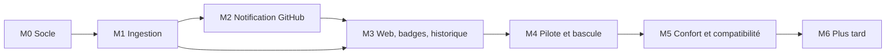
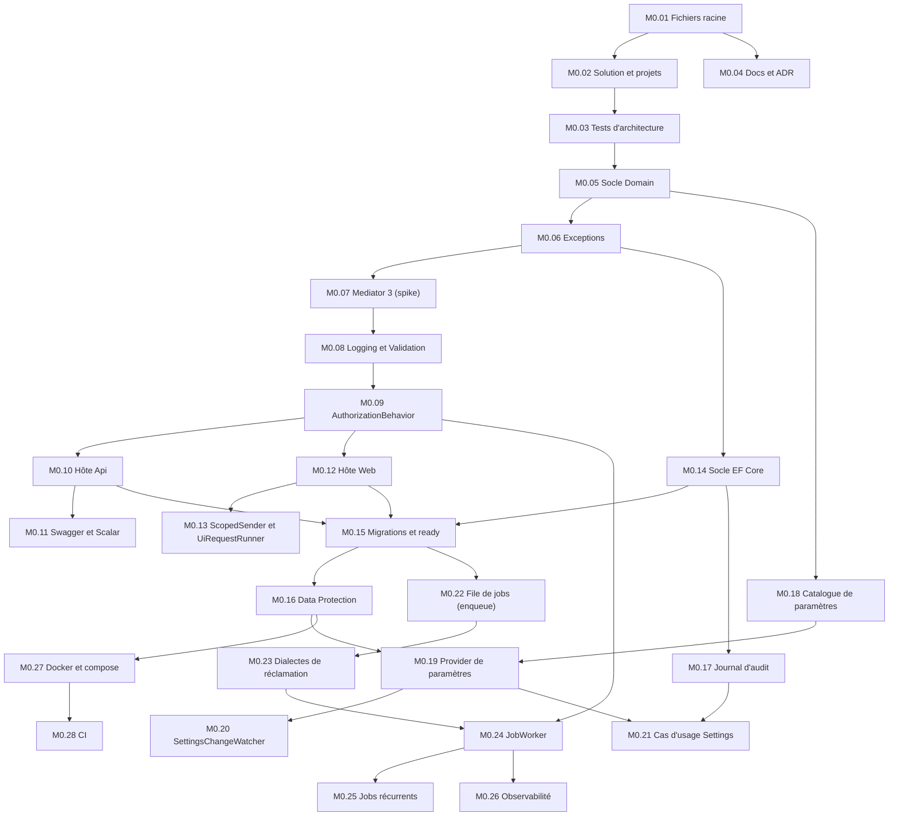
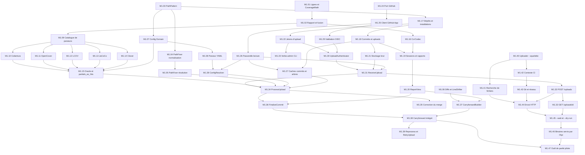
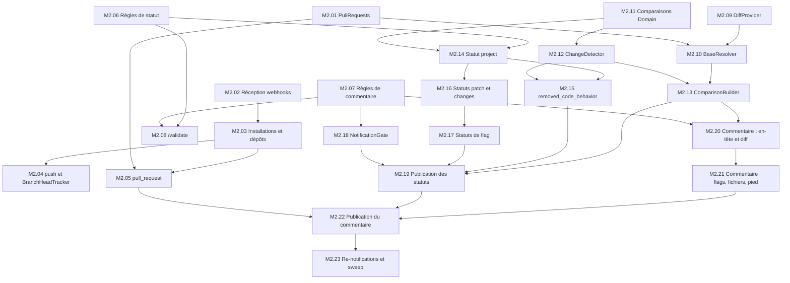
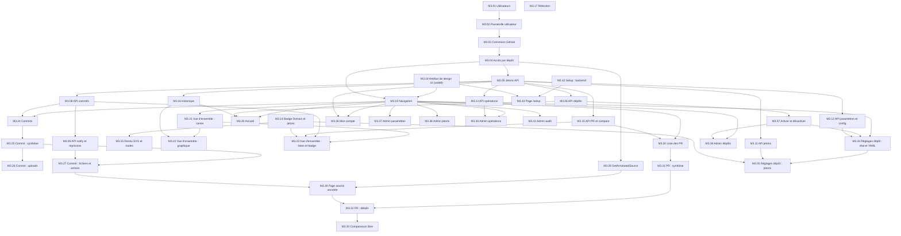
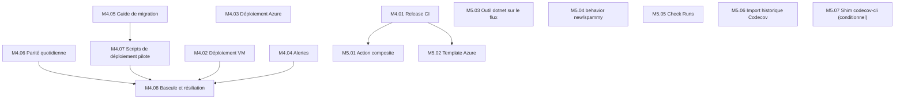

# Plan d'implémentation

> **Produit :** `CodeCoverage`. **Dépôt :** `code-coverage`. **Destination :** `docs/PLAN.md`.
> **Sources :** `docs/ARCHITECTURE.md`, qui fait foi pour le périmètre, et `docs/CONVENTIONS.md`, qui fait foi pour la forme. En cas de conflit, les exigences utilisateur listées dans CONVENTIONS priment, puis l'architecture.
> **Règle utilisateur :** chaque implémentation est découpée en **micro-features**. Une micro-feature est un changement autonome et facile à relire : en général une PR de quelques fichiers et de moins de 400 lignes environ, hors migrations générées, fixtures et `.resx`.
> **Ordre :** chaque micro-feature s'appuie uniquement sur des micro-features déjà fusionnées, et le build reste vert après chaque fusion.

---

## Table des matières

1. [Lecture du plan](#1-lecture-du-plan)
   - 1.1 Format d'une micro-feature
   - 1.2 Chemins et namespaces abrégés
   - 1.3 Définition de « terminé » commune
   - 1.4 Patrons transverses
2. [Vue d'ensemble des dépendances](#2-vue-densemble-des-dépendances)
3. [Jalon M0 – Socle](#3-jalon-m0--socle)
4. [Jalon M1 – Ingestion](#4-jalon-m1--ingestion)
5. [Jalon M2 – Notification GitHub](#5-jalon-m2--notification-github)
6. [Jalon M3 – Web, badges, historique](#6-jalon-m3--web-badges-historique)
7. [Jalon M4 – Pilote et bascule](#7-jalon-m4--pilote-et-bascule)
8. [Jalon M5 – Confort et compatibilité](#8-jalon-m5--confort-et-compatibilité)
9. [Jalon M6 – Plus tard](#9-jalon-m6--plus-tard)
10. [Écarts et compléments par rapport à l'architecture](#10-écarts-et-compléments-par-rapport-à-larchitecture)
11. [Décisions ouvertes](#11-décisions-ouvertes)

---

## 1. Lecture du plan

### 1.1 Format d'une micro-feature

Chaque micro-feature porte les rubriques suivantes :

- un **ID** `M{jalon}.{nn}` et un titre ;
- l'**Objectif** ;
- les **Couches** touchées ;
- les **Fichiers / types** à créer ;
- les **Tests** à écrire, nommés `{Method}_{Scenario}_Should{Behavior}` (CONVENTIONS §13.2) ;
- les critères d'**Acceptation** ;
- les **Dépendances** (`Dépend de`).

### 1.2 Chemins et namespaces abrégés

| Abréviation | Chemin réel | Namespace racine |
|---|---|---|
| `Domain/…` | `src/CodeCoverage.Domain/…` | `CodeCoverage.Domain` |
| `Application/…` | `src/CodeCoverage.Application/…` | `CodeCoverage.Application` |
| `Infrastructure/…` | `src/CodeCoverage.Infrastructure/…` | `CodeCoverage.Infrastructure` |
| `PostgreSql/…` | `src/CodeCoverage.Infrastructure.PostgreSql/…` | `CodeCoverage.Infrastructure.PostgreSql` |
| `SqlServer/…` | `src/CodeCoverage.Infrastructure.SqlServer/…` | `CodeCoverage.Infrastructure.SqlServer` |
| `Api/…`, `Web/…`, `Uploader/…` | `src/CodeCoverage.{Api,Web,Uploader}/…` | idem |
| `X.Tests/…` | `tests/CodeCoverage.X.Tests/…` | `CodeCoverage.X.Tests` |

**Règle de namespace :** le namespace est la racine du projet suivie du chemin du dossier. Par exemple, `Domain/Coverage/LineCoverage.cs` est dans `CodeCoverage.Domain.Coverage`. Les noms de dossier ne reprennent jamais le nom d'un type (CONVENTIONS §3.2).

**Cas d'usage :** la notation « UC `Features/Uploads/Commands/ReceiveUpload` » désigne le dossier `Application/Features/Uploads/Commands/ReceiveUpload/`. Il contient `ReceiveUploadCommand.cs` (`public sealed record`) et `ReceiveUploadCommandHandler.cs` (`internal sealed`). Le suffixe **`+V`** ajoute `ReceiveUploadCommandValidator.cs`. Les requêtes suivent le même modèle avec `Query` et `QueryHandler`.

**Migration EF :** la notation « Migration `AddXxx` » signifie une migration générée dans `PostgreSql/Migrations/` **et** dans `SqlServer/Migrations/`, avec la mise à jour des deux `CodeCoverageDbContextModelSnapshot`.

### 1.3 Définition de « terminé » commune (applicable à chaque micro-feature)

1. L'en-tête de copyright est présent sur chaque `.cs` et chaque `.razor` (CONVENTIONS §3.1), suivi d'une ligne vide.
2. Les `#region` sont dans l'ordre de CONVENTIONS §3.3, avec `Ctors` et jamais `Constructors`.
3. Un seul type par fichier, aucun type imbriqué.
4. Documentation XML de style MSDN sur tout membre `public` et `internal` (CONVENTIONS §3.6). Pas de documentation XML dans les tests.
5. `ConfigureAwait(false)` partout, sauf `ConfigureAwait(true)` dans les `.razor.cs`. `ArgumentNullException.ThrowIfNull` en tête de chaque méthode publique.
6. Chaque nouveau code d'erreur `Feature.Reason` est ajouté à `{Feature}Errors.cs` **et** traduit dans `Web/Resources/Common.resx` et `Common.fr.resx`.
7. Tout changement de modèle EF s'accompagne de la migration pour les deux fournisseurs. Le test « aucun changement de modèle sans migration » reste vert.
8. `dotnet build -c Release` passe sans avertissement, et `dotnet test` est vert, Architecture.Tests compris. Les règles d'architecture ne sont jamais assouplies.
9. Message de commit : conventional commit et gitmoji, sans clé de ticket (CONVENTIONS §15).

### 1.4 Patrons transverses (appliqués partout où ils s'appliquent)

- **Patron « envoi-et-conversion » (isolement du Domain).** La règle d'architecture interdit toute dépendance vers `CodeCoverage.Domain` dans `Api.*` et `Web.*`, hors `Mapping`, `Program` et `Configuration`. La vérification se fait sur l'IL, corps de méthodes compris. Un contrôleur ou une page ne nomme donc jamais un type du Domain, même comme argument générique de `Send<T>`.
  - Les requêtes qui renvoient un objet du Domain passent par une extension de mapper sur `ISender`, rangée dans le namespace `Mapping` :
    - Api : `public static async Task<CommitResponse> GetCommitResponseAsync(this ISender sender, GetCommitQuery query, CancellationToken ct)` ;
    - Web : `GetCommitViewModelAsync(...)`, appelée à travers `UiRequestRunner`.
  - Les commandes qui renvoient `Unit`, un identifiant ou un scalaire sont envoyées directement.
  - Nommage : `{UseCase}ResponseAsync` / `{UseCase}ResponsesAsync` pour l'Api, `{UseCase}ViewModelAsync` / `{UseCase}ViewModelsAsync` pour le Web, en plus de `ToCommand`, `ToQuery`, `ToResponse` et `ToViewModel`.
- **Patron « job ».**
  - La constante est ajoutée dans `Domain/Contracts/Jobs/JobTypes.cs`.
  - Le cas est ajouté dans `Infrastructure/Jobs/JobDispatcher.cs`, du payload JSON vers la commande.
  - La mise en file passe par une **méthode de repository unique**, dans la transaction de la modification, avec un paramètre `JobRequest`. `IJobQueue.EnqueueAsync` reste réservé aux déclenchements isolés (Web, relance).
- **Patron « persistance d'une feature ».**
  - `Infrastructure/Persistence/Configurations/{Entity}Configuration.cs` (`internal sealed`, `IEntityTypeConfiguration<T>`) ;
  - `Infrastructure/Persistence/Repositories/{Entity}Repository.cs` (`internal sealed`, implémente le port) ;
  - enregistrement dans `Infrastructure/DependencyInjection.cs` ;
  - tests d'intégration paramétrés pour les deux fournisseurs (`Infrastructure.Tests/Support/DatabaseFixture` avec Testcontainers PostgreSQL et MsSql).
- **Patron « page Web ».**
  - `Web/Components/Pages/{Name}.razor` et `{Name}.razor.cs`, sans bloc `@code` ;
  - ViewModels dans `Web/ViewModels/{Feature}/` ;
  - mapper dans `Web/Mapping/{Feature}Mapper.cs` ;
  - envoi par `UiRequestRunner` ;
  - libellés par `IStringLocalizer<Common>` et préfixe CSS `cc-` ;
  - test bUnit dans `Web.Tests/Components/Pages/{Name}Tests.cs`.

---

## 2. Vue d'ensemble des dépendances

### 2.1 Jalons

Les graphes suivants ne montrent que les dépendances **internes** à chaque jalon. Les dépendances vers des jalons antérieurs sont indiquées sur chaque fiche.

### 2.2 M0 – Socle

### 2.3 M1 – Ingestion

### 2.4 M2 – Notification GitHub

### 2.5 M3 – Web, badges, historique

### 2.6 M4 et M5

---

## 3. Jalon M0 – Socle

**Critère de sortie :** `docker compose up` donne une Api et un Web sains, sur PostgreSQL comme sur SQL Server. Swagger est visible, et les tests d'architecture sont au vert.

#### M0.01 — Fichiers racine du dépôt
- **Objectif :** poser les fichiers de configuration et les documents racine du dépôt.
- **Couches :** dépôt.
- **Fichiers :**
  - `.editorconfig` et `GitVersion.yml`, propres à ce dépôt (CONVENTIONS §2.1 et §2.2) ;
  - `.github/SECURITY.md` ;
  - `global.json` (`10.0.403`, `rollForward: latestFeature`) ;
  - `.gitignore` (VisualStudio et ajouts de CONVENTIONS §2.4), `.gitattributes` (`*.verified.txt text eol=lf`), `.dockerignore` ;
  - `.env.example`, `README.md`, `AGENT.md`, `CLAUDE.md`.
- **Tests :** aucun (fichiers seulement).
- **Acceptation :**
  - les fichiers sont versionnés dans ce dépôt, qui en est la seule source ;
  - aucun `nuget.docker.config` ni flux NuGet privé : la restauration utilise uniquement nuget.org.
- **Dépend de :** —

#### M0.02 — Solution, `Directory.Build.props` et projets vides
- **Objectif :** créer la solution et tous les projets, compilables et vides.
- **Couches :** toutes.
- **Fichiers :**
  - `CodeCoverage.slnx` (dossiers `/config/`, `/deploy/`, `/src/`, `/tests/`) et `CodeCoverage.sln.DotSettings` (CONVENTIONS §3.1 et §3.7) ;
  - `src/Directory.Build.props` (CONVENTIONS §2.5, avec `Copyright`, `Company` et `Authors` à « Gaëtan Thouvenin », sans `RepositoryUrl` ni `PackageProjectUrl`), `src/default.ruleset` (CONVENTIONS §2.7, `Name="CodeCoverage Rules"`), `tests/Directory.Build.props` (CONVENTIONS §2.6) ;
  - `.csproj` de Domain, Application, Infrastructure, Infrastructure.PostgreSql, Infrastructure.SqlServer, Api (`Microsoft.NET.Sdk.Web`), Web (`Microsoft.NET.Sdk.Web`) et Uploader (`Exe`, `PackAsTool`, `ToolCommandName=coverage-upload`, `TargetFrameworks=net8.0;net10.0`, `RollForward=Major`) ;
  - les sept projets de tests ;
  - `Api/Program.cs` et `Web/Program.cs` minimaux, chacun avec `public partial class Program;` ;
  - `Uploader/Program.cs` qui renvoie 0.
- **Tests :** aucun test unitaire. Le pipeline local `dotnet build -c Release` et `dotnet test` passe.
- **Acceptation :**
  - les références de projets respectent le tableau §3.2 de l'architecture ;
  - l'Uploader ne référence aucun projet ;
  - `InternalsVisibleTo` pour les projets de tests et `DynamicProxyGenAssembly2`.
- **Dépend de :** M0.01

#### M0.03 — Tests d'architecture (règles de base)
- **Objectif :** verrouiller les règles avant d'écrire le premier type métier.
- **Couches :** Architecture.Tests.
- **Fichiers :**
  - `Architecture.Tests/Support/SolutionAssemblies.cs` et `Support/SourceFiles.cs` (énumération de `src/**/*.cs|razor` et `tests/**/*.cs`) ;
  - `LayerDependencyTests.cs`, `FeatureLayoutTests.cs`, `HandlerConventionTests.cs`, `PortConventionTests.cs`, `PresentationIsolationTests.cs`, `SourceFileConventionTests.cs`.
- **Tests :**
  - `Domain_ShouldNotDependOnAnyProjectOrPackage` ;
  - `Application_ShouldOnlyDependOnDomain` ;
  - `Infrastructure_ShouldNotDependOnHosts` ;
  - `Uploader_ShouldReferenceNoSolutionProject` ;
  - `UseCases_ShouldLiveInFeatureCommandsOrQueriesFolder` ;
  - `Handlers_ShouldBeInternalSealed` ;
  - `Ports_ShouldNotExposeQueryable` ;
  - `Ports_ShouldRequireCancellationToken` (sans valeur par défaut) ;
  - `Ports_ShouldOfferNoUnitOfWork` ;
  - `Types_ShouldNotBeSuffixedDto` ;
  - `ApiAndWeb_ShouldNotReferenceDomain_ExceptMappingProgramAndConfiguration` (NetArchTest, IL compris : patron §1.4) ;
  - `SourceFiles_ShouldStartWithCopyrightHeader` ;
  - `SourceFiles_ShouldNeverUseConstructorsRegion` ;
  - `SourceFiles_ShouldDeclareOneTopLevelType`.
- **Acceptation :**
  - les règles passent sur la solution vide (les règles sans objet passent sans erreur) ;
  - chaque règle cassée volontairement dans un test négatif local échoue avec un message lisible.
- **Dépend de :** M0.02

#### M0.04 — Documentation d'architecture et ADR
- **Objectif :** versionner l'architecture et les décisions actées.
- **Couches :** docs.
- **Fichiers :**
  - `docs/ARCHITECTURE.md`, `docs/CONVENTIONS.md`, `docs/PLAN.md` ;
  - `docs/adr/0001-mediator.md` à `docs/adr/0012-uploader-distribution.md` (ADR-001 à ADR-012 de l'architecture §13.1), au format Contexte / Décision / Conséquences.
- **Tests :** —
- **Acceptation :**
  - l'ADR-001 porte le statut « proposé » jusqu'à M0.07 ;
  - l'ADR-003 (mono-tenant) est rédigé et rappelé dans les décisions ouvertes (§11).
- **Dépend de :** M0.01

#### M0.05 — Socle du Domain
- **Objectif :** créer les ports et marqueurs partagés par toutes les features.
- **Couches :** Domain.
- **Fichiers :**
  - `Domain/Ports/IClock.cs` (`UtcNow`) ;
  - `Domain/Ports/ICurrentUser.cs` (`UserId?`, `Login?`, `IsAuthenticated`, `IsAdmin`, `IsSystem`) ;
  - `Domain/IDomainEvent.cs` et `Domain/IHasDomainEvents.cs` (CONVENTIONS §4.4).
- **Tests :** `Architecture.Tests` (les ports respectent `PortConventionTests`).
- **Acceptation :** le Domain compile sans aucun `PackageReference`.
- **Dépend de :** M0.03

#### M0.06 — Exceptions « proches HTTP »
- **Objectif :** créer la hiérarchie de refus de l'Application (CONVENTIONS §6).
- **Couches :** Application.
- **Fichiers :**
  - dans `Application/Exceptions/` : `ApplicationException.cs` (abstraite, `ErrorCode`), `BadRequestException.cs`, `ValidationException.cs` (`IReadOnlyDictionary<string,string[]> Errors`, code `General.ValidationFailed`), `UnauthorizedException.cs`, `ForbiddenException.cs`, `NotFoundException.cs` (fabrique `For(string entity, string id)`), `ConflictException.cs`, `UnprocessableEntityException.cs`, `BadGatewayException.cs`, `RetryLaterException.cs` (`TimeSpan Delay`, interne au worker) ;
  - `Application/Exceptions/ErrorCodes/GeneralErrors.cs` (`ValidationFailed`, `Unexpected`).
- **Tests :** `Application.Tests/Exceptions/ValidationExceptionTests` — `Ctor_WithFailuresOnSameProperty_ShouldGroupErrors`, `NotFoundException_For_ShouldBuildFeatureNotFoundCode`.
- **Acceptation :**
  - le code HTTP figure uniquement dans la documentation XML (« Maps to HTTP 404 Not Found. ») ;
  - l'alias `ApplicationException` est documenté dans `AGENT.md`.
- **Dépend de :** M0.03

#### M0.07 — Médiateur martinothamar `Mediator` 3.x (spike et montage)
- **Objectif :** valider le montage du générateur de source et figer l'API v3.
- **Couches :** Application, Api, Web, Application.Tests.
- **Rappel de l'API v3 :**
  - `IPipelineBehavior<TMessage,TResponse>.Handle(TMessage message, MessageHandlerDelegate<TMessage,TResponse> next, CancellationToken ct)` renvoie `ValueTask<TResponse>` ;
  - `next(message, ct)` ;
  - `ICommand<T>`, `IQuery<T>`, `ICommandHandler<,>`, `IQueryHandler<,>` ;
  - options `Namespace`, `ServiceLifetime`, `GenerateTypesAsInternal`, `PipelineBehaviors` et `Assemblies`.
- **Fichiers :**
  - références `Mediator.Abstractions` 3.\* et `Mediator.SourceGenerator` 3.\* (PrivateAssets all) dans Application ;
  - `Application/DependencyInjection.cs` (`AddApplication()`, `AddMediator` avec `Namespace = "CodeCoverage.Application.Messaging"`, `ServiceLifetime.Scoped`, `GenerateTypesAsInternal = true`, `Assemblies = [typeof(DependencyInjection)]`, `PipelineBehaviors = []`) ;
  - `Application/Features/Diagnostics/Queries/Ping/PingQuery.cs` et `PingQueryHandler.cs`, cas d'usage de diagnostic conservé : il renvoie la version de l'assembly et sert au smoke test.
- **Tests :**
  - `Application.Tests/Messaging/MediatorSignatureTests` — `PipelineBehavior_ShouldCompileAgainstV3Signature` (behavior factice compilé) ;
  - `Application.Tests/Features/Diagnostics/Queries/Ping/PingQueryHandlerTests` ;
  - `Api.Tests/Smoke/MediatorWiringTests` — `Send_PingQuery_FromApiHost_ShouldReturnVersion` ;
  - même test côté Web.
- **Acceptation :**
  - le générateur n'est référencé que par Application, ce qui fait un seul générateur par artefact ;
  - les handlers `internal sealed` sont résolus sans `InternalsVisibleTo` ;
  - l'ADR-001 passe à « accepté ».
  - Si le montage échoue, le repli est appliqué et l'ADR est mis à jour (voir §11) : générateur dans Api et Web, conformément à la recommandation du README v3 de l'installer dans le projet exécutable, avec `InternalsVisibleTo`.
- **Dépend de :** M0.06

#### M0.08 — `LoggingBehavior` et `ValidationBehavior`
- **Objectif :** mettre en place le pipeline Logging puis Validation (CONVENTIONS §5.6 et §6.4), adapté à l'API v3.
- **Couches :** Application.
- **Fichiers :**
  - `Application/Behaviors/LoggingBehavior.cs` :
    - requêtes en `Debug`, commandes en `Information` ;
    - `ApplicationException` en `Warning` avec son `ErrorCode`, le reste en `Error` ;
    - **ne sérialise jamais le message** ;
  - `Application/Behaviors/ValidationBehavior.cs` (lève `ValidationException`) ;
  - packages FluentValidation 12.\* ;
  - `AddValidatorsFromAssembly(..., includeInternalTypes: true)` ;
  - `PipelineBehaviors = [LoggingBehavior<,>, ValidationBehavior<,>]`.
- **Tests :**
  - `Application.Tests/Behaviors/LoggingBehaviorTests` — `Handle_WithRefusal_ShouldLogWarningWithErrorCode`, `Handle_WithQuery_ShouldLogAtDebug`, `Handle_ShouldNeverLogMessageProperties` (message portant une propriété sensible) ;
  - `ValidationBehaviorTests` — `Handle_WithFailingRule_ShouldThrowValidationException`, `Handle_WithoutValidator_ShouldCallNext`.
- **Acceptation :** l'ordre des behaviors est vérifié par un test d'intégration avec un handler factice.
- **Dépend de :** M0.07

#### M0.09 — `AuthorizationBehavior` (admin et système) et principal courant
- **Objectif :** appliquer les marqueurs `IAdminOnly` et `ISystemOnly`, et poser le principal système du worker. `IRepositoryScoped` est déclaré ici et appliqué en M3.04.
- **Couches :** Application, Infrastructure.
- **Fichiers :**
  - `Application/Security/IRepositoryScoped.cs` (`Owner`, `Name`, `RequiredPermission`), `IAdminOnly.cs`, `ISystemOnly.cs` ;
  - `Application/Security/SecurityErrors.cs` (`Access.Forbidden`, `Access.Unauthenticated`) ;
  - `Application/Behaviors/AuthorizationBehavior.cs`, inséré entre Logging et Validation ;
  - `Domain/Users/RepositoryPermission.cs` (enum `Read`, `Write`, `Admin`) ;
  - `Infrastructure/Identity/CurrentUserContext.cs` (scoped, implémente `ICurrentUser`, `public SetUser(...)`, `internal SetSystem()`) ;
  - `Infrastructure/DependencyInjection.cs` (`AddInfrastructure` minimal).
- **Tests :**
  - `Application.Tests/Behaviors/AuthorizationBehaviorTests` — `Handle_AdminOnlyWithoutAdmin_ShouldThrowForbidden`, `Handle_SystemOnlyFromUser_ShouldThrowForbidden`, `Handle_AsSystem_ShouldPassEveryCheck` ;
  - `Infrastructure.Tests/Identity/CurrentUserContextTests`.
- **Acceptation :** `SetSystem` est inaccessible depuis Api et Web, ce que vérifie le compilateur (`internal`).
- **Dépend de :** M0.08

#### M0.10 — Hôte Api : composition, erreurs et sécurité
- **Objectif :** obtenir un hôte Api complet, sans endpoint métier.
- **Couches :** Api.
- **Fichiers :**
  - `Api/Program.cs` : bootstrap Serilog, `try`/`catch` `Fatal`, `CloseAndFlushAsync` ;
  - `Api/CodeCoverageApi.cs` (`Route = "api/v1"`, `Prefix`, `Tag`) ;
  - `Api/Configuration/SerilogConfiguration.cs`, `Configuration/PresentationConfiguration.cs` (`AddControllers` et `JsonStringEnumConverter`), `Configuration/HealthProbes.cs` (`/health/live`) ;
  - `Api/Configuration/Errors/ApiExceptionHandler.cs` (CONVENTIONS §10.3, `errorCode` et `errors`) ;
  - `Api/Configuration/Security/SecurityHeadersMiddleware.cs`, `Configuration/Security/ForwardedHeadersConfiguration.cs` (`ForwardedHeaders:KnownProxies`) ;
  - `Api/Configuration/Identity/HttpCurrentUserMiddleware.cs` (alimente `CurrentUserContext` depuis les claims ; anonyme pour l'instant).
- **Tests :** `Api.Tests/Support/CodeCoverageApiFactory.cs`, plus un contrôleur de test enregistré comme `ApplicationPart` dans le projet de tests (`Api.Tests/Support/ThrowingController.cs`). `Api.Tests/Errors/ApiExceptionHandlerTests` contient :
  - `Get_WhenValidationFails_ShouldReturn400WithErrors` ;
  - `…_NotFound_ShouldReturn404WithErrorCode` ;
  - `…_Bug_ShouldReturn500WithoutDetail` ;
  - `…_BadGateway_ShouldReturn502` ;
  - `SecurityHeaders_ShouldBePresent`.
- **Acceptation :** `/health/live` répond 200, chaque exception de CONVENTIONS §6 a son statut et les en-têtes de CONVENTIONS §8.6 sont présents.
- **Dépend de :** M0.09

#### M0.11 — OpenAPI : Swashbuckle, Swagger UI et Scalar
- **Objectif :** documentation d'API avec Swagger UI et Scalar (CONVENTIONS §10.5).
- **Couches :** Api.
- **Fichiers :**
  - `Api/Configuration/OpenApiConfiguration.cs` (`AddApiDocumentation`, XML des assemblies Api et Application, schéma `Bearer`) ;
  - `Api/Configuration/ScalarConfiguration.cs` (`MapScalarDocumentation`, redirection de `/scalar`) ;
  - dans `Program.cs` : condition `Features:EnableApiDocs` hors Production.
- **Tests :** `Api.Tests/OpenApi/OpenApiDocumentTests` — `Get_OpenApiJson_ShouldDescribeBearerScheme`, `Get_Swagger_InProduction_ShouldReturn404`, `Get_Scalar_ShouldRedirectToV1`.
- **Acceptation :** `/openapi/v1.json`, `/swagger` et `/scalar/v1` sont servis, et la documentation XML de `PingController` (`GET /api/v1/diagnostics/ping`, Name `Ping`) apparaît.
- **Dépend de :** M0.10

#### M0.12 — Hôte Web : coquille Blazor
- **Objectif :** hôte Blazor Server avec composants UI maison (`Web/Components/Ui`), sans page métier.
- **Couches :** Web.
- **Fichiers :**
  - `Web/Program.cs` : Serilog, `AddCoverageUi()`, `AddRazorComponents().AddInteractiveServerComponents()`, `UseExceptionHandler("/error", true)`, `UseStatusCodePagesWithReExecute("/not-found")` ;
  - `Web/Components/App.razor`, `Routes.razor` (`@rendermode="InteractiveServer"`), `Layout/MainLayout.razor` et `.razor.cs` (`CcAppShell`, `CcErrorBoundary` réinitialisé sur `LocationChanged`) ;
  - pages `Components/Pages/Error.razor(.cs)`, `NotFound.razor(.cs)`, `AccessDenied.razor(.cs)` ;
  - `Web/Resources/Common.resx` et `Common.fr.resx` ;
  - `Web/Configuration/SerilogConfiguration.cs`, `Configuration/HealthProbes.cs`, `Configuration/Security/SecurityHeadersMiddleware.cs` (CSP `frame-ancestors`, `SuppressXFrameOptionsHeader`) ;
  - `wwwroot/css/app.css` (préfixe `cc-`).
- **Tests :** `Web.Tests/Components/Layout/MainLayoutTests` (bUnit) — `NavigationChange_AfterError_ShouldRecoverBoundary` ; `Web.Tests/Smoke/WebHostTests` — `Get_Live_ShouldReturn200`.
- **Acceptation :** page d'accueil vide rendue dans la coquille, mode sombre fonctionnel, pages d'erreur localisées en anglais et en français.
- **Dépend de :** M0.09, M0.12a

#### M0.12a — Bibliothèque de composants UI maison (socle visuel)
- **Objectif :** transposer l'identité de la maquette validée (`docs/design/ui-mockup.html`) en composants Razor réutilisables, sans librairie tierce ni thème externe (CONVENTIONS §11.6).
- **Couches :** Web.
- **Fichiers :**
  - `wwwroot/css/tokens.css` (tokens clair et sombre repris de la maquette : neutres, sémantique hit/partial/miss, polices Plus Jakarta Sans + JetBrains Mono auto-hébergées) et `wwwroot/css/components.css` (BEM, préfixe `cc-`) ;
  - `Web/Components/Ui/` : `CcAppShell`, `CcTopNav`, `CcPillTabs`, `CcKpiCard`, `CcHeader`, `CcUserMenu`, `CcPageContainer`, `CcBadge`, `CcButton`, `CcBanner`, `CcEmptyState`, `CcLoadingSpinner`, `CcTextField`, `CcSelectField`, `CcSearchBar`, `CcFolderTabs`, `CcErrorBoundary` (chacun `.razor` + `.razor.cs`, en-tête et documentation XML) ;
  - `Web/Components/Ui/Icons/CcIcon.razor` (jeu d'icônes SVG inline, trait 2 px) ;
  - `Web/Extensions/UiServiceCollectionExtensions.cs` (`AddCoverageUi()`) ;
  - les composants de données (`CcGauge`, `CcBarChart`, `CcLineChart`, `CcSparkline`, `CcCoverageBar`, `CcToast` + `IToastService`) arrivent avec les pages qui les utilisent (M3) ou avec M0.13 pour les toasts.
- **Tests :** `Web.Tests/Components/Ui/*Tests` (bUnit) — rendu des variantes, accessibilité de base (`aria-*`, focus visible).
- **Acceptation :** une page `/_ui` (Development uniquement) affiche tous les composants en clair et en sombre, conforme à la maquette.
- **Dépend de :** M0.02

#### M0.13 — `ScopedSender` et `UiRequestRunner`
- **Objectif :** mettre en place le mécanisme central d'erreurs côté Blazor (CONVENTIONS §11.4).
- **Couches :** Web.
- **Fichiers :**
  - `Web/Messaging/ScopedSender.cs` : un scope DI par envoi, recopie l'utilisateur du circuit dans le `CurrentUserContext` du scope ;
  - `Web/Messaging/UiRequestRunner.cs` :
    - `RunAsync<T>(Func<ISender,CancellationToken,Task<T>>, EditContext? form = null)` ;
    - toast `IToastService` localisé par `ErrorCode` ;
    - `ValidationException` renvoyée au formulaire ;
    - `NotFoundException` signalée à la page ;
  - `Web/Messaging/UiResult.cs` (`Succeeded`, `Value`, `NotFound`) ;
  - `Web/Localization/ErrorCodeLocalizer.cs`, avec repli sur `General.Unexpected`.
- **Tests :** `Web.Tests/Messaging/UiRequestRunnerTests` — `RunAsync_WithApplicationException_ShouldShowLocalizedToast`, `RunAsync_WithValidationException_ShouldPopulateEditContext`, `RunAsync_WithNotFound_ShouldReturnNotFoundResult`, `RunAsync_WithBug_ShouldRethrow` ; `ScopedSenderTests` — `Send_ShouldUseFreshScopePerCall`.
- **Acceptation :** aucune page n'utilise `ISender` directement (règle d'architecture ajoutée : `Web.Components` ne dépend pas de `Mediator.ISender`).
- **Dépend de :** M0.12

#### M0.14 — Socle EF Core et projets de migrations
- **Objectif :** un seul modèle EF Core 10 pour deux fournisseurs.
- **Couches :** Infrastructure, PostgreSql, SqlServer.
- **Fichiers :**
  - `Infrastructure/Persistence/CodeCoverageDbContext.cs` (`sealed`, `ApplyConfigurationsFromAssembly`) ;
  - `Persistence/DatabaseOptions.cs` (`CodeCoverage:Database`), `Persistence/DatabaseProvider.cs` (enum) ;
  - `Persistence/DbContextOptionsBuilderExtensions.cs` (`UseCodeCoverageDatabase`) ;
  - `Persistence/Conventions/JsonListConverter.cs` (listes en JSON texte), `Persistence/Conventions/EnumAsStringConvention.cs` ;
  - `Infrastructure/Time/SystemClock.cs` (`IClock`) ;
  - `PostgreSql/DesignTimeDbContextFactory.cs` et `SqlServer/DesignTimeDbContextFactory.cs` (`internal sealed`, `CODECOVERAGE_DESIGN_CONNECTION`) ;
  - Migration `InitialSchema`, vide hors `__EFMigrationsHistory`.
- **Tests :** `Infrastructure.Tests/Support/DatabaseFixture.cs` (Testcontainers PostgreSQL 17 et MsSql 2022), `Support/ProviderTheoryData.cs` ; `Infrastructure.Tests/Persistence/DbContextTests` — `Create_ForEachProvider_ShouldConnect`.
- **Acceptation :** `dotnet ef migrations add` fonctionne pour les deux projets, et les clés `bigint identity` sont la convention par défaut.
- **Dépend de :** M0.06

#### M0.15 — Migrations au démarrage, sonde `ready` et garde de modèle
- **Objectif :** l'Api migre au démarrage, le Web vérifie seulement le schéma.
- **Couches :** Infrastructure, Api, Web.
- **Fichiers :**
  - `Infrastructure/Persistence/DatabaseMigrator.cs` (`IHostedService`, `MigrateOnStartup`) ;
  - `Infrastructure/HealthChecks/MigrationsAppliedHealthCheck.cs`, `HealthChecks/ReadCommittedSnapshotHealthCheck.cs` (SQL Server seulement) ;
  - `ReadyTag` dans `Infrastructure/DependencyInjection.cs` ;
  - `/health/ready` dans les deux hôtes.
- **Tests :** `Infrastructure.Tests/Persistence/ModelSnapshotTests` — `Model_ForEachProvider_ShouldHaveNoPendingChanges` ; `HealthChecks/ReadCommittedSnapshotHealthCheckTests` — `Check_WithRcsiOff_ShouldBeUnhealthy`.
- **Acceptation :** le Web reste « not ready » tant que l'Api n'a pas migré, et le test de modèle échoue si une configuration change sans migration.
- **Dépend de :** M0.14, M0.10, M0.12

#### M0.16 — Data Protection en base, `ISecretProtector` et `ITokenHasher`
- **Objectif :** trousseau partagé entre les deux hôtes, secrets chiffrés et hachage des jetons.
- **Couches :** Domain, Infrastructure, hôtes.
- **Fichiers :**
  - `Domain/Ports/ISecretProtector.cs`, `Domain/Ports/ITokenHasher.cs` (`byte[] Hash(string)`, `bool FixedTimeEquals(...)`) ;
  - `Infrastructure/Security/DataProtectionSecretProtector.cs` (purpose `CodeCoverage.Secrets`), `Security/Sha256TokenHasher.cs` ;
  - `Infrastructure/Security/DataProtectionConfiguration.cs` :
    - `PersistKeysToDbContext` ;
    - `ProtectKeysWithCertificate` ou `ProtectKeysWithAzureKeyVault` ;
    - **refus de démarrer en Production** sans protection, sauf `DataProtection:AllowUnprotectedKeys=true` ;
  - Migration `AddDataProtectionKeys`.
- **Tests :** `Infrastructure.Tests/Security/DataProtectionSecretProtectorTests` — `Unprotect_FromOtherHostInstance_ShouldRoundTrip` (deux fournisseurs DP sur la même base) ; `DataProtectionConfigurationTests` — `Configure_InProductionWithoutProtection_ShouldThrow`.
- **Acceptation :** un secret chiffré par l'Api se déchiffre dans le Web.
- **Dépend de :** M0.15

#### M0.17 — Journal d'audit
- **Objectif :** tracer jetons, paramètres, secrets et relances manuelles.
- **Couches :** Domain, Infrastructure.
- **Fichiers :**
  - `Domain/Ports/IAuditLog.cs` (`RecordAsync(string action, string target, IReadOnlyDictionary<string,string>? details, CancellationToken)`) ;
  - `Domain/Operations/AuditEntry.cs` ;
  - `Infrastructure/Persistence/Configurations/AuditEntryConfiguration.cs`, `Infrastructure/Operations/AuditLog.cs` (acteur lu depuis `ICurrentUser`) ;
  - Migration `AddAuditEntries`.
- **Tests :** `Infrastructure.Tests/Operations/AuditLogTests` — `Record_AsSystem_ShouldStoreSystemActor`.
- **Acceptation :** aucune valeur secrète n'est acceptée dans `details` ; une clé `*Secret*` lève `ArgumentException`.
- **Dépend de :** M0.14

#### M0.18 — Catalogue des paramètres (Domain)
- **Objectif :** décrire toutes les clés de §4bis.3.
- **Couches :** Domain.
- **Fichiers :**
  - `Domain/Settings/SettingDefinition.cs` (`Key`, `Group`, `Type`, `Default`, `RequiresRestart`, `Min`, `Max`, `IsSecret`), `SettingType.cs`, `SettingDefinitions.cs` (catalogue complet), `SettingValue.cs`, `SettingSource.cs` (`Store`, `Environment`, `Default`) ;
  - `Domain/Ports/ISettingsStore.cs`.
- **Tests :** `Domain.Tests/Settings/SettingDefinitionsTests` — `Catalog_ShouldHaveUniqueKeys`, `Catalog_SecretsShouldHaveNoDefault`, `Find_UnknownKey_ShouldReturnNull`.
- **Acceptation :** le catalogue reprend une à une les clés de §4bis.3, `Processing:WorkerConcurrency` est marquée `RequiresRestart` et les quatre secrets de §4bis.3 (`GitHub:ClientSecret`, `GitHub:PrivateKeyPem`, `GitHub:WebhookSecret`, `GitHub:WebhookSecretPrevious`) sont marqués.
- **Dépend de :** M0.05

#### M0.19 — Provider de configuration sur table et store
- **Objectif :** mettre en place le provider de configuration sur table (CONVENTIONS §12.2), adapté aux deux fournisseurs.
- **Couches :** Infrastructure, hôtes.
- **Fichiers :**
  - dans `Infrastructure/Settings/` : `DatabaseSettingsConfigurationSource.cs`, `DatabaseSettingsConfigurationProvider.cs` (ADO.NET brut, `NpgsqlConnection` ou `SqlConnection`, table absente donnant un jeu vide, `RefreshAll`), `ConfigurationBuilderExtensions.cs` (`AddCodeCoverageSettingsStore(connectionString, provider)` en source la plus faible), `ConfigurationSourceInspector.cs`, `ConfigurationSettingsStore.cs` (EF ; écrit la valeur **et** `UPDATE SettingsRevision SET Revision = Revision + 1` dans une transaction) ;
  - `Infrastructure/Persistence/Configurations/SettingConfiguration.cs`, `SettingsRevisionConfiguration.cs` ;
  - `Infrastructure/Settings/StoredSetting.cs` et `SettingsRevisionRow.cs` (tables techniques internes) ;
  - Migration `AddSettings`, qui insère la ligne `SettingsRevision(Id=1, Revision=0)`.
- **Tests :** `Infrastructure.Tests/Settings/DatabaseSettingsConfigurationProviderTests` — `Load_WithoutTable_ShouldReturnEmpty`, `Load_ForEachProvider_ShouldExposeValues` ; `ConfigurationSettingsStoreTests` — `Save_ShouldIncrementRevisionInSameTransaction`, `GetSource_WhenEnvironmentProvidesKey_ShouldReturnEnvironment`.
- **Acceptation :** l'ordre de priorité est ligne de commande, puis environnement, puis `appsettings.json`, puis store. Un secret n'apparaît dans `IConfiguration` que sous sa forme protégée.
- **Dépend de :** M0.18, M0.16

#### M0.20 — Propagation entre hôtes : `SettingsChangeWatcher`
- **Objectif :** un changement fait sur un hôte est vu par l'autre en 5 s au plus, de façon portable (sans LISTEN/NOTIFY).
- **Couches :** Infrastructure, hôtes.
- **Fichiers :** `Infrastructure/Settings/SettingsChangeWatcher.cs` (`BackgroundService`, `PeriodicTimer` réglé par `Settings:PollSeconds`, lecture de `Revision`, puis `RefreshAll`), `Infrastructure/Settings/SettingsWatcherOptions.cs`.
- **Tests :** `Infrastructure.Tests/Settings/SettingsChangeWatcherTests` — `Poll_WhenOtherRootSaved_ShouldNotifyOptionsMonitor` (deux `IConfigurationRoot` sur la même base, `IOptionsMonitor.OnChange` observé), `Poll_WhenRevisionUnchanged_ShouldNotReload`.
- **Acceptation :** l'hôte qui sauvegarde se rafraîchit immédiatement et l'autre suit dans le délai.
- **Dépend de :** M0.19

#### M0.21 — Cas d'usage Settings
- **Objectif :** lire et modifier les paramètres via l'Application, avec audit.
- **Couches :** Application.
- **Fichiers :**
  - UC `Features/Settings/Queries/GetSettings` (renvoie `IReadOnlyList<SettingValue>`, secrets réduits à « défini / non défini ») ;
  - UC `Features/Settings/Commands/UpdateSetting` `+V` (type, min, max) ;
  - UC `Features/Settings/Commands/ReplaceSecret` `+V` ;
  - UC `Features/Settings/Commands/ResetSetting` ;
  - tous `IAdminOnly` ;
  - `Features/Settings/SettingErrors.cs` (`Setting.Unknown`, `Setting.ProvidedByEnvironment`, `Setting.OutOfRange`, `Setting.NotSecret`).
- **Tests :** `Application.Tests/Features/Settings/Commands/UpdateSetting/UpdateSettingCommandHandlerTests` — `Handle_WhenProvidedByEnvironment_ShouldThrowUnprocessableEntity`, `Handle_ShouldAudit` ; `ReplaceSecretCommandHandlerTests` — `Handle_ShouldProtectBeforeSaving` ; `GetSettingsQueryHandlerTests` — `Handle_ShouldNeverReturnSecretValue`.
- **Acceptation :** 422 pour une clé fournie par l'environnement, et aucun secret en clair dans la réponse.
- **Dépend de :** M0.19, M0.17, M0.09

#### M0.22 — File de jobs : contrats et mise en file
- **Objectif :** mettre en file de façon transactionnelle, avec dédoublonnage, fusion et anti-rebond.
- **Couches :** Domain, Infrastructure.
- **Fichiers :**
  - `Domain/Contracts/Jobs/JobRequest.cs`, `Domain/Contracts/Jobs/JobTypes.cs` (constantes vides au départ) ;
  - `Domain/Ports/IJobQueue.cs`, `Domain/Ports/IJobMonitor.cs` ;
  - `Domain/Operations/JobSummary.cs`, `Domain/Operations/JobState.cs` ;
  - `Infrastructure/Jobs/JobRecord.cs` (entité technique interne), `Persistence/Configurations/JobRecordConfiguration.cs` ;
  - `Infrastructure/Jobs/SqlJobQueue.cs` (`EnqueueAsync` ; `internal EnqueueInTransactionAsync(CodeCoverageDbContext, JobRequest)` pour les repositories) ;
  - Migration `AddJobs`, avec index uniques filtrés écrits à la main par fournisseur : `UX(DedupKey) WHERE State='Queued'` et `UX(LockKey) WHERE State='Running'`.
- **Tests :** `Infrastructure.Tests/Jobs/SqlJobQueueTests` — `Enqueue_WithSameDedupKeyAndCoalesce_ShouldKeepOneJob`, `Enqueue_WithDebounce_ShouldPushRunAfterUpToMaxDelay`, `Enqueue_WhileTwinRunning_ShouldQueueNewJob`.
- **Acceptation :** comportements identiques sur les deux fournisseurs.
- **Dépend de :** M0.15

#### M0.23 — Dialectes de réclamation (`SKIP LOCKED` / `READPAST`)
- **Objectif :** réclamer un job de façon atomique et sérialiser par clé de verrou.
- **Couches :** Infrastructure, PostgreSql, SqlServer.
- **Fichiers :**
  - `Infrastructure/Jobs/IJobClaimDialect.cs` (`internal`, exposé aux assemblies de migrations par `InternalsVisibleTo`) ;
  - `PostgreSql/Jobs/PostgreSqlJobClaimDialect.cs`, `SqlServer/Jobs/SqlServerJobClaimDialect.cs` (SQL de §6.1) ;
  - `PostgreSql/DependencyInjection.cs` et `SqlServer/DependencyInjection.cs` (`AddPostgreSqlProvider()` et `AddSqlServerProvider()`) ;
  - `Infrastructure/Jobs/SqlJobQueue.cs` étendu avec `ClaimNextAsync`, `CompleteAsync`, `FailAsync`, `ExtendLeaseAsync` (tous conditionnés à `LockedBy=@me AND State='Running'`).
- **Tests :** `Infrastructure.Tests/Jobs/JobClaimConcurrencyTests` — `Claim_With8ConcurrentWorkers_ShouldNeverRunSameJobTwice`, `Claim_WithSameLockKey_ShouldRunOneAtATime`, `Complete_AfterLeaseLost_ShouldWriteNothing` ; exécutés sur les deux fournisseurs.
- **Acceptation :** aucune double exécution sur 1 000 jobs, et une violation résiduelle de l'index `Running` est absorbée.
- **Dépend de :** M0.22

#### M0.24 — `JobWorker`, `JobDispatcher` et `LeaseSweeper`
- **Objectif :** exécuter les jobs dans l'Api.
- **Couches :** Infrastructure, Api.
- **Fichiers :**
  - `Infrastructure/Jobs/JobWorker.cs` :
    - `Processing:WorkerConcurrency` boucles ;
    - réveil par canal, sinon scrutation toutes les 2 s ;
    - scope par job avec `CurrentUserContext.SetSystem()` ;
    - `LogContext`, `Activity` et timeout de 10 minutes ;
  - `Jobs/JobDispatcher.cs` (switch sur `JobTypes`, vide hors `Diagnostics`), `Jobs/JobWakeUpSignal.cs` (`Channel<long>`), `Jobs/JobHeartbeat.cs` (renouvellement du bail toutes les 60 s), `Jobs/JobRetryPolicy.cs` (backoff de `2^n × 10 s`, plafond de 30 minutes, ±20 %), `Jobs/LeaseSweeper.cs` (tient compte du dédoublonnage) ;
  - `Jobs/WorkerOptions.cs` (`Worker:Enabled`) ;
  - `Domain/Contracts/Jobs/JobTypes.Ping` et `Application/Features/Diagnostics/Commands/RunDiagnosticJob` (`ISystemOnly`) pour le test de bout en bout.
- **Tests :** `Infrastructure.Tests/Jobs/JobWorkerTests` :
  - `Run_WhenHandlerThrowsRetryLater_ShouldRescheduleWithoutConsumingAttempt` ;
  - `Run_WhenNotFound_ShouldFailPermanently` ;
  - `Run_AfterMaxAttempts_ShouldMarkDead` ;
  - `Sweep_ExpiredLeaseWithQueuedTwin_ShouldAbsorb` ;
  - `Run_ShouldExecuteAsSystem`.
- **Acceptation :** `Worker:Enabled=false` désactive le worker, et le Web n'enregistre jamais le worker.
- **Dépend de :** M0.23, M0.09

#### M0.25 — `RecurringJobScheduler`
- **Objectif :** insérer les jobs récurrents de façon idempotente entre réplicas.
- **Couches :** Infrastructure.
- **Fichiers :** `Infrastructure/Jobs/RecurringJobScheduler.cs`, `Jobs/RecurringJobDefinition.cs`, `Jobs/RecurringJobCatalog.cs` (vide, alimenté par les features : `SyncInstallations`, `SweepPendingCommits`, `PurgeExpiredData`).
- **Tests :** `Infrastructure.Tests/Jobs/RecurringJobSchedulerTests` — `Schedule_FromTwoReplicas_ShouldInsertOnce`.
- **Acceptation :** la clé de dédoublonnage est la seule garantie d'unicité.
- **Dépend de :** M0.24

#### M0.26 — Observabilité : OpenTelemetry et métriques
- **Objectif :** traces et métriques communes aux deux hôtes.
- **Couches :** Infrastructure, hôtes.
- **Fichiers :**
  - `Infrastructure/Diagnostics/CodeCoverageMeter.cs` (`Meter "CodeCoverage"`, instruments de §12.6), `Diagnostics/CodeCoverageActivitySources.cs` (`CodeCoverage.Jobs`) ;
  - `Api/Configuration/TelemetryConfiguration.cs`, `Web/Configuration/TelemetryConfiguration.cs` (OTLP si `OTEL_EXPORTER_OTLP_ENDPOINT` est défini) ;
  - instrumentation du worker (`jobs_queued`, `job_oldest_queued_age_seconds`, `jobs_dead_total`).
- **Tests :** `Infrastructure.Tests/Diagnostics/CodeCoverageMeterTests` — `JobDead_ShouldIncrementCounter` (via `MeterListener`).
- **Acceptation :** sans endpoint OTLP, aucune erreur et aucun export.
- **Dépend de :** M0.24, M0.10, M0.12

#### M0.27 — Dockerfiles, compose et Caddy
- **Objectif :** démarrer la pile complète en local, sur PostgreSQL et sur SQL Server.
- **Couches :** déploiement.
- **Fichiers :**
  - `Dockerfile.api`, `Dockerfile.web` (CONVENTIONS §14.3, sans flux NuGet privé : restauration depuis nuget.org seul, utilisateur et groupe non root `codecoverage` uid et gid 1001, `/app/data`, port 8080) ;
  - `docker-compose.yml` (§12.2, avec un certificat DP de développement), `docker-compose.sqlserver.yml` (surcharge MsSql 2022 avec RCSI) ;
  - `Caddyfile.example` (deux hôtes).
- **Tests :** script `scripts/smoke-compose.ps1` qui démarre la pile, attend `ready` sur les deux hôtes et appelle `/swagger`. Il est lancé en CI dans M0.28.
- **Acceptation :** `docker compose up` donne une Api et un Web « ready » sur chaque fournisseur, et les conteneurs tournent sans root.
- **Dépend de :** M0.16, M0.15

#### M0.28 — CI du dépôt
- **Objectif :** build, tests, images et (plus tard) release.
- **Couches :** CI.
- **Fichiers :** `.github/workflows/ci-cd.yml` (CONVENTIONS §14.1) avec les jobs :
  - `gitversion` ;
  - `build-and-test` (Testcontainers pour les deux fournisseurs) ;
  - `compose-smoke` ;
  - `docker` (deux images GHCR, poussées seulement depuis `main` et les tags `v*`, jamais depuis `develop` ni une PR).
- **Tests :** la CI elle-même.
- **Acceptation :** CI verte sur `main` et sur les PR, et aucune image poussée depuis une PR.
- **Dépend de :** M0.27

---

## 4. Jalon M1 – Ingestion

**Critère de sortie :** uploads réels coverlet et Vitest depuis 3 dépôts pilotes (GitHub Actions et Azure), avec des totaux à ±0,01 % de Codecov sur 20 commits.

### 4.1 Domaine de la couverture

#### M1.01 — Modèle de ligne et `CoverageMath`
- **Objectif :** formule Codecov exacte et affichage (§6.5, §7.1).
- **Couches :** Domain.
- **Fichiers :**
  - `Domain/Coverage/LineCoverage.cs` (`readonly record struct`), `LineState.cs` (`Hit`, `Miss`, `Partial`), `LineKind.cs` ;
  - `CoverageTotals.cs` (`Lines`, `Hits`, `Misses`, `Partials`, `Branches`, `Methods`, `Coverage`) ;
  - `CoverageMath.cs` (`Ratio`, `Classify`, `Format(value, precision, RoundingMode)`, `<0.01`, `∅`, `ø`) ;
  - `Domain/Config/RoundingMode.cs` (`Down`, `Up`, `Nearest`).
- **Tests :** `Domain.Tests/Coverage/CoverageMathTests` :
  - `Ratio_WithPartials_ShouldCountThemInDenominatorOnly` ;
  - `Ratio_ShouldRoundHalfToEvenAt5Decimals` ;
  - `Format_Down_ShouldTruncate` ;
  - `Format_TinyNonZero_ShouldShowLessThan001` ;
  - `Classify_BranchLine_ShouldIgnoreHits`.
- **Acceptation :** les vecteurs de test reprennent des valeurs calculées par `totals.py` et `ratio()` de Codecov.
- **Dépend de :** M0.05

#### M1.02 — `FileCoverage`, `CoverageReport` et `ReportMerger`
- **Objectif :** fusion ligne à ligne selon `merge_coverage`.
- **Couches :** Domain.
- **Fichiers :** `Domain/Coverage/FileCoverage.cs`, `CoverageReport.cs` (fichiers, `FileTotals`, `TotalsOf(path, lines)`), `FileTotals.cs`, `ReportMerger.cs` (`MergeLine`, `Merge(IEnumerable<CoverageReport>)`).
- **Tests :** `Domain.Tests/Coverage/ReportMergerTests` :
  - `MergeLine_HitsWithHits_ShouldTakeMax` ;
  - `MergeLine_HitsWithBranch_ShouldMakeFullBranch` ;
  - `MergeLine_BranchesWithMissingIds_ShouldIntersect` ;
  - `MergeLine_BranchesWithoutIds_ShouldKeepBestRatio` ;
  - `Merge_ShuffledSessions_ShouldBeDeterministic`, test de propriété sur 200 permutations aléatoires à graine fixe.
- **Acceptation :** fusion commutative et associative sur les jeux de propriété.
- **Dépend de :** M1.01

#### M1.03 — `PathPattern` et `PathPatternSet`
- **Objectif :** motifs `ignore`, `paths` et `branches` (§6.4).
- **Couches :** Domain.
- **Fichiers :** `Domain/Paths/PathPattern.cs` (négation, expression régulière, glob, préfixe ; `NonBacktracking`, timeout de 100 ms), `Domain/Paths/PathPatternSet.cs`.
- **Tests :** `Domain.Tests/Paths/PathPatternTests` — `Match_Glob_DoubleStar_ShouldCrossDirectories`, `Match_Regex_ShouldBeAnchored`, `Match_Prefix_ShouldMatchSubpaths` ; `PathPatternSetTests` — `Includes_WithOnlyNegatives_ShouldIncludeOthers`.
- **Acceptation :** aucun motif ne peut provoquer de retour arrière catastrophique.
- **Dépend de :** M0.05

#### M1.04 — `PathFixer` : normalisation, `fixes` et candidats
- **Objectif :** étapes 1 à 4 de §6.4.
- **Couches :** Domain.
- **Fichiers :** `Domain/Paths/PathFixer.cs` (partie normalisation), `PathFixContext.cs`, `FixRule.cs` (alternation unique et ancrée), `NetworkIndex.cs`, `CiPathPrefixes.cs`.
- **Tests :** `Domain.Tests/Paths/PathFixerNormalizationTests` :
  - `Normalize_WindowsDrive_ShouldStripAndSlash` ;
  - `Normalize_DeterministicSourcePrefix_ShouldStrip` (`/_/`) ;
  - `ApplyFixes_FirstMatchingRuleShouldWin` ;
  - `Candidates_ShouldIncludeCoberturaSourcesAndCiPrefixes`.
- **Acceptation :** les règles `before::after` et `::prefix` sont conformes à la sémantique Codecov.
- **Dépend de :** M1.03

#### M1.05 — `PathFixer` : résolution sur la liste réseau
- **Objectif :** étapes 5 à 7 (exact, insensible à la casse, suffixe avec score ≥ 2, départage, ambiguïté).
- **Couches :** Domain.
- **Fichiers :** `Domain/Paths/PathFixer.cs` (partie résolution), `PathFixResult.cs` (`Resolved`, `Unresolved`, `Ambiguous`, `Unverified`).
- **Tests :** `Domain.Tests/Paths/PathFixerResolutionTests` :
  - `Fix_SuffixScoreOne_ShouldBeRejectedByDefault` ;
  - `Fix_SuffixScoreOne_WithAllowFilenameOnlyAndUnique_ShouldResolve` ;
  - `Fix_Tie_ShouldPreferFlagPaths` ;
  - `Fix_PersistentTie_ShouldBeAmbiguous` ;
  - `Fix_WithoutNetwork_ShouldReturnUnverified`.
- **Acceptation :** les fixtures de chemins coverlet Linux, Windows et `/_/`, Jest absolus et JaCoCo par package se résolvent toutes.
- **Dépend de :** M1.04

#### M1.06 — Diffs : `UnifiedDiffParser` et `LineShifter`
- **Objectif :** lignes ajoutées et supprimées, et décalage des lignes (patch, carryforward).
- **Couches :** Domain.
- **Fichiers :** `Domain/Diffs/FileDiff.cs`, `FileDiffStatus.cs`, `Hunk.cs`, `UnifiedDiffParser.cs`, `LineShifter.cs`, `DiffSet.cs` (`Complete`, `Truncated`, `Source`), `DiffSource.cs`.
- **Tests :** `Domain.Tests/Diffs/UnifiedDiffParserTests` — `Parse_MultipleHunks_ShouldTrackBothCounters`, `Parse_NoNewlineMarker_ShouldIgnore` ; `LineShifterTests` — `Shift_AfterInsertions_ShouldOffsetFollowingLines`, `Shift_DeletedLine_ShouldDropIt`.
- **Acceptation :** les numéros de ligne restent cohérents avec des diffs GitHub réels pris en fixtures (`tests/fixtures/github/patches/*.diff`).
- **Dépend de :** M0.05

### 4.2 Configuration `codecov.yml` (anticipée depuis M2 : requise par le traitement)

#### M1.07 — Configuration : Domain de base
- **Objectif :** modèle de configuration fusionnable (§9.1 à §9.3), hors statuts et commentaire.
- **Couches :** Domain.
- **Fichiers :**
  - `Domain/Config/ConfigNode.cs`, `ConfigMerger.cs` (maps fusionnées, scalaires et listes remplacés), `CoverageConfigDefaults.cs` (§9.2) ;
  - `CoverageConfig.cs` (vues typées `precision`, `round`, `range`, `ignore`, `fixes`, `codecov.*`, `parsers`, flags) ;
  - `FlagRule.cs` (résolution `default_rules`, puis `individual_flags`, puis `flags.<F>`), `ParserRule.cs`, `CoverageRange.cs`, `ConfigWarning.cs` ;
  - `Domain/Ports/ICoverageConfigParser.cs`.
- **Tests :** `Domain.Tests/Config/ConfigMergerTests` — `Merge_ListShouldReplace`, `Merge_MapShouldMerge` ; `FlagRuleTests` — `Resolve_LegacyFlagsShouldWinOverIndividualFlags`, `Resolve_FlagWithoutPaths_ShouldCoverAll`.
- **Acceptation :** défauts intégrés identiques à §9.2.
- **Dépend de :** M1.03

#### M1.08 — `YamlCoverageConfigParser`
- **Objectif :** lire le YAML et produire des `ConfigWarning` pour les clés inconnues, sans effet ou ignorées.
- **Couches :** Infrastructure.
- **Fichiers :** `Infrastructure/Yaml/YamlCoverageConfigParser.cs` (YamlDotNet 16.\*, vers `ConfigNode`), `Infrastructure/Yaml/SupportedKeys.cs`.
- **Tests :** `Infrastructure.Tests/Yaml/YamlCoverageConfigParserTests` — `Parse_InvalidYaml_ShouldReturnError`, `Parse_UnsupportedKey_ShouldWarn`, `Parse_SilentlyIgnoredKey_ShouldNotWarn`, `Parse_PercentStrings_ShouldParseTargets`.
- **Acceptation :** les `codecov.yml` des dépôts pilotes se lisent sans erreur.
- **Dépend de :** M1.07

### 4.3 Parseurs de rapports

#### M1.09 — Contrats de parsing, catalogue et sécurité XML
- **Objectif :** détection du format et lecture XML sûre.
- **Couches :** Domain, Infrastructure.
- **Fichiers :**
  - `Domain/Coverage/ParsedReport.cs`, `ParsedFile.cs`, `ReportFormat.cs` ;
  - `Domain/Ports/IReportParser.cs`, `Domain/Ports/IReportParserCatalog.cs` ;
  - `Infrastructure/Reports/ReportParserCatalog.cs` (`Detect` sur les 4 premiers Ko et le nom de fichier), `Infrastructure/Reports/SafeXmlReaderFactory.cs` ;
  - `tests/fixtures/reports/security/xxe.xml`.
- **Tests :** `Infrastructure.Tests/Reports/ReportParserCatalogTests` — `Detect_EachFixture_ShouldReturnExpectedFormat`, `Detect_CoverletJson_ShouldReturnNull` ; `SafeXmlReaderFactoryTests` — `Read_XxePayload_ShouldNotResolveEntity`.
- **Acceptation :** aucun accès réseau ni fichier pendant la lecture d'un DOCTYPE.
- **Dépend de :** M1.02

#### M1.10 — Parseur Cobertura
- **Objectif :** règles Cobertura de §6.3.
- **Couches :** Infrastructure.
- **Fichiers :** `Infrastructure/Reports/Parsers/CoberturaParser.cs` (`internal sealed`) ; fixtures `tests/fixtures/reports/cobertura/{coverlet-multitarget,coverlet-async,reportgenerator-merged,windows-paths}.xml`.
- **Tests :** `Infrastructure.Tests/Reports/Parsers/CoberturaParserTests` :
  - `Parse_ConditionCoverage_ShouldEmitBranchLine` ;
  - `Parse_BranchTrueWithoutCondition_ShouldUseHits` ;
  - `Parse_ShouldIgnoreMethodsSubtrees` ;
  - `Parse_SameFileInSeveralClasses_ShouldAggregate`.
- **Acceptation :** totaux identiques à ceux attendus pour chaque fixture.
- **Dépend de :** M1.09

#### M1.11 — Parseur OpenCover
- **Objectif :** règles OpenCover (table de fichiers par module, `SequencePoint`, `BranchPoint`).
- **Couches :** Infrastructure.
- **Fichiers :** `Infrastructure/Reports/Parsers/OpenCoverParser.cs` ; fixtures `tests/fixtures/reports/opencover/*.xml`.
- **Tests :** `OpenCoverParserTests` — `Parse_SkippedModule_ShouldIgnore`, `Parse_SequencePointSpan_ShouldApplyMaxToEachLine`, `Parse_UncoveredBranchPoints_ShouldProduceMissingIds`.
- **Acceptation :** les fixtures coverlet sont parsées sans exception.
- **Dépend de :** M1.09

#### M1.12 — Parseur LCOV
- **Objectif :** règles LCOV (`BRDA` prime sur `DA`, cas `.js` et `.ts`, blocs `SF` répétés).
- **Couches :** Infrastructure.
- **Fichiers :** `Infrastructure/Reports/Parsers/LcovParser.cs` ; fixtures `tests/fixtures/reports/lcov/{jest-absolute,vitest-relative,coverlet}.info`.
- **Tests :** `LcovParserTests` :
  - `Parse_BrdaOnDaLine_ShouldReplaceWithBranch` ;
  - `Parse_JsFile_ShouldIgnoreFnAndBrda` ;
  - `Parse_TsLineOneBrda_ShouldIgnore` ;
  - `Parse_RepeatedSf_ShouldMerge`.
- **Acceptation :** les rapports Jest et Vitest donnent les totaux attendus.
- **Dépend de :** M1.09

#### M1.13 — Parseur JaCoCo
- **Objectif :** règles JaCoCo (chemin par package, `mi`, `ci`, `mb`, `cb`).
- **Couches :** Infrastructure.
- **Fichiers :** `Infrastructure/Reports/Parsers/JacocoParser.cs` ; fixture `tests/fixtures/reports/jacoco/with-doctype.xml`.
- **Tests :** `JacocoParserTests` — `Parse_PartialBranches_ShouldEmitCoveredOverTotal`, `Parse_EmptyCounters_ShouldSkipLine`, `Parse_Doctype_ShouldNotFetch`.
- **Acceptation :** les chemins `package/Source.java` sont résolus par suffixe, ce que montre un test croisé avec `PathFixer`.
- **Dépend de :** M1.09

#### M1.14 — Parseur Clover
- **Objectif :** règles Clover (`cond`, `method` comptée comme ligne, `stmt`).
- **Couches :** Infrastructure.
- **Fichiers :** `Infrastructure/Reports/Parsers/CloverParser.cs` ; fixture `tests/fixtures/reports/clover/istanbul.xml`.
- **Tests :** `CloverParserTests` — `Parse_CondBothZero_ShouldBeZeroOfTwo`, `Parse_MethodLine_ShouldCountAsLine`.
- **Acceptation :** totaux istanbul attendus.
- **Dépend de :** M1.09

#### M1.15 — Oracle ReportGenerator et `partials_as_hits`
- **Objectif :** vérifier les cinq parseurs contre un oracle indépendant, et appliquer `parsers.*.partials_as_hits`.
- **Couches :** Infrastructure, Infrastructure.Tests.
- **Fichiers :**
  - `Infrastructure/Reports/PartialsAsHitsTransform.cs` ;
  - `Infrastructure.Tests/Reports/Oracle/ReportGeneratorOracle.cs` (`ReportGenerator.Core`, **tests seulement**) ;
  - `tests/fixtures/reports/expected-totals.json`.
- **Tests :** `Infrastructure.Tests/Reports/Oracle/ParserOracleTests` — `Parse_EachFixture_ShouldMatchOracleLineCounts` ; `PartialsAsHitsTransformTests` — `Apply_WhenEnabled_ShouldTurnPartialsIntoHits`.
- **Acceptation :** chaque écart avec l'oracle est soit nul, soit expliqué et documenté dans `expected-totals.json` (les particularités Codecov de l'ADR-009).
- **Dépend de :** M1.10, M1.11, M1.12, M1.13, M1.14, M1.07

#### M1.16 — Codec de blob `CCR1`
- **Objectif :** sérialisation compacte et versionnée (§4.3).
- **Couches :** Domain, Infrastructure.
- **Fichiers :** `Domain/Ports/ICoverageReportCodec.cs` ; `Infrastructure/Reports/Codecs/CcrCodec.cs` (Brotli qualité 5, varints), `Codecs/FileIndexCodec.cs`, `Codecs/VarIntWriter.cs`, `Codecs/VarIntReader.cs`.
- **Tests :** `Infrastructure.Tests/Reports/Codecs/CcrCodecTests` — `RoundTrip_RandomReports_ShouldBeLossless`, `Decode_UnknownVersion_ShouldThrow`, `Encode_5000Files_ShouldStayUnder500Kb`.
- **Acceptation :** octet de version lu, avec un format v1 figé par un fichier de référence (`tests/fixtures/ccr/v1-sample.bin`).
- **Dépend de :** M1.02

### 4.4 Persistance de l'ingestion

#### M1.17 — Dépôts, installations et branches
- **Objectif :** entités `Repositories` du Domain et leurs tables.
- **Couches :** Domain, Infrastructure.
- **Fichiers :**
  - `Domain/Repositories/RepositorySlug.cs` (VO, `owner/repo` et `owner::::repo`), `TrackedRepository.cs`, `Installation.cs`, `Branch.cs` ;
  - `Domain/Ports/IRepositoryRepository.cs`, `IInstallationRepository.cs`, `IBranchRepository.cs` ;
  - configurations et repositories EF ;
  - Migration `AddRepositories` (`UX(GitHubId)`, `UX(Owner, Name)`, `Version`).
- **Tests :** `Domain.Tests/Repositories/RepositorySlugTests` — `Parse_CodecovSeparator_ShouldSplit`, `Parse_Invalid_ShouldThrow` ; `TrackedRepositoryTests` — `Rename_ShouldKeepGitHubId` ; `Infrastructure.Tests/Persistence/Repositories/RepositoryRepositoryTests` — `FindBySlug_ShouldBeCaseInsensitive`.
- **Acceptation :** concurrence optimiste via `Version`.
- **Dépend de :** M1.03, M0.15

#### M1.18 — Commits, uploads et métadonnées git
- **Objectif :** entités de commit et d'upload.
- **Couches :** Domain, Infrastructure.
- **Fichiers :**
  - `Domain/Commits/Commit.cs`, `CommitState.cs`, `CarryforwardStatus.cs`, `Upload.cs`, `UploadState.cs`, `PrincipalKind.cs`, `ProcessingLog.cs` (plafond de 64 Ko, 200 premiers chemins et total), `GitCommit.cs` ;
  - `Domain/Ports/ICommitRepository.cs` (`GetOrCreateAsync` par insertion puis relecture, `NextUploadSequenceAsync` atomique), `IUploadRepository.cs`, `IGitCommitRepository.cs` ;
  - EF ;
  - Migration `AddCommitsAndUploads`.
- **Tests :** `Domain.Tests/Commits/CommitTests` — `MarkPending_FromKnown_ShouldSetPending` ; `ProcessingLogTests` — `Add_Over64Kb_ShouldTruncateKeepingTotal` ; `Infrastructure.Tests/Persistence/Repositories/CommitRepositoryTests` — `GetOrCreate_Concurrent_ShouldCreateOnce`, `NextUploadSequence_Concurrent_ShouldBeUnique`.
- **Acceptation :** les courses entre uploads parallèles sont absorbées sur les deux fournisseurs.
- **Dépend de :** M1.17

#### M1.19 — Sessions, rapports de commit et totaux par flag
- **Objectif :** tables des résultats de traitement.
- **Couches :** Domain, Infrastructure.
- **Fichiers :**
  - `Domain/Commits/Session.cs`, `SessionKind.cs`, `CommitFlagTotals.cs` ;
  - `Domain/Ports/ICommitReportRepository.cs` (`GetUploadCoverageAsync`, `SaveProcessedUploadAsync(upload, blob, JobRequest)`, `SaveFinalizedAsync(...)`, `GetReportAsync`, `GetFileIndexAsync`) ;
  - EF `UploadCoverages`, `CommitSessions`, `CommitReports`, `CommitFlagTotals` ;
  - Migration `AddCommitReports`.
- **Tests :** `Infrastructure.Tests/Persistence/Repositories/CommitReportRepositoryTests` — `SaveFinalized_WithStaleVersion_ShouldThrowConflict`, `SaveProcessedUpload_ShouldEnqueueInSameTransaction`.
- **Acceptation :** aucun chemin de fichier n'est clé d'index.
- **Dépend de :** M1.18, M1.16

#### M1.20 — `ReportView` (filtrage par flags et par chemins)
- **Objectif :** vue par flag calculée à partir des sessions (ADR-008).
- **Couches :** Domain.
- **Fichiers :** `Domain/Coverage/ReportView.cs` (`Build(sessions, flags, paths)`, `Totals`, `TotalsOf`), `Domain/Coverage/SessionReport.cs`.
- **Tests :** `Domain.Tests/Coverage/ReportViewTests` — `Build_WithFlag_ShouldMergeOnlySessionsCarryingIt`, `Build_WithFlagPaths_ShouldFilterFiles`, `Build_JoinedFalse_ShouldExcludeFromProject`.
- **Acceptation :** la vue sans flag est égale au rapport fusionné.
- **Dépend de :** M1.19, M1.02, M1.03

#### M1.21 — Stockage brut par morceaux
- **Objectif :** écrire en flux, morceau par morceau, avec décompression bornée.
- **Couches :** Domain, Infrastructure.
- **Fichiers :**
  - `Domain/Contracts/Uploads/UploadPart.cs`, `UploadPartKind.cs` ;
  - `Domain/Ports/IRawUploadStore.cs` (`WriteAsync(uploadId, UploadPart, CancellationToken)` qui renvoie le SHA-256 et les tailles ; `OpenReadAsync` ; `DeleteAsync`) ;
  - `Infrastructure/Uploads/SqlRawUploadStore.cs` (morceaux de 1 Mo), `Uploads/BoundedDecompressionStream.cs`, `Uploads/GzipDetector.cs` (`1F 8B`) ;
  - EF `UploadRawFiles` et `UploadRawChunks` ;
  - Migration `AddRawUploads`.
- **Tests :** `Infrastructure.Tests/Uploads/SqlRawUploadStoreTests` — `Write_200MbStream_ShouldNotMaterialize` (mémoire bornée), `Read_ShouldRestoreBytes` ; `BoundedDecompressionStreamTests` — `Read_ZipBomb_ShouldThrowOverLimit`.
- **Acceptation :** pic mémoire inférieur à 32 Mo pour un upload de 200 Mo.
- **Dépend de :** M1.18

#### M1.22 — Jetons d'upload
- **Objectif :** jetons d'organisation et de dépôt, import des `CODECOV_TOKEN`.
- **Couches :** Domain, Application, Infrastructure.
- **Fichiers :**
  - `Domain/Tokens/UploadToken.cs`, `UploadTokenScope.cs`, `IssuedToken.cs` ;
  - `Domain/Contracts/Uploads/UploadCredential.cs` (VO, `ToString()` caviardé) ;
  - `Domain/Ports/IUploadTokenRepository.cs` ;
  - `Infrastructure/Security/TokenGenerator.cs` (`cvc_` suivi de 43 caractères base64url) et `Domain/Ports/ITokenGenerator.cs` ;
  - UC `Features/UploadTokens/Commands/CreateUploadToken` `+V` (génération ou import UUID ; `IAdminOnly`, audit) ;
  - UC `Features/UploadTokens/Commands/RevokeUploadToken` ;
  - UC `Features/UploadTokens/Queries/ListUploadTokens` ;
  - `Features/UploadTokens/UploadTokenErrors.cs` ;
  - Migration `AddUploadTokens`.
- **Tests :** `Domain.Tests/Contracts/Uploads/UploadCredentialTests` — `ToString_ShouldRedactValue` ; `Application.Tests/Features/UploadTokens/Commands/CreateUploadToken/CreateUploadTokenCommandHandlerTests` — `Handle_Import_ShouldStoreHashOnly`, `Handle_ShouldReturnPlainValueOnce`.
- **Acceptation :** seul le hash est stocké, et un même hash est refusé par `UX(Hash)` (409).
- **Dépend de :** M1.17, M0.16, M0.17

#### M1.23 — Verbe d'administration en ligne de commande (amorçage du pilote)
- **Objectif :** créer et importer des jetons d'upload avant l'arrivée de l'UI et de l'API de gestion en M3 (voir §10).
- **Couches :** Api (composition).
- **Fichiers :** `Api/Configuration/Administration/AdminCommandLine.cs`. Il gère `dotnet CodeCoverage.Api.dll admin create-upload-token --scope … --owner … [--repository …] --label … [--import-value-stdin]` et `admin revoke-upload-token --id …`. Il exécute la commande Application avec le principal système, puis quitte sans démarrer Kestrel.
- **Tests :** `Api.Tests/Administration/AdminCommandLineTests` — `Run_CreateUploadToken_ShouldPrintValueOnce`, `Run_ImportFromStdin_ShouldNotEchoValue`.
- **Acceptation :** la valeur importée n'apparaît jamais dans les arguments de processus, et la commande est utilisable via `docker compose exec api`.
- **Dépend de :** M1.22, M0.24

### 4.5 Passerelle GitHub minimale

#### M1.24 — Contrats et port GitHub (lecture)
- **Objectif :** décrire GitHub côté Domain, sans dépendance HTTP.
- **Couches :** Domain.
- **Fichiers :**
  - `Domain/Contracts/GitHub/GitHubRepositoryInfo.cs`, `GitHubCommitInfo.cs`, `GitHubCompareResult.cs`, `GitHubChangedFile.cs`, `GitHubPullInfo.cs`, `GitHubTreeEntry.cs`, `GitHubTree.cs`, `GitHubInstallationInfo.cs` ;
  - `Domain/Ports/IGitHubAppGateway.cs`, partie lecture : `GetRepositoryInstallationAsync`, `GetRepositoryAsync`, `ListCommitsAsync(sha, perPage)`, `GetCommitAsync`, `CompareAsync`, `GetPullAsync`, `GetTreeAsync(recursive)`, `GetContentAsync`.
- **Tests :** Architecture.Tests (règles des ports).
- **Acceptation :** chaque méthode du port prend un `CancellationToken` obligatoire.
- **Dépend de :** M0.05

#### M1.25 — Client GitHub App : JWT, jeton d'installation et pipeline HTTP
- **Objectif :** authentification serveur et gestion du rate limit (§8.2).
- **Couches :** Infrastructure.
- **Fichiers :**
  - `Infrastructure/GitHub/GitHubOptions.cs` (section `GitHub`, `GetPrivateKeyPem(ISecretProtector)`) ;
  - `GitHub/GitHubAppTokenProvider.cs` (JWT RS256 avec `iss = ClientId` ; jeton d'installation en cache jusqu'à expiration moins 10 minutes ; `SemaphoreSlim` par installation) ;
  - `GitHub/GitHubHttpClientConfiguration.cs` (client typé `github`, en-têtes, `AddStandardResilienceHandler` sans 403 ni 429) ;
  - `GitHub/RateLimitHandler.cs`, `GitHub/GitHubRateLimitedException.cs` ;
  - `GitHub/GitHubJsonContext.cs` (source generation) ;
  - `GitHub/GitHubErrors.cs` (`GitHub.Unavailable`).
- **Tests :** `Infrastructure.Tests/GitHub/GitHubAppTokenProviderTests` (WireMock) — `GetInstallationToken_Twice_ShouldCallOnce`, `GetInstallationToken_AfterPemRotation_ShouldUseNewKey` ; `RateLimitHandlerTests` — `Send_SecondaryLimit_ShouldThrowRateLimitedWithReset`, `Send_5xxExhausted_ShouldThrowBadGateway`.
- **Acceptation :** le jeton d'installation n'est jamais persisté, et la métrique `github_ratelimit_remaining` est publiée.
- **Dépend de :** M1.24, M0.19, M0.26

#### M1.26 — `GitHubAppGateway` : endpoints de lecture
- **Objectif :** implémenter le port en lecture.
- **Couches :** Infrastructure.
- **Fichiers :** `Infrastructure/GitHub/GitHubAppGateway.cs` (partie lecture) ; `GitHub/Models/*.cs` (records JSON internes) ; fixtures `tests/fixtures/github/{repo,commits,compare,pull,tree,contents}.json`.
- **Tests :** `Infrastructure.Tests/GitHub/GitHubAppGatewayReadTests` (WireMock) — `ListCommits_ShouldMapParents`, `Compare_Truncated_ShouldFlag`, `GetTree_Truncated_ShouldFlag`, `GetContent_ShouldUseRawMediaType`, `GetRepositoryInstallation_NotInstalled_ShouldReturnNull`.
- **Acceptation :** chaque appel porte `X-GitHub-Api-Version: 2022-11-28`.
- **Dépend de :** M1.25

#### M1.27 — Caches immuables : ascendance et arbres
- **Objectif :** remplir `GitCommits` par lots de 50 et mettre en cache `RepositoryTrees`.
- **Couches :** Domain, Application, Infrastructure.
- **Fichiers :**
  - `Domain/Ports/IRepositoryTreeRepository.cs` (ajout, §10) ;
  - `Application/Services/CommitAncestry.cs` (`GetFirstParentChainAsync(repo, sha, maxDepth)`, rempli via `ListCommitsAsync(per_page=50)`) ;
  - `Application/Services/RepositoryTreeProvider.cs` ;
  - EF `RepositoryTrees` (gzip) ;
  - Migration `AddRepositoryTrees`.
- **Tests :** `Application.Tests/Services/CommitAncestryTests` — `GetChain_WhenCached_ShouldNotCallGitHub`, `GetChain_ShouldFetch50PerCall` ; `Infrastructure.Tests/Persistence/Repositories/RepositoryTreeRepositoryTests`.
- **Acceptation :** au plus un appel GitHub pour 50 ancêtres, et les parents ne sont jamais déduits d'un webhook.
- **Dépend de :** M1.26, M1.18

#### M1.28 — `ConfigResolver` et cache `CommitConfigs`
- **Objectif :** configuration effective au SHA (§9.1).
- **Couches :** Domain, Application, Infrastructure.
- **Fichiers :**
  - `Domain/Config/CommitConfig.cs`, `ConfigSource.cs` ;
  - `Domain/Ports/ICommitConfigRepository.cs` ;
  - `Application/Services/ConfigResolver.cs` (arbre racine, puis `.github`, puis `dev`, puis `contents` ; repli sur `DefaultBranchYaml`, puis `Coverage:OrganizationYaml`, puis défauts) ;
  - `Application/Configuration/CoverageOptions.cs` (section `Coverage`) ;
  - EF `CommitConfigs` ;
  - Migration `AddCommitConfigs`.
- **Tests :** `Application.Tests/Services/ConfigResolverTests` — `Resolve_ShouldPreferRootThenGithubThenDev`, `Resolve_InvalidYaml_ShouldFallBackAndKeepError`, `Resolve_Twice_ShouldHitCache`, `Resolve_ShouldMergeOrganizationYaml`.
- **Acceptation :** quatre appels GitHub au plus par SHA, puis zéro.
- **Dépend de :** M1.08, M1.26

### 4.6 Réception des uploads

#### M1.29 — Validation des JWT OIDC GitHub Actions
- **Objectif :** valider l'issuer, le JWKS, l'audience et les conditions du dépôt.
- **Couches :** Domain, Infrastructure.
- **Fichiers :** `Domain/Contracts/Identity/GitHubOidcIdentity.cs` ; `Domain/Ports/IOidcTokenValidator.cs` ; `Infrastructure/Identity/GitHubOidcTokenValidator.cs` (`ConfigurationManager<OpenIdConnectConfiguration>`, tolérance d'une minute) ; `Application/Configuration/UploadOptions.cs` (section `Uploads`).
- **Tests :** `Infrastructure.Tests/Identity/GitHubOidcTokenValidatorTests` (JWKS WireMock, clés de test) — `Validate_WrongAudience_ShouldFail`, `Validate_Expired_ShouldFail`, `Validate_Valid_ShouldReturnRepositoryId`.
- **Acceptation :** aucun appel réseau par validation une fois le JWKS en cache.
- **Dépend de :** M1.25

#### M1.30 — `UploadAuthenticator` et `AuthorizeUploadQuery`
- **Objectif :** authentifier un credential pour un dépôt (§5.1).
- **Couches :** Application.
- **Fichiers :**
  - `Application/Services/UploadAuthenticator.cs` (JWT, puis jeton, sans mode anonyme ; cache de 60 s par hash ; `LastUsedAt` au plus une fois par minute) ;
  - `Domain/Uploads/UploadAuthorization.cs` ;
  - UC `Features/Uploads/Queries/AuthorizeUpload` `+V` ;
  - `Features/Uploads/UploadErrors.cs` (`Upload.TokenInvalid`, `Upload.TokenNotForRepository`, `Upload.OidcMismatch`, `Upload.MetadataMustPrecedeFiles`, `Upload.NoFileMapped`, `Upload.UnsupportedFormat`, `Upload.MergeCommitRewritten`).
- **Tests :** `Application.Tests/Services/UploadAuthenticatorTests` :
  - `Authenticate_OrgTokenOtherOwner_ShouldThrowForbidden` ;
  - `Authenticate_OidcRepositoryIdMismatch_ShouldThrowForbidden` ;
  - `Authenticate_RevokedToken_ShouldThrowUnauthorized` ;
  - `Authenticate_ImportedCodecovToken_ShouldPass`.
- **Acceptation :** les codes 401 et 403 conformes au tableau §5.1.
- **Dépend de :** M1.22, M1.29

#### M1.31 — `ReceiveUploadCommand`
- **Objectif :** enregistrer un upload sans parsing, puis le mettre en file.
- **Couches :** Domain, Application, Infrastructure.
- **Fichiers :**
  - `Domain/Contracts/Uploads/UploadMetadata.cs`, `CiContext.cs` ;
  - UC `Features/Uploads/Commands/ReceiveUpload` `+V` (`ReceiveUploadCommand(UploadCredential, UploadMetadata, IAsyncEnumerable<UploadPart>, string? IdempotencyKey)` qui renvoie `Upload`) ;
  - le handler suit les étapes 1 à 7 de §5.1 : ré-authentification, résolution ou création du dépôt via l'installation, commit par insertion puis relecture, séquence atomique, brut en flux, transaction `Upload(Received)` avec job `ProcessUpload`, rejeu idempotent et réveil ;
  - `Domain/Ports/IJobWakeUp.cs` (réveil en process) ;
  - `JobTypes.ProcessUpload`.
- **Tests :** `Application.Tests/Features/Uploads/Commands/ReceiveUpload/ReceiveUploadCommandHandlerTests` :
  - `Handle_UnknownRepoWithInstallation_ShouldCreateTrackedRepository` ;
  - `Handle_NoInstallation_ShouldThrowNotFound` ;
  - `Handle_InactiveRepo_ShouldThrowUnprocessable` ;
  - `Handle_SameIdempotencyKey_ShouldReturnExistingAndDeleteOrphanRaw`.

  `Infrastructure.Tests/Uploads/ReceiveUploadIntegrationTests` couvre les uploads parallèles d'une matrice.
- **Acceptation :** aucun parsing dans le handler, et le job est inséré dans la même transaction que l'upload.
- **Dépend de :** M1.30, M1.21, M1.26, M0.22

#### M1.32 — `POST /api/v1/uploads` en flux
- **Objectif :** lire le multipart sans model binding, avec authentification avant le corps.
- **Couches :** Api.
- **Fichiers :**
  - `Api/Controllers/UploadsController.cs` (`CreateAsync`, Name `CreateUpload`) ;
  - `Api/Uploads/UploadMultipartReader.cs` (`MultipartReader` ; champs texte accumulés ; `MultipartFilePart` défini côté Api) ;
  - `Api/Uploads/UploadCredentialReader.cs` (`Bearer`, `token`, `X-Upload-Token`) ;
  - `Api/Contracts/Uploads/UploadAcceptedResponse.cs` ;
  - `Api/Mapping/UploadMapper.cs` (`ToMetadataQuery`, `ToCommand`, conversion des parties en `UploadPart`, `ReceiveUploadResponseAsync`) ;
  - `Api/Configuration/RateLimiting/UploadRateLimiterConfiguration.cs` (fenêtre fixe par paire hash et dépôt, `IOptionsMonitor`) ;
  - `Api/Configuration/Uploads/RequestBodyLimitMiddleware.cs` (`IHttpMaxRequestBodySizeFeature` à chaque requête).
- **Tests :** `Api.Tests/Uploads/UploadsControllerTests` :
  - `Post_Unauthenticated_ShouldRejectBeforeReadingBody` ;
  - `Post_FileBeforeSlug_ShouldReturn400` ;
  - `Post_Valid_ShouldReturn202` ;
  - `Post_Replay_ShouldReturn200` ;
  - `Post_OverLimit_ShouldReturn413` ;
  - `Post_RateLimited_ShouldReturn429`.
- **Acceptation :** réponse en moins de 300 ms hors transfert sur un rapport de 5 Mo, et aucun type du Domain dans le contrôleur (Architecture.Tests).
- **Dépend de :** M1.31, M0.11

#### M1.33 — `GET /api/v1/uploads/{id}`
- **Objectif :** donner l'état et le journal d'un upload, avec authentification par credential d'upload. Le jeton API est ajouté en M3.09.
- **Couches :** Application, Api.
- **Fichiers :** UC `Features/Uploads/Queries/GetUpload` ; UC `Features/Uploads/Queries/ListCommitUploads` ; `Api/Contracts/Uploads/UploadResponse.cs`, `UploadTotalsModel.cs` ; `UploadMapper.GetUploadResponseAsync`.
- **Tests :** `Application.Tests/Features/Uploads/Queries/GetUpload/GetUploadQueryHandlerTests` — `Handle_CredentialForOtherRepo_ShouldThrowNotFound` ; `Api.Tests/Uploads/GetUploadTests`.
- **Acceptation :** le journal présente les chemins non résolus ou ambigus et les formats inconnus.
- **Dépend de :** M1.32

### 4.7 Traitement

#### M1.34 — `ProcessUpload`
- **Objectif :** parser, corriger les chemins, fusionner, appliquer `ignore`, écrire le blob et mettre en file la finalisation (§6.2).
- **Couches :** Application, Infrastructure.
- **Fichiers :**
  - UC `Features/Uploads/Commands/ProcessUpload` (`ISystemOnly`) ;
  - `Application/Configuration/ProcessingOptions.cs` ;
  - `Application/Services/UploadProcessor.cs` (`SemaphoreSlim` réglé par `MaxParallelParses`) ;
  - `Domain/Contracts/Jobs/JobTypes.FinalizeCommit` ;
  - cas `JobDispatcher` pour `ProcessUpload` ;
  - `IUploadRepository.TryStartProcessingAsync` (transition gardée).
- **Tests :** `Application.Tests/Features/Uploads/Commands/ProcessUpload/ProcessUploadCommandHandlerTests` :
  - `Handle_UnknownFormat_ShouldLogAndContinue` ;
  - `Handle_NoFileResolved_ShouldFailAndStillEnqueueFinalize` ;
  - `Handle_ParseException_ShouldFailWithCode` ;
  - `Handle_WithoutNetwork_ShouldUseTreeAndWarnIfTruncated`.

  `Infrastructure.Tests/Uploads/ProcessUploadIntegrationTests` couvre de bout en bout une fixture coverlet.
- **Acceptation :** le traitement d'un upload n'écrit que ses propres lignes, et deux uploads d'un même commit sont traités en parallèle.
- **Dépend de :** M1.31, M1.15, M1.05, M1.28, M1.27, M0.24

#### M1.35 — Correction du commit de merge synthétique
- **Objectif :** filet de sécurité côté serveur (principe §1.4-2).
- **Couches :** Application, Infrastructure.
- **Fichiers :**
  - `Application/Services/MergeCommitDetector.cs` ;
  - `IUploadRepository.MoveToCommitAsync(uploadId, targetSha)` (méthode unique, cible créée au besoin) ;
  - branchement dans `ProcessUploadCommandHandler`.
- **Tests :** `Application.Tests/Services/MergeCommitDetectorTests` — `Detect_ShaEqualsMergeCommitSha_ShouldReturnHead`, `Detect_SecondParentIsHead_ShouldReturnHead`, `Detect_RegularCommit_ShouldReturnNull`.
- **Acceptation :** `Upload.MergeCommitRewritten` est journalisé, et l'upload est rattaché à `pr.head.sha`.
- **Dépend de :** M1.34

#### M1.36 — `FinalizeCommit` sans carryforward
- **Objectif :** reconstruction déterministe, totaux et `CommitFlagTotals` (§6.5, étapes 1 à 3 et 5 à 8).
- **Couches :** Application, Infrastructure.
- **Fichiers :** UC `Features/Commits/Commands/FinalizeCommit` (`ISystemOnly`) ; `Application/Services/CommitMerger.cs` ; `Features/Commits/CommitErrors.cs` (`Commit.NotFound`, `Commit.Compacted`) ; cas `JobDispatcher` pour `FinalizeCommit` (`LockKey commit:{id}`, `DedupKey finalize:{id}`).
- **Tests :** `Application.Tests/Features/Commits/Commands/FinalizeCommit/FinalizeCommitCommandHandlerTests` :
  - `Handle_WhenUploadStillProcessing_ShouldStop` ;
  - `Handle_ShouldNumberSessionsBySequence` ;
  - `Handle_AllUploadsFailed_ShouldSetError` ;
  - `Handle_ShouldWriteProjectAndFlagTotals` ;
  - `Handle_ShuffledArrival_ShouldProduceSameReport`.
- **Acceptation :** les révisions s'incrémentent, et `Commit.Version` est contrôlée.
- **Dépend de :** M1.34, M1.20

#### M1.37 — `CarryforwardBuilder` (Domain pur)
- **Objectif :** planifier et construire les sessions reportées (§6.5, étape 4).
- **Couches :** Domain.
- **Fichiers :** `Domain/Commits/CarryforwardBuilder.cs`, `CarryforwardPlan.cs`, `CarryforwardSource.cs`.
- **Tests :** `Domain.Tests/Commits/CarryforwardBuilderTests` :
  - `Plan_FlagUploaded_ShouldNotCarry` ;
  - `Build_SessionWithMixedFlags_ShouldSkipWhenAnyUploaded` ;
  - `Build_ModifiedFile_ShouldShiftLines` ;
  - `Build_RenamedFile_ShouldMovePath` ;
  - `Build_NoDiffAndDifferentBlob_ShouldDropFile` ;
  - `Build_Unshifted_ShouldReferenceSourceBlob`.
- **Acceptation :** des lignes mal alignées ne sont jamais conservées.
- **Dépend de :** M1.06, M1.20

#### M1.38 — Carryforward intégré à `FinalizeCommit`
- **Objectif :** ancêtres, attente d'un ancêtre `Pending`, état `AncestorPending` et réveil des descendants.
- **Couches :** Application.
- **Fichiers :** `FinalizeCommitCommandHandler` étendu ; `Application/Services/CarryforwardResolver.cs` (`CommitAncestry`, diff `A...commit` par `CompareAsync`, arbres) ; `ICommitRepository.ListAncestorPendingDescendantsAsync`.
- **Tests :** `Application.Tests/Services/CarryforwardResolverTests` :
  - `Resolve_NearestCompleteAncestor_ShouldBeOrigin` ;
  - `Resolve_PendingAncestorWithinWait_ShouldThrowRetryLater` ;
  - `Resolve_PendingAncestorAfterWait_ShouldUseNextAndMarkAncestorPending` ;
  - `Complete_ShouldRequeueDescendants`.
- **Acceptation :** remontée d'au plus `CarryforwardMaxDepth`, et un `CarriedForwardFromSha` transitif est conservé.
- **Dépend de :** M1.36, M1.37, M1.27

#### M1.39 — `ReprocessCommit` et `RetryUpload`
- **Objectif :** retraitement depuis le brut et relance d'un upload échoué.
- **Couches :** Application.
- **Fichiers :** UC `Features/Commits/Commands/ReprocessCommit` (`LockKey commit:{id}`, `DedupKey reprocess:{id}`) ; UC `Features/Uploads/Commands/RetryUpload` ; `JobTypes.ReprocessCommit` ; audit.
- **Tests :** `ReprocessCommitCommandHandlerTests` — `Handle_RawExpired_ShouldThrowUnprocessable`, `Handle_ShouldRequeueEveryUpload` ; `RetryUploadCommandHandlerTests` — `Handle_ProcessedUpload_ShouldThrowConflict`.
- **Acceptation :** un retraitement produit un rapport identique si le parseur n'a pas changé.
- **Dépend de :** M1.38

### 4.8 Uploader `coverage-upload`

#### M1.40 — Squelette de l'uploader
- **Objectif :** CLI autonome qui ne casse jamais un build.
- **Couches :** Uploader.
- **Fichiers :**
  - `Uploader/Program.cs` ;
  - `Uploader/Commands/UploadCommandFactory.cs` (System.CommandLine 2.0.\*, options de §5.3, toutes lisibles aussi depuis l'environnement) ;
  - `Uploader/UploaderSettings.cs`, `Uploader/ExitCodePolicy.cs` (0 sauf `--fail-on-error`), `Uploader/Output/ConsoleReporter.cs` ;
  - `Uploader/Serialization/UploaderJsonContext.cs`.
- **Tests :** `Uploader.Tests/Commands/UploadCommandFactoryTests` — `Parse_EnvironmentFallbacks_ShouldApply`, `Run_AnyError_WithoutFailOnError_ShouldExitZero`.
- **Acceptation :** aucun package autre que System.CommandLine, et cible `net8.0;net10.0`.
- **Dépend de :** M0.02

#### M1.41 — Recherche des rapports
- **Objectif :** motifs par défaut, exclusions et `-f`.
- **Couches :** Uploader.
- **Fichiers :** `Uploader/Discovery/ReportFinder.cs`, `Discovery/DefaultPatterns.cs`, `Discovery/GlobMatcher.cs`.
- **Tests :** `Uploader.Tests/Discovery/ReportFinderTests` — `Find_ShouldSkipNodeModulesAndObjExceptTestResults`, `Find_WithAgentTempDirectory_ShouldSearchIt`, `Find_None_ShouldWarn`.
- **Acceptation :** comportement identique sous Windows et sous Linux.
- **Dépend de :** M1.40

#### M1.42 — Détection du contexte CI
- **Objectif :** GitHub Actions, Azure Pipelines et local (§5.3-2).
- **Couches :** Uploader.
- **Fichiers :** `Uploader/Ci/CiContextDetector.cs`, `Ci/GitHubActionsContext.cs`, `Ci/AzurePipelinesContext.cs`, `Ci/LocalContext.cs`, `Ci/DetectedContext.cs` ; fixtures `tests/fixtures/ci-env/{gha-pull_request,gha-push,gha-merge_group,azure-pr,azure-ci}.json`.
- **Tests :** `Uploader.Tests/Ci/CiContextDetectorTests` — `Detect_GhaPullRequest_ShouldUseHeadSha`, `Detect_AzurePr_ShouldUseSourceCommitId`, `Detect_MergeGroup_ShouldExtractBranch`, `Detect_AzureNonGitHubProvider_ShouldRequireSlug`.
- **Acceptation :** le SHA est toujours la tête de PR.
- **Dépend de :** M1.40

#### M1.43 — Git : réseau, SHA parent et contrôles de cohérence
- **Objectif :** `git ls-files -z`, détection des clones superficiels et des merges.
- **Couches :** Uploader.
- **Fichiers :** `Uploader/Git/GitRunner.cs`, `Git/NetworkCollector.cs`, `Git/ParentShaResolver.cs`, `Git/ConsistencyChecker.cs`.
- **Tests :** `Uploader.Tests/Git/ParentShaResolverTests` (dépôt git temporaire) — `Resolve_Shallow_ShouldReturnNull`, `Resolve_MergeHead_ShouldReturnNull` ; `ConsistencyCheckerTests` — `Check_PushBuildShaDiffersFromHead_ShouldWarn`.
- **Acceptation :** fonctionne en profondeur 1.
- **Dépend de :** M1.42

#### M1.44 — Envoi HTTP
- **Objectif :** multipart gzip (champs texte d'abord), `Idempotency-Key`, nouvelles tentatives et OIDC.
- **Couches :** Uploader.
- **Fichiers :** `Uploader/Http/UploadClient.cs`, `Http/MultipartBuilder.cs`, `Http/RetryPolicy.cs` (5 tentatives, `Retry-After`), `Http/OidcTokenFetcher.cs`, `Http/IdempotencyKeyFactory.cs`.
- **Tests :** `Uploader.Tests/Http/UploadClientTests` (`HttpMessageHandler` factice) — `Send_ShouldWriteFieldsBeforeFiles`, `Send_429WithRetryAfter_ShouldWait`, `Send_NoToken_WithActionsOidc_ShouldFetchJwt`, `Send_ShouldGzipReports`.
- **Acceptation :** contrat conforme à §5.1, vérifié par un test croisé contre `Api.Tests` (fixture multipart partagée).
- **Dépend de :** M1.41, M1.43, M1.32

#### M1.45 — `--wait`, `--dry-run` et `--verbose`
- **Objectif :** attendre le traitement et afficher le journal.
- **Couches :** Uploader.
- **Fichiers :** `Uploader/Http/UploadStatusPoller.cs` (timeout de 120 s), `Uploader/Output/ProcessingLogPrinter.cs`, `Uploader/Commands/DryRunPrinter.cs`.
- **Tests :** `Uploader.Tests/Http/UploadStatusPollerTests` — `Poll_UntilProcessed_ShouldPrintResolvedCounts`, `Poll_Timeout_ShouldExitZero`.
- **Acceptation :** affiche « resolved 412/415 files; unresolved: … ».
- **Dépend de :** M1.44, M1.33

#### M1.46 — Binaires autonomes servis par l'Api
- **Objectif :** distribution sans .NET (ADR-012).
- **Couches :** Api, déploiement.
- **Fichiers :**
  - `Api/Controllers/UploaderController.cs` (`GET /api/v1/uploader/{rid}` et `{rid}.sha256`, anonyme, RID validé) ;
  - `Api/Configuration/Uploader/UploaderFilesOptions.cs` (`/app/uploader`) ;
  - étape de publication dans `Dockerfile.api` (`linux-x64`, `linux-musl-x64`, `win-x64`, `osx-arm64` ; single-file, trimmed, self-contained ; fichiers `.sha256`).
- **Tests :** `Api.Tests/Uploader/UploaderControllerTests` — `Get_UnknownRid_ShouldReturn404`, `Get_Sha256_ShouldMatchFile`.
- **Acceptation :** le binaire `linux-x64` téléchargé depuis le conteneur s'exécute et la somme correspond.
- **Dépend de :** M1.45, M0.27

#### M1.47 — Outillage de parité pour le pilote M1
- **Objectif :** mesurer le critère de sortie M1 (±0,01 % sur 20 commits).
- **Couches :** outillage.
- **Fichiers :** `tools/parity/Compare-TotalsWithCodecov.ps1` (API Codecov v2, contre une lecture SQL en lecture seule de `CommitFlagTotals`) ; `tools/parity/README.md`.
- **Tests :** exécution sur un jeu figé `tools/parity/samples/` (sorties JSON de référence).
- **Acceptation :**
  - rapport tabulaire par commit et par flag ;
  - écarts au-delà de 0,01 % listés ;
  - le script sera remplacé par la version API en M4.06.
- **Dépend de :** M1.38, M1.46

---

## 5. Jalon M2 – Notification GitHub

**Critère de sortie :** les PR pilotes reçoivent `coverage/project`, `coverage/patch` et un commentaire, identiques à Codecov aux arrondis près.

#### M2.01 — Pull requests (Domain et persistance)
- **Objectif :** représenter les PR, la table GitHub faisant foi.
- **Couches :** Domain, Infrastructure.
- **Fichiers :** `Domain/PullRequests/PullRequest.cs`, `PullRequestState.cs` ; `Domain/Ports/IPullRequestRepository.cs` (`FindOpenByHeadShaAsync`, `ListOpenByForkPointAsync`, `UpsertAsync`) ; EF ; Migration `AddPullRequests`.
- **Tests :** `Domain.Tests/PullRequests/PullRequestTests` — `Close_Merged_ShouldStopComments` ; `Infrastructure.Tests/Persistence/Repositories/PullRequestRepositoryTests`.
- **Acceptation :** `UX(RepositoryId, Number)` et `Version`.
- **Dépend de :** M1.17

#### M2.02 — Réception des webhooks
- **Objectif :** vérification HMAC, idempotence et réponse 202 en quelques millisecondes.
- **Couches :** Domain, Application, Infrastructure, Api.
- **Fichiers :**
  - `Domain/Contracts/GitHub/GitHubWebhookEvent.cs` ;
  - `Domain/Ports/IWebhookSignatureValidator.cs` (ajout, §10), `IWebhookDeliveryRepository.cs` ;
  - `Domain/Operations/WebhookDeliverySummary.cs` ;
  - `Infrastructure/GitHub/WebhookSignatureValidator.cs` (secret courant et précédent, `FixedTimeEquals`) ;
  - UC `Features/GitHubEvents/Commands/ReceiveWebhook` (authentifiée par signature dans le handler, **pas** `ISystemOnly`, voir §10) ;
  - `Features/GitHubEvents/GitHubEventErrors.cs` ;
  - `Api/Controllers/GitHubWebhooksController.cs` (`[AllowAnonymous]`, corps de 25 Mo au plus) ;
  - EF `WebhookDeliveries` ; Migration `AddWebhookDeliveries` ;
  - `JobTypes.HandleWebhook`.
- **Tests :** `Application.Tests/Features/GitHubEvents/Commands/ReceiveWebhook/ReceiveWebhookCommandHandlerTests` — `Handle_InvalidSignature_ShouldThrowUnauthorized`, `Handle_PreviousSecret_ShouldAccept`, `Handle_KnownDelivery_ShouldDoNothing` ; `Api.Tests/GitHub/GitHubWebhooksControllerTests` — `Post_Valid_ShouldReturn202WithoutCallingGitHub`.
- **Acceptation :** métrique `webhook_signature_failures_total`, et aucun appel GitHub pendant la requête.
- **Dépend de :** M1.25, M0.24

#### M2.03 — Traitement des webhooks : installations et dépôts
- **Objectif :** dispatcher les livraisons et réconcilier les installations.
- **Couches :** Application, Infrastructure.
- **Fichiers :**
  - UC `Features/GitHubEvents/Commands/HandleWebhookDelivery` (`ISystemOnly`, dispatcher par événement) ;
  - UC `Features/GitHubEvents/Commands/SyncInstallations` ;
  - `IGitHubAppGateway.ListInstallationsAsync` et `ListInstallationRepositoriesAsync` ;
  - traitement de `installation`, `installation_repositories` et `repository` (`renamed`, `transferred`, `deleted`, `privatized`, `publicized`) ;
  - `RecurringJobCatalog` : `SyncInstallations` quotidien.
- **Tests :** `HandleWebhookDeliveryCommandHandlerTests` — `Handle_RepositoryRenamed_ShouldUpdateOwnerAndNameByGitHubId`, `Handle_InstallationRepositoriesRemoved_ShouldDeactivate` ; `SyncInstallationsCommandHandlerTests` — `Handle_ShouldUpsertAndDeactivateMissing`.
- **Acceptation :** une redélivrance est absorbée.
- **Dépend de :** M2.02

#### M2.04 — `push` et `BranchHeadTracker`
- **Objectif :** suivre la tête de branche et la tête couverte (§11.1).
- **Couches :** Application.
- **Fichiers :**
  - `Application/Services/BranchHeadTracker.cs` (parcours de `GitCommits` sur 50 ancêtres au plus, sans tri par date) ;
  - gestion de `push` (tête, suppression, commits `Known`, rafraîchissement de `DefaultBranchYaml` si `codecov.yml` est ajouté ou modifié) ;
  - appel dans `FinalizeCommit` (dans la transaction `SaveFinalizedAsync`).
- **Tests :** `Application.Tests/Services/BranchHeadTrackerTests` — `Track_AfterForcePush_ShouldDropOldHead`, `Track_ShouldPickNearestCompleteAncestor` ; `HandleWebhookDeliveryCommandHandlerTests` — `Handle_PushDeleted_ShouldRemoveBranch`, `Handle_PushDefaultBranchYaml_ShouldRefresh`.
- **Acceptation :** les parents ne sont jamais déduits de `commits[]`.
- **Dépend de :** M2.03, M1.38, M1.28

#### M2.05 — `pull_request` et `SyncPullRequest`
- **Objectif :** tenir les PR à jour, l'API GitHub faisant foi.
- **Couches :** Application.
- **Fichiers :**
  - UC `Features/PullRequests/Commands/SyncPullRequest` (`ISystemOnly`, `LockKey pull:{repoId}:{n}`) ;
  - gestion de `pull_request` (`opened`, `synchronize`, `reopened`, `edited`, `ready_for_review`, `closed`) ;
  - `JobTypes.SyncPullRequest`.
- **Tests :** `SyncPullRequestCommandHandlerTests` — `Handle_ShouldUseGitHubApiNotPayload`, `Handle_ClosedMerged_ShouldSetMerged`.
- **Acceptation :** la PR est créée même si l'upload a précédé son ouverture.
- **Dépend de :** M2.03, M2.01

#### M2.06 — Règles de statut dans la configuration
- **Objectif :** modéliser `coverage.status.*` et les statuts de `flag_management` (§9.3).
- **Couches :** Domain.
- **Fichiers :** `Domain/Config/StatusRule.cs`, `StatusType.cs`, `Target.cs` (`auto` ou pourcentage), `RemovedCodeBehavior.cs`, `NotUploadedBehavior.cs`, `StatusRuleSet.cs` (entrées `default`, nommées et par flag avec `name_prefix`).
- **Tests :** `Domain.Tests/Config/StatusRuleSetTests` — `Build_FlagManagementStatuses_ShouldCreateFlagRules`, `Build_CarryforwardBehaviorAlias_ShouldMap`, `Build_ChangesDefault_ShouldBeDisabled`.
- **Acceptation :** les clés lues mais sans effet produisent un avertissement.
- **Dépend de :** M1.07

#### M2.07 — Règles de commentaire et de notification
- **Objectif :** modéliser `comment.*`, `codecov.notify.*` et `require_changes` avec `AND` et `OR`.
- **Couches :** Domain.
- **Fichiers :** `Domain/Config/CommentRule.cs`, `CommentSection.cs`, `RequireChangesExpression.cs` (évaluation de gauche à droite), `NotifyRule.cs`.
- **Tests :** `Domain.Tests/Config/RequireChangesExpressionTests` — `Evaluate_AndOr_ShouldBeLeftToRight`, `Evaluate_CoverageDropMissingData_ShouldBeTrue` ; `CommentRuleTests` — `Parse_NewBehavior_ShouldFallBackToDefaultWithWarning`.
- **Acceptation :** valeurs par défaut conformes à §9.2.
- **Dépend de :** M1.07

#### M2.08 — `ValidateCoverageYaml` et `POST /api/v1/validate`
- **Objectif :** valider un `codecov.yml` sans authentification, avec rate limit.
- **Couches :** Application, Api.
- **Fichiers :** UC `Features/Configuration/Queries/ValidateCoverageYaml` (renvoie `Domain/Config/ConfigValidationResult.cs`) ; `Api/Controllers/ConfigurationController.cs` ; `Api/Contracts/Configuration/ValidationResultResponse.cs` ; `Api/Mapping/ConfigurationMapper.cs`.
- **Tests :** `ValidateCoverageYamlQueryHandlerTests` — `Handle_UnknownKey_ShouldWarn` ; `Api.Tests/Configuration/ValidateTests` — `Post_ShouldBeRateLimited`.
- **Acceptation :** renvoie la configuration normalisée, les avertissements et les erreurs.
- **Dépend de :** M2.06, M2.07, M1.08

#### M2.09 — `DiffProvider` et `DiffCache`
- **Objectif :** diffs de PR (3000 fichiers) et de comparaison (300 fichiers), mis en cache.
- **Couches :** Domain, Application, Infrastructure.
- **Fichiers :** `IGitHubAppGateway.ListPullFilesAsync` (pagination `per_page=50`) ; `Domain/Ports/IDiffCacheRepository.cs` (ajout, §10) ; `Application/Services/DiffProvider.cs` ; EF `DiffCache` (gzip JSON) ; Migration `AddDiffCache`.
- **Tests :** `Application.Tests/Services/DiffProviderTests` — `GetPullDiff_Over3000_ShouldMarkIncomplete`, `GetCompareDiff_Cached_ShouldNotCallGitHub`, `GetPullDiff_NullPatch_ShouldKeepFileMarkedUnavailable`.
- **Acceptation :** le cache est immuable par couple base/tête.
- **Dépend de :** M1.26, M1.06

#### M2.10 — `BaseResolver`
- **Objectif :** point de fourche, `comparedTo`, `patchDiff` et `comparisonDiff` (§7.4).
- **Couches :** Domain, Application.
- **Fichiers :** `Domain/Comparisons/BaseResolution.cs` ; `Application/Services/BaseResolver.cs` (`NearestReported`, `RetryLater` pendant `BaseWaitMinutes`, `allow_pseudo_compare`).
- **Tests :** `Application.Tests/Services/BaseResolverTests` :
  - `Resolve_PrHead_ShouldUsePullFiles` ;
  - `Resolve_StaleHead_ShouldCompareForkPointToSha` ;
  - `Resolve_PushBuild_ShouldUseNearestReportedAncestor` ;
  - `Resolve_PendingBase_ShouldRetryLater` ;
  - `Resolve_PseudoCompareDisabled_ShouldReturnNullComparedTo`.
- **Acceptation :** aucun historique git de l'agent n'est utilisé.
- **Dépend de :** M2.09, M2.01, M1.27

#### M2.11 — Comparaisons : Domain
- **Objectif :** couverture du patch, fichiers impactés et comparaison par flag (§7.2, §7.3).
- **Couches :** Domain, Infrastructure.
- **Fichiers :**
  - `Domain/Comparisons/PatchCoverage.cs`, `ImpactedFile.cs`, `FlagComparison.cs`, `Comparison.cs`, `ComparisonCalculator.cs` ;
  - `Domain/Ports/IReportViewCache.cs` (ajout, §10) ;
  - `Infrastructure/Caching/MemoryReportViewCache.cs` (`IMemoryCache`, 10 minutes, clé `(commitId, revision, flagsKey, pathsKey)`).
- **Tests :** `Domain.Tests/Comparisons/ComparisonCalculatorTests` — `Patch_ShouldCountOnlyCoverableAddedLines`, `Patch_NoCoverableLine_ShouldBeNull`, `Delta_ShouldBeUnrounded`, `Flags_CarriedForward_ShouldBeMarked`.
- **Acceptation :** valeurs de patch identiques à Codecov sur les fixtures.
- **Dépend de :** M1.20, M1.06

#### M2.12 — `ChangeDetector`
- **Objectif :** changements indirects ligne à ligne (§7.5).
- **Couches :** Domain.
- **Fichiers :** `Domain/Comparisons/ChangeDetector.cs`, `IndirectChange.cs`.
- **Tests :** `Domain.Tests/Comparisons/ChangeDetectorTests` — `Detect_FileInDiff_ShouldBeExcluded`, `Detect_StateChangeOutsideDiff_ShouldReport`, `Detect_FileAppearing_ShouldReport`.
- **Acceptation :** conforme à `get_changes`.
- **Dépend de :** M2.11

#### M2.13 — `ComparisonBuilder` et cache `Comparisons`
- **Objectif :** produire et stocker la `Comparison` d'un commit.
- **Couches :** Application, Infrastructure.
- **Fichiers :**
  - `Application/Services/ComparisonBuilder.cs` ;
  - `Domain/Ports/IComparisonRepository.cs` ;
  - `Infrastructure/Comparisons/ComparisonDataSerializer.cs` (versionné) ;
  - EF `Comparisons` ; Migration `AddComparisons`.
- **Tests :** `Application.Tests/Services/ComparisonBuilderTests` — `Build_ShouldUsePatchDiffForPatchAndComparisonDiffForIndirect` ; `Infrastructure.Tests/Comparisons/ComparisonDataSerializerTests` — `RoundTrip_ShouldBeLossless`.
- **Acceptation :** `UX(CommitId, PullNumber)` et `DiffIncomplete` propagé.
- **Dépend de :** M2.10, M2.12

#### M2.14 — `StatusEvaluator` : statut project
- **Objectif :** cible numérique ou `auto`, seuil, `if_not_found` et descriptions (§7.7).
- **Couches :** Domain.
- **Fichiers :** `Domain/Notifications/StatusEvaluator.cs` (partie project), `CommitStatus.cs`, `StatusState.cs`, `StatusContext.cs` (`{prefix}/project[/name]`).
- **Tests :** `Domain.Tests/Notifications/StatusEvaluatorProjectTests` — `Evaluate_AutoWithinThreshold_ShouldSucceed`, `Evaluate_NoHead_ShouldUseIfNotFound`, `Evaluate_ShouldCompareWithDecimalFromIntegers`.
- **Acceptation :** descriptions mot pour mot conformes à §7.7.
- **Dépend de :** M2.06, M2.11

#### M2.15 — `removed_code_behavior`
- **Objectif :** `adjust_base`, `removals_only`, `fully_covered_patch` et `off`.
- **Couches :** Domain.
- **Fichiers :** `Domain/Notifications/RemovedCodeAdjuster.cs`.
- **Tests :** `Domain.Tests/Notifications/RemovedCodeAdjusterTests` — `AdjustBase_RemovedUncoveredLines_ShouldPass`, `RemovalsOnly_WithIndirectChanges_ShouldFail`, `FullyCoveredPatch_NullPatch_ShouldPass`.
- **Acceptation :** suffixe « passed because coverage increased by … » exact.
- **Dépend de :** M2.14, M2.12

#### M2.16 — Statuts patch et changes
- **Objectif :** compléter l'évaluation, avec `informational`.
- **Couches :** Domain.
- **Fichiers :** `StatusEvaluator.cs` (parties patch et changes).
- **Tests :** `StatusEvaluatorPatchTests` — `Evaluate_NoCoverableLines_ShouldSucceedNotAffected`, `Evaluate_WithinThreshold_ShouldUseThresholdText` ; `StatusEvaluatorChangesTests` — `Evaluate_MissesIncreaseOutsideDiff_ShouldFail` ; `Evaluate_Informational_ShouldSendSuccessKeepDescription`.
- **Acceptation :** descriptions tronquées à 140 caractères.
- **Dépend de :** M2.14

#### M2.17 — Statuts de flag et filtres de règles
- **Objectif :** `flags`, `paths`, `branches`, `only_pulls`/`base: pr`, `after_n_builds` par flag et `flag_coverage_not_uploaded_behavior`.
- **Couches :** Domain.
- **Fichiers :** `Domain/Notifications/StatusRuleFilter.cs` ; `StatusEvaluator.cs` (statuts par flag).
- **Tests :** `StatusRuleFilterTests` — `Skip_OnlyPullsWithoutPr_ShouldSkip`, `Skip_FlagAfterNBuildsNotReached_ShouldSkip`, `NotUploaded_Pass_ShouldAutoPassWithSuffix`, `NotUploaded_Exclude_ShouldPostNothing`.
- **Acceptation :** contexte `{prefix}/{type}/{name_prefix}{F}`.
- **Dépend de :** M2.16

#### M2.18 — `NotificationGate`, anti-rebond et `uploads-complete`
- **Objectif :** décider quand notifier (§7.6), avec déclenchement manuel.
- **Couches :** Domain, Application, Api, Uploader.
- **Fichiers :**
  - `Domain/Notifications/NotificationGate.cs`, `NotificationDecision.cs` ;
  - `Application/Configuration/NotificationOptions.cs` ;
  - mise en file de `NotifyCommit` dans `SaveFinalizedAsync` (`DedupKey notify:{id}`, `DebounceSeconds`, `MaxDelaySeconds`) ;
  - `JobTypes.NotifyCommit` ;
  - UC `Features/Uploads/Commands/CompleteUploads` (credential d'upload, forcé) ;
  - `Api/Controllers/CommitsController.cs` (`POST …/uploads-complete`) ;
  - `Api/Contracts/Uploads/UploadsCompleteResponse.cs` ;
  - `Uploader/Http/FinalizeClient.cs` (`--finalize`).
- **Tests :** `Domain.Tests/Notifications/NotificationGateTests` — `Decide_UploadsProcessing_ShouldWait`, `Decide_ManualTrigger_ShouldWaitUnlessForced`, `Decide_AfterNBuilds_ShouldCountCarriedForwardSessions` ; `CompleteUploadsCommandHandlerTests` ; `Uploader.Tests/Http/FinalizeClientTests`.
- **Acceptation :** une notification au plus après une rafale d'uploads, dans la limite de `MaxDelaySeconds`.
- **Dépend de :** M2.07, M1.38, M1.44

#### M2.19 — Publication des statuts : `NotifyCommit` (partie statuts)
- **Objectif :** publier les statuts sans doublon, et `notify_error`.
- **Couches :** Domain, Application, Infrastructure.
- **Fichiers :**
  - `IGitHubAppGateway.CreateStatusAsync` ;
  - `Domain/Ports/IPostedStatusRepository.cs` ; EF `PostedStatuses` ; Migration `AddPostedStatuses` ;
  - `Application/Services/NotificationService.cs` (statuts) ;
  - UC `Features/Notifications/Commands/NotifyCommit` (`ISystemOnly`, `LockKey commit:{id}`) ;
  - `Features/Notifications/NotificationErrors.cs`.
- **Tests :** `NotificationServiceTests` — `Publish_SameStateAndDescription_ShouldSkip`, `Publish_AllUploadsFailed_ShouldPostErrorOnExpectedContexts`, `Publish_ShouldUseConfiguredPrefix`, `Publish_StatusesDisabled_ShouldPostNothing`.
- **Acceptation :** `target_url` pointe vers la page PR du Web, sinon vers la page commit, et métrique `notify_latency_seconds`.
- **Dépend de :** M2.13, M2.15, M2.17, M2.18

#### M2.20 — `CommentComposer` : en-tête et tableau `diff`
- **Objectif :** sections `header`, `condensed_header` et `diff` (§8.4).
- **Couches :** Application.
- **Fichiers :** `Application/Services/CommentComposer.cs` (partie en-tête et diff), `Application/Services/Comments/DiffTableRenderer.cs`, `Application/Services/Comments/CommentFormatting.cs`.
- **Tests :** `Application.Tests/Services/Comments/CommentComposerHeaderTests` (Verify) — `Compose_PatchMissing_ShouldMatchSnapshot`, `Compose_BaseMissing_ShouldWarn`, `Compose_ComparedToNotForkPoint_ShouldExplain`, `Compose_HideProjectCoverage_ShouldOmitDiff`.
- **Acceptation :** préfixes `+` et `-` selon le bon ou le mauvais sens, et snapshots validés à la main contre des commentaires Codecov réels.
- **Dépend de :** M2.13, M2.07

#### M2.21 — `CommentComposer` : flags, fichiers et pied
- **Objectif :** sections `flags`, `files`/`tree` et `footer`, avec plafond de 60 000 caractères.
- **Couches :** Application.
- **Fichiers :** `Application/Services/Comments/FlagTableRenderer.cs`, `FileTableRenderer.cs`, `FooterRenderer.cs`, `CommentTruncator.cs`.
- **Tests :** `CommentComposerSectionsTests` (Verify) — `Compose_CarryforwardHidden_ShouldOmitFlag`, `Compose_FilesLimit_ShouldAddMore`, `Compose_DeletedFile_ShouldStrike`, `Compose_Over60000_ShouldTruncateFilesFirst`, `Compose_LayoutOrder_ShouldFollowConfig`.
- **Acceptation :** tri par lignes de patch manquantes, puis par `|Δ|`.
- **Dépend de :** M2.20

#### M2.22 — Publication et mise à jour du commentaire
- **Objectif :** un commentaire unique, retrouvé par son marqueur et mis à jour sur place.
- **Couches :** Application, Infrastructure.
- **Fichiers :**
  - `IGitHubAppGateway.ListIssueCommentsAsync`, `CreateIssueCommentAsync`, `UpdateIssueCommentAsync` ;
  - `NotificationService` (commentaire) : conditions de §8.4, `require_changes` à la première publication seulement, 404 avec `default` ou `once`, `CommentBodyHash`, `PullRequest.Version`.
- **Tests :** `NotificationServiceCommentTests` :
  - `Comment_StaleHead_ShouldNotComment` ;
  - `Comment_UnchangedHash_ShouldSkipPatch` ;
  - `Comment_Deleted_DefaultBehavior_ShouldRecreate` ;
  - `Comment_Deleted_Once_ShouldDoNothing` ;
  - `Comment_UnknownId_ShouldFindByMarkerAndBotAuthor`.
- **Acceptation :** jamais deux commentaires sur une PR, même sous concurrence (test d'intégration avec WireMock).
- **Dépend de :** M2.21, M2.19, M2.05

#### M2.23 — Re-notifications et commits bloqués
- **Objectif :** dépendants, PR ouvertes après l'upload, re-notification manuelle et `SweepPendingCommits`.
- **Couches :** Application, Infrastructure.
- **Fichiers :**
  - re-notification dans `FinalizeCommit` des PR dont `ForkPointSha` vaut ce SHA ;
  - `NotifyCommit` mis en file par `pull_request` si la tête est `Complete` ;
  - UC `Features/Notifications/Commands/TriggerNotify` (`IRepositoryScoped(Admin)` ; le marqueur est actif à partir de M3.04) ;
  - UC `Features/Notifications/Commands/SweepPendingCommits` (récurrent toutes les 5 minutes, suffixe « (partial: n/m uploads) »).
- **Tests :** `SweepPendingCommitsCommandHandlerTests` — `Handle_StaleNeverNotified_ShouldForceNotify` ; `FinalizeCommitCommandHandlerTests` — `Handle_BaseProcessedAfterPr_ShouldRenotifyPrHead`.
- **Acceptation :** aucun statut `pending` n'est jamais posté.
- **Dépend de :** M2.22

---

## 6. Jalon M3 – Web, badges, historique

**Critère de sortie :** l'équipe utilise l'UI, et les badges des README sont basculés en changeant seulement l'hôte.

### 6.1 Accès et identité

#### M3.01 — Utilisateurs (Domain et persistance)
- **Objectif :** utilisateurs GitHub, avec jetons stockés côté serveur seulement.
- **Couches :** Domain, Infrastructure.
- **Fichiers :** `Domain/Users/AppUser.cs`, `RepositoryAccess.cs` ; `Domain/Ports/IUserRepository.cs`, `IUserRepositoryAccessRepository.cs` ; EF `Users` et `UserRepositoryAccess` ; Migration `AddUsers`.
- **Tests :** `Domain.Tests/Users/AppUserTests` — `ReplaceTokens_ShouldStoreProtectedValuesOnly` ; tests de repository.
- **Acceptation :** les colonnes de jetons ne contiennent que des valeurs protégées par Data Protection.
- **Dépend de :** M0.16

#### M3.02 — Passerelle utilisateur GitHub et rafraîchissement des jetons
- **Objectif :** user-to-server tokens avec rotation du refresh token.
- **Couches :** Domain, Infrastructure.
- **Fichiers :** `Domain/Contracts/GitHub/GitHubUser.cs`, `GitHubUserRepository.cs` ; `Domain/Ports/IGitHubUserGateway.cs`, `IGitHubUserTokenProvider.cs` ; `Infrastructure/GitHub/GitHubUserGateway.cs` ; `Infrastructure/GitHub/GitHubUserTokenProvider.cs` (verrou par utilisateur et `Users.Version`).
- **Tests :** `Infrastructure.Tests/GitHub/GitHubUserTokenProviderTests` — `GetToken_Expired_ShouldRefreshOnceUnderConcurrency`, `GetToken_RefreshFails_ShouldThrowUnauthorized`.
- **Acceptation :** le refresh token, à usage unique, n'est jamais utilisé deux fois.
- **Dépend de :** M3.01, M1.25

#### M3.03 — Connexion GitHub sur le Web
- **Objectif :** cookie et OAuth GitHub App, rechargés à chaud.
- **Couches :** Application, Web.
- **Fichiers :**
  - UC `Features/Access/Commands/SignInUser` ;
  - UC `Features/Access/Queries/GetCurrentUser` ;
  - `Features/Access/AccessErrors.cs` (`Access.NoRepository`) ;
  - `Web/Configuration/Authentication/AuthenticationConfiguration.cs` (cookie et `AddGitHub`) ;
  - `Web/Configuration/Authentication/ConfigureGitHubOAuthOptions.cs` (`IConfigureNamedOptions<OAuthOptions>`, invalidation de `IOptionsMonitorCache` à chaque changement) ;
  - `Web/Configuration/Identity/CircuitCurrentUserInitializer.cs` ;
  - `Web/Mapping/AccessMapper.cs` ;
  - `Web/ViewModels/Access/CurrentUserViewModel.cs`.
- **Tests :** `Web.Tests/Authentication/ConfigureGitHubOAuthOptionsTests` — `ClientIdChange_ShouldInvalidateCache` ; `SignInUserCommandHandlerTests` — `Handle_NoAccessibleRepository_ShouldThrowForbidden`.
- **Acceptation :** le cookie ne contient que l'identifiant utilisateur et un horodatage, et un rafraîchissement échoué redirige vers la connexion.
- **Dépend de :** M3.02, M0.13, M0.20

#### M3.04 — Accès par dépôt et `IRepositoryScoped`
- **Objectif :** n'afficher que les dépôts lisibles sur GitHub (exigence 9).
- **Couches :** Domain, Application, Infrastructure.
- **Fichiers :**
  - `Domain/Ports/IRepositoryAccessService.cs` (ajout, §10) ;
  - `Infrastructure/Identity/RepositoryAccessService.cs` (cache `UserRepositoryAccess` de `Access:CacheMinutes`, admin global via `Access:AdminLogins` ou `Bootstrap:AdminLogins`) ;
  - UC `Features/Access/Commands/RefreshUserAccess` (job `user:{id}`) ;
  - `AuthorizationBehavior` étendu : lecture refusée donne `NotFoundException(Repository.NotFound)`, administration refusée donne `ForbiddenException` ;
  - `Application/Configuration/AccessOptions.cs`.
- **Tests :** `AuthorizationBehaviorTests` — `Handle_RepositoryScopedWithoutRead_ShouldThrowNotFound`, `Handle_RepositoryScopedWithoutAdmin_ShouldThrowForbidden` ; `RepositoryAccessServiceTests` — `Can_CacheExpired_ShouldEnqueueRefresh`.
- **Acceptation :** un dépôt privé inaccessible est indiscernable d'un dépôt inexistant.
- **Dépend de :** M3.03

#### M3.05 — Jetons API personnels et schéma `ApiToken`
- **Objectif :** authentifier les endpoints de gestion.
- **Couches :** Domain, Application, Infrastructure, Api.
- **Fichiers :**
  - `Domain/Tokens/ApiToken.cs` ; `Domain/Ports/IApiTokenRepository.cs` ;
  - UC `Features/Access/Commands/CreateApiToken` `+V`, `RevokeApiToken` ; UC `Features/Access/Queries/ListApiTokens`, `AuthenticateApiToken` ;
  - `Api/Configuration/Authentication/ApiTokenAuthenticationHandler.cs` (`cvp_…`) ;
  - `Api/Configuration/Identity/HttpCurrentUserMiddleware.cs` (utilisateur réel) ;
  - EF `ApiTokens` ; Migration `AddApiTokens`.
- **Tests :** `Api.Tests/Authentication/ApiTokenAuthenticationHandlerTests` — `Authenticate_RevokedToken_ShouldReturn401`, `Authenticate_Valid_ShouldUseStoredGitHubUserToken`.
- **Acceptation :** les contrôles d'accès utilisent le user-to-server token stocké de l'utilisateur, jamais un `gh auth token`.
- **Dépend de :** M3.04, M0.10

### 6.2 API de gestion

#### M3.06 — API dépôts : lecture
- **Objectif :** `GET /repos`, `GET /repos/{owner}/{repo}` et `GET /repos/{owner}/{repo}/branches`.
- **Couches :** Application, Api.
- **Fichiers :**
  - UC `Features/Repositories/Queries/ListRepositories` (filtrée par accès) ;
  - UC `Features/Repositories/Queries/GetRepository` (`IRepositoryScoped(Read)`, renvoie `Domain/Repositories/RepositoryOverview.cs`) ;
  - UC `Features/Repositories/Queries/ListBranches` ;
  - `Features/Repositories/RepositoryErrors.cs` ;
  - `Api/Controllers/RepositoriesController.cs` ;
  - `Api/Contracts/Repositories/RepositoryResponse.cs`, `RepositoryDetailResponse.cs`, `BranchResponse.cs` ;
  - `Api/Mapping/RepositoryMapper.cs`.
- **Tests :** `ListRepositoriesQueryHandlerTests` — `Handle_ShouldReturnOnlyAccessibleRepositories` ; `Api.Tests/Repositories/RepositoriesControllerTests`.
- **Acceptation :** documentation OpenAPI complète avec `Name` et `ProducesResponseType`.
- **Dépend de :** M3.05

#### M3.07 — Activer ou désactiver un dépôt
- **Objectif :** commandes réservées aux administrateurs.
- **Couches :** Application, Api.
- **Fichiers :** UC `Features/Repositories/Commands/ActivateRepository`, `DeactivateRepository` (`IAdminOnly`, audit) ; endpoints `POST …/activate` et `…/deactivate`.
- **Tests :** `ActivateRepositoryCommandHandlerTests` ; `Api.Tests/Repositories/ActivationTests` — `Post_NonAdmin_ShouldReturn403`.
- **Acceptation :** un upload vers un dépôt inactif renvoie 422.
- **Dépend de :** M3.06

#### M3.08 — API commits : lecture
- **Objectif :** liste des commits, détail, fichiers et couverture d'un fichier.
- **Couches :** Domain, Application, Api.
- **Fichiers :**
  - UC `Features/Commits/Queries/ListCommits`, `GetCommit` (renvoie `Domain/Commits/CommitDetail.cs`), `GetCommitFiles`, `GetFileCoverage` (renvoie `Domain/Coverage/FileCoverageView.cs`) ;
  - `Api/Contracts/Commits/CommitResponse.cs`, `CommitPageResponse.cs`, `FileTotalsResponse.cs`, `FileCoverageResponse.cs`, `SessionModel.cs`, `PostedStatusModel.cs` ;
  - `Api/Mapping/CommitMapper.cs`.
- **Tests :** `GetCommitFilesQueryHandlerTests` — `Handle_ShouldReadFileIndexWithoutDecodingLines` ; `Api.Tests/Commits/CommitsControllerTests`.
- **Acceptation :** pagination et filtre `?flag=`.
- **Dépend de :** M3.05, M1.38

#### M3.09 — Notify et reprocess via l'API, `GetUpload` par jeton API
- **Objectif :** exposer les actions d'administration du dépôt.
- **Couches :** Api, Application.
- **Fichiers :** endpoints `POST …/commits/{sha}/notify` et `…/reprocess` (202) ; `IRepositoryScoped(Admin)` sur `TriggerNotify` et `ReprocessCommit` ; `UploadsController` accepte aussi `ApiToken`.
- **Tests :** `Api.Tests/Commits/CommitActionsTests` — `Post_Notify_AsRepoAdmin_ShouldReturn202`, `Post_Reprocess_AsReader_ShouldReturn403`.
- **Acceptation :** chaque action est auditée.
- **Dépend de :** M3.08, M2.23, M1.39

#### M3.10 — API PR et comparaisons
- **Objectif :** `GET /pulls`, `GET /pulls/{n}` et `GET /compare`.
- **Couches :** Application, Api.
- **Fichiers :** UC `Features/PullRequests/Queries/ListPullRequests`, `GetPullRequestComparison` ; UC `Features/Comparisons/Queries/CompareCommits` ; `Api/Controllers/PullRequestsController.cs`, `ComparisonsController.cs` ; `Api/Contracts/Comparisons/ComparisonResponse.cs`, `ImpactedFileModel.cs`, `FlagComparisonModel.cs`, `IndirectChangeModel.cs`, `BaseResolutionModel.cs` ; `Api/Contracts/PullRequests/PullRequestResponse.cs` ; mappers.
- **Tests :** `GetPullRequestComparisonQueryHandlerTests` — `Handle_CachedComparison_ShouldNotRecompute` ; contrôleurs.
- **Acceptation :** `DiffIncomplete` est exposé.
- **Dépend de :** M3.05, M2.13

#### M3.11 — API jetons d'upload et jetons API
- **Objectif :** endpoints `upload-tokens` et `api-tokens`.
- **Couches :** Api.
- **Fichiers :** `Api/Controllers/UploadTokensController.cs`, `ApiTokensController.cs` ; `Api/Contracts/Tokens/CreateUploadTokenRequest.cs`, `IssuedUploadTokenResponse.cs`, `UploadTokenResponse.cs`, `CreateApiTokenRequest.cs`, `IssuedApiTokenResponse.cs`, `ApiTokenResponse.cs` ; `Api/Mapping/TokenMapper.cs` ; la portée dépôt est ouverte à l'admin du dépôt.
- **Tests :** `Api.Tests/Tokens/UploadTokensControllerTests` — `Post_ShouldReturnValueOnce`, `Get_ShouldNeverReturnValue`.
- **Acceptation :** valeur en clair renvoyée une seule fois.
- **Dépend de :** M3.05, M1.22

#### M3.12 — API paramètres et configuration effective
- **Objectif :** `GET` et `PUT /settings`, `PUT /settings/{key}/secret` et `GET …/config`.
- **Couches :** Application, Api.
- **Fichiers :** `Api/Controllers/SettingsController.cs` ; `Api/Contracts/Settings/SettingResponse.cs`, `UpdateSettingRequest.cs`, `ReplaceSecretRequest.cs` ; UC `Features/Repositories/Queries/GetEffectiveConfig` ; `Api/Contracts/Repositories/EffectiveConfigResponse.cs` ; mappers.
- **Tests :** `Api.Tests/Settings/SettingsControllerTests` — `Get_ShouldMaskSecrets`, `Put_EnvironmentKey_ShouldReturn422`.
- **Acceptation :** aucun secret ne sort.
- **Dépend de :** M3.05, M0.21, M1.28

#### M3.13 — API opérations
- **Objectif :** jobs, webhooks et état du système.
- **Couches :** Domain, Application, Infrastructure, Api.
- **Fichiers :**
  - `Domain/Operations/SystemStatus.cs` ;
  - `Infrastructure/Jobs/SqlJobMonitor.cs` (`IJobMonitor`) ;
  - UC `Features/Operations/Queries/ListJobs`, `ListWebhookDeliveries`, `GetSystemStatus` ;
  - UC `Features/Operations/Commands/RetryJob` (409 si le job n'est pas relançable) ;
  - `Api/Controllers/OperationsController.cs` ; contrats `JobPageResponse`, `WebhookDeliveryResponse`, `SystemStatusResponse` ; `Api/Mapping/OperationsMapper.cs`.
- **Tests :** `RetryJobCommandHandlerTests` — `Handle_RunningJob_ShouldThrowConflict` ; `SqlJobMonitorTests` — `GetStatus_ShouldReportOldestQueuedAge`.
- **Acceptation :** heartbeats du worker et quota GitHub restant visibles.
- **Dépend de :** M3.05, M0.24, M2.02

### 6.3 Badges, historique et rétention

#### M3.14 — Badge : Domain, requête et jetons de badge
- **Objectif :** valeur et couleur du badge, jeton pour les dépôts privés, import du graphing token Codecov.
- **Couches :** Domain, Application.
- **Fichiers :**
  - `Domain/Badges/Badge.cs`, `BadgeColorScale.cs` (101 pas ; plage YAML explicite, sinon `[70, 100]`) ;
  - UC `Features/Repositories/Queries/GetBadge` (anonyme ; comparaison en temps constant ; inconnu donne « unknown ») ;
  - UC `Features/Repositories/Commands/RotateBadgeToken`, `ImportBadgeToken` `+V` (`IRepositoryScoped(Admin)`) ;
  - `Application/Configuration/BadgeOptions.cs`.
- **Tests :** `Domain.Tests/Badges/BadgeColorScaleTests` — `Color_AtLow_ShouldBeRed`, `Color_RawYamlRangeAbsent_ShouldUse70To100` ; `GetBadgeQueryHandlerTests` — `Handle_WrongToken_ShouldReturnUnknownNotThrow`.
- **Acceptation :** jamais de 404 ni de 403.
- **Dépend de :** M2.04, M1.17

#### M3.15 — Rendu SVG et routes compatibles Codecov
- **Objectif :** badges SVG et TXT avec ETag.
- **Couches :** Api.
- **Fichiers :**
  - `Api/Rendering/BadgeSvgRenderer.cs` (gabarit « flat »), `Api/Rendering/VerdanaWidthTable.cs` ;
  - `Api/Controllers/BadgesController.cs` : routes `/api/v1/badges/{owner}/{repo}.{ext}`, `/{service}/{owner}/{repo}/{graph}/badge.{ext}` et `/{service}/{owner}/{repo}/branch/{**branchAndSuffix}` ;
  - `Api/Contracts/Badges/BadgeResponse.cs` ; `Api/Mapping/BadgeMapper.cs`.
- **Tests :** `Api.Tests/Badges/BadgesControllerTests` — `Get_CodecovStyleBranchUrl_ShouldServeSvg`, `Get_IfNoneMatch_ShouldReturn304`, `Get_Unknown_ShouldReturn200Grey` ; `BadgeSvgRendererTests` (Verify).
- **Acceptation :** une URL Codecov dont seul l'hôte est remplacé fonctionne.
- **Dépend de :** M3.14

#### M3.16 — Historique de couverture
- **Objectif :** séries par branche et par flag (§11.3).
- **Couches :** Domain, Application, Api.
- **Fichiers :** `Domain/History/CoveragePoint.cs`, `CoverageSeries.cs`, `HistoryInterval.cs` ; UC `Features/Repositories/Queries/GetCoverageHistory` `+V` (agrégation en C#, 10 000 lignes au plus) ; endpoint `GET …/history` ; `Api/Contracts/Repositories/CoverageSeriesResponse.cs`.
- **Tests :** `GetCoverageHistoryQueryHandlerTests` — `Handle_WeekInterval_ShouldKeepLastValuePerWeek`, `Handle_ShouldUseCommitterDateThenCompletedAt`.
- **Acceptation :** résultats identiques sur les deux fournisseurs.
- **Dépend de :** M3.05, M1.36

#### M3.17 — Rétention : `PurgeExpiredData`
- **Objectif :** purges quotidiennes par lots de 5 000 (§4.4).
- **Couches :** Application, Infrastructure.
- **Fichiers :** UC `Features/Operations/Commands/PurgeExpiredData` (`ISystemOnly`) ; `Application/Configuration/RetentionOptions.cs` ; `Domain/Ports/IRetentionRepository.cs` (ajout, §10) ; passage à l'état `Compacted` ; récurrent quotidien.
- **Tests :** `Infrastructure.Tests/Operations/RetentionRepositoryTests` — `Purge_ShouldKeepDefaultBranchAndOpenPrReports`, `Purge_ShouldKeepCarryforwardSources`, `Purge_ShouldDeleteInBatches`.
- **Acceptation :** `FinalizeCommit` sur un commit compacté renvoie 422 `Commit.Compacted`.
- **Dépend de :** M0.25, M1.38, M2.13

### 6.4 Interface Web (après validation de l'artefact de design)

#### M3.18 — Artefact de design UI (porte de validation)
- **Objectif :** produire les maquettes de toutes les pages de §10bis.3 et les faire **valider par l'utilisateur** avant toute page Web. Elles couvrent la navigation, les états vides, de chargement et d'erreur, le mode sombre et la largeur mobile, avec les composants maison `Cc*` de `Web/Components/Ui` (préfixe CSS `cc-`).
- **Couches :** design, sans code de production.
- **Fichiers :** artefact de design publié, dont le lien est consigné dans `docs/ui-design.md` (inventaire des écrans, des composants et des libellés clés en anglais et en français).
- **Tests :** —
- **Acceptation :**
  - validation explicite de l'utilisateur, consignée dans `docs/ui-design.md` ;
  - chaque page à venir (M3.19 à M3.43) correspond à un écran validé.
- **Dépend de :** M0.12

#### M3.19 — Navigation et gabarit de dépôt
- **Objectif :** menu latéral, onglets de dépôt et menu utilisateur.
- **Couches :** Web.
- **Fichiers :** `Web/Components/Layout/MainLayout.razor` (`CcTopNav`, `CcPillTabs`, `CcUserMenu`) ; `Web/Components/Layout/NavMenu.razor(.cs)` (section Administration visible par les administrateurs) ; `Web/Components/Repositories/RepositoryTabs.razor(.cs)` (`CcFolderTabs`) ; `Web/ViewModels/Access/NavigationViewModel.cs`.
- **Tests :** `Web.Tests/Components/Layout/NavMenuTests` — `Render_NonAdmin_ShouldHideAdministration`.
- **Acceptation :** conforme à la maquette M3.18.
- **Dépend de :** M3.18, M3.04

#### M3.20 — Page d'accueil `/`
- **Objectif :** dépôts accessibles, couverture, sparkline de 30 jours, dernier commit et flags.
- **Couches :** Web.
- **Fichiers :** `Web/Components/Pages/Home.razor(.cs)` ; `Web/ViewModels/Repositories/RepositorySummaryViewModel.cs` ; `Web/Mapping/RepositoryMapper.cs` (`ListRepositoriesViewModelsAsync`) ; recherche (`CcSearchBar`) et filtre actifs/inactifs.
- **Tests :** `Web.Tests/Components/Pages/HomeTests` — `Render_Empty_ShouldShowEmptyState`, `Search_ShouldFilterList`.
- **Acceptation :** aucun type du Domain dans la page (Architecture.Tests).
- **Dépend de :** M3.19, M3.06, M3.16

#### M3.21 — Vue d'ensemble : cartes projet et flags
- **Objectif :** `CcStatCard` pour le projet et par flag, avec Δ sur 30 jours.
- **Couches :** Web.
- **Fichiers :** `Web/Components/Pages/RepositoryOverview.razor(.cs)` ; `Web/Components/Repositories/CoverageCards.razor(.cs)` ; `Web/ViewModels/Repositories/RepositoryOverviewViewModel.cs`, `FlagCardViewModel.cs`.
- **Tests :** `RepositoryOverviewTests` — `Render_NotFound_ShouldShowInaccessibleState`.
- **Acceptation :** valeurs formatées selon `precision` et `round`.
- **Dépend de :** M3.19, M3.06

#### M3.22 — Vue d'ensemble : graphique d'historique
- **Objectif :** `CcLineChart` avec sélecteur de branche, multi-sélection de flags et plage de 30, 90 ou 365 jours.
- **Couches :** Web.
- **Fichiers :** `Web/Components/Repositories/CoverageHistoryChart.razor(.cs)` ; `Web/ViewModels/Repositories/CoverageSeriesViewModel.cs`.
- **Tests :** `CoverageHistoryChartTests` — `ChangeFlags_ShouldReloadSeries`.
- **Acceptation :** une série par flag.
- **Dépend de :** M3.21, M3.16

#### M3.23 — Vue d'ensemble : commits, PR et snippets de badge
- **Objectif :** commits récents, PR ouvertes et snippets Markdown et HTML (avec jeton si le dépôt est privé).
- **Couches :** Web.
- **Fichiers :** `Web/Components/Repositories/RecentCommits.razor(.cs)`, `OpenPullRequests.razor(.cs)`, `BadgeSnippets.razor(.cs)` ; ViewModels associés.
- **Tests :** `BadgeSnippetsTests` — `Render_PrivateRepo_ShouldIncludeToken`.
- **Acceptation :** snippets copiables et conformes aux routes compatibles.
- **Dépend de :** M3.21, M3.08, M3.10, M3.14

#### M3.24 — Liste des commits
- **Objectif :** liste paginée par branche.
- **Couches :** Web.
- **Fichiers :** `Web/Components/Pages/CommitList.razor(.cs)` ; `Web/ViewModels/Commits/CommitRowViewModel.cs`, `CommitPageViewModel.cs` ; `Web/Mapping/CommitMapper.cs`.
- **Tests :** `CommitListTests` — `ChangeBranch_ShouldReload`.
- **Acceptation :** affiche état, Δ et nombre de sessions.
- **Dépend de :** M3.19, M3.08

#### M3.25 — Détail d'un commit : synthèse
- **Objectif :** totaux, tableau des flags (avec marqueur de report), statuts publiés, source et avertissements de configuration.
- **Couches :** Web.
- **Fichiers :** `Web/Components/Pages/CommitDetail.razor(.cs)` ; `Web/Components/Commits/CommitSummary.razor(.cs)`, `CommitFlags.razor(.cs)`, `PostedStatuses.razor(.cs)`, `ConfigWarnings.razor(.cs)` ; `Web/ViewModels/Commits/CommitDetailViewModel.cs`.
- **Tests :** `CommitDetailTests` — `Render_ConfigError_ShouldShowBanner`.
- **Acceptation :** conforme à la maquette.
- **Dépend de :** M3.24

#### M3.26 — Détail d'un commit : uploads, sessions et journal
- **Objectif :** lien CI, flags, état, origine du report et journal de traitement.
- **Couches :** Web.
- **Fichiers :** `Web/Components/Commits/UploadSessions.razor(.cs)`, `ProcessingLogView.razor(.cs)` ; `Web/ViewModels/Commits/SessionViewModel.cs`, `UploadViewModel.cs`.
- **Tests :** `UploadSessionsTests` — `Render_CarriedForward_ShouldShowOrigin`, `Render_Unresolved_ShouldListPaths`.
- **Acceptation :** chemins non résolus ou ambigus visibles.
- **Dépend de :** M3.25

#### M3.27 — Détail d'un commit : arbre des fichiers et actions
- **Objectif :** arbre triable issu de `FileIndex`, filtre de flag, boutons re-notifier et retraiter.
- **Couches :** Web.
- **Fichiers :** `Web/Components/Commits/FileTree.razor(.cs)`, `CommitActions.razor(.cs)` ; `Web/ViewModels/Commits/FileNodeViewModel.cs`.
- **Tests :** `CommitActionsTests` — `Render_NonRepoAdmin_ShouldHideActions`, `Click_Notify_ShouldShowToast`.
- **Acceptation :** chaque action passe par `UiRequestRunner`.
- **Dépend de :** M3.25, M3.09

#### M3.28 — Requête `GetAnnotatedSource`
- **Objectif :** source lue en direct sur GitHub après contrôle d'accès, jamais persistée.
- **Couches :** Domain, Application, Infrastructure.
- **Fichiers :** `Domain/Source/AnnotatedSource.cs`, `AnnotatedLine.cs` ; `Domain/Ports/ISourceContentCache.cs` (ajout, §10) ; `Infrastructure/Caching/BoundedSourceContentCache.cs` (100 Mo, 10 minutes) ; UC `Features/Commits/Queries/GetAnnotatedSource` (`IRepositoryScoped(Read)`).
- **Tests :** `GetAnnotatedSourceQueryHandlerTests` — `Handle_NoAccess_ShouldThrowNotFoundWithoutCallingGitHub`, `Handle_ShouldMergeLinesWithCoverage`.
- **Acceptation :** cache borné en taille, et aucune écriture en base.
- **Dépend de :** M3.04, M1.26

#### M3.29 — Page source annotée
- **Objectif :** marge Hit, Miss et Partial, survol avec hits et `c/t`, lignes de patch surlignées (`?pull=`), ligne non couverte suivante.
- **Couches :** Web.
- **Fichiers :** `Web/Components/Pages/AnnotatedSource.razor(.cs)` ; `Web/wwwroot/lib/highlightjs/*` (servi localement) ; `Web/wwwroot/js/annotated-source.js` ; `Web/ViewModels/Source/AnnotatedSourceViewModel.cs`, `AnnotatedLineViewModel.cs` ; `Web/Mapping/SourceMapper.cs`.
- **Tests :** `AnnotatedSourceTests` — `Render_PatchLines_ShouldHighlight`, `NextUncovered_ShouldScroll`.
- **Acceptation :** fonctionne sur un fichier de 5 000 lignes sans blocage du circuit.
- **Dépend de :** M3.28, M3.27

#### M3.30 — Liste des PR
- **Objectif :** numéro, titre, auteur, état, couverture du patch et Δ projet.
- **Couches :** Web.
- **Fichiers :** `Web/Components/Pages/PullRequestList.razor(.cs)` ; `Web/ViewModels/PullRequests/PullRequestRowViewModel.cs` ; `Web/Mapping/PullRequestMapper.cs`.
- **Tests :** `PullRequestListTests` — `FilterState_ShouldReload`.
- **Acceptation :** conforme à la maquette.
- **Dépend de :** M3.19, M3.10

#### M3.31 — Page PR : bases et synthèse
- **Objectif :** expliquer les bases (tête, point de fourche, `comparedTo`, retard), patch, Δ et tableau `diff`.
- **Couches :** Web.
- **Fichiers :** `Web/Components/Pages/PullRequestDetail.razor(.cs)` ; `Web/Components/Comparisons/BaseExplanation.razor(.cs)`, `ComparisonSummary.razor(.cs)`, `DiffTable.razor(.cs)` ; `Web/ViewModels/Comparisons/ComparisonViewModel.cs` ; `Web/Mapping/ComparisonMapper.cs`.
- **Tests :** `PullRequestDetailTests` — `Render_ComparedToDiffersFromForkPoint_ShouldExplain`.
- **Acceptation :** lien vers le commentaire GitHub.
- **Dépend de :** M3.30

#### M3.32 — Page PR : flags, fichiers impactés, changements indirects et avertissements
- **Objectif :** compléter la page PR, avec liens vers la source annotée.
- **Couches :** Web.
- **Fichiers :** `Web/Components/Comparisons/FlagComparisons.razor(.cs)`, `ImpactedFiles.razor(.cs)`, `IndirectChanges.razor(.cs)`, `ComparisonWarnings.razor(.cs)`, `RenotifyButton.razor(.cs)`.
- **Tests :** `ImpactedFilesTests` — `Click_File_ShouldLinkToSourceWithPull` ; `ComparisonWarningsTests` — `Render_DiffIncomplete_ShouldWarn`.
- **Acceptation :** contenu équivalent à celui du commentaire.
- **Dépend de :** M3.31, M3.29

#### M3.33 — Comparaison libre `/compare/{base}...{head}`
- **Objectif :** même contenu que la page PR, sans commentaire.
- **Couches :** Web.
- **Fichiers :** `Web/Components/Pages/Compare.razor(.cs)` (réutilise les composants `Comparisons/*`).
- **Tests :** `CompareTests` — `Render_InvalidRange_ShouldShowValidationError`.
- **Acceptation :** les SHA courts sont résolus côté Application.
- **Dépend de :** M3.32

#### M3.34 — Réglages du dépôt : état et YAML
- **Objectif :** activer ou désactiver, afficher le YAML effectif en lecture seule et le valider.
- **Couches :** Web.
- **Fichiers :** `Web/Components/Pages/RepositorySettings.razor(.cs)` ; `Web/Components/Repositories/RepositoryActivation.razor(.cs)`, `EffectiveConfigView.razor(.cs)` ; `Web/ViewModels/Repositories/RepositorySettingsViewModel.cs`.
- **Tests :** `RepositorySettingsTests` — `Render_Reader_ShouldShowAccessDenied`.
- **Acceptation :** réservé à l'admin du dépôt et à l'admin global.
- **Dépend de :** M3.19, M3.07, M3.12, M2.08

#### M3.35 — Réglages du dépôt : jetons d'upload et de badge
- **Objectif :** créer (valeur affichée une fois), importer un `CODECOV_TOKEN`, révoquer, renouveler et importer le jeton de badge.
- **Couches :** Web.
- **Fichiers :** `Web/Components/Repositories/RepositoryUploadTokens.razor(.cs)`, `BadgeTokenPanel.razor(.cs)`, `Web/Components/Tokens/IssuedTokenDialog.razor(.cs)` ; `Web/ViewModels/Tokens/UploadTokenViewModel.cs`, `CreateUploadTokenFormViewModel.cs` ; `Web/Mapping/TokenMapper.cs` (`ToCommand`).
- **Tests :** `IssuedTokenDialogTests` — `Close_ShouldForgetValue`.
- **Acceptation :** la valeur n'est plus récupérable après fermeture.
- **Dépend de :** M3.34, M3.11, M3.14

#### M3.36 — Mon compte : jetons API
- **Objectif :** créer et révoquer ses jetons API.
- **Couches :** Web.
- **Fichiers :** `Web/Components/Pages/AccountTokens.razor(.cs)` ; `Web/ViewModels/Tokens/ApiTokenViewModel.cs`.
- **Tests :** `AccountTokensTests` — `Create_ShouldShowValueOnce`.
- **Acceptation :** conforme à la maquette.
- **Dépend de :** M3.19, M3.05

#### M3.37 — Administration : paramètres
- **Objectif :** groupes du catalogue, source effective, badge `RequiresRestart`, remplacement des secrets, réinitialisation, clés d'environnement en lecture seule.
- **Couches :** Web.
- **Fichiers :** `Web/Components/Pages/AdminSettings.razor(.cs)` ; `Web/Components/Settings/SettingEditor.razor(.cs)`, `SecretReplaceDialog.razor(.cs)` ; `Web/ViewModels/Settings/SettingViewModel.cs`, `SettingGroupViewModel.cs` ; `Web/Mapping/SettingsMapper.cs`.
- **Tests :** `AdminSettingsTests` — `Render_EnvironmentKey_ShouldBeReadOnly`, `Render_Secret_ShouldNeverShowValue`.
- **Acceptation :** une modification est visible dans l'Api en 5 s au plus.
- **Dépend de :** M3.19, M0.21

#### M3.38 — Administration : jetons d'organisation
- **Objectif :** créer, importer et révoquer les jetons d'organisation.
- **Couches :** Web.
- **Fichiers :** `Web/Components/Pages/AdminUploadTokens.razor(.cs)` (réutilise `Tokens/*`).
- **Tests :** `AdminUploadTokensTests`.
- **Acceptation :** réservé à l'admin global.
- **Dépend de :** M3.19, M1.22

#### M3.39 — Administration : dépôts
- **Objectif :** tous les dépôts de l'installation, activation et synchronisation.
- **Couches :** Web, Application.
- **Fichiers :** `Web/Components/Pages/AdminRepositories.razor(.cs)` ; UC `Features/GitHubEvents/Commands/SyncInstallations`, exposée à l'admin (`IAdminOnly` ou système) ; `Web/ViewModels/Repositories/AdminRepositoryViewModel.cs`.
- **Tests :** `AdminRepositoriesTests` — `Click_Sync_ShouldEnqueue`.
- **Acceptation :** affiche le dernier upload.
- **Dépend de :** M3.19, M3.07, M2.03

#### M3.40 — Administration : opérations
- **Objectif :** file, jobs morts, webhooks, heartbeats, quota GitHub et uploads échoués, avec relance.
- **Couches :** Web.
- **Fichiers :** `Web/Components/Pages/AdminOperations.razor(.cs)` ; `Web/Components/Operations/JobTable.razor(.cs)`, `WebhookDeliveries.razor(.cs)`, `SystemStatusCards.razor(.cs)` ; `Web/ViewModels/Operations/*` ; `Web/Mapping/OperationsMapper.cs`.
- **Tests :** `AdminOperationsTests` — `Click_RetryDeadJob_ShouldEnqueue`.
- **Acceptation :** les indicateurs sont les mêmes que les métriques de §12.6.
- **Dépend de :** M3.19, M3.13

#### M3.41 — Administration : journal d'audit
- **Objectif :** consulter et filtrer l'audit.
- **Couches :** Application, Web.
- **Fichiers :** UC `Features/Operations/Queries/ListAuditEntries` (ajout, §10) ; `Web/Components/Pages/AdminAudit.razor(.cs)` ; `Web/ViewModels/Operations/AuditEntryViewModel.cs`.
- **Tests :** `ListAuditEntriesQueryHandlerTests` ; `AdminAuditTests` — `Filter_ShouldReload`.
- **Acceptation :** aucun secret n'apparaît.
- **Dépend de :** M3.19, M0.17

#### M3.42 — Assistant de premier démarrage : backend
- **Objectif :** jeton de mise en place, flux App Manifest et finalisation.
- **Couches :** Application, Infrastructure, Web.
- **Fichiers :**
  - UC `Features/Settings/Queries/GetSetupState` ;
  - UC `Features/Settings/Commands/CompleteGitHubAppManifest` (`POST /app-manifests/{code}/conversions` ; stocke AppId, ClientId, secrets et PEM) ;
  - UC `Features/Settings/Commands/CompleteSetup` ;
  - `Domain/Settings/SetupState.cs` ;
  - `Infrastructure/Settings/SetupTokenIssuer.cs` (jeton haché, journalisé en `Warning`) ;
  - `IGitHubAppGateway.ConvertManifestAsync` ;
  - `Web/Configuration/Setup/SetupRedirectMiddleware.cs`.
- **Tests :** `CompleteGitHubAppManifestCommandHandlerTests` — `Handle_ShouldProtectSecrets`, `Handle_InvalidSetupToken_ShouldThrowUnauthorized` ; `SetupRedirectMiddlewareTests`.
- **Acceptation :** le jeton est supprimé après la mise en place, et les variables `GitHub__*` rendent l'assistant facultatif.
- **Dépend de :** M0.21, M1.25

#### M3.43 — Page `/setup`
- **Objectif :** état, création de l'App par manifest ou saisie manuelle, URL publiques, administrateurs et installation.
- **Couches :** Web.
- **Fichiers :** `Web/Components/Pages/Setup.razor(.cs)` ; `Web/ViewModels/Settings/SetupViewModel.cs`, `ManualAppFormViewModel.cs`.
- **Tests :** `SetupTests` — `Render_AppCreated_ShouldShowInstallStep`.
- **Acceptation :** parcours complet sur une organisation de test.
- **Dépend de :** M3.42, M3.18

---

## 7. Jalon M4 – Pilote et bascule

**Critère de sortie :** Codecov désinstallé et abonnement résilié.

#### M4.01 — Release CI : binaires de l'uploader et sommes de contrôle
- **Objectif :** publier une release GitHub avec les binaires et leurs fichiers `.sha256`.
- **Couches :** CI.
- **Fichiers :** job `release` dans `.github/workflows/ci-cd.yml` (`softprops/action-gh-release@v3`), étape de publication de l'uploader par RID, étape d'upload de la couverture du dépôt par son propre service.
- **Tests :** release de test sur un tag `v0.x` de pré-version.
- **Acceptation :** les sommes de la release sont égales à celles servies par l'Api.
- **Dépend de :** M1.46, M0.28

#### M4.02 — Déploiement VM de production
- **Objectif :** compose de production, Caddy, sauvegardes et runbook.
- **Couches :** déploiement, docs.
- **Fichiers :** `deploy/vm/docker-compose.prod.yml`, `deploy/vm/Caddyfile`, `deploy/vm/backup/Dockerfile` (cron `pg_dump -Fc`), `docs/operations.md` (déploiement, mise à jour en commençant par l'Api, restauration trimestrielle, sauvegarde séparée du certificat DP).
- **Tests :** restauration testée sur une VM de recette.
- **Acceptation :** RPO de 24 h au plus, et procédure de restauration exécutée une fois.
- **Dépend de :** M0.27

#### M4.03 — Déploiement Azure Container Apps (option)
- **Objectif :** deux Container Apps, PostgreSQL Flexible ou Azure SQL, et Key Vault pour Data Protection.
- **Couches :** déploiement, docs.
- **Fichiers :** `deploy/azure/main.bicep` (Api avec au moins un réplica, Web, base, identité managée, Key Vault), `docs/deployment-azure.md`.
- **Tests :** déploiement de recette.
- **Acceptation :** l'Api ne passe jamais à zéro réplica, et le RCSI est vérifié par `ready`.
- **Dépend de :** M0.16

#### M4.04 — Alertes et tableaux de bord
- **Objectif :** alertes suggérées de §12.6.
- **Couches :** exploitation.
- **Fichiers :** `deploy/observability/alerts.yml`, `docs/operations.md` (section alertes).
- **Tests :** déclenchement provoqué (job mort, worker arrêté).
- **Acceptation :** chaque alerte est déclenchée une fois en recette.
- **Dépend de :** M0.26

#### M4.05 — Guide de migration depuis Codecov
- **Objectif :** documenter la bascule des pipelines.
- **Couches :** docs.
- **Fichiers :** `docs/migration-from-codecov.md` (GitHub Actions avec OIDC, Azure Pipelines, recette curl, monorepo sans `after_n_builds` global, `--finalize`, import des jetons et du graphing token, changement d'hôte des badges).
- **Tests :** relecture par une équipe pilote.
- **Acceptation :** un dépôt pilote est migré en suivant le guide seul.
- **Dépend de :** M2.23

#### M4.06 — Script de parité quotidien (API)
- **Objectif :** comparer chaque jour totaux et lignes de patch avec Codecov.
- **Couches :** outillage.
- **Fichiers :** `tools/parity/Compare-WithCodecov.ps1` (API v1 avec jeton API, Codecov API v2, totaux à ±0,01 %, lignes de patch identiques), `.github/workflows/parity.yml` (planifié, rapport en artefact).
- **Tests :** jeux figés dans `tools/parity/samples/`.
- **Acceptation :** chaque écart est expliqué un par un dans `docs/parity-log.md`.
- **Dépend de :** M3.08, M3.05

#### M4.07 — Scripts de déploiement pilote (double upload)
- **Objectif :** PR d'une ligne scriptées avec `gh`.
- **Couches :** outillage.
- **Fichiers :** `tools/rollout/Add-CoverageUpload.ps1`, `tools/rollout/Import-CodecovTokens.ps1`.
- **Tests :** essai sur un dépôt bac à sable.
- **Acceptation :** tous les dépôts envoient leurs uploads aux deux services.
- **Dépend de :** M4.05, M3.11

#### M4.08 — Bascule et résiliation
- **Objectif :** passer `Notifications:StatusContextPrefix` à `codecov`, retirer les étapes et l'App Codecov, résilier.
- **Couches :** exploitation.
- **Fichiers :** `docs/cutover-runbook.md` (pré-requis de parité, changement de préfixe, vérification des protections de branche, scripts de retrait, désinstallation, résiliation).
- **Tests :** répétition sur un dépôt.
- **Acceptation :** les protections de branche restent inchangées, Codecov est désinstallé et l'abonnement résilié.
- **Dépend de :** M4.06, M4.07, M4.02, M4.04

---

## 8. Jalon M5 – Confort et compatibilité

#### M5.01 — Action composite `<owner>/code-coverage/action@v1`
- **Objectif :** télécharger et vérifier le binaire, avec les entrées passées par `env:`.
- **Couches :** dépôt.
- **Fichiers :** `action/action.yml`, `action/README.md`.
- **Tests :** workflow `.github/workflows/action-test.yml` (Linux, Windows, macOS).
- **Acceptation :** aucune interpolation d'entrée dans `run:`, et un `::warning::` suivi d'un code 0 en cas d'échec d'installation.
- **Dépend de :** M4.01

#### M5.02 — Template Azure `pipelines/templates/coverage-upload.yml`
- **Objectif :** paramètres `flags`, `files` et `name`, somme épinglée.
- **Couches :** dépôt.
- **Fichiers :** `pipelines/templates/coverage-upload.yml`.
- **Tests :** pipeline de démonstration.
- **Acceptation :** secrets mappés explicitement.
- **Dépend de :** M4.01

#### M5.03 — Outil dotnet sur le flux NuGet
- **Objectif :** publier `coverage-upload` (package `CodeCoverage.Uploader`) sur le flux NuGet choisi au démarrage de M5 (décision ouverte §11-11).
- **Couches :** CI.
- **Fichiers :** job `nuget-tool` dans `ci-cd.yml`.
- **Tests :** `dotnet tool install` sur un agent propre.
- **Acceptation :** version alignée sur GitVersion.
- **Dépend de :** M1.40, M0.28

#### M5.04 — `comment.behavior: new` et `spammy`
- **Objectif :** compléter les comportements de commentaire.
- **Couches :** Domain, Application.
- **Fichiers :** `CommentRule` (suppression de l'avertissement de repli), `NotificationService` (suppression puis recréation pour `new`, nouveau commentaire pour `spammy`).
- **Tests :** `NotificationServiceCommentTests` — `Comment_New_ShouldDeleteAndCreate`, `Comment_Spammy_ShouldAlwaysCreate`.
- **Acceptation :** conforme à Codecov.
- **Dépend de :** M2.22

#### M5.05 — Check Runs avec annotations
- **Objectif :** annoter les lignes du patch non couvertes, avec les mêmes noms de contexte.
- **Couches :** Domain, Application, Infrastructure.
- **Fichiers :** `IGitHubAppGateway.CreateCheckRunAsync` ; `Domain/Notifications/CheckRunAnnotationBuilder.cs` ; prise en charge de `github_checks` dans la configuration ; permission Checks ajoutée au manifest.
- **Tests :** `CheckRunAnnotationBuilderTests` — `Build_ShouldGroupConsecutiveUncoveredLines`.
- **Acceptation :** 50 annotations par appel au plus.
- **Dépend de :** M2.19

#### M5.06 — Import de l'historique Codecov
- **Objectif :** importer les totaux par commit via l'API Codecov v2.
- **Couches :** Application, Infrastructure.
- **Fichiers :** UC `Features/Repositories/Commands/ImportCodecovHistory` (`IAdminOnly`) ; `Infrastructure/Codecov/CodecovApiClient.cs` ; `ConfigSource=codecov-import`.
- **Tests :** `ImportCodecovHistoryCommandHandlerTests` — `Handle_ShouldCreateCompleteCommitsWithoutBlob`.
- **Acceptation :** l'historique est visible dans le graphique.
- **Dépend de :** M3.16

#### M5.07 — Shim codecov-cli (conditionnel à la décision 13.2-1)
- **Objectif :** `POST /upload/github/{owner::::repo}/upload-coverage` suivi d'un `PUT` signé.
- **Couches :** Api, Application.
- **Fichiers :** `Api/Controllers/CodecovCompatibilityController.cs`, `Api/Compatibility/SignedUploadUrl.cs`.
- **Tests :** rejeu de requêtes codecov-cli enregistrées (`tests/fixtures/codecov-cli/*`).
- **Acceptation :** les étapes `codecov/codecov-action@v5` fonctionnent avec `url:`, et la version est épinglée.
- **Dépend de :** M1.31

---

## 9. Jalon M6 – Plus tard

Ce jalon n'est pas découpé ; il le sera après la bascule. Il comprend :
- `wait_for_ci` et `require_ci_to_pass` (webhooks `check_suite` et `status`) ;
- `component_management` ;
- notifications Teams et Slack ;
- graphes `tree` et `sunburst` ;
- GitHub Enterprise.

---

## 10. Écarts et compléments par rapport à l'architecture

| # | Écart ou complément | Raison |
|---|---|---|
| 1 | La configuration `codecov.yml` (Domain, parseur YAML, `ConfigResolver`) passe de M2 à **M1** (M1.07, M1.08, M1.28). | `ProcessUpload` et `FinalizeCommit` ont besoin de `ignore`, `fixes`, flags, `carryforward` et `partials_as_hits`. M2 n'ajoute que les règles de statut et de commentaire et `/validate`. |
| 2 | Le Domain des diffs (`UnifiedDiffParser`, `LineShifter`) passe en **M1** (M1.06). | Le décalage des lignes du carryforward en dépend. |
| 3 | Ports ajoutés : `IRepositoryAccessService`, `IRepositoryTreeRepository`, `IDiffCacheRepository`, `IWebhookSignatureValidator`, `IReportViewCache`, `ISourceContentCache`, `IRetentionRepository`, `ITokenGenerator`, `IJobWakeUp`. | Ils sont cités implicitement par l'architecture (services et tables) sans figurer dans la liste des ports. Les caches et l'HMAC restent ainsi derrière des ports, l'Application ne dépendant ni d'`IMemoryCache` ni des secrets. |
| 4 | `ReceiveWebhookCommand` est authentifiée par signature dans son handler et n'est **pas** `ISystemOnly`. | Un hôte HTTP ne peut jamais produire le principal système (§3bis.2). Seule `HandleWebhookDeliveryCommand`, exécutée dans le worker, est `ISystemOnly`. |
| 5 | Le verbe d'administration en ligne de commande (`admin create-upload-token`, M1.23) est ajouté. | Le pilote M1 a besoin de jetons pour Azure avant l'arrivée de l'UI et du schéma `ApiToken` en M3. |
| 6 | La parité M1 se mesure par lecture SQL en lecture seule (M1.47), et par l'API en M4.06. | L'API de gestion authentifiée n'existe qu'en M3. |
| 7 | Patron « envoi-et-conversion » (§1.4). | Le test d'architecture inspecte l'IL : sans ce patron, un contrôleur ou une page nommerait un type du Domain via `Send<T>`. |
| 8 | Les adaptateurs d'hôte qui implémentent ou alimentent des ports (`HttpCurrentUserMiddleware`, `CircuitCurrentUserInitializer`, `ApiTokenAuthenticationHandler`) sont rangés sous `{Host}/Configuration/…`. | Ce sont des éléments de composition ; ils restent dans les exceptions autorisées par la règle d'isolement. |
| 9 | `ListAuditEntries` (Operations) et le cas d'usage de diagnostic `Ping` sont ajoutés. | Ils servent la page `/admin/audit` et le smoke test du médiateur. |
| 10 | `global.json` épinglé en `10.0.403` (architecture) ; CONVENTIONS §2.3 renvoie au fichier pour la version courante. | L'architecture fixe la version ; les conventions n'en dupliquent pas la valeur. |
| 11 | `JobRecord`, `StoredSetting` et `SettingsRevisionRow` sont des entités techniques de l'Infrastructure, pas du Domain. | Ce sont des mécanismes techniques ; seuls leurs read models (`JobSummary`, `SettingValue`) sont dans le Domain. |

---

## 11. Décisions ouvertes

1. **Placement du générateur `Mediator` (M0.07, [ADR-001](adr/0001-mediator.md), statut « proposé »).**
   - Le README v3 recommande de l'installer dans le projet exécutable le plus externe et met en garde contre une installation dans chaque couche d'un même artefact.
   - L'architecture le place dans Application, seul projet qui le référence dans chaque artefact.
   - Le spike tranche. Repli : générateur dans Api et Web avec `InternalsVisibleTo`, et `Assemblies = [Application]`.
2. **Mono-tenant ([ADR-003](adr/0003-single-tenant.md)).**
   - Aucune raison forte de recourir à une brique multi-tenant : une organisation GitHub, un déploiement, une isolation par dépôt calquée sur les droits GitHub.
   - Plusieurs organisations restent possibles grâce à `Installations` et `Owner`.
   - Ajouter un `TenantId` plus tard serait une migration mécanique.
   - À confirmer avant M0.14.
3. **Patron « envoi-et-conversion » contre test d'architecture limité aux signatures.**
   - Le plan retient l'isolement strict au niveau de l'IL (exigence utilisateur 5).
   - L'alternative est un test limité aux signatures publiques, plus simple mais plus permissif.
4. **Verbe d'administration en ligne de commande (M1.23)** : à conserver comme outil d'exploitation ou à retirer après M3.
5. **Shim codecov-cli (M5.07)** : à décider selon l'effort de migration mesuré pendant le pilote.
6. **Exposition du Web** : public avec connexion GitHub, ou réseau interne et VPN.
7. **Profil de défauts** : historique (retenu) ou centré sur le patch.
8. **Rétention** : 30 jours de brut et 180 jours de rapports hors branche par défaut, à ajuster après mesure de la volumétrie du pilote.
9. **Hébergement** : VM Docker (M4.02) ou Azure Container Apps (M4.03).
10. **Nom définitif du produit et du dépôt** : tranché, produit `CodeCoverage` et dépôt `code-coverage`. Le projet est indépendant.
11. **Flux de publication de l'outil `coverage-upload` (M5.03)** : nuget.org public ou flux privé. À trancher au démarrage de M5 ; les binaires autonomes servis par l'Api (ADR-012) ne dépendent pas de ce choix.
