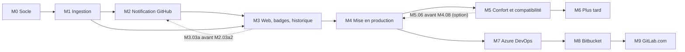
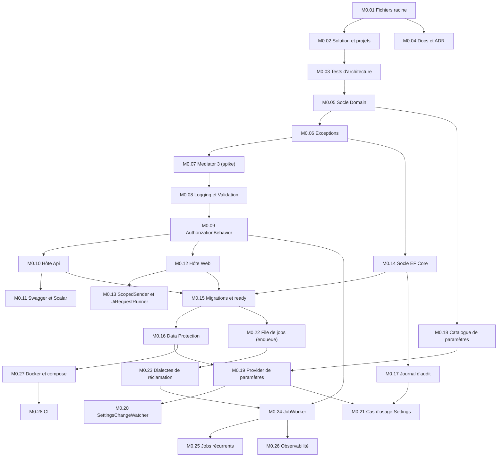
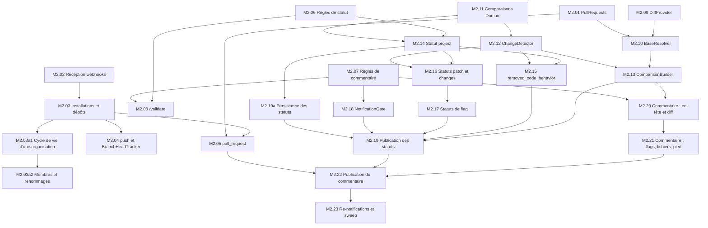
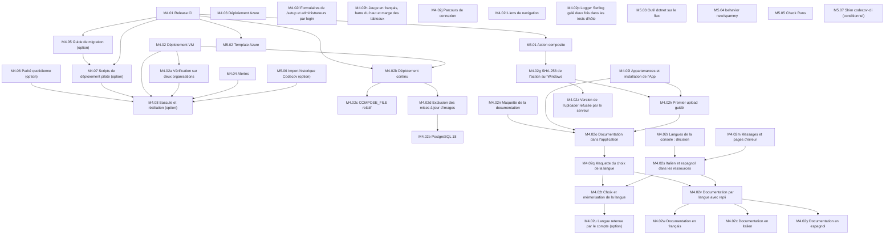
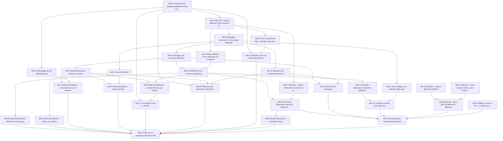
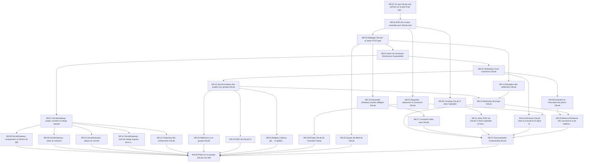

# Plan d'implémentation

> **Produit :** `CodeCoverage`. **Dépôt :** `code-coverage`. **Destination :** `docs/PLAN.md`.
> **Sources :** `docs/ARCHITECTURE.md`, qui fait foi pour le périmètre, et `docs/CONVENTIONS.md`, qui fait foi pour la forme. En cas de conflit, les exigences utilisateur listées dans CONVENTIONS priment, puis l'architecture.
> **Règle utilisateur :** chaque implémentation est découpée en **micro-features**. Une micro-feature est un changement autonome et facile à relire : en général une PR de quelques fichiers et de moins de 400 lignes environ, hors migrations générées, fixtures et `.resx`.
> **Ordre :** chaque micro-feature s'appuie uniquement sur des micro-features déjà fusionnées, et le build reste vert après chaque fusion.

---

## Table des matières

1. [Lecture du plan](#1-lecture-du-plan)
   - 1.1 Format d'une micro-feature
   - 1.2 Chemins et namespaces abrégés
   - 1.3 Définition de « terminé » commune
   - 1.4 Patrons transverses
2. [Vue d'ensemble des dépendances](#2-vue-densemble-des-dépendances)
3. [Jalon M0 – Socle](#3-jalon-m0--socle)
4. [Jalon M1 – Ingestion](#4-jalon-m1--ingestion)
5. [Jalon M2 – Notification GitHub](#5-jalon-m2--notification-github)
6. [Jalon M3 – Web, badges, historique](#6-jalon-m3--web-badges-historique)
7. [Jalon M4 – Mise en production](#7-jalon-m4--mise-en-production)
8. [Jalon M5 – Confort et compatibilité](#8-jalon-m5--confort-et-compatibilité)
9. [Jalon M6 – Plus tard](#9-jalon-m6--plus-tard)
   - 9.1 Jalon M7 – Azure DevOps Services
   - 9.2 Jalon M8 – Bitbucket Cloud
   - 9.3 Jalon M9 – GitLab.com
10. [Écarts et compléments par rapport à l'architecture](#10-écarts-et-compléments-par-rapport-à-larchitecture)
11. [Décisions ouvertes](#11-décisions-ouvertes)

---

## 1. Lecture du plan

### 1.1 Format d'une micro-feature

Chaque micro-feature porte les rubriques suivantes :

- un **ID** `M{jalon}.{nn}` et un titre ; un suffixe (`a`, `a1`…) insère une micro-feature sans renuméroter les autres ;
- l'**Objectif** ;
- les **Couches** touchées ;
- les **Fichiers / types** à créer ;
- les **Tests** à écrire, nommés `{Method}_{Scenario}_Should{Behavior}` (CONVENTIONS §13.2) ;
- les critères d'**Acceptation** ;
- les **Dépendances** (`Dépend de`) ;
- l'**Issue** GitHub qui la suit. Les issues d'un jalon sont créées au démarrage du jalon, une par
  micro-feature, avec le texte du plan, le jalon GitHub (`M1 – Ingestion`…) et les labels de couche
  (`layer: domain`…). Un jalon livré garde une issue récapitulative fermée (M0 : #1). Si le plan
  change, l'issue est mise à jour dans la même pull request.

### 1.2 Chemins et namespaces abrégés

| Abréviation | Chemin réel | Namespace racine |
|---|---|---|
| `Domain/…` | `src/CodeCoverage.Domain/…` | `CodeCoverage.Domain` |
| `Application/…` | `src/CodeCoverage.Application/…` | `CodeCoverage.Application` |
| `Infrastructure/…` | `src/CodeCoverage.Infrastructure/…` | `CodeCoverage.Infrastructure` |
| `PostgreSql/…` | `src/CodeCoverage.Infrastructure.PostgreSql/…` | `CodeCoverage.Infrastructure.PostgreSql` |
| `SqlServer/…` | `src/CodeCoverage.Infrastructure.SqlServer/…` | `CodeCoverage.Infrastructure.SqlServer` |
| `Api/…`, `Web/…`, `Uploader/…` | `src/CodeCoverage.{Api,Web,Uploader}/…` | idem |
| `X.Tests/…` | `tests/CodeCoverage.X.Tests/…` | `CodeCoverage.X.Tests` |

**Règle de namespace :** le namespace est la racine du projet suivie du chemin du dossier. Par exemple, `Domain/Coverage/LineCoverage.cs` est dans `CodeCoverage.Domain.Coverage`. Les noms de dossier ne reprennent jamais le nom d'un type (CONVENTIONS §3.2).

**Cas d'usage :** la notation « UC `Features/Uploads/Commands/ReceiveUpload` » désigne le dossier `Application/Features/Uploads/Commands/ReceiveUpload/`. Il contient `ReceiveUploadCommand.cs` (`public sealed record`) et `ReceiveUploadCommandHandler.cs` (`internal sealed`). Le suffixe **`+V`** ajoute `ReceiveUploadCommandValidator.cs`. Les requêtes suivent le même modèle avec `Query` et `QueryHandler`.

**Migration EF :** la notation « Migration `AddXxx` » signifie une migration générée dans `PostgreSql/Migrations/` **et** dans `SqlServer/Migrations/`, avec la mise à jour des deux `CodeCoverageDbContextModelSnapshot`.

### 1.3 Définition de « terminé » commune (applicable à chaque micro-feature)

1. L'en-tête de copyright est présent sur chaque `.cs` et chaque `.razor` (CONVENTIONS §3.1), suivi d'une ligne vide.
2. Les `#region` sont dans l'ordre de CONVENTIONS §3.3, avec `Ctors` et jamais `Constructors`.
3. Un seul type par fichier, aucun type imbriqué.
4. Documentation XML de style MSDN sur tout membre `public` et `internal` (CONVENTIONS §3.6). Pas de documentation XML dans les tests.
5. `ConfigureAwait(false)` partout, sauf `ConfigureAwait(true)` dans les `.razor.cs`. `ArgumentNullException.ThrowIfNull` en tête de chaque méthode publique.
6. Chaque nouveau code d'erreur `Feature.Reason` est ajouté à `{Feature}Errors.cs` **et** traduit dans `Web/Resources/Common.resx` et `Common.fr.resx`.
7. Tout changement de modèle EF s'accompagne de la migration pour les deux fournisseurs. Le test « aucun changement de modèle sans migration » reste vert.
8. `dotnet build -c Release` passe sans avertissement, et `dotnet test` est vert, Architecture.Tests compris. Les règles d'architecture ne sont jamais assouplies.
9. Message de commit : conventional commit et gitmoji, sans clé de ticket (CONVENTIONS §15).
10. Branche `feature/{id}-{sujet}` partie de `develop` (par exemple `feature/m1.01-coverage-math`),
    pull request vers `develop` dont la description contient `Closes #{issue}` (CONVENTIONS §15.1).

### 1.4 Patrons transverses (appliqués partout où ils s'appliquent)

- **Patron « envoi-et-conversion » (isolement du Domain).** La règle d'architecture interdit toute dépendance vers `CodeCoverage.Domain` dans `Api.*` et `Web.*`, hors `Mapping`, `Program` et `Configuration`. La vérification se fait sur l'IL, corps de méthodes compris. Un contrôleur ou une page ne nomme donc jamais un type du Domain, même comme argument générique de `Send<T>`.
  - Les requêtes qui renvoient un objet du Domain passent par une extension de mapper sur `ISender`, rangée dans le namespace `Mapping` :
    - Api : `public static async Task<CommitResponse> GetCommitResponseAsync(this ISender sender, GetCommitQuery query, CancellationToken ct)` ;
    - Web : `GetCommitViewModelAsync(...)`, appelée à travers `UiRequestRunner`.
  - Les commandes qui renvoient `Unit`, un identifiant ou un scalaire sont envoyées directement.
  - Nommage : `{UseCase}ResponseAsync` / `{UseCase}ResponsesAsync` pour l'Api, `{UseCase}ViewModelAsync` / `{UseCase}ViewModelsAsync` pour le Web, en plus de `ToCommand`, `ToQuery`, `ToResponse` et `ToViewModel`.
- **Patron « job ».**
  - La constante est ajoutée dans `Domain/Contracts/Jobs/JobTypes.cs`.
  - Le cas est ajouté dans `Infrastructure/Jobs/JobDispatcher.cs`, du payload JSON vers la commande.
  - La mise en file passe par une **méthode de repository unique**, dans la transaction de la modification, avec un paramètre `JobRequest`. `IJobQueue.EnqueueAsync` reste réservé aux déclenchements isolés (Web, relance).
  - `JobRequest.Create` prend l'organisation de la portée courante et lève sans elle ; `ForInstance` et `ForOrganization` sont explicites, le second limité à une liste de sources (ADR-013, M1.16g1). `SqlJobQueue` préfixe lui-même `LockKey` et `DedupKey` : une clé métier reste `repo:{githubRepoId}`.
- **Patron « persistance d'une feature ».**
  - `Infrastructure/Persistence/Configurations/{Entity}Configuration.cs` (`internal sealed`, `IEntityTypeConfiguration<T>`) ;
  - `Infrastructure/Persistence/Repositories/{Entity}Repository.cs` (`internal sealed`, implémente le port) ;
  - enregistrement dans `Infrastructure/DependencyInjection.cs` ;
  - tests d'intégration paramétrés pour les deux fournisseurs (`Infrastructure.Tests/Support/DatabaseFixture` avec Testcontainers PostgreSQL et MsSql) ;
  - une table d'organisation est déclarée par `IsOrganizationOwned`, classée dans `TableClassification`, et son repository a une classe de tests à deux organisations (ADR-013, M1.16d1, M1.16e).
- **Patron « isolation entre organisations » (ADR-013).**
  - Une portée DI n'entre dans une organisation que par `AuthorizationBehavior`, `JobWorker` ou `SystemCommandRunner`. `IgnoreQueryFilters` est interdit dans `src`, et les ports ne reçoivent aucun paramètre d'organisation.
  - Chaque message déclare exactement un marqueur d'accès (`IRepositoryScoped`, `IOrganizationScoped`, `IPublicOwnerAddressed`, `IAnonymousEntry`, `IUserScoped`, `IAdminOnly` ou `ISystemOnly`) et sert une seule audience.
  - Toute route adressant une donnée d'organisation contient l'owner ou l'organisation, et chaque nouvelle route ou page déclare sa sonde à deux organisations (M3.43a).
- **Patron « forge » (ADR-014).**
  - Un login, un identifiant de compte ou de dépôt n'a de sens que sur sa forge : toute recherche les accompagne de `Forge`, et les identifiants externes sont du texte.
  - Toute adresse d'organisation porte la forge (`/{forge}/{owner}/{repo}`, `/api/v1/repos/{forge}/{owner}/{repo}`, `/orgs/{forge}/{org}`) ; seules les URL compatibles Codecov gardent leur forme.
  - Un owner à plusieurs niveaux s'écrit avec `:` (`org:project`, `group:sub:sub2`) : le tenant est ce qui précède le premier `:`, le reste est le `Namespace` du dépôt.
  - L'Application appelle une forge par `IForgeGateway` et ses contrats `Domain/Contracts/Forges/` ; ce qui est propre à une forge (authentification, réception des webhooks) reste dans son adaptateur.
- **Patron « page Web ».**
  - `Web/Components/Pages/{Name}.razor` et `{Name}.razor.cs`, sans bloc `@code` ;
  - ViewModels dans `Web/ViewModels/{Feature}/` ;
  - mapper dans `Web/Mapping/{Feature}Mapper.cs` ;
  - envoi par `UiRequestRunner` ;
  - libellés par `IStringLocalizer<Common>` et préfixe CSS `cc-` ;
  - test bUnit dans `Web.Tests/Components/Pages/{Name}Tests.cs`.

---

## 2. Vue d'ensemble des dépendances

### 2.1 Jalons

Deux exceptions à l'ordre des jalons : M5.06 (import de l'historique Codecov) passe avant M4.08, parce qu'elle lit une API que la résiliation rend inaccessible ; M3.03a (appartenances) passe avant M2.03a2, dont les événements de membres alimentent cette table.

Les graphes suivants ne montrent que les dépendances **internes** à chaque jalon. Les dépendances vers des jalons antérieurs sont indiquées sur chaque fiche.

### 2.2 M0 – Socle

### 2.3 M1 – Ingestion

```mermaid
graph TD
  M1_01["M1.01 Lignes et CoverageMath"] --> M1_02["M1.02 Rapport et fusion"]
  M1_03["M1.03 PathPattern"] --> M1_04["M1.04 PathFixer normalisation"]
  M1_04 --> M1_05["M1.05 PathFixer résolution"]
  M1_06["M1.06 Diffs et LineShifter"]
  M1_03 --> M1_07["M1.07 Config Domain"]
  M1_01 --> M1_07
  M1_07 --> M1_08["M1.08 Parseur YAML"]
  M1_02 --> M1_09["M1.09 Catalogue de parseurs"]
  M1_09 --> M1_10["M1.10 Cobertura"]
  M1_09 --> M1_11["M1.11 OpenCover"]
  M1_09 --> M1_12["M1.12 LCOV"]
  M1_09 --> M1_13["M1.13 JaCoCo"]
  M1_09 --> M1_14["M1.14 Clover"]
  M1_05 --> M1_13
  M1_10 --> M1_15["M1.15 Oracle et partials_as_hits"]
  M1_11 --> M1_15
  M1_12 --> M1_15
  M1_13 --> M1_15
  M1_14 --> M1_15
  M1_07 --> M1_15
  M1_02 --> M1_16["M1.16 CcrCodec"]
  M1_16a1["M1.16a1 ADR-013 et plan"] --> M1_16b["M1.16b Organizations"]
  M1_16a1 --> M1_16a3["M1.16a3 ADR-014 multi-forge"]
  M1_16b --> M1_16c["M1.16c Contexte d'organisation"]
  M1_16a3 --> M1_16a4["M1.16a4 GitLab dans ADR-014"]
  M1_16a4 --> M1_16c
  M1_16c --> M1_16d1["M1.16d1 Filtre et classement"]
  M1_16d1 --> M1_16d2["M1.16d2 Estampille et garde"]
  M1_16d2 --> M1_16a2["M1.16a2 Documents d'architecture"]
  M1_16d2 --> M1_16e["M1.16e Gardes d'architecture"]
  M1_16c --> M1_16f["M1.16f Porte et marqueurs"]
  M1_16d1 --> M1_16g1["M1.16g1 Jobs par organisation"]
  M1_16g1 --> M1_16g2["M1.16g2 Audit par organisation"]
  M1_16a1 --> M1_16h["M1.16h Portées de paramètres"]
  M1_16d1 --> M1_16i["M1.16i Provider d'organisation"]
  M1_16h --> M1_16i
  M1_03 --> M1_17["M1.17 Dépôts et installations"]
  M1_16d2 --> M1_17
  M1_16f --> M1_17
  M1_17 --> M1_18["M1.18 Commits et uploads"]
  M1_18 --> M1_19["M1.19 Sessions et rapports"]
  M1_16 --> M1_19
  M1_19 --> M1_20["M1.20 ReportView"]
  M1_02 --> M1_20
  M1_03 --> M1_20
  M1_07 --> M1_20
  M1_18 --> M1_21["M1.21 Stockage brut"]
  M1_17 --> M1_22["M1.22 Jetons d'upload"]
  M1_22 --> M1_22a["M1.22a Admission et exécuteur système"]
  M1_16f --> M1_22a
  M1_16g1 --> M1_22a
  M1_22 --> M1_23["M1.23 Verbe admin CLI"]
  M1_22a --> M1_23
  M1_24["M1.24 Port de forge"] --> M1_25["M1.25 Client GitHub App"]
  M1_25 --> M1_26["M1.26 Passerelle lecture"]
  M1_26 --> M1_27["M1.27 Caches commits et arbres"]
  M1_18 --> M1_27
  M1_08 --> M1_28["M1.28 ConfigResolver"]
  M1_26 --> M1_28
  M1_17 --> M1_28
  M1_16i --> M1_28
  M1_25 --> M1_29["M1.29 Validation OIDC"]
  M1_22 --> M1_30["M1.30 UploadAuthenticator"]
  M1_29 --> M1_30
  M1_16f --> M1_30
  M1_30 --> M1_31["M1.31 ReceiveUpload"]
  M1_21 --> M1_31
  M1_26 --> M1_31
  M1_16g1 --> M1_31
  M1_31 --> M1_32["M1.32 POST /uploads"]
  M1_32 --> M1_33["M1.33 GET repos/uploads/id"]
  M1_31 --> M1_34["M1.34 ProcessUpload"]
  M1_15 --> M1_34
  M1_05 --> M1_34
  M1_28 --> M1_34
  M1_27 --> M1_34
  M1_19 --> M1_34
  M1_34 --> M1_35["M1.35 Correction du merge"]
  M1_34 --> M1_36["M1.36 FinalizeCommit"]
  M1_20 --> M1_36
  M1_06 --> M1_37["M1.37 CarryforwardBuilder"]
  M1_20 --> M1_37
  M1_07 --> M1_37
  M1_36 --> M1_38["M1.38 Carryforward intégré"]
  M1_37 --> M1_38
  M1_27 --> M1_38
  M1_38 --> M1_39["M1.39 Reprocess et RetryUpload"]
  M1_40["M1.40 Uploader : squelette"] --> M1_41["M1.41 Recherche de fichiers"]
  M1_40 --> M1_42["M1.42 Contexte CI"]
  M1_42 --> M1_43["M1.43 Git et réseau"]
  M1_41 --> M1_44["M1.44 Envoi HTTP"]
  M1_43 --> M1_44
  M1_32 --> M1_44
  M1_44 --> M1_45["M1.45 --wait et --dry-run"]
  M1_33 --> M1_45
  M1_45 --> M1_46["M1.46 Binaires servis par l'Api"]
  M1_38 --> M1_47["M1.47 Outil de parité pilote"]
  M1_46 --> M1_47
  M1_23 --> M1_47
```

### 2.4 M2 – Notification GitHub

### 2.5 M3 – Web, badges, historique

```mermaid
graph TD
  M3_01["M3.01 Utilisateurs"] --> M3_02["M3.02 Passerelle utilisateur"]
  M3_02 --> M3_03a["M3.03a Appartenances"]
  M3_03a --> M3_03["M3.03 Connexion GitHub"]
  M3_02 --> M3_03
  M3_03 --> M3_04["M3.04 Accès par dépôt"]
  M3_04 --> M3_05["M3.05 Jetons API"]
  M3_05 --> M3_06["M3.06 API dépôts"]
  M3_06 --> M3_07["M3.07 Activer et désactiver"]
  M3_05 --> M3_08["M3.08 API commits"]
  M3_08 --> M3_09["M3.09 API notify et reprocess"]
  M3_05 --> M3_10["M3.10 API PR et compare"]
  M3_05 --> M3_11["M3.11 API jetons"]
  M3_05 --> M3_12["M3.12 API paramètres et config"]
  M3_06 --> M3_12
  M3_04 --> M3_12a["M3.12a API paramètres d'organisation"]
  M3_05 --> M3_12a
  M3_05 --> M3_13["M3.13 API opérations"]
  M3_14["M3.14 Badge Domain et jetons"] --> M3_15["M3.15 Rendu SVG et routes"]
  M3_06 --> M3_15
  M3_05 --> M3_16["M3.16 Historique"]
  M3_06 --> M3_16
  M3_17["M3.17 Rétention"]
  M3_18["M3.18 Artefact de design UI (validé)"] --> M3_19["M3.19 Navigation"]
  M3_04 --> M3_19
  M3_03a --> M3_19
  M3_19 --> M3_20["M3.20 Accueil"]
  M3_03a --> M3_20
  M3_06 --> M3_20
  M3_16 --> M3_20
  M3_19 --> M3_21["M3.21 Vue d'ensemble : cartes"]
  M3_06 --> M3_21
  M3_16 --> M3_21
  M3_12 --> M3_21
  M3_21 --> M3_22["M3.22 Vue d'ensemble : graphique"]
  M3_16 --> M3_22
  M3_21 --> M3_23["M3.23 Vue d'ensemble : listes et badge"]
  M3_24 --> M3_23
  M3_30 --> M3_23
  M3_14 --> M3_23
  M3_35 --> M3_23
  M3_19 --> M3_24["M3.24 Commits"]
  M3_08 --> M3_24
  M3_06 --> M3_24
  M3_24 --> M3_25["M3.25 Commit : synthèse"]
  M3_25 --> M3_26["M3.26 Commit : uploads"]
  M3_25 --> M3_27["M3.27 Commit : fichiers et actions"]
  M3_26 --> M3_27
  M3_09 --> M3_27
  M3_34 --> M3_27
  M3_04 --> M3_28["M3.28 GetAnnotatedSource"]
  M3_28 --> M3_29["M3.29 Page source annotée"]
  M3_27 --> M3_29
  M3_10 --> M3_29
  M3_31 --> M3_29
  M3_19 --> M3_30["M3.30 Liste des PR"]
  M3_10 --> M3_30
  M3_30 --> M3_31["M3.31 PR : synthèse"]
  M3_31 --> M3_32["M3.32 PR : détails"]
  M3_29 --> M3_32
  M3_32 --> M3_33["M3.33 Comparaison libre"]
  M3_21 --> M3_34["M3.34 Réglages dépôt : état et YAML"]
  M3_07 --> M3_34
  M3_12 --> M3_34
  M3_34 --> M3_35["M3.35 Réglages dépôt : jetons"]
  M3_11 --> M3_35
  M3_14 --> M3_35
  M3_19 --> M3_36["M3.36 Mon compte"]
  M3_05 --> M3_36
  M3_35 --> M3_36
  M3_19 --> M3_37["M3.37 Admin paramètres"]
  M3_19 --> M3_37a["M3.37a Paramètres d'organisation"]
  M3_12a --> M3_37a
  M3_37 --> M3_37a
  M3_19 --> M3_38["M3.38 Jetons d'organisation"]
  M3_35 --> M3_38
  M3_37a --> M3_38
  M3_19 --> M3_39["M3.39 Dépôts d'organisation"]
  M3_07 --> M3_39
  M3_37a --> M3_39
  M3_13 --> M3_13a["M3.13a Heartbeat et quota persistés"]
  M3_19 --> M3_40["M3.40 Admin opérations"]
  M3_13a --> M3_40
  M3_19 --> M3_41["M3.41 Admin audit"]
  M3_19 --> M3_41a["M3.41a Admin organisations"]
  M3_42["M3.42 Setup : backend"] --> M3_43["M3.43 Page /setup"]
  M3_18 --> M3_43
  M3_13 --> M3_43a["M3.43a Suite d'isolation"]
  M3_15 --> M3_43a
  M3_20 --> M3_43a
  M3_37 --> M3_43a
  M3_37a --> M3_43a
  M3_38 --> M3_43a
  M3_39 --> M3_43a
  M3_40 --> M3_43a
  M3_41 --> M3_43a
  M3_41a --> M3_43a
  M3_43 --> M3_43a
```

### 2.6 M4 et M5

### 2.7 M7 – Azure DevOps Services

```mermaid
graph TD
  M7_01["M7.01 Calcul du diff sur Azure DevOps (spike)"]
  M7_02["M7.02 Amendement d'ADR-014 et ADR-015 (connexions de…"]
  M7_03["M7.03 Limitation de débit et indisponibilité neutres"]
  M7_04["M7.04 Résolution des passerelles par forge"]
  M7_05["M7.05 Disponibilité des forges : admission et connex…"]
  M7_06["M7.06 Table ForgeConnections et son port"]
  M7_07["M7.07 TrackedRepository.ConnectionId en texte"]
  M7_08["M7.08 Appelants sans long.Parse de la connexion"]
  M7_09["M7.09 Port neutre de l'annuaire et synchronisation d…"]
  M7_10["M7.10 Coordinateur SyncConnections"]
  M7_11["M7.11 Synchronisation manuelle, transfert et réécrit…"]
  M7_12["M7.12 Admission d'une organisation par connexion"]
  M7_12a["M7.12a Enregistrement d'une organisation et de sa con…"]
  M7_13["M7.13 Rotation des secrets d'une connexion"]
  M7_14["M7.14 Santé des connexions (CheckConnections)"]
  M7_15["M7.15 Port neutre de l'utilisateur et forge de SignI…"]
  M7_16["M7.16 Port neutre du jeton de l'utilisateur"]
  M7_17["M7.17 Adhésions et droits neutres"]
  M7_18["M7.18 Livraisons de webhooks par forge"]
  M7_19["M7.19 Événements neutres de push, de pull request et…"]
  M7_20["M7.20 Traduction par forge et traitement neutre des…"]
  M7_21["M7.21 Réception neutre des webhooks par connexion"]
  M7_22["M7.22 Table ForgeHooks"]
  M7_23["M7.23 Gestion neutre des hooks : EnsureForgeHooks et…"]
  M7_24["M7.24 Liens par forge"]
  M7_25["M7.25 Capacités de commentaire par forge"]
  M7_26["M7.26 PullRequests.BaseShaGitHub renommé BaseShaForge"]
  M7_27["M7.27 Forge et slug à plusieurs niveaux dans l'uploa…"]
  M7_28["M7.28 Quotas par forge : stockage et suivi"]
  M7_29["M7.29 Quotas par forge : métriques et alertes"]
  M7_30["M7.30 Table des segments Codecov par forge"]
  M7_31["M7.31 Maquette : connexion par forge, listes de forg…"]
  M7_32["M7.32 Maquette : /setup multi-forge et administrateu…"]
  M7_33["M7.33 Maquette : page de connexion d'une organisation"]
  M7_34["M7.34 Page de connexion à choix de forge"]
  M7_35["M7.35 Libellés et listes de forges neutres dans l'in…"]
  M7_36["M7.36 Opérations : forge des livraisons et quotas pa…"]
  M7_37["M7.37 Administrateurs de l'instance sur toute forge"]
  M7_38["M7.38 Page de connexion d'une organisation"]
  M7_39["M7.39 Réglages AzureDevOps:* et jetons Entra ID"]
  M7_40["M7.40 Vérification d'une connexion Azure DevOps"]
  M7_41["M7.41 Formulaire d'admission Azure DevOps et ligne d…"]
  M7_42["M7.42 Assistant /setup indépendant de la forge"]
  M7_43["M7.43 Synchronisation des projets et des dépôts Azur…"]
  M7_44["M7.44 AzureDevOpsGateway : dépôts, commits et pull r…"]
  M7_45["M7.45 AzureDevOpsGateway : arbres et contenus"]
  M7_46["M7.46 AzureDevOpsGateway : comparaison et fichiers d…"]
  M7_47["M7.47 AzureDevOpsGateway : statuts"]
  M7_48["M7.48 AzureDevOpsGateway : commentaire de pull request"]
  M7_49["M7.49 Réception des service hooks Azure DevOps"]
  M7_50["M7.50 Traduction des service hooks Azure DevOps"]
  M7_51["M7.51 Abonnements des service hooks Azure DevOps"]
  M7_52["M7.52 Passerelle utilisateur et jeton délégué Azure…"]
  M7_53["M7.53 Connexion Web par Microsoft Entra ID"]
  M7_54["M7.54 Adhésions et droits sur les dépôts Azure DevOps"]
  M7_55["M7.55 Upload par jeton pour Azure DevOps"]
  M7_56["M7.56 Uploader sur Azure Pipelines avec Azure Repos"]
  M7_57["M7.57 Documentation d'onboarding Azure DevOps"]
  M7_58["M7.58 Pilote sur une organisation Azure DevOps réelle"]
  M7_01 --> M7_02
  M7_02 --> M7_03
  M7_02 --> M7_04
  M7_04 --> M7_05
  M7_02 --> M7_06
  M7_06 --> M7_07
  M7_07 --> M7_08
  M7_04 --> M7_09
  M7_08 --> M7_09
  M7_09 --> M7_10
  M7_09 --> M7_11
  M7_05 --> M7_12
  M7_09 --> M7_12
  M7_12a --> M7_12
  M7_06 --> M7_12a
  M7_09 --> M7_12a
  M7_12 --> M7_13
  M7_10 --> M7_14
  M7_12 --> M7_14
  M7_04 --> M7_15
  M7_15 --> M7_16
  M7_09 --> M7_17
  M7_16 --> M7_17
  M7_02 --> M7_18
  M7_18 --> M7_19
  M7_11 --> M7_20
  M7_19 --> M7_20
  M7_06 --> M7_21
  M7_18 --> M7_21
  M7_20 --> M7_21
  M7_06 --> M7_22
  M7_10 --> M7_23
  M7_21 --> M7_23
  M7_22 --> M7_23
  M7_04 --> M7_24
  M7_04 --> M7_25
  M7_02 --> M7_26
  M7_02 --> M7_27
  M7_03 --> M7_28
  M7_28 --> M7_29
  M7_02 --> M7_30
  M7_02 --> M7_31
  M7_02 --> M7_32
  M7_02 --> M7_33
  M7_05 --> M7_34
  M7_31 --> M7_34
  M7_24 --> M7_35
  M7_34 --> M7_35
  M7_18 --> M7_36
  M7_28 --> M7_36
  M7_31 --> M7_36
  M7_32 --> M7_37
  M7_11 --> M7_38
  M7_13 --> M7_38
  M7_14 --> M7_38
  M7_23 --> M7_38
  M7_33 --> M7_38
  M7_03 --> M7_39
  M7_05 --> M7_39
  M7_06 --> M7_39
  M7_12 --> M7_40
  M7_39 --> M7_40
  M7_35 --> M7_41
  M7_40 --> M7_41
  M7_33 --> M7_41
  M7_05 --> M7_42
  M7_32 --> M7_42
  M7_39 --> M7_42
  M7_10 --> M7_43
  M7_40 --> M7_43
  M7_04 --> M7_44
  M7_39 --> M7_44
  M7_44 --> M7_45
  M7_01 --> M7_46
  M7_44 --> M7_46
  M7_44 --> M7_47
  M7_24 --> M7_48
  M7_25 --> M7_48
  M7_40 --> M7_48
  M7_44 --> M7_48
  M7_21 --> M7_49
  M7_39 --> M7_49
  M7_20 --> M7_50
  M7_44 --> M7_50
  M7_23 --> M7_51
  M7_43 --> M7_51
  M7_49 --> M7_51
  M7_15 --> M7_52
  M7_16 --> M7_52
  M7_39 --> M7_52
  M7_34 --> M7_53
  M7_52 --> M7_53
  M7_17 --> M7_54
  M7_52 --> M7_54
  M7_08 --> M7_55
  M7_27 --> M7_55
  M7_30 --> M7_55
  M7_43 --> M7_55
  M7_27 --> M7_56
  M7_41 --> M7_57
  M7_51 --> M7_57
  M7_53 --> M7_57
  M7_56 --> M7_57
  M7_26 --> M7_58
  M7_29 --> M7_58
  M7_36 --> M7_58
  M7_37 --> M7_58
  M7_38 --> M7_58
  M7_42 --> M7_58
  M7_45 --> M7_58
  M7_46 --> M7_58
  M7_47 --> M7_58
  M7_48 --> M7_58
  M7_50 --> M7_58
  M7_54 --> M7_58
  M7_55 --> M7_58
  M7_57 --> M7_58
```

### 2.8 M8 – Bitbucket Cloud

### 2.9 M9 – GitLab.com

---

## 3. Jalon M0 – Socle

> Livré par le commit initial du dépôt public ; issue récapitulative fermée : [#1](https://github.com/gaetanthouvenin/code-coverage/issues/1).

**Critère de sortie :** `docker compose up` donne une Api et un Web sains, sur PostgreSQL comme sur SQL Server. Swagger est visible, et les tests d'architecture sont au vert.

#### M0.01 — Fichiers racine du dépôt
- **Objectif :** poser les fichiers de configuration et les documents racine du dépôt.
- **Couches :** dépôt.
- **Fichiers :**
  - `.editorconfig` et `GitVersion.yml`, propres à ce dépôt (CONVENTIONS §2.1 et §2.2) ;
  - `.github/SECURITY.md` ;
  - `global.json` (`10.0.403`, `rollForward: latestFeature`) ;
  - `.gitignore` (VisualStudio et ajouts de CONVENTIONS §2.4), `.gitattributes` (`*.verified.txt text eol=lf`), `.dockerignore` ;
  - `.env.example`, `README.md`, `AGENT.md`, `CLAUDE.md`.
- **Tests :** aucun (fichiers seulement).
- **Acceptation :**
  - les fichiers sont versionnés dans ce dépôt, qui en est la seule source ;
  - aucun `nuget.docker.config` ni flux NuGet privé : la restauration utilise uniquement nuget.org.
- **Dépend de :** —

#### M0.02 — Solution, `Directory.Build.props` et projets vides
- **Objectif :** créer la solution et tous les projets, compilables et vides.
- **Couches :** toutes.
- **Fichiers :**
  - `CodeCoverage.slnx` (dossiers `/config/`, `/deploy/`, `/src/`, `/tests/`) et `CodeCoverage.sln.DotSettings` (CONVENTIONS §3.1 et §3.7) ;
  - `src/Directory.Build.props` (CONVENTIONS §2.5, avec `Copyright`, `Company` et `Authors` à « Gaëtan Thouvenin », sans `RepositoryUrl` ni `PackageProjectUrl`), `src/default.ruleset` (CONVENTIONS §2.7, `Name="CodeCoverage Rules"`), `tests/Directory.Build.props` (CONVENTIONS §2.6) ;
  - `.csproj` de Domain, Application, Infrastructure, Infrastructure.PostgreSql, Infrastructure.SqlServer, Api (`Microsoft.NET.Sdk.Web`), Web (`Microsoft.NET.Sdk.Web`) et Uploader (`Exe`, `PackAsTool`, `ToolCommandName=coverage-upload`, `TargetFramework=net10.0`, `RollForward=Major`) ;
  - les sept projets de tests ;
  - `Api/Program.cs` et `Web/Program.cs` minimaux, chacun avec `public partial class Program;` ;
  - `Uploader/Program.cs` qui renvoie 0.
- **Tests :** aucun test unitaire. Le pipeline local `dotnet build -c Release` et `dotnet test` passe.
- **Acceptation :**
  - les références de projets respectent le tableau §3.2 de l'architecture ;
  - l'Uploader ne référence aucun projet ;
  - `InternalsVisibleTo` pour les projets de tests et `DynamicProxyGenAssembly2`.
- **Dépend de :** M0.01

#### M0.03 — Tests d'architecture (règles de base)
- **Objectif :** verrouiller les règles avant d'écrire le premier type métier.
- **Couches :** Architecture.Tests.
- **Fichiers :**
  - `Architecture.Tests/Support/SolutionAssemblies.cs` et `Support/SourceFiles.cs` (énumération de `src/**/*.cs|razor` et `tests/**/*.cs`) ;
  - `LayerDependencyTests.cs`, `FeatureLayoutTests.cs`, `HandlerConventionTests.cs`, `PortConventionTests.cs`, `PresentationIsolationTests.cs`, `SourceFileConventionTests.cs`.
- **Tests :**
  - `Domain_ShouldNotDependOnAnyProjectOrPackage` ;
  - `Application_ShouldOnlyDependOnDomain` ;
  - `Infrastructure_ShouldNotDependOnHosts` ;
  - `Uploader_ShouldReferenceNoSolutionProject` ;
  - `UseCases_ShouldLiveInFeatureCommandsOrQueriesFolder` ;
  - `Handlers_ShouldBeInternalSealed` ;
  - `Ports_ShouldNotExposeQueryable` ;
  - `Ports_ShouldRequireCancellationToken` (sans valeur par défaut) ;
  - `Ports_ShouldOfferNoUnitOfWork` ;
  - `Types_ShouldNotBeSuffixedDto` ;
  - `ApiAndWeb_ShouldNotReferenceDomain_ExceptMappingProgramAndConfiguration` (NetArchTest, IL compris : patron §1.4) ;
  - `SourceFiles_ShouldStartWithCopyrightHeader` ;
  - `SourceFiles_ShouldNeverUseConstructorsRegion` ;
  - `SourceFiles_ShouldDeclareOneTopLevelType`.
- **Acceptation :**
  - les règles passent sur la solution vide (les règles sans objet passent sans erreur) ;
  - chaque règle cassée volontairement dans un test négatif local échoue avec un message lisible.
- **Dépend de :** M0.02

#### M0.04 — Documentation d'architecture et ADR
- **Objectif :** versionner l'architecture et les décisions actées.
- **Couches :** docs.
- **Fichiers :**
  - `docs/ARCHITECTURE.md`, `docs/CONVENTIONS.md`, `docs/PLAN.md` ;
  - `docs/adr/0001-mediator.md` à `docs/adr/0012-uploader-distribution.md` (ADR-001 à ADR-012 de l'architecture §13.1), au format Contexte / Décision / Conséquences.
- **Tests :** —
- **Acceptation :**
  - l'ADR-001 porte le statut « proposé » jusqu'à M0.07 ;
  - l'ADR-003 (mono-tenant) est rédigé et rappelé dans les décisions ouvertes (§11).
- **Dépend de :** M0.01

#### M0.05 — Socle du Domain
- **Objectif :** créer les ports et marqueurs partagés par toutes les features.
- **Couches :** Domain.
- **Fichiers :**
  - `Domain/Ports/IClock.cs` (`UtcNow`) ;
  - `Domain/Ports/ICurrentUser.cs` (`UserId?`, `Login?`, `IsAuthenticated`, `IsAdmin`, `IsSystem`) ;
  - `Domain/IDomainEvent.cs` et `Domain/IHasDomainEvents.cs` (CONVENTIONS §4.4).
- **Tests :** `Architecture.Tests` (les ports respectent `PortConventionTests`).
- **Acceptation :** le Domain compile sans aucun `PackageReference`.
- **Dépend de :** M0.03

#### M0.06 — Exceptions « proches HTTP »
- **Objectif :** créer la hiérarchie de refus de l'Application (CONVENTIONS §6).
- **Couches :** Application.
- **Fichiers :**
  - dans `Application/Exceptions/` : `ApplicationException.cs` (abstraite, `ErrorCode`), `BadRequestException.cs`, `ValidationException.cs` (`IReadOnlyDictionary<string,string[]> Errors`, code `General.ValidationFailed`), `UnauthorizedException.cs`, `ForbiddenException.cs`, `NotFoundException.cs` (fabrique `For(string entity, string id)`), `ConflictException.cs`, `UnprocessableEntityException.cs`, `BadGatewayException.cs`, `RetryLaterException.cs` (`TimeSpan Delay`, interne au worker) ;
  - `Application/Exceptions/ErrorCodes/GeneralErrors.cs` (`ValidationFailed`, `Unexpected`).
- **Tests :** `Application.Tests/Exceptions/ValidationExceptionTests` — `Ctor_WithFailuresOnSameProperty_ShouldGroupErrors`, `NotFoundException_For_ShouldBuildFeatureNotFoundCode`.
- **Acceptation :**
  - le code HTTP figure uniquement dans la documentation XML (« Maps to HTTP 404 Not Found. ») ;
  - l'alias `ApplicationException` est documenté dans `AGENT.md`.
- **Dépend de :** M0.03

#### M0.07 — Médiateur martinothamar `Mediator` 3.x (spike et montage)
- **Objectif :** valider le montage du générateur de source et figer l'API v3.
- **Couches :** Application, Api, Web, Application.Tests.
- **Rappel de l'API v3 :**
  - `IPipelineBehavior<TMessage,TResponse>.Handle(TMessage message, MessageHandlerDelegate<TMessage,TResponse> next, CancellationToken ct)` renvoie `ValueTask<TResponse>` ;
  - `next(message, ct)` ;
  - `ICommand<T>`, `IQuery<T>`, `ICommandHandler<,>`, `IQueryHandler<,>` ;
  - options `Namespace`, `ServiceLifetime`, `GenerateTypesAsInternal`, `PipelineBehaviors` et `Assemblies`.
- **Fichiers :**
  - références `Mediator.Abstractions` 3.\* et `Mediator.SourceGenerator` 3.\* (PrivateAssets all) dans Application ;
  - `Application/DependencyInjection.cs` (`AddApplication()`, `AddMediator` avec `Namespace = "CodeCoverage.Application.Messaging"`, `ServiceLifetime.Scoped`, `GenerateTypesAsInternal = true`, `Assemblies = [typeof(DependencyInjection)]`, `PipelineBehaviors = []`) ;
  - `Application/Features/Diagnostics/Queries/Ping/PingQuery.cs` et `PingQueryHandler.cs`, cas d'usage de diagnostic conservé : il renvoie la version de l'assembly et sert au smoke test.
- **Tests :**
  - `Application.Tests/Messaging/MediatorSignatureTests` — `PipelineBehavior_ShouldCompileAgainstV3Signature` (behavior factice compilé) ;
  - `Application.Tests/Features/Diagnostics/Queries/Ping/PingQueryHandlerTests` ;
  - `Api.Tests/Smoke/MediatorWiringTests` — `Send_PingQuery_FromApiHost_ShouldReturnVersion` ;
  - même test côté Web.
- **Acceptation :**
  - le générateur n'est référencé que par Application, ce qui fait un seul générateur par artefact ;
  - les handlers `internal sealed` sont résolus sans `InternalsVisibleTo` ;
  - l'ADR-001 passe à « accepté ».
  - Si le montage échoue, le repli est appliqué et l'ADR est mis à jour (voir §11) : générateur dans Api et Web, conformément à la recommandation du README v3 de l'installer dans le projet exécutable, avec `InternalsVisibleTo`.
- **Dépend de :** M0.06

#### M0.08 — `LoggingBehavior` et `ValidationBehavior`
- **Objectif :** mettre en place le pipeline Logging puis Validation (CONVENTIONS §5.6 et §6.4), adapté à l'API v3.
- **Couches :** Application.
- **Fichiers :**
  - `Application/Behaviors/LoggingBehavior.cs` :
    - requêtes en `Debug`, commandes en `Information` ;
    - `ApplicationException` en `Warning` avec son `ErrorCode`, le reste en `Error` ;
    - **ne sérialise jamais le message** ;
  - `Application/Behaviors/ValidationBehavior.cs` (lève `ValidationException`) ;
  - packages FluentValidation 12.\* ;
  - `AddValidatorsFromAssembly(..., includeInternalTypes: true)` ;
  - `PipelineBehaviors = [LoggingBehavior<,>, ValidationBehavior<,>]`.
- **Tests :**
  - `Application.Tests/Behaviors/LoggingBehaviorTests` — `Handle_WithRefusal_ShouldLogWarningWithErrorCode`, `Handle_WithQuery_ShouldLogAtDebug`, `Handle_ShouldNeverLogMessageProperties` (message portant une propriété sensible) ;
  - `ValidationBehaviorTests` — `Handle_WithFailingRule_ShouldThrowValidationException`, `Handle_WithoutValidator_ShouldCallNext`.
- **Acceptation :** l'ordre des behaviors est vérifié par un test d'intégration avec un handler factice.
- **Dépend de :** M0.07

#### M0.09 — `AuthorizationBehavior` (admin et système) et principal courant
- **Objectif :** appliquer les marqueurs `IAdminOnly` et `ISystemOnly`, et poser le principal système du worker. `IRepositoryScoped` est déclaré ici et appliqué en M3.04.
- **Couches :** Application, Infrastructure.
- **Fichiers :**
  - `Application/Security/IRepositoryScoped.cs` (`Owner`, `Name`, `RequiredPermission`), `IAdminOnly.cs`, `ISystemOnly.cs` ;
  - `Application/Security/SecurityErrors.cs` (`Access.Forbidden`, `Access.Unauthenticated`) ;
  - `Application/Behaviors/AuthorizationBehavior.cs`, inséré entre Logging et Validation ;
  - `Domain/Users/RepositoryPermission.cs` (enum `Read`, `Write`, `Admin`) ;
  - `Infrastructure/Identity/CurrentUserContext.cs` (scoped, implémente `ICurrentUser`, `public SetUser(...)`, `internal SetSystem()`) ;
  - `Infrastructure/DependencyInjection.cs` (`AddInfrastructure` minimal).
- **Tests :**
  - `Application.Tests/Behaviors/AuthorizationBehaviorTests` — `Handle_AdminOnlyWithoutAdmin_ShouldThrowForbidden`, `Handle_SystemOnlyFromUser_ShouldThrowForbidden`, `Handle_AsSystem_ShouldPassEveryCheck` ;
  - `Infrastructure.Tests/Identity/CurrentUserContextTests`.
- **Acceptation :** `SetSystem` est inaccessible depuis Api et Web, ce que vérifie le compilateur (`internal`).
- **Dépend de :** M0.08

#### M0.10 — Hôte Api : composition, erreurs et sécurité
- **Objectif :** obtenir un hôte Api complet, sans endpoint métier.
- **Couches :** Api.
- **Fichiers :**
  - `Api/Program.cs` : bootstrap Serilog, `try`/`catch` `Fatal`, `CloseAndFlushAsync` ;
  - `Api/CodeCoverageApi.cs` (`Route = "api/v1"`, `Prefix`, `Tag`) ;
  - `Api/Configuration/SerilogConfiguration.cs`, `Configuration/PresentationConfiguration.cs` (`AddControllers` et `JsonStringEnumConverter`), `Configuration/HealthProbes.cs` (`/health/live`) ;
  - `Api/Configuration/Errors/ApiExceptionHandler.cs` (CONVENTIONS §10.3, `errorCode` et `errors`) ;
  - `Api/Configuration/Security/SecurityHeadersMiddleware.cs`, `Configuration/Security/ForwardedHeadersConfiguration.cs` (`ForwardedHeaders:KnownProxies`) ;
  - `Api/Configuration/Identity/HttpCurrentUserMiddleware.cs` (alimente `CurrentUserContext` depuis les claims ; anonyme pour l'instant).
- **Tests :** `Api.Tests/Support/CodeCoverageApiFactory.cs`, plus un contrôleur de test enregistré comme `ApplicationPart` dans le projet de tests (`Api.Tests/Support/ThrowingController.cs`). `Api.Tests/Errors/ApiExceptionHandlerTests` contient :
  - `Get_WhenValidationFails_ShouldReturn400WithErrors` ;
  - `…_NotFound_ShouldReturn404WithErrorCode` ;
  - `…_Bug_ShouldReturn500WithoutDetail` ;
  - `…_BadGateway_ShouldReturn502` ;
  - `SecurityHeaders_ShouldBePresent`.
- **Acceptation :** `/health/live` répond 200, chaque exception de CONVENTIONS §6 a son statut et les en-têtes de CONVENTIONS §8.6 sont présents.
- **Dépend de :** M0.09

#### M0.11 — OpenAPI : Swashbuckle, Swagger UI et Scalar
- **Objectif :** documentation d'API avec Swagger UI et Scalar (CONVENTIONS §10.5).
- **Couches :** Api.
- **Fichiers :**
  - `Api/Configuration/OpenApiConfiguration.cs` (`AddApiDocumentation`, XML des assemblies Api et Application, schéma `Bearer`) ;
  - `Api/Configuration/ScalarConfiguration.cs` (`MapScalarDocumentation`, redirection de `/scalar`) ;
  - dans `Program.cs` : condition `Features:EnableApiDocs` hors Production.
- **Tests :** `Api.Tests/OpenApi/OpenApiDocumentTests` — `Get_OpenApiJson_ShouldDescribeBearerScheme`, `Get_Swagger_InProduction_ShouldReturn404`, `Get_Scalar_ShouldRedirectToV1`.
- **Acceptation :** `/openapi/v1.json`, `/swagger` et `/scalar/v1` sont servis, et la documentation XML de `PingController` (`GET /api/v1/diagnostics/ping`, Name `Ping`) apparaît.
- **Dépend de :** M0.10

#### M0.12 — Hôte Web : coquille Blazor
- **Objectif :** hôte Blazor Server avec composants UI maison (`Web/Components/Ui`), sans page métier.
- **Couches :** Web.
- **Fichiers :**
  - `Web/Program.cs` : Serilog, `AddCoverageUi()`, `AddRazorComponents().AddInteractiveServerComponents()`, `UseExceptionHandler("/error", true)`, `UseStatusCodePagesWithReExecute("/not-found")` ;
  - `Web/Components/App.razor`, `Routes.razor` (`@rendermode="InteractiveServer"`), `Layout/MainLayout.razor` et `.razor.cs` (`CcAppShell`, `CcErrorBoundary` réinitialisé sur `LocationChanged`) ;
  - pages `Components/Pages/Error.razor(.cs)`, `NotFound.razor(.cs)`, `AccessDenied.razor(.cs)` ;
  - `Web/Resources/Common.resx` et `Common.fr.resx` ;
  - `Web/Configuration/SerilogConfiguration.cs`, `Configuration/HealthProbes.cs`, `Configuration/Security/SecurityHeadersMiddleware.cs` (CSP `frame-ancestors`, `SuppressXFrameOptionsHeader`) ;
  - `wwwroot/css/app.css` (préfixe `cc-`).
- **Tests :** `Web.Tests/Components/Layout/MainLayoutTests` (bUnit) — `NavigationChange_AfterError_ShouldRecoverBoundary` ; `Web.Tests/Smoke/WebHostTests` — `Get_Live_ShouldReturn200`.
- **Acceptation :** page d'accueil vide rendue dans la coquille, mode sombre fonctionnel, pages d'erreur localisées en anglais et en français.
- **Dépend de :** M0.09, M0.12a

#### M0.12a — Bibliothèque de composants UI maison (socle visuel)
- **Objectif :** transposer l'identité de la maquette validée (`docs/design/ui-mockup.html`) en composants Razor réutilisables, sans librairie tierce ni thème externe (CONVENTIONS §11.6).
- **Couches :** Web.
- **Fichiers :**
  - `wwwroot/css/tokens.css` (tokens clair et sombre repris de la maquette : neutres, sémantique hit/partial/miss, polices Plus Jakarta Sans + JetBrains Mono auto-hébergées) et `wwwroot/css/components.css` (BEM, préfixe `cc-`) ;
  - `Web/Components/Ui/` : `CcAppShell`, `CcTopNav`, `CcPillTabs`, `CcKpiCard`, `CcHeader`, `CcUserMenu`, `CcPageContainer`, `CcBadge`, `CcButton`, `CcBanner`, `CcEmptyState`, `CcLoadingSpinner`, `CcTextField`, `CcSelectField`, `CcSearchBar`, `CcFolderTabs`, `CcErrorBoundary` (chacun `.razor` + `.razor.cs`, en-tête et documentation XML) ;
  - `Web/Components/Ui/Icons/CcIcon.razor` (jeu d'icônes SVG inline, trait 2 px) ;
  - `Web/Extensions/UiServiceCollectionExtensions.cs` (`AddCoverageUi()`) ;
  - les composants de données (`CcGauge`, `CcBarChart`, `CcLineChart`, `CcSparkline`, `CcCoverageBar`, `CcToast` + `IToastService`) arrivent avec les pages qui les utilisent (M3) ou avec M0.13 pour les toasts.
- **Tests :** `Web.Tests/Components/Ui/*Tests` (bUnit) — rendu des variantes, accessibilité de base (`aria-*`, focus visible).
- **Acceptation :** une page `/_ui` (Development uniquement) affiche tous les composants en clair et en sombre, conforme à la maquette.
- **Dépend de :** M0.02

#### M0.13 — `ScopedSender` et `UiRequestRunner`
- **Objectif :** mettre en place le mécanisme central d'erreurs côté Blazor (CONVENTIONS §11.4).
- **Couches :** Web.
- **Fichiers :**
  - `Web/Messaging/ScopedSender.cs` : un scope DI par envoi, recopie l'utilisateur du circuit dans le `CurrentUserContext` du scope ;
  - `Web/Messaging/UiRequestRunner.cs` :
    - `RunAsync<T>(Func<ISender,CancellationToken,Task<T>>, EditContext? form = null)` ;
    - toast `IToastService` localisé par `ErrorCode` ;
    - `ValidationException` renvoyée au formulaire ;
    - `NotFoundException` signalée à la page ;
  - `Web/Messaging/UiResult.cs` (`Succeeded`, `Value`, `NotFound`) ;
  - `Web/Localization/ErrorCodeLocalizer.cs`, avec repli sur `General.Unexpected`.
- **Tests :** `Web.Tests/Messaging/UiRequestRunnerTests` — `RunAsync_WithApplicationException_ShouldShowLocalizedToast`, `RunAsync_WithValidationException_ShouldPopulateEditContext`, `RunAsync_WithNotFound_ShouldReturnNotFoundResult`, `RunAsync_WithBug_ShouldRethrow` ; `ScopedSenderTests` — `Send_ShouldUseFreshScopePerCall`.
- **Acceptation :** aucune page n'utilise `ISender` directement (règle d'architecture ajoutée : `Web.Components` ne dépend pas de `Mediator.ISender`).
- **Dépend de :** M0.12

#### M0.14 — Socle EF Core et projets de migrations
- **Objectif :** un seul modèle EF Core 10 pour deux fournisseurs.
- **Couches :** Infrastructure, PostgreSql, SqlServer.
- **Fichiers :**
  - `Infrastructure/Persistence/CodeCoverageDbContext.cs` (`sealed`, `ApplyConfigurationsFromAssembly`) ;
  - `Persistence/DatabaseOptions.cs` (`CodeCoverage:Database`), `Persistence/DatabaseProvider.cs` (enum) ;
  - `Persistence/DbContextOptionsBuilderExtensions.cs` (`UseCodeCoverageDatabase`) ;
  - `Persistence/Conventions/JsonListConverter.cs` (listes en JSON texte), `Persistence/Conventions/EnumAsStringConvention.cs` ;
  - `Infrastructure/Time/SystemClock.cs` (`IClock`) ;
  - `PostgreSql/DesignTimeDbContextFactory.cs` et `SqlServer/DesignTimeDbContextFactory.cs` (`internal sealed`, `CODECOVERAGE_DESIGN_CONNECTION`) ;
  - Migration `InitialSchema`, vide hors `__EFMigrationsHistory`.
- **Tests :** `Infrastructure.Tests/Support/DatabaseFixture.cs` (Testcontainers PostgreSQL 17 et MsSql 2022), `Support/ProviderTheoryData.cs` ; `Infrastructure.Tests/Persistence/DbContextTests` — `Create_ForEachProvider_ShouldConnect`.
- **Acceptation :** `dotnet ef migrations add` fonctionne pour les deux projets, et les clés `bigint identity` sont la convention par défaut.
- **Dépend de :** M0.06

#### M0.15 — Migrations au démarrage, sonde `ready` et garde de modèle
- **Objectif :** l'Api migre au démarrage, le Web vérifie seulement le schéma.
- **Couches :** Infrastructure, Api, Web.
- **Fichiers :**
  - `Infrastructure/Persistence/DatabaseMigrator.cs` (`IHostedService`, `MigrateOnStartup`) ;
  - `Infrastructure/HealthChecks/MigrationsAppliedHealthCheck.cs`, `HealthChecks/ReadCommittedSnapshotHealthCheck.cs` (SQL Server seulement) ;
  - `ReadyTag` dans `Infrastructure/DependencyInjection.cs` ;
  - `/health/ready` dans les deux hôtes.
- **Tests :** `Infrastructure.Tests/Persistence/ModelSnapshotTests` — `Model_ForEachProvider_ShouldHaveNoPendingChanges` ; `HealthChecks/ReadCommittedSnapshotHealthCheckTests` — `Check_WithRcsiOff_ShouldBeUnhealthy`.
- **Acceptation :** le Web reste « not ready » tant que l'Api n'a pas migré, et le test de modèle échoue si une configuration change sans migration.
- **Dépend de :** M0.14, M0.10, M0.12

#### M0.16 — Data Protection en base, `ISecretProtector` et `ITokenHasher`
- **Objectif :** trousseau partagé entre les deux hôtes, secrets chiffrés et hachage des jetons.
- **Couches :** Domain, Infrastructure, hôtes.
- **Fichiers :**
  - `Domain/Ports/ISecretProtector.cs`, `Domain/Ports/ITokenHasher.cs` (`byte[] Hash(string)`, `bool FixedTimeEquals(...)`) ;
  - `Infrastructure/Security/DataProtectionSecretProtector.cs` (purpose `CodeCoverage.Secrets`), `Security/Sha256TokenHasher.cs` ;
  - `Infrastructure/Security/DataProtectionConfiguration.cs` :
    - `PersistKeysToDbContext` ;
    - `ProtectKeysWithCertificate` ou `ProtectKeysWithAzureKeyVault` ;
    - **refus de démarrer en Production** sans protection, sauf `DataProtection:AllowUnprotectedKeys=true` ;
  - Migration `AddDataProtectionKeys`.
- **Tests :** `Infrastructure.Tests/Security/DataProtectionSecretProtectorTests` — `Unprotect_FromOtherHostInstance_ShouldRoundTrip` (deux fournisseurs DP sur la même base) ; `DataProtectionConfigurationTests` — `Configure_InProductionWithoutProtection_ShouldThrow`.
- **Acceptation :** un secret chiffré par l'Api se déchiffre dans le Web.
- **Dépend de :** M0.15

#### M0.17 — Journal d'audit
- **Objectif :** tracer jetons, paramètres, secrets et relances manuelles.
- **Couches :** Domain, Infrastructure.
- **Fichiers :**
  - `Domain/Ports/IAuditLog.cs` (`RecordAsync(string action, string target, IReadOnlyDictionary<string,string>? details, CancellationToken)`) ;
  - `Domain/Operations/AuditEntry.cs` ;
  - `Infrastructure/Persistence/Configurations/AuditEntryConfiguration.cs`, `Infrastructure/Operations/AuditLog.cs` (acteur lu depuis `ICurrentUser`) ;
  - Migration `AddAuditEntries`.
- **Tests :** `Infrastructure.Tests/Operations/AuditLogTests` — `Record_AsSystem_ShouldStoreSystemActor`.
- **Acceptation :** aucune valeur secrète n'est acceptée dans `details` ; une clé `*Secret*` lève `ArgumentException`.
- **Dépend de :** M0.14

#### M0.18 — Catalogue des paramètres (Domain)
- **Objectif :** décrire toutes les clés de §4bis.3.
- **Couches :** Domain.
- **Fichiers :**
  - `Domain/Settings/SettingDefinition.cs` (`Key`, `Group`, `Type`, `Default`, `RequiresRestart`, `Min`, `Max`, `IsSecret`), `SettingType.cs`, `SettingDefinitions.cs` (catalogue complet), `SettingValue.cs`, `SettingSource.cs` (`Store`, `Environment`, `Default`) ;
  - `Domain/Ports/ISettingsStore.cs`.
- **Tests :** `Domain.Tests/Settings/SettingDefinitionsTests` — `Catalog_ShouldHaveUniqueKeys`, `Catalog_SecretsShouldHaveNoDefault`, `Find_UnknownKey_ShouldReturnNull`.
- **Acceptation :** le catalogue reprend une à une les clés de §4bis.3, `Processing:WorkerConcurrency` est marquée `RequiresRestart` et les quatre secrets de §4bis.3 (`GitHub:ClientSecret`, `GitHub:PrivateKeyPem`, `GitHub:WebhookSecret`, `GitHub:WebhookSecretPrevious`) sont marqués.
- **Dépend de :** M0.05

#### M0.19 — Provider de configuration sur table et store
- **Objectif :** mettre en place le provider de configuration sur table (CONVENTIONS §12.2), adapté aux deux fournisseurs.
- **Couches :** Infrastructure, hôtes.
- **Fichiers :**
  - dans `Infrastructure/Settings/` : `DatabaseSettingsConfigurationSource.cs`, `DatabaseSettingsConfigurationProvider.cs` (ADO.NET brut, `NpgsqlConnection` ou `SqlConnection`, table absente donnant un jeu vide, `RefreshAll`), `ConfigurationBuilderExtensions.cs` (`AddCodeCoverageSettingsStore(connectionString, provider)` en source la plus faible), `ConfigurationSourceInspector.cs`, `ConfigurationSettingsStore.cs` (EF ; écrit la valeur **et** `UPDATE SettingsRevision SET Revision = Revision + 1` dans une transaction) ;
  - `Infrastructure/Persistence/Configurations/SettingConfiguration.cs`, `SettingsRevisionConfiguration.cs` ;
  - `Infrastructure/Settings/StoredSetting.cs` et `SettingsRevisionRow.cs` (tables techniques internes) ;
  - Migration `AddSettings`, qui insère la ligne `SettingsRevision(Id=1, Revision=0)`.
- **Tests :** `Infrastructure.Tests/Settings/DatabaseSettingsConfigurationProviderTests` — `Load_WithoutTable_ShouldReturnEmpty`, `Load_ForEachProvider_ShouldExposeValues` ; `ConfigurationSettingsStoreTests` — `Save_ShouldIncrementRevisionInSameTransaction`, `GetSource_WhenEnvironmentProvidesKey_ShouldReturnEnvironment`.
- **Acceptation :** l'ordre de priorité est ligne de commande, puis environnement, puis `appsettings.json`, puis store. Un secret n'apparaît dans `IConfiguration` que sous sa forme protégée.
- **Dépend de :** M0.18, M0.16

#### M0.20 — Propagation entre hôtes : `SettingsChangeWatcher`
- **Objectif :** un changement fait sur un hôte est vu par l'autre en 5 s au plus, de façon portable (sans LISTEN/NOTIFY).
- **Couches :** Infrastructure, hôtes.
- **Fichiers :** `Infrastructure/Settings/SettingsChangeWatcher.cs` (`BackgroundService`, `PeriodicTimer` réglé par `Settings:PollSeconds`, lecture de `Revision`, puis `RefreshAll`), `Infrastructure/Settings/SettingsWatcherOptions.cs`.
- **Tests :** `Infrastructure.Tests/Settings/SettingsChangeWatcherTests` — `Poll_WhenOtherRootSaved_ShouldNotifyOptionsMonitor` (deux `IConfigurationRoot` sur la même base, `IOptionsMonitor.OnChange` observé), `Poll_WhenRevisionUnchanged_ShouldNotReload`.
- **Acceptation :** l'hôte qui sauvegarde se rafraîchit immédiatement et l'autre suit dans le délai.
- **Dépend de :** M0.19

#### M0.21 — Cas d'usage Settings
- **Objectif :** lire et modifier les paramètres via l'Application, avec audit.
- **Couches :** Application.
- **Fichiers :**
  - UC `Features/Settings/Queries/GetSettings` (renvoie `IReadOnlyList<SettingValue>`, secrets réduits à « défini / non défini ») ;
  - UC `Features/Settings/Commands/UpdateSetting` `+V` (type, min, max) ;
  - UC `Features/Settings/Commands/ReplaceSecret` `+V` ;
  - UC `Features/Settings/Commands/ResetSetting` ;
  - tous `IAdminOnly` ;
  - `Features/Settings/SettingErrors.cs` (`Setting.Unknown`, `Setting.ProvidedByEnvironment`, `Setting.OutOfRange`, `Setting.NotSecret`).
- **Tests :** `Application.Tests/Features/Settings/Commands/UpdateSetting/UpdateSettingCommandHandlerTests` — `Handle_WhenProvidedByEnvironment_ShouldThrowUnprocessableEntity`, `Handle_ShouldAudit` ; `ReplaceSecretCommandHandlerTests` — `Handle_ShouldProtectBeforeSaving` ; `GetSettingsQueryHandlerTests` — `Handle_ShouldNeverReturnSecretValue`.
- **Acceptation :** 422 pour une clé fournie par l'environnement, et aucun secret en clair dans la réponse.
- **Dépend de :** M0.19, M0.17, M0.09

#### M0.22 — File de jobs : contrats et mise en file
- **Objectif :** mettre en file de façon transactionnelle, avec dédoublonnage, fusion et anti-rebond.
- **Couches :** Domain, Infrastructure.
- **Fichiers :**
  - `Domain/Contracts/Jobs/JobRequest.cs`, `Domain/Contracts/Jobs/JobTypes.cs` (constantes vides au départ) ;
  - `Domain/Ports/IJobQueue.cs`, `Domain/Ports/IJobMonitor.cs` ;
  - `Domain/Operations/JobSummary.cs`, `Domain/Operations/JobState.cs` ;
  - `Infrastructure/Jobs/JobRecord.cs` (entité technique interne), `Persistence/Configurations/JobRecordConfiguration.cs` ;
  - `Infrastructure/Jobs/SqlJobQueue.cs` (`EnqueueAsync` ; `internal EnqueueInTransactionAsync(CodeCoverageDbContext, JobRequest)` pour les repositories) ;
  - Migration `AddJobs`, avec index uniques filtrés écrits à la main par fournisseur : `UX(DedupKey) WHERE State='Queued'` et `UX(LockKey) WHERE State='Running'`.
- **Tests :** `Infrastructure.Tests/Jobs/SqlJobQueueTests` — `Enqueue_WithSameDedupKeyAndCoalesce_ShouldKeepOneJob`, `Enqueue_WithDebounce_ShouldPushRunAfterUpToMaxDelay`, `Enqueue_WhileTwinRunning_ShouldQueueNewJob`.
- **Acceptation :** comportements identiques sur les deux fournisseurs.
- **Dépend de :** M0.15

#### M0.23 — Dialectes de réclamation (`SKIP LOCKED` / `READPAST`)
- **Objectif :** réclamer un job de façon atomique et sérialiser par clé de verrou.
- **Couches :** Infrastructure, PostgreSql, SqlServer.
- **Fichiers :**
  - `Infrastructure/Jobs/IJobClaimDialect.cs` (`internal`, exposé aux assemblies de migrations par `InternalsVisibleTo`) ;
  - `PostgreSql/Jobs/PostgreSqlJobClaimDialect.cs`, `SqlServer/Jobs/SqlServerJobClaimDialect.cs` (SQL de §6.1) ;
  - `PostgreSql/DependencyInjection.cs` et `SqlServer/DependencyInjection.cs` (`AddPostgreSqlProvider()` et `AddSqlServerProvider()`) ;
  - `Infrastructure/Jobs/SqlJobQueue.cs` étendu avec `ClaimNextAsync`, `CompleteAsync`, `FailAsync`, `ExtendLeaseAsync` (tous conditionnés à `LockedBy=@me AND State='Running'`).
- **Tests :** `Infrastructure.Tests/Jobs/JobClaimConcurrencyTests` — `Claim_With8ConcurrentWorkers_ShouldNeverRunSameJobTwice`, `Claim_WithSameLockKey_ShouldRunOneAtATime`, `Complete_AfterLeaseLost_ShouldWriteNothing` ; exécutés sur les deux fournisseurs.
- **Acceptation :** aucune double exécution sur 1 000 jobs, et une violation résiduelle de l'index `Running` est absorbée.
- **Dépend de :** M0.22

#### M0.24 — `JobWorker`, `JobDispatcher` et `LeaseSweeper`
- **Objectif :** exécuter les jobs dans l'Api.
- **Couches :** Infrastructure, Api.
- **Fichiers :**
  - `Infrastructure/Jobs/JobWorker.cs` :
    - `Processing:WorkerConcurrency` boucles ;
    - réveil par canal, sinon scrutation toutes les 2 s ;
    - scope par job avec `CurrentUserContext.SetSystem()` ;
    - `LogContext`, `Activity` et timeout de 10 minutes ;
  - `Jobs/JobDispatcher.cs` (switch sur `JobTypes`, vide hors `Diagnostics`), `Jobs/JobWakeUpSignal.cs` (`Channel<long>`), `Jobs/JobHeartbeat.cs` (renouvellement du bail toutes les 60 s), `Jobs/JobRetryPolicy.cs` (backoff de `2^n × 10 s`, plafond de 30 minutes, ±20 %), `Jobs/LeaseSweeper.cs` (tient compte du dédoublonnage) ;
  - `Jobs/WorkerOptions.cs` (`Worker:Enabled`) ;
  - `Domain/Contracts/Jobs/JobTypes.Ping` et `Application/Features/Diagnostics/Commands/RunDiagnosticJob` (`ISystemOnly`) pour le test de bout en bout.
- **Tests :** `Infrastructure.Tests/Jobs/JobWorkerTests` :
  - `Run_WhenHandlerThrowsRetryLater_ShouldRescheduleWithoutConsumingAttempt` ;
  - `Run_WhenNotFound_ShouldFailPermanently` ;
  - `Run_AfterMaxAttempts_ShouldMarkDead` ;
  - `Sweep_ExpiredLeaseWithQueuedTwin_ShouldAbsorb` ;
  - `Run_ShouldExecuteAsSystem`.
- **Acceptation :** `Worker:Enabled=false` désactive le worker, et le Web n'enregistre jamais le worker.
- **Dépend de :** M0.23, M0.09

#### M0.25 — `RecurringJobScheduler`
- **Objectif :** insérer les jobs récurrents de façon idempotente entre réplicas.
- **Couches :** Infrastructure.
- **Fichiers :** `Infrastructure/Jobs/RecurringJobScheduler.cs`, `Jobs/RecurringJobDefinition.cs`, `Jobs/RecurringJobCatalog.cs` (vide, alimenté par les features : `SyncInstallations`, `SweepPendingCommits`, `PurgeExpiredData`).
- **Tests :** `Infrastructure.Tests/Jobs/RecurringJobSchedulerTests` — `Schedule_FromTwoReplicas_ShouldInsertOnce`.
- **Acceptation :** la clé de dédoublonnage est la seule garantie d'unicité.
- **Dépend de :** M0.24

#### M0.26 — Observabilité : OpenTelemetry et métriques
- **Objectif :** traces et métriques communes aux deux hôtes.
- **Couches :** Infrastructure, hôtes.
- **Fichiers :**
  - `Infrastructure/Diagnostics/CodeCoverageMeter.cs` (`Meter "CodeCoverage"`, instruments de §12.6), `Diagnostics/CodeCoverageActivitySources.cs` (`CodeCoverage.Jobs`) ;
  - `Api/Configuration/TelemetryConfiguration.cs`, `Web/Configuration/TelemetryConfiguration.cs` (OTLP si `OTEL_EXPORTER_OTLP_ENDPOINT` est défini) ;
  - instrumentation du worker (`jobs_queued`, `job_oldest_queued_age_seconds`, `jobs_dead_total`).
- **Tests :** `Infrastructure.Tests/Diagnostics/CodeCoverageMeterTests` — `JobDead_ShouldIncrementCounter` (via `MeterListener`).
- **Acceptation :** sans endpoint OTLP, aucune erreur et aucun export.
- **Dépend de :** M0.24, M0.10, M0.12

#### M0.27 — Dockerfiles, compose et Caddy
- **Objectif :** démarrer la pile complète en local, sur PostgreSQL et sur SQL Server.
- **Couches :** déploiement.
- **Fichiers :**
  - `Dockerfile.api`, `Dockerfile.web` (CONVENTIONS §14.3, sans flux NuGet privé : restauration depuis nuget.org seul, utilisateur et groupe non root `codecoverage` uid et gid 1001, `/app/data`, port 8080) ;
  - `docker-compose.yml` (§12.2, avec un certificat DP de développement), `docker-compose.sqlserver.yml` (surcharge MsSql 2022 avec RCSI) ;
  - `Caddyfile.example` (deux hôtes).
- **Tests :** script `scripts/smoke-compose.ps1` qui démarre la pile, attend `ready` sur les deux hôtes et appelle `/swagger`. Il est lancé en CI dans M0.28.
- **Acceptation :** `docker compose up` donne une Api et un Web « ready » sur chaque fournisseur, et les conteneurs tournent sans root.
- **Dépend de :** M0.16, M0.15

#### M0.28 — CI du dépôt
- **Objectif :** build, tests, images et (plus tard) release.
- **Couches :** CI.
- **Fichiers :** `.github/workflows/ci-cd.yml` (CONVENTIONS §14.1) avec les jobs :
  - `gitversion` ;
  - `build-and-test` (Testcontainers pour les deux fournisseurs) ;
  - `compose-smoke` ;
  - `docker` (deux images poussées sur GHCR ; job lancé seulement sur `main` et les tags `v*`, jamais sur `develop` ni une PR).
- **Tests :** la CI elle-même.
- **Acceptation :** CI verte sur `main` et sur les PR, et aucune image poussée depuis une PR.
- **Dépend de :** M0.27

---

## 4. Jalon M1 – Ingestion

**Critère de sortie :** uploads réels coverlet et Vitest depuis 3 dépôts pilotes (GitHub Actions et Azure), avec des totaux à ±0,01 % de Codecov sur 20 commits.

### 4.1 Domaine de la couverture

#### M1.01 — Modèle de ligne et `CoverageMath`
- **Issue :** [#2](https://github.com/gaetanthouvenin/code-coverage/issues/2)
- **Objectif :** formule Codecov exacte et affichage (§6.5, §7.1).
- **Couches :** Domain.
- **Fichiers :**
  - `Domain/Coverage/LineCoverage.cs` (`readonly record struct`), `LineState.cs` (`Hit`, `Miss`, `Partial`), `LineKind.cs` ;
  - `CoverageTotals.cs` (`Lines`, `Hits`, `Misses`, `Partials`, `Branches`, `Methods`, `Coverage`) ;
  - `CoverageMath.cs` (`Ratio`, `Classify`, `Format(value, precision, RoundingMode)`, `FormatDelta`, `<0.01`, `∅`, `ø`) ;
  - `Domain/Config/RoundingMode.cs` (`Down`, `Up`, `Nearest`).
- **Tests :** `Domain.Tests/Coverage/CoverageMathTests` :
  - `Ratio_WithPartials_ShouldCountThemInDenominatorOnly` ;
  - `Ratio_ShouldMatchPythonRoundAt5Decimals` ;
  - `Format_Down_ShouldTruncate` ;
  - `Format_DownOnNegative_ShouldRoundTowardNegativeInfinity` ;
  - `Format_Nearest_ShouldRoundHalfToEven` ;
  - `Format_TinyNonZero_ShouldShowLessThan001` ;
  - `Classify_BranchLine_ShouldIgnoreHits`.
- **Acceptation :** les vecteurs de test reprennent des valeurs calculées par `totals.py` et `ratio()` de Codecov.
- **Dépend de :** M0.05

#### M1.02 — `FileCoverage`, `CoverageReport` et `ReportMerger`
- **Issue :** [#3](https://github.com/gaetanthouvenin/code-coverage/issues/3)
- **Objectif :** fusion ligne à ligne selon `merge_coverage`.
- **Couches :** Domain.
- **Fichiers :** `Domain/Coverage/FileCoverage.cs`, `CoverageReport.cs` (fichiers, `FileTotals`, `TotalsOf(path, lines)`), `FileTotals.cs`, `ReportMerger.cs` (`MergeLine`, `Merge(IEnumerable<CoverageReport>)`).
- **Tests :** `Domain.Tests/Coverage/ReportMergerTests` :
  - `MergeLine_HitsWithHits_ShouldTakeMax` ;
  - `MergeLine_HitsWithBranch_ShouldMakeFullBranch` ;
  - `MergeLine_BranchesWithMissingIds_ShouldIntersect` ;
  - `MergeLine_BranchesWithoutIds_ShouldTakeGreatestOfEach` ;
  - `Merge_ShuffledSessions_ShouldBeDeterministic`, test de propriété sur 200 permutations aléatoires à graine fixe.
- **Acceptation :** fusion commutative et associative sur les jeux de propriété.
- **Dépend de :** M1.01

#### M1.03 — `PathPattern` et `PathPatternSet`
- **Issue :** [#4](https://github.com/gaetanthouvenin/code-coverage/issues/4)
- **Objectif :** motifs `ignore`, `paths` et `branches` (§6.4), dont le mode branche (`ParseBranch`) et l'inversion (`Invert()`).
- **Couches :** Domain.
- **Fichiers :** `Domain/Paths/PathPattern.cs` (négation, expression régulière, glob, préfixe ; `NonBacktracking`, sans timeout de correspondance), `Domain/Paths/PathPatternSet.cs`.
- **Tests :** `Domain.Tests/Paths/PathPatternTests` — `Match_Glob_DoubleStar_ShouldCrossDirectories`, `Match_Regex_ShouldBeAnchored`, `Match_Prefix_ShouldMatchSubpaths` ; `PathPatternSetTests` — `Includes_WithOnlyNegatives_ShouldIncludeOthers`.
- **Acceptation :** aucun motif ne peut provoquer de retour arrière catastrophique.
- **Dépend de :** M0.05

#### M1.04 — `PathFixer` : normalisation, `fixes` et candidats
- **Issue :** [#5](https://github.com/gaetanthouvenin/code-coverage/issues/5)
- **Objectif :** étapes 1 à 4 de §6.4.
- **Couches :** Domain.
- **Fichiers :** `Domain/Paths/PathFixer.cs` (partie normalisation), `PathFixContext.cs`, `FixRule.cs` (alternation unique et ancrée), `NetworkIndex.cs`, `CiPathPrefixes.cs`.
- **Tests :** `Domain.Tests/Paths/PathFixerNormalizationTests` :
  - `Normalize_WindowsDrive_ShouldStripAndSlash` ;
  - `Normalize_DeterministicSourcePrefix_ShouldStrip` (`/_/`) ;
  - `ApplyFixes_FirstMatchingRuleShouldWin` ;
  - `Candidates_ShouldIncludeCoberturaSourcesAndCiPrefixes`.
- **Acceptation :** les règles `before::after` et `::prefix` sont conformes à la sémantique Codecov, aux écarts nommés de §6.4 près.
- **Dépend de :** M1.03

#### M1.05 — `PathFixer` : résolution sur la liste réseau
- **Issue :** [#6](https://github.com/gaetanthouvenin/code-coverage/issues/6)
- **Objectif :** étapes 5 à 7 (exact, insensible à la casse, suffixe avec score ≥ 2, départage, ambiguïté), puis second passage des `fixes` : `ApplyFixes(resolved, addPrefixes: true)` sur le chemin retenu, seul endroit où `::prefix` s'applique, `Candidates` ayant déjà fait le passage sans préfixes. Avec `disable_default_path_fixes` et une liste, le seul candidat est conservé même s'il est inconnu de la liste. `FixRule.RefusedFixes` doit rejoindre le journal de traitement.
- **Couches :** Domain.
- **Fichiers :** `Domain/Paths/PathFixer.cs` (partie résolution), `PathFixResult.cs` (`Resolved`, `Unresolved`, `Ambiguous`, `Unverified`), `PathFixContext.cs` (ajout des `paths` des flags et de `AllowFilenameOnlyMatch`, qui n'y figurent pas encore).
- **Tests :** `Domain.Tests/Paths/PathFixerResolutionTests` :
  - `Fix_SuffixScoreOne_ShouldBeRejectedByDefault` ;
  - `Fix_SuffixScoreOne_WithAllowFilenameOnlyAndUnique_ShouldResolve` ;
  - `Fix_Tie_ShouldPreferFlagPaths` ;
  - `Fix_PersistentTie_ShouldBeAmbiguous` ;
  - `Fix_WithoutNetwork_ShouldReturnUnverified`.
- **Acceptation :** les fixtures de chemins coverlet Linux, Windows et `/_/`, Jest absolus et JaCoCo par package se résolvent toutes.
- **Dépend de :** M1.04

#### M1.06 — Diffs : `UnifiedDiffParser` et `LineShifter`
- **Issue :** [#7](https://github.com/gaetanthouvenin/code-coverage/issues/7)
- **Objectif :** lignes ajoutées et supprimées, et décalage des lignes (patch, carryforward).
- **Couches :** Domain.
- **Fichiers :** `Domain/Diffs/FileDiff.cs`, `FileDiffStatus.cs`, `Hunk.cs`, `UnifiedDiffParser.cs`, `LineShifter.cs`, `DiffSet.cs` (`Complete`, `Truncated`, `Source`), `DiffSource.cs`.
- **Tests :** `Domain.Tests/Diffs/UnifiedDiffParserTests` — `Parse_MultipleHunks_ShouldTrackBothCounters`, `Parse_NoNewlineMarker_ShouldIgnore` ; `LineShifterTests` — `Shift_AfterInsertions_ShouldOffsetFollowingLines`, `Shift_DeletedLine_ShouldDropIt`.
- **Acceptation :** les numéros de ligne restent cohérents avec des diffs GitHub réels pris en fixtures (`tests/fixtures/github/patches/*.diff`).
- **Dépend de :** M0.05

### 4.2 Configuration `codecov.yml` (anticipée depuis M2 : requise par le traitement)

#### M1.07 — Configuration : Domain de base
- **Issue :** [#8](https://github.com/gaetanthouvenin/code-coverage/issues/8)
- **Objectif :** modèle de configuration fusionnable (§9.1 à §9.3), hors statuts et commentaire.
- **Couches :** Domain.
- **Fichiers :**
  - `Domain/Config/ConfigNode.cs`, `ConfigNodeKind.cs`, `ConfigMerger.cs` (maps fusionnées, scalaires et listes remplacés), `CoverageConfigDefaults.cs` (§9.2), `ConfigPatterns.cs` (lecture des motifs `paths` et `branches`) ;
  - `CoverageConfig.cs` (vues typées `precision`, `round`, `range`, `ignore`, `fixes`, `codecov.*`, `parsers`, flags ; un motif dont `IsSupported` est faux produit un `ConfigWarning`, `branches` est lu par `PathPattern.ParseBranch` et les entrées de `ignore` sont inversées) ;
  - `FlagRule.cs` (d'après `get_flag_configuration` : une entrée `flags.<F>`, même vide, est utilisée seule ; sinon `default_rules`, mises à jour par la première entrée `individual_flags` du flag ; §9.3), `ParserRule.cs`, `CoverageRange.cs`, `ConfigWarning.cs` ;
  - `Domain/Ports/ICoverageConfigParser.cs`, `Domain/Contracts/Config/ConfigParseResult.cs`.
- **Tests :** `Domain.Tests/Config/ConfigMergerTests` — `Merge_ListShouldReplace`, `Merge_MapShouldMerge` ; `FlagRuleTests` — `Resolve_LegacyFlagsShouldWinOverIndividualFlags`, `Resolve_FlagWithoutPaths_ShouldCoverAll`.
- **Acceptation :** défauts intégrés identiques à §9.2.
- **Dépend de :** M1.03, M1.01

#### M1.08 — `YamlCoverageConfigParser`
- **Issue :** [#9](https://github.com/gaetanthouvenin/code-coverage/issues/9)
- **Objectif :** lire le YAML, en typant les scalaires selon YAML 1.1 comme `safe_load` de PyYAML, et produire des `ConfigWarning` pour les clés inconnues, sans effet ou ignorées.
- **Couches :** Infrastructure.
- **Fichiers :** `Infrastructure/Yaml/YamlCoverageConfigParser.cs` (YamlDotNet 16.\*, vers `ConfigNode`), `Infrastructure/Yaml/SupportedKeys.cs`, enregistrement de `ICoverageConfigParser` dans `DependencyInjection.Reports.cs`.
- **Tests :** `Infrastructure.Tests/Yaml/YamlCoverageConfigParserTests` — `Parse_InvalidYaml_ShouldReturnError`, `Parse_UnsupportedKey_ShouldWarn`, `Parse_SilentlyIgnoredKey_ShouldNotWarn`, `Parse_PercentStrings_ShouldParseTargets`.
- **Acceptation :** les `codecov.yml` des dépôts pilotes se lisent sans erreur.
- **Dépend de :** M1.07

### 4.3 Parseurs de rapports

#### M1.09 — Contrats de parsing, catalogue et sécurité XML
- **Issue :** [#10](https://github.com/gaetanthouvenin/code-coverage/issues/10)
- **Objectif :** détection du format et lecture XML sûre.
- **Couches :** Domain, Infrastructure.
- **Fichiers :**
  - `Domain/Coverage/ParsedReport.cs`, `ParsedFile.cs`, `ReportFormat.cs` ;
  - `Domain/Ports/IReportParser.cs`, `Domain/Ports/IReportParserCatalog.cs` ;
  - `Infrastructure/Reports/ReportParserCatalog.cs` (`Detect` sur les 4 premiers Ko et le nom de fichier, `Find` par format), `Infrastructure/Reports/SafeXmlReaderFactory.cs` ; enregistrement du catalogue dans `DependencyInjection.Reports.cs` ;
  - `tests/fixtures/reports/security/xxe.xml`.
- **Tests :** `Infrastructure.Tests/Reports/ReportParserCatalogTests` — `Detect_EachFixture_ShouldReturnExpectedFormat`, `Detect_CoverletJson_ShouldReturnNull` ; `SafeXmlReaderFactoryTests` — `Read_XxePayload_ShouldNotResolveEntity`.
- **Acceptation :** aucun accès réseau ni fichier pendant la lecture d'un DOCTYPE.
- **Dépend de :** M1.02

#### M1.10 — Parseur Cobertura
- **Issue :** [#11](https://github.com/gaetanthouvenin/code-coverage/issues/11)
- **Objectif :** règles Cobertura de §6.3.
- **Couches :** Infrastructure.
- **Fichiers :** `Infrastructure/Reports/Parsers/CoberturaParser.cs` (`internal sealed`) ; fixtures `tests/fixtures/reports/cobertura/{coverlet-multitarget,coverlet-async,reportgenerator-merged,windows-paths}.xml`.
- **Tests :** `Infrastructure.Tests/Reports/Parsers/CoberturaParserTests` :
  - `Parse_ConditionCoverage_ShouldEmitBranchLine` ;
  - `Parse_BranchTrueWithoutCondition_ShouldUseHits` ;
  - `Parse_ShouldIgnoreMethodsSubtrees` ;
  - `Parse_SameFileInSeveralClasses_ShouldAggregate`.
- **Acceptation :** totaux identiques à ceux attendus pour chaque fixture.
- **Dépend de :** M1.09

#### M1.11 — Parseur OpenCover
- **Issue :** [#12](https://github.com/gaetanthouvenin/code-coverage/issues/12)
- **Objectif :** règles OpenCover (table de fichiers par module, `SequencePoint`, `BranchPoint`).
- **Couches :** Infrastructure.
- **Fichiers :** `Infrastructure/Reports/Parsers/OpenCoverParser.cs` ; fixtures `tests/fixtures/reports/opencover/*.xml`.
- **Tests :** `OpenCoverParserTests` — `Parse_SkippedModule_ShouldIgnore`, `Parse_SequencePointSpan_ShouldApplyMaxToEachLine`, `Parse_UncoveredBranchPoints_ShouldProduceMissingIds`.
- **Acceptation :** les fixtures coverlet sont parsées sans exception.
- **Dépend de :** M1.09

#### M1.12 — Parseur LCOV
- **Issue :** [#13](https://github.com/gaetanthouvenin/code-coverage/issues/13)
- **Objectif :** règles LCOV (`BRDA` prime sur `DA`, cas `.js` et `.ts`, blocs `SF` répétés).
- **Couches :** Infrastructure.
- **Fichiers :** `Infrastructure/Reports/Parsers/LcovParser.cs` ; fixtures `tests/fixtures/reports/lcov/{jest-absolute,vitest-relative,coverlet}.info`.
- **Tests :** `LcovParserTests` :
  - `Parse_BrdaOnDaLine_ShouldReplaceWithBranch` ;
  - `Parse_JsFile_ShouldIgnoreFnAndBrda` ;
  - `Parse_TsLineOneBrda_ShouldIgnore` ;
  - `Parse_RepeatedSf_ShouldMerge`.
- **Acceptation :** les rapports Jest et Vitest donnent les totaux attendus.
- **Dépend de :** M1.09

#### M1.13 — Parseur JaCoCo
- **Issue :** [#14](https://github.com/gaetanthouvenin/code-coverage/issues/14)
- **Objectif :** règles JaCoCo (chemin par package, `mi`, `ci`, `mb`, `cb`).
- **Couches :** Infrastructure.
- **Fichiers :** `Infrastructure/Reports/Parsers/JacocoParser.cs` ; fixture `tests/fixtures/reports/jacoco/with-doctype.xml`.
- **Tests :** `JacocoParserTests` — `Parse_PartialBranches_ShouldEmitCoveredOverTotal`, `Parse_EmptyCounters_ShouldSkipLine`, `Parse_Doctype_ShouldNotFetch`.
- **Acceptation :** les chemins `package/Source.java` sont résolus par suffixe, ce que montre un test croisé avec `PathFixer`.
- **Dépend de :** M1.09, M1.05

#### M1.14 — Parseur Clover
- **Issue :** [#15](https://github.com/gaetanthouvenin/code-coverage/issues/15)
- **Objectif :** règles Clover (`cond`, `method` comptée comme ligne, `stmt`).
- **Couches :** Infrastructure.
- **Fichiers :** `Infrastructure/Reports/Parsers/CloverParser.cs` ; fixture `tests/fixtures/reports/clover/istanbul.xml`.
- **Tests :** `CloverParserTests` — `Parse_CondBothZero_ShouldBeZeroOfTwo`, `Parse_MethodLine_ShouldCountAsLine`.
- **Acceptation :** totaux istanbul attendus.
- **Dépend de :** M1.09

#### M1.15 — Oracle ReportGenerator et `partials_as_hits`
- **Issue :** [#16](https://github.com/gaetanthouvenin/code-coverage/issues/16)
- **Objectif :** vérifier les cinq parseurs contre un oracle indépendant, et appliquer `parsers.*.partials_as_hits`.
- **Couches :** Infrastructure, Infrastructure.Tests.
- **Fichiers :**
  - `Infrastructure/Reports/PartialsAsHitsTransform.cs` ;
  - `Infrastructure.Tests/Reports/Oracle/ReportGeneratorOracle.cs` (`ReportGenerator.Core`, **tests seulement**) ;
  - `tests/fixtures/reports/expected-totals.json`.
- **Tests :** `Infrastructure.Tests/Reports/Oracle/ParserOracleTests` — `Parse_EachFixture_ShouldMatchOracleLineCounts` ; `PartialsAsHitsTransformTests` — `Apply_WhenEnabled_ShouldTurnPartialsIntoHits`.
- **Acceptation :** chaque écart avec l'oracle est soit nul, soit expliqué et documenté dans `expected-totals.json` (les particularités Codecov de l'ADR-009).
- **Dépend de :** M1.10, M1.11, M1.12, M1.13, M1.14, M1.07

#### M1.16 — Codec de blob `CCR1`
- **Issue :** [#17](https://github.com/gaetanthouvenin/code-coverage/issues/17)
- **Objectif :** sérialisation compacte et versionnée (§4.3).
- **Couches :** Domain, Infrastructure.
- **Fichiers :** `Domain/Ports/ICoverageReportCodec.cs` ; `Infrastructure/Reports/Codecs/CcrCodec.cs` (Brotli qualité 5, varints), `Codecs/FileIndexCodec.cs` (chemin vers lignes, hits, misses, partials, branches et méthodes), `Codecs/VarIntWriter.cs`, `Codecs/VarIntReader.cs`.
- **Tests :** `Infrastructure.Tests/Reports/Codecs/CcrCodecTests` — `RoundTrip_RandomReports_ShouldBeLossless`, `Decode_UnknownVersion_ShouldThrow`, `Encode_5000Files_ShouldStayUnder500Kb`.
- **Acceptation :** octet de version lu, avec un format v1 figé par un fichier de référence (`tests/fixtures/ccr/v1-sample.bin`).
- **Dépend de :** M1.02

### 4.4 Persistance de l'ingestion

L'isolation entre organisations (ADR-013) passe avant la première table métier : M1.17 attend M1.16d2 et M1.16f, et M1.16a1 à M1.16i peuvent démarrer dès maintenant.

#### M1.16a1 — ADR-013 et réécriture du plan pour le multi-organisation
- **Issue :** [#67](https://github.com/gaetanthouvenin/code-coverage/issues/67)
- **Objectif :** consigner la décision et mettre le plan à jour avant tout changement de modèle.
- **Couches :** docs.
- **Fichiers :**
  - `docs/adr/0013-organization-isolation.md` (statut « proposé », avec chaque écart de multi-organisation non configurable) ;
  - `docs/adr/0003-single-tenant.md` marqué remplacé par ADR-013, et `docs/adr/README.md` ;
  - `docs/PLAN.md` (fiches, §1.4, §2.3 à §2.6, §4.4, §10, §11) ;
  - issues #18 à #48 mises à jour dans la même pull request (§1.1).
- **Tests :** — (documentation seule, `Architecture.Tests` restent verts).
- **Acceptation :** chaque micro-feature modifiée par cette décision est à jour dans le plan et dans son issue.
- **Dépend de :** —

#### M1.16a3 — ADR-014 et plan pour le multi-forge
- **Issue :** [#87](https://github.com/gaetanthouvenin/code-coverage/issues/87)
- **Objectif :** consigner la préparation du multi-forge avant que la porte d'entrée, les adresses et le schéma des dépôts ne se figent.
- **Couches :** docs.
- **Fichiers :**
  - `docs/adr/0014-multi-forge.md` (statut « proposé ») ;
  - `docs/adr/README.md` et la référence d'ADR-013 ;
  - `docs/PLAN.md` (§1.4, §2.1, §2.3, §9, §10, §11 et les fiches qui figent la forge).
- **Tests :** — (documentation seule, `Architecture.Tests` restent verts).
- **Acceptation :** aucune fiche ne fige une identité, une adresse ou un port propre à GitHub en dehors de ce qu'ADR-014 laisse à l'adaptateur GitHub.
- **Dépend de :** M1.16a1

#### M1.16a4 — GitLab.com dans ADR-014 et le plan
- **Issue :** [#90](https://github.com/gaetanthouvenin/code-coverage/issues/90)
- **Objectif :** ajouter GitLab.com aux forges préparées, avant que la porte d'entrée et le schéma des dépôts ne se figent.
- **Couches :** docs.
- **Fichiers :** `docs/adr/0014-multi-forge.md` ; `docs/PLAN.md` (§1.4, §2.1, §2.3, §9.1, §10, §11, M1.16b, M1.17).
- **Tests :** — (documentation seule, `Architecture.Tests` restent verts).
- **Acceptation :** les sous-groupes, la forme du login, l'organisation, les credentials, le diff, les statuts et les commentaires de GitLab sont tranchés dans ADR-014, avec un jalon et un spike.
- **Dépend de :** M1.16a3

#### M1.16b — Entité `Organization`, port d'annuaire et table
- **Issue :** [#68](https://github.com/gaetanthouvenin/code-coverage/issues/68)
- **Objectif :** la racine d'organisation, identifiée par sa forge et l'identifiant que celle-ci donne au compte (ADR-014).
- **Couches :** Domain, Infrastructure.
- **Fichiers :**
  - `Domain/Organizations/Organization.cs`, `OrganizationState.cs`, `OrganizationAccountType.cs`, `SuspensionReason.cs`, `ReservedLogins.cs`, `Forge.cs` ;
  - `Domain/Ports/IOrganizationDirectory.cs` (`FindByLoginAsync(forge, login)`, `FindByAccountIdAsync(forge, externalAccountId)`, `ListActiveAsync`, `UpsertFromForgeAsync` avec pierre tombale du login limitée à la même forge ; aucune réconciliation n'est mise en file, la synchronisation de M2.03a1 rétablit le login) ;
  - configuration et repository EF ;
  - Migration `AddOrganizations` (`UX(Forge, ExternalAccountId)`, `UX(Forge, NormalizedLogin)`, `Version`, login de 255 caractères au plus pouvant contenir des points).
- **Tests :** `Domain.Tests/Organizations/OrganizationTests` — `Admit_FromPending_ShouldBecomeActive`, `Admit_ReservedLogin_ShouldThrow`, `Rename_ReservedLogin_ShouldSuspend`, `Rename_ShouldKeepExternalAccountId` ; `Infrastructure.Tests/Persistence/Repositories/OrganizationDirectoryTests` — `FindByLogin_ShouldBeCaseInsensitive`, `Upsert_LoginHeldByOtherAccount_ShouldTombstoneOldRow`, `Upsert_SameAccountNewLogin_ShouldKeepId`, `FindByLogin_TombstonedLogin_ShouldReturnNull`, `FindByLogin_SameLoginOnTwoForges_ShouldReturnTheRowOfThatForge`, `Upsert_SameLoginOnOtherForge_ShouldNotTombstone`, `Upsert_SameLoginOnGitLabAndGitHub_ShouldKeepBoth`, `FindByLogin_DottedGitLabPath_ShouldBeFound`.
- **Acceptation :** aucune méthode ne renvoie la ligne d'un autre compte pour un login passé en pierre tombale, et la table ne contient aucune donnée métier.
- **Dépend de :** M1.16a1, M0.15

#### M1.16c — Portée d'organisation et contexte à écriture unique
- **Issue :** [#69](https://github.com/gaetanthouvenin/code-coverage/issues/69)
- **Objectif :** l'organisation ambiante d'une portée DI.
- **Couches :** Domain, Infrastructure.
- **Fichiers :**
  - `Domain/Ports/ICurrentOrganization.cs` (`Id` lève si le contexte n'est pas posé, `IsKnown`) ;
  - `IOrganizationDirectory.FindCurrentAsync`, ajouté ici puisqu'il lit `ICurrentOrganization` ;
  - `Domain/Ports/IOrganizationScope.cs` (`TryEnterAsync(forge, login, CancellationToken)`, organisations `Active` seulement, `false` pour une entrée nulle, vide ou mal formée) ;
  - `Infrastructure/Identity/OrganizationContext.cs` (`internal Enter(long)` : même valeur sans effet, autre valeur lève), enregistré en portée, et `Infrastructure/Identity/OrganizationScope.cs`, son adaptateur.
- **Tests :** `Infrastructure.Tests/Identity/OrganizationContextTests` — `Id_WhenUnset_ShouldThrow`, `Enter_SameValueTwice_ShouldKeepIt`, `Enter_OtherValue_ShouldThrow` ; `OrganizationScopeTests` — `TryEnter_SuspendedOrganization_ShouldReturnFalseAndStayUnset`, `TryEnter_UnknownLogin_ShouldReturnFalse`, `TryEnter_MalformedLogin_ShouldReturnFalse`.
- **Acceptation :** l'Application ne peut pas faire entrer la portée courante par identifiant (le compilateur le refuse).
- **Dépend de :** M1.16b, M1.16a4

#### M1.16d1 — Filtre de requête, classement et première table d'organisation
- **Issue :** [#70](https://github.com/gaetanthouvenin/code-coverage/issues/70)
- **Objectif :** des lectures filtrées, prouvées sur les deux fournisseurs.
- **Couches :** Infrastructure, Infrastructure.PostgreSql, Infrastructure.SqlServer.
- **Fichiers :**
  - `CodeCoverageDbContext` reçoit `ICurrentOrganization` et installe le filtre nommé `Organization` dans une boucle après `ApplyConfigurationsFromAssembly` ;
  - `Infrastructure/Persistence/Organizations/OrganizationOwnedExtensions.cs` (`IsOrganizationOwned`, et l'assistant de clé étrangère pour les quatre tables à index unique commençant par `OrganizationId`) ;
  - `Infrastructure/Persistence/Organizations/TableClassification.cs` ;
  - un contexte de conception qui lève, pour les 2 fabriques ; les 5 sites de construction des tests ; une fixture à deux organisations, `tests/CodeCoverage.Infrastructure.Tests/Support/TwoOrganizationDatabase.cs` ;
  - EF `StoredOrganizationSetting` (`Id`, `UX(OrganizationId, Key)`, `Value`, `UpdatedAt`, `UpdatedBy`) ;
  - Migration `AddOrganizationSettings`.
- **Tests :** `Infrastructure.Tests/Persistence/Organizations/OrganizationFilterTests` — `Query_WithoutOrganization_ShouldThrow`, `Query_OtherOrganizationRows_ShouldReturnNothing`, `ExecuteUpdate_OtherOrganizationRows_ShouldAffectNone`, `ExecuteDelete_OtherOrganizationRows_ShouldAffectNone`, `TwoContexts_InOneProcess_ShouldUseTheirOwnOrganization` ; `ModelClassificationTests` — `Model_EveryEntity_ShouldBeClassifiedOnce`, `Model_OwnedEntity_ShouldHaveNamedFilter`.
- **Acceptation :** le filtre tient sur les requêtes, `ExecuteUpdate` et `ExecuteDelete` sur les deux fournisseurs, et la migration ne crée aucun index de clé étrangère en dehors de l'index unique.
- **Dépend de :** M1.16c

#### M1.16d2 — Estampille et garde d'écriture
- **Issue :** [#71](https://github.com/gaetanthouvenin/code-coverage/issues/71)
- **Objectif :** isoler les écritures et clore le spike EF.
- **Couches :** Infrastructure.
- **Fichiers :** estampille et garde de `SaveChanges` dans `CodeCoverageDbContext` ; résultats du spike consignés dans ADR-013.
- **Tests :** `Infrastructure.Tests/Persistence/Organizations/OrganizationWriteGuardTests` — `SaveChanges_Added_ShouldStampCurrentOrganization`, `SaveChanges_AddedWithoutOrganization_ShouldThrow`, `SaveChanges_ModifiedRowOfOtherOrganization_ShouldThrow`, `SaveChanges_DeletedRowOfOtherOrganization_ShouldThrow`.
- **Acceptation :** l'estampille et la garde tiennent sur PostgreSQL et SQL Server, y compris pour une colonne fantôme comprise dans un index unique.
- **Dépend de :** M1.16d1

#### M1.16a2 — Documents d'architecture une fois l'isolation prouvée
- **Issue :** [#72](https://github.com/gaetanthouvenin/code-coverage/issues/72)
- **Objectif :** écrire les règles après le spike.
- **Couches :** docs.
- **Fichiers :**
  - `AGENT.md` : règle 1 amendée pour les écarts de multi-organisation, nommés dans ADR-013 comme non configurables ; nouvelle règle critique des invariants d'isolation (tables classées, jamais `IgnoreQueryFilters`, une seule porte) ; règle 7 étendue aux 4 paramètres par organisation lus par un provider à portée ; lignes des §1 et §3 pour une table d'organisation et un paramètre d'organisation ;
  - `docs/ARCHITECTURE.md` §1, §1.3 (retrait du multi-tenant hors périmètre et de l'organisation unique) et §2 ; §3bis.2 (porte, et CLI d'administration comme seule exception à la règle du principal système) ;
  - `docs/ARCHITECTURE.md` §3bis et §4.2 (nouvelles tables, classement des 32 tables, index uniques modifiés) ; §4bis.1 (clés `Instance` par `IOptionsMonitor`, clés `Organization` par le provider) ; §4bis.3 (portées des paramètres, administrateurs par identifiant numérique) ; §5.1 (ordre d'authentification et table des réponses) ; §6.1 (organisation des jobs, préfixe des clés, coordinateurs) ; §9.1 (YAML d'organisation) ;
  - `docs/ARCHITECTURE.md` §8.1 (App publique, Members en lecture, nouveaux événements), §8.2 (forme `/repositories/{id}`), §8.3 (filtre à la réception, transfert avec révocation des jetons, libellé de `ReceiveWebhookCommand`) ; §10.2 et §10bis.2-3 (routes, règle d'entrée, rôles, pages) ; §12.5 et §12.6 (sauvegardes et journaux, exposition opérateur de toutes les organisations) ; §13.1 (table des ADR) ;
  - `docs/CONVENTIONS.md` : mentions du multi-tenant renvoyant à ADR-013 ; §4.2 (les ports restent sans paramètre d'organisation) ; §5.6 (marqueurs de message, règle d'une audience) ; §8 (`IsOrganizationOwned`, patron de migration) ; §12.4 ;
  - multi-forge (ADR-014) : `AGENT.md` règles 1 et 2 ; `docs/ARCHITECTURE.md` §1.3 (GitLab et Bitbucket), §4.2 (`Forge`, `ExternalAccountId`, `Namespace`, `ExternalId`), §5.1 (champ `forge`), §8 (`IForgeGateway`), §10.2 et §10bis.3 (routes avec la forge) ;
  - `docs/adr/0006-settings-revision-polling.md` (les paramètres d'organisation n'emploient pas le compteur de révision), `0007-commit-statuses.md` (bascule par organisation), `0011-two-public-hostnames.md` (Web public, §11-6) ;
  - ADR-013 et ADR-014 passent à « accepté ».
- **Tests :** — (documentation seule).
- **Acceptation :** hors maquette UI et `docs/ui-design.md`, qui relèvent de M3.18, aucun document n'affirme une organisation unique servie, et le classement des 32 tables figure dans ARCHITECTURE §4.2.
- **Dépend de :** M1.16d2

#### M1.16e — Gardes d'architecture de l'isolation
- **Issue :** [#73](https://github.com/gaetanthouvenin/code-coverage/issues/73)
- **Objectif :** faire échouer le build en cas de contournement ; chaque règle ne fait que se resserrer.
- **Couches :** Architecture.Tests, Infrastructure.Tests.
- **Fichiers :**
  - `Architecture.Tests/OrganizationIsolationTests.cs`, fondé sur Roslyn comme `SourceFileConventionTests` : liste d'exceptions vide pour `IgnoreQueryFilters` ; liste d'exceptions pour le SQL brut et `UseModel`, dont `ReadCommittedSnapshotHealthCheck` ; aucun `SetProperty` sur `OrganizationId` ; consommateurs de `IOrganizationScope` ; appelants de `JobRequest.ForOrganization` ; appelants de `SystemCommandRunner` ; utilisateurs d'`IMemoryCache` ;
  - règle d'`Infrastructure.Tests` exigeant une classe de tests à deux organisations par repository sur une table d'organisation.
- **Tests :** `Architecture.Tests/OrganizationIsolationTests` — `Source_ShouldNeverIgnoreQueryFilters`, `Source_RawSqlOutsideAllowList_ShouldFail`, `Source_RawSqlInComment_ShouldBeIgnored`, `Source_SetPropertyOnOrganizationId_ShouldFail`, `Source_OrganizationScopeConsumers_ShouldBeAuthorizationBehaviorOnly`, `Source_ForOrganizationOutsideAllowList_ShouldFail`, `Source_SystemCommandRunnerOutsideAdminCommandLine_ShouldFail`, `Source_MemoryCacheOutsideAllowList_ShouldFail` ; `Infrastructure.Tests/Persistence/RepositoryIsolationCoverageTests` — `EveryOwnedRepository_ShouldHaveTwoOrganizationTests`.
- **Acceptation :** verts sur le code courant, et chaque règle a un test prouvant qu'elle détecte une violation d'exemple.
- **Dépend de :** M1.16d2

#### M1.16f — Porte d'autorisation et marqueurs d'accès obligatoires
- **Issue :** [#74](https://github.com/gaetanthouvenin/code-coverage/issues/74)
- **Objectif :** une seule entrée dans une organisation, et aucun message sans marqueur.
- **Couches :** Application, Web, Architecture.Tests.
- **Fichiers :**
  - `Domain/Organizations/OrganizationRole.cs` (`Participant`, `Admin`), dont `IOrganizationScoped` a besoin ;
  - `Application/Security/IOrganizationScoped.cs` (`Forge`, `Login` et `RequiredRole` obligatoire), `IPublicOwnerAddressed.cs` (`Forge` et `Owner` ; entrée si `Active`, sinon portée laissée non posée), `IAnonymousEntry.cs`, `IUserScoped.cs` (refuse un expéditeur anonyme avec `Access.Unauthenticated`) ;
  - `IRepositoryScoped` reçoit aussi `Forge` (ADR-014) ;
  - `AuthorizationBehavior` devient asynchrone, entre par `IOrganizationScope` en ne passant que ce qui précède le premier `:` de l'owner (ADR-014), refuse `IRepositoryScoped` avec `Repository.NotFound` et `IOrganizationScoped` avec `Organization.NotFound`, et refuse tout expéditeur non système de ces deux marqueurs jusqu'au contrôle réel de M3.04 ;
  - `PingQuery` devient `IAnonymousEntry` ;
  - `Features/Repositories/RepositoryErrors.cs` (`Repository.NotFound`) et `Features/Organizations/OrganizationErrors.cs` (`Organization.NotFound`), complétés par M1.31 et M1.22a ; `SecurityErrors` ; `Common.resx` et `Common.fr.resx` ;
  - `Architecture.Tests/MessageMarkerTests.cs`.

  L'ordre du pipeline ne change pas.
- **Tests :** `Application.Tests/Behaviors/AuthorizationBehaviorTests` — `Handle_RepositoryScopedActiveOrganization_ShouldEnterBeforeValidation`, `Handle_RepositoryScopedSuspendedOrganization_ShouldThrowRepositoryNotFound`, `Handle_OrganizationScopedUnknownOrganization_ShouldThrowOrganizationNotFound`, `Handle_OwnerAddressedUnknownOrganization_ShouldLeaveScopeUnset`, `Handle_MalformedOwner_ShouldNotThrowServerError`, `Handle_RepositoryScopedBeforeAccessCheck_ShouldRefuseUser`, `Handle_SystemPrincipal_ShouldKeepTheScopeOfTheJob` ; `Architecture.Tests/MessageMarkerTests` — `Messages_ShouldDeclareExactlyOneAccessMarker`.
- **Acceptation :** `PipelineOrderTests` passent sans modification, et chaque message porte exactement un marqueur.
- **Dépend de :** M1.16c

#### M1.16g1 — Organisation sur les jobs et les clés de file
- **Issue :** [#75](https://github.com/gaetanthouvenin/code-coverage/issues/75)
- **Objectif :** le travail de fond s'exécute dans une organisation, et ses clés ne peuvent pas entrer en collision.
- **Couches :** Domain, Infrastructure, Infrastructure.PostgreSql, Infrastructure.SqlServer.
- **Fichiers :**
  - `JobRecord.OrganizationId` nullable, sans clé étrangère ni filtre ;
  - `JobRequest.ForInstance` et `ForOrganization`, `KeyMaxLength` ramené à 178 (colonne maintenue à 200) ;
  - `SqlJobQueue` estampille l'organisation et préfixe `LockKey` et `DedupKey` (`o{id}:` ou `i:`) en tête d'`EnqueueInTransactionAsync` ;
  - `RecurringJobDefinition` emploie `ForInstance` ;
  - `JobWorker.DispatchAsync` entre à côté de `SetSystem`, termine un job d'une organisation non active et ajoute l'organisation au scope de journalisation ;
  - `JobWorkerTests`, `SqlJobQueueTests`, `JobClaimConcurrencyTests` et `RecurringJobSchedulerTests` passent à `ForInstance` et aux clés préfixées ;
  - Migration `AddOrganizationToJobs`.
- **Tests :** `Domain.Tests/Contracts/Jobs/JobRequestTests` — `ForOrganization_InsideOtherOrganizationScope_ShouldThrow` ; `Infrastructure.Tests/Jobs/SqlJobQueueTests` — `Insert_Default_ShouldStampCurrentOrganization`, `Insert_DefaultWithoutOrganization_ShouldThrow`, `Enqueue_SameDedupKeyOtherOrganization_ShouldNotMerge`, `Enqueue_LongestKey_ShouldFitTheColumn` ; `JobClaimConcurrencyTests` — `Claim_SameLockKeyTwoOrganizations_ShouldRunBoth` ; `JobWorkerTests` — `Dispatch_OrganizationJob_ShouldEnterItsOrganization`, `Dispatch_InstanceJobReadingOwnedTable_ShouldFail`.
- **Acceptation :** les deux dialectes de réclamation renvoient la nouvelle colonne sur les deux fournisseurs, et les tests de file existants sont verts après le passage à `ForInstance`.
- **Dépend de :** M1.16d1

#### M1.16g2 — Organisation sur les entrées d'audit
- **Issue :** [#76](https://github.com/gaetanthouvenin/code-coverage/issues/76)
- **Objectif :** attribuer les lignes d'audit.
- **Couches :** Infrastructure, Infrastructure.PostgreSql, Infrastructure.SqlServer.
- **Fichiers :** colonne fantôme `OrganizationId` nullable sur `AuditEntries` avec `IX(OrganizationId, At)`, estampillée par `AuditLog` depuis la portée, jamais par un argument de l'appelant ; Migration `AddOrganizationToAuditEntries`.
- **Tests :** `Infrastructure.Tests/Operations/AuditLogTests` — `Record_InOrganizationScope_ShouldStampIt`, `Record_WithoutOrganization_ShouldStoreNull`.
- **Acceptation :** les tests d'audit existants restent verts.
- **Dépend de :** M1.16g1

#### M1.16h — Portées de paramètres et retrait des paramètres d'organisation unique
- **Issue :** [#77](https://github.com/gaetanthouvenin/code-coverage/issues/77)
- **Objectif :** chaque paramètre déclare son niveau.
- **Couches :** Domain, Application, Infrastructure.
- **Fichiers :**
  - `Domain/Settings/SettingScope.cs` (`Instance`, `Organization`), obligatoire sur `SettingDefinition` ;
  - `Organization` (4) : `Coverage:OrganizationYaml`, `Notifications:StatusContextPrefix`, `Notifications:StatusesEnabled`, `Notifications:CommentsEnabled` ;
  - retirés : `GitHub:Organization`, `Uploads:AllowedOwners` et `UploadOptions.AllowedOwners` ;
  - `Access:AdminLogins` devient `Access:AdminUserIds` et `AccessOptions.AdminUserIds` ; ajout de `Access:HardExpiryMinutes` (`Instance`) ;
  - `Min` et `Max` sur `Access:CacheMinutes` et `Access:HardExpiryMinutes`, limite de taille sur `Coverage:OrganizationYaml` ;
  - `UpdateSetting`, `ResetSetting` et `GetSettings` n'acceptent que les clés `Instance`.
- **Tests :** `Domain.Tests/Settings/SettingDefinitionsTests` — `All_ShouldDeclareExpectedScope`, `All_Secret_ShouldBeInstanceScope` ; `UpdateSettingCommandHandlerTests` — `Handle_OrganizationKey_ShouldThrow`.
- **Acceptation :** le catalogue compte 41 clés, et les tests employant `GitHub:Organization` comme exemple passent à une autre clé.
- **Dépend de :** M1.16a1

#### M1.16i — Provider de paramètres par organisation
- **Issue :** [#78](https://github.com/gaetanthouvenin/code-coverage/issues/78)
- **Objectif :** lire les valeurs d'organisation sans cache partagé.
- **Couches :** Domain, Application, Infrastructure.
- **Fichiers :** `Domain/Ports/IOrganizationSettingsProvider.cs` (`GetAsync(CancellationToken)`) ; `Domain/Settings/OrganizationSettingsSnapshot.cs` (les 4 valeurs) ; implémentation Infrastructure, à portée et mémorisée une fois par portée DI, avec la précédence ligne de l'organisation puis défaut du catalogue. Les 4 clés quittent `NotificationOptions` et `CoverageOptions`.
- **Tests :** `Infrastructure.Tests/Settings/OrganizationSettingsProviderTests` — `Get_NoRow_ShouldUseCatalogDefault`, `Get_OtherOrganizationRow_ShouldBeIgnored`, `Get_Twice_ShouldReadOnce` ; `Infrastructure.Tests/Settings/SettingsOptionsCatalogTests` — `Catalog_EveryKey_ShouldBeCoveredByOptionsOrSnapshot`.
- **Acceptation :** une modification est visible à l'envoi suivant sans redémarrage, et `SettingsRevision` n'est pas incrémenté.
- **Dépend de :** M1.16d1, M1.16h

#### M1.17 — Dépôts, installations et branches
- **Issue :** [#18](https://github.com/gaetanthouvenin/code-coverage/issues/18)
- **Objectif :** entités `Repositories` du Domain et leurs tables.
- **Couches :** Domain, Infrastructure.
- **Fichiers :**
  - `Domain/Repositories/RepositorySlug.cs` (VO, `owner/repo`, `group/sub/repo`, `owner::::repo` et `group:::sub::::repo`, découpé au dernier séparateur), `TrackedRepository.cs`, `Installation.cs`, `Branch.cs` ;
  - `Domain/Ports/IRepositoryRepository.cs`, `IInstallationRepository.cs`, `IBranchRepository.cs` ;
  - configurations et repositories EF ;
  - `Repositories` et `Branches` sont des tables d'organisation (ADR-013) ; `Installations` est globale, avec une clé étrangère `OrganizationId`, et `AccountLogin` passe dans `Organizations` ;
  - `Repositories` porte `Namespace` (projet Azure DevOps ou sous-groupes GitLab, 512 caractères au plus, chaîne vide ailleurs) et `ExternalId` en texte à la place de `GitHubId` (ADR-014) ; `Installations` reste propre à GitHub ;
  - la recherche par slug se fait par nom dans l'organisation courante ; `Repositories.Owner` reste une copie d'affichage, jamais employée pour résoudre, autoriser ou appeler GitHub ;
  - Migration `AddRepositories` (`UX(OrganizationId, NormalizedNamespace, NormalizedName)`, `UX(OrganizationId, ExternalId)`, `Version`). `Branches.CoveredCommitId` y est créée sans contrainte, car la table `Commits` n'existe pas encore.
- **Tests :** `Domain.Tests/Repositories/RepositorySlugTests` — `Parse_CodecovSeparator_ShouldSplit`, `Parse_GitLabSubgroups_ShouldSplitAtLastSeparator`, `Parse_Invalid_ShouldThrow` ; `TrackedRepositoryTests` — `Rename_ShouldKeepExternalId` ; `Infrastructure.Tests/Persistence/Repositories/RepositoryRepositoryTests` — `FindBySlug_ShouldBeCaseInsensitive`, `FindBySlug_SameNameInOtherOrganization_ShouldReturnOwnRow`, `Add_SameExternalIdInTwoOrganizations_ShouldKeepBoth`, `FindBySlug_SameNameInOtherNamespace_ShouldReturnOwnRow`.
- **Acceptation :** concurrence optimiste via `Version`.
- **Dépend de :** M1.03, M0.15, M1.16d2, M1.16f

#### M1.18 — Commits, uploads et métadonnées git
- **Issue :** [#19](https://github.com/gaetanthouvenin/code-coverage/issues/19)
- **Objectif :** entités de commit et d'upload.
- **Couches :** Domain, Infrastructure.
- **Fichiers :**
  - `Domain/Commits/Commit.cs` (`ConfigSource` est une simple chaîne : la `Source` de `CommitConfigs`, ou `codecov-import` en M5.06), `CommitState.cs`, `CarryforwardStatus.cs`, `Upload.cs`, `UploadState.cs`, `PrincipalKind.cs`, `ProcessingLog.cs` (plafond de 64 Ko, 200 premiers chemins et total), `GitCommit.cs` ;
  - `Domain/Ports/ICommitRepository.cs` (`GetOrCreateAsync` par insertion puis relecture, `NextUploadSequenceAsync` atomique), `IUploadRepository.cs`, `IGitCommitRepository.cs` ;
  - EF (`Commits`, `GitCommits` et `Uploads` sont des tables d'organisation) ;
  - Migration `AddCommitsAndUploads`, qui pose aussi la FK `Branches.CoveredCommitId` vers `Commits` (`NoAction` : SQL Server refuse les chemins de cascade multiples).
- **Tests :** `Domain.Tests/Commits/CommitTests` — `MarkPending_FromKnown_ShouldSetPending` ; `ProcessingLogTests` — `Add_Over64Kb_ShouldTruncateKeepingTotal` ; `Infrastructure.Tests/Persistence/Repositories/CommitRepositoryTests` — `GetOrCreate_Concurrent_ShouldCreateOnce`, `NextUploadSequence_Concurrent_ShouldBeUnique`, `GetOrCreate_SameShaInTwoOrganizations_ShouldCreateTwoCommits`.
- **Acceptation :** les courses entre uploads parallèles sont absorbées sur les deux fournisseurs.
- **Dépend de :** M1.17

#### M1.19 — Sessions, rapports de commit et totaux par flag
- **Issue :** [#20](https://github.com/gaetanthouvenin/code-coverage/issues/20)
- **Objectif :** tables des résultats de traitement.
- **Couches :** Domain, Application, Infrastructure.
- **Fichiers :**
  - `Domain/Commits/Session.cs`, `SessionKind.cs`, `CommitFlagTotals.cs` ;
  - `Domain/Ports/ICommitReportRepository.cs` (`GetUploadCoverageAsync`, `SaveProcessedUploadAsync(upload, blob, JobRequest)`, `SaveFinalizedAsync(...)`, `GetReportAsync`, `GetFileIndexAsync`) ;
  - `Features/Commits/CommitErrors.cs` (`Commit.ConcurrentSave`, code du `ConflictException` de `SaveFinalizedAsync`) ;
  - EF `UploadCoverages`, `CommitSessions`, `CommitReports`, `CommitFlagTotals`, tables d'organisation ;
  - Migration `AddCommitReports`.
- **Tests :** `Infrastructure.Tests/Persistence/Repositories/CommitReportRepositoryTests` — `SaveFinalized_WithStaleVersion_ShouldThrowConflict`, `SaveProcessedUpload_ShouldEnqueueInSameTransaction`, `GetReport_OtherOrganization_ShouldReturnNull`.
- **Acceptation :** aucun chemin de fichier n'est clé d'index.
- **Dépend de :** M1.18, M1.16

#### M1.20 — `ReportView` (filtrage par flags et par chemins)
- **Issue :** [#21](https://github.com/gaetanthouvenin/code-coverage/issues/21)
- **Objectif :** vue par flag calculée à partir des sessions (ADR-008).
- **Couches :** Domain.
- **Fichiers :** `Domain/Coverage/ReportView.cs` (`Build(sessions, flags, paths)`, `Totals`, `TotalsOf`), `Domain/Coverage/SessionReport.cs`.
- **Tests :** `Domain.Tests/Coverage/ReportViewTests` — `Build_WithFlag_ShouldMergeOnlySessionsCarryingIt`, `Build_WithFlagPaths_ShouldFilterFiles`, `Build_JoinedFalse_ShouldExcludeFromProject`.
- **Acceptation :** la vue sans flag est égale au rapport fusionné.
- **Dépend de :** M1.19, M1.02, M1.03, M1.07

#### M1.21 — Stockage brut par morceaux
- **Issue :** [#22](https://github.com/gaetanthouvenin/code-coverage/issues/22)
- **Objectif :** écrire en flux, morceau par morceau, avec décompression bornée.
- **Couches :** Domain, Infrastructure.
- **Fichiers :**
  - `Domain/Contracts/Uploads/UploadPart.cs`, `UploadPartKind.cs` ;
  - `Domain/Ports/IRawUploadStore.cs` (`WriteAsync(uploadId, UploadPart, CancellationToken)` qui renvoie le SHA-256 et les tailles ; `OpenReadAsync` ; `DeleteAsync`) ;
  - `Infrastructure/Uploads/SqlRawUploadStore.cs` (morceaux de 1 Mo), `Uploads/BoundedDecompressionStream.cs`, `Uploads/GzipDetector.cs` (`1F 8B`) ;
  - EF `UploadRawFiles` et `UploadRawChunks`, tables d'organisation ; les écritures passent par EF pour rester sous les gardes ;
  - Migration `AddRawUploads`.
- **Tests :** `Infrastructure.Tests/Uploads/SqlRawUploadStoreTests` — `Write_200MbStream_ShouldNotMaterialize` (mémoire bornée), `Read_ShouldRestoreBytes` ; `BoundedDecompressionStreamTests` — `Read_ZipBomb_ShouldThrowOverLimit`.
- **Acceptation :** pic mémoire inférieur à 32 Mo pour un upload de 200 Mo.
- **Dépend de :** M1.18

#### M1.22 — Jetons d'upload
- **Issue :** [#23](https://github.com/gaetanthouvenin/code-coverage/issues/23)
- **Objectif :** jetons d'organisation et de dépôt, import des `CODECOV_TOKEN`.
- **Couches :** Domain, Application, Infrastructure.
- **Fichiers :**
  - `Domain/Tokens/UploadToken.cs`, `UploadTokenScope.cs`, `IssuedToken.cs` ;
  - `Domain/Contracts/Uploads/UploadCredential.cs` (VO, `ToString()` caviardé) ;
  - `Domain/Ports/IUploadTokenRepository.cs` ;
  - `Infrastructure/Security/TokenGenerator.cs` (`cvc_` suivi de 43 caractères base64url) et `Domain/Ports/ITokenGenerator.cs` ;
  - UC `Features/UploadTokens/Commands/CreateOrganizationUploadToken` `+V` et `CreateRepositoryUploadToken` `+V` (génération ou import UUID, audit) ;
  - UC `Features/UploadTokens/Commands/RevokeOrganizationUploadToken` et `RevokeRepositoryUploadToken` ;
  - UC `Features/UploadTokens/Queries/ListOrganizationUploadTokens` et `ListRepositoryUploadTokens` ;
  - marqueurs : `IOrganizationScoped(Admin)` pour les messages d'organisation, `IRepositoryScoped(Admin)` pour ceux de dépôt ; les six partagent `Application/Services/UploadTokenService.cs` ;
  - `Features/UploadTokens/UploadTokenErrors.cs` ;
  - `UploadTokens` est une table d'organisation : colonne `Owner` retirée, `UX(OrganizationId, Hash)` à la place de `UX(Hash)`, `RotationAdvisedAt` ajoutée ;
  - Migration `AddUploadTokens`.
- **Tests :** `Domain.Tests/Contracts/Uploads/UploadCredentialTests` — `ToString_ShouldRedactValue` ; `Application.Tests/Features/UploadTokens/Commands/CreateOrganizationUploadToken/CreateOrganizationUploadTokenCommandHandlerTests` — `Handle_Import_ShouldStoreHashOnly`, `Handle_ShouldReturnPlainValueOnce`, `Handle_SameImportedValueInOtherOrganization_ShouldAccept`, `Handle_SameImportedValueTwiceInOrganization_ShouldThrowConflict`.
- **Acceptation :** seul le hash est stocké, et une même valeur importée est acceptée dans deux organisations et refusée deux fois dans une seule (409).
- **Dépend de :** M1.17, M0.16, M0.17

#### M1.22a — Cas d'usage d'admission et exécuteur de commandes système
- **Issue :** [#79](https://github.com/gaetanthouvenin/code-coverage/issues/79)
- **Objectif :** créer des organisations avant M2 et M3, et rendre M1.23 réalisable.
- **Couches :** Application, Infrastructure.
- **Fichiers :**
  - UC `Features/Organizations/Commands/AdmitOrganization` (`IAdminOnly`, audit ; création depuis `Forge`, `Login` et `ExternalAccountId`, ou activation d'une ligne `Pending`) et `SuspendOrganization` ;
  - `Features/Organizations/OrganizationErrors.cs` complété, dans les deux `.resx` ;
  - `IOrganizationDirectory` complété d'une méthode d'écriture pour `Admit` et `Suspend`, le port de M1.16b n'ayant que l'upsert ;
  - `Infrastructure/Administration/SystemCommandRunner.cs`, public, non enregistré en DI, qui exécute une liste nommée de commandes comme système dans une nouvelle portée avec une organisation facultative, de sorte que `SetSystem` reste `internal`.
- **Tests :** `AdmitOrganizationCommandHandlerTests` — `Handle_Pending_ShouldActivateAndAudit`, `Handle_UnknownAccount_ShouldCreateActive`, `Handle_ReservedLogin_ShouldThrow` ; `SuspendOrganizationCommandHandlerTests` — `Handle_ShouldBlockTheNextEntry` ; `Infrastructure.Tests/Administration/SystemCommandRunnerTests` — `Run_CommandOutsideList_ShouldThrow`, `Run_WithOrganization_ShouldEnterIt` ; `JobWorkerTests` — `Dispatch_SuspendedOrganization_ShouldEndTheJob`.
- **Acceptation :** M1.23 n'emploie plus `SetSystem` directement, `SetSystem_ShouldNeverBeVisibleFromTheHosts` est inchangé, et une organisation `Active` peut être créée à partir de rien.
- **Dépend de :** M1.22, M1.16f, M1.16g1

#### M1.23 — Verbe d'administration en ligne de commande (amorçage du pilote)
- **Issue :** [#24](https://github.com/gaetanthouvenin/code-coverage/issues/24)
- **Objectif :** admettre une organisation, créer et importer des jetons d'upload avant l'arrivée de l'UI et de l'API de gestion en M3 (voir §10).
- **Couches :** Api (composition).
- **Fichiers :** `Api/Configuration/Administration/AdminCommandLine.cs`. Il gère `dotnet CodeCoverage.Api.dll admin create-upload-token --owner … --scope organization|repository [--repository …] --label … [--import-value-stdin]`, `admin revoke-upload-token --owner … --id …` et `admin admit-organization [--forge …] --login … --account-id …` (`--forge` vaut `github` par défaut). `--owner` est obligatoire et doit désigner une organisation `Active`, et `--scope` choisit le message d'organisation ou de dépôt. Il exécute la commande Application par `SystemCommandRunner` (M1.22a), auditée avec un acteur distinct, puis quitte sans démarrer Kestrel.
- **Tests :** `Api.Tests/Administration/AdminCommandLineTests` — `Run_CreateUploadToken_ShouldPrintValueOnce`, `Run_ImportFromStdin_ShouldNotEchoValue`, `Run_AdmitOrganization_ShouldCreateActiveOrganization`, `Run_OwnerNotActive_ShouldFail`.
- **Acceptation :** la valeur importée n'apparaît jamais dans les arguments de processus, et la commande est utilisable via `docker compose exec api`.
- **Dépend de :** M1.22, M0.24, M1.22a

### 4.5 Passerelle GitHub minimale

#### M1.24 — Contrats et port de forge (lecture)
- **Issue :** [#25](https://github.com/gaetanthouvenin/code-coverage/issues/25)
- **Objectif :** décrire une forge côté Domain, sans dépendance HTTP (ADR-014).
- **Couches :** Domain.
- **Fichiers :**
  - `Domain/Contracts/Forges/ForgeRepositoryRef.cs`, `ForgeRepositoryInfo.cs`, `ForgeCommitInfo.cs`, `ForgeCompareResult.cs`, `ForgeChangedFile.cs`, `ForgeChangedFileStatus.cs`, `ForgePullInfo.cs`, `ForgePullState.cs`, `ForgeTreeEntry.cs`, `ForgeTree.cs`, `ForgeConnectionInfo.cs` ;
  - `Domain/Git/GitSha.cs`, qui porte chaque SHA du port (40 caractères hexadécimaux en minuscules, vérifiés une fois à la frontière) ;
  - `Domain/Ports/IForgeGateway.cs`, partie lecture : `GetRepositoryConnectionAsync`, `GetRepositoryAsync`, `ListCommitsAsync(sha, perPage)`, `GetCommitAsync`, `CompareAsync`, `GetPullAsync`, `GetTreeAsync(recursive)`, `GetContentAsync`. Chaque méthode au niveau d'un dépôt prend une `ForgeRepositoryRef` (forge, connexion, soit l'identifiant d'installation sur GitHub, et identifiant externe du dépôt suivi), sans connexion par défaut ; `GetRepositoryConnectionAsync` renvoie aussi l'identifiant du compte et l'identifiant externe du dépôt, sans lequel la référence ne peut pas être construite au premier upload ;
  - `Domain/Ports/IForgeGatewayProvider.cs`, qui résout le port de la forge d'une organisation. `IGitHubAppGateway`, pour ce qui est propre à GitHub (installations, manifest, Check Runs), n'est pas créé ici : il arrive avec sa première méthode en M2.03.
- **Tests :** Architecture.Tests (règles des ports).
- **Acceptation :** chaque méthode du port prend un `CancellationToken` obligatoire.
- **Dépend de :** M0.05

#### M1.25 — Client GitHub App : JWT, jeton d'installation et pipeline HTTP
- **Issue :** [#26](https://github.com/gaetanthouvenin/code-coverage/issues/26)
- **Objectif :** authentification serveur et gestion du rate limit (§8.2).
- **Couches :** Infrastructure.
- **Fichiers :**
  - `Infrastructure/GitHub/GitHubOptions.cs` (section `GitHub`, `GetPrivateKeyPem(ISecretProtector)`) ;
  - `GitHub/GitHubAppTokenProvider.cs` (JWT RS256 avec `iss = ClientId` ; jeton d'installation en cache jusqu'à expiration moins 10 minutes ; `SemaphoreSlim` par installation) ;
  - `GitHub/GitHubHttpClientConfiguration.cs` (client typé `github`, en-têtes, `AddStandardResilienceHandler` sans 403 ni 429) ;
  - `GitHub/RateLimitHandler.cs`, `GitHub/GitHubRateLimitedException.cs` ;
  - `GitHub/GitHubJsonContext.cs` (source generation), `GitHub/Models/GitHubInstallationTokenResponse.cs` ;
  - `GitHub/GitHubErrors.cs` (`GitHub.Unavailable`).
- **Tests :** `Infrastructure.Tests/GitHub/GitHubAppTokenProviderTests` (WireMock) — `GetInstallationToken_Twice_ShouldCallOnce`, `GetInstallationToken_AfterPemRotation_ShouldUseNewKey` ; `RateLimitHandlerTests` — `Send_SecondaryLimit_ShouldThrowRateLimitedWithReset`, `Send_5xxExhausted_ShouldThrowBadGateway`.
- **Acceptation :** le jeton d'installation n'est jamais persisté, et la métrique `github_ratelimit_remaining` est publiée.
- **Dépend de :** M1.24, M0.19, M0.26

#### M1.26 — `GitHubAppGateway` : endpoints de lecture
- **Issue :** [#27](https://github.com/gaetanthouvenin/code-coverage/issues/27)
- **Objectif :** implémenter le port en lecture.
- **Couches :** Infrastructure.
- **Fichiers :** `Infrastructure/GitHub/GitHubAppGateway.cs` (partie lecture, implémente `IForgeGateway`) ; `Infrastructure/Forges/ForgeGatewayProvider.cs` ; `GitHub/Models/*.cs` (records JSON internes) ; fixtures `tests/fixtures/github/{repo,commits,compare,pull,tree,contents}.json`, sur la forme par identifiant. Les lectures d'un dépôt suivi emploient `/repositories/{ExternalId}/…` ; seule la recherche d'installation d'un dépôt inconnu emploie owner et nom.
- **Tests :** `Infrastructure.Tests/GitHub/GitHubAppGatewayReadTests` (WireMock) — `ListCommits_ShouldMapParents`, `Compare_Truncated_ShouldFlag`, `GetTree_Truncated_ShouldFlag`, `GetContent_ShouldUseRawMediaType`, `GetRepositoryInstallation_NotInstalled_ShouldReturnNull`, `ListCommits_TrackedRepository_ShouldUseRepositoryIdRoute`.
- **Acceptation :** chaque appel porte `X-GitHub-Api-Version: 2022-11-28`.
- **Dépend de :** M1.25

#### M1.27 — Caches immuables : ascendance et arbres
- **Issue :** [#28](https://github.com/gaetanthouvenin/code-coverage/issues/28)
- **Objectif :** remplir `GitCommits` par lots de 50 et mettre en cache `RepositoryTrees`.
- **Couches :** Domain, Application, Infrastructure.
- **Fichiers :**
  - `Domain/Ports/IRepositoryTreeRepository.cs` (ajout, §10) ;
  - `Application/Services/CommitAncestry.cs` (`GetFirstParentChainAsync(repo, sha, maxDepth)`, rempli via `ListCommitsAsync(per_page=50)`) ;
  - `Application/Services/RepositoryTreeProvider.cs` ;
  - EF `RepositoryTrees` (gzip), table d'organisation ;
  - Migration `AddRepositoryTrees`.
- **Tests :** `Application.Tests/Services/CommitAncestryTests` — `GetChain_WhenCached_ShouldNotCallGitHub`, `GetChain_ShouldFetch50PerCall` ; `Infrastructure.Tests/Persistence/Repositories/RepositoryTreeRepositoryTests`.
- **Acceptation :** au plus un appel GitHub pour 50 ancêtres, et les parents ne sont jamais déduits d'un webhook.
- **Dépend de :** M1.26, M1.18

#### M1.28 — `ConfigResolver` et cache `CommitConfigs`
- **Issue :** [#29](https://github.com/gaetanthouvenin/code-coverage/issues/29)
- **Objectif :** configuration effective au SHA (§9.1).
- **Couches :** Domain, Application, Infrastructure.
- **Fichiers :**
  - `Domain/Config/CommitConfig.cs`, `ConfigSource.cs` (énumération de `CommitConfigs.Source`) ;
  - `Domain/Ports/ICommitConfigRepository.cs` ;
  - `Application/Services/ConfigResolver.cs` (arbre racine, puis `.github`, puis `dev`, puis `contents` ; repli sur `DefaultBranchYaml`, puis `Coverage:OrganizationYaml` lu par `IOrganizationSettingsProvider`, puis défauts) ;
  - EF `CommitConfigs`, table d'organisation ;
  - Migration `AddCommitConfigs`.
- **Tests :** `Application.Tests/Services/ConfigResolverTests` — `Resolve_ShouldPreferRootThenGithubThenDev`, `Resolve_InvalidYaml_ShouldFallBackAndKeepError`, `Resolve_Twice_ShouldHitCache`, `Resolve_ShouldMergeOrganizationYaml`, `Resolve_ShouldNotUseOtherOrganizationYaml`.
- **Acceptation :** quatre appels GitHub au plus par SHA, puis zéro.
- **Dépend de :** M1.08, M1.26, M1.17, M1.16i

### 4.6 Réception des uploads

#### M1.29 — Validation des JWT OIDC GitHub Actions
- **Issue :** [#30](https://github.com/gaetanthouvenin/code-coverage/issues/30)
- **Objectif :** valider l'issuer, le JWKS, l'audience et les conditions du dépôt.
- **Couches :** Domain, Infrastructure.
- **Fichiers :** `Domain/Contracts/Identity/GitHubOidcIdentity.cs` (expose `repository_owner_id` et `repository_id`, sans liste de propriétaires autorisés) ; `Domain/Ports/IOidcTokenValidator.cs` ; `Infrastructure/Identity/GitHubOidcTokenValidator.cs` (`ConfigurationManager<OpenIdConnectConfiguration>`, tolérance d'une minute).
- **Tests :** `Infrastructure.Tests/Identity/GitHubOidcTokenValidatorTests` (JWKS WireMock, clés de test) — `Validate_WrongAudience_ShouldFail`, `Validate_Expired_ShouldFail`, `Validate_Valid_ShouldReturnRepositoryId`.
- **Acceptation :** aucun appel réseau par validation une fois le JWKS en cache.
- **Dépend de :** M1.25

#### M1.30 — `UploadAuthenticator` et `AuthorizeUploadQuery`
- **Issue :** [#31](https://github.com/gaetanthouvenin/code-coverage/issues/31)
- **Objectif :** authentifier un credential pour un dépôt (§5.1).
- **Couches :** Application.
- **Fichiers :**
  - `Application/Services/UploadAuthenticator.cs` (ordre uniforme d'ADR-013, sans mode anonyme ; OIDC : `repository_owner_id` égal au compte de l'organisation et `repository_id` égal à `ExternalId`, ou à l'identifiant renvoyé par GitHub pour un dépôt inconnu ; `LastUsedAt` au plus une fois par minute) ;
  - `Domain/Ports/IUploadCredentialCache.cs` et son implémentation Infrastructure (`IMemoryCache`, 60 s, clé préfixée par l'organisation), qui ne met en cache que l'identité du credential, jamais la décision ;
  - `Domain/Uploads/UploadAuthorization.cs` ;
  - UC `Features/Uploads/Queries/AuthorizeUpload` `+V` (`IPublicOwnerAddressed`) ;
  - `Features/Uploads/UploadErrors.cs` (`Upload.TokenInvalid`, `Upload.TokenNotForRepository`, `Upload.OidcMismatch`, `Upload.MetadataMustPrecedeFiles`, `Upload.NoFileMapped`, `Upload.UnsupportedFormat`, `Upload.MergeCommitRewritten`).
- **Tests :** `Application.Tests/Services/UploadAuthenticatorTests` :
  - `Authenticate_TokenOfOtherOrganization_ShouldThrowUnauthorized` ;
  - `Authenticate_TokenAgainstUnknownOwner_ShouldThrowUnauthorized`, avec le même statut que le cas du mauvais jeton ;
  - `Authenticate_OidcRepositoryIdMismatch_ShouldThrowForbidden` ;
  - `Authenticate_RevokedToken_ShouldThrowUnauthorized` ;
  - `Authenticate_ImportedCodecovToken_ShouldPass`.
- **Acceptation :** les codes 401 et 403 conformes au tableau §5.1, et aucune réponse ne dépend de l'état de l'organisation avant qu'un credential soit prouvé.
- **Dépend de :** M1.22, M1.29, M1.16f

#### M1.31 — `ReceiveUploadCommand`
- **Issue :** [#32](https://github.com/gaetanthouvenin/code-coverage/issues/32)
- **Objectif :** enregistrer un upload sans parsing, puis le mettre en file.
- **Couches :** Domain, Application, Infrastructure.
- **Fichiers :**
  - `Domain/Contracts/Uploads/UploadMetadata.cs` (dont `Forge`, GitHub par défaut, ADR-014), `CiContext.cs` ;
  - UC `Features/Uploads/Commands/ReceiveUpload` `+V` (`IPublicOwnerAddressed` ; `ReceiveUploadCommand(UploadCredential, UploadMetadata, IAsyncEnumerable<UploadPart>, string? IdempotencyKey)` qui renvoie `Upload`) ;
  - le handler suit les étapes 1 à 7 de §5.1 : ré-authentification, résolution ou création du dépôt via l'installation (le compte de l'installation doit être celui de l'organisation courante, sinon `Repository.NotFound` ; la ligne `Installations` est écrite avec l'organisation), commit par insertion puis relecture, séquence atomique, brut en flux, transaction `Upload(Received)` avec job `ProcessUpload`, rejeu idempotent et réveil ;
  - `Features/Repositories/RepositoryErrors.cs` complété (`Repository.Inactive`) ;
  - `Domain/Ports/IJobWakeUp.cs` (réveil en process) ;
  - `JobTypes.ProcessUpload`.
- **Tests :** `Application.Tests/Features/Uploads/Commands/ReceiveUpload/ReceiveUploadCommandHandlerTests` :
  - `Handle_UnknownRepoWithInstallation_ShouldCreateTrackedRepository` ;
  - `Handle_NoInstallation_ShouldThrowNotFound` ;
  - `Handle_InstallationOfOtherAccount_ShouldThrowNotFound` ;
  - `Handle_InactiveRepo_ShouldThrowUnprocessable` ;
  - `Handle_SameIdempotencyKey_ShouldReturnExistingAndDeleteOrphanRaw`.

  `Infrastructure.Tests/Uploads/ReceiveUploadIntegrationTests` couvre les uploads parallèles d'une matrice.
- **Acceptation :** aucun parsing dans le handler, et le job est inséré dans la même transaction que l'upload.
- **Dépend de :** M1.30, M1.21, M1.26, M0.22, M1.16g1

#### M1.32 — `POST /api/v1/uploads` en flux
- **Issue :** [#33](https://github.com/gaetanthouvenin/code-coverage/issues/33)
- **Objectif :** lire le multipart sans model binding, avec authentification avant le corps.
- **Couches :** Api.
- **Fichiers :**
  - `Api/Controllers/UploadsController.cs` (`CreateAsync`, Name `CreateUpload`) ;
  - `Api/Uploads/UploadMultipartReader.cs` (`MultipartReader` ; champs texte accumulés, dont `forge` facultatif ; `MultipartFilePart` défini côté Api) ;
  - `Api/Uploads/UploadCredentialReader.cs` (`Bearer`, `token`, `X-Upload-Token`) ;
  - `Api/Contracts/Uploads/UploadAcceptedResponse.cs` (`StatusUrl` sur la route du dépôt) ;
  - `Api/Mapping/UploadMapper.cs` (`ToMetadataQuery`, `ToCommand`, conversion des parties en `UploadPart`, `ReceiveUploadResponseAsync`) ;
  - `Api/Configuration/RateLimiting/UploadRateLimiterConfiguration.cs` (fenêtre fixe par paire hash et dépôt, `IOptionsMonitor` ; partition calculée une fois lu le champ `slug` du multipart) ;
  - `Api/Configuration/Uploads/RequestBodyLimitMiddleware.cs` (`IHttpMaxRequestBodySizeFeature` à chaque requête).
- **Tests :** `Api.Tests/Uploads/UploadsControllerTests` :
  - `Post_Unauthenticated_ShouldRejectBeforeReadingBody` ;
  - `Post_FileBeforeSlug_ShouldReturn400` ;
  - `Post_Valid_ShouldReturn202` ;
  - `Post_Replay_ShouldReturn200` ;
  - `Post_OverLimit_ShouldReturn413` ;
  - `Post_RateLimited_ShouldReturn429`.
- **Acceptation :** réponse en moins de 300 ms hors transfert sur un rapport de 5 Mo, et aucun type du Domain dans le contrôleur (Architecture.Tests).
- **Dépend de :** M1.31, M0.11

#### M1.33 — `GET /api/v1/repos/{forge}/{owner}/{repo}/uploads/{id}`
- **Issue :** [#34](https://github.com/gaetanthouvenin/code-coverage/issues/34)
- **Objectif :** donner l'état et le journal d'un upload, avec authentification par credential d'upload. Le jeton API est ajouté en M3.09.
- **Couches :** Application, Api.
- **Fichiers :** route `GET /api/v1/repos/{forge}/{owner}/{repo}/uploads/{id:guid}` ; UC `Features/Uploads/Queries/GetUploadByCredential` (`IPublicOwnerAddressed`, credential d'upload seulement) ; UC `Features/Uploads/Queries/ListCommitUploads` (`IRepositoryScoped(Read)`) ; `Api/Contracts/Uploads/UploadResponse.cs`, `UploadTotalsModel.cs` ; `UploadMapper.GetUploadResponseAsync`.
- **Tests :** `Application.Tests/Features/Uploads/Queries/GetUploadByCredential/GetUploadByCredentialQueryHandlerTests` — `Handle_CredentialForOtherRepo_ShouldThrowNotFound` ; `Api.Tests/Uploads/GetUploadTests`.
- **Acceptation :** le journal présente les chemins non résolus ou ambigus et les formats inconnus.
- **Dépend de :** M1.32

### 4.7 Traitement

#### M1.34 — `ProcessUpload`
- **Issue :** [#35](https://github.com/gaetanthouvenin/code-coverage/issues/35)
- **Objectif :** parser, corriger les chemins, fusionner, appliquer `ignore`, écrire le blob et mettre en file la finalisation (§6.2).
- **Couches :** Application, Infrastructure.
- **Fichiers :**
  - UC `Features/Uploads/Commands/ProcessUpload` (`ISystemOnly`) ;
  - `Application/Services/UploadProcessor.cs` (`SemaphoreSlim` réglé par `MaxParallelParses`) ;
  - `Domain/Contracts/Jobs/JobTypes.FinalizeCommit` ;
  - cas `JobDispatcher` pour `ProcessUpload` ;
  - `IUploadRepository.TryStartProcessingAsync` (transition gardée).
- **Tests :** `Application.Tests/Features/Uploads/Commands/ProcessUpload/ProcessUploadCommandHandlerTests` :
  - `Handle_UnknownFormat_ShouldLogAndContinue` ;
  - `Handle_NoFileResolved_ShouldFailAndStillEnqueueFinalize` ;
  - `Handle_ParseException_ShouldFailWithCode` ;
  - `Handle_WithoutNetwork_ShouldUseTreeAndWarnIfTruncated`.

  `Infrastructure.Tests/Uploads/ProcessUploadIntegrationTests` couvre de bout en bout une fixture coverlet.
- **Acceptation :** le traitement d'un upload n'écrit que ses propres lignes, et deux uploads d'un même commit sont traités en parallèle.
- **Dépend de :** M1.31, M1.15, M1.05, M1.28, M1.27, M0.24, M1.19

#### M1.35 — Correction du commit de merge synthétique
- **Issue :** [#36](https://github.com/gaetanthouvenin/code-coverage/issues/36)
- **Objectif :** filet de sécurité côté serveur (principe §1.4-2).
- **Couches :** Application, Infrastructure.
- **Fichiers :**
  - `Application/Services/MergeCommitDetector.cs` ;
  - `IUploadRepository.MoveToCommitAsync(uploadId, targetSha)` (méthode unique, cible créée au besoin) ;
  - branchement dans `ProcessUploadCommandHandler`.
- **Tests :** `Application.Tests/Services/MergeCommitDetectorTests` — `Detect_ShaEqualsMergeCommitSha_ShouldReturnHead`, `Detect_SecondParentIsHead_ShouldReturnHead`, `Detect_RegularCommit_ShouldReturnNull`.
- **Acceptation :** `Upload.MergeCommitRewritten` est journalisé, et l'upload est rattaché à `pr.head.sha`.
- **Dépend de :** M1.34

#### M1.36 — `FinalizeCommit` sans carryforward
- **Issue :** [#37](https://github.com/gaetanthouvenin/code-coverage/issues/37)
- **Objectif :** reconstruction déterministe, totaux et `CommitFlagTotals` (§6.5, étapes 1 à 3 et 5 à 8).
- **Couches :** Application, Infrastructure.
- **Fichiers :** UC `Features/Commits/Commands/FinalizeCommit` (`ISystemOnly`) ; `Application/Services/CommitMerger.cs` ; `Features/Commits/CommitErrors.cs` complété (`Commit.NotFound`, `Commit.Compacted`) ; cas `JobDispatcher` pour `FinalizeCommit` (`LockKey commit:{id}`, `DedupKey finalize:{id}`).
- **Tests :** `Application.Tests/Features/Commits/Commands/FinalizeCommit/FinalizeCommitCommandHandlerTests` :
  - `Handle_WhenUploadStillProcessing_ShouldStop` ;
  - `Handle_ShouldNumberSessionsBySequence` ;
  - `Handle_AllUploadsFailed_ShouldSetError` ;
  - `Handle_ShouldWriteProjectAndFlagTotals` ;
  - `Handle_ShuffledArrival_ShouldProduceSameReport`.
- **Acceptation :** les révisions s'incrémentent, et `Commit.Version` est contrôlée.
- **Dépend de :** M1.34, M1.20

#### M1.37 — `CarryforwardBuilder` (Domain pur)
- **Issue :** [#38](https://github.com/gaetanthouvenin/code-coverage/issues/38)
- **Objectif :** planifier et construire les sessions reportées (§6.5, étape 4).
- **Couches :** Domain.
- **Fichiers :** `Domain/Commits/CarryforwardBuilder.cs`, `CarryforwardPlan.cs`, `CarryforwardSource.cs`.
- **Tests :** `Domain.Tests/Commits/CarryforwardBuilderTests` :
  - `Plan_FlagUploaded_ShouldNotCarry` ;
  - `Build_SessionWithMixedFlags_ShouldSkipWhenAnyUploaded` ;
  - `Build_ModifiedFile_ShouldShiftLines` ;
  - `Build_RenamedFile_ShouldMovePath` ;
  - `Build_NoDiffAndDifferentBlob_ShouldDropFile` ;
  - `Build_Unshifted_ShouldReferenceSourceBlob`.
- **Acceptation :** des lignes mal alignées ne sont jamais conservées.
- **Dépend de :** M1.06, M1.20, M1.07

#### M1.38 — Carryforward intégré à `FinalizeCommit`
- **Issue :** [#39](https://github.com/gaetanthouvenin/code-coverage/issues/39)
- **Objectif :** ancêtres, attente d'un ancêtre `Pending`, état `AncestorPending` et réveil des descendants.
- **Couches :** Application.
- **Fichiers :** `FinalizeCommitCommandHandler` étendu ; `Application/Services/CarryforwardResolver.cs` (`CommitAncestry`, diff `A...commit` par `CompareAsync`, arbres) ; `ICommitRepository.ListAncestorPendingDescendantsAsync`.
- **Tests :** `Application.Tests/Services/CarryforwardResolverTests` :
  - `Resolve_NearestCompleteAncestor_ShouldBeOrigin` ;
  - `Resolve_PendingAncestorWithinWait_ShouldThrowRetryLater` ;
  - `Resolve_PendingAncestorAfterWait_ShouldUseNextAndMarkAncestorPending` ;
  - `Complete_ShouldRequeueDescendants`.
- **Acceptation :** remontée d'au plus `CarryforwardMaxDepth`, et un `CarriedForwardFromSha` transitif est conservé.
- **Dépend de :** M1.36, M1.37, M1.27

#### M1.39 — `ReprocessCommit` et `RetryUpload`
- **Issue :** [#40](https://github.com/gaetanthouvenin/code-coverage/issues/40)
- **Objectif :** retraitement depuis le brut et relance d'un upload échoué.
- **Couches :** Application.
- **Fichiers :** UC `Features/Commits/Commands/ReprocessCommit` (`IRepositoryScoped(Admin)`, `LockKey commit:{id}`, `DedupKey reprocess:{id}`) ; UC `Features/Uploads/Commands/RetryUpload` (`IRepositoryScoped(Admin)`) ; `JobTypes.ReprocessCommit` ; audit.
- **Tests :** `ReprocessCommitCommandHandlerTests` — `Handle_RawExpired_ShouldThrowUnprocessable`, `Handle_ShouldRequeueEveryUpload` ; `RetryUploadCommandHandlerTests` — `Handle_ProcessedUpload_ShouldThrowConflict`, `Handle_UploadOfOtherOrganization_ShouldThrowNotFound`.
- **Acceptation :** un retraitement produit un rapport identique si le parseur n'a pas changé.
- **Dépend de :** M1.38

### 4.8 Uploader `coverage-upload`

#### M1.40 — Squelette de l'uploader
- **Issue :** [#41](https://github.com/gaetanthouvenin/code-coverage/issues/41)
- **Objectif :** CLI autonome qui ne casse jamais un build.
- **Couches :** Uploader.
- **Fichiers :**
  - `Uploader/Program.cs` ;
  - `Uploader/Commands/UploadCommandFactory.cs` (System.CommandLine 2.0.\*, options de §5.3, toutes lisibles aussi depuis l'environnement) ;
  - `Uploader/UploaderSettings.cs`, `Uploader/ExitCodePolicy.cs` (0 sauf `--fail-on-error`), `Uploader/Output/ConsoleReporter.cs` ;
  - `Uploader/Serialization/UploaderJsonContext.cs`.
- **Tests :** `Uploader.Tests/Commands/UploadCommandFactoryTests` — `Parse_EnvironmentFallbacks_ShouldApply`, `Run_AnyError_WithoutFailOnError_ShouldExitZero`.
- **Acceptation :** aucun package autre que System.CommandLine, et cible `net10.0` seul (ADR-012).
- **Dépend de :** M0.02

#### M1.41 — Recherche des rapports
- **Issue :** [#42](https://github.com/gaetanthouvenin/code-coverage/issues/42)
- **Objectif :** motifs par défaut, exclusions et `-f`.
- **Couches :** Uploader.
- **Fichiers :** `Uploader/Discovery/ReportFinder.cs`, `Discovery/DefaultPatterns.cs`, `Discovery/GlobMatcher.cs`.
- **Tests :** `Uploader.Tests/Discovery/ReportFinderTests` — `Find_ShouldSkipNodeModulesAndObjExceptTestResults`, `Find_WithAgentTempDirectory_ShouldSearchIt`, `Find_None_ShouldWarn`.
- **Acceptation :** comportement identique sous Windows et sous Linux.
- **Dépend de :** M1.40

#### M1.42 — Détection du contexte CI
- **Issue :** [#43](https://github.com/gaetanthouvenin/code-coverage/issues/43)
- **Objectif :** GitHub Actions, Azure Pipelines et local (§5.3-2).
- **Couches :** Uploader.
- **Fichiers :** `Uploader/Ci/CiContextDetector.cs`, `Ci/GitHubActionsContext.cs`, `Ci/AzurePipelinesContext.cs`, `Ci/LocalContext.cs`, `Ci/DetectedContext.cs` ; fixtures `tests/fixtures/ci-env/{gha-pull_request,gha-push,gha-merge_group,azure-pr,azure-ci}.json`.
- **Tests :** `Uploader.Tests/Ci/CiContextDetectorTests` — `Detect_GhaPullRequest_ShouldUseHeadSha`, `Detect_AzurePr_ShouldUseSourceCommitId`, `Detect_MergeGroup_ShouldExtractBranch`, `Detect_AzureNonGitHubProvider_ShouldRequireSlug`.
- **Acceptation :** le SHA est toujours la tête de PR.
- **Dépend de :** M1.40

#### M1.43 — Git : réseau, SHA parent et contrôles de cohérence
- **Issue :** [#44](https://github.com/gaetanthouvenin/code-coverage/issues/44)
- **Objectif :** `git ls-files -z`, détection des clones superficiels et des merges.
- **Couches :** Uploader.
- **Fichiers :** `Uploader/Git/GitRunner.cs`, `Git/NetworkCollector.cs`, `Git/ParentShaResolver.cs`, `Git/ConsistencyChecker.cs`.
- **Tests :** `Uploader.Tests/Git/ParentShaResolverTests` (dépôt git temporaire) — `Resolve_Shallow_ShouldReturnNull`, `Resolve_MergeHead_ShouldReturnNull` ; `ConsistencyCheckerTests` — `Check_PushBuildShaDiffersFromHead_ShouldWarn`.
- **Acceptation :** fonctionne en profondeur 1.
- **Dépend de :** M1.42

#### M1.44 — Envoi HTTP
- **Issue :** [#45](https://github.com/gaetanthouvenin/code-coverage/issues/45)
- **Objectif :** multipart gzip (champs texte d'abord), `Idempotency-Key`, nouvelles tentatives et OIDC.
- **Couches :** Uploader.
- **Fichiers :** `Uploader/Http/UploadClient.cs`, `Http/MultipartBuilder.cs`, `Http/RetryPolicy.cs` (5 tentatives, `Retry-After`), `Http/OidcTokenFetcher.cs`, `Http/IdempotencyKeyFactory.cs`.
- **Tests :** `Uploader.Tests/Http/UploadClientTests` (`HttpMessageHandler` factice) — `Send_ShouldWriteFieldsBeforeFiles`, `Send_429WithRetryAfter_ShouldWait`, `Send_NoToken_WithActionsOidc_ShouldFetchJwt`, `Send_ShouldGzipReports`.
- **Acceptation :** contrat conforme à §5.1, vérifié par un test croisé contre `Api.Tests` (fixture multipart partagée).
- **Dépend de :** M1.41, M1.43, M1.32

#### M1.45 — `--wait`, `--dry-run` et `--verbose`
- **Issue :** [#46](https://github.com/gaetanthouvenin/code-coverage/issues/46)
- **Objectif :** attendre le traitement et afficher le journal.
- **Couches :** Uploader.
- **Fichiers :** `Uploader/Http/UploadStatusPoller.cs` (timeout de 120 s ; interroge le `StatusUrl` renvoyé par le serveur, sans jamais construire l'URL), `Uploader/Output/ProcessingLogPrinter.cs`, `Uploader/Commands/DryRunPrinter.cs`.
- **Tests :** `Uploader.Tests/Http/UploadStatusPollerTests` — `Poll_UntilProcessed_ShouldPrintResolvedCounts`, `Poll_Timeout_ShouldExitZero`.
- **Acceptation :** affiche « resolved 412/415 files; unresolved: … ».
- **Dépend de :** M1.44, M1.33

#### M1.46 — Binaires autonomes servis par l'Api
- **Issue :** [#47](https://github.com/gaetanthouvenin/code-coverage/issues/47)
- **Objectif :** distribution sans .NET (ADR-012).
- **Couches :** Api, déploiement.
- **Fichiers :**
  - `Api/Controllers/UploaderController.cs` (`GET /api/v1/uploader/{rid}` et `{rid}.sha256`, anonyme, RID validé) ;
  - `Api/Configuration/Uploader/UploaderFilesOptions.cs` (`/app/uploader`) ;
  - étape de publication dans `Dockerfile.api` (`linux-x64`, `linux-musl-x64`, `win-x64`, `osx-arm64` ; single-file, trimmed, self-contained ; fichiers `.sha256`).
- **Tests :** `Api.Tests/Uploader/UploaderControllerTests` — `Get_UnknownRid_ShouldReturn404`, `Get_Sha256_ShouldMatchFile`.
- **Acceptation :** le binaire `linux-x64` téléchargé depuis le conteneur s'exécute et la somme correspond.
- **Dépend de :** M1.45, M0.27

#### M1.47 — Outillage de parité pour le pilote M1
- **Issue :** [#48](https://github.com/gaetanthouvenin/code-coverage/issues/48)
- **Objectif :** mesurer le critère de sortie M1 (±0,01 % sur 20 commits).
- **Couches :** outillage.
- **Fichiers :** `tools/parity/Compare-TotalsWithCodecov.ps1` (API Codecov v2, contre une lecture SQL en lecture seule de `CommitFlagTotals`) ; `tools/parity/README.md`.
- **Tests :** exécution sur un jeu figé `tools/parity/samples/` (sorties JSON de référence).
- **Acceptation :**
  - rapport tabulaire par commit et par flag ;
  - écarts au-delà de 0,01 % listés ;
  - le script sera remplacé par la version API en M4.06.
- **Dépend de :** M1.38, M1.46, M1.23

---

## 5. Jalon M2 – Notification GitHub

**Critère de sortie :** les PR pilotes reçoivent `coverage/project`, `coverage/patch` et un commentaire, identiques à Codecov aux arrondis près.

#### M2.01 — Pull requests (Domain et persistance)
- **Objectif :** représenter les PR, la table GitHub faisant foi.
- **Couches :** Domain, Infrastructure.
- **Fichiers :** `Domain/PullRequests/PullRequest.cs`, `PullRequestState.cs` ; `Domain/Ports/IPullRequestRepository.cs` (`FindOpenByHeadShaAsync` par `RepositoryId`, `ListOpenByForkPointAsync`, `UpsertAsync`) ; EF (`PullRequests`, table d'organisation) ; Migration `AddPullRequests`.
- **Tests :** `Domain.Tests/PullRequests/PullRequestTests` — `Close_Merged_ShouldStopComments` ; `Infrastructure.Tests/Persistence/Repositories/PullRequestRepositoryTests`.
- **Acceptation :** `UX(RepositoryId, Number)` et `Version`.
- **Dépend de :** M1.17

#### M2.02 — Réception des webhooks
- **Objectif :** vérification HMAC, idempotence et réponse 202 en quelques millisecondes.
- **Couches :** Domain, Application, Infrastructure, Api.
- **Fichiers :**
  - `Domain/Contracts/GitHub/GitHubWebhookEvent.cs` ;
  - `Domain/Ports/IWebhookSignatureValidator.cs` (ajout, §10), `IWebhookDeliveryRepository.cs` ;
  - `Domain/Operations/WebhookDeliverySummary.cs` ;
  - `Infrastructure/GitHub/WebhookSignatureValidator.cs` (secret courant et précédent, `FixedTimeEquals`) ;
  - UC `Features/GitHubEvents/Commands/ReceiveWebhook` (`IAnonymousEntry`, authentifiée par signature dans le handler, **pas** `ISystemOnly`, voir §10 ; une seule lecture de `installation.id` dans `Installations`, sans appel GitHub ; organisation `Active` : stockée et mise en file par `ForOrganization` ; sinon seuls `installation`, `installation_repositories` et `installation_target` sont stockés, sur la voie d'instance, le reste est abandonné avec 202 ; `LockKey repo:{githubRepoId}`, préfixée par la file) ;
  - `Features/GitHubEvents/GitHubEventErrors.cs` ;
  - `Api/Controllers/GitHubWebhooksController.cs` (`[AllowAnonymous]`, corps de 25 Mo au plus) ;
  - EF `WebhookDeliveries`, table opérationnelle à `OrganizationId` nullable ; la lecture de traitement vérifie que l'organisation de la ligne est la courante ou nulle ; Migration `AddWebhookDeliveries` ;
  - `JobTypes.HandleWebhook`.
- **Tests :** `Application.Tests/Features/GitHubEvents/Commands/ReceiveWebhook/ReceiveWebhookCommandHandlerTests` — `Handle_InvalidSignature_ShouldThrowUnauthorized`, `Handle_PreviousSecret_ShouldAccept`, `Handle_KnownDelivery_ShouldDoNothing`, `Handle_ActiveOrganization_ShouldQueueForOrganization`, `Handle_NonActiveOrganizationPush_ShouldDropWith202`, `Handle_NonActiveOrganizationInstallation_ShouldQueueInInstanceLane` ; `Api.Tests/GitHub/GitHubWebhooksControllerTests` — `Post_Valid_ShouldReturn202WithoutCallingGitHub`.
- **Acceptation :** métrique `webhook_signature_failures_total`, et aucun appel GitHub pendant la requête.
- **Dépend de :** M1.25, M0.24, M1.17, M1.16g1

#### M2.03 — Traitement des webhooks : installations et dépôts
- **Objectif :** dispatcher les livraisons et réconcilier les installations.
- **Couches :** Application, Infrastructure.
- **Fichiers :**
  - UC `Features/GitHubEvents/Commands/HandleWebhookDelivery` (`ISystemOnly`, dispatcher par événement, exécuté dans l'organisation de la livraison) ;
  - UC `Features/GitHubEvents/Commands/SyncInstallations`, coordinateur (`ForInstance`) qui met en file un enfant par installation ; une organisation non active ne crée aucun dépôt ;
  - `Domain/Ports/IGitHubAppGateway.cs`, créé ici, avec `ListInstallationsAsync` et `ListInstallationRepositoriesAsync` ;
  - traitement de `installation`, `installation_repositories` et `repository` (`renamed`, `transferred`, `deleted`, `privatized`, `publicized`) ;
  - `repository.transferred` crée une nouvelle ligne chez le destinataire et met en file la réconciliation de la voie d'instance, qui désactive l'ancienne ligne, révoque ses jetons de dépôt, fait tourner son jeton de badge (`TrackedRepository.RotateBadgeToken`, réutilisé par M3.14), marque `RotationAdvisedAt` sur les jetons d'organisation de l'origine et audite ces actions ;
  - `RecurringJobCatalog` : `SyncInstallations` quotidien.
- **Tests :** `HandleWebhookDeliveryCommandHandlerTests` — `Handle_RepositoryRenamed_ShouldUpdateNameInsideOrganization`, `Handle_InstallationRepositoriesRemoved_ShouldDeactivate`, `Handle_TransferredAway_ShouldRevokeRepositoryTokens`, `Handle_TransferredBack_ShouldNotRestoreTokens` ; `SyncInstallationsCommandHandlerTests` — `Handle_ShouldUpsertAndDeactivateMissing`.
- **Acceptation :** une redélivrance est absorbée.
- **Dépend de :** M2.02, M1.17, M1.26, M1.22

#### M2.03a1 — Cycle de vie d'une organisation depuis les événements d'installation
- **Objectif :** suivre les installations et les événements perdus.
- **Couches :** Application, Infrastructure.
- **Fichiers :**
  - traitement de `installation.created` (`Pending`, liée par identifiant de compte, rien n'est suivi), `installation.deleted` et `suspend` (`Suspended`), et de la réinstallation (rattachement, réactivation si la suspension venait de la désinstallation) ;
  - le coordinateur `SyncInstallations` appelle `UpsertFromForgeAsync` par identifiant de compte pour chaque installation, ce qui crée les lignes `Pending`, met à jour les logins et rétablit celui d'une ligne en pierre tombale ;
  - l'admission met en file la synchronisation de son installation.
- **Tests :** `HandleWebhookDeliveryCommandHandlerTests` — `Handle_InstallationCreated_ShouldCreatePendingOrganization`, `Handle_ReinstallSameAccount_ShouldReattachAndReactivate`, `Handle_AdminSuspended_ShouldStaySuspendedOnReinstall` ; `SyncInstallationsCommandHandlerTests` — `Handle_UnknownInstallation_ShouldCreatePendingOrganization`.
- **Acceptation :** aucun événement n'admet automatiquement une organisation, et un `installation.created` perdu pendant une indisponibilité produit une ligne `Pending` à la synchronisation suivante.
- **Dépend de :** M2.03, M1.22a

#### M2.03a2 — Événements de membres et de renommage
- **Objectif :** suivre les départs et les renommages.
- **Couches :** Application, Infrastructure.
- **Fichiers :** les événements `organization`, `member` et `membership` mettent en file `RefreshUserMemberships` ; `installation_target` renommé, pour les organisations et les comptes personnels, met à jour le login par identifiant de compte, avec la réécriture par lots de `Repositories.Owner` dans un job enfant ; un nouveau login réservé suspend l'organisation avec un motif.
- **Tests :** `HandleWebhookDeliveryCommandHandlerTests` — `Handle_InstallationTargetRenamed_ShouldUpdateLoginByAccountId`, `Handle_PersonalAccountRenamed_ShouldRewriteRepositoryOwner`, `Handle_RenamedToReservedLogin_ShouldSuspend`, `Handle_MemberRemoved_ShouldQueueMembershipRefresh`.
- **Acceptation :** un renommage met à jour un compte personnel aussi bien qu'une organisation.
- **Dépend de :** M2.03a1, M3.03a

#### M2.04 — `push` et `BranchHeadTracker`
- **Objectif :** suivre la tête de branche et la tête couverte (§11.1).
- **Couches :** Application.
- **Fichiers :**
  - `Application/Services/BranchHeadTracker.cs` (parcours de `GitCommits` sur 50 ancêtres au plus, sans tri par date) ;
  - gestion de `push` (tête, suppression, commits `Known`, rafraîchissement de `DefaultBranchYaml` si `codecov.yml` est ajouté ou modifié) ;
  - appel dans `FinalizeCommit` (dans la transaction `SaveFinalizedAsync`).
- **Tests :** `Application.Tests/Services/BranchHeadTrackerTests` — `Track_AfterForcePush_ShouldDropOldHead`, `Track_ShouldPickNearestCompleteAncestor` ; `HandleWebhookDeliveryCommandHandlerTests` — `Handle_PushDeleted_ShouldRemoveBranch`, `Handle_PushDefaultBranchYaml_ShouldRefresh`.
- **Acceptation :** les parents ne sont jamais déduits de `commits[]`.
- **Dépend de :** M2.03, M1.38, M1.28

#### M2.05 — `pull_request` et `SyncPullRequest`
- **Objectif :** tenir les PR à jour, l'API GitHub faisant foi.
- **Couches :** Application.
- **Fichiers :**
  - UC `Features/PullRequests/Commands/SyncPullRequest` (`ISystemOnly`, `LockKey pull:{repoId}:{n}`) ;
  - gestion de `pull_request` (`opened`, `synchronize`, `reopened`, `edited`, `ready_for_review`, `closed`) ;
  - `JobTypes.SyncPullRequest`.
- **Tests :** `SyncPullRequestCommandHandlerTests` — `Handle_ShouldUseGitHubApiNotPayload`, `Handle_ClosedMerged_ShouldSetMerged`.
- **Acceptation :** la PR est créée même si l'upload a précédé son ouverture.
- **Dépend de :** M2.03, M2.01, M1.26

#### M2.06 — Règles de statut dans la configuration
- **Issue :** [#100](https://github.com/gaetanthouvenin/code-coverage/issues/100)
- **Objectif :** modéliser `coverage.status.*` et les statuts de `flag_management` (§9.3). `project` et `patch` valent `true` dans les défauts (§9.2) : `target: auto`, `threshold: 0` et, pour `project`, `removed_code_behavior: adjust_base` s'appliquent à la lecture d'une règle.
- **Couches :** Domain.
- **Fichiers :** `Domain/Config/StatusRule.cs`, `StatusType.cs`, `Target.cs` (`auto` ou pourcentage), `StatusBase.cs`, `IfNotFoundBehavior.cs`, `RemovedCodeBehavior.cs`, `NotUploadedBehavior.cs`, `StatusRuleSet.cs` (entrées `default`, nommées et par flag avec `name_prefix`) ; `CoverageConfig.BuildStatusRules(flags)`.
- **Tests :** `Domain.Tests/Config/StatusRuleSetTests` — `Build_FlagManagementStatuses_ShouldCreateFlagRules`, `Build_CarryforwardBehaviorAlias_ShouldMap`, `Build_ChangesDefault_ShouldBeDisabled`.
- **Acceptation :** les clés lues mais sans effet produisent un avertissement.
- **Dépend de :** M1.07

#### M2.07 — Règles de commentaire et de notification
- **Issue :** [#101](https://github.com/gaetanthouvenin/code-coverage/issues/101)
- **Objectif :** modéliser `comment.*`, `codecov.notify.*` et `require_changes` avec `AND` et `OR`.
- **Couches :** Domain.
- **Fichiers :** `Domain/Config/CommentRule.cs`, `CommentSection.cs`, `CommentBehavior.cs`, `RequireChangesExpression.cs` (groupes `or` joints par `and` : `a and b or c` vaut `a and (b or c)`), `RequireChangesFacts.cs`, `NotifyRule.cs` ; `CoverageConfig` expose `Notify` et `Comment`.
- **Tests :** `Domain.Tests/Config/RequireChangesExpressionTests` — `Evaluate_AndOr_ShouldGroupOrInsideAnd`, `Evaluate_CoverageDropMissingData_ShouldBeTrue` ; `CommentRuleTests` — `Parse_NewBehavior_ShouldFallBackToDefaultWithWarning`.
- **Acceptation :** valeurs par défaut conformes à §9.2.
- **Dépend de :** M1.07

#### M2.08 — `ValidateCoverageYaml` et `POST /api/v1/validate`
- **Issue :** [#110](https://github.com/gaetanthouvenin/code-coverage/issues/110)
- **Objectif :** valider un `codecov.yml` sans authentification, avec rate limit et corps plafonné (écarts nommés en §10.2).
- **Couches :** Application, Api.
- **Fichiers :** UC `Features/Configuration/Queries/ValidateCoverageYaml` (`IAnonymousEntry`, renvoie `Domain/Config/ConfigValidationResult.cs`) ; `Api/Controllers/ConfigurationController.cs` ; `Api/Configuration/RateLimiting/ValidateRateLimiterConfiguration.cs` ; `Api/Contracts/Configuration/ValidationResultResponse.cs`, `ConfigWarningModel.cs` ; `Api/Mapping/ConfigurationMapper.cs`.
- **Tests :** `ValidateCoverageYamlQueryHandlerTests` — `Handle_UnknownKey_ShouldWarn`, `Handle_ShouldNeverMergeOrganizationYaml` ; `Api.Tests/Configuration/ValidateTests` — `Post_ShouldBeRateLimited`.
- **Acceptation :** renvoie la configuration normalisée, les avertissements et les erreurs.
- **Dépend de :** M2.06, M2.07, M1.08, M1.16f

#### M2.09 — `DiffProvider` et `DiffCache`
- **Objectif :** diffs de PR (3000 fichiers) et de comparaison (300 fichiers), mis en cache.
- **Couches :** Domain, Application, Infrastructure.
- **Fichiers :** `IForgeGateway.ListPullFilesAsync` (pagination `per_page=50`) ; `Domain/Ports/IDiffCacheRepository.cs` (ajout, §10) ; `Application/Services/DiffProvider.cs` ; EF `DiffCache` (gzip JSON), table d'organisation ; Migration `AddDiffCache`.
- **Tests :** `Application.Tests/Services/DiffProviderTests` — `GetPullDiff_Over3000_ShouldMarkIncomplete`, `GetCompareDiff_Cached_ShouldNotCallGitHub`, `GetPullDiff_NullPatch_ShouldKeepFileMarkedUnavailable`.
- **Acceptation :** le cache est immuable par couple base/tête.
- **Dépend de :** M1.26, M1.06, M1.17

#### M2.10 — `BaseResolver`
- **Objectif :** point de fourche, `comparedTo`, `patchDiff` et `comparisonDiff` (§7.4).
- **Couches :** Domain, Application.
- **Fichiers :** `Domain/Comparisons/BaseResolution.cs` ; `Application/Services/BaseResolver.cs` (`NearestReported`, `RetryLater` pendant `BaseWaitMinutes`, `allow_pseudo_compare`).
- **Tests :** `Application.Tests/Services/BaseResolverTests` :
  - `Resolve_PrHead_ShouldUsePullFiles` ;
  - `Resolve_StaleHead_ShouldCompareForkPointToSha` ;
  - `Resolve_PushBuild_ShouldUseNearestReportedAncestor` ;
  - `Resolve_PendingBase_ShouldRetryLater` ;
  - `Resolve_PseudoCompareDisabled_ShouldReturnNullComparedTo`.
- **Acceptation :** aucun historique git de l'agent n'est utilisé.
- **Dépend de :** M2.09, M2.01, M1.27, M1.07

#### M2.11 — Comparaisons : Domain
- **Objectif :** couverture du patch, fichiers impactés et comparaison par flag (§7.2, §7.3).
- **Couches :** Domain, Infrastructure.
- **Fichiers :**
  - `Domain/Comparisons/PatchCoverage.cs`, `ImpactedFile.cs`, `FlagComparison.cs`, `Comparison.cs`, `ComparisonCalculator.cs` ;
  - `Domain/Ports/IReportViewCache.cs` (ajout, §10) ;
  - `Infrastructure/Caching/MemoryReportViewCache.cs` (`IMemoryCache`, 10 minutes, clé `(commitId, revision, flagsKey, pathsKey)`).
- **Tests :** `Domain.Tests/Comparisons/ComparisonCalculatorTests` — `Patch_ShouldCountOnlyCoverableAddedLines`, `Patch_NoCoverableLine_ShouldBeNull`, `Delta_ShouldBeUnrounded`, `Flags_CarriedForward_ShouldBeMarked`.
- **Acceptation :** valeurs de patch identiques à Codecov sur les fixtures.
- **Dépend de :** M1.20, M1.06

#### M2.12 — `ChangeDetector`
- **Objectif :** changements indirects ligne à ligne (§7.5).
- **Couches :** Domain.
- **Fichiers :** `Domain/Comparisons/ChangeDetector.cs`, `IndirectChange.cs`.
- **Tests :** `Domain.Tests/Comparisons/ChangeDetectorTests` — `Detect_FileInDiff_ShouldBeExcluded`, `Detect_StateChangeOutsideDiff_ShouldReport`, `Detect_FileAppearing_ShouldReport`.
- **Acceptation :** conforme à `get_changes`.
- **Dépend de :** M2.11

#### M2.13 — `ComparisonBuilder` et cache `Comparisons`
- **Objectif :** produire et stocker la `Comparison` d'un commit.
- **Couches :** Application, Infrastructure.
- **Fichiers :**
  - `Application/Services/ComparisonBuilder.cs` ;
  - `Domain/Ports/IComparisonRepository.cs` ;
  - `Infrastructure/Comparisons/ComparisonDataSerializer.cs` (versionné) ;
  - EF `Comparisons`, table d'organisation ; base et tête se résolvent dans le dépôt de la route ; Migration `AddComparisons`.
- **Tests :** `Application.Tests/Services/ComparisonBuilderTests` — `Build_ShouldUsePatchDiffForPatchAndComparisonDiffForIndirect` ; `Infrastructure.Tests/Comparisons/ComparisonDataSerializerTests` — `RoundTrip_ShouldBeLossless`.
- **Acceptation :** `UX(CommitId, PullNumber)` et `DiffIncomplete` propagé.
- **Dépend de :** M2.10, M2.12

#### M2.14 — `StatusEvaluator` : statut project
- **Objectif :** cible numérique ou `auto`, seuil, `if_not_found` et descriptions (§7.7).
- **Couches :** Domain.
- **Fichiers :** `Domain/Notifications/StatusEvaluator.cs` (partie project), `CommitStatus.cs`, `StatusState.cs`, `StatusContext.cs` (`{prefix}/project[/name]`).
- **Tests :** `Domain.Tests/Notifications/StatusEvaluatorProjectTests` — `Evaluate_AutoWithinThreshold_ShouldSucceed`, `Evaluate_NoHead_ShouldUseIfNotFound`, `Evaluate_ShouldCompareWithDecimalFromIntegers`.
- **Acceptation :** descriptions mot pour mot conformes à §7.7.
- **Dépend de :** M2.06, M2.11

#### M2.15 — `removed_code_behavior`
- **Objectif :** `adjust_base`, `removals_only`, `fully_covered_patch` et `off`.
- **Couches :** Domain.
- **Fichiers :** `Domain/Notifications/RemovedCodeAdjuster.cs`.
- **Tests :** `Domain.Tests/Notifications/RemovedCodeAdjusterTests` — `AdjustBase_RemovedUncoveredLines_ShouldPass`, `RemovalsOnly_WithIndirectChanges_ShouldFail`, `FullyCoveredPatch_NullPatch_ShouldPass`.
- **Acceptation :** suffixe « passed because coverage increased by … » exact.
- **Dépend de :** M2.14, M2.12

#### M2.16 — Statuts patch et changes
- **Objectif :** compléter l'évaluation, avec `informational`.
- **Couches :** Domain.
- **Fichiers :** `StatusEvaluator.cs` (parties patch et changes).
- **Tests :** `StatusEvaluatorPatchTests` — `Evaluate_NoCoverableLines_ShouldSucceedNotAffected`, `Evaluate_WithinThreshold_ShouldUseThresholdText` ; `StatusEvaluatorChangesTests` — `Evaluate_MissesIncreaseOutsideDiff_ShouldFail` ; `Evaluate_Informational_ShouldSendSuccessKeepDescription`.
- **Acceptation :** descriptions tronquées à 140 caractères.
- **Dépend de :** M2.14, M2.12

#### M2.17 — Statuts de flag et filtres de règles
- **Objectif :** `flags`, `paths`, `branches`, `only_pulls`/`base: pr`, `after_n_builds` par flag et `flag_coverage_not_uploaded_behavior`.
- **Couches :** Domain.
- **Fichiers :** `Domain/Notifications/StatusRuleFilter.cs` ; `StatusEvaluator.cs` (statuts par flag).
- **Tests :** `StatusRuleFilterTests` — `Skip_OnlyPullsWithoutPr_ShouldSkip`, `Skip_FlagAfterNBuildsNotReached_ShouldSkip`, `NotUploaded_Pass_ShouldAutoPassWithSuffix`, `NotUploaded_Exclude_ShouldPostNothing`.
- **Acceptation :** contexte `{prefix}/{type}/{name_prefix}{F}`.
- **Dépend de :** M2.16

#### M2.18 — `NotificationGate`, anti-rebond et `uploads-complete`
- **Objectif :** décider quand notifier (§7.6), avec déclenchement manuel.
- **Couches :** Domain, Application, Api, Uploader.
- **Fichiers :**
  - `Domain/Notifications/NotificationGate.cs`, `NotificationDecision.cs` ;
  - mise en file de `NotifyCommit` dans `SaveFinalizedAsync` (`DedupKey notify:{id}`, `DebounceSeconds`, `MaxDelaySeconds`) ;
  - `JobTypes.NotifyCommit` ;
  - UC `Features/Uploads/Commands/CompleteUploads` (`IPublicOwnerAddressed`, credential d'upload contrôlé comme en M1.30, forcé) ;
  - `Api/Controllers/CommitsController.cs` (`POST …/uploads-complete`) ;
  - `Api/Contracts/Uploads/UploadsCompleteResponse.cs` ;
  - `Uploader/Http/FinalizeClient.cs` (`--finalize`).
- **Tests :** `Domain.Tests/Notifications/NotificationGateTests` — `Decide_UploadsProcessing_ShouldWait`, `Decide_ManualTrigger_ShouldWaitUnlessForced`, `Decide_AfterNBuilds_ShouldCountCarriedForwardSessions` ; `CompleteUploadsCommandHandlerTests` — `Handle_CredentialOfOtherOrganization_ShouldThrowUnauthorized` ; `Uploader.Tests/Http/FinalizeClientTests`.
- **Acceptation :** une notification au plus après une rafale d'uploads, dans la limite de `MaxDelaySeconds`.
- **Dépend de :** M2.07, M1.38, M1.44

#### M2.19a — Persistance des statuts publiés
- **Objectif :** stocker les statuts publiés avant leur publication (M2.19) et leur lecture (M3.08), pour que l'API et les pages de commit n'attendent pas la fin de M2. Le suffixe `a` (comme M0.12a) évite de renuméroter les autres micro-features ; elle se livre avant M2.19.
- **Couches :** Domain, Infrastructure.
- **Fichiers :**
  - `Domain/Notifications/PostedStatus.cs` (`CommitId`, `CommitStatus`, `TargetUrl`, `PostedAt`) ;
  - `Domain/Ports/IPostedStatusRepository.cs` (`ListByCommitAsync`, `UpsertAsync`) ;
  - EF `PostedStatuses`, table d'organisation ;
  - Migration `AddPostedStatuses`.
- **Tests :** `Infrastructure.Tests/Persistence/Repositories/PostedStatusRepositoryTests` — `Upsert_SameContext_ShouldReplace`, `ListByCommit_ShouldReturnEveryContext`.
- **Acceptation :** clé primaire `(CommitId, Context)` et description de 140 caractères au plus, sur les deux fournisseurs.
- **Dépend de :** M2.14, M1.18

#### M2.19 — Publication des statuts : `NotifyCommit` (partie statuts)
- **Objectif :** publier les statuts sans doublon, et `notify_error`.
- **Couches :** Domain, Application, Infrastructure.
- **Fichiers :**
  - `IForgeGateway.CreateStatusAsync` ;
  - `Application/Services/NotificationService.cs` (statuts ; `StatusContextPrefix` et `StatusesEnabled` viennent d'`IOrganizationSettingsProvider`) ;
  - UC `Features/Notifications/Commands/NotifyCommit` (`ISystemOnly`, `LockKey commit:{id}`) ;
  - `Features/Notifications/NotificationErrors.cs`.
- **Tests :** `NotificationServiceTests` — `Publish_SameStateAndDescription_ShouldSkip`, `Publish_AllUploadsFailed_ShouldPostErrorOnExpectedContexts`, `Publish_ShouldUseConfiguredPrefix`, `Publish_StatusesDisabled_ShouldPostNothing`.
- **Acceptation :** `target_url` pointe vers la page PR du Web, sinon vers la page commit, et métrique `notify_latency_seconds`.
- **Dépend de :** M2.13, M2.15, M2.17, M2.18, M2.19a

#### M2.20 — `CommentComposer` : en-tête et tableau `diff`
- **Objectif :** sections `header`, `condensed_header` et `diff` (§8.4).
- **Couches :** Application.
- **Fichiers :** `Application/Services/CommentComposer.cs` (partie en-tête et diff), `Application/Services/Comments/DiffTableRenderer.cs`, `Application/Services/Comments/CommentFormatting.cs`.
- **Tests :** `Application.Tests/Services/Comments/CommentComposerHeaderTests` (Verify) — `Compose_PatchMissing_ShouldMatchSnapshot`, `Compose_BaseMissing_ShouldWarn`, `Compose_ComparedToNotForkPoint_ShouldExplain`, `Compose_HideProjectCoverage_ShouldOmitDiff`.
- **Acceptation :** préfixes `+` et `-` selon le bon ou le mauvais sens, et snapshots validés à la main contre des commentaires Codecov réels.
- **Dépend de :** M2.13, M2.07

#### M2.21 — `CommentComposer` : flags, fichiers et pied
- **Objectif :** sections `flags`, `files`/`tree` et `footer`, avec plafond de 60 000 caractères.
- **Couches :** Application.
- **Fichiers :** `Application/Services/Comments/FlagTableRenderer.cs`, `FileTableRenderer.cs`, `FooterRenderer.cs`, `CommentTruncator.cs`.
- **Tests :** `CommentComposerSectionsTests` (Verify) — `Compose_CarryforwardHidden_ShouldOmitFlag`, `Compose_FilesLimit_ShouldAddMore`, `Compose_DeletedFile_ShouldStrike`, `Compose_Over60000_ShouldTruncateFilesFirst`, `Compose_LayoutOrder_ShouldFollowConfig`.
- **Acceptation :** tri par lignes de patch manquantes, puis par `|Δ|`.
- **Dépend de :** M2.20

#### M2.22 — Publication et mise à jour du commentaire
- **Objectif :** un commentaire unique, retrouvé par son marqueur et mis à jour sur place.
- **Couches :** Application, Infrastructure.
- **Fichiers :**
  - `IForgeGateway.ListIssueCommentsAsync`, `CreateIssueCommentAsync`, `UpdateIssueCommentAsync` ;
  - `NotificationService` (commentaire ; `CommentsEnabled` vient d'`IOrganizationSettingsProvider`, l'installation de la ligne du dépôt) : conditions de §8.4, `require_changes` à la première publication seulement, 404 avec `default` ou `once`, `CommentBodyHash`, `PullRequest.Version`.
- **Tests :** `NotificationServiceCommentTests` :
  - `Comment_StaleHead_ShouldNotComment` ;
  - `Comment_UnchangedHash_ShouldSkipPatch` ;
  - `Comment_Deleted_DefaultBehavior_ShouldRecreate` ;
  - `Comment_Deleted_Once_ShouldDoNothing` ;
  - `Comment_UnknownId_ShouldFindByMarkerAndBotAuthor`.
- **Acceptation :** jamais deux commentaires sur une PR, même sous concurrence (test d'intégration avec WireMock).
- **Dépend de :** M2.21, M2.19, M2.05

#### M2.23 — Re-notifications et commits bloqués
- **Objectif :** dépendants, PR ouvertes après l'upload, re-notification manuelle et `SweepPendingCommits`.
- **Couches :** Application, Infrastructure.
- **Fichiers :**
  - re-notification dans `FinalizeCommit` des PR dont `ForkPointSha` vaut ce SHA ;
  - `NotifyCommit` mis en file par `pull_request` si la tête est `Complete` ;
  - UC `Features/Notifications/Commands/TriggerNotify` (`IRepositoryScoped(Admin)` ; le marqueur est actif à partir de M3.04) ;
  - UC `Features/Notifications/Commands/SweepPendingCommits` (coordinateur à un enfant par organisation `Active`, récurrent toutes les 5 minutes, suffixe « (partial: n/m uploads) »).
- **Tests :** `SweepPendingCommitsCommandHandlerTests` — `Handle_StaleNeverNotified_ShouldForceNotify` ; `FinalizeCommitCommandHandlerTests` — `Handle_BaseProcessedAfterPr_ShouldRenotifyPrHead`.
- **Acceptation :** aucun statut `pending` n'est jamais posté.
- **Dépend de :** M2.22

---

## 6. Jalon M3 – Web, badges, historique

**Critère de sortie :** l'équipe utilise l'UI, et les badges des README sont basculés en changeant seulement l'hôte.

**Règle des pages :** toute page ou tout panneau qui charge passe par `UiRequestRunner` et un mapper de `Web/Mapping`, et écarte une réponse qui n'est plus la dernière avec `Web/Messaging/LatestRequest`.

**Règle des droits de dépôt :** un administrateur d'une organisation (`OrganizationRole.Admin`) satisfait `RepositoryPermission.Admin` sur les dépôts de cette organisation. Le contrôle de lisibilité passe d'abord (un dépôt illisible reste le même 404), et l'administrateur d'instance n'en tire rien. La règle est écrite une seule fois, partagée par `AuthorizationBehavior` et `GetRepositoryPermission` (M3.34), pour qu'ils ne divergent pas (ARCHITECTURE §10bis.3).

### 6.1 Accès et identité

#### M3.01 — Utilisateurs (Domain et persistance)
- **Objectif :** utilisateurs GitHub, avec jetons stockés côté serveur seulement.
- **Couches :** Domain, Infrastructure.
- **Fichiers :** `Domain/Users/AppUser.cs`, `RepositoryAccess.cs` ; `Domain/Ports/IUserRepository.cs`, `IUserRepositoryAccessRepository.cs` ; EF `Users`, table globale `UX(Forge, ExternalId)` dont `IsAdmin` désigne l'administrateur d'instance, et `UserRepositoryAccess`, table d'organisation avec `Id` de substitution et `UX(OrganizationId, UserId, RepositoryExternalId)` ; Migration `AddUsers`.
- **Tests :** `Domain.Tests/Users/AppUserTests` — `ReplaceTokens_ShouldStoreProtectedValuesOnly` ; tests de repository.
- **Acceptation :** les colonnes de jetons ne contiennent que des valeurs protégées par Data Protection, et `UserRepositoryAccess.RepositoryExternalId` porte l'identifiant externe du dépôt, sans FK vers `Repositories`.
- **Dépend de :** M0.16, M1.16d2

#### M3.02 — Passerelle utilisateur GitHub et rafraîchissement des jetons
- **Objectif :** user-to-server tokens avec rotation du refresh token.
- **Couches :** Domain, Infrastructure.
- **Fichiers :** `Domain/Contracts/GitHub/GitHubUser.cs`, `GitHubUserRepository.cs` ; `Domain/Ports/IGitHubUserGateway.cs`, `IGitHubUserTokenProvider.cs` ; `Infrastructure/GitHub/GitHubUserGateway.cs` ; `Infrastructure/GitHub/GitHubUserTokenProvider.cs` (verrou par utilisateur et `Users.Version`).
- **Tests :** `Infrastructure.Tests/GitHub/GitHubUserTokenProviderTests` — `GetToken_Expired_ShouldRefreshOnceUnderConcurrency`, `GetToken_RefreshFails_ShouldThrowUnauthorized`.
- **Acceptation :** le refresh token, à usage unique, n'est jamais utilisé deux fois.
- **Dépend de :** M3.01, M1.25

#### M3.03a — Appartenances aux organisations
- **Objectif :** qui est lié à quelle organisation, avec quel rôle, en échouant fermé.
- **Couches :** Domain, Application, Infrastructure.
- **Fichiers :**
  - `Domain/Organizations/OrganizationMembership.cs` (`OrganizationRole` vient de M1.16f) ;
  - `Domain/Ports/IOrganizationMembershipRepository.cs` (lecture par identifiant d'utilisateur), `IOrganizationRoleResolver.cs` ;
  - `IGitHubUserGateway.ListInstallationsAsync` et `GetOrganizationMembershipAsync` ;
  - UC `Features/Access/Commands/RefreshUserMemberships` ;
  - UC `Features/Organizations/Queries/ListMyOrganizations` (`IUserScoped`) ;
  - table globale `OrganizationMemberships`, `UX(UserId, OrganizationId)`, `RefreshedAt` ; `Admin` seulement si l'appartenance est active avec le rôle admin, ou si l'utilisateur possède le compte personnel ;
  - Migration `AddOrganizationMemberships`.
- **Tests :** `OrganizationRoleResolverTests` — `Resolve_PastHardExpiry_ShouldGrantNothing`, `Resolve_PersonalAccountOwner_ShouldBeAdmin` ; `RefreshUserMembershipsCommandHandlerTests` — `Handle_OutsideCollaborator_ShouldBeParticipant`, `Handle_ActiveOrganizationAdmin_ShouldBeAdmin`, `Handle_PendingInvitation_ShouldNotBeAdmin`, `Handle_UserLeftOrganization_ShouldRemoveRow`, `Handle_NonActiveOrganization_ShouldNotCreateRow`.
- **Acceptation :** une ligne plus ancienne que `Access:HardExpiryMinutes` n'accorde rien, y compris si le job de rafraîchissement est mort ou si le refresh token a expiré.
- **Dépend de :** M3.02, M1.16b, M1.16f, M1.16h

#### M3.03 — Connexion GitHub sur le Web
- **Objectif :** cookie et OAuth GitHub App, rechargés à chaud.
- **Couches :** Application, Web.
- **Fichiers :**
  - UC `Features/Access/Commands/SignInUser` (énumère `GET /user/installations`, croise avec les organisations `Active`, écrit les appartenances et refuse avec `Access.NoRepository` s'il n'en reste aucune ; un administrateur d'instance sans organisation peut entrer) ;
  - UC `Features/Access/Queries/GetCurrentUser` ;
  - `Features/Access/AccessErrors.cs` (`Access.NoRepository`) ;
  - `Web/Configuration/Authentication/AuthenticationConfiguration.cs` (cookie et `AddGitHub`) ;
  - `Web/Configuration/Authentication/ConfigureGitHubOAuthOptions.cs` (`IConfigureNamedOptions<OAuthOptions>`, invalidation de `IOptionsMonitorCache` à chaque changement) ;
  - `Web/Configuration/Identity/CircuitUserScopeInitializer.cs` (existant) : ne copie plus que l'identité, sans `IsAdmin` ;
  - `Web/Mapping/AccessMapper.cs` ;
  - `Web/ViewModels/Access/CurrentUserViewModel.cs`.
- **Tests :** `Web.Tests/Authentication/ConfigureGitHubOAuthOptionsTests` — `ClientIdChange_ShouldInvalidateCache` ; `SignInUserCommandHandlerTests` — `Handle_NoAccessibleRepository_ShouldThrowForbidden`, `Handle_NoActiveOrganization_ShouldThrowForbidden`, `Handle_InstanceAdminWithoutOrganization_ShouldSignIn`.
- **Acceptation :** le cookie ne contient que l'identifiant utilisateur et un horodatage, et aucune organisation, et un rafraîchissement échoué redirige vers la connexion.
- **Dépend de :** M3.02, M0.13, M0.20, M1.17, M3.03a

#### M3.04 — Accès par dépôt et `IRepositoryScoped`
- **Objectif :** n'afficher que les dépôts lisibles sur GitHub (exigence 9).
- **Couches :** Domain, Application, Infrastructure.
- **Fichiers :**
  - `Domain/Ports/IRepositoryAccessService.cs` (ajout, §10) ;
  - `Infrastructure/Identity/RepositoryAccessService.cs` (cache `UserRepositoryAccess` de `Access:CacheMinutes` ; une lecture de dépôt n'exige que `UserRepositoryAccess`, pas d'appartenance, et une ligne au-delà de `Access:HardExpiryMinutes` n'accorde rien ; l'administrateur d'instance n'a aucun passe-droit) ;
  - `CurrentUserContext` calcule `IsAdmin` à chaque lecture à partir de `Access:AdminUserIds` et de `CodeCoverage__Bootstrap__AdminUserIds` ;
  - UC `Features/Access/Commands/RefreshUserAccess` (job par couple utilisateur et organisation, clé `user:{id}`, préfixée par la file) ;
  - `AuthorizationBehavior` applique `IRepositoryScoped` et `IOrganizationScoped` après la porte, ce qui retire le refus temporaire de M1.16f : lecture refusée donne `NotFoundException(Repository.NotFound)`, administration refusée donne `ForbiddenException`.
- **Tests :** `AuthorizationBehaviorTests` — `Handle_RepositoryScopedWithoutRead_ShouldThrowNotFound`, `Handle_RepositoryScopedWithoutAdmin_ShouldThrowForbidden`, `Handle_InstanceAdminNotMember_ShouldThrowNotFound`, `Handle_OrganizationScopedAdminAsParticipant_ShouldThrowForbidden` ; `RepositoryAccessServiceTests` — `Can_CacheExpired_ShouldEnqueueRefresh`, `Can_PastHardExpiry_ShouldDeny` ; `CurrentUserContextTests` — `IsAdmin_AfterSettingChange_ShouldFollowOnNextRead`.
- **Acceptation :** un dépôt privé inaccessible est indiscernable d'un dépôt inexistant.
- **Dépend de :** M3.03, M1.17, M1.31

#### M3.05 — Jetons API personnels et schéma `ApiToken`
- **Objectif :** authentifier les endpoints de gestion.
- **Couches :** Domain, Application, Infrastructure, Api.
- **Fichiers :**
  - `Domain/Tokens/ApiToken.cs` ; `Domain/Ports/IApiTokenRepository.cs` ;
  - UC `Features/Access/Commands/CreateApiToken` `+V`, `RevokeApiToken` ; UC `Features/Access/Queries/ListApiTokens`, `AuthenticateApiToken` ;
  - `Api/Configuration/Authentication/ApiTokenAuthenticationHandler.cs` (`cvp_…`) ;
  - `Api/Configuration/Identity/HttpCurrentUserMiddleware.cs` (utilisateur réel) ;
  - EF `ApiTokens` avec `OrganizationId` fixé à la création ; `null` désigne un jeton d'instance, créé seulement par un administrateur d'instance et qui n'entre dans aucune organisation ; `ICurrentUser` expose l'organisation du jeton, et la porte refuse une autre organisation avec le code introuvable du marqueur ;
  - Migration `AddApiTokens`.
- **Tests :** `Api.Tests/Authentication/ApiTokenAuthenticationHandlerTests` — `Authenticate_RevokedToken_ShouldReturn401`, `Authenticate_Valid_ShouldUseStoredGitHubUserToken`.
- **Acceptation :** les contrôles d'accès utilisent le user-to-server token stocké de l'utilisateur, jamais un `gh auth token`.
- **Dépend de :** M3.04, M0.10, M1.22

### 6.2 API de gestion

#### M3.06 — API dépôts : lecture
- **Objectif :** `GET /orgs/{forge}/{org}/repos` (à la place de `GET /repos`), `GET /repos/{forge}/{owner}/{repo}` et `GET /repos/{forge}/{owner}/{repo}/branches`.
- **Couches :** Application, Api.
- **Fichiers :**
  - UC `Features/Repositories/Queries/ListRepositories` (`IOrganizationScoped(Participant)`, filtrée par accès) ;
  - UC `Features/Repositories/Queries/GetRepository` (`IRepositoryScoped(Read)`, renvoie `Domain/Repositories/RepositoryOverview.cs`) ;
  - UC `Features/Repositories/Queries/ListBranches` ;
  - `Api/Controllers/RepositoriesController.cs` ;
  - `Api/Contracts/Repositories/RepositoryResponse.cs`, `RepositoryDetailResponse.cs`, `BranchResponse.cs` ;
  - `Api/Mapping/RepositoryMapper.cs`.
- **Tests :** `ListRepositoriesQueryHandlerTests` — `Handle_ShouldReturnOnlyAccessibleRepositories` ; `Api.Tests/Repositories/RepositoriesControllerTests`.
- **Acceptation :** documentation OpenAPI complète avec `Name` et `ProducesResponseType`.
- **Dépend de :** M3.05, M1.17, M1.19

#### M3.07 — Activer ou désactiver un dépôt
- **Objectif :** commandes réservées aux administrateurs.
- **Couches :** Application, Api.
- **Fichiers :** UC `Features/Repositories/Commands/ActivateRepository`, `DeactivateRepository` (`IRepositoryScoped(Admin)`, audit) ; endpoints `POST …/activate` et `…/deactivate`.
- **Tests :** `ActivateRepositoryCommandHandlerTests` ; `Api.Tests/Repositories/ActivationTests` — `Post_NonAdmin_ShouldReturn403`.
- **Acceptation :** un upload vers un dépôt inactif renvoie 422.
- **Dépend de :** M3.06, M1.31

#### M3.08 — API commits : lecture
- **Objectif :** liste des commits, détail, fichiers et couverture d'un fichier.
- **Couches :** Domain, Application, Api.
- **Fichiers :**
  - UC `Features/Commits/Queries/ListCommits`, `GetCommit` (renvoie `Domain/Commits/CommitDetail.cs`), `GetCommitFiles`, `GetFileCoverage` (renvoie `Domain/Coverage/FileCoverageView.cs`) ;
  - actions de lecture ajoutées à `Api/Controllers/CommitsController.cs`, créé par M2.18 ;
  - `Api/Contracts/Commits/CommitResponse.cs`, `CommitPageResponse.cs`, `FileTotalsResponse.cs`, `FileCoverageResponse.cs`, `SessionModel.cs`, `PostedStatusModel.cs` ;
  - `Api/Mapping/CommitMapper.cs`.
- **Tests :** `GetCommitFilesQueryHandlerTests` — `Handle_ShouldReadFileIndexWithoutDecodingLines` ; `Api.Tests/Commits/CommitsControllerTests`.
- **Acceptation :** pagination et filtre `?flag=`.
- **Dépend de :** M3.05, M1.38, M2.18, M2.19a

#### M3.09 — Notify et reprocess via l'API, `GetUpload` par jeton API
- **Objectif :** exposer les actions d'administration du dépôt.
- **Couches :** Api, Application.
- **Fichiers :** endpoints `POST …/commits/{sha}/notify` et `…/reprocess` (202) ; `IRepositoryScoped(Admin)` sur `TriggerNotify` et `ReprocessCommit`, déjà posé par M2.23 et M1.39 ; UC `Features/Uploads/Queries/GetUpload` (`IRepositoryScoped(Read)`, jeton API) à côté de `GetUploadByCredential`, le contrôleur choisissant selon le schéma d'authentification.
- **Tests :** `Api.Tests/Commits/CommitActionsTests` — `Post_Notify_AsRepoAdmin_ShouldReturn202`, `Post_Reprocess_AsReader_ShouldReturn403`.
- **Acceptation :** chaque action est auditée.
- **Dépend de :** M3.08, M2.23, M1.39, M1.33

#### M3.10 — API PR et comparaisons
- **Objectif :** `GET /pulls`, `GET /pulls/{n}` et `GET /compare`.
- **Couches :** Application, Api.
- **Fichiers :** UC `Features/PullRequests/Queries/ListPullRequests`, `GetPullRequestComparison` ; UC `Features/Comparisons/Queries/CompareCommits` ; `Api/Controllers/PullRequestsController.cs`, `ComparisonsController.cs` ; `Api/Contracts/Comparisons/ComparisonResponse.cs`, `ImpactedFileModel.cs`, `FlagComparisonModel.cs`, `IndirectChangeModel.cs`, `BaseResolutionModel.cs` ; `Api/Contracts/PullRequests/PullRequestResponse.cs` ; mappers.
- **Tests :** `GetPullRequestComparisonQueryHandlerTests` — `Handle_CachedComparison_ShouldNotRecompute` ; contrôleurs.
- **Acceptation :** `DiffIncomplete` est exposé.
- **Dépend de :** M3.05, M2.13

#### M3.11 — API jetons d'upload et jetons API
- **Objectif :** endpoints `upload-tokens` et `api-tokens`.
- **Couches :** Api.
- **Fichiers :** `Api/Controllers/UploadTokensController.cs`, `ApiTokensController.cs` ; `Api/Contracts/Tokens/CreateUploadTokenRequest.cs`, `IssuedUploadTokenResponse.cs`, `UploadTokenResponse.cs`, `CreateApiTokenRequest.cs`, `IssuedApiTokenResponse.cs`, `ApiTokenResponse.cs` ; `Api/Mapping/TokenMapper.cs`. Les jetons d'upload sont adressés sous `/api/v1/orgs/{forge}/{org}/upload-tokens` et `/api/v1/repos/{forge}/{owner}/{repo}/upload-tokens`, associés aux six messages de M1.22 ; la suppression par identifiant seul disparaît. Les jetons API restent filtrés par utilisateur.
- **Tests :** `Api.Tests/Tokens/UploadTokensControllerTests` — `Post_ShouldReturnValueOnce`, `Get_ShouldNeverReturnValue`.
- **Acceptation :** valeur en clair renvoyée une seule fois.
- **Dépend de :** M3.05, M1.22

#### M3.12 — API paramètres et configuration effective
- **Objectif :** `GET` et `PUT /settings`, `PUT /settings/{key}/secret` (clés `Instance` seulement) et `GET …/config`.
- **Couches :** Application, Api.
- **Fichiers :** `Api/Controllers/SettingsController.cs` ; `Api/Contracts/Settings/SettingResponse.cs`, `UpdateSettingRequest.cs`, `ReplaceSecretRequest.cs` ; UC `Features/Repositories/Queries/GetEffectiveConfig` (ne fusionne que le YAML de l'organisation du dépôt) ; `Api/Contracts/Repositories/EffectiveConfigResponse.cs` ; mappers.
- **Tests :** `Api.Tests/Settings/SettingsControllerTests` — `Get_ShouldMaskSecrets`, `Put_EnvironmentKey_ShouldReturn422`.
- **Acceptation :** aucun secret ne sort.
- **Dépend de :** M3.05, M0.21, M1.28, M1.17, M3.06

#### M3.12a — Cas d'usage et API des paramètres d'organisation
- **Objectif :** modifier les paramètres d'organisation au niveau de l'organisation.
- **Couches :** Application, Infrastructure, Api.
- **Fichiers :**
  - `Domain/Ports/IOrganizationSettingRepository.cs` et son implémentation ;
  - UC `Features/Organizations/Queries/GetOrganizationSettings`, `Commands/UpdateOrganizationSetting` et `Commands/ResetOrganizationSetting` (`IOrganizationScoped(Admin)`, audit, `SettingRules.Check` réutilisé) ;
  - `Api/Controllers/OrganizationsController.cs` : `GET /api/v1/orgs`, `GET` et `PUT /api/v1/orgs/{forge}/{org}/settings`, sans route de secret ;
  - contrats et `Api/Mapping/OrganizationMapper.cs`.
- **Tests :** `UpdateOrganizationSettingCommandHandlerTests` — `Handle_InstanceKey_ShouldThrow`, `Handle_ShouldWriteOnlyCurrentOrganization` ; `OrganizationSettingRepositoryTests` — `Update_OtherOrganization_ShouldChangeNothing` ; `Api.Tests/Organizations/OrganizationsControllerTests` — `Get_Participant_ShouldReturn403`, `Put_Participant_ShouldReturn403`, `Put_OtherOrganization_ShouldReturn404`.
- **Acceptation :** une clé `Instance` est refusée, et l'Api ne manipule aucun type du Domain.
- **Dépend de :** M3.04, M3.05, M1.16i

#### M3.13 — API opérations
- **Objectif :** jobs, webhooks et état du système, au niveau de l'instance seulement (`IAdminOnly`).
- **Couches :** Domain, Application, Infrastructure, Api.
- **Fichiers :**
  - `Domain/Operations/SystemStatus.cs` ;
  - `Infrastructure/Jobs/SqlJobMonitor.cs` (`IJobMonitor`) ; `IJobMonitor` et le lecteur de webhooks renvoient des projections de métadonnées, sans `LastError`, `LockKey`, `DedupKey` ni payload ;
  - UC `Features/Operations/Queries/ListJobs`, `ListWebhookDeliveries`, `GetSystemStatus` ;
  - UC `Features/Operations/Commands/RetryJob` (409 si le job n'est pas relançable), à `/api/v1/ops/jobs/{id}/retry`, exécutée sous l'organisation du job ;
  - `Api/Controllers/OperationsController.cs` ; contrats `JobPageResponse`, `WebhookDeliveryResponse`, `SystemStatusResponse` ; `Api/Mapping/OperationsMapper.cs`.
- **Tests :** `RetryJobCommandHandlerTests` — `Handle_RunningJob_ShouldThrowConflict` ; `SqlJobMonitorTests` — `GetStatus_ShouldReportOldestQueuedAge` ; `Infrastructure.Tests/Operations/OperationalReadModelTests` — `ReadModels_ShouldExposeNoPayloadOrKeys`.
- **Acceptation :** heartbeats du worker et quota GitHub restant visibles depuis l'Api qui fait tourner le worker ; la lecture depuis un autre processus arrive en M3.13a.
- **Dépend de :** M3.05, M0.24, M2.02

#### M3.13a — Heartbeat du worker et quota GitHub persistés
- **Objectif :** rendre le heartbeat du worker et le quota GitHub lisibles depuis n'importe quel processus. Aujourd'hui, `WorkerPulse` et le dictionnaire de `CodeCoverageMeter` ne vivent que dans la mémoire de l'Api, et le Web, autre processus, affiche un heartbeat nul et un quota vide. La profondeur de file et l'âge du plus ancien job, déjà lus dans `Jobs`, ne changent pas.
- **Couches :** Domain, Infrastructure, Infrastructure.PostgreSql, Infrastructure.SqlServer, Api.
- **Fichiers :**
  - `Domain/Operations/WorkerHeartbeat.cs` (`Host`, `StartedAt`, `LastBeatAt`) et `GitHubQuota.cs` (`Installation`, `Remaining`, `Limit`, `ResetAt`, `ObservedAt`) ; `SystemStatus` garde `WorkerLastSeenAt` (dernier battement) et `GitHubRemaining`, et ajoute `IReadOnlyList<WorkerHeartbeat> Workers` et `IReadOnlyList<GitHubQuota> GitHubQuotas` (changement additif) ;
  - tables opérationnelles `WorkerHeartbeats` (clé `Host`, nom de machine et identifiant de processus) et `GitHubQuotas` (clé `Installation`, `app` pour le quota de l'App), ajoutées à `TableClassification.Operational`, sans `IsOrganizationOwned` ; `Persistence/Configurations/WorkerHeartbeatConfiguration.cs`, `GitHubQuotaConfiguration.cs` ; deux migrations `AddOperationalStatus` (PostgreSQL et SQL Server) ;
  - `Infrastructure/GitHub/GitHubQuotaTracker.cs` (singleton) : `RateLimitHandler` y publie aussi `x-ratelimit-limit` et `x-ratelimit-reset` ; la jauge `github_ratelimit_remaining` reste ;
  - `Infrastructure/Jobs/OperationalStatusPublisher.cs` : service hébergé enregistré par `AddJobProcessing` (Api seulement) ; toutes les 15 s, il écrit le battement de `WorkerPulse` et les quotas changés depuis le passage précédent (`ExecuteUpdateAsync`, puis insertion si aucune ligne, sans SQL propre à un fournisseur), et supprime les heartbeats de plus de 24 h ;
  - `SqlJobMonitor.GetStatusAsync` lit les deux tables au lieu de `WorkerPulse` et du compteur ; `WorkerPulse` quitte `AddInfrastructure` (`DependencyInjection.cs:187`) ;
  - `GetSystemStatus` (`IAdminOnly`) est inchangée : c'est elle que le Web lira en M3.40 ; `Api/Contracts/Operations/SystemStatusResponse.cs` et `OperationsMapper` gardent `WorkerLastSeenAt` et `GitHubRemaining` et ajoutent `Workers` (`WorkerHeartbeatModel`) et `GitHubQuotas` (`GitHubQuotaModel`) ; route propre au produit, sans parité Codecov.
- **Tests :** `OperationalStatusPublisherTests` — `Publish_ShouldUpsertHeartbeatAndChangedQuotas` ; `SqlJobMonitorTests` — `GetStatus_FromAnotherProcess_ShouldReadPersistedHeartbeat` (contexte sans `WorkerPulse`, deux fournisseurs) ; `RateLimitHandlerTests` — `Send_ShouldTrackLimitAndReset` ; test de classement des tables et « pas de changement de modèle sans migration » verts.
- **Acceptation :** un hôte sans worker (le Web) lit le dernier battement et le quota de chaque installation, avec sa limite et sa remise à zéro, à 15 s près ; aucune écriture en base par requête GitHub ; aucune donnée métier ni identifiant d'organisation dans ces tables.
- **Dépend de :** M3.13, M0.26, M1.25
- **Issue :** TBD

### 6.3 Badges, historique et rétention

#### M3.14 — Badge : Domain, requête et jetons de badge
- **Objectif :** valeur et couleur du badge, jeton pour les dépôts privés, import du graphing token Codecov.
- **Couches :** Domain, Application.
- **Fichiers :**
  - `Domain/Badges/Badge.cs`, `BadgeColorScale.cs` (101 pas ; plage YAML explicite, sinon `[70, 100]`) ;
  - UC `Features/Repositories/Queries/GetBadge` (`IPublicOwnerAddressed` ; comparaison en temps constant ; une organisation non active ou un dépôt inconnu donne « unknown ») ;
  - UC `Features/Repositories/Commands/RotateBadgeToken`, `ImportBadgeToken` `+V` (`IRepositoryScoped(Admin)`).
- **Tests :** `Domain.Tests/Badges/BadgeColorScaleTests` — `Color_AtLow_ShouldBeRed`, `Color_RawYamlRangeAbsent_ShouldUse70To100` ; `GetBadgeQueryHandlerTests` — `Handle_WrongToken_ShouldReturnUnknownNotThrow`.
- **Acceptation :** jamais de 404 ni de 403.
- **Dépend de :** M2.04, M1.17

#### M3.15 — Rendu SVG et routes compatibles Codecov
- **Objectif :** badges SVG et TXT avec ETag, et endpoints de gestion du jeton de badge (§10.2).
- **Couches :** Api.
- **Fichiers :**
  - `Api/Rendering/BadgeSvgRenderer.cs` (gabarit « flat »), `Api/Rendering/VerdanaWidthTable.cs` ;
  - `Api/Controllers/BadgesController.cs` : routes `/api/v1/badges/{forge}/{owner}/{repo}.{ext}`, `/{service}/{owner}/{repo}/{graph}/badge.{ext}` et `/{service}/{owner}/{repo}/branch/{**branchAndSuffix}` ;
  - `Api/Controllers/RepositoriesController.cs` : `POST` et `PUT /api/v1/repos/{forge}/{owner}/{repo}/badge-token` (jeton API de l'admin du dépôt, `RotateBadgeToken` et `ImportBadgeToken`) ;
  - `Api/Contracts/Repositories/BadgeTokenResponse.cs`, `ImportBadgeTokenRequest.cs` ;
  - `Api/Contracts/Badges/BadgeResponse.cs` ; `Api/Mapping/BadgeMapper.cs`.
- **Tests :** `Api.Tests/Badges/BadgesControllerTests` — `Get_CodecovStyleBranchUrl_ShouldServeSvg`, `Get_IfNoneMatch_ShouldReturn304`, `Get_Unknown_ShouldReturn200Grey` ; `BadgeSvgRendererTests` (Verify) ; `Api.Tests/Repositories/BadgeTokenEndpointsTests` — `Post_NonRepoAdmin_ShouldReturn403`, `Put_Import_ShouldReturn204`.
- **Acceptation :** une URL Codecov dont seul l'hôte est remplacé fonctionne.
- **Dépend de :** M3.14, M3.06

#### M3.16 — Historique de couverture
- **Objectif :** séries par branche et par flag (§11.3).
- **Couches :** Domain, Application, Infrastructure, Api.
- **Fichiers :** `Domain/History/CoveragePoint.cs`, `CoverageSeries.cs`, `HistoryInterval.cs`, `HistoryEntry.cs` ; `ICommitReportRepository.ListHistoryAsync` (jointure gauche sur `GitCommits`, plafond par commits entiers) ; UC `Features/Repositories/Queries/GetCoverageHistory` `+V` (agrégation en C#, 10 000 lignes au plus) ; endpoint `GET …/history` ; `Api/Contracts/Repositories/CoverageSeriesResponse.cs`.
- **Tests :** `GetCoverageHistoryQueryHandlerTests` — `Handle_WeekInterval_ShouldKeepLastValuePerWeek`, `Handle_ShouldUseCommitterDateThenCompletedAt`.
- **Acceptation :** résultats identiques sur les deux fournisseurs.
- **Dépend de :** M3.05, M1.36, M3.06

#### M3.17 — Rétention : `PurgeExpiredData`
- **Objectif :** purges quotidiennes par lots de 5 000 (§4.4).
- **Couches :** Application, Infrastructure.
- **Fichiers :** UC `Features/Operations/Commands/PurgeExpiredData` (`ISystemOnly`), coordinateur à un enfant par organisation avec la rétention de l'instance, plus un job d'instance pour `Jobs` et `WebhookDeliveries` ; `Domain/Ports/IRetentionRepository.cs` (ajout, §10) ; passage à l'état `Compacted` ; récurrent quotidien.
- **Tests :** `Infrastructure.Tests/Operations/RetentionRepositoryTests` — `Purge_ShouldKeepDefaultBranchAndOpenPrReports`, `Purge_ShouldKeepCarryforwardSources`, `Purge_ShouldDeleteInBatches`.
- **Acceptation :** `FinalizeCommit` sur un commit compacté renvoie 422 `Commit.Compacted`.
- **Dépend de :** M0.25, M1.38, M2.13, M2.02

### 6.4 Interface Web (après validation de l'artefact de design)

#### M3.18 — Artefact de design UI (porte de validation)
- **Objectif :** produire les maquettes de toutes les pages de §10bis.3 et les faire **valider par l'utilisateur** avant toute page Web. Elles couvrent la navigation, les états vides, de chargement et d'erreur, le mode sombre et la largeur mobile, avec les composants maison `Cc*` de `Web/Components/Ui` (préfixe CSS `cc-`). Elles ajoutent le sélecteur d'organisation, la section Organisation, `/orgs/{forge}/{org}/*` et `/admin/organizations`, et retirent l'organisation unique.
- **Couches :** design, sans code de production.
- **Fichiers :** artefact de design publié, dont le lien est consigné dans `docs/ui-design.md` (inventaire des écrans, des composants et des libellés clés en anglais et en français).
- **Tests :** —
- **Acceptation :**
  - validation explicite de l'utilisateur, consignée dans `docs/ui-design.md` ;
  - chaque page à venir (M3.19 à M3.43) correspond à un écran validé.
- **Dépend de :** M0.12

#### M3.19 — Navigation et gabarit de dépôt
- **Objectif :** menu latéral, onglets de dépôt, menu utilisateur et sélecteur d'organisation (navigation seule).
- **Couches :** Application, Web.
- **Fichiers :** `Web/Components/Layout/MainLayout.razor` (`CcTopNav`, `CcPillTabs`, `CcUserMenu`) ; `Web/Components/Layout/NavMenu.razor(.cs)` (section Organisation visible par ses administrateurs, section Instance visible par les administrateurs d'instance) ; `Web/Components/Repositories/RepositoryTabs.razor(.cs)` (`CcPillTabs`) ; `Web/ViewModels/Access/NavigationViewModel.cs`, `NavigationOrganizationViewModel.cs` ; UC `Features/Access/Queries/GetCurrentUserAccess` (`IUserScoped`, read model Domain `UserAccess` : l'administrateur d'instance se lit dans `ICurrentUser.IsAdmin`) ; `CcNavItem.Active` et slot `Start` de `CcTopNav`.
- **Tests :** `Web.Tests/Components/Layout/NavMenuTests` — `Render_NonAdmin_ShouldHideAdministration`, `Render_OrganizationAdmin_ShouldShowOrganizationSection`, `Render_InstanceAdmin_ShouldShowInstanceSection`.
- **Acceptation :** conforme à la maquette M3.18.
- **Dépend de :** M3.18, M3.04, M3.03a

#### M3.20 — Page d'accueil `/`
- **Objectif :** dépôts accessibles, couverture, sparkline de 30 jours, dernier commit et flags.
- **Couches :** Domain, Application, Infrastructure, Web.
- **Fichiers :** `Domain/Repositories/RepositorySummary.cs` (dépôt, totaux projet de la tête couverte de la branche par défaut, ce commit comme dernier commit, flags, points quotidiens des 30 derniers jours) ; UC `Features/Repositories/Queries/ListRepositorySummaries` (`IOrganizationScoped`, `Participant`, filtrée par `IRepositoryAccessService.ListReadableAsync` comme `ListRepositories`, avant toute lecture) ; des méthodes de dépôt qui prennent plusieurs identifiants de dépôt (tête couverte et totaux, flags, historique quotidien borné), testées sur deux organisations et les deux fournisseurs, sans envoi par dépôt ; `Web/Components/Pages/Home.razor(.cs)` ; `Web/ViewModels/Repositories/RepositorySummaryViewModel.cs` ; `Web/Mapping/RepositoryMapper.cs` (`ListRepositorySummaryViewModelsAsync`) ; la page appelle `ListMyOrganizations`, puis envoie une requête par organisation ; recherche (`CcSearchBar`) et filtre actifs/inactifs.
- **Tests :** `Web.Tests/Components/Pages/HomeTests` — `Render_Empty_ShouldShowEmptyState`, `Search_ShouldFilterList`.
- **Acceptation :** aucun type du Domain dans la page (Architecture.Tests) ; les points de la sparkline sont datés par la finalisation du commit (`CompletedAt`), un point par jour (le dernier du jour) ; la couverture de l'accueil a 2 décimales arrondies au plus proche, sans lire la configuration de chaque dépôt.
- **Dépend de :** M3.19, M3.06, M3.16, M3.03a

#### M3.21 — Vue d'ensemble : cartes projet et flags
- **Objectif :** `CcKpiCard` (maquette validée) pour le projet et pour chaque flag, avec Δ sur 30 jours.
- **Couches :** Web.
- **Fichiers :** `Web/Components/Pages/RepositoryOverview.razor(.cs)` ; `Web/Components/Repositories/CoverageCards.razor(.cs)` ; `Web/ViewModels/Repositories/RepositoryOverviewViewModel.cs`, `FlagCardViewModel.cs`.
- **Tests :** `RepositoryOverviewTests` — `Render_NotFound_ShouldShowInaccessibleState`.
- **Acceptation :** valeurs formatées selon `precision` et `round` ; la liste des commits (M3.24), la liste des PR (M3.30) et la synthèse du commit (M3.25) formatent de même, avec un envoi de `GetEffectiveConfig` de plus par page.
- **Dépend de :** M3.19, M3.06, M3.16, M3.12 (`precision` et `round` viennent de `GetEffectiveConfig`)

#### M3.22 — Vue d'ensemble : graphique d'historique
- **Objectif :** `CcLineChart` avec sélecteur de branche, multi-sélection de flags et plage de 30, 90 ou 365 jours.
- **Couches :** Web.
- **Fichiers :** `Web/Components/Repositories/CoverageHistoryChart.razor(.cs)` ; `Web/ViewModels/Repositories/CoverageSeriesViewModel.cs`.
- **Tests :** `CoverageHistoryChartTests` — `ChangeFlags_ShouldReloadSeries`.
- **Acceptation :** une série par flag.
- **Dépend de :** M3.21, M3.16

#### M3.23 — Vue d'ensemble : commits, PR et snippets de badge
- **Objectif :** commits récents, PR ouvertes et snippets Markdown et HTML (avec jeton si le dépôt est privé).
- **Couches :** Application, Web (le jeton de badge est lu par `GetBadgeToken` de M3.35, lisible par tout lecteur du dépôt).
- **Fichiers :** `Web/Components/Repositories/RecentCommits.razor(.cs)`, `OpenPullRequests.razor(.cs)`, `BadgeSnippets.razor(.cs)` ; ViewModels associés ; `RepositoryOverviewViewModel.IsPrivate` ; `Web/Mapping/RepositoryMapper.cs` (`GetRepositoryActivityViewModelAsync` : `ListCommitsQuery` sur la branche par défaut, page 1, 5 lignes, et `ListPullRequestsQuery` `open`, 5 lignes, avec le format et la branche déjà lus par la vue d'ensemble, sans renvoyer `GetRepository` ni `GetEffectiveConfig`) ; URL publiques par `IOptionsMonitor<UrlOptions>`, snippets remplacés par un bandeau quand elles sont nulles ; route `gh` pour GitHub seulement, `/api/v1/badges/{forge}/…` sinon (ADR-014) ; aperçu du badge par une `` servie par `ApiPublicUrl` ; numéro de PR non lié jusqu'à M3.31, qui le lie ; copie par `wwwroot/js/cc-ui.js`, classes `cc-code` et `cc-copy`.
- **Tests :** `BadgeSnippetsTests` — `Render_PrivateRepo_ShouldIncludeToken`, `Render_PublicRepo_ShouldOmitToken`, une route de forge autre que GitHub, des URL publiques nulles.
- **Acceptation :** snippets copiables et conformes aux routes compatibles ; le snippet complet, jeton compris pour un dépôt privé, est montré à tout lecteur du dépôt.
- **Dépend de :** M3.21, M3.24, M3.30, M3.14, M3.35

#### M3.24 — Liste des commits
- **Objectif :** liste paginée par branche.
- **Couches :** Domain, Application, Infrastructure, Web.
- **Fichiers :** `IGitCommitRepository.ListByShasAsync` (métadonnées git de la page) ; read model de page `CommitSummary` (commit, message, auteur, Δ) ; Δ lu dans la comparaison de push enregistrée (`IComparisonRepository.ListByCommitsAsync`, `PullNumber` nul), testé sur deux organisations et les deux fournisseurs ; `Web/Components/Pages/CommitList.razor(.cs)` ; `Web/ViewModels/Commits/CommitRowViewModel.cs`, `CommitPageViewModel.cs` ; `Web/Mapping/CommitMapper.cs`.
- **Tests :** `CommitListTests` — `ChangeBranch_ShouldReload`.
- **Acceptation :** affiche état, Δ et nombre de sessions ; les contrats de l'Api (`CommitPageResponse`) ne changent pas, l'enrichissement ne sert que le Web.
- **Dépend de :** M3.19, M3.08, M3.06

#### M3.25 — Détail d'un commit : synthèse
- **Objectif :** totaux, tableau des flags (avec marqueur de report), statuts publiés, source et avertissements de configuration.
- **Couches :** Domain, Application, Web.
- **Fichiers :** `CommitDetail` porte aussi les métadonnées git, la ligne `CommitConfigs` enregistrée (source, chemin et avertissements réellement appliqués, sans relire la configuration au SHA) et la comparaison de push, ainsi que `BaseFiles`, le nombre de fichiers de la base lu dans sa ligne `Commits` (`GetCommitQueryHandler` prend `ICommitRepository`, base de données seulement ; contrats de l'Api inchangés) ; pied de la carte Fichiers « Base : N », pied de la carte Sessions « {flags} depuis {SHA court} » ; `Web/Components/Pages/CommitDetail.razor(.cs)` ; `Web/Components/Commits/CommitSummary.razor(.cs)`, `CommitFlags.razor(.cs)`, `PostedStatuses.razor(.cs)`, `ConfigWarnings.razor(.cs)` ; `Web/ViewModels/Commits/CommitDetailViewModel.cs`.
- **Tests :** `CommitDetailTests` — `Render_ConfigError_ShouldShowBanner`.
- **Acceptation :** conforme à la maquette.
- **Dépend de :** M3.24, M2.19a (statuts publiés de `CommitDetail.Statuses`)

#### M3.26 — Détail d'un commit : uploads, sessions et journal
- **Issue :** [#194](https://github.com/gaetanthouvenin/code-coverage/issues/194)
- **Objectif :** lien CI, flags, état, origine du report et journal de traitement.
- **Couches :** Web.
- **Fichiers :** `Web/Components/Commits/UploadSessions.razor(.cs)`, `ProcessingLogView.razor(.cs)` ; `Web/ViewModels/Commits/UploadSessionRowViewModel.cs` (une ligne par upload, tous états, triés par `Sequence`, puis une par session reportée, triées par `Number` ; porte l'identifiant public de l'upload pour la relance de M3.27), `ProcessingLogViewModel.cs`, `UploadStatus.cs` (énumération Web : en cours, traité, échoué, reporté) ; `CommitDetailViewModel` reçoit la liste des lignes ; étend `CommitMapper.ToDetail` (`Uploads`, `ProcessingLog` et `Sessions` déjà dans `CommitDetail`, aucune requête nouvelle, aucune migration) : un upload rejoint sa session par `Kind is Upload && UploadId == upload.Id`, jamais par `Number == Sequence` ni par `DataUploadId` ; `BuildUrl` filtré par `SafeUrl` et ouvert avec `rel="noopener noreferrer"`, jamais `Upload.Id` ni `Session.Data` ; `CommitDetail.razor` place le panneau entre la grille flags/statuts et la configuration ; journal : `ErrorCode` et messages `{Upload.Code}: argument` traduits par les ressources existantes, les autres messages affichés tels quels ; clés `Upload_Failed`, titre et colonnes du panneau dans `Common.resx` et `Common.fr.resx`.
- **Tests :** `UploadSessionsTests` — `Render_CarriedForward_ShouldShowOrigin`, `Render_Unresolved_ShouldListPaths` ; `CommitMapperTests` — jointure par `UploadId`.
- **Acceptation :** chemins non résolus ou ambigus visibles (liste repliable au-delà de quelques chemins, « +N » quand le journal est tronqué), uploads échoués listés avec leur code d'erreur traduit, uploads reçus ou en cours affichés « En cours », session reportée avec son origine ; le format du rapport, le nombre d'ambigus séparé et le nombre de fichiers d'une session reportée ne sont pas affichés (aucune donnée, retirés de la maquette) ; la dernière colonne reste vide pour la relance de M3.27.
- **Dépend de :** M3.25, M1.33

#### M3.27 — Détail d'un commit : arbre des fichiers et actions
- **Issue :** [#195](https://github.com/gaetanthouvenin/code-coverage/issues/195)
- **Objectif :** arbre triable issu de `FileIndex`, filtre de flag, boutons re-notifier et retraiter dans l'en-tête, bouton relancer sur la ligne d'un upload échoué (déplacé de M3.40).
- **Couches :** Web.
- **Fichiers :** `Web/Components/Commits/FileTree.razor(.cs)`, `CommitActions.razor(.cs)` ; `Web/ViewModels/Commits/FileNodeViewModel.cs`, `FileTreeViewModel.cs` ; `CommitDetailViewModel` gagne le format de couverture (`CoverageFormatViewModel`, déjà lu par `GetCommitDetailViewModelAsync`) ; `Web/Mapping/CommitMapper.cs` (`GetCommitFilesViewModelAsync`, `TriggerNotifyAsync`, `ReprocessCommitAsync`, `RetryUploadAsync`) ; arbre en ligne, dossiers et totaux agrégés dans le mapper (somme des hits, manquées et partielles, puis `hits / (hits + misses + partials)`), dossiers repliés au-delà du premier niveau, chaînes à un seul enfant fusionnées, ordre des chemins par défaut, tri par couverture à chaque niveau avec le chemin ordinal pour départager ; recherche côté client en liste plate plafonnée, sans requête nouvelle ; pas d'envoi de `GetCommitFilesQuery` pour un commit `Compacted` (indication `Commit_CompactedHint`), état vide pour un commit non finalisé ; filtre de flag limité à `CommitDetailViewModel.Flags`, rechargé par son propre `LatestRequest` ; droit lu une seule fois par la page : `RepositoryHeader` transmet la réponse qu'il lit déjà (`CanAdministerRepositoryAsync`, `GetRepositoryPermission` de M3.34), actions cachées sauf réponse vraie, la vérification `Admin` du serveur restant la vraie frontière ; `CommitActions` dans l'emplacement `Actions` de `RepositoryHeader` ; actions par `TriggerNotifyCommand`, `ReprocessCommitCommand` dans `CommitActions`, et `RetryUploadCommand` dans la dernière colonne de `UploadSessions` (M3.26), ligne d'un upload échoué, clic traité par la page ; un refus d'une action donne un toast, jamais l'état Introuvable ou Accès refusé de la page ; rechargement du détail après retraiter ou relancer ; chemins non liés jusqu'à M3.29 ; clés `Action_Renotify`, `Action_Reprocess`, `Filter_AllFlags`, `Search_Files`, `Column_File`, `Column_Hits`, `Column_Partials`, `Column_Misses` et toasts de succès dans `Common.resx` et `Common.fr.resx`.
- **Tests :** `CommitActionsTests` — `Render_NonRepoAdmin_ShouldHideActions`, `Click_Notify_ShouldShowToast` ; `UploadSessionsTests` — `Click_RetryFailedUpload_ShouldEnqueue` ; `FileTreeTests` — `Render_Compacted_ShouldShowHintWithoutReading`, `ChangeFlag_ShouldReload`, `Render_Folder_ShouldSumItsFiles`.
- **Acceptation :** chaque action passe par `UiRequestRunner` ; aucune route nouvelle, la sonde de la page du commit (M3.43a) reste valable.
- **Dépend de :** M3.25, M3.26, M3.09, M3.34

#### M3.28 — Requête `GetAnnotatedSource`
- **Issue :** [#196](https://github.com/gaetanthouvenin/code-coverage/issues/196)
- **Objectif :** source lue en direct sur la forge après contrôle d'accès, par le port `ISourceContentCache` qui appelle lui-même `IForgeGatewayProvider` (ADR-014), jamais persistée.
- **Couches :** Domain, Application, Infrastructure.
- **Fichiers :** `Domain/Source/AnnotatedSource.cs` (fabrique pure `Merge` : découpage sur `\n`, `\r` et BOM retirés, pas de ligne fantôme finale, lignes du rapport au-delà de la fin ignorées), `AnnotatedLine.cs` (`long? Hits`, comme `LineCoverage.Hits`) ; `Domain/Ports/ISourceContentCache.cs` (ajout, §10) : le port lit la source par `IForgeGatewayProvider`, borne sa taille, décide de la mise en cache et rend la source ou « indisponible », si bien que le handler reste une fusion pure et ne simule qu'un port ; nouvelle méthode bornée de `IForgeGateway` (`ForgeRepositoryRef` en premier, `CancellationToken` sans défaut), lue avec `ResponseHeadersRead`, `Content-Length` puis un flux borné à 1 Mo, `GetContentAsync` inchangée ; `Infrastructure/Caching/BoundedSourceContentCache.cs` (`MemoryCache` dédié tenu par un singleton, 100 Mo, 10 minutes, clé préfixée par l'organisation, puis dépôt, SHA et chemin, comme `MemoryReportViewCache`, après le contrôle d'accès ; le singleton et le cache ajoutés à `MemoryCacheAllowList` avec leur justification, jamais de `SizeLimit` sur l'`IMemoryCache` partagé) ; service `Application/Services/CommitFileReader.cs` (commit, flag et chemin vers `FileCoverage`, extrait de `GetFileCoverageQueryHandler`, qui l'utilise) ; UC `Features/Commits/Queries/GetAnnotatedSource` (`IRepositoryScoped(Read)`) ; `AnnotatedSource` porte `Totals` (`CoverageTotals`) et `IsSourceAvailable` ; la requête prend `string? Flag` (`CommitFlagView`, comme `GetFileCoverage`) ; ordre du handler : dépôt, commit, 422 compacté, 404 `Commit.FileNotFound` pour un chemin absent du rapport (égalité ordinale avec un chemin enregistré, sans appel à la forge), puis la forge ; « source indisponible », totaux gardés, pour un fichier absent de la forge à ce SHA, une source de plus de 1 Mo, un contenu binaire (caractère NUL), une limite de débit (`GitHubRateLimitedException`, convertie dans l'Infrastructure) ou une forge sans passerelle (`NotSupportedException` de `ForgeGatewayProvider.GetGateway`) ; l'absence et le dépassement de taille sont gardés en cache, la limite de débit jamais ; un `BadGatewayException` de la forge reste ce qu'il est (toast) ; `ARCHITECTURE.md` (lecture de la source).
- **Tests :** `GetAnnotatedSourceQueryHandlerTests` — `Pipeline_NoAccess_ShouldThrowNotFoundWithoutCallingTheForge` (dans le pipeline : le refus vient d'`AuthorizationBehavior`, pas du handler), `Handle_ShouldMergeLinesWithCoverage`, `Handle_FileNotInReport_ShouldThrowNotFoundWithoutCallingTheForge`, `Handle_SourceUnavailable_ShouldKeepTotals` ; `AnnotatedSourceTests` (Domain) — fins de ligne CRLF, BOM, lignes au-delà de la fin ; `BoundedSourceContentCacheTests` — deux organisations, limite de débit non gardée ; lecture bornée de la passerelle au-delà de 1 Mo.
- **Acceptation :** cache borné en taille, et aucune écriture en base.
- **Dépend de :** M3.04, M1.26, M1.19

#### M3.29 — Page source annotée
- **Issue :** [#197](https://github.com/gaetanthouvenin/code-coverage/issues/197)
- **Objectif :** marge Hit, Miss et Partial, survol avec hits et `c/t`, lignes de patch surlignées (`?pull=`), ligne non couverte suivante.
- **Couches :** Domain, Application, Web.
- **Fichiers :** `Web/Components/Pages/AnnotatedSource.razor(.cs)`, route `/{Forge}/{Owner}/{Name}/commit/{Sha}/blob/{*Path}` (SHA complet de 40 caractères dans l'URL, SHA court affiché seulement ; liens construits par `Uri.EscapeDataString` sur chaque segment) ; `Web/wwwroot/lib/highlightjs/*` (highlight.js 11 à une version épinglée, cœur et sous-ensemble de langages, avec sa `LICENSE` BSD-3, servi localement, chargé en module ES par `import()` par la seule page source, `classPrefix` `cc-hl-`, sans thème fourni, règles dans `components.css` sur les jetons `--cc-tk-*`) ; `Web/wwwroot/js/annotated-source.js` (coloration du fichier entier une seule fois puis découpage par ligne, langage déduit de l'extension, jamais `highlightAuto` ; seul le HTML échappé par highlight.js est assigné ; ligne non couverte suivante : Miss et Partial, retour au début, toast quand il n'y en a aucune) ; `Web/ViewModels/Source/AnnotatedSourceViewModel.cs`, `AnnotatedLineViewModel.cs` ; `Web/Mapping/SourceMapper.cs` (`GetAnnotatedSourceViewModelAsync`, avec `GetEffectiveConfigQuery` pour la précision) ; un tableau simple avec `@key` par ligne, sans composant par ligne, sans `Virtualize` ni `@onmouseover`, texte des cellules de code stable pour que le diff de Blazor ne touche jamais les nœuds remplacés en JS ; jamais de `MarkupString` sur le contenu de la forge ; `GetAnnotatedSourceQuery` gagne `int? Pull` (positif) : lignes de patch lues dans le diff en cache (`IComparisonRepository.FindAsync(commit, Pull)`, puis `IDiffCacheRepository.FindAsync` sur le point de fourche, le SHA du commit et la `DiffSource` de la comparaison enregistrée), base de données seulement, jamais `DiffProvider` ni `RepositoryTreeProvider` ; sans comparaison, point de fourche ou diff en cache, aucun surlignage ; `AnnotatedLine` gagne `InPatch`, `AnnotatedSource` gagne `PatchPull` (renseigné seulement si la comparaison existe) et `Flags` (`ListFlagTotalsAsync`, pour le sélecteur de flag) ; état « Source indisponible » avec les totaux, état compacté ; les noms de fichier de `FileTree` (M3.27) deviennent des liens vers la source ; numéro de PR du sous-titre lié à `/pull/{n}` (M3.31) ; sonde de la page déclarée dans `Web.Tests/Isolation/PageProbes.cs` dans le même commit, adressée à une ressource réelle de l'organisation B ensemencée par `TwoOrganizationWeb` (SHA valide de 40 caractères).
- **Tests :** `AnnotatedSourceTests` — `Render_PatchLines_ShouldHighlight`, `NextUncovered_ShouldScroll`, `Render_SourceUnavailable_ShouldOfferBackToCommit` ; `GetAnnotatedSourceQueryHandlerTests` — `Handle_PullWithCachedDiff_ShouldMarkAddedLines`, `Handle_PullWithoutCachedDiff_ShouldNotHighlightNorCallTheForge` ; un GET `WebApplicationFactory` prouve qu'un chemin à points, `%23` et espaces atteint la page.
- **Acceptation :** fonctionne sur un fichier de 5 000 lignes sans blocage du circuit ; au second rendu (prérendu), la lecture de la forge est servie par le cache.
- **Dépend de :** M3.28, M3.27 (liens de l'arbre des fichiers), M3.31 (lien du numéro de PR)

#### M3.30 — Liste des PR
- **Objectif :** numéro, titre, auteur, état, couverture du patch et Δ projet.
- **Couches :** Web.
- **Fichiers :** `Web/Components/Pages/PullRequestList.razor(.cs)` ; `Web/ViewModels/PullRequests/PullRequestRowViewModel.cs` ; `Web/Mapping/PullRequestMapper.cs`.
- **Tests :** `PullRequestListTests` — `FilterState_ShouldReload`.
- **Acceptation :** conforme à la maquette.
- **Dépend de :** M3.19, M3.10

#### M3.31 — Page PR : bases et synthèse
- **Issue :** [#199](https://github.com/gaetanthouvenin/code-coverage/issues/199)
- **Objectif :** expliquer les bases (tête, point de fourche, `comparedTo`, retard), patch, Δ et tableau `diff`.
- **Couches :** Domain, Application, Infrastructure, Infrastructure.PostgreSql, Infrastructure.SqlServer, Api, Web (dont `Web/Components/Ui/CcHeader`).
- **Fichiers :** `CommitComparison` gagne `int? BehindBy` et `int? Hops` (paramètres optionnels ajoutés en fin), remplis par `ComparisonBuilder` depuis `BaseResolution` ; colonnes `BehindBy` et `Hops` de `Comparisons` (nullables, migration `AddComparisonBaseDistance` dans les deux fournisseurs ; une comparaison existante les laisse nulles, sans reprise), lues par `ComparisonView.Comparison` et ajoutées à `BaseResolutionModel` (deux champs ajoutés) ; `ComparisonView` gagne `HeadFiles` et `BaseFiles` (nombre de fichiers lu dans les lignes `Commits` de la tête et de `comparedTo`, `CoverageTotals` n'en ayant pas ; nul sans rapport de base) pour la ligne Files du tableau `diff` ; UC `Features/PullRequests/Queries/GetPullRequest` (`IRepositoryScoped(Read)`, base de données seulement) et read model `Domain/PullRequests/PullRequestDetail` (la PR et sa `ComparisonView` nullable : une PR lisible dont la tête n'a pas encore de comparaison donne l'état « Comparaison en attente », jamais « Introuvable », et seulement après une lecture autorisée) ; `GetPullRequestComparison` et l'Api gardent leur 404 `Comparison.NotComputed` ; `Web/Components/Pages/PullRequestDetail.razor(.cs)` (route `/{Forge}/{Owner}/{Name}/pull/{Number:int}`, `LatestRequest`, onglet Pull requests actif) ; `Web/Components/Comparisons/BaseExplanation.razor(.cs)`, `ComparisonSummary.razor(.cs)` (les cartes KPI de la maquette et la jauge du patch, sans cible), `DiffTable.razor(.cs)` (mêmes lignes et mêmes signes que `DiffTableRenderer`, classes `cc-code__head`, `cc-code__add`, `cc-code__del`) ; `Web/ViewModels/Comparisons/ComparisonViewModel.cs` et ViewModels associés ; `Web/Mapping/ComparisonMapper.cs` (précision et arrondi par `GetEffectiveConfig` de la branche par défaut, comme les autres pages) ; `CcHeader` et `RepositoryHeader` gagnent un `SubtitleContent` (exemple dans `/_ui`) ; le numéro de PR devient un lien vers `/pull/{n}` dans `PullRequestList`, `OpenPullRequests` et le sous-titre de `CommitDetail` ; lien du commentaire construit depuis `PullRequest.CommentId`, pour `Forge.GitHub` seulement (`https://github.com/{owner}/{repo}/pull/{n}#issuecomment-{id}`, GitHub Enterprise non couvert), sans appel à la forge ; avec une base manquante, Δ projet `ø` et « Aucun rapport de base » (la bannière est en M3.32) ; sonde de la page déclarée dans `Web.Tests/Isolation/PageProbes.cs` dans le même commit, adressée à une ressource réelle de l'organisation B ensemencée par `TwoOrganizationWeb` ; `ARCHITECTURE.md` §Comparisons complété (`BehindBy?`, `Hops?`).
- **Tests :** `PullRequestDetailTests` — `Render_ComparedToDiffersFromForkPoint_ShouldExplain`, `Render_ComparisonPending_ShouldShowPendingState`, `Render_NotFound_ShouldShowInaccessibleState` ; `ComparisonRepositoryTests` — `Save_ShouldRoundTripHopsAndBehindBy` (deux fournisseurs, valeurs nulles comprises) ; `ComparisonBuilderTests` (retard et sauts reportés) ; `GetPullRequestQueryHandlerTests` ; `PullRequestListTests` et `CommitDetailTests` : le numéro de PR devient un lien.
- **Acceptation :** lien vers le commentaire GitHub ; une comparaison ancienne (retard et sauts nuls) n'affiche ni « 0 » ni ligne Retard ; une PR lisible sans comparaison montre son en-tête et l'état « Comparaison en attente » ; l'autre organisation reçoit la même page qu'un propriétaire inconnu ; aucune cible du patch n'est affichée (aucune donnée, retirée de la maquette).
- **Dépend de :** M3.30, M3.10

#### M3.32 — Page PR : flags, fichiers impactés, changements indirects et avertissements
- **Issue :** [#200](https://github.com/gaetanthouvenin/code-coverage/issues/200)
- **Objectif :** compléter la page PR, avec liens vers la source annotée.
- **Couches :** Domain, Application, Web.
- **Fichiers :** `Web/Components/Comparisons/FlagComparisons.razor(.cs)`, `ImpactedFiles.razor(.cs)`, `IndirectChanges.razor(.cs)`, `ComparisonWarnings.razor(.cs)` (diff incomplet, base manquante), `RenotifyButton.razor(.cs)` (composant sans `ISender`, `EventCallback`) ; ViewModels des fichiers impactés, des flags et des changements indirects ajoutés à `ComparisonViewModel` (M3.31) ; `Web/Mapping/ComparisonMapper.cs` étendu ; `RenotifyButton` dans les actions de `RepositoryHeader`, caché sans `Admin` par la réponse que l'en-tête lit déjà (`GetRepositoryPermission`, M3.34), envoie `TriggerNotifyCommand` sur la tête par l'enveloppe de `CommitMapper` (M3.27) ; toast « Notification mise en file », toast aussi pour un refus ; fichiers impactés triés comme le commentaire (lignes du patch manquées, puis |Δ|, puis chemin), tous listés, badge « nouveau » pour un fichier ajouté, `ø` sans patch ou sans base, lien vers la source annotée avec `?pull={n}` (chemin échappé par segment), aucun lien pour un fichier supprimé ; couverture de tête des changements indirects calculée à la lecture depuis l'index des fichiers du rapport de tête (base de données seulement), portée par le read model de la page, sans changement du blob de la comparaison ni de son sérialiseur ; fichiers impactés et changements indirects paginés côté client par `CcPager` (50 lignes) ; flags reportés montrés avec le badge `Session_CarriedForward` et un Δ en tiret.
- **Tests :** `ImpactedFilesTests` — `Click_File_ShouldLinkToSourceWithPull`, `Render_ShouldSortByMissedPatchLines` ; `ComparisonWarningsTests` — `Render_DiffIncomplete_ShouldWarn`, `Render_BaseMissing_ShouldWarn` ; `PullRequestDetailTests` — `Render_NonRepoAdmin_ShouldHideRenotify`, `Click_Renotify_ShouldShowToast`.
- **Acceptation :** contenu équivalent à celui du commentaire et conforme à la maquette : mêmes chiffres, même ordre et mêmes marqueurs (`ø`, report) que le commentaire, mais sans son filtre (tous les fichiers impactés, tous les changements indirects, tous les flags) ; avertissements diff incomplet et base manquante ; Re-notifier réservé à l'admin du dépôt ou de son organisation.
- **Dépend de :** M3.31, M3.29, M3.27, M3.34

#### M3.33 — Comparaison libre `/compare/{base}...{head}`
- **Issue :** [#201](https://github.com/gaetanthouvenin/code-coverage/issues/201)
- **Objectif :** même contenu que la page PR, sans commentaire, pour une paire de commits déjà comparée.
- **Couches :** Domain, Application, Web.
- **Fichiers :** route `/{Forge}/{Owner}/{Name}/compare/{Range}` (un seul paramètre, découpé sur `...` : le routeur Blazor n'accepte pas deux paramètres dans un segment), onglet Commits imposé ; `Web/Components/Pages/Compare.razor(.cs)` (réutilise les composants `Comparisons/*` sans pull request : ni lien de commentaire, ni Re-notifier, liens vers la source sans `?pull=`) ; `GetCompareViewModelAsync` dans `Web/Mapping/ComparisonMapper.cs` ; UC dédiée de `Features/Comparisons/Queries` (`IRepositoryScoped(Read)`, base de données seulement) dont le read model Domain porte une comparaison nullable : une paire lisible qu'aucune notification n'a comparée donne l'état « Non calculée », jamais « Introuvable » ; `CompareCommitsQuery` et l'Api gardent leur 404 `Comparison.NotComputed`, inchangés ; une plage mal formée ou un SHA court donne l'état « Plage invalide » côté client, avant tout envoi ; un SHA complet inconnu donne « Introuvable » ; sonde de la page déclarée dans `Web.Tests/Isolation/PageProbes.cs` dans le même commit, adressée à une ressource réelle de l'organisation B ensemencée par `TwoOrganizationWeb` (plage valide avec `...`) ; `ARCHITECTURE.md` (routes et cas d'usage des comparaisons).
- **Tests :** `CompareTests` — `Render_InvalidRange_ShouldShowValidationError`, `Render_NotComputed_ShouldShowEmptyState` ; tests du handler de la requête dédiée ; un GET `WebApplicationFactory` prouve que les points de la plage atteignent la page.
- **Acceptation :** SHA complets de 40 caractères seulement, comme `GET /compare` de l'Api et la page du commit ; une paire jamais calculée affiche « Non calculée », sans calcul dans la requête (règle 3) ; un dépôt illisible garde l'état introuvable (sonde M3.43a). La résolution des préfixes courts est laissée à une entrée ultérieure (§10).
- **Dépend de :** M3.32

#### M3.34 — Réglages du dépôt : état et YAML
- **Objectif :** activer ou désactiver, afficher en lecture seule le YAML du dépôt avec ses erreurs et avertissements.
- **Couches :** Application, Web.
- **Fichiers :** `Web/Components/Pages/RepositorySettings.razor(.cs)` ; `Web/Components/Repositories/RepositoryActivation.razor(.cs)`, `EffectiveConfigView.razor(.cs)` ; `Web/ViewModels/Repositories/RepositorySettingsViewModel.cs` ; UC `Features/Repositories/Queries/GetRepositoryPermission` (`IRepositoryScoped(Read)`, dit si l'utilisateur a `RepositoryPermission.Admin` selon la règle des droits de dépôt, partagée avec `AuthorizationBehavior` et non dupliquée), réutilisée par M3.27 et M3.32 ; UC `Features/Repositories/Queries/GetRepositorySettings` (`IRepositoryScoped(Admin)`, dépôt et `EffectiveConfig`) ; onglet Réglages ajouté à `RepositoryTabs`, visible par `GetRepositoryPermission`, qui donne aussi l'état Accès refusé ; YAML du dépôt tel qu'écrit (`EffectiveConfig.Yaml`, avec source, chemin et SHA), erreurs et avertissements de `EffectiveConfig`, sans appel à `ValidateCoverageYaml` ; interrupteur lié à `DisabledAt is null`, par des enveloppes `ActivateRepositoryAsync` / `DeactivateRepositoryAsync` de `Web/Mapping/RepositoryMapper.cs` ; classe `cc-code`.
- **Tests :** `RepositorySettingsTests` — `Render_Reader_ShouldShowAccessDenied`.
- **Acceptation :** réservé à l'admin du dépôt et aux administrateurs de cette organisation ; l'administrateur d'instance n'y a pas accès.
- **Dépend de :** M3.21, M3.07, M3.12

#### M3.35 — Réglages du dépôt : jetons d'upload et de badge
- **Objectif :** créer (valeur affichée une fois), importer un `CODECOV_TOKEN`, révoquer, renouveler et importer le jeton de badge.
- **Couches :** Application, Web.
- **Fichiers :** `Web/Components/Repositories/RepositoryUploadTokens.razor(.cs)`, `BadgeTokenPanel.razor(.cs)`, `Web/Components/Tokens/IssuedTokenDialog.razor(.cs)` et les autres composants partagés de `Web/Components/Tokens` (table, création, import, révocation), réutilisés par M3.23, M3.36 et M3.38 ; `Web/ViewModels/Tokens/UploadTokenViewModel.cs`, `CreateUploadTokenFormViewModel.cs` ; `Web/Mapping/TokenMapper.cs` (extensions sur `ISender`, comme `SettingsMapper`), avec les messages de jeton d'upload de dépôt de M1.22 ; UC `Features/Repositories/Queries/GetBadgeToken` (`IRepositoryScoped(Read)`, `ISecretProtector`, nul pour un dépôt public : le jeton de badge est lisible par tout lecteur du dépôt) ; copie par `ccUi.copy` de `wwwroot/js/cc-ui.js`, classe `cc-copy` ; jetons révoqués masqués, avec une bascule « Afficher les révoqués » ; indices affichés tels que stockés ; un import n'ouvre jamais le dialogue de valeur ; pas de ligne « Origine ».
- **Tests :** `IssuedTokenDialogTests` — `Close_ShouldForgetValue`.
- **Acceptation :** la valeur n'est plus récupérable après fermeture.
- **Dépend de :** M3.34, M3.11, M3.14

#### M3.36 — Mon compte : jetons API
- **Objectif :** créer et révoquer ses jetons API. La création exige de choisir une organisation ; le niveau instance n'est proposé qu'aux administrateurs d'instance.
- **Couches :** Web.
- **Fichiers :** `Web/Components/Pages/AccountTokens.razor(.cs)` ; `Web/ViewModels/Tokens/ApiTokenViewModel.cs` ; `Web/Mapping/TokenMapper.cs` (créé par M3.35) ; portée affichée par le login lu dans `ListMyOrganizations` ; jetons révoqués masqués avec une bascule, sans champ d'expiration.
- **Tests :** `AccountTokensTests` — `Create_ShouldShowValueOnce`.
- **Acceptation :** conforme à la maquette.
- **Dépend de :** M3.19, M3.05, M3.35

#### M3.37 — Administration : paramètres
- **Objectif :** `/admin/settings`, clés `Instance` seulement : groupes du catalogue, source effective, badge `RequiresRestart`, remplacement des secrets, réinitialisation, clés d'environnement en lecture seule.
- **Couches :** Web.
- **Fichiers :** `Web/Components/Pages/AdminSettings.razor(.cs)` ; `Web/Components/Settings/SettingEditor.razor(.cs)`, `SecretReplaceDialog.razor(.cs)` ; `Web/ViewModels/Settings/SettingViewModel.cs`, `SettingGroupViewModel.cs` ; `Web/Mapping/SettingsMapper.cs`.
- **Tests :** `AdminSettingsTests` — `Render_EnvironmentKey_ShouldBeReadOnly`, `Render_Secret_ShouldNeverShowValue`.
- **Acceptation :** une modification est visible dans l'Api en 5 s au plus.
- **Dépend de :** M3.19, M0.21

#### M3.37a — Page `/orgs/{forge}/{org}/settings`
- **Objectif :** les paramètres de l'organisation, sans secret.
- **Couches :** Web.
- **Fichiers :** `Web/Components/Pages/OrganizationSettings.razor(.cs)`, qui réutilise `Settings/SettingEditor` ; ViewModels et mapper, envoi par `UiRequestRunner`.
- **Tests :** `OrganizationSettingsTests` — `Render_Participant_ShouldBeDenied`, `Save_ShouldCallUpdateForThatOrganization`.
- **Acceptation :** conforme à la maquette validée, et réservée aux administrateurs de l'organisation.
- **Dépend de :** M3.19, M3.12a, M3.37

#### M3.38 — Organisation : jetons d'upload
- **Objectif :** `/orgs/{forge}/{org}/upload-tokens` : créer, importer et révoquer les jetons d'organisation, avec un bandeau quand `RotationAdvisedAt` est posé.
- **Couches :** Web.
- **Fichiers :** `Web/Components/Pages/OrganizationUploadTokens.razor(.cs)` (messages `IOrganizationScoped(Admin)` de M1.22, réutilise `Tokens/*`) ; ajoute l'onglet Jetons d'upload à `Organizations/OrganizationTabs` ; jetons révoqués masqués avec une bascule, sans champ d'expiration.
- **Tests :** `OrganizationUploadTokensTests` — `Render_RotationAdvised_ShouldShowBanner`, `Render_Participant_ShouldBeDenied`.
- **Acceptation :** réservé aux administrateurs de l'organisation.
- **Dépend de :** M3.19, M1.22, M3.35, M3.37a

#### M3.39 — Organisation : dépôts
- **Objectif :** `/orgs/{forge}/{org}/repositories` : tous les dépôts de l'installation de l'organisation, activation et synchronisation.
- **Couches :** Domain, Application, Infrastructure, Web.
- **Fichiers :** `Web/Components/Pages/OrganizationRepositories.razor(.cs)` ; UC `Features/GitHubEvents/Commands/SyncOrganizationInstallation` (`IOrganizationScoped(Admin)`, mise en file seulement), en plus du job global `SyncInstallations`, qui reste pour les webhooks : elle met en file le job existant `SyncInstallationRepositories` pour chaque installation de l'organisation (`IInstallationRepository.ListIdsForOrganizationAsync`), avec la clé de dédoublonnage existante `sync:{InstallationKey}` et `JobRequest.Create`, sans nouveau type de job ; sans installation, 422 `GitHubEvents.NoInstallation` par un garde ; UC `Features/Repositories/Queries/ListOrganizationRepositories` (`IOrganizationScoped(Admin)`, tous les dépôts de l'installation avec leur dernier upload, `MAX(Commits.LastUploadAt)` par dépôt ; `ListRepositorySummaries` de M3.20 ne convient pas, car elle est `Participant` et filtrée par les dépôts lisibles) ; `Web/ViewModels/Repositories/OrganizationRepositoryViewModel.cs` ; read model Domain du dépôt d'organisation avec son dernier upload ; `ICommitRepository.ListLastUploadsAsync` (deux fournisseurs, deux organisations, sans index nouveau) ; un dépôt sorti de l'installation (`IsActive` faux) n'est pas listé ; mapper `Web/Mapping/RepositoryMapper.cs`, interrupteur par les enveloppes de M3.34 (permis à l'administrateur de l'organisation par la règle des droits de dépôt) ; onglet Dépôts ajouté à `OrganizationTabs`, dans l'ordre final Dépôts, Jetons d'upload, Paramètres.
- **Tests :** `OrganizationRepositoriesTests` — `Click_Sync_ShouldEnqueue`.
- **Acceptation :** affiche le dernier upload.
- **Dépend de :** M3.19, M3.07, M2.03, M3.37a

#### M3.40 — Administration : opérations
- **Objectif :** `/admin/operations`, métadonnées seulement : file, jobs morts, webhooks, heartbeats, quota GitHub et relance. Les uploads échoués et leur relance passent sur la page du commit (M3.26, M3.27).
- **Couches :** Web.
- **Fichiers :** `Web/Components/Pages/AdminOperations.razor(.cs)` ; `Web/Components/Operations/JobTable.razor(.cs)`, `WebhookDeliveries.razor(.cs)`, `SystemStatusCards.razor(.cs)` ; `CcGauge` (quota GitHub, sur `Remaining / Limit`) dans `Web/Components/Ui` ; `Web/ViewModels/Operations/*` ; `Web/Mapping/OperationsMapper.cs`.
- **Tests :** `AdminOperationsTests` — `Click_RetryDeadJob_ShouldEnqueue`.
- **Acceptation :** les indicateurs sont les mêmes que les métriques de §12.6 ; la jauge montre l'installation la plus consommée parmi les quotas non expirés ; un quota dont `ResetAt` est passé s'affiche comme une fenêtre repartie ; le pied de carte donne une remise à zéro relative (« dans 38 min ») ; les jobs échoués et morts sont les 25 premiers de chaque état.
- **Dépend de :** M3.19, M3.13, M3.13a

#### M3.41 — Administration : journal d'audit
- **Objectif :** `/admin/audit` : consulter et filtrer l'audit de l'instance (lignes à `OrganizationId` nul seulement).
- **Couches :** Domain, Application, Infrastructure, Web.
- **Fichiers :** read model `Domain/Audit/AuditEntrySummary.cs` (sans valeur de secret) et `Domain/Ports/IAuditReader.cs`, implémenté dans `Infrastructure` (table opérationnelle `AuditEntries`, `OrganizationId` nul, filtres et pagination bornée ; `IAuditLog` n'a que `RecordAsync` ; les événements `ApiTokens.*` d'un jeton lié à une organisation sont exclus sans exception possible (fail-closed), par la ligne `ApiTokens` et non par le JSON des détails ; recherche en minuscules des deux côtés ; pas de filtre de période, bien que la maquette en montre un) ; UC `Features/Operations/Queries/ListAuditEntries` (ajout, §10) ; `Web/Components/Pages/AdminAudit.razor(.cs)` ; `Web/ViewModels/Operations/AuditEntryViewModel.cs`.
- **Tests :** `ListAuditEntriesQueryHandlerTests` ; `AdminAuditTests` — `Filter_ShouldReload`.
- **Acceptation :** aucun secret n'apparaît.
- **Dépend de :** M3.19, M0.17

#### M3.41a — Page `/admin/organizations`
- **Objectif :** l'écran de cycle de vie de l'administrateur d'instance.
- **Couches :** Domain, Application, Infrastructure, Web.
- **Fichiers :** UC `Features/Organizations/Queries/ListOrganizations` (`IAdminOnly`, lignes `Organizations` et profondeur de file par organisation seulement) ; Domain `OrganizationOverview` ; `IOrganizationDirectory.ListAllAsync` ; `IJobMonitor.CountQueuedByOrganizationAsync` (Queued et Running, file d'instance exclue) ; `CcTable` ; `Web/Components/Pages/AdminOrganizations.razor(.cs)` avec admission et suspension ; ViewModels et mapper.
- **Tests :** `AdminOrganizationsTests` — `Click_Admit_ShouldActivate`, `Render_NonInstanceAdmin_ShouldBeDenied` ; `ListOrganizationsQueryHandlerTests` — `Handle_ShouldExposeNoBusinessData`.
- **Acceptation :** la page n'affiche aucun dépôt, jeton, YAML ni donnée métier d'une organisation.
- **Dépend de :** M3.19, M1.22a

#### M3.42 — Assistant de premier démarrage : backend
- **Objectif :** jeton de mise en place, flux App Manifest et finalisation, pour l'amorçage de l'instance seulement.
- **Couches :** Application, Infrastructure, Web.
- **Fichiers :**
  - UC `Features/Settings/Queries/GetSetupState` ;
  - UC `Features/Settings/Commands/CompleteGitHubAppManifest` (`POST /app-manifests/{code}/conversions` ; le manifest crée une App publique avec `Organization Members: read` et les événements `organization`, `member`, `membership` et `installation_target` ; stocke AppId, ClientId, secrets et PEM) ;
  - UC `Features/Settings/Commands/CompleteSetup` ;
  - `Domain/Settings/SetupState.cs` (sans `GitHub:Organization` ni `Uploads:AllowedOwners` ; l'administrateur d'amorçage est épinglé par identifiant numérique) ;
  - `Infrastructure/Settings/SetupTokenIssuer.cs` (jeton haché, journalisé en `Warning`) ;
  - `IGitHubAppGateway.ConvertManifestAsync` ;
  - `Web/Configuration/Setup/SetupRedirectMiddleware.cs`.
- **Tests :** `CompleteGitHubAppManifestCommandHandlerTests` — `Handle_ShouldProtectSecrets`, `Handle_InvalidSetupToken_ShouldThrowUnauthorized` ; `SetupRedirectMiddlewareTests`.
- **Acceptation :** le jeton est supprimé après la mise en place, et les variables `GitHub__*` rendent l'assistant facultatif.
- **Dépend de :** M0.21, M1.25, M1.26, M1.16f, M1.16h

#### M3.43 — Page `/setup`
- **Objectif :** état, création de l'App par manifest ou saisie manuelle, URL publiques et administrateurs. L'installation de l'App n'est plus une étape.
- **Couches :** Application, Web : commande anonyme de saisie manuelle de l'App (`SaveGitHubAppCommand`, gardée par le jeton de mise en place, secrets protégés, auditée) ; commande d'enregistrement des URL publiques avant l'App (`SavePublicUrlsCommand`, `CompleteSetup` n'est pas assoupli) ; réémission du jeton par `SetupRedirectMiddleware` tant que la mise en place n'est pas finie ; jeton porté à travers l'aller-retour du manifest par un cookie protégé HttpOnly SameSite=Lax limité à `/setup`, avec un `state` vérifié au retour (jamais `sessionStorage`, jamais la query string au-delà du `code` de GitHub) ; App sur le compte personnel par défaut, login d'organisation facultatif, nom modifiable valant « CodeCoverage » par défaut ; l'état Jeton invalide ne passe pas par `signin?expired=true`.
- **Fichiers :** `Web/Components/Pages/Setup.razor(.cs)` ; `Web/ViewModels/Settings/SetupViewModel.cs`, `ManualAppFormViewModel.cs`.
- **Tests :** `SetupTests` — `Render_AppCreated_ShouldCompleteWithoutInstallation` ; cas de menace en tests : mauvais jeton, `state` rejoué, cookie absent, mise en place déjà finie (409).
- **Acceptation :** parcours complet sur une instance sans aucune organisation.
- **Dépend de :** M3.42, M3.18

#### M3.43a — Suite d'isolation de bout en bout à deux organisations
- **Objectif :** prouver l'exigence à la frontière externe.
- **Couches :** Domain, Application, Web (resx), Api.Tests, Web.Tests.
- **Fichiers :** `Api.Tests/Isolation/CrossOrganizationRouteTests.cs` et `Web.Tests/Isolation/CrossOrganizationPageTests.cs`, avec deux organisations ensemencées sur les deux fournisseurs ; chaque action MVC et page routable, trouvée par réflexion, doit déclarer une sonde employant une ressource réelle de l'organisation B. Retire `ReservedLogins` et son emploi dans `Organization.Admit` et `Organization.Rename`, avec les tests associés, son garde de `OrganizationGuards`, son emploi dans `AdmitOrganizationCommandHandler`, son code d'erreur et les deux resx ; la valeur `SuspensionReason.ReservedLogin` reste pour les lignes existantes (ADR-014). Les deux organisations sont ensemencées sur une vraie base par Testcontainers (tests ignorés avec une raison explicite sans Docker).
- **Tests :** `CrossOrganizationRouteTests` — `EveryAction_ShouldDeclareProbe`, `Request_OtherOrganization_ShouldMatchUnknownOwner`, `Upload_JunkTokenActiveAndUnknownOwner_ShouldBeIdentical`, `GetUpload_ApiTokenOnRealUploadOfOtherOrganization_ShouldMatchUnknownOwner`, `Request_OutsideCollaborator_ShouldReachOnlyThatRepository`, `Badge_PrivateRepositoryWrongToken_ShouldMatchUnknown` ; `ForgeRouteTests` — `EveryOrganizationRoute_ShouldCarryTheForge` ; `CrossOrganizationPageTests` — `Render_OtherOrganization_ShouldMatchNotFound`.
- **Acceptation :**
  - pour chacune, un credential ou une session de l'organisation A contre l'organisation B donne le même statut, le même `errorCode` et le même corps qu'un slug dont l'owner n'existe pas ;
  - une nouvelle route sans sonde échoue ;
  - un badge inconnu ou au jeton incorrect est identique à l'octet près, ETag compris ;
  - une page livrée après M3.43a déclare sa sonde dans son propre commit.
- **Dépend de :** M3.13, M3.15, M3.20, M3.37, M3.37a, M3.38, M3.39, M3.40, M3.41, M3.41a, M3.43

---

## 7. Jalon M4 – Mise en production

**Critère de sortie :** une instance de production sert les dépôts du propriétaire : une release `v*` publiée (M4.01), la VM déployée avec une sauvegarde hors machine restaurée une fois (M4.02), la release arrivée sur l'hôte par le déploiement continu du runner auto-hébergé (M4.02b), la liste de contrôle GitHub exécutée (M4.02a) et les alertes branchées sur un récepteur (M4.04). M4.03 reste une option de déploiement.

**Migration depuis Codecov (option).** M4.05 à M4.08, comme l'import d'historique M5.06, servent seulement une organisation qui quitte un abonnement Codecov : guide, parité, double upload, bascule. Elles sont livrées (#254) mais sortent du critère de sortie : le propriétaire n'a pas d'abonnement Codecov, CodeCoverage sert justement à s'en passer (2026-11-14). Leurs étapes « propriétaire » ne s'appliquent qu'à une telle organisation.

#### M4.01 — Release CI : binaires de l'uploader et sommes de contrôle
- **Issue :** [#214](https://github.com/gaetanthouvenin/code-coverage/issues/214)
- **Objectif :** publier une release GitHub avec les binaires et leurs fichiers `.sha256`.
- **Couches :** CI.
- **Fichiers :** job `release` dans `.github/workflows/ci-cd.yml`, sur les tags `refs/tags/v` seulement, après les jobs `gitversion` et `docker` (`permissions: contents: write` et `packages: read` au niveau du job, `softprops/action-gh-release` épinglé par SHA avec sa version en commentaire, `prerelease` déduit de `preReleaseTag`) : garde « tag = `v{semVer}` » lue par `env:`, extraction de `/app/uploader` depuis l'image `${IMAGE_PREFIX}-api:<semver>` poussée pour le même tag (`docker create` puis `docker cp`, jamais une seconde compilation, dont les sommes différeraient), vérification de chaque `.sha256` contre son binaire, puis pièces jointes sous les noms de `UploaderFileCatalog` (`coverage-upload-{rid}[.exe]` et `.sha256`, hexadécimal minuscule) ; la même extraction et la même vérification tournent à chaque PR dans le job `compose-smoke`, sur l'image qu'il construit ; en-tête de `ci-cd.yml` mis à jour. L'upload de la couverture du dépôt par son propre service attend une instance (CONVENTIONS §14.2) et sort de M4.01.
- **Tests :** extraction et vérification à blanc dans `compose-smoke` à chaque PR ; release de test sur un tag `v0.x` de pré-version (propriétaire).
- **Acceptation :** les sommes de la release sont égales à celles servies par l'Api (mêmes fichiers que l'image du même tag, vérifiés par le job), et la version du tag est égale au `semVer` de GitVersion.
- **Dépend de :** M1.46, M0.28

#### M4.02 — Déploiement VM de production
- **Issue :** [#215](https://github.com/gaetanthouvenin/code-coverage/issues/215)
- **Objectif :** compose de production, Caddy, sauvegardes et runbook, sur PostgreSQL seul (une VM sur SQL Server n'a pas de recette de sauvegarde ; SQL Server en production passe par Azure SQL, M4.03).
- **Couches :** déploiement, docs.
- **Fichiers :** `deploy/vm/docker-compose.prod.yml` (autonome, images seules sans `build:`, `TAG` obligatoire, Caddy en conteneur à adresse fixe sur un réseau de sous-réseau fixe, nommée dans `FORWARDED_KNOWN_PROXIES`), `deploy/vm/Caddyfile` (variante conteneur ; `Caddyfile.example` reste pour un Caddy installé sur la VM, chacun nommant l'autre), `deploy/vm/backup/Dockerfile` (base `postgres:17-alpine` épinglée, cron `pg_dump -Fc` vers un volume, rétention réglable, healthcheck rouge si la dernière sauvegarde a plus de 26 h, crochet facultatif de copie hors machine), `scripts/test-backup-restore.ps1`, `docs/operations.md` (déploiement, mise à jour en commençant par l'Api, restauration trimestrielle, sauvegarde séparée du certificat DP, une sauvegarde contient toutes les organisations, verbe d'administration en ligne de commande gardé comme voie de secours, §11-4).
- **Tests :** `scripts/test-backup-restore.ps1` en local (sauvegarde par l'image, `pg_restore` dans une base neuve, comptes de lignes comparés, ignoré avec une raison explicite sans Docker) ; puis restauration sur une VM de recette (propriétaire).
- **Acceptation :** RPO de 24 h au plus une fois le stockage hors machine branché (propriétaire) ; le script de restauration passe en local ; la procédure est exécutée une fois sur la VM de recette (propriétaire).
- **Dépend de :** M0.27

#### M4.02a — Vérification sur deux organisations réelles et guide d'accueil
- **Issue :** [#216](https://github.com/gaetanthouvenin/code-coverage/issues/216)
- **Objectif :** confirmer les comportements GitHub qui n'ont pas pu être vérifiés dans le dépôt (ADR-013).
- **Couches :** docs, exploitation.
- **Fichiers :** `docs/operations/organization-onboarding.md` (installation de l'App, admission, paramètres d'organisation, import des jetons, écarts non configurables d'ADR-013, sans les logins réservés retirés en M3.43a) et `docs/operations/github-verification-checklist.md` (une ligne par comportement « Probable » d'ADR-013 : procédure, résultat attendu tiré du code, preuve attendue, colonnes « confirmé / corrigé / non vérifiable / date »), avec en annexe l'inventaire des chemins de `GitHubAppGateway`. La liste est exécutée sur deux comptes réels : SAML et `GET /user/installations` (le point SAML exige une organisation GitHub Enterprise Cloud ; sans elle, il est consigné « non vérifiable » avec son risque) ; présence d'un collaborateur externe dans cette liste ; contenu de l'événement `transferred` ; réception de `installation_repositories` retiré par le compte d'origine ; `organization` renommé et `installation_target` renommé sur les deux types de compte ; conservation des secrets Actions après un transfert ; lecture d'un dépôt public d'un autre compte par un jeton d'installation ; forme `/repositories/{id}` sur chaque endpoint de la passerelle.
- **Tests :** exécution de la liste de contrôle sur deux comptes réels (propriétaire).
- **Acceptation :** le guide et la liste vierge sont livrés dans le dépôt ; chaque point est ensuite consigné par le propriétaire comme confirmé, corrigé ou non vérifiable, et une correction ouvre une modification du plan avant la mise en production.
- **Dépend de :** M4.02, M2.03a2, M3.43a

#### M4.02b — Déploiement continu sur le runner auto-hébergé
- **Issue :** [#257](https://github.com/gaetanthouvenin/code-coverage/issues/257)
- **Objectif :** déployer chaque tag `v*` (pré-versions comprises) sur l'hôte Docker du propriétaire depuis la CI, sans geste manuel, par le runner auto-hébergé et l'environnement GitHub `production` (relecteur requis), avec le compose de M4.02 dans `/data03/docker/code-coverage` derrière le Nginx Proxy Manager (NPX) déjà en place sur l'hôte (décisions du propriétaire du 2026-11-14).
- **Couches :** CI, déploiement, Api et Web (amorçage), docs.
- **Fichiers :**
  - **Job `deploy` de `.github/workflows/ci-cd.yml`**, dans le même workflow pour que la ref soit le tag (workflow, script et `deploy/vm` du commit du tag ; images et release déjà publiées) : `needs: [gitversion, release]`, jamais sur `pull_request` (`if: github.event_name == 'push' && startsWith(github.ref, 'refs/tags/v')`), `runs-on: [self-hosted, cc-production]`, `environment: production` (son `url` lu dans la variable `PRODUCTION_URL`, l'adresse https du Web, facultative), `timeout-minutes: 20` (l'attente de l'approbation n'en fait pas partie), `concurrency` `production` sans annulation, permissions `contents: read` et `packages: read`, toute valeur par `env:`, `DOCKER_CONFIG` dans `runner.temp`, `actions/checkout` épinglé par SHA avec `persist-credentials: false`. Étapes : contrôle des outils (`pwsh` 7.4+, compose 2.24+, `curl`) ; garde d'ascendance (une version stable descend de `origin/main`, une pré-version de `origin/develop` ou d'une branche `release/*`) ; connexion GHCR par `--password-stdin` ; `scripts/Deploy-Production.ps1 -Execute` ; déconnexion et nettoyage en `always()`. Un redéploiement est un « Re-run job » du tag ; un retour en arrière passe par le script lancé à la main avec `-AllowDowngrade` et une restauration.
  - **`scripts/Deploy-Production.ps1`**, en simulation par défaut : contrôles (`.env`, `secrets/dp.pfx`, dossiers de `DATA_DIR`, `TAG` courant, comparaison SemVer 2.0 qui refuse une version plus ancienne sauf `-AllowDowngrade`) ; copie en place d'une liste explicite de `deploy/vm` (jamais `.env` ni `secrets/`) ; `pull api web` ; révision `org.opencontainers.image.revision` des deux images égale au commit du tag ; sauvegarde `BACKUP_ONCE` dont le dump est exigé ; écriture du `TAG` (l'ancien dans `.env.previous-tag`) seulement après le pull et la sauvegarde ; démarrage de l'Api puis du Web avec attente de santé par sondage ; vérification `curl --resolve <hôte>:443:127.0.0.1` de `/health/ready` sur les deux hôtes et de l'uploader servi contre l'asset de la release ; remise de l'ancien `TAG` sur un échec avant le démarrage de l'Api, procédure de restauration nommée après ; nettoyage des seules images `-api` et `-web` ni courantes ni précédentes ; résumé dans `$GITHUB_STEP_SUMMARY`. `scripts/Test-DeployProduction.ps1` le vérifie hors ligne (`docker` et `curl` remplacés), dans `build-and-test` à côté de `Test-Rollout.ps1`.
  - **`deploy/vm/docker-compose.host.yml`**, surcharge activée par `COMPOSE_FILE` dans `.env` : Api et Web sur le réseau Docker externe de NPX (`PROXY_NETWORK`) sans port publié, Caddy désactivé (`profiles: [caddy]`), `KnownProxies` vidé et `KnownNetworks` à `PROXY_NETWORK_CIDR`, volumes en montages liés sous `DATA_DIR` (`db`, `backups`, `api`, `web`). `.env.example` reçoit `COMPOSE_FILE`, `PROXY_NETWORK`, `PROXY_NETWORK_CIDR` et `DATA_DIR`.
  - **Clé d'amorçage `ForwardedHeaders:KnownNetworks`** (liste de CIDR, même format que `KnownProxies`, valeur invalide refusée au démarrage) dans `ForwardedHeadersConfiguration` de l'Api et du Web ; ARCHITECTURE §4bis.2 et §12 mis à jour.
  - **`deploy/vm/runner/job-started.sh`**, crochet pré-job `ACTIONS_RUNNER_HOOK_JOB_STARTED` du runner : refuse tout job qui n'est pas un `push` d'un tag `v*` de ce dépôt par `ci-cd.yml` du tag ; son test hors ligne tourne en CI.
  - **`docs/operations.md`, section « Continuous deployment »** : préparation de l'hôte (outils, groupe `docker` équivalent root, droits de `.env`, `secrets/` et des dossiers de données), runner et crochet, hôtes proxy NPX (WebSocket pour le Web), réglages GitHub du propriétaire (règle de tag `v*.*.*` et variables `DEPLOY_DIR` et `PRODUCTION_URL` de `production`, relecteur requis, ruleset de tags obligatoire, accès du paquet GHCR), retour manuel, et « Before making the repository public ». En-tête de `ci-cd.yml` mis à jour.
- **Tests :** unitaires et d'hôte de `KnownNetworks` dans `Api.Tests` et `Web.Tests` ; `Test-DeployProduction.ps1` et le test du crochet en CI ; puis un premier déploiement réel par une pré-version (propriétaire).
- **Acceptation :** un tag `v*` dont la CI réussit est déployé après approbation dans `/data03/docker/code-coverage` ; l'Api et le Web sont prêts derrière NPX ; l'uploader servi est celui de la release ; une image dont la révision diffère du tag est refusée ; un job d'une PR qui vise le label est refusé par le crochet (propriétaire).
- **Dépend de :** M4.01, M4.02

#### M4.02c — Chemins relatifs de `COMPOSE_FILE` au déploiement
- **Issue :** [#259](https://github.com/gaetanthouvenin/code-coverage/issues/259)
- **Objectif :** qu'un `COMPOSE_FILE` relatif dans le `.env` de l'hôte (`docker-compose.prod.yml:docker-compose.host.yml`, la forme de `.env.example`) désigne les fichiers du dossier de déploiement. Constaté au premier déploiement du 2026-11-14 : `docker compose --project-directory <Directory>` lit bien le `.env` de ce dossier, mais résout les chemins relatifs de `COMPOSE_FILE` depuis le dossier courant, celui du runner (`stat …/_work/code-coverage/code-coverage/docker-compose.prod.yml: no such file or directory`). Le contournement actuel est un `COMPOSE_FILE` en chemins absolus.
- **Couches :** déploiement, CI, docs.
- **Fichiers :** `scripts/Deploy-Production.ps1` (chaque commande compose lancée avec `<Directory>` comme dossier courant, rétabli après la commande, échec compris ; les commandes affichées pour un retour manuel commencent par `cd <Directory>`) ; `scripts/Test-DeployProduction.ps1` (le faux `docker` consigne son dossier courant et échoue, comme compose, quand un chemin relatif de `COMPOSE_FILE` n'existe pas depuis ce dossier) ; `deploy/vm/.env.example` (les deux formes, relative et absolue, sont admises) ; `docs/operations.md` (section « Continuous deployment »).
- **Tests :** `Test-DeployProduction.ps1` lancé depuis un autre dossier que le dossier de déploiement, avec un `COMPOSE_FILE` relatif puis absolu ; puis un déploiement réel avec la forme relative (propriétaire).
- **Acceptation :** un `.env` qui reprend `COMPOSE_FILE` tel quel depuis `.env.example` se déploie par le job `deploy` ; aucune commande compose du script ne dépend du dossier courant du runner.
- **Dépend de :** M4.02b

#### M4.02d — Conteneurs exclus des outils de mise à jour automatique d'images
- **Issue :** [#260](https://github.com/gaetanthouvenin/code-coverage/issues/260)
- **Objectif :** qu'un outil de mise à jour d'images de l'hôte ne recrée jamais un conteneur de CodeCoverage ; seul un tag `v*` déployé par M4.02b change une image. Constaté le 2026-11-14 : WUD (What's Up Docker) a recréé `code-coverage-db-1` en `postgres:18-alpine3.24` une minute après l'initialisation de la base par PostgreSQL 17. PostgreSQL 18 a refusé ces données, et l'Api ne résolvait plus `db`. WUD est arrêté sur l'hôte jusqu'à cette micro-feature.
- **Couches :** déploiement, docs.
- **Fichiers :** `deploy/vm/docker-compose.prod.yml` (labels `wud.watch: "false"` et `com.centurylinklabs.watchtower.enable: "false"` sur chaque service, sans effet sur un hôte sans ces outils ; commentaire d'en-tête : les images sont épinglées par condensé et ne changent que par une release) ; `docs/operations.md` (section « Continuous deployment » : outils de mise à jour d'images de l'hôte, labels posés, vérification avant de relancer WUD).
- **Tests :** contrôle dans `compose-smoke` que `docker compose config` de `deploy/vm/docker-compose.prod.yml`, avec et sans `docker-compose.host.yml`, porte les deux labels sur chaque service ; puis WUD relancé sur l'hôte sans qu'il recrée un conteneur de CodeCoverage (propriétaire).
- **Acceptation :** après un déploiement, WUD relancé liste les conteneurs de CodeCoverage comme ignorés et ne les recrée pas (propriétaire).
- **Dépend de :** M4.02b

#### M4.02e — Passage à PostgreSQL 18
- **Issue :** [#261](https://github.com/gaetanthouvenin/code-coverage/issues/261)
- **Objectif :** passer de PostgreSQL 17 à PostgreSQL 18, la dernière version majeure, partout où le dépôt fixe la version, et migrer la base de l'hôte. PostgreSQL 17 avait été pris par défaut au démarrage du projet, sans décision écrite (ARCHITECTURE, CONVENTIONS et tests) ; il reste maintenu jusqu'en novembre 2029. Les images 18 rangent les données dans `/var/lib/postgresql/18/docker` et refusent de démarrer quand `/var/lib/postgresql/data` contient une base : le montage passe à `/var/lib/postgresql`, et une base 17 existante passe par une sauvegarde puis une restauration.
- **Couches :** déploiement, tests, docs.
- **Fichiers :**
  - **Images** : `postgres:18-alpine` épinglé par condensé, avec la version en commentaire, dans `deploy/vm/docker-compose.prod.yml` (services `db` et `backup`) et `deploy/vm/backup/Dockerfile` ; `postgres:18-alpine` dans `docker-compose.yml`, `Infrastructure.Tests/Support/DatabaseFixture.cs`, `Api.Tests/Isolation/IsolationDatabase.cs` et `Web.Tests/Isolation/IsolationDatabase.cs`.
  - **Montage** : volume `db` monté sur `/var/lib/postgresql` dans les deux compose ; `docker-compose.host.yml` inchangé (le dossier `DATA_DIR/db` reçoit le sous-dossier `18/docker`).
  - **Garde de déploiement** : `scripts/Deploy-Production.ps1` lit `DATA_DIR/db/PG_VERSION` (et `DATA_DIR/db/*/docker/PG_VERSION`) et refuse, sans rien changer, une version majeure différente de celle de l'image `db`, en nommant la procédure de migration ; cas ajouté à `Test-DeployProduction.ps1`.
  - **Migration** : `scripts/Migrate-PostgreSqlMajor.ps1`, en simulation par défaut (sauvegarde `BACKUP_ONCE` par l'image de la version source, arrêt de l'Api et du Web, ancien dossier de données renommé et jamais supprimé, base neuve sur la nouvelle image, `pg_restore`, comptes de lignes comparés, redémarrage de l'Api puis du Web, retour arrière par le dossier renommé) ; `docs/operations.md` (section « PostgreSQL major upgrade »).
  - **Documents** : ARCHITECTURE et CONVENTIONS (version de PostgreSQL), `scripts/test-backup-restore.ps1` (restauration d'un dump 17 dans une base 18).
- **Tests :** toute la suite de base de données sur PostgreSQL 18 (Testcontainers) ; `compose-smoke` sur l'image 18 ; `test-backup-restore.ps1` d'un dump 17 vers une base 18 ; garde de version dans `Test-DeployProduction.ps1` ; puis la migration de la base de l'hôte (propriétaire).
- **Acceptation :** la CI est verte sur PostgreSQL 18 ; un déploiement sur une base 17 est refusé avec la procédure nommée ; la base de l'hôte est migrée sans perte, comptes de lignes identiques, et l'ancien dossier est gardé jusqu'à sa suppression par le propriétaire.
- **Dépend de :** M4.02b, M4.02d

#### M4.02f — Formulaires de `/setup` réparés et administrateurs saisis par login
- **Issue :** [#263](https://github.com/gaetanthouvenin/code-coverage/issues/263)
- **Objectif :** rendre l'assistant de premier démarrage utilisable sans contournement. Constaté sur l'instance de production le 2026-11-14, il a fallu poster les trois étapes à la main. Deux défauts empêchaient tout envoi :
  1. chaque `EditForm` de `Setup.razor` contient un `<AntiforgeryToken />` en plus du jeton que `EditForm` rend déjà : le jeton arrive deux fois, la validation échoue, et la réponse est 400 sans corps ni journal ;
  2. `CcTextField` ne rend pas d'attribut `name` : la page est en rendu statique, donc le navigateur n'envoie aucune valeur.

  Deux défauts d'usage s'y ajoutent :
  1. le nom d'App par défaut, « CodeCoverage », est réservé sur GitHub au compte `@codecoverage` ;
  2. les administrateurs se saisissent par identifiant numérique, que personne ne connaît.
- **Couches :** Application, Infrastructure, Web.
- **Fichiers :**
  - **`Setup.razor`** : les `<AntiforgeryToken />` en double sont retirés des `EditForm`, le jeton de `EditForm` suffit. Le même contrôle porte sur `SignIn.razor` et `NavMenu.razor`.
  - **`CcTextField`** : paramètre `Name`. Sans `Name`, le composant le déduit de `ValueExpression` quand il est dans un `EditForm` à rendu statique, comme `InputBase` (`Urls.WebPublicUrl`, `appName`…), et `Setup.razor` le passe.
  - **Nom d'App par défaut** : `CodeCoverage-{login}` quand le login est connu, sinon un champ vide obligatoire. Le refus de GitHub est expliqué sur la page.
  - **Administrateurs** : le champ accepte des logins ou des identifiants numériques, séparés par des virgules. Les logins sont convertis en identifiants par le port de lecture `GET /users/{login}` créé par M4.02i (`IGitHubAppGateway.GetAccountByLoginAsync`, sans jeton, donc utilisable avant que l'App existe) avant `CompleteSetup`. Seuls les identifiants sont stockés (`Access:AdminUserIds` ne change pas, l'épinglage par identifiant de M3.42 reste). La page affiche « login → identifiant » pour confirmation, et un login inconnu est refusé avec un code d'erreur `Setting.UnknownGitHubLogin` (`SettingErrors.cs`, `Common.resx` et `Common.fr.resx`).
- **Tests :**
  - **`Web.Tests`** : un vrai envoi de chaque formulaire de `/setup` par `WebApplicationFactory`. Le test lit la page, poste le formulaire tel qu'un navigateur le ferait, avec tous ses champs nommés, puis vérifie l'étape enregistrée. Il échoue sur un jeton antiforgery en double comme sur un champ sans `name`.
  - **bUnit** : `CcTextField` rend `name`.
  - **Application** : la conversion login → identifiant, avec les cas login inconnu, valeurs mêlées et doublons.
  - **Propriétaire** : un premier démarrage complet sur une instance neuve.
- **Acceptation :** l'assistant se termine depuis le navigateur, sans outil ni console. Un administrateur se saisit par son login. Un login inconnu est refusé avant tout enregistrement.
- **Dépend de :** M3.43

#### M4.02g — Somme SHA-256 de l'action composite sur les runners Windows
- **Issue :** [#267](https://github.com/gaetanthouvenin/code-coverage/issues/267)
- **Objectif :** que l'action `gaetanthouvenin/code-coverage/action` installe l'uploader sur un runner Windows. Constaté le 2026-11-14 sur le premier dépôt branché (Capto, `windows-latest`) : l'action a averti « the SHA-256 of coverage-upload-win-x64.exe (\261483af…) is not the one of the release (261483af…) » et n'a rien envoyé. Cause prouvée : `sha256_of` de `action/install.sh` appelle `sha256sum "$1"`. Le chemin du binaire vient de `RUNNER_TEMP` (`D:\a\_temp\…`) ; GNU `sha256sum` échappe un nom de fichier qui contient `\` et préfixe alors la ligne d'un `\`, que `cut` garde. Le job Windows de `action-test.yml` ne l'a pas vu : `action/tests/serve-release.sh` calcule la somme publiée de la même façon, donc avec le même `\` (cause probable).
- **Couches :** action, CI.
- **Fichiers :**
  - **`action/install.sh`** : `sha256_of` lit le fichier sur l'entrée standard (`sha256sum < "$1"`, `shasum -a 256 < "$1"`), sans nom de fichier à échapper, et ne garde que les 64 caractères hexadécimaux en minuscules.
  - **`action/tests/serve-release.sh`** : la somme publiée est calculée de la même façon.
  - **`action/tests/test-install.sh`** : un cas où `RUNNER_TEMP` contient un `\`, et un cas où la somme publiée est comparée à une somme calculée indépendamment de `sha256_of`.
  - **`action/README.md`** et le `CHANGELOG` s'il existe : la correction est notée.
- **Tests :** `test-install.sh` échoue sur le code actuel et passe après la correction ; le job `action (windows-latest)` de `action-test.yml` installe l'uploader sous `RUNNER_TEMP` ; puis, après le tag `v0.1.0-beta.2`, le job Upload coverage de Capto envoie un rapport (propriétaire).
- **Acceptation :** sur `windows-latest`, `ubuntu-latest` et `macos-latest`, l'action installe l'uploader d'une release réelle et ne prévient d'une somme différente que si les octets diffèrent.
- **Dépend de :** M5.01

#### M4.02h — Jauge en culture française, barre du haut et marge haute des tableaux sans en-tête
- **Issue :** [#269](https://github.com/gaetanthouvenin/code-coverage/issues/269)
- **Objectif :** corriger trois défauts d'affichage constatés le 2026-11-14 sur l'instance de production :
  1. **Jauge Quota GitHub** (`/admin/operations`) éclatée en fragments. Cause prouvée sur le HTML servi : `CcGauge.razor` écrit `y="@(CenterY - 8.5)"`, que Blazor formate dans la culture courante, d'où `y="147,5"` en français. Le navigateur ignore la valeur, prend `y=0`, et la rotation autour de (160, 156) disperse les segments. `CcLineChart` et `CcSparkline` passent déjà par `Num()` (culture invariante).
  2. **Header de tableau collé au bord de la carte** (`/orgs/github/{org}/repositories`). `.cc-panel > .cc-table-wrap` a un padding haut de 0, qui suppose qu'un `cc-panel__head` précède le tableau. Une carte dont le tableau est le premier enfant n'a donc aucune marge haute.
  3. **Sélecteur d'organisation par-dessus les onglets** de la barre du haut, de 1041 px (en dessous, le menu burger prend le relais) à environ 1340 px. Cause prouvée en mesurant le rendu : `.cc-topnav__bar` est en `grid-template-columns: 1fr auto 1fr`, et `.cc-topnav__start` (marque et sélecteur de 250 px, environ 403 px) a `min-width: 0` : sa colonne `1fr` devient plus étroite que son contenu, qui déborde sur les onglets centrés (jusqu'à 133 px à 1041 px). La maquette avait la règle `@media (max-width:1320px)` (colonnes `auto 1fr auto`, nom de l'utilisateur masqué), jamais reportée dans `components.css` ; seule, elle laisse encore 5 px de chevauchement de 1321 à 1340 px avec les libellés français.
- **Couches :** Web, maquette.
- **Fichiers :**
  - **`Ui/CcGauge.razor`** : `x` et `y` des segments passent par `Num()`, et aucune valeur numérique d'attribut SVG n'est formatée dans la culture courante.
  - **`wwwroot/css/components.css`** et **`docs/design/ui-mockup.html`** : `.cc-panel > .cc-table-wrap:first-child { padding-top: 18px }`, et `8px` sous 640 px comme le bas.
  - **`wwwroot/css/components.css`** et **`docs/design/ui-mockup.html`** : `.cc-topnav__bar` en `minmax(max-content, 1fr) auto minmax(max-content, 1fr)` (les colonnes latérales ne descendent jamais sous leur contenu : les onglets restent centrés quand la place le permet et se décalent sinon), la règle `@media (max-width: 1320px)` de la maquette reportée, et `.cc-topnav__org` à 210 px sous 1180 px.
- **Tests :**
  - **bUnit** : `CcGauge` rendu en culture `fr-FR` n'a aucun attribut numérique (`x`, `y`, `transform`) contenant une virgule ; le test échoue sur le code actuel.
  - **Contrôle de source** ou **bUnit** : les autres composants SVG (`CcLineChart`, `CcSparkline`) rendus en `fr-FR` n'ont pas de virgule dans leurs coordonnées.
  - **Contrôle de source** (`UiStylesheetTests`) : chaque déclaration d'une règle `@media` de la barre du haut (`cc-topnav`, `cc-user-menu`) de la maquette existe dans `components.css` sous la même condition ; le test échoue sur le code actuel.
  - **Mesure dans le navigateur** : la barre réelle (rendue par bUnit en français, administrateur d'instance, quatre onglets) sur les feuilles de style du dépôt, de 1041 à 1400 px : marque, sélecteur, onglets et fin de barre ne se chevauchent jamais.
  - **Propriétaire** : la jauge en demi-cercle, la barre du haut et la marge du tableau sur l'instance, après déploiement.
- **Acceptation :** en français comme en anglais, la jauge est un demi-cercle régulier ; de 1041 à 1400 px, le sélecteur d'organisation ne recouvre jamais les onglets ; un tableau premier enfant d'une carte a la même marge en haut qu'en bas.
- **Dépend de :** M3.43

> M4.02i à M4.02m viennent de l'audit des parcours utilisateur du 2026-11-14 (29 constats confirmés sur le code, un réfuté), mené après le premier démarrage de l'instance de production.

#### M4.02i — Appartenances à jour, lien d'installation de l'App et admission guidée
- **Issue :** [#270](https://github.com/gaetanthouvenin/code-coverage/issues/270)
- **Objectif :** qu'un utilisateur voie ses organisations sans se déconnecter, et que l'administrateur d'instance sache installer l'App puis admettre un compte. Trois défauts sont prouvés :
  1. **Appartenances figées à la connexion.** `RefreshUserMemberships` n'est mis en file que par `SignInUserCommandHandler` et par les webhooks `member` et `membership`. `OrganizationRoleResolver` ignore une appartenance plus vieille que `Access:HardExpiryMinutes` (60 minutes), alors que le cookie vit 7 jours en glissement. Conséquence : toutes les organisations disparaissent une heure après la connexion. De plus, `AdmitOrganizationCommandHandler` ne met en file que `SyncInstallations`, donc l'administrateur qui vient d'admettre un compte ne le voit pas avant de se reconnecter. Constaté sur l'instance de production.
  2. **Aucun lien d'installation de l'App.** `GitHub:AppSlug` est stocké mais n'est affiché nulle part : aucune URL `github.com/apps/…/installations/new` n'existe dans `src`. Le manifest n'a pas de `setup_url`.
  3. **Rattrapage nocturne seulement.** Une installation dont le webhook a été perdu n'apparaît qu'au `SyncInstallations` de minuit UTC. Le dialogue d'admission demande un identifiant numérique sans aide.
- **Couches :** Application, Infrastructure, Web, docs.
- **Fichiers :**
  - **Rafraîchissement à la lecture** : quand la liste des organisations de l'utilisateur ou son rôle est lu avec une appartenance plus vieille que le délai doux, `RefreshUserMemberships` est mis en file (dédoublonné par utilisateur), sans travail lourd dans la requête, comme `RepositoryAccessService` pour les accès aux dépôts. La remarque fausse de `SignInUserCommandHandler` est corrigée.
  - **Admission** : `AdmitOrganizationCommandHandler` met aussi en file `RefreshUserMemberships` pour l'administrateur qui admet.
  - **Lien d'installation** : `https://github.com/apps/{AppSlug}/installations/new`, construit par la configuration du Web, affiché à la fin de `/setup`, dans l'en-tête et l'état vide de `/admin/organizations`, et dans l'état vide de l'accueil pour un administrateur d'instance. `setup_url` est ajouté au manifest (`GitHubAppManifest.cs`) pour revenir à la console.
  - **Vérifier les installations** : commande `IAdminOnly`, auditée, qui met en file `SyncInstallations` tout de suite, avec un bouton dans `/admin/organizations`.
  - **Admission par login** : le dialogue accepte un login, résolu en identifiant de compte par le port de lecture `GET /users/{login}` (`IGitHubAppGateway.GetAccountByLoginAsync`, sans jeton : le compte est public, et ni l'App ni une installation n'existent forcément), avec confirmation « login → identifiant ». Ce port est créé ici ; M4.02f le réutilise. Un login inconnu est refusé (`Organization.UnknownGitHubLogin`).
  - **Documents** : `docs/operations.md` (premier démarrage : installer l'App) et `docs/operations/organization-onboarding.md`.
- **Tests :**
  - **Application** : une appartenance périmée lue met le rafraîchissement en file, une seule fois ; l'admission met en file `SyncInstallations` et `RefreshUserMemberships`.
  - **Web.Tests** : le lien d'installation dans les trois écrans ; le bouton Vérifier les installations met le job en file ; l'admission par login.
  - **Manifest** : `setup_url` présent.
  - **Propriétaire** : sur l'instance, admettre un compte et le voir sans se reconnecter, puis toujours le voir deux heures après la connexion.
- **Acceptation :** aucune reconnexion n'est nécessaire, ni après une admission, ni au bout d'une heure ; l'App s'installe depuis la console ; une installation manquée se rattrape par un bouton ; un compte s'admet par son login.
- **Dépend de :** M3.43 (le port de lecture `GET /users/{login}`, prévu par M4.02f, est créé par M4.02i)

#### M4.02j — Parcours de connexion
- **Issue :** [#271](https://github.com/gaetanthouvenin/code-coverage/issues/271)
- **Objectif :** qu'un visiteur sache où se connecter, et revienne à la page qu'il voulait. Défauts prouvés par l'audit :
  1. aucun lien « Se connecter » : `NavMenu` n'affiche le menu utilisateur que si `Model` n'est pas nul ;
  2. un lien profond suivi sans être connecté, par exemple depuis un commentaire de PR ou un statut, affiche « Introuvable ou inaccessible ». Aucune page ne porte `[Authorize]`, donc le `LoginPath` du cookie ne se déclenche jamais, et `AuthorizationBehavior` renvoie 404 à un anonyme ;
  3. `returnUrl` n'est jamais renseigné : `UiRequestRunner` envoie vers la constante `signin?expired=true`, et toute connexion aboutit à `/` ;
  4. « Votre session a expiré » s'affiche à qui ne s'est jamais connecté ;
  5. le membre d'une organisation installée mais pas encore admise se voit dire « demandez l'installation de la GitHub App » (`Access.NoRepository`).
- **Couches :** Application, Web.
- **Fichiers :**
  - **`NavMenu.razor(.cs)`** : un bouton « Se connecter » vers `/signin?returnUrl=…` quand personne n'est connecté.
  - **`UiRequestRunner.cs`** : pour un anonyme, un refus 404 ou 401 envoie vers `/signin?returnUrl={page courante}`. `expired=true` n'est ajouté que si un cookie de session a été présenté puis rejeté par `SessionCookieEvents`. Un utilisateur connecté garde la page « Introuvable », qui ne révèle rien.
  - **`RepositoryInaccessible.razor`** : pour un anonyme, une action « Se connecter » à la place du seul retour à l'accueil.
  - **Organisation en attente** : `SignInUserCommandHandler` distingue l'utilisateur dont une installation désigne une organisation `Pending`, avec la nouvelle raison `PendingAdmission` dans `AccessDeniedReasons.cs`. Le message correspondant, dans `Common.resx` et `Common.fr.resx`, explique que l'administrateur de l'instance doit admettre le compte. `AccessDenied.razor` propose de se reconnecter.
- **Tests :**
  - **Web.Tests** (`WebApplicationFactory`) : un GET anonyme d'un dépôt privé redirige vers `/signin?returnUrl=…`, sans `expired` ; un cookie rejeté donne `expired=true` ; la connexion revient au `returnUrl` local et refuse une URL externe.
  - **bUnit** : `NavMenu` anonyme rend le bouton « Se connecter ».
  - **Application** : `SignInUserCommandHandler` avec une organisation `Pending` renvoie `PendingAdmission`.
- **Acceptation :** un visiteur voit toujours où se connecter ; un lien profond le ramène, après connexion, à la page demandée ; « session expirée » n'apparaît qu'après une vraie session ; un membre d'une organisation en attente sait qu'il attend une admission.
- **Dépend de :** M3.43

#### M4.02k — Premier upload guidé
- **Issue :** [#272](https://github.com/gaetanthouvenin/code-coverage/issues/272)
- **Objectif :** qu'un administrateur de dépôt sache quoi mettre dans son workflow, et qu'un upload refusé dise pourquoi. Défauts prouvés par l'audit :
  1. l'état vide de la vue d'ensemble d'un dépôt n'a aucune action ; rien dans le Web ne mentionne l'action, l'uploader ni `id-token` ;
  2. `UploadClient` n'affiche que le code d'erreur, et ignore le `detail` du ProblemDetails ;
  3. la documentation renvoie à `action@v1`, qui n'existe pas ;
  4. un dépôt désactivé se dit encore « suivi » alors que ses uploads sont refusés (`Repository.Inactive`).
- **Couches :** Web, Uploader, docs.
- **Fichiers :**
  - **`RepositoryOverview.razor(.cs)`** : l'état vide propose « Configurer l'envoi », avec un extrait GitHub Actions prêt à copier : `permissions: id-token: write`, l'action épinglée sur la version déployée (version informationnelle de l'assembly), `url` égal à `Urls.ApiPublicUrl`. Un lien renvoie vers le template Azure Pipelines et vers les jetons d'upload.
  - **Dépôt désactivé** : `RepositoryOverviewViewModel` porte l'état désactivé, et la page l'affiche à la place de « suivi ».
  - **`Uploader/UploadClient.cs`** : affiche le `detail` et un conseil par code d'erreur (App non installée ou compte non admis, dépôt inactif, jeton invalide), sans révéler plus que l'Api.
  - **Documents** : `action/README.md`, `docs/migration-from-codecov.md` et `docs/ARCHITECTURE.md` citent `@vX.Y.Z`, avec un exemple sur la dernière release. Le tag majeur `v1` est posé par le propriétaire à la première version stable.
- **Tests :**
  - **bUnit** : l'état vide rend l'extrait avec l'URL de l'Api et la version ; un dépôt désactivé est affiché comme tel.
  - **Uploader.Tests** : un refus 401, 404 ou 422 affiche le détail et le conseil.
  - **Contrôle de source** : aucun document ne cite `action@v1` tant que le tag n'existe pas.
- **Acceptation :** depuis un dépôt sans couverture, un administrateur copie un workflow qui fonctionne ; un upload refusé dit quoi faire.
- **Dépend de :** M4.02g, M4.02i

#### M4.02l — Liens de navigation manquants
- **Issue :** [#273](https://github.com/gaetanthouvenin/code-coverage/issues/273)
- **Objectif :** rendre accessibles les vues qu'on ne peut atteindre qu'en tapant l'adresse. Défauts prouvés par l'audit :
  1. la page Comparer n'a aucun lien ;
  2. la page d'une PR n'a de lien ni vers son commit de tête, ni vers sa base ;
  3. les noms de `/orgs/{forge}/{org}/repositories` ne sont pas des liens.
- **Couches :** Web.
- **Fichiers :**
  - `PullRequestDetail.razor`, `BaseExplanation.razor` et `ComparisonSummary.razor` : liens vers les commits de tête, de base et le point de fourche, et un lien « Comparer » vers `/compare/{base}...{head}`.
  - `OrganizationRepositories.razor` : le nom du dépôt devient un lien, par le même `HrefOf` que l'accueil.
- **Tests :** bUnit des liens de chaque composant, avec un chemin et des SHA encodés.
- **Acceptation :** chaque vue de dépôt s'atteint par un clic, depuis l'accueil, une organisation ou une PR.
- **Dépend de :** M3.43

#### M4.02m — Messages de validation et pages d'erreur
- **Issue :** [#274](https://github.com/gaetanthouvenin/code-coverage/issues/274)
- **Objectif :** des messages compris par l'utilisateur. Défauts prouvés par l'audit :
  1. les messages de validation restent en anglais, parce que `ValidationException` ne garde que `ErrorMessage` ;
  2. un refus d'étape de `/setup` n'affiche que « Certaines valeurs ne sont pas valides », sans champ ;
  3. toute réponse 4xx ou 5xx sans corps devient « Page introuvable » (`UseStatusCodePagesWithReExecute` sans filtre) ;
  4. base de données arrêtée, un utilisateur connecté obtient une 500 brute, parce que `/error` repasse par `SessionCookieEvents` ;
  5. l'accueil dit « n'appartient à aucune organisation » à un compte personnel.
- **Couches :** Application, Web.
- **Fichiers :**
  - **Validation** : `ValidationException` garde le code d'erreur de chaque champ ; `UiRequestRunner` traduit ce code par `IStringLocalizer<Common>`, avec repli sur le message.
  - **`Setup.razor.cs`** : passe son `EditContext` pour afficher les erreurs par champ.
  - **Pages d'erreur** : `Program.cs` réserve `/not-found` au 404, et les autres codes vont vers `/error`. La page `/error` ne dépend pas de la base pour un utilisateur connecté.
  - **Textes** : « compte ou organisation » dans `Home_EmptyText`, dans `Common.resx` et `Common.fr.resx`.
- **Tests :**
  - **Web.Tests** : une erreur de validation en `fr-FR` est affichée en français, sur son champ ; un 400 sans corps n'affiche pas « introuvable » ; `/error` répond avec une base injoignable.
- **Acceptation :** aucun message anglais dans l'interface française ; une erreur dit ce qui s'est passé, et où.
- **Dépend de :** M3.43

#### M4.02n — Maquette de la documentation dans l'application
- **Issue :** [#275](https://github.com/gaetanthouvenin/code-coverage/issues/275)
- **Objectif :** décider, puis faire valider par le propriétaire, la présentation d'une documentation lue dans le Web. Elle doit expliquer comment mettre en place l'instance, l'App GitHub, les organisations et les dépôts, sans renvoyer au dépôt GitHub. Demande du propriétaire du 2026-11-14, après le premier démarrage de l'instance de production.
- **Couches :** maquette.
- **Fichiers :** `docs/design/ui-mockup.html`, avec les composants maison `Cc*` et le préfixe `cc-`, en mode clair, sombre et largeur mobile :
  - **Entrée « Documentation »** dans la barre du haut et dans le menu mobile, visible connecté ou non.
  - **Page `/docs/{page}`** : navigation à gauche par rubrique (premier démarrage ; installer l'App et admettre un compte ; configurer un dépôt : GitHub Actions, Azure Pipelines, jetons d'upload, `codecov.yml` ; paramètres de l'instance et de l'organisation ; exploitation ; migration depuis Codecov), contenu Markdown rendu (titres, listes, tableaux, blocs de code avec bouton copier, encadrés), sommaire de la page, liens précédent et suivant, version de l'instance affichée.
  - **Aide contextuelle** : un bouton « ? » discret dans l'en-tête de `/setup`, `/admin/organizations`, `/admin/settings`, `/orgs/{forge}/{org}/settings`, des jetons d'upload et de l'état vide d'un dépôt, qui ouvre la bonne section.
  - **États** : page inconnue, chargement, mobile avec navigation repliée.
  - `docs/ui-design.md` : la rubrique et ses règles.
- **Tests :** validation de la maquette par le propriétaire.
- **Acceptation :** le propriétaire valide la maquette avant M4.02o.
- **Dépend de :** M3.18

#### M4.02o — Documentation dans l'application
- **Issue :** [#276](https://github.com/gaetanthouvenin/code-coverage/issues/276)
- **Objectif :** servir dans le Web la documentation utilisateur de `docs/`, selon la maquette de M4.02n. Les fichiers de `docs/` restent la seule source : la documentation affichée est celle de la version déployée.
- **Couches :** Web, docs.
- **Fichiers :**
  - **Source** : liste blanche des documents publiés (`docs/operations.md`, `docs/operations/organization-onboarding.md`, `docs/operations/github-verification-checklist.md`, `docs/migration-from-codecov.md`, `docs/deployment-azure.md`, `action/README.md`, la documentation du template Azure Pipelines), embarqués comme ressources du Web au build. Le plan, les ADR, ARCHITECTURE et CONVENTIONS ne sont jamais publiés.
  - **Rendu** : Markdown converti en HTML côté serveur, avec un HTML brut neutralisé, des ancres de titres, des liens entre documents réécrits vers `/docs/…` et les autres liens du dépôt vers GitHub à la version déployée.
  - **Pages** : `Web/Components/Pages/Docs.razor(.cs)`, accessibles sans connexion et pendant le premier démarrage (chemin ouvert de `SetupRedirectMiddleware`) ; entrée de navigation ; boutons d'aide contextuelle des écrans de la maquette.
  - **Langue** : documents en anglais. Une traduction `*.fr.md` à côté d'un document est servie en culture française quand elle existe (traductions dans une micro-feature suivante).
  - **Paquet** : une bibliothèque Markdown (par exemple Markdig) ajoutée à `Directory.Packages.props`, si la maquette n'impose pas mieux. Le dépôt n'a pas de gestion centrale des paquets : Markdig est référencé dans `CodeCoverage.Web.csproj`, comme les autres paquets.
  - **Écarts avec la maquette** (décision du propriétaire du 2026-11-15, option A) :
    - une page par document de la liste blanche, avec ses vrais titres, au lieu des treize pages de la maquette taillées dans ces documents avec des titres inventés. Les adresses sont `operations`, `organization-onboarding`, `github-checklist`, `github-actions` (`action/README.md`), `deployment-azure` et `migration-from-codecov`, rangées sous les rubriques de la maquette (la rubrique Paramètres, sans document, n'apparaît pas) ;
    - les aides visent les titres réels : `/setup` → `operations#first-deployment`, `/admin/organizations` → `organization-onboarding#2-admit-it`, paramètres de l'organisation → `organization-onboarding#3-configure-it`, jetons d'upload → `migration-from-codecov#2-tokens`, dépôt sans rapport → `github-actions` ;
    - pas de « ? » sur `/admin/settings` tant qu'aucun document ne décrit les paramètres de l'instance ; pas de page du template Azure Pipelines (`pipelines/templates/README.md` n'existe pas, `migration-from-codecov#azure-pipelines` le couvre). Ces deux documents restent à écrire ;
    - signé ou non, `/docs` garde la barre du haut de la console ; non connecté, elle ne montre que la marque, Documentation, le thème et Se connecter.
- **Tests :**
  - **Web.Tests** : chaque document de la liste blanche est servi ; un document hors liste répond 404 ; `/docs` répond sans connexion et avant la fin du setup ; un HTML brut du Markdown est neutralisé ; les liens entre documents sont réécrits.
  - **bUnit** : navigation et liens d'aide contextuelle.
  - **Contrôle de source** : chaque lien d'aide vise une ancre qui existe.
- **Acceptation :** un administrateur installe l'instance, l'App et un premier dépôt en lisant seulement la documentation de l'application.
- **Dépend de :** M4.02n, M4.02i, M4.02k

#### M4.02p — Logger Serilog de démarrage gelé deux fois dans les tests d'hôte
- **Issue :** [#403](https://github.com/gaetanthouvenin/code-coverage/issues/403)
- **Objectif :** supprimer l'échec intermittent `System.InvalidOperationException: The logger is already frozen.` des tests d'hôte. Constaté sur la CI : develop (run 43687214281, commit 8fa7bf3, `CrossOrganizationRouteTests.GetUpload_ApiTokenOnRealUploadOfOtherOrganization_ShouldMatchUnknownOwner`) et les PR #400 et #401 (runs 43690256399 et 43690260089, `UploaderControllerTests.Get_UnknownRid_ShouldReturn404`) ; un seul test d'`Api.Tests` échoue à chaque fois, la pile part de `ReloadableLogger.Freeze()` sous `AddSerilog`, et les mêmes commits passent en local. Cause prouvée par un test de reproduction : `Program` met son logger de démarrage (`ReloadableLogger`) dans le statique `Log.Logger`, puis `UseSerilog` appelle `AddSerilog`, qui lit `Log.Logger` à ce moment-là et le recharge puis le gèle au `Build()`. Deux hôtes `WebApplicationFactory` construits en parallèle dans le même processus (collections de tests en parallèle) : le second remplace `Log.Logger` entre l'affectation et `UseSerilog` du premier, les deux capturent le même logger, et le second gel lève l'exception.
- **Couches :** Api, Web.
- **Fichiers :**
  - **`Api/Configuration/SerilogConfiguration.cs`** et **`Web/Configuration/SerilogConfiguration.cs`** : `CreateBootstrapLogger` rend un `ReloadableLogger` ; `UseSerilog(WebApplicationBuilder, ReloadableLogger)` remet le logger de démarrage de l'hôte dans `Log.Logger`, appelle `AddSerilog` sur une collection de services temporaire, et recommence si `Log.Logger` n'est plus ce logger après l'appel. Seule cette méthode y écrit ce logger, sous un verrou : le retrouver inchangé prouve qu'`AddSerilog` l'a lu. Les enregistrements sont ensuite copiés dans `builder.Services`, avec le même contexte que `UseSerilog` passe à `ConfigureLogger`.
  - **`Api/Program.cs`** et **`Web/Program.cs`** : le logger de démarrage est gardé dans une variable locale et passé à `SerilogConfiguration.UseSerilog`.
- **Choix :** un logger de démarrage par hôte. `preserveStaticLogger: true` aurait changé les journaux d'un hôte réel (les événements de `Log` de `Program`, dont le `Fatal` d'un échec de démarrage, seraient restés sur la console du logger de démarrage, sans fichier ni enrichissements). Créer le logger de démarrage seulement si `Log.Logger` n'est pas déjà un `ReloadableLogger` partagerait un même logger entre les hôtes et rendrait le double gel certain. Un hôte seul enregistre exactement ce que `UseSerilog` enregistrait.
- **Tests :** `Api.Tests` et `Web.Tests` : `SerilogBootstrapTests.Start_HostsInParallel_ShouldStartEveryHost` construit huit hôtes en même temps, trois fois. Il échoue à chaque exécution sans la correction (3 sur 3 pour chaque hôte) et passe avec.
- **Acceptation :** les tests d'hôte ne lèvent plus « The logger is already frozen. » ; les journaux d'un hôte réel (console, fichier, enrichissements, événements de `Program`) ne changent pas.
- **Dépend de :** —

> M4.02q à M4.02y viennent de la demande du propriétaire du 2026-11-15, après M4.02o : la console et sa documentation existent au moins en français, en anglais, en italien et en espagnol, car une console en français qui affiche une documentation en anglais n'est pas acceptable. L'anglais reste la langue de référence et de repli. État au 2026-11-15, prouvé sur le code : `Program` du Web n'accepte que `en` et `fr` (`UseRequestLocalization`, culture par défaut `en`), choisies par l'en-tête `Accept-Language` seulement, car rien n'écrit le cookie de culture ; `Common.resx` et `UiStrings.resx` n'ont qu'une traduction `.fr.resx`, et seuls des tests en français (`CommonTests`, `UiStringsTests`, `ErrorCodeLocalizerTests`, `ResourceEntryFormatTests`) vérifient leurs clés ; `DocumentationLibrary` sert `{slug}.fr.md` en culture française quand il est embarqué, aucune traduction n'existe, et les ancres viennent du texte des titres (`UseAutoIdentifiers(GitHub)`), si bien qu'un titre traduit casserait les cibles de `DocumentationLinks` ; les formats SVG en culture française sont corrigés par M4.02h.

#### M4.02q — Maquette du choix de la langue
- **Issue :** [#409](https://github.com/gaetanthouvenin/code-coverage/issues/409)
- **Objectif :** décider, puis faire valider par le propriétaire, où l'utilisateur choisit la langue de la console, comment la langue courante se voit, et comment une page de documentation non traduite l'annonce.
- **Couches :** maquette.
- **Fichiers :** `docs/design/ui-mockup.html` (livré avec ce découpage), en mode clair, sombre et largeur mobile :
  - **Sélecteur `CcLanguagePicker`** : un groupe « Langue » (icône `globe`) de quatre liens, chacun nommé dans sa propre langue (English, Français, Italiano, Español, attributs `lang` et `hreflang`), la langue courante en évidence (`aria-current="true"`).
  - **Connecté** : en bas du menu utilisateur, sous un filet, en deux colonnes ; aucun bouton de plus dans la barre du haut, dont M4.02h a réglé la largeur au pixel près. Jusqu'à 1040 px : dernière ligne du menu mobile, sur quatre colonnes (deux sous 400 px).
  - **Non connecté** : un bouton rond `globe` dans la barre publique de `/docs`, entre Documentation et le thème, avec le code de la langue en pastille, qui ouvre le même groupe ; une ligne de langue en bas de la carte de connexion et sous `/setup`.
  - **Documentation** : état « Page pas encore traduite » de `#docs`, un bandeau d'information au-dessus du contenu (« Cette page n'est pas encore traduite en français : elle s'affiche en anglais, la langue de référence de la documentation. ») et le contenu marqué `lang="en"`.
  - **Barre de revue** : quatre langues ; les textes de la maquette n'existent qu'en anglais et en français, l'italien et l'espagnol y montrent le sélecteur, les formats de nombres et de dates et le bandeau.
  - `docs/ui-design.md` : section « Langues de la console ».
- **Tests :** validation de la maquette par le propriétaire.
- **Acceptation :** le propriétaire valide la maquette avant M4.02t et M4.02v.
- **Dépend de :** M4.02o

#### M4.02r — Langues de la console : décision et ce qui reste en anglais
- **Issue :** [#410](https://github.com/gaetanthouvenin/code-coverage/issues/410)
- **Objectif :** écrire la décision avant le code : quelles langues, où elles s'appliquent, et ce qui reste en anglais.
- **Couches :** docs, Architecture.Tests.
- **Fichiers :**
  - **ADR** `docs/adr/00NN-console-languages.md` (numéro libre suivant au moment de l'écrire) et son entrée dans `docs/adr/README.md` :
    - **Langues** : anglais (référence, langue par défaut et de repli), français, italien, espagnol, cultures neutres `en`, `fr`, `it`, `es` (`it-CH` ou `es-MX` du navigateur retombent sur leur parent). Une langue de plus est une ligne de `ConsoleLanguages` (M4.02s), ses deux `.resx` et, au besoin, ses traductions de documents.
    - **Choix** : cookie de culture d'ASP.NET Core, posé par le sélecteur ; sans cookie, `Accept-Language` ; sinon l'anglais. Le paramètre de requête `?culture=` n'est pas accepté, pour que les adresses partagées ne changent pas la langue de celui qui les ouvre.
    - **Ce qui reste en anglais**, sans réglage : l'Api (réponses `ProblemDetails`, codes d'erreur, OpenAPI, Swagger et Scalar) ; l'uploader `coverage-upload` (messages, `--help`, journaux), l'action composite et le template Azure Pipelines ; les journaux Serilog des deux hôtes ; ce qui est publié sur une forge, commentaires de pull request, statuts de commit et leurs noms, badges, parce qu'ils doivent rester ceux de Codecov (règle critique 1) et qu'un dépôt est lu par des personnes de toutes langues ; les identifiants stockés (codes d'erreur, codes du journal de traitement, actions d'audit, clés de réglages), traduits seulement à l'affichage ; la ligne de commande d'administration (M1.22a) ; les documents internes jamais publiés (plan, ADR, architecture, conventions), qui gardent leur langue actuelle.
    - **Documentation** : un document publié est écrit en anglais, puis traduit à côté de lui (`{nom}.{langue}.md`) ; une page sans traduction s'affiche en anglais avec un avis (M4.02v).
  - **`docs/ARCHITECTURE.md`** et **`docs/CONVENTIONS.md`** : renvoi à l'ADR là où ils parlent des ressources (« pas de texte d'interface en dur ») ; `AGENT.md` §2 : « `IStringLocalizer<Common>`, quatre langues ».
- **Tests :** **Architecture.Tests** : seuls le Web référence `Microsoft.Extensions.Localization` et contient des `.resx` ; aucun projet hors du Web n'embarque de ressource satellite. Les deux tests passent sur le code actuel et gardent la frontière.
- **Acceptation :** l'ADR est accepté par le propriétaire ; la liste de ce qui reste en anglais est fermée et chaque élément y a sa raison.
- **Dépend de :** —

#### M4.02s — Italien et espagnol dans les ressources de la console
- **Issue :** [#411](https://github.com/gaetanthouvenin/code-coverage/issues/411)
- **Objectif :** la console parle italien et espagnol, choisis par `Accept-Language` en attendant le sélecteur de M4.02t, et un test prouve que chaque fichier de ressources a les mêmes clés que l'anglais.
- **Couches :** Web.
- **Fichiers :**
  - **`Web/Localization/ConsoleLanguages.cs`** : seule source des langues de la console (code, nom dans sa propre langue, `en` par défaut), lue par `Program`, par le sélecteur de M4.02t, par la documentation (M4.02v) et par les tests.
  - **`Web/Program.cs`** : `UseRequestLocalization` construit depuis `ConsoleLanguages` (cultures et cultures d'interface `en`, `fr`, `it`, `es`, défaut `en`) ; fournisseurs dans l'ordre cookie puis `Accept-Language`, sans `QueryStringRequestCultureProvider` (ADR de M4.02r). Le commentaire « The interface speaks English and French » suit.
  - **`Web/Resources/Common.it.resx`**, **`Common.es.resx`**, **`UiStrings.it.resx`**, **`UiStrings.es.resx`** : toutes les clés de `Common.resx` (588 au 2026-11-15) et de `UiStrings.resx`, une entrée par ligne (`ResourceEntryFormatTests`), mêmes paramètres `{0}`, `{1}` que l'anglais, typographie de chaque langue (guillemets, espaces). Les noms de produits, de forges et les termes techniques gardés en anglais par le français (`pull request`, `commit`, `upload`, `token` selon `Common.fr.resx`) sont traités de même, sauf usage établi contraire de la langue.
  - **`docs/ui-design.md`** : le tableau « Libellés clés » gagne les colonnes Italien et Espagnol.
- **Tests :**
  - **Web.Tests** (`Resources/ResourceParityTests`, remplace les deux tests `…ShouldTranslateEveryKeyInFrench`) : pour `Common` et `UiStrings`, chaque langue de `ConsoleLanguages` autre que l'anglais a un fichier, avec exactement les clés de l'anglais (ni manquante, ni en trop), aucune valeur vide, et les mêmes paramètres de format par clé ; aucun `.resx` de culture hors de `ConsoleLanguages`. Le test échoue sur le code actuel (italien et espagnol absents).
  - **Web.Tests** : `ResourceEntryFormatTests` et `ErrorCodeLocalizerTests.Resources_ShouldTranslateEveryErrorCodeOfTheApplication` parcourent tous les fichiers de langue, plus seulement `en` et `fr` ; `UiStringsTests` et `ErrorCodeLocalizerTests` ont un cas `it` et un cas `es`.
  - **Web.Tests** (hôte) : `Accept-Language: it-CH` sert `<html lang="it">` et un libellé italien ; `es-MX` l'espagnol ; `de` l'anglais.
  - **bUnit** : comme M4.02h en `fr-FR`, `CcGauge`, `CcLineChart` et `CcSparkline` rendus en `it-IT` et `es-ES` n'ont aucune virgule dans leurs attributs numériques ; un pourcentage et une date d'une page (par exemple la tendance de `Home`) suivent la culture.
  - **Propriétaire** : relecture de l'italien et de l'espagnol par un locuteur si possible ; sinon, les traductions sont livrées et marquées à relire dans la PR.
- **Acceptation :** un navigateur en italien ou en espagnol voit toute la console dans sa langue, messages de validation et refus compris ; aucune clé ne manque dans aucune langue.
- **Dépend de :** M4.02r, M4.02m

#### M4.02t — Choix et mémorisation de la langue
- **Issue :** [#412](https://github.com/gaetanthouvenin/code-coverage/issues/412)
- **Objectif :** l'utilisateur choisit la langue de la console, connecté ou non, et la retrouve à sa prochaine visite sur ce navigateur, selon la maquette de M4.02q.
- **Couches :** Web.
- **Fichiers :**
  - **`Web/Configuration/Localization/CultureEndpoints.cs`** (`MapCultureEndpoint`, appelé par `Program`) : `GET /culture?lang={code}&returnUrl={chemin}`. Une langue hors de `ConsoleLanguages` ne pose rien. Sinon, il écrit le cookie `CookieRequestCultureProvider.DefaultCookieName` (`MakeCookieValue`, culture et culture d'interface), `Path=/`, un an, `SameSite=Lax`, `Secure`, `HttpOnly`, `IsEssential`. Puis il redirige (302) vers `returnUrl` seulement s'il est local (`/…`, jamais `//` ni `/\`), sinon vers `/`. L'adresse est ouverte sans connexion et pendant le premier démarrage (chemin ouvert de `SetupRedirectMiddleware`). Un `GET` ne change qu'une préférence d'affichage, sans risque à protéger par l'antiforgery.
  - **`Web/Components/Ui/CcLanguagePicker.razor(.cs)`** : paramètre `Variant` (`Menu`, `Row`, `Inline`), un lien par langue de `ConsoleLanguages` vers `culture?lang=…&returnUrl=…` (chemin et requête courants de `NavigationManager`, encodés), `data-enhance-nav="false"` pour recharger la page : un circuit Blazor Server garde la culture de son démarrage. Nom accessible et libellé `Language_Label` ; les noms des langues viennent de `ConsoleLanguages`, jamais traduits.
  - **Emplacements** : menu utilisateur et menu mobile (`Layout/NavMenu.razor`), barre publique de `/docs` (bouton rond `globe` et pastille du code, même ouverture que le menu utilisateur), `SignIn.razor` et `Setup.razor` (ligne en bas) ; styles `cc-lang*` de la maquette reportés dans `wwwroot/css/components.css`.
  - **Ressources** : `Language_Label` dans les quatre `Common*.resx`.
- **Tests :**
  - **Web.Tests** : `GET /culture?lang=it&returnUrl=/docs` répond 302 vers `/docs` avec le cookie `c=it|uic=it` et ses attributs ; `lang=de` ne pose aucun cookie ; `returnUrl` absolu, `//hôte` ou `/\hôte` redirige vers `/` ; l'adresse répond sans connexion et avant la fin du setup ; une requête portant le cookie `es` et `Accept-Language: fr` est servie en espagnol (`<html lang="es">`).
  - **bUnit** : `CcLanguagePicker` marque la langue courante (`aria-current`), chaque lien porte `lang`, `hreflang` et un `returnUrl` encodé de la page courante, dans chaque variante ; le menu utilisateur et le menu mobile le contiennent.
  - **Contrôle de source** (`UiStylesheetTests`) : les règles `cc-lang*` de la maquette existent dans `components.css`.
  - **Mesure dans le navigateur** : comme M4.02h, de 1041 à 1400 px la barre du haut ne change pas de largeur ; le menu utilisateur ouvert tient dans la fenêtre.
- **Acceptation :** choisir une langue recharge la page courante dans cette langue, partout, connecté ou non ; la langue est retrouvée après fermeture du navigateur ; une adresse externe dans `returnUrl` ne redirige jamais hors de la console.
- **Dépend de :** M4.02q, M4.02s

#### M4.02u — Langue retenue par le compte (option)
- **Issue :** [#413](https://github.com/gaetanthouvenin/code-coverage/issues/413)
- **Objectif :** un utilisateur connecté retrouve sa langue sur un autre navigateur ou après avoir effacé ses cookies.
- **Couches :** Domain, Application, Infrastructure (deux fournisseurs), Web.
- **Fichiers :**
  - **Domain** : `AppUser.PreferredLanguage` (code de langue facultatif, validé par le Web contre `ConsoleLanguages`, le Domain ne connaissant pas les langues de la console : il ne garde qu'un code de deux lettres minuscules).
  - **Application** : `SetPreferredLanguageCommand` (utilisateur courant, `IUserScoped`) et son validateur.
  - **Infrastructure** : colonne `Users.PreferredLanguage` (`nvarchar(8)`/`varchar(8)` nullable), migrations PostgreSQL et SQL Server dans le même commit ; `Users` reste une table globale (`TableClassification`).
  - **Web** : `GET /culture` connecté envoie aussi la commande ; à la connexion (`SessionCookieEvents` ou le rappel de connexion), une langue enregistrée écrit le cookie de culture si elle diffère.
- **Tests :** Domain, validateur, repository sur les deux fournisseurs (Testcontainers), test « pas de changement de modèle sans migration » ; Web.Tests : choisir `it` connecté l'enregistre, et une nouvelle session sans cookie de culture revient en italien.
- **Acceptation :** la langue choisie suit le compte d'un navigateur à l'autre ; un visiteur non connecté garde le seul cookie.
- **Dépend de :** M4.02t

#### M4.02v — Documentation par langue avec repli sur l'anglais
- **Issue :** [#414](https://github.com/gaetanthouvenin/code-coverage/issues/414)
- **Objectif :** servir chaque document publié dans la langue de la console quand sa traduction existe, sinon en anglais avec l'avis de la maquette, avec les mêmes ancres dans toutes les langues. Cette micro-feature livre le mécanisme ; les traductions viennent ensuite (M4.02w à M4.02y).
- **Couches :** Web, docs.
- **Fichiers :**
  - **`Documentation/DocumentationLibrary.cs`** : la langue demandée est la langue d'interface courante si elle est dans `ConsoleLanguages` ; la ressource `{slug}.{langue}.md` est servie si elle est embarquée, sinon `{slug}.md`. `RenderedDocument` porte la langue servie et la langue demandée (`IsFallback`). Le cache reste par document et langue de la console ; les libellés des encadrés suivent la langue servie, comme aujourd'hui.
  - **`CodeCoverage.Web.csproj`** : propriété `DocumentationLanguages` (`fr;it;es`) ; la cible `EmbedPublishedDocuments` embarque `{nom}.{langue}.md` de chaque langue s'il existe (`LogicalName` `CodeCoverage.Web.Docs.{slug}.{langue}.md`, `WithCulture="false"`).
  - **Ancres** : les titres `h2` et `h3` d'une traduction reçoivent, dans l'ordre, les identifiants des titres de même niveau du document anglais. Une traduction a donc le même plan que l'anglais (mêmes niveaux, même nombre, même ordre), ce qu'un test vérifie. `DocumentationLinks`, les liens entre documents (`autre.md#ancre`) et les ancres partagées ne changent pas d'une langue à l'autre, et un titre traduit ne casse aucune aide contextuelle.
  - **Fraîcheur** : chaque traduction commence par un en-tête YAML `source-sha256: {empreinte}` du document anglais (texte normalisé en LF, pour ne pas dépendre de la copie de travail), ignoré au rendu (`UseYamlFrontMatter` de Markdig). Une modification d'un document anglais met donc à jour ses traductions dans la même PR, comme une modification de modèle porte ses deux migrations.
  - **`Pages/Docs.razor(.cs)`** : bandeau `CcBanner` d'information `Docs_NotTranslated` (« … pas encore traduite en {langue} : elle s'affiche en anglais… », jamais affiché en anglais) au-dessus du contenu quand `IsFallback` ; `lang` du contenu égal à la langue servie. Navigation et titres des pages dans la langue servie de chaque document.
  - **`.dockerignore`** : les traductions entrent dans la construction de l'image.
  - **`docs/CONVENTIONS.md`** : section « Traduire un document publié » : fichier `{nom}.{langue}.md` à côté de l'anglais, en-tête `source-sha256`, même plan de titres, blocs de code, commandes, clés de réglages, noms de produits et adresses inchangés, liens vers les fichiers anglais (`autre.md#ancre`), encadrés GitHub `> [!NOTE]` gardés tels quels.
  - **`docs/ui-design.md`** : la sous-section « Source et langue » ne dit plus « en anglais » seulement.
- **Tests :**
  - **Web.Tests** (`DocumentationSourceTests`, sur chaque langue de `DocumentationLanguages`) : chaque traduction présente est embarquée et a un document anglais ; même plan de titres que l'anglais ; `source-sha256` égal à l'empreinte du document anglais (le message donne l'empreinte attendue) ; `HelpLinks_OfTheConsole_ShouldEachTargetAnExistingAnchor` et `LinksBetweenDocuments_ShouldEachTargetAnExistingAnchor` passent dans chaque langue ; `DockerIgnore_ShouldLetEveryPublishedDocumentIntoTheImageBuild` couvre les traductions ; `DocumentationLanguages` est égal à `ConsoleLanguages` sans l'anglais.
  - **Web.Tests** (rendu, sur une traduction de test) : culture `it` avec traduction → contenu italien, ancres anglaises, aucun bandeau ; culture `es` sans traduction → contenu anglais, `lang="en"`, bandeau ; culture `en` → jamais de bandeau ; en-tête YAML absent du HTML.
  - **Architecture.Tests** : `Documents_ShouldNotCiteTheMajorTagOfTheAction` parcourt aussi les traductions.
  - **bUnit** : `Docs` affiche le bandeau et le `lang` du contenu selon `IsFallback`.
- **Acceptation :** dans chaque langue, chaque page de `/docs` s'affiche, traduite ou en anglais avec l'avis ; chaque aide contextuelle ouvre la bonne section dans chaque langue ; un document anglais modifié sans ses traductions fait échouer la CI.
- **Dépend de :** M4.02q, M4.02s

#### M4.02w — Documentation en français
- **Issue :** [#415](https://github.com/gaetanthouvenin/code-coverage/issues/415)
- **Objectif :** traduire en français les six documents publiés, pour qu'une console en français n'affiche plus de documentation en anglais.
- **Couches :** docs.
- **Fichiers :** `docs/operations.fr.md`, `docs/operations/organization-onboarding.fr.md`, `docs/operations/github-verification-checklist.fr.md`, `action/README.fr.md`, `docs/deployment-azure.fr.md`, `docs/migration-from-codecov.fr.md`, selon la section « Traduire un document publié » de `docs/CONVENTIONS.md`. Les termes suivent `Common.fr.resx` (ce que la console affiche, la documentation le nomme de même).
- **Tests :** ceux de M4.02v (plan, empreinte, ancres, liens) sur les six traductions ; **propriétaire** : relecture.
- **Acceptation :** console en français, les six pages de `/docs` sont en français, sans bandeau, et chaque aide contextuelle ouvre la bonne section.
- **Dépend de :** M4.02v

#### M4.02x — Documentation en italien
- **Issue :** [#416](https://github.com/gaetanthouvenin/code-coverage/issues/416)
- **Objectif :** traduire en italien les six documents publiés.
- **Couches :** docs.
- **Fichiers :** les six fichiers `{nom}.it.md` à côté des documents anglais, selon `docs/CONVENTIONS.md` ; termes de `Common.it.resx`.
- **Tests :** ceux de M4.02v sur les six traductions ; **propriétaire** : relecture par un locuteur si possible, sinon marquée à relire dans la PR.
- **Acceptation :** console en italien, les six pages de `/docs` sont en italien, sans bandeau.
- **Dépend de :** M4.02v

#### M4.02y — Documentation en espagnol
- **Issue :** [#417](https://github.com/gaetanthouvenin/code-coverage/issues/417)
- **Objectif :** traduire en espagnol les six documents publiés.
- **Couches :** docs.
- **Fichiers :** les six fichiers `{nom}.es.md` à côté des documents anglais, selon `docs/CONVENTIONS.md` ; termes de `Common.es.resx`.
- **Tests :** ceux de M4.02v sur les six traductions ; **propriétaire** : relecture par un locuteur si possible, sinon marquée à relire dans la PR.
- **Acceptation :** console en espagnol, les six pages de `/docs` sont en espagnol, sans bandeau.
- **Dépend de :** M4.02v

#### M4.02z — Version de l'uploader refusée par le serveur
- **Issue :** à créer
- **Objectif :** que les uploads d'un uploader publié soient acceptés. Constaté le 2026-11-15 sur Capto (PR Capto#65, run 43737404584, `windows-latest`, uploader `0.1.0-beta.2`) : l'installation et la somme SHA-256 passent (M4.02g), l'uploader trouve les quatre rapports, puis le serveur répond « 400 (General.ValidationFailed) » et l'uploader n'affiche que « One or more validation errors occurred. ». Cause prouvée : `UploadClient.Version` envoie l'`AssemblyInformationalVersion` complète, que GitVersion écrit `0.1.0-beta.2+Branch.develop.Sha.c37d8a367310aa9b967b5213753f378d8c5679af` (72 caractères, lue dans le binaire `coverage-upload-win-x64.exe` de la release) ; `ReceiveUploadCommandValidator` limite `Metadata.UploaderVersion` à `Upload.UploaderVersionMaxLength` (64) et refuse tout l'upload. Les autres champs d'une PR GitHub restent dans leurs limites. Toute release `v*` construite de cette façon est touchée, `v0.1.0-beta.1` comprise.
- **Couches :** Uploader, Api.
- **Fichiers :**
  - **`Uploader/Http/UploadClient.cs`** : `Version` rend la version sans ses métadonnées de build (ce qui suit `+`, ignoré par SemVer pour la précédence) ; c'est elle qui part dans `uploaderVersion` et dans `--version` s'il la lit.
  - **`Uploader/Http/UploadClient.cs`** (`ReportAsync`) : sur un refus, l'uploader lit l'extension `errors` du `ProblemDetails` (`ApiExceptionHandler.ErrorsExtension`) et affiche chaque champ refusé avec son message, après la ligne du code d'erreur ; un corps sans `errors` garde l'affichage actuel.
  - **`Api/Mapping/UploadMapper.cs`** : le champ `uploaderVersion` est lu sans ses métadonnées de build avant de former `UploadMetadata`, pour que les uploaders déjà publiés (`v0.1.0-beta.1`, `v0.1.0-beta.2`) soient acceptés ; la limite de 64 caractères et le validateur ne changent pas (aucune migration).
- **Tests :**
  - `Uploader.Tests` : `Version` ne contient pas de `+` ; un refus 400 avec `errors` affiche le champ et son message ; un refus sans `errors` affiche comme avant.
  - `Api.Tests` : un upload dont `uploaderVersion` vaut la chaîne de 72 caractères ci-dessus est accepté (202) et l'upload enregistré porte `0.1.0-beta.2` ; une version de plus de 64 caractères sans `+` est toujours refusée (400, `Upload.InvalidMetadata`).
- **Acceptation :** après le déploiement, le job Upload coverage de Capto, toujours en `0.1.0-beta.2`, envoie son rapport (propriétaire) ; un tag `v0.1.0-beta.3` publie ensuite l'uploader qui envoie sa version courte et détaille les refus.
- **Dépend de :** M4.02g

#### M4.03 — Déploiement Azure Container Apps (option)
- **Issue :** [#217](https://github.com/gaetanthouvenin/code-coverage/issues/217)
- **Objectif :** deux Container Apps, PostgreSQL Flexible ou Azure SQL, et Key Vault pour Data Protection (déjà pris en charge par `DataProtectionConfiguration`, M0.16). Bicep et documentation seulement : aucun déploiement dans le lot (décision du propriétaire du 2026-11-13, §11-9).
- **Couches :** déploiement, docs.
- **Fichiers :** `deploy/azure/main.bicep` (Api avec au moins un réplica, Web limité à un réplica, base au choix par paramètre, identité managée affectée par l'utilisateur et `AZURE_CLIENT_ID`, Key Vault portant la clé Data Protection et la chaîne de connexion en référence de secret, sondes `/health/live` et `/health/ready`, `ASPNETCORE_FORWARDEDHEADERS_ENABLED` derrière l'ingress), `docs/deployment-azure.md`.
- **Tests :** `az bicep build` et son lint en local s'ils sont installés, sans abonnement ; puis déploiement de recette (propriétaire).
- **Acceptation :** l'Api ne passe jamais à zéro réplica, le RCSI est vérifié par `ready` (sonde de disponibilité), et le rappel de connexion GitHub du Web est en https derrière l'ingress.
- **Dépend de :** M0.16

#### M4.04 — Alertes
- **Issue :** [#218](https://github.com/gaetanthouvenin/code-coverage/issues/218)
- **Objectif :** alertes suggérées de §12.6, en règles Prometheus (décision du propriétaire du 2026-11-13).
- **Couches :** Infrastructure, exploitation, CI.
- **Fichiers :**
  - `Infrastructure/Diagnostics/CodeCoverageMeter.cs` et l'échantillonneur : jauges `jobs_dead` (jobs morts en base), `worker_heartbeat_age_seconds` (âge du dernier battement de `WorkerHeartbeats`) et `github_ratelimit_limit` (quota de `GitHubQuotas`), lues par l'échantillonneur sur les tables opérationnelles, jamais par une requête dans un rappel de collecte ; §12.6 de l'architecture mis à jour ;
  - `deploy/observability/alerts.yml` (règles Prometheus des alertes de §12.6, plus une règle quand aucune Api n'exporte), `deploy/observability/alerts.test.yml` (`promtool test rules`), `deploy/observability/docker-compose.observability.yml` (collecteur OTLP et Prometheus, images épinglées par condensé) ;
  - `docs/operations.md` (section alertes : signification, premier diagnostic, correspondance des noms OTLP vers Prometheus ; le récepteur de notification reste un paramètre d'exploitation hors dépôt) ;
  - étape `promtool check rules` et `promtool test rules` dans `.github/workflows/ci-cd.yml`.
- **Tests :** tests des nouvelles jauges (`MeterListener`) ; lecture des tables opérationnelles sur les deux fournisseurs (Testcontainers) ; tests unitaires des règles par promtool ; déclenchement provoqué en local par la surcharge compose (job mort, worker arrêté).
- **Acceptation :** chaque alerte passe ses tests promtool et se déclenche une fois sur la pile locale autant que possible ; le déclenchement en recette sur l'hôte réel est consigné par le propriétaire après M4.02.
- **Dépend de :** M0.26, M1.25, M2.02, M3.13a

#### M4.05 — Guide de migration depuis Codecov (option)
- **Issue :** [#219](https://github.com/gaetanthouvenin/code-coverage/issues/219)
- **Objectif :** documenter la bascule des pipelines.
- **Couches :** docs.
- **Fichiers :** `docs/migration-from-codecov.md`, en anglais (GitHub Actions avec OIDC et l'action composite, Azure Pipelines et son template, recette curl, monorepo sans `after_n_builds` global, `--finalize` et sa route `repos/{forge}/{owner}/{repo}/commits/{sha}/uploads-complete`, import des jetons et du graphing token, import de l'historique, changement d'hôte des badges vers l'hôte public de l'Api, écarts avec Codecov nommés : ADR-013 et ADR-014, profil de défauts historique (§11-7) pour un dépôt sans `codecov.yml`, interrupteur `Notifications:ChecksEnabled` éteint par défaut, commits importés sans fichiers ni sessions).
- **Tests :** chaque route, option et code d'erreur cité est vérifié contre le code ; les exemples passent `coverage-upload --dry-run`. Relecture par une équipe pilote (propriétaire).
- **Acceptation :** un dépôt pilote est migré en suivant le guide seul (vérifié par le propriétaire avant M4.08).
- **Dépend de :** M2.23, M1.46, M3.11, M3.15, M4.01

#### M4.06 — Script de parité quotidien (API) (option)
- **Issue :** [#220](https://github.com/gaetanthouvenin/code-coverage/issues/220)
- **Objectif :** comparer chaque jour les totaux et les totaux de patch par fichier avec Codecov.
- **Couches :** outillage.
- **Fichiers :** `tools/parity/Compare-WithCodecov.ps1` (API v1 avec un jeton API `cvp_` par organisation, Codecov API v2, totaux à ±0,01 %, totaux de patch par fichier identiques quand les deux côtés ont la même base ; M3.10 ne sert pas les lignes de patch, l'écart ligne à ligne est consigné dans `docs/parity-log.md` ; simulation par défaut, jetons lus dans l'environnement) et son autotest hors ligne sur des jeux synthétiques ; remplace `Compare-TotalsWithCodecov.ps1`, `tools/parity/sql/` et leur étape de CI (M1.47), sans aucune requête SQL entre organisations ; `.github/workflows/parity.yml` (planifié et manuel, ignoré sans configuration, secrets passés par `env:`, rapport en artefact sans nom privé ; pour des dépôts pilotes privés, exécuté depuis un dépôt privé, les artefacts d'un dépôt public étant lisibles) ; squelette de `docs/parity-log.md` ; `tools/parity/README.md`.
- **Tests :** jeux figés dans `tools/parity/samples/`, autotest lancé par la CI.
- **Acceptation :** chaque écart est expliqué un par un dans `docs/parity-log.md` (exécutions réelles par le propriétaire).
- **Dépend de :** M3.08, M3.05, M1.47, M3.10

#### M4.07 — Scripts de déploiement pilote (double upload) (option)
- **Issue :** [#221](https://github.com/gaetanthouvenin/code-coverage/issues/221)
- **Objectif :** PR d'une étape, scriptées avec `gh`, qui ajoutent l'upload vers CodeCoverage à côté de l'étape Codecov existante.
- **Couches :** outillage.
- **Fichiers :** `tools/rollout/Add-CoverageUpload.ps1` (insertion textuelle après l'étape `codecov/codecov-action`, OIDC par défaut, simulation par défaut), `tools/rollout/Import-CodecovTokens.ps1` (valeurs lues depuis un CSV hors dépôt, routes `upload-tokens` de M3.11 avec la forge et l'organisation, 409 traité comme déjà fait, aucune valeur journalisée), `tools/rollout/Start-CodecovImport.ps1` (route de M5.06), `tools/rollout/Test-Rollout.ps1` et `tools/rollout/samples/` (jeux figés et `gh` remplacé par un script, exécutés par la CI), `tools/rollout/README.md`.
- **Tests :** `Test-Rollout.ps1` sur les jeux figés, sans réseau ; essai sur un dépôt bac à sable (propriétaire).
- **Acceptation :** tous les dépôts envoient leurs uploads aux deux services (propriétaire). Le pilote mesure aussi combien de dépôts gardent `codecov/codecov-action`, mesure qui tranche la décision 13.2-1 (M5.07).
- **Dépend de :** M4.05, M3.11, M4.01

#### M4.08 — Bascule et résiliation (option)
- **Issue :** [#222](https://github.com/gaetanthouvenin/code-coverage/issues/222)
- **Objectif :** par organisation, passer `Notifications:StatusContextPrefix` à `codecov` dans les paramètres de l'organisation, retirer les étapes et l'App Codecov, résilier.
- **Couches :** exploitation.
- **Fichiers :** `docs/cutover-runbook.md` (pré-requis de parité, import de l'historique Codecov par M5.06, relevé des protections de branche et des rulesets, protections épinglées sur l'`app_id` de Codecov, arrêt des notifications Codecov avant le changement de préfixe, changement de préfixe par M3.12a et interrupteur `Notifications:ChecksEnabled` allumé, renotification des PR ouvertes, comparaison du relevé, retrait des étapes, désinstallation, révocation du jeton API Codecov, résiliation, retour arrière) ; `tools/rollout/Test-BranchProtection.ps1` (lecture seule par `gh api`, contextes requis et application source attendue) ; `tools/rollout/Remove-CodecovUpload.ps1` (PR d'une ligne par `gh`, simulation par défaut).
- **Tests :** scripts vérifiés sur des réponses figées (`gh` remplacé par un script) ; répétition sur un dépôt (propriétaire).
- **Acceptation :** les protections de branche restent inchangées (une règle qui attend l'App Codecov comme source est relevée et corrigée avant la bascule), Codecov est désinstallé et l'abonnement résilié (propriétaire).
- **Dépend de :** M4.06, M4.07, M4.02, M4.04, M3.12a, M5.06, M4.02a

---

## 8. Jalon M5 – Confort et compatibilité

#### M5.01 — Action composite `<owner>/code-coverage/action@v1`
- **Issue :** [#223](https://github.com/gaetanthouvenin/code-coverage/issues/223)
- **Objectif :** télécharger depuis la release GitHub de la version épinglée le binaire du RID du runner, vérifier sa somme (fichier `.sha256` de la release, et somme épinglée par l'appelant si fournie), puis lancer `coverage-upload` avec les entrées passées par `env:`. La release est la source principale des binaires pour la CI ; la route `/api/v1/uploader/{rid}` de l'instance reste un secours et sert l'usage manuel (amendement d'ADR-012, décision du propriétaire du 2026-11-13).
- **Couches :** dépôt.
- **Fichiers :** `action/action.yml` (bash seul, aucune action tierce ; RID déduit de `RUNNER_OS` et `RUNNER_ARCH` ; runner non pris en charge : avertissement), `action/README.md`, `.github/workflows/action-test.yml` ; ADR-012 amendé.
- **Tests :** `action-test.yml` (Linux, Windows, macOS) : uploader publié depuis les sources pour le RID du runner, servi localement, `--dry-run` ; cas négatifs somme fausse et URL injoignable, étape réussie avec un avertissement.
- **Acceptation :** aucune interpolation `${{ }}` dans un `run:` ; un `::warning::` nommant la cause suivi d'un code 0 en cas d'échec d'installation, sauf `fail-on-error` ; le tag majeur `v1` est déplacé à la main par le propriétaire.
- **Dépend de :** M4.01

#### M5.02 — Template Azure `pipelines/templates/coverage-upload.yml`
- **Issue :** [#224](https://github.com/gaetanthouvenin/code-coverage/issues/224)
- **Objectif :** paramètres `flags`, `files`, `name`, `version` et `failOnError` ; binaire téléchargé depuis la release GitHub de la version épinglée, somme épinglée vérifiée.
- **Couches :** dépôt.
- **Fichiers :** `pipelines/templates/coverage-upload.yml` (une étape `pwsh` dont le script ne lit que `$env:`), `pipelines/demo/azure-pipelines.yml`, `pipelines/tests/Test-CoverageUploadTemplate.ps1` (lancé par `ci-cd.yml`).
- **Tests :** `Test-CoverageUploadTemplate.ps1` (script extrait du template, serveur HTTP local : somme bonne, somme fausse, URL injoignable) ; pipeline de démonstration exécuté par le propriétaire sur une organisation Azure DevOps réelle.
- **Acceptation :** secrets mappés explicitement (macro non résolue traitée comme absente) ; avertissement `##vso[task.logissue type=warning]` suivi d'un code 0 en cas d'échec d'installation, sauf `failOnError`.
- **Dépend de :** M4.01

#### M5.03 — Outil dotnet sur nuget.org
- **Issue :** [#225](https://github.com/gaetanthouvenin/code-coverage/issues/225)
- **Objectif :** publier `coverage-upload` (package `CodeCoverage.Uploader`) sur nuget.org par publication de confiance (OIDC), sous licence Apache-2.0 (§11-11, décision du propriétaire du 2026-11-13).
- **Couches :** CI.
- **Fichiers :** métadonnées du package dans `src/CodeCoverage.Uploader/CodeCoverage.Uploader.csproj` (description, `PackageLicenseExpression` `Apache-2.0`, dépôt, README) ; job `nuget-tool` dans `ci-cd.yml` : `dotnet pack` avec la version GitVersion à chaque exécution, installation depuis un dossier local, version du package comparée au `nuGetVersion` (pas `--version`, qui porte `+sha`) ; publication sur les tags `v*` seulement et quand une variable de dépôt l'active, par `NuGet/login` épinglé par SHA, sans clé d'API durable.
- **Tests :** `dotnet tool install --tool-path` depuis le `.nupkg` du job, puis lancement de l'outil ; installation depuis nuget.org après la première publication (propriétaire).
- **Acceptation :** version alignée sur GitVersion.
- **Dépend de :** M1.40, M0.28

#### M5.04 — `comment.behavior: new` et `spammy`
- **Issue :** [#226](https://github.com/gaetanthouvenin/code-coverage/issues/226)
- **Objectif :** compléter les comportements de commentaire.
- **Couches :** Domain, Application, Infrastructure.
- **Fichiers :** `Domain/Config/CommentBehavior.cs` (membres `New` et `Spammy`) ; `CommentRule` (suppression de l'avertissement de repli) ; `IForgeGateway.DeleteIssueCommentAsync` (un 404 vaut suppression déjà faite) et son implémentation dans `Infrastructure/GitHub/GitHubAppGateway.cs` ; `Application/Services/CommentPublisher.cs`, appelé par `NotificationService` (le plan nommait `NotificationService` : la logique est dans `CommentPublisher`) : `new` supprime chaque commentaire marqué de l'App puis en crée un, une suppression refusée crée quand même et journalise un avertissement ; `spammy` crée toujours ; un corps identique sur la même tête republie, comme Codecov ; ARCHITECTURE §8.4 et §9.3.
- **Tests :** `NotificationServiceCommentTests` (la classe qui pilote `CommentPublisher`) — `Comment_New_ShouldDeleteAndCreate`, `Comment_Spammy_ShouldAlwaysCreate` ; tests de `CommentRule` (`new` et `spammy` lus sans avertissement) ; test de l'adaptateur GitHub pour la suppression.
- **Acceptation :** conforme à Codecov.
- **Dépend de :** M2.22

#### M5.05 — Check Runs avec annotations
- **Issue :** [#227](https://github.com/gaetanthouvenin/code-coverage/issues/227)
- **Objectif :** annoter les lignes du patch non couvertes, avec les mêmes noms de contexte. Les Check Runs remplacent les statuts derrière un interrupteur d'organisation (décision du propriétaire du 2026-11-13, amendement d'ADR-007).
- **Couches :** Domain, Application, Infrastructure, Infrastructure.PostgreSql, Infrastructure.SqlServer.
- **Fichiers :** `IGitHubAppGateway.CreateCheckRunAsync` et `UpdateCheckRunAsync` (`POST` puis `PATCH` par lots de 50 annotations), implémentés dans `Infrastructure/GitHub/GitHubAppGateway.cs`, appelés par l'Application après le contrôle de la forge ; `Domain/Notifications/CheckRunAnnotationBuilder.cs` ; règle `github_checks` du Domain, retirée des clés sans effet de `SupportedKeys` ; cinquième paramètre d'organisation `Notifications:ChecksEnabled` (`SettingScope.Organization`, `false` par défaut, jamais secret) dans `OrganizationSettingsSnapshot` ; quand il est allumé et que `github_checks` est actif, la notification publie un Check Run à la place du statut ; un refus (403, permission non accordée) revient au statut pour cette notification, jamais un échec définitif ; identifiant du Check Run conservé (migration `AddCheckRunIds` dans les deux fournisseurs) ; `checks: write` dans le manifest de `/setup` ; ADR-007, AGENT.md règle 7 (« les 5 paramètres ») et ARCHITECTURE §8.
- **Tests :** `CheckRunAnnotationBuilderTests` — `Build_ShouldGroupConsecutiveUncoveredLines`, lots de 50 ; tests de l'adaptateur ; repli sur les statuts sur un 403 ; manifest (permission `checks`) ; tests de dépôt sur les deux fournisseurs.
- **Acceptation :** 50 annotations par appel au plus ; mêmes noms que les statuts ; repli sur les statuts sans permission Checks, sans échec du job ; une App existante reçoit la permission Checks par une action du propriétaire, puis l'approbation de chaque installation.
- **Dépend de :** M2.19, M3.43

#### M5.06 — Import de l'historique Codecov
- **Issue :** [#228](https://github.com/gaetanthouvenin/code-coverage/issues/228)
- **Objectif :** importer les totaux par commit via l'API Codecov v2. Cette lecture exige un accès à Codecov : malgré son jalon, M5.06 passe donc avant la résiliation (M4.08).
- **Couches :** Domain, Application, Infrastructure, Infrastructure.PostgreSql, Infrastructure.SqlServer, Api.
- **Fichiers :** UC `Features/Repositories/Commands/StartCodecovImport` (`IRepositoryScoped(Admin)`, la route étant celle d'un dépôt : chiffre le jeton API Codecov par `ISecretProtector`, écrit la ligne `CodecovImports` et met en file le job dans la même transaction) et UC `Features/Repositories/Commands/ImportCodecovHistory` (`ISystemOnly`, exécutée en job) ; endpoint `POST /api/v1/repos/{forge}/{owner}/{repo}/codecov-import` avec sa sonde dans `ApiProbes` ; table d'organisation `CodecovImports`, classée dans `TableClassification`, qui porte le credential chiffré, référencé par identifiant depuis le payload et supprimé quand l'import se termine, échoue définitivement ou meurt (crochet du job mort) ; purge des credentials de plus de 7 jours par un job coordinateur qui met en file un enfant par organisation ; Migration `AddCodecovImports` ; `Infrastructure/Codecov/CodecovApiClient.cs` ; `ConfigSource=codecov-import` ; un commit importé est inséré sans réveil ni notification, n'est jamais ni base ni tête (`BaseResolver`, `SyncPullRequestCommandHandler`, `BranchHeadTracker`, `FinalizeCommitCommandHandler`), ses totaux sont recalculés depuis les compteurs et un SHA déjà connu est ignoré.
- **Tests :** `ImportCodecovHistoryCommandHandlerTests` — `Handle_ShouldCreateCompleteCommitsWithoutBlob`, SHA connu ignoré, credential supprimé ; `CodecovApiClientTests` (WireMock, fixtures écrites d'après la documentation, fidélité non prouvée) ; tests du dépôt `CodecovImports` sur deux organisations et deux fournisseurs ; garde de la base.
- **Acceptation :** l'historique est visible dans le graphique ; import réel avant M4.08 (propriétaire).
- **Dépend de :** M3.16, M3.22

#### M5.07 — Shim codecov-cli (conditionnel à la décision 13.2-1)
- **Issue :** [#229](https://github.com/gaetanthouvenin/code-coverage/issues/229)
- **Objectif :** `POST /upload/github/{owner::::repo}/upload-coverage` suivi d'un `PUT` signé. **Reporté** (décision du propriétaire du 2026-11-13) jusqu'à ce que le pilote (M4.07) mesure combien de dépôts gardent `codecov/codecov-action`.
- **Couches :** Api, Application.
- **Fichiers :** `Api/Controllers/CodecovCompatibilityController.cs`, `Api/Compatibility/SignedUploadUrl.cs`.
- **Tests :** rejeu de requêtes codecov-cli enregistrées (`tests/fixtures/codecov-cli/*`).
- **Acceptation :** les étapes `codecov/codecov-action@v5` fonctionnent avec `url:`, la version est épinglée, et l'URL d'upload signée lie l'organisation, le dépôt et l'upload.
- **Dépend de :** M1.31, M1.32, M3.43a, M4.07 (décision 13.2-1)

---

## 9. Jalon M6 – Plus tard

Ce jalon n'est pas découpé ; il le sera après la bascule. Il comprend :
- `wait_for_ci` et `require_ci_to_pass` (webhooks `check_suite` et `status`) ;
- `component_management` ;
- notifications Teams et Slack ;
- graphes `tree` et `sunburst` ;
- GitHub Enterprise.

### 9.1 Jalon M7 – Azure DevOps Services

**Critère de sortie :** une organisation Azure DevOps Services du propriétaire est admise et connectée par une identité Microsoft Entra ID (M7.12, M7.40, M7.41). Ses dépôts sont suivis sous l'owner `org:project` (M7.43). Un membre s'y connecte dans le Web avec son compte Entra et ne voit que les dépôts qu'il peut lire (M7.53, M7.54). Une pull request d'un dépôt pilote reçoit, après un upload par jeton depuis Azure Pipelines (M7.55, M7.56), tous les statuts émis par `NotificationService` et un commentaire unique mis à jour en place (M7.47, M7.48), déclenchés par les service hooks (M7.49 à M7.51). Sur les pull requests pilotes, la couverture du patch calculée correspond au patch retenu par le spike (M7.01, M7.46) (propriétaire). GitHub ne régresse pas : `Architecture.Tests` et les tests GitHub restent verts après chaque refactor neutre (M7.03 à M7.38).

**Toutes les forges sont implémentées.** Décision du propriétaire du 2026-11-14 : Azure DevOps (M7), puis Bitbucket (M8), puis GitLab.com (M9) sont implémentés, pas seulement préparés ; M7.02 amende ADR-014 en ce sens. M7 est la première forge après GitHub. Il porte donc aussi les refactors neutres que M8 et M9 réutilisent : ports, résolution par forge, connexions, admission, réception et traitement des webhooks, hooks, santé des connexions, administrateurs, libellés, maquettes, uploader, quotas et table des segments Codecov. Chacun est une micro-feature placée avant l'adaptateur Azure DevOps. Azure DevOps n'a pas de référence Codecov : son comportement suit GitHub, et chaque écart est nommé dans ADR-014 (règle critique 1).

**Cadrage**

#### M7.01 — Calcul du diff sur Azure DevOps (spike)
- **Issue :** [#277](https://github.com/gaetanthouvenin/code-coverage/issues/277)
- **Objectif :** établir comment obtenir les lignes modifiées d'une pull request Azure DevOps, et fixer la voie retenue avec ses preuves. C'est le risque principal d'ADR-014 : l'API ne renvoie que des changements par fichier. Le spike tranche aussi quatre questions annexes dont dépendent M7.40, M7.47, M7.48 et M7.54.
- **Couches :** docs.
- **Fichiers :**
  - **`docs/research/azure-devops-diff.md`** : comparaison mesurée de trois voies sur au moins dix pull requests réelles d'une organisation de test :
    - `Diffs - Get` (GA, par fichier) avec `diffCommonCommit=true` ;
    - `FileDiffs` (préversion, `lineDiffBlocks`) ;
    - diff local de deux blobs (`Blobs - Get` sur `originalObjectId` et `objectId`), entre la base de fusion (`commonRefCommit` de l'itération) et la tête de la PR.

    Pour chaque voie : écart avec `git diff -U0` sur les mêmes SHA, coût en TSTU (`X-RateLimit-*`), fichiers binaires, renommages, fichiers au-delà d'un plafond de taille, PR de plus de 100 fichiers (pagination `$top`/`$skip`, `allChangesIncluded`).
  - **Recommandation** : voie retenue, plafond de taille, cas où le patch est « inconnu » (jamais vide), et besoin ou non d'un paquet de diff (aucun paquet tiers sans l'accord du propriétaire, CONVENTIONS).
  - **Questions annexes, chacune classée prouvée ou probable** :
    1. identifiant de commentaire : un fil créé par l'application ne contient qu'un commentaire, d'identifiant 1, donc l'identifiant du fil (`long`) suffit (B9) ;
    2. identifiant stable de l'organisation dans `_apis/connectionData` ;
    3. recherche de la PR active dont un commit est la tête (`pullrequestquery`) ;
    4. appartenance à « Project Collection Administrators » lisible avec le jeton de l'application.
  - **Fixtures enregistrées pour M7.46** : `tests/fixtures/azure-devops/diffs/{commits,blob-base,blob-head}.json` et le `git diff` attendu `tests/fixtures/azure-devops/patches/*.diff`.
- **Tests :** — (documentation seule, `Architecture.Tests` restent verts).
- **Acceptation :** la voie retenue reproduit `git diff -U0` sur au moins neuf PR sur dix, et chaque divergence est décrite comme écart nommé ou comme patch inconnu. Chaque affirmation est classée prouvée ou probable. Si l'identifiant de fil ne suffit pas, le document le prouve et M7.02 ajoute une micro-feature d'identifiant de commentaire texte avant M7.48.
- **Dépend de :** M4.02a

#### M7.02 — Amendement d'ADR-014 et ADR-015 (connexions de forge)
- **Issue :** [#278](https://github.com/gaetanthouvenin/code-coverage/issues/278)
- **Objectif :** remplacer « préparer maintenant, implémenter GitHub seul » par la décision du propriétaire d'implémenter Azure DevOps, Bitbucket puis GitLab.com ; trancher les choix d'Azure DevOps établis par le spike et la recherche ; consigner la place des connexions de forge dans l'isolation (ADR-013).
- **Couches :** docs.
- **Fichiers :**
  - **`docs/adr/0014-multi-forge.md`** : Décision, Conséquences et Arbitrages, plus une section Azure DevOps :
    - application Entra ID multi-tenant de l'instance, ajoutée à chaque organisation Azure DevOps avec un accès Basic ;
    - connexion Web par Entra ID OpenID Connect, l'OAuth Azure DevOps étant déprécié ;
    - service hooks authentifiés par un secret d'en-tête propre à la connexion, charge utile `Minimal` puis relecture par l'API ;
    - statuts `genre=codecov` ;
    - commentaire publié dans un fil de PR unique, identifié par l'identifiant du fil (M7.01) ;
    - upload par jeton seulement ; diff selon M7.01.

    Écarts nommés et non configurables : pas de route de badge Codecov, pas de signature HMAC, pas d'OIDC d'upload, comptes Microsoft personnels non pris en charge tant qu'Entra ne les accepte pas.
  - **`docs/adr/0015-forge-connections.md`** :
    - **Classement** : la table `ForgeConnections` est **globale**, comme `Installations` (`TableClassification.Global`), avec une clé étrangère `OrganizationId`, `UX(OrganizationId, Id)` et des secrets chiffrés par `ISecretProtector`. Une réception de webhook doit en effet trouver l'organisation avant d'y entrer, et `IgnoreQueryFilters` reste interdit sans exception.
    - **Routes** : toute route de webhook d'une forge à connexion porte l'identifiant de la connexion, `/api/v1/{forge}/webhooks/{connectionId}`, jamais un identifiant lu dans le corps.
    - **GitHub** reste sur `Installations` : aucune ligne `ForgeConnections` n'est créée pour lui, et `Repositories.ConnectionId` n'a pas de clé étrangère (pour GitHub, il vaut l'identifiant d'installation en texte).
    - **Portes d'isolation** : chaque réception et chaque coordinateur qui lit `ForgeConnections` est une porte nommée dans `OrganizationIsolationTests`.
  - **`docs/adr/README.md`** (index : ADR-015, ADR-014 amendé).
  - **`docs/PLAN.md`** : §2.1, graphes du §2, §9.1 remplacée par les §9.1 (M7), §9.2 (M8) et §9.3 (M9), nouvelles lignes du §10 à partir de 27 (connexions globales, ports neutres ajoutés), item 12 du §11.
  - **`docs/ARCHITECTURE.md`** §1.3 et §8 (renvoi à ADR-014 et ADR-015 pour les autres forges).
- **Tests :** — (documentation seule, `Architecture.Tests` restent verts).
- **Acceptation :** ADR-014 et le plan ne disent plus « GitHub seul ». Chaque écart d'Azure DevOps avec GitHub est nommé et déclaré non configurable. ADR-015 tranche le classement global, la route par connexion et le cas de GitHub, et il est accepté par le propriétaire (propriétaire).
- **Dépend de :** M7.01

**Refactors neutres (partagés avec M8 et M9) : socle des forges**

#### M7.03 — Limitation de débit et indisponibilité neutres
- **Issue :** [#279](https://github.com/gaetanthouvenin/code-coverage/issues/279)
- **Objectif :** que le worker et le cache de contenu reconnaissent la limitation de débit de n'importe quelle forge, et que les refus de statut et l'indisponibilité ne portent plus de code GitHub. Bitbucket et GitLab réutilisent ces codes, sans en créer d'autres.
- **Couches :** Infrastructure, Web.
- **Fichiers :**
  - `Infrastructure/Forges/ForgeRateLimitedException.cs` (forge, `RetryAfter`) ;
  - `Infrastructure/GitHub/GitHubRateLimitedException.cs` dérive de la nouvelle exception. `GitHubAppGateway`, `GitHubUserGateway` et `GitHubAppTokenProvider` continuent de lever le type dérivé, qui disparaît des `catch` ;
  - `Infrastructure/Jobs/JobWorker.cs` et `Infrastructure/Caching/BoundedSourceContentCache.cs` (`catch (ForgeRateLimitedException)`) ;
  - `Infrastructure/Forges/ForgeErrors.cs` (`Forge.StatusRefused`, `Forge.Unavailable`) remplace les codes équivalents de `Infrastructure/GitHub/GitHubErrors.cs` ;
  - `Web/Resources/Common.resx` et `Common.fr.resx` : clés renommées, texte « la forge » au lieu de « GitHub ».
- **Tests :**
  - `Infrastructure.Tests/Jobs/JobWorkerTests` — `RunAsync_ForgeRateLimited_ShouldRescheduleAfterRetryAfter` ;
  - `Infrastructure.Tests/Caching/BoundedSourceContentCacheTests` — `GetAsync_ForgeRateLimited_ShouldReturnUnavailable` ;
  - `Infrastructure.Tests/GitHub/RateLimitHandlerTests` (existants, code d'erreur mis à jour) ;
  - `Web.Tests/Resources/CommonTests` vert.
- **Acceptation :** aucun `catch (GitHubRateLimitedException)` hors `Infrastructure/GitHub` ; les codes `GitHub.*` d'indisponibilité ont disparu des resx.
- **Dépend de :** M7.02

#### M7.04 — Résolution des passerelles par forge
- **Issue :** [#280](https://github.com/gaetanthouvenin/code-coverage/issues/280)
- **Objectif :** que `ForgeGatewayProvider` choisisse l'adaptateur par la forge, au lieu de recevoir `GitHubAppGateway` dans son constructeur, pour qu'un adaptateur s'ajoute sans toucher au fournisseur. Les ports neutres suivants (annuaire, utilisateur, jeton, liens, vérification, webhooks, événements, hooks) sont enregistrés de la même façon, en services à clé `Forge`.
- **Couches :** Infrastructure.
- **Fichiers :**
  - `Infrastructure/Forges/ForgeGatewayProvider.cs` : services à clé `Forge` (`IServiceProvider.GetKeyedService<IForgeGateway>`), `NotSupportedException` conservée pour une forge sans adaptateur ;
  - `Infrastructure/DependencyInjection.GitHub.cs` : `AddKeyedScoped<IForgeGateway, GitHubAppGateway>(Forge.GitHub)`.
- **Tests :** `Infrastructure.Tests/Forges/ForgeGatewayProviderTests` — `GetGateway_RegisteredForge_ShouldReturnItsAdapter`, `GetGateway_UnregisteredForge_ShouldThrowNotSupported`.
- **Acceptation :** `ForgeGatewayProvider` ne nomme plus aucun type GitHub ; les tests GitHub existants restent verts.
- **Dépend de :** M7.02

#### M7.05 — Disponibilité des forges : admission et connexion
- **Issue :** [#281](https://github.com/gaetanthouvenin/code-coverage/issues/281)
- **Objectif :** savoir, par forge, si une organisation peut être admise (adaptateur enregistré et réglages de connexion remplis) et si un utilisateur peut se connecter (client OAuth ou OpenID Connect configuré). Ce sont deux notions distinctes : un adaptateur enregistré avant sa connexion Web ne doit pas afficher de bouton de connexion.
- **Couches :** Domain, Application, Infrastructure.
- **Fichiers :**
  - `Domain/Ports/IForgeAvailability.cs` (`AdmissionForges`, `SignInForges` ; ajout, §10) et `Domain/Organizations/ForgeAvailabilitySnapshot.cs` ;
  - `Infrastructure/Forges/ForgeAvailability.cs` : compose les contributeurs à clé `Forge` ; `Infrastructure/Forges/IForgeAvailabilityContributor.cs` (`CanAdmit`, `CanSignIn`, lus par `IOptionsMonitor<T>`) ; `Infrastructure/GitHub/GitHubAvailabilityContributor.cs` (`GitHub:AppId` pour l'admission, `GitHub:ClientId` pour la connexion) ;
  - UC `Features/Organizations/Queries/GetForgeAvailability` (`IAnonymousEntry` : la liste des forges ne protège rien et sert la page de connexion).

  Le mapper Web `GetForgeAvailabilityViewModelAsync` (segments de forge, aucun type du Domain dans les pages) arrive avec la première page qui le lit (M7.34).
- **Tests :**
  - `Infrastructure.Tests/Forges/ForgeAvailabilityTests` — `AdmissionForges_GitHubAppConfigured_ShouldListGitHub`, `SignInForges_ClientIdMissing_ShouldBeEmpty` ;
  - `Application.Tests/Features/Organizations/Queries/GetForgeAvailability/GetForgeAvailabilityQueryHandlerTests` — `Handle_TwoContributors_ShouldListBoth`.
- **Acceptation :** avec GitHub seul et configuré, les deux listes valent `[GitHub]` ; un changement de réglage prend effet sans redémarrage.
- **Dépend de :** M7.04

**Refactors neutres : connexions**

#### M7.06 — Table `ForgeConnections` et son port
- **Issue :** [#282](https://github.com/gaetanthouvenin/code-coverage/issues/282)
- **Objectif :** donner à chaque organisation d'une forge à connexion (Azure DevOps, Bitbucket, GitLab) une connexion qui porte ses identifiants chiffrés, avec ses colonnes définitives pour M8 et M9 : aucune migration conditionnelle plus tard. La table est globale (ADR-015).
- **Couches :** Domain, Infrastructure, Infrastructure.PostgreSql, Infrastructure.SqlServer.
- **Fichiers :**
  - **`Domain/Connections/ForgeConnection.cs`** :
    - identité et rattachement : `Id` texte ≤ 64, `OrganizationId`, `Forge`, `Kind`, `ExternalAccountId`, `BaseAddress`, `TenantId` ;
    - compte de service : `ServiceAccountExternalId`, l'auteur des commentaires (M7.48, M8, M9) ;
    - secrets protégés : `CredentialProtected`, `WebhookSecretProtected`, `WebhookSecretPreviousProtected` ;
    - échéance et état : `ExpiresAt`, `Status`, `ConnectedAt`, `SuspendedAt`, `LastCheckedAt`, `LastError` ;
    - méthodes `Create`, `Suspend`, `RotateWebhookSecret`, `RecordCheck`.
  - **Énumérations, stockées en texte (une nouvelle valeur n'exige aucune migration)** : `Domain/Connections/ForgeConnectionKind.cs` (`AzureDevOpsEntraApplication`, puis les valeurs de M8 et M9) et `Domain/Connections/ForgeConnectionStatus.cs` (`Active`, `Failing`, `Expiring`, `Suspended`).
  - **`Domain/Ports/IForgeConnectionRepository.cs`**, sur le modèle d'`IInstallationRepository`, `CancellationToken` obligatoire partout :
    - `FindOwnerAsync(id)` : organisation et état, lu avant l'entrée dans une organisation ;
    - `FindAsync(id)`, `ListForOrganizationAsync(organizationId)`, `ListActiveAsync` ;
    - `AddAsync` et `UpdateAsync`.
  - **Persistance** :
    - `Infrastructure/Persistence/Configurations/ForgeConnectionConfiguration.cs` : table globale, sans `IsOrganizationOwned`, `HasOne<Organization>()` en `Restrict`, `UX(OrganizationId, Id)` ;
    - `Infrastructure/Persistence/Repositories/ForgeConnectionRepository.cs` : secrets chiffrés par `ISecretProtector`, comme `CodecovImportRepository` ;
    - `Infrastructure/DependencyInjection.Repositories.cs`.
  - **`Infrastructure/Persistence/Organizations/TableClassification.cs`** : `ForgeConnections` dans `Global`.
  - **Migration `AddForgeConnections`**.
- **Tests :**
  - `Domain.Tests/Connections/ForgeConnectionTests` — `Create_EmptyAccount_ShouldThrow`, `Suspend_Active_ShouldRecordTheDate`, `RotateWebhookSecret_Current_ShouldKeepItAsPrevious` ;
  - `Infrastructure.Tests/Persistence/Repositories/ForgeConnectionRepositoryTests`, sur deux organisations et sur les deux fournisseurs (ignorés avec une raison explicite sans Docker) — `FindOwnerAsync_AnyOrganization_ShouldReturnItsOwner`, `ListForOrganizationAsync_TwoOrganizations_ShouldReturnOnlyItsOwn`, `AddAsync_Secrets_ShouldStoreThemProtected` ;
  - `Model_EveryEntity_ShouldBeClassifiedOnce` vert.
- **Acceptation :** aucun secret en clair en base ; le test « aucun changement de modèle sans migration » est vert ; aucun `IgnoreQueryFilters`.
- **Dépend de :** M7.02

#### M7.07 — `TrackedRepository.ConnectionId` en texte
- **Issue :** [#283](https://github.com/gaetanthouvenin/code-coverage/issues/283)
- **Objectif :** rattacher un dépôt suivi à sa connexion de forge par un identifiant texte, `InstallationId` ne restant que pour GitHub.
- **Couches :** Domain, Infrastructure, Infrastructure.PostgreSql, Infrastructure.SqlServer.
- **Fichiers :**
  - `Domain/Repositories/TrackedRepository.cs` : `ConnectionId` texte ≤ 64, `InstallationId` nullable, `ToForgeRef` lit `ConnectionId`, `Create` et `Activate` reçoivent la connexion ;
  - `Infrastructure/Persistence/Configurations/TrackedRepositoryConfiguration.cs` : aucune clé étrangère vers `ForgeConnections` ni `Installations` (ADR-015) ;
  - Migration `AddRepositoryConnectionId`, colonne remplie depuis `InstallationId` dans la migration.
- **Tests :**
  - `Domain.Tests/Repositories/TrackedRepositoryTests` — `ToForgeRef_AnyForge_ShouldCarryTheConnectionId` ;
  - `Infrastructure.Tests/Persistence/Repositories/RepositoryRepositoryTests` — `Migration_ExistingGitHubRepository_ShouldKeepItsInstallationAsConnection` (deux fournisseurs).
- **Acceptation :** un dépôt GitHub existant garde la même `ForgeRepositoryRef` après la migration. Pour GitHub, `ConnectionId` vaut l'identifiant d'installation en texte, sans clé étrangère, et aucune ligne `ForgeConnections` n'est créée (ADR-015).
- **Dépend de :** M7.06

#### M7.08 — Appelants sans `long.Parse` de la connexion
- **Issue :** [#284](https://github.com/gaetanthouvenin/code-coverage/issues/284)
- **Objectif :** que l'upload, la réconciliation et leurs jobs ne supposent plus qu'une connexion est une installation GitHub numérique.
- **Couches :** Domain, Application.
- **Fichiers :**
  - UC `Features/Uploads/Commands/ReceiveUpload` : `EnsureInstallationAsync` seulement pour `Forge.GitHub`, sinon la connexion de l'organisation ;
  - `Application/Services/RepositoryReconciler.cs` : `Create(ForgeConnectionInfo, ForgeRepositoryInfo)` ;
  - `Domain/Contracts/Jobs/RepositoryReconciliationJobs.cs` : `ForConnection(string)`, clé `connection:{id}`, `ForInstallation` conservé comme alias GitHub.
- **Tests :**
  - `Application.Tests/Features/Uploads/Commands/ReceiveUpload/ReceiveUploadCommandHandlerTests` — `Handle_NonGitHubConnection_ShouldTrackWithoutInstallation` ;
  - `Application.Tests/Services/RepositoryReconcilerTests` — `Create_AzureDevOpsConnection_ShouldSetTheConnection` ;
  - `Domain.Tests/Contracts/Jobs/RepositoryReconciliationJobsTests` (nouveau) — `ForConnection_Id_ShouldPrefixTheKey`.
- **Acceptation :** aucun `long.Parse` d'un `ConnectionId` dans `src`.
- **Dépend de :** M7.07

**Refactors neutres : annuaire, synchronisation et admission**

#### M7.09 — Port neutre de l'annuaire et synchronisation des dépôts d'une connexion
- **Issue :** [#285](https://github.com/gaetanthouvenin/code-coverage/issues/285)
- **Objectif :** lister le compte et les dépôts d'une connexion par un port neutre, faire de la synchronisation des dépôts un job valable pour toute forge, et appliquer au même endroit le renommage du compte.
- **Couches :** Domain, Application, Infrastructure.
- **Fichiers :**
  - **Port** : `Domain/Ports/IForgeDirectoryGateway.cs` (`GetAccountAsync`, `ListRepositoriesAsync(ForgeConnectionRef)`), avec `Domain/Contracts/Forges/ForgeConnectionRef.cs` et `ForgeAccountInfo.cs` (ajout, §10 : `ExternalAccountId`, `Login`, `ServiceAccountExternalId?` et `ExpiresAt?`, ces deux derniers renvoyés par les vérificateurs de M7.40, M8 et M9 et enregistrés par `ConnectOrganization`) ; `Domain/Ports/IForgeGatewayProvider.cs` (`GetDirectory(Forge)`).
  - **GitHub** : `Infrastructure/GitHub/GitHubDirectoryGateway.cs`, qui enveloppe `IGitHubAppGateway.ListInstallationRepositoriesAsync`, enregistré à clé `Forge.GitHub`.
  - **Cas d'usage** : UC `Features/Connections/Commands/SyncConnectionRepositories` (`ISystemOnly`) remplace `Features/GitHubEvents/Commands/SyncInstallationRepositories`. Quand `ForgeAccountInfo` porte un nouveau nom, l'étape neutre de renommage met à jour le login de l'organisation (M9 s'en sert).
  - **Job** : `JobTypes.SyncConnectionRepositories` ; dans `Infrastructure/Jobs/JobDispatcher.cs`, le cas de l'ancien type `SyncInstallationRepositories` (clé `installation:{id}`) est gardé une version pour les jobs déjà en file au déploiement.
  - **Isolation** : `OrganizationIsolationTests` mis à jour pour les chemins déplacés.
- **Tests :**
  - `Application.Tests/Features/Connections/Commands/SyncConnectionRepositories/SyncConnectionRepositoriesCommandHandlerTests` — `Handle_NewRepository_ShouldTrackIt`, `Handle_MissingRepository_ShouldDeactivateIt`, `Handle_AccountRenamed_ShouldRenameTheOrganization` ;
  - `Infrastructure.Tests/GitHub/GitHubDirectoryGatewayTests` (WireMock) — `ListRepositoriesAsync_Installation_ShouldMapNamespaceEmpty` ;
  - `Infrastructure.Tests/Jobs/JobDispatcherTests` — `DispatchAsync_LegacySyncInstallationRepositories_ShouldRunTheNewCommand`.
- **Acceptation :** la synchronisation GitHub passe par le port neutre sans changer de résultat ; un job de l'ancien type en file au déploiement aboutit ; aucune règle d'isolation n'est assouplie.
- **Dépend de :** M7.04, M7.08

#### M7.10 — Coordinateur `SyncConnections`
- **Issue :** [#286](https://github.com/gaetanthouvenin/code-coverage/issues/286)
- **Objectif :** rattraper chaque jour les dépôts des forges à connexion, par un coordinateur qui met en file un enfant par organisation. `SyncInstallations` reste le coordinateur de GitHub seul, ce qui évite deux coordinateurs quotidiens pour GitHub (`ForgeConnections` n'a pas de ligne GitHub).
- **Couches :** Domain, Application, Infrastructure.
- **Fichiers :**
  - UC `Features/Connections/Commands/SyncConnections` (`ISystemOnly`, voie de l'instance) : il lit `ForgeConnections.ListActiveAsync` et `Organizations`, et met en file un `SyncConnectionRepositories` par connexion active avec `JobRequest.ForOrganization` ;
  - `Domain/Contracts/Jobs/SyncConnectionsJobs.cs` ; `JobTypes.SyncConnections` ;
  - `Infrastructure/Jobs/JobDispatcher.cs` ; `Infrastructure/Jobs/RecurringJobCatalog.cs` (quotidien) ;
  - `tests/CodeCoverage.Architecture.Tests/OrganizationIsolationTests.cs` : `ConnectionCoordinator` dans `CrossOrganizationEnqueueAllowList`, avec sa justification.
- **Tests :**
  - `Application.Tests/Features/Connections/Commands/SyncConnections/SyncConnectionsCommandHandlerTests` — `Handle_TwoOrganizations_ShouldQueueOneChildEach`, `Handle_SuspendedConnection_ShouldSkipIt` ;
  - `Infrastructure.Tests/Jobs/JobDispatcherTests` — `DispatchAsync_SyncConnections_ShouldRunTheCoordinator`.
- **Acceptation :** `OrganizationIsolationTests` nomme le coordinateur comme porte inter-organisations ; aucun `IgnoreQueryFilters`.
- **Dépend de :** M7.09

#### M7.11 — Synchronisation manuelle, transfert et réécriture d'owner neutres
- **Issue :** [#287](https://github.com/gaetanthouvenin/code-coverage/issues/287)
- **Objectif :** que le bouton « synchroniser » de l'écran des dépôts, la réconciliation d'un transfert et la réécriture d'owner marchent pour toute forge, et pas seulement pour une installation GitHub.
- **Couches :** Domain, Application, Web.
- **Fichiers :**
  - **Synchronisation manuelle** : UC `Features/Connections/Commands/SyncOrganizationConnection` (`IOrganizationScoped`, administrateur de l'organisation) remplace `Features/GitHubEvents/Commands/SyncOrganizationInstallation`. Il passe par l'installation pour GitHub et par la connexion sinon, puis met en file `SyncConnectionRepositories`.
  - **Erreurs** : `Features/Connections/ConnectionErrors.cs` (`Connection.NotConnected`, qui remplace `GitHubEvent.NoInstallation` dans ce chemin) et `ConnectionGuards.cs`.
  - **Transfert et owner** : `Features/GitHubEvents/Commands/ReconcileRepositoryTransfer` et `RewriteRepositoryOwner` déplacés en `Features/Repositories/Commands/ReconcileRepositoryTransfer` et `RewriteRepositoryOwner`, avec des identifiants externes texte et la forge ; `Domain/Contracts/Jobs/RewriteRepositoryOwnerJobs.cs`.
  - **Web** : `Web/Mapping/RepositoryMapper.cs` (`SyncOrganizationConnectionAsync`) et `Web/Components/Pages/OrganizationRepositories.razor.cs`. Le code seul change, pas le rendu.
  - **Libellés** : resx de `Connection.NotConnected`.
- **Tests :**
  - tests déplacés vers `Application.Tests/Features/Connections/Commands/SyncOrganizationConnection/` et `Application.Tests/Features/Repositories/Commands/{ReconcileRepositoryTransfer,RewriteRepositoryOwner}/` — `Handle_AzureDevOpsConnection_ShouldQueueTheSync`, `Handle_NoConnection_ShouldThrowNotConnected` ;
  - `Web.Tests/Components/Pages/OrganizationRepositoriesTests` (bouton inchangé).
- **Acceptation :** le bouton marche pour GitHub comme avant ; aucun type `Domain/Contracts/GitHub` dans les trois cas d'usage.
- **Dépend de :** M7.09, M4.02i

#### M7.12 — Admission d'une organisation par connexion
- **Issue :** [#288](https://github.com/gaetanthouvenin/code-coverage/issues/288)
- **Objectif :** admettre une organisation d'une forge à connexion, par une seule voie que M8 et M9 réutilisent :
  1. vérifier l'accès par un port propre à chaque forge ;
  2. créer l'organisation et sa connexion dans une même transaction ;
  3. mettre en file la synchronisation des dépôts et le rafraîchissement des appartenances de l'administrateur (comme M4.02i).

  L'admission GitHub reste `AdmitOrganization`, par l'installation, et n'est touchée qu'une fois ici.
- **Couches :** Domain, Application, Web.
- **Fichiers :**
  - **Port** : `Domain/Ports/IForgeConnectionVerifier.cs`, à clé `Forge` (ajout, §10) : `VerifyAsync(ForgeConnectionRequest)` renvoie `ForgeAccountInfo` ou un refus. Contrats `Domain/Contracts/Forges/ForgeConnectionRequest.cs` et `ForgeConnectionCheck.cs`. `IForgeGatewayProvider.GetVerifier(Forge)`.
  - **Cas d'usage** : UC `Features/Connections/Commands/ConnectOrganization` `+V` (`IAdminOnly`, audité). Le login doit respecter la règle de forme d'ADR-014, la forge doit figurer dans `IForgeAvailability.AdmissionForges`, et la forge GitHub est refusée (elle passe par `AdmitOrganization`).
  - **Admission GitHub** : UC `Features/Organizations/Commands/AdmitOrganization` (validateur) renvoie une forge à connexion vers `ConnectOrganization` avec un code explicite. Ce changement est fait une fois ici, et non dans M9.
  - **Enregistrement** : l'organisation, la connexion et les deux jobs sont écrits par `IForgeConnectionRepository.AddWithOrganizationAsync` (M7.12a), dans sa transaction. `ForgeConnection.Create` reçoit `ServiceAccountExternalId` et `ExpiresAt` de `ForgeAccountInfo`.
  - **Erreurs** : `Features/Connections/ConnectionErrors.cs` et `ConnectionGuards.cs` (`Connection.ForgeAccessDenied`, `Connection.ForgeNotAvailable`, `Connection.UseInstallation`) ; `Features/Organizations/OrganizationErrors.cs` (`Organization.UseConnection`) ; resx.
- **Tests :**
  - `Application.Tests/Features/Connections/Commands/ConnectOrganization/ConnectOrganizationCommandHandlerTests` — `Handle_Verified_ShouldCreateOrganizationAndConnection`, `Handle_Verified_ShouldStoreServiceAccountAndExpiry`, `Handle_VerifierRefuses_ShouldThrowForgeAccessDenied`, `Handle_SameLoginOnAnotherForge_ShouldCreateASecondOrganization`, `Handle_Connected_ShouldQueueSyncAndMemberships` ;
  - `ConnectOrganizationCommandValidatorTests` — `Validate_GitHub_ShouldRefuse`, `Validate_LoginOutOfShape_ShouldRefuse` ;
  - `Application.Tests/Features/Organizations/Commands/AdmitOrganization/AdmitOrganizationCommandHandlerTests` — `Handle_ConnectionForge_ShouldThrowUseConnection`.
- **Acceptation :** l'appel à la forge est une vérification légère, et la synchronisation reste un job. Un même nom sur deux forges donne deux organisations. Aucune connexion n'est créée sans organisation, ni l'inverse.
- **Dépend de :** M7.05, M7.09, M7.12a, M4.02i

#### M7.12a — Enregistrement d'une organisation et de sa connexion dans une même transaction
- **Issue :** [#289](https://github.com/gaetanthouvenin/code-coverage/issues/289)
- **Objectif :** donner à `ConnectOrganization` une méthode de dépôt qui crée l'organisation et sa connexion et met en file leurs jobs dans une seule transaction, sans unité de travail : les jobs sont mis en file par la méthode de dépôt du changement, comme le veut la règle des jobs. L'admission GitHub garde `IOrganizationDirectory.UpsertFromForgeAsync`.
- **Couches :** Domain, Infrastructure.
- **Fichiers :**
  - `Domain/Ports/IForgeConnectionRepository.cs` : `AddWithOrganizationAsync(organization, connection, jobs, ct)` ;
  - `Infrastructure/Persistence/Repositories/ForgeConnectionRepository.cs` : organisation, connexion (secrets chiffrés par `ISecretProtector`) et lignes `Jobs` (synchronisation des dépôts de M7.09, rafraîchissement des appartenances de M4.02i) dans la même transaction.
- **Tests :** `Infrastructure.Tests/Persistence/Repositories/ForgeConnectionRepositoryTests`, sur les deux fournisseurs (ignorés avec une raison explicite sans Docker) — `AddWithOrganizationAsync_JobFails_ShouldRollBackBoth`, `AddWithOrganizationAsync_Valid_ShouldStoreAllThree`.
- **Acceptation :** aucune connexion n'est créée sans organisation, ni l'inverse ; aucune unité de travail ; aucun `IgnoreQueryFilters`.
- **Dépend de :** M7.06, M7.09, M4.02i

#### M7.13 — Rotation des secrets d'une connexion
- **Issue :** [#290](https://github.com/gaetanthouvenin/code-coverage/issues/290)
- **Objectif :** remplacer l'identifiant ou le secret de webhook d'une connexion sans interrompre les livraisons : l'ancien secret de webhook reste accepté jusqu'à la rotation suivante.
- **Couches :** Domain, Application, Web.
- **Fichiers :**
  - UC `Features/Connections/Commands/RotateConnectionSecret` `+V` (`IOrganizationScoped`, rôle administrateur de l'organisation, audité, jamais le secret dans l'audit) : `Kind` vaut `Credential` ou `WebhookSecret` ; le nouvel identifiant est vérifié par `IForgeConnectionVerifier` avant d'être enregistré ;
  - `ConnectionGuards.ThrowIfNotInOrganization` : une connexion d'une autre organisation donne 404 ;
  - `Domain/Connections/ForgeConnection.cs` (`RotateCredential`) ;
  - resx des erreurs (`Connection.NotFound`, `Connection.CredentialRefused`).
- **Tests :** `Application.Tests/Features/Connections/Commands/RotateConnectionSecret/RotateConnectionSecretCommandHandlerTests` — `Handle_WebhookSecret_ShouldKeepThePreviousOne`, `Handle_OtherOrganizationConnection_ShouldThrowNotFound`, `Handle_CredentialRefused_ShouldKeepTheOldOne`.
- **Acceptation :** aucune rotation ne fait perdre une livraison signée avec l'ancien secret ; aucun secret n'est journalisé.
- **Dépend de :** M7.12

#### M7.14 — Santé des connexions (`CheckConnections`)
- **Issue :** [#291](https://github.com/gaetanthouvenin/code-coverage/issues/291)
- **Objectif :** vérifier chaque jour chaque connexion par `IForgeConnectionVerifier`, enregistrer son état et signaler une échéance proche. M9 n'y ajoute que la règle d'expiration de GitLab.
- **Couches :** Domain, Application, Infrastructure.
- **Fichiers :**
  - UC `Features/Connections/Commands/CheckConnections` : coordinateur `ISystemOnly` de la voie de l'instance, qui lit `ForgeConnections` et met en file un `CheckConnection` par connexion active (`JobRequest.ForOrganization`) ;
  - UC `Features/Connections/Commands/CheckConnection` (`ISystemOnly`, dans l'organisation) : vérification, `ForgeConnection.RecordCheck`, statut `Failing` ou `Expiring` (`ExpiresAt` à moins du délai), jamais de suspension automatique ;
  - `JobTypes.CheckConnections` et `JobTypes.CheckConnection` ; `Infrastructure/Jobs/JobDispatcher.cs` ; `Infrastructure/Jobs/RecurringJobCatalog.cs` (quotidien) ;
  - `OrganizationIsolationTests` : `ConnectionHealthCoordinator` dans `CrossOrganizationEnqueueAllowList`.
- **Tests :**
  - `Application.Tests/Features/Connections/Commands/CheckConnections/CheckConnectionsCommandHandlerTests` — `Handle_TwoOrganizations_ShouldQueueOneChildEach` ;
  - `Application.Tests/Features/Connections/Commands/CheckConnection/CheckConnectionCommandHandlerTests` — `Handle_VerifierRefuses_ShouldMarkFailing`, `Handle_ExpiresSoon_ShouldMarkExpiring`.
- **Acceptation :** une connexion révoquée apparaît en échec le lendemain sans faire échouer d'autre job ; la porte est nommée dans `OrganizationIsolationTests`.
- **Dépend de :** M7.10, M7.12

**Refactors neutres : accès des utilisateurs**

#### M7.15 — Port neutre de l'utilisateur et forge de `SignInUserCommand`
- **Issue :** [#292](https://github.com/gaetanthouvenin/code-coverage/issues/292)
- **Objectif :** que la connexion d'un utilisateur passe par un port neutre, et que `SignInUserCommand` porte la forge.
- **Couches :** Domain, Application, Infrastructure, Web.
- **Fichiers :**
  - `Domain/Ports/IForgeUserGateway.cs` (`GetUserAsync`, `ListAccountsAsync`, `ListRepositoryPermissionsAsync`), avec `Domain/Contracts/Forges/ForgeUser.cs`, `ForgeUserAccount.cs` et `ForgeRepositoryPermission.cs` ;
  - `IForgeGatewayProvider.GetUserGateway(Forge)` ; `Infrastructure/GitHub/GitHubUserGateway.cs` implémente le port neutre, à clé `Forge.GitHub` ;
  - UC `Features/Access/Commands/SignInUser` : `Forge` sur la commande, plus de `Forge.GitHub` en dur. Le handler appelle encore `MembershipUpdater` à travers un adaptateur des types GitHub jusqu'à M7.17, ce qui évite un cycle caché entre M7.15 et M7.17 ;
  - `Web/Configuration/Authentication/GitHubSignInEvents.cs`, une ligne : forge `GitHub` transmise.
- **Tests :**
  - `Application.Tests/Features/Access/Commands/SignInUser/SignInUserCommandHandlerTests` — `Handle_Forge_ShouldFindTheUserOnThatForge`, `Handle_UnknownUser_ShouldCreateItOnTheCommandForge` ;
  - `Web.Tests/Authentication/GitHubSignInEventsTests` (forge `GitHub` transmise).
- **Acceptation :** `IGitHubUserGateway` n'est plus nommé dans `Features/Access/Commands/SignInUser`.
- **Dépend de :** M7.04

#### M7.16 — Port neutre du jeton de l'utilisateur
- **Issue :** [#293](https://github.com/gaetanthouvenin/code-coverage/issues/293)
- **Objectif :** que le renouvellement du jeton délégué d'un utilisateur passe par un port neutre.
- **Couches :** Domain, Application, Infrastructure.
- **Fichiers :**
  - `Domain/Ports/IForgeUserTokenProvider.cs` ; `IForgeGatewayProvider.GetUserTokenProvider(Forge)` ;
  - `Infrastructure/GitHub/GitHubUserTokenProvider.cs`, à clé `Forge.GitHub` ;
  - UC `Features/Access/Commands/RefreshUserAccess`, par le port neutre.
- **Tests :**
  - `Infrastructure.Tests/GitHub/GitHubUserTokenProviderTests` (existants, résolus par la clé) ;
  - `Application.Tests/Features/Access/Commands/RefreshUserAccess/RefreshUserAccessCommandHandlerTests` — `Handle_ExpiredToken_ShouldRenewThroughTheForgeProvider`.
- **Acceptation :** `IGitHubUserTokenProvider` n'est plus nommé dans `Application`.
- **Dépend de :** M7.15

#### M7.17 — Adhésions et droits neutres
- **Issue :** [#294](https://github.com/gaetanthouvenin/code-coverage/issues/294)
- **Objectif :** calculer le rôle d'un utilisateur et ses droits sur les dépôts à partir de contrats neutres, l'adhésion étant lue avec l'identifiant de la connexion.
- **Couches :** Domain, Application, Infrastructure.
- **Fichiers :**
  - `Domain/Contracts/Forges/ForgeMembership.cs` (`Active`, `Admin`) remplace `GitHubOrganizationMembership` dans `Domain/Organizations/OrganizationRoles.cs` ;
  - `Application/Services/MembershipUpdater.cs` : `IReadOnlyList<ForgeUserAccount>`, port `IForgeDirectoryGateway.GetMembershipAsync` ; l'adaptateur de M7.15 disparaît ;
  - UC `Features/Access/Commands/RefreshUserAccess` et `RefreshUserMemberships`, par les ports neutres de M7.15 et M7.16 ;
  - `Infrastructure/GitHub/GitHubDirectoryGateway.cs` (adhésion) ;
  - `OrganizationIsolationTests` : le chemin `MembershipRefresh` est vérifié, et mis à jour s'il change.
- **Tests :**
  - `Domain.Tests/Organizations/OrganizationRolesTests` (nouveau) — `Of_AdminMembership_ShouldBeAdmin` ;
  - `Application.Tests/Features/Access/Commands/RefreshUserAccess/RefreshUserAccessCommandHandlerTests` — `Handle_ForgePermissions_ShouldReplaceTheAccess` ;
  - `Application.Tests/Features/Access/Commands/RefreshUserMemberships/RefreshUserMembershipsCommandHandlerTests` — `Handle_ForgeMembership_ShouldUpdateTheRole`.
- **Acceptation :** aucun type `Domain/Contracts/GitHub` dans `OrganizationRoles`, `MembershipUpdater`, `RefreshUserAccess` ni `RefreshUserMemberships`.
- **Dépend de :** M7.09, M7.16

**Refactors neutres : webhooks, événements et hooks**

#### M7.18 — Livraisons de webhooks par forge
- **Issue :** [#295](https://github.com/gaetanthouvenin/code-coverage/issues/295)
- **Objectif :** stocker une livraison avec sa forge et des identifiants neutres, pour que toute réception rejoigne la même file.
- **Couches :** Domain, Infrastructure, Infrastructure.PostgreSql, Infrastructure.SqlServer.
- **Fichiers :**
  - `Infrastructure/GitHub/WebhookDeliveryRecord.cs` déplacé en `Infrastructure/Webhooks/WebhookDeliveryRecord.cs`, avec les colonnes `Forge`, `RepositoryExternalId` (texte, remplace `RepositoryGitHubId`) et `ConnectionId` (texte, remplace `InstallationId`) ;
  - `Infrastructure/Persistence/Configurations/WebhookDeliveryConfiguration.cs` : la clé primaire `PK_WebhookDeliveries` devient `(Forge, DeliveryId)`, et les longueurs ne viennent plus de `GitHubWebhookEvent` ;
  - Migration `AddWebhookDeliveryForge` : valeur `GitHub` pour les lignes existantes, colonnes converties ;
  - `Domain/Ports/IWebhookDeliveryRepository.cs` (forge) ; `Domain/Operations/WebhookDeliverySummary.cs` (forge) ;
  - `Infrastructure/Jobs/JobDispatcher.cs` : `HandleWebhook` reste le cas GitHub.
- **Tests :**
  - `Infrastructure.Tests/Persistence/Repositories/WebhookDeliveryRepositoryTests` — `AddAsync_SameDeliveryIdOnTwoForges_ShouldKeepBoth`, `Migration_ExistingGitHubDelivery_ShouldKeepItsIdentifiers` (deux fournisseurs).
- **Acceptation :** les livraisons GitHub existantes restent lisibles et rejouables ; le test « aucun changement de modèle sans migration » est vert.
- **Dépend de :** M7.02

#### M7.19 — Événements neutres de push, de pull request et de dépôt
- **Issue :** [#296](https://github.com/gaetanthouvenin/code-coverage/issues/296)
- **Objectif :** que `PushProcessor`, la synchronisation des PR et la réconciliation des dépôts reçoivent des événements neutres, GitHub traduisant les siens.
- **Couches :** Domain, Application.
- **Fichiers :**
  - `Domain/Contracts/Forges/ForgePushEvent.cs`, `ForgePullRequestEvent.cs` et `ForgeRepositoryEvent.cs` (créé, renommé, supprimé, transféré), avec `ForgeRepositoryEventKind.cs` ;
  - `Application/Services/PushProcessor.cs`, qui prend `ForgePushEvent` ;
  - UC `Features/GitHubEvents/Commands/HandleWebhookDelivery` : traduit `GitHubPushEvent`, `GitHubPullRequestEvent` et `GitHubRepositoryEvent` avant les traitements.
- **Tests :**
  - `Application.Tests/Services/PushProcessorTests` (événement neutre) ;
  - `Application.Tests/Features/GitHubEvents/Commands/HandleWebhookDelivery/HandleWebhookDeliveryCommandHandlerTests` — `Handle_Push_ShouldPassANeutralEvent`, `Handle_RepositoryRenamed_ShouldPassANeutralEvent`.
- **Acceptation :** `PushProcessor` ne nomme plus aucun type GitHub ; les tests GitHub restent verts.
- **Dépend de :** M7.18

#### M7.20 — Traduction par forge et traitement neutre des livraisons
- **Issue :** [#297](https://github.com/gaetanthouvenin/code-coverage/issues/297)
- **Objectif :** traiter les livraisons de toute forge à connexion par un seul cas d'usage. Chaque adaptateur n'écrit que son traducteur, placé dans `Infrastructure/{Forge}/Events/`.
- **Couches :** Domain, Application, Infrastructure.
- **Fichiers :**
  - **Port** : `Domain/Ports/IForgeEventTranslator.cs`, à clé `Forge` (ajout, §10), qui renvoie un `ForgeEvent` ou « ignoré » ; contrats `Domain/Contracts/Forges/ForgeEvent.cs` et `ForgeDelivery.cs`. `IForgeGatewayProvider.GetEventTranslator(Forge)`.
  - **Cas d'usage** : UC `Features/Webhooks/Commands/HandleForgeDelivery` (`ISystemOnly`) aiguille l'événement traduit :
    - `ForgePushEvent` vers `PushProcessor` ;
    - `ForgePullRequestEvent` vers `SyncPullRequestJobs` ;
    - `ForgeRepositoryEvent` vers `RepositoryReconciliationJobs.ForConnection`, `ReconcileRepositoryTransfer` ou `RewriteRepositoryOwner` ;
    - un événement inconnu ou ignoré est marqué ignoré, jamais en échec.
  - **Job** : `JobTypes.HandleForgeDelivery` ; dans `Infrastructure/Jobs/JobDispatcher.cs`, un cas pour toute forge autre que GitHub.
- **Tests :**
  - `Application.Tests/Features/Webhooks/Commands/HandleForgeDelivery/HandleForgeDeliveryCommandHandlerTests` — `Handle_Push_ShouldProcessTheBranch`, `Handle_PullRequest_ShouldQueueItsSync`, `Handle_RepositoryRenamed_ShouldQueueReconciliation`, `Handle_Ignored_ShouldMarkTheDeliveryIgnored` ;
  - `Infrastructure.Tests/Jobs/JobDispatcherTests` — `DispatchAsync_HandleForgeDelivery_ShouldRouteByForge`.
- **Acceptation :** aucun type d'une forge dans le cas d'usage ; M8 et M9 n'ajoutent ni cas d'usage ni cas de dispatcher.
- **Dépend de :** M7.11, M7.19

#### M7.21 — Réception neutre des webhooks par connexion
- **Issue :** [#298](https://github.com/gaetanthouvenin/code-coverage/issues/298)
- **Objectif :** recevoir le webhook d'une forge à connexion en quelques millisecondes, sans appel à la forge pendant la requête (règle critique 3) :
  1. trouver la connexion par l'identifiant de la route, avant d'entrer dans une organisation ;
  2. l'authentifier par un validateur propre à la forge, avec le secret courant ou précédent de la connexion ;
  3. stocker la livraison et la mettre en file.

  Les contrôleurs par forge restent minces : seuls leurs en-têtes diffèrent.
- **Couches :** Domain, Application, Web.
- **Fichiers :**
  - **Port** : `Domain/Ports/IForgeWebhookValidator.cs`, à clé `Forge` (ajout, §10). Il reçoit `Domain/Contracts/Webhooks/ForgeWebhookRequest.cs` (forge, connexion, identifiant de livraison, événement, en-têtes utiles, corps) et les secrets déchiffrés. Le validateur GitHub (`IWebhookSignatureValidator`, `GitHub:WebhookSecret`) reste celui des installations, comme le dit ADR-015.
  - **Cas d'usage** : UC `Features/Webhooks/Commands/ReceiveForgeWebhook` `+V` (`IAnonymousEntry`, authentifiée dans son handler) :
    - `IForgeConnectionRepository.FindOwnerAsync` ;
    - comparaison en temps constant par le validateur ;
    - livraison stockée dans `WebhookDeliveries` avec sa forge ;
    - `HandleForgeDelivery` mis en file par `JobRequest.ForOrganization` ;
    - une livraison déjà reçue n'est stockée qu'une fois.
  - **Erreurs** : `Features/Webhooks/WebhookErrors.cs` et `WebhookGuards.cs` (`Webhook.InvalidSignature` pour une connexion inconnue comme pour une signature fausse, sans oracle ; `Webhook.InvalidPayload`) ; resx.
  - **Isolation** : `OrganizationIsolationTests`, `ForgeWebhookReception` dans `CrossOrganizationEnqueueAllowList`.
  - **Route** : `/api/v1/{forge}/webhooks/{connectionId}`, rappelée dans la remarque XML du cas d'usage.
- **Tests :** `Application.Tests/Features/Webhooks/Commands/ReceiveForgeWebhook/ReceiveForgeWebhookCommandHandlerTests` — `Handle_ValidSignature_ShouldStoreAndQueue`, `Handle_PreviousSecret_ShouldAccept`, `Handle_UnknownConnection_ShouldThrowUnauthorized`, `Handle_WrongSignature_ShouldThrowUnauthorized`, `Handle_SameDeliveryTwice_ShouldStoreOnce`.
- **Acceptation :** le handler n'appelle aucune forge ; la porte est nommée dans `OrganizationIsolationTests` ; aucun `IgnoreQueryFilters`.
- **Dépend de :** M7.06, M7.18, M7.20

#### M7.22 — Table `ForgeHooks`
- **Issue :** [#299](https://github.com/gaetanthouvenin/code-coverage/issues/299)
- **Objectif :** garder l'état des hooks qu'une connexion a créés chez sa forge (par connexion, projet ou dépôt), pour les vérifier et pour afficher un hook manquant ou interdit dans l'écran de l'organisation. Une seule table sert les trois forges.
- **Couches :** Domain, Infrastructure, Infrastructure.PostgreSql, Infrastructure.SqlServer.
- **Fichiers :**
  - `Domain/Connections/ForgeHook.cs` : `ConnectionId`, `ScopeKind`, `ScopeExternalId`, `ExternalId`, `State`, `LastCheckedAt`, `LastError` ; `Domain/Connections/ForgeHookScopeKind.cs` (`Connection`, `Project`, `Repository`) et `ForgeHookState.cs` (`Active`, `Disabled`, `Missing`, `Forbidden`), stockés en texte ;
  - `Domain/Ports/IForgeHookRepository.cs` ;
  - `Infrastructure/Persistence/Configurations/ForgeHookConfiguration.cs` (`IsOrganizationOwned()`, `HasOrganizationForeignKey()`, `UX(OrganizationId, ConnectionId, ScopeKind, ScopeExternalId)`) ; `Infrastructure/Persistence/Repositories/ForgeHookRepository.cs` ; `Infrastructure/DependencyInjection.Repositories.cs` ;
  - `TableClassification.OrganizationOwned` (`ForgeHooks`) ;
  - Migration `AddForgeHooks`.
- **Tests :**
  - `Domain.Tests/Connections/ForgeHookTests` — `MarkForbidden_Active_ShouldRecordTheError` ;
  - `Infrastructure.Tests/Persistence/Repositories/ForgeHookRepositoryTests`, sur deux organisations et deux fournisseurs — `ListAsync_OtherOrganization_ShouldReturnNothing`, `UpsertAsync_SameScope_ShouldNotDuplicate`.
- **Acceptation :** `Model_EveryEntity_ShouldBeClassifiedOnce` est vert ; le test « aucun changement de modèle sans migration » est vert.
- **Dépend de :** M7.06

#### M7.23 — Gestion neutre des hooks : `EnsureForgeHooks` et `CheckForgeHooks`
- **Issue :** [#300](https://github.com/gaetanthouvenin/code-coverage/issues/300)
- **Objectif :** créer et vérifier par l'API les hooks de chaque connexion, avec son secret de webhook, pour que l'onboarding n'exige pas de les créer à la main. M8 et M9 n'écrivent que leur adaptateur.
- **Couches :** Domain, Application, Infrastructure.
- **Fichiers :**
  - **Port** : `Domain/Ports/IForgeHookManager.cs`, à clé `Forge` (ajout, §10) : `EnsureAsync(ForgeConnectionRef, scopes, callback)` et `CheckAsync`, qui renvoient l'état par portée.
  - **Cas d'usage** :
    - UC `Features/Webhooks/Commands/EnsureForgeHooks` (`ISystemOnly`, dans l'organisation) : crée ce qui manque et enregistre l'état ; un refus donne `Forbidden`, jamais un job en échec ;
    - UC `Features/Webhooks/Commands/CheckForgeHooks` : coordinateur `ISystemOnly` qui met en file un `EnsureForgeHooks` par connexion active (`JobRequest.ForOrganization`).
  - **Jobs** : `JobTypes.EnsureForgeHooks` et `JobTypes.CheckForgeHooks` ; `Infrastructure/Jobs/JobDispatcher.cs` ; `Infrastructure/Jobs/RecurringJobCatalog.cs` (quotidien) ; UC `Features/Connections/Commands/SyncConnectionRepositories`, qui met en file `EnsureForgeHooks` quand une portée apparaît.
  - **Isolation** : `OrganizationIsolationTests`, `HookCoordinator` dans `CrossOrganizationEnqueueAllowList`.
- **Tests :**
  - `Application.Tests/Features/Webhooks/Commands/EnsureForgeHooks/EnsureForgeHooksCommandHandlerTests` — `Handle_MissingScope_ShouldCreateTheHook`, `Handle_Forbidden_ShouldRecordForbidden` ;
  - `Application.Tests/Features/Webhooks/Commands/CheckForgeHooks/CheckForgeHooksCommandHandlerTests` — `Handle_TwoOrganizations_ShouldQueueOneChildEach` ;
  - `Application.Tests/Features/Connections/Commands/SyncConnectionRepositories/SyncConnectionRepositoriesCommandHandlerTests` — `Handle_NewProject_ShouldQueueEnsureForgeHooks`.
- **Acceptation :** une portée sans droit est enregistrée `Forbidden` au lieu de faire échouer la synchronisation ; la porte est nommée dans `OrganizationIsolationTests`.
- **Dépend de :** M7.10, M7.21, M7.22

**Refactors neutres : liens, commentaires et pull requests**

#### M7.24 — Liens par forge
- **Issue :** [#301](https://github.com/gaetanthouvenin/code-coverage/issues/301)
- **Objectif :** que le lien « voir le commentaire » (et ceux d'une PR ou d'un commit) vienne de la forge, et non de `https://github.com` en dur.
- **Couches :** Domain, Infrastructure, Web.
- **Fichiers :**
  - `Domain/Ports/IForgeLinks.cs`, à clé `Forge` (`PullRequest`, `Comment`, `Commit`) ; `IForgeGatewayProvider.GetLinks(Forge)` ;
  - `Infrastructure/GitHub/GitHubLinks.cs`, dérivé de `GitHub:ApiBaseUrl` ;
  - `Web/Mapping/ComparisonMapper.cs` : lien par `IForgeLinks`, au lieu de `https://github.com/…#issuecomment-…`.
- **Tests :**
  - `Infrastructure.Tests/GitHub/GitHubLinksTests` — `Comment_PublicGitHub_ShouldMatchTheCurrentLink` ;
  - `Web.Tests/Mapping/ComparisonMapperTests` (nouveau dossier `Web.Tests/Mapping/`) — `ToViewModel_AnyForge_ShouldUseTheForgeLink`.
- **Acceptation :** plus de `github.com` en dur dans `Web/Mapping` ; le lien GitHub rendu ne change pas.
- **Dépend de :** M7.04

#### M7.25 — Capacités de commentaire par forge
- **Issue :** [#302](https://github.com/gaetanthouvenin/code-coverage/issues/302)
- **Objectif :** que le plafond de longueur du commentaire vienne de la forge et non d'une constante GitHub. M8 étend ces capacités au HTML et à `
`.
- **Couches :** Domain, Application, Infrastructure.
- **Fichiers :**
  - `Domain/Contracts/Forges/ForgeCapabilities.cs` (`CommentMaxLength`) ; `IForgeGatewayProvider.GetCapabilities(Forge)` ; `Infrastructure/GitHub/GitHubCapabilities.cs` (valeur actuelle) ;
  - `Application/Services/Comments/CommentTruncator.cs` (plafond reçu) ; `Application/Services/CommentPublisher.cs`.
- **Tests :** `Application.Tests/Services/Comments/CommentTruncatorTests` — `Truncate_ForgeLimit_ShouldRespectIt` ; snapshots `CommentComposer*Tests` inchangés.
- **Acceptation :** aucune constante de longueur GitHub dans `Application`.
- **Dépend de :** M7.04

#### M7.26 — `PullRequests.BaseShaGitHub` renommé `BaseShaForge`
- **Issue :** [#303](https://github.com/gaetanthouvenin/code-coverage/issues/303)
- **Objectif :** donner un nom neutre à la base de la PR rapportée par la forge. C'est un renommage mécanique, sans autre changement.
- **Couches :** Domain, Application, Infrastructure, Infrastructure.PostgreSql, Infrastructure.SqlServer.
- **Fichiers :**
  - `Domain/PullRequests/PullRequest.cs` ;
  - `Infrastructure/Persistence/Configurations/PullRequestConfiguration.cs` ; `Infrastructure/Persistence/Repositories/RetentionRepository.cs` ;
  - `Application/Services/BaseResolver.cs` et `Application/Services/CommentComposer.cs` ;
  - Migration `RenamePullRequestBaseShaForge` (renommage de colonne).
- **Tests :** tests existants de `Application.Tests/Services/BaseResolverTests` et de `Infrastructure.Tests/Persistence/Repositories/PullRequestRepositoryTests` (deux fournisseurs) verts.
- **Acceptation :** les données existantes sont conservées par le renommage ; plus aucun `BaseShaGitHub` dans `src` hors migrations historiques.
- **Dépend de :** M7.02

**Refactors neutres : uploader, quotas et badges**

#### M7.27 — Forge et slug à plusieurs niveaux dans l'uploader
- **Issue :** [#304](https://github.com/gaetanthouvenin/code-coverage/issues/304)
- **Objectif :** que l'uploader envoie la forge du dépôt au lieu que l'adresse de finalisation suppose `github`, et qu'il sache adresser un owner à plusieurs niveaux (`org:project`, `group:sub`).
- **Couches :** Uploader.
- **Fichiers :**
  - **`Uploader/Commands/UploadCommandFactory.cs`** :
    - `--forge`, valeurs de `ForgeSegments`, défaut issu du contexte CI ;
    - alias `--git-service`, l'option de codecov-cli (`github`, `gitlab`, `bitbucket`) ;
    - aide de `--slug` : « owner/repo, ou org/project/repo » ;
    - un dépôt sans forge détectée garde `github`.
  - **`Uploader/Ci/DetectedContext.cs`** : propriété `Forge`.
  - **`Uploader/Ci/LocalContext.cs`** : `ParseSlug` accepte deux segments ou plus.
  - **`Uploader/Http/MultipartBuilder.cs`** : champ `forge`, déjà lu par `Api/Mapping/UploadMapper.cs`.
  - **`Uploader/Http/FinalizeClient.cs`** :
    - segment de la forge au lieu de la constante `github` ;
    - `BuildAddress` coupe le slug au **dernier** `/` ;
    - un owner à plusieurs segments est écrit avec `:`.
- **Tests :**
  - `Uploader.Tests/Http/FinalizeClientTests` — `BuildAddress_ThreeLevels_ShouldWriteColonOwner`, `CompleteAsync_AzureDevOps_ShouldUseItsSegment` ;
  - `Uploader.Tests/Http/MultipartBuilderTests` (nouveau) — `Build_Forge_ShouldSendTheField` ;
  - `Uploader.Tests/Commands/UploadCommandFactoryTests` — `Create_GitServiceAlias_ShouldSetTheForge` ;
  - `Uploader.Tests/Ci/CiContextDetectorTests` — `Detect_LocalThreeLevelSlug_ShouldKeepIt`.
- **Acceptation :** un uploader sans `--forge` sur GitHub Actions envoie `github` ; un ancien uploader sans le champ continue de fonctionner ; l'uploader sort en 0 sans `--fail-on-error` sur une forge inconnue (règle critique 6).
- **Dépend de :** M7.02

#### M7.28 — Quotas par forge : stockage et suivi
- **Issue :** [#306](https://github.com/gaetanthouvenin/code-coverage/issues/306)
- **Objectif :** suivre le débit restant de chaque forge et de chaque connexion, et non des seules installations GitHub.
- **Couches :** Domain, Infrastructure, Infrastructure.PostgreSql, Infrastructure.SqlServer.
- **Fichiers :**
  - `Domain/Operations/ForgeQuota.cs` (forge, connexion, restant, limite, remise à zéro) remplace `GitHubQuota.cs` ; `Domain/Operations/SystemStatus.cs` (`ForgeQuotas`) ;
  - `Infrastructure/Persistence/Configurations/GitHubQuotaConfiguration.cs` devient `ForgeQuotaConfiguration.cs` ; table `ForgeQuotas` opérationnelle (`TableClassification.Operational`) ;
  - Migration `RenameGitHubQuotasToForgeQuotas` (données conservées, forge `GitHub`) ;
  - `Infrastructure/Forges/ForgeQuotaTracker.cs` : suivi neutre (forge, connexion, restant, limite, remise à zéro), que M8 et M9 appellent depuis leur gestionnaire de limitation de débit sans écrire de suivi propre ;
  - `Infrastructure/GitHub/GitHubQuotaTracker.cs` ne fait plus que lire les en-têtes GitHub et les transmettre à `ForgeQuotaTracker` ; `Infrastructure/Jobs/SqlJobQueue.cs` (lecture de `ForgeQuotas`) ; `Infrastructure/Jobs/OperationalStatusPublisher.cs`.
- **Tests :**
  - `Infrastructure.Tests/Forges/ForgeQuotaTrackerTests` — `Record_TwoConnections_ShouldKeepOneQuotaEach` ;
  - `Infrastructure.Tests/GitHub/GitHubQuotaTrackerTests` (forge `GitHub`) ;
  - `Infrastructure.Tests/Jobs/OperationalStatusPublisherTests` — `PublishAsync_TwoForges_ShouldWriteOneQuotaEach` ;
  - `Infrastructure.Tests/Jobs/SqlJobQueueTests` (deux fournisseurs, lecture de `ForgeQuotas`).
- **Acceptation :** les quotas GitHub existants restent lus ; `Model_EveryEntity_ShouldBeClassifiedOnce` est vert.
- **Dépend de :** M7.03

#### M7.29 — Quotas par forge : métriques et alertes
- **Issue :** [#307](https://github.com/gaetanthouvenin/code-coverage/issues/307)
- **Objectif :** une seule métrique et une seule alerte de quota, étiquetées par forge et par connexion, que M8 et M9 réutilisent sans en créer d'autres.
- **Couches :** Infrastructure, exploitation.
- **Fichiers :**
  - `Infrastructure/Diagnostics/CodeCoverageMeter.cs` : `forge_ratelimit_limit`, `forge_ratelimit_remaining` et `forge_ratelimit_recorded_remaining`, étiquettes `forge` et `connection`. La valeur de `forge` est le segment de `ForgeSegments` (`github`, `azure-devops`, `bitbucket`, `gitlab`), jamais le nom de l'énumération. Les noms `github_ratelimit_*` restent publiés une version, et le changement est noté dans `docs/operations.md` ;
  - `deploy/observability/alerts.yml` : `CodeCoverageForgeQuotaLow` remplace `CodeCoverageGitHubQuotaLow`, étiquette `forge` ; `deploy/observability/alerts.test.yml`.
- **Tests :** `Infrastructure.Tests/Diagnostics/CodeCoverageMeterTests` — `Report_TwoForges_ShouldLabelEachSeries` ; tests d'alertes de `alerts.test.yml` (CI).
- **Acceptation :** une alerte de quota bas nomme la forge et la connexion.
- **Dépend de :** M7.28

#### M7.30 — Table des segments Codecov par forge
- **Issue :** [#308](https://github.com/gaetanthouvenin/code-coverage/issues/308)
- **Objectif :** tirer d'une seule table « forge → segments Codecov » les routes compatibles Codecov de `BadgesController` et les extraits de badge. M8 et M9 n'y ajoutent qu'une ligne ; une forge sans ligne (Azure DevOps) n'a que la route neutre.
- **Couches :** Domain, Api, Web.
- **Fichiers :**
  - `Domain/Organizations/CodecovServiceSegments.cs` (`GitHub` → `gh`, `github`) ;
  - `Api/Configuration/Routing/CodecovServiceRouteConstraint.cs`, qui remplace la contrainte `regex(^(gh|github)$)` des deux routes de `Api/Controllers/BadgesController.cs` ;
  - `Web/Mapping/RepositoryMapper.cs` (`ToSnippets` : route Codecov si la forge a une ligne, sinon `/api/v1/badges/{forge}/{owner}/{repo}.svg`).
- **Tests :**
  - `Domain.Tests/Organizations/CodecovServiceSegmentsTests` — `TryParse_Gh_ShouldReturnGitHub` ;
  - `Api.Tests/Badges/BadgesControllerTests` — `Get_GitHubAliases_ShouldStillRender`, `Get_UnknownService_ShouldReturnNotFound` ;
  - `Web.Tests/Components/Repositories/BadgeSnippetsTests` — `Render_ForgeWithoutCodecovSegment_ShouldUseTheNeutralRoute`.
- **Acceptation :** les URL Codecov GitHub existantes répondent à l'identique (règle critique 1).
- **Dépend de :** M7.02

**Maquettes (avant tout changement d'interface)**

#### M7.31 — Maquette : connexion par forge, listes de forges et opérations
- **Issue :** [#309](https://github.com/gaetanthouvenin/code-coverage/issues/309)
- **Objectif :** valider avant tout code les écrans neutres qui changent :
  - la page de connexion avec un bouton par forge disponible ;
  - le choix de la forge dans le dialogue d'admission de `/admin/organizations` ;
  - la colonne forge des livraisons et les cartes de quota par forge et par connexion de `/admin/operations` ;
  - le libellé « Voir le commentaire sur {forge} » de la page PR.
- **Couches :** maquette.
- **Fichiers :** `docs/design/ui-mockup.html` (sections ajoutées, CSS `cc-signin__forge`, icônes Azure DevOps, Bitbucket et GitLab).
- **Tests :** — (maquette seule).
- **Acceptation :** la maquette est validée par le propriétaire avant M7.34, M7.35 et M7.36 (propriétaire).
- **Dépend de :** M7.02

#### M7.32 — Maquette : `/setup` multi-forge et administrateurs par forge
- **Issue :** [#310](https://github.com/gaetanthouvenin/code-coverage/issues/310)
- **Objectif :** valider l'assistant de premier démarrage avec une étape « forges » (GitHub, Azure DevOps, puis Bitbucket et GitLab), l'App GitHub devenant facultative, et une saisie des administrateurs qualifiés par forge.
- **Couches :** maquette.
- **Fichiers :** `docs/design/ui-mockup.html` (section `/setup`).
- **Tests :** — (maquette seule).
- **Acceptation :** la maquette est validée par le propriétaire avant M7.37 et M7.42 (propriétaire).
- **Dépend de :** M7.02, M4.02f

#### M7.33 — Maquette : page de connexion d'une organisation
- **Issue :** [#311](https://github.com/gaetanthouvenin/code-coverage/issues/311)
- **Objectif :** valider une page générique, valable pour toutes les forges à connexion. M8 et M9 n'y ajoutent que leurs champs.
- **Couches :** maquette.
- **Fichiers :** `docs/design/ui-mockup.html`, avec deux sections :
  - **dialogue d'admission par forge** : nom, tenant pour Azure DevOps, identifiant ;
  - **page `/orgs/{forge}/{org}/connection`** : état et dernière vérification, échéance, rotation des secrets, état des hooks par portée (actif, manquant, interdit), bouton synchroniser.
- **Tests :** — (maquette seule).
- **Acceptation :** la maquette est validée par le propriétaire avant M7.38 et M7.41 (propriétaire).
- **Dépend de :** M7.02

**Refactors neutres : interface**

#### M7.34 — Page de connexion à choix de forge
- **Issue :** [#312](https://github.com/gaetanthouvenin/code-coverage/issues/312)
- **Objectif :** proposer un bouton par forge de `SignInForges` sur la page de connexion, avec un chemin de défi par forge.
- **Couches :** Web.
- **Fichiers :**
  - `Web/Components/Pages/SignIn.razor(.cs)`, boutons tirés de `GetForgeAvailabilityViewModelAsync` ;
  - `Web/Mapping/OrganizationsMapper.cs` (`GetForgeAvailabilityViewModelAsync`) ; `Web/ViewModels/Organizations/ForgeAvailabilityViewModel.cs` (segments) ;
  - `Web/Configuration/Authentication/AuthenticationEndpoints.cs` : `/signin/{forge}` lu par `ForgeSegments`, schéma par forge ;
  - `Web/Components/Ui/Icons/CcIconName.cs` et `CcIconPaths.cs` (`AzureDevOps`, `Bitbucket`, `GitLab`) ; CSS `cc-signin__forge` ;
  - resx `Forge_AzureDevOps`, `Forge_Bitbucket`, `Forge_GitLab` et `SignIn_With`. M8 et M9 ne les ajoutent pas une seconde fois.
- **Tests :**
  - `Web.Tests/Components/Pages/SignInTests` (nouveau, bUnit) — `Render_GitHubOnly_ShouldShowOneButton`, `Render_TwoForges_ShouldShowTwoButtons` ;
  - `Web.Tests/Authentication/AuthenticationEndpointsTests` — `Challenge_UnknownForge_ShouldReturnNotFound`, `Challenge_GitHub_ShouldKeepItsPath` ;
  - `Web.Tests/Components/Ui/CcIconTests` (nouvelles icônes).
- **Acceptation :** avec GitHub seul, la page est identique à aujourd'hui. Le chemin de retour OAuth `/signin-github`, enregistré dans l'App GitHub, ne change pas, et `/signin/github` fonctionne toujours.
- **Dépend de :** M7.05, M7.31

#### M7.35 — Libellés et listes de forges neutres dans l'interface
- **Issue :** [#313](https://github.com/gaetanthouvenin/code-coverage/issues/313)
- **Objectif :** retirer « GitHub » et « installation » des textes qui valent pour toute forge, et tirer les listes de forges de `AdmissionForges`.
- **Couches :** Web.
- **Fichiers :**
  - `Web/Resources/Common.resx` et `Common.fr.resx`, environ 40 clés : `Home_*`, `Pulls_EmptyText`, `Inaccessible_Description`, `OrganizationRepositories_*`, `AdminOrganizations_*`, `Operations_Webhooks`, `SuspensionReason_AppUninstalled`… ; `Pull_ViewComment` = « Voir le commentaire sur {0} » ;
  - `Web/Components/Pages/AdminOrganizations.razor(.cs)` (forges d'admission) ; `Web/Components/Organizations/AdmitAccountForm.cs` (forge obligatoire, plus de défaut `github`) ;
  - `Web/Mapping/OrganizationsMapper.cs` (`ForgeOf` sans repli sur GitHub) ; `Web/Components/Pages/OrganizationRepositories.razor` (icône de la forge).
- **Tests :**
  - `Web.Tests/Components/Pages/AdminOrganizationsTests` — `Render_TwoForges_ShouldOfferBoth` ;
  - `Web.Tests/Resources/CommonTests` (clés présentes en français et en anglais).
- **Acceptation :** les seules occurrences de « GitHub » restantes dans les resx désignent une notion propre à GitHub (App, Check Runs, installation).
- **Dépend de :** M7.24, M7.34

#### M7.36 — Opérations : forge des livraisons et quotas par forge
- **Issue :** [#314](https://github.com/gaetanthouvenin/code-coverage/issues/314)
- **Objectif :** afficher la forge de chaque livraison et un quota par forge et par connexion dans `/admin/operations`.
- **Couches :** Application, Api, Web.
- **Fichiers :**
  - UC `Features/Operations/Queries/ListWebhookDeliveries` (filtre facultatif par forge, validateur) ;
  - `Api/Contracts/Operations/WebhookDeliveryResponse.cs` (forge) ; `Api/Contracts/Operations/ForgeQuotaModel.cs` remplace `GitHubQuotaModel.cs` ; `Api/Contracts/Operations/SystemStatusResponse.cs` ; `Api/Mapping/OperationsMapper.cs` ;
  - `Web/Components/Operations/WebhookDeliveries.razor(.cs)` (colonne forge) ; `Web/ViewModels/Operations/QuotaViewModel.cs` ; `Web/Components/Operations/SystemStatusCards.razor(.cs)` (une jauge par forge et par connexion) ; `Web/Mapping/OperationsMapper.cs` ; resx.
- **Tests :**
  - `Application.Tests/Features/Operations/Queries/ListWebhookDeliveries/ListWebhookDeliveriesQueryHandlerTests` — `Handle_ForgeFilter_ShouldKeepOnlyThatForge` ;
  - `Api.Tests` (réponse des opérations : forge présente) ;
  - `Web.Tests/Components/Pages/AdminOperationsTests` — `Render_TwoForgeQuotas_ShouldShowTwoGauges`.
- **Acceptation :** les livraisons et le quota GitHub existants restent affichés ; la sonde à deux organisations des routes d'exploitation reste verte.
- **Dépend de :** M7.18, M7.28, M7.31

#### M7.37 — Administrateurs de l'instance sur toute forge
- **Issue :** [#315](https://github.com/gaetanthouvenin/code-coverage/issues/315)
- **Objectif :** qu'un utilisateur Azure DevOps, Bitbucket ou GitLab puisse être administrateur de l'instance. Aujourd'hui, `AdministratorList.Contains` renvoie `false` hors de GitHub.
- **Couches :** Domain, Application, Web.
- **Fichiers :**
  - **`Domain/Users/AdministratorList.cs`** : une entrée vaut `{segment}:{id}` (`azure-devops:…`), et un identifiant numérique nu reste un compte GitHub, pour la compatibilité. Cela vaut pour `Access:AdminUserIds` comme pour `CodeCoverage:Bootstrap:AdminUserIds` (`Application/Configuration/BootstrapOptions.cs`, documentation).
  - **`Features/Settings/Commands/CompleteSetup/CompleteSetupCommandValidator.cs`** : liste qualifiée acceptée. La conversion login → identifiant de M4.02f reste propre à GitHub.
  - **Libellés** : `Setting.InvalidAdministrators` et `Setup_AdminsHelp` (resx), selon la maquette de M7.32.
- **Tests :**
  - `Domain.Tests/Users/AdministratorListTests` — `Contains_QualifiedAzureDevOpsEntry_ShouldBeTrue`, `Contains_BareNumber_ShouldMeanGitHub`, `Contains_QualifiedEntryOtherForge_ShouldBeFalse` ;
  - `Application.Tests/Features/Settings/Commands/CompleteSetup/CompleteSetupCommandValidatorTests` (nouveau) — `Validate_QualifiedList_ShouldAccept`.
- **Acceptation :** les listes existantes gardent leurs administrateurs GitHub ; un administrateur Azure DevOps qualifié voit `/admin`.
- **Dépend de :** M4.02f, M7.32

#### M7.38 — Page de connexion d'une organisation
- **Issue :** [#316](https://github.com/gaetanthouvenin/code-coverage/issues/316)
- **Objectif :** donner à l'administrateur d'une organisation une page générique : état de la connexion, échéance, rotation des secrets, état des hooks et synchronisation manuelle.
- **Couches :** Domain, Application, Web.
- **Fichiers :**
  - `Domain/Connections/ForgeConnectionSummary.cs` (read model sans secret) ;
  - UC `Features/Connections/Queries/GetOrganizationConnection` (`IOrganizationScoped`, administrateur de l'organisation) : connexion et `ForgeHooks` ;
  - `Web/Components/Pages/OrganizationConnection.razor(.cs)` (`/orgs/{forge}/{org}/connection`, absente pour une organisation GitHub) ; `Web/ViewModels/Organizations/OrganizationConnectionViewModel.cs` ; `Web/Mapping/OrganizationsMapper.cs` (`GetOrganizationConnectionViewModelAsync`, `RotateConnectionSecretAsync`) ; lien depuis la navigation de l'organisation ; resx.
- **Tests :**
  - `Application.Tests/Features/Connections/Queries/GetOrganizationConnection/GetOrganizationConnectionQueryHandlerTests` — `Handle_Connection_ShouldNeverExposeSecrets` ;
  - `Web.Tests/Components/Pages/OrganizationConnectionTests` — `Render_ForbiddenHook_ShouldShowIt`, `Render_Expiring_ShouldWarn` ;
  - sonde à deux organisations de la nouvelle route (M3.43a).
- **Acceptation :** un hook interdit et une connexion en échec sont visibles sans lire les journaux ; aucun secret n'est rendu.
- **Dépend de :** M7.11, M7.13, M7.14, M7.23, M7.33

**Connexion d'une organisation Azure DevOps**

#### M7.39 — Réglages `AzureDevOps:*` et jetons Entra ID
- **Issue :** [#317](https://github.com/gaetanthouvenin/code-coverage/issues/317)
- **Objectif :** obtenir un jeton d'application pour une organisation Azure DevOps, avec client HTTP typé, limitation de débit et cache, sans jamais persister le jeton.
- **Couches :** Domain, Infrastructure, Web.
- **Fichiers :**
  - **`Domain/Settings/SettingDefinitions.cs`** : groupe `AzureDevOps`, avec `AzureDevOps:ClientId`, `AzureDevOps:ClientSecret` (secret), `AzureDevOps:CertificatePem` (secret), `AzureDevOps:Authority`, et `AzureDevOps:ApiBaseUrl` (par défaut `https://dev.azure.com`).
  - **Lecture neutre des identifiants d'une connexion** : `Infrastructure/Forges/ForgeConnectionCredentialReader.cs`, que M8 et M9 réutilisent sans relire la connexion eux-mêmes :
    - il lit la connexion par `IForgeConnectionRepository.FindAsync`, compare son `OrganizationId` à `ICurrentOrganization` et refuse une connexion d'une autre organisation ou `Suspended` par `Forge.Unavailable`, y compris sur une entrée de cache ;
    - il déchiffre l'identifiant et le met en cache mémoire sous une clé qui commence par l'organisation.
  - **Infrastructure** :
    - `Infrastructure/AzureDevOps/AzureDevOpsOptions.cs` ;
    - `AzureDevOpsTokenProvider.cs` : connexion et `TenantId` lus par `ForgeConnectionCredentialReader`, client credentials sur le tenant de la connexion, portée `499b84ac-1321-427f-aa17-267ca6975798/.default`, cache mémoire sous une clé `{tenant}:{connection}` ;
    - `AzureDevOpsRateLimitHandler.cs` : `Retry-After` et `X-RateLimit-*` ; un 429 `TF400733` lève `ForgeRateLimitedException` ;
    - `AzureDevOpsHttpClientConfiguration.cs` (client typé `azure-devops`) ; `AzureDevOpsJsonContext.cs` ;
    - `AzureDevOpsErrors.cs` (`AzureDevOps.AccessDenied` pour `TF400813`) ;
    - `AzureDevOpsAvailabilityContributor.cs`, à clé `Forge.AzureDevOps` : admission possible quand `ClientId` et un secret sont remplis ;
    - `Infrastructure/DependencyInjection.AzureDevOps.cs`, appelé par `Infrastructure/DependencyInjection.cs` comme `AddGitHub()`.
  - **Isolation** : `OrganizationIsolationTests`, `ForgeConnectionCredentialReader` et le fournisseur de jetons dans `MemoryCacheAllowList`, chacun avec sa propre entrée.
  - **Libellés** : resx `SettingGroup_AzureDevOps` et libellés des réglages.
- **Tests :**
  - `Infrastructure.Tests/Forges/ForgeConnectionCredentialReaderTests` — `ReadAsync_OtherOrganizationConnection_ShouldThrowUnavailable`, `ReadAsync_SuspendedConnection_ShouldThrowUnavailable` ;
  - `Infrastructure.Tests/AzureDevOps/AzureDevOpsTokenProviderTests` (WireMock) — `GetTokenAsync_SameTenant_ShouldReuseTheCachedToken`, `GetTokenAsync_SecretChanged_ShouldResetTheCache` ;
  - `Infrastructure.Tests/AzureDevOps/AzureDevOpsRateLimitHandlerTests` — `SendAsync_TooManyRequests_ShouldThrowForgeRateLimited` ;
  - `Domain.Tests/Settings/SettingDefinitionsTests` (groupe présent, secrets marqués).
- **Acceptation :** aucun réglage fonctionnel dans `appsettings.json` ; un changement de secret prend effet sans redémarrage (`IOptionsMonitor<T>`).
- **Dépend de :** M7.03, M7.05, M7.06

#### M7.40 — Vérification d'une connexion Azure DevOps
- **Issue :** [#318](https://github.com/gaetanthouvenin/code-coverage/issues/318)
- **Objectif :** vérifier qu'une organisation Azure DevOps est accessible avec l'application Entra de l'instance, et lire son identifiant et son nom.
- **Couches :** Infrastructure.
- **Fichiers :**
  - `Infrastructure/AzureDevOps/AzureDevOpsConnectionVerifier.cs` (`IForgeConnectionVerifier`, à clé `Forge.AzureDevOps`) : lit `_apis/connectionData` (identifiant de l'organisation selon M7.01, et `authenticatedUser.id`, l'identité de l'application Entra, dans `ForgeAccountInfo.ServiceAccountExternalId`, que M7.48 utilise pour filtrer les fils), `TF400813` donne un refus ;
  - `Infrastructure/AzureDevOps/AzureDevOpsDirectoryGateway.cs` (`GetAccountAsync`, à clé `Forge.AzureDevOps`) ;
  - fixture `tests/fixtures/azure-devops/connection-data.json`.
- **Tests :**
  - `Infrastructure.Tests/AzureDevOps/AzureDevOpsConnectionVerifierTests` (WireMock) — `VerifyAsync_Reachable_ShouldReturnTheAccount`, `VerifyAsync_Reachable_ShouldReturnTheServiceAccount`, `VerifyAsync_AccessDenied_ShouldRefuse` ;
  - `Infrastructure.Tests/AzureDevOps/AzureDevOpsDirectoryGatewayTests` — `GetAccountAsync_ShouldMapTheOrganization`.
- **Acceptation :** aucun jeton n'est journalisé ; un refus ne lève pas d'exception non traduite.
- **Dépend de :** M7.12, M7.39

#### M7.41 — Formulaire d'admission Azure DevOps et ligne de commande
- **Issue :** [#319](https://github.com/gaetanthouvenin/code-coverage/issues/319)
- **Objectif :** admettre une organisation Azure DevOps par son nom et son tenant, depuis la console comme depuis la ligne de commande d'administration, par `ConnectOrganization`.
- **Couches :** Api, Web.
- **Fichiers :**
  - `Web/Components/Organizations/AdmitAccountForm.cs` (champs `Tenant` et `Name` pour `azure-devops`) ; `Web/Components/Pages/AdminOrganizations.razor(.cs)` (dialogue selon la maquette de M7.33) ; `Web/Mapping/OrganizationsMapper.cs` (`ToCommand` vers `ConnectOrganizationCommand`) ; resx ;
  - `Api/Configuration/Administration/AdminCommandLine.cs` : `admit-organization --forge azure-devops --tenant …`, par `SystemCommandRunner`.
- **Tests :**
  - `Web.Tests/Components/Pages/AdminOrganizationsTests` — `Submit_AzureDevOps_ShouldSendTheTenant` ;
  - `Api.Tests/Administration/AdminCommandLineTests` — `Run_AdmitAzureDevOps_ShouldConnectTheOrganization`.
- **Acceptation :** un login d'organisation Azure DevOps hors de la règle de forme d'ADR-014 est refusé avec un code traduit ; un même nom sur GitHub et Azure DevOps donne deux organisations.
- **Dépend de :** M7.35, M7.40, M7.33

#### M7.42 — Assistant `/setup` indépendant de la forge
- **Issue :** [#320](https://github.com/gaetanthouvenin/code-coverage/issues/320)
- **Objectif :** considérer une instance comme configurée dès qu'au moins une forge l'est, l'App GitHub devenant une étape facultative.
- **Couches :** Domain, Application, Web.
- **Fichiers :**
  - `Domain/Settings/SetupState.cs` : `IsComplete` exige les URL publiques, des administrateurs et au moins une forge dans `AdmissionForges` ;
  - UC `Features/Settings/Queries/GetSetupState` (lit `IForgeAvailability`) ;
  - `Web/Configuration/Setup/SetupRedirectMiddleware.cs` (lit `SetupState`, plus `GitHub:AppId` directement) ;
  - `Web/Components/Pages/Setup.razor(.cs)` : étape « forges » selon la maquette de M7.32 ; GitHub garde son manifest, Azure DevOps renvoie au groupe de réglages `AzureDevOps` de M7.39.
- **Tests :**
  - `Domain.Tests/Settings/SetupStateTests` (nouveau) — `IsComplete_AzureDevOpsOnly_ShouldBeTrue`, `IsComplete_NoForge_ShouldBeFalse` ;
  - `Application.Tests/Features/Settings/Queries/GetSetupState/GetSetupStateQueryHandlerTests` — `Handle_AzureDevOpsConfigured_ShouldBeComplete` ;
  - `Web.Tests/Setup/SetupRedirectMiddlewareTests` — `Invoke_AzureDevOpsConfigured_ShouldNotRedirect` ;
  - `Web.Tests/Components/Pages/SetupTests` (étape forges).
- **Acceptation :** une instance déjà configurée avec GitHub n'est pas renvoyée vers `/setup`, et les envois réels de M4.02f restent verts.
- **Dépend de :** M7.05, M7.32, M7.39, M4.02f

#### M7.43 — Synchronisation des projets et des dépôts Azure DevOps
- **Issue :** [#321](https://github.com/gaetanthouvenin/code-coverage/issues/321)
- **Objectif :** suivre les dépôts de chaque projet d'une organisation Azure DevOps, le projet allant dans `Namespace` et l'owner s'écrivant `org:project`.
- **Couches :** Infrastructure.
- **Fichiers :**
  - `Infrastructure/AzureDevOps/AzureDevOpsDirectoryGateway.cs` (`ListRepositoriesAsync` : `_apis/projects` puis `_apis/git/repositories`, dépôts désactivés ignorés) ; `Infrastructure/AzureDevOps/AzureDevOpsGatewayMapper.cs` ;
  - fixtures `tests/fixtures/azure-devops/{projects,repositories}.json`.
- **Tests :** `Infrastructure.Tests/AzureDevOps/AzureDevOpsDirectoryGatewayTests` — `ListRepositoriesAsync_TwoProjects_ShouldSetTheNamespace`, `ListRepositoriesAsync_ProjectWithSpace_ShouldKeepIt`, `ListRepositoriesAsync_DisabledRepository_ShouldSkipIt`.
- **Acceptation :** un dépôt `Projet A/api` est adressé `/azure-devops/org:Projet A/api` ; le coordinateur de M7.10 le rattrape chaque jour.
- **Dépend de :** M7.10, M7.40

**Passerelle Azure DevOps**

#### M7.44 — `AzureDevOpsGateway` : dépôts, commits et pull requests
- **Issue :** [#322](https://github.com/gaetanthouvenin/code-coverage/issues/322)
- **Objectif :** lire dépôt, commits, branches et pull requests d'Azure DevOps par `IForgeGateway`. La tête de PR vient de `lastMergeSourceCommit`, jamais du commit de fusion (règle critique 2).
- **Couches :** Infrastructure.
- **Fichiers :**
  - `Infrastructure/AzureDevOps/AzureDevOpsGateway.cs` (`GetRepositoryConnectionAsync`, `GetRepositoryAsync`, `ListCommitsAsync`, `GetCommitAsync`, `GetBranchHeadAsync`, `GetPullAsync`) ;
  - `Infrastructure/AzureDevOps/Models/AzureDevOps{Repository,Commit,PullRequest,Ref}.cs` ; `AzureDevOpsGatewayMapper.cs` ;
  - `DependencyInjection.AzureDevOps.cs` (`AddKeyedScoped<IForgeGateway, AzureDevOpsGateway>(Forge.AzureDevOps)`) ;
  - fixtures `tests/fixtures/azure-devops/{repo,commits,commit,pull,refs}.json`.
- **Tests :** `Infrastructure.Tests/AzureDevOps/AzureDevOpsGatewayReadTests` (WireMock) — `GetPullAsync_Active_ShouldUseTheSourceCommit`, `GetPullAsync_Completed_ShouldMapMerged`, `GetCommitAsync_Missing_ShouldReturnNull`, `ListCommitsAsync_Paged_ShouldStopAtPerPage`.
- **Acceptation :** chaque appel passe par l'identifiant du dépôt (GUID), pas par son nom.
- **Dépend de :** M7.04, M7.39

#### M7.45 — `AzureDevOpsGateway` : arbres et contenus
- **Issue :** [#323](https://github.com/gaetanthouvenin/code-coverage/issues/323)
- **Objectif :** lire `codecov.yml`, l'arbre du dépôt et le contenu borné des sources sur Azure DevOps.
- **Couches :** Infrastructure.
- **Fichiers :**
  - `Infrastructure/AzureDevOps/AzureDevOpsGateway.cs` (`GetTreeAsync` récursif, `GetContentAsync`, `GetBoundedContentAsync` par `items?versionDescriptor.versionType=commit`) ;
  - `Models/AzureDevOpsItem.cs` ;
  - fixtures `tests/fixtures/azure-devops/{tree,contents}.json`.
- **Tests :** `Infrastructure.Tests/AzureDevOps/AzureDevOpsGatewayContentTests` (WireMock) — `GetContentAsync_Missing_ShouldReturnNull`, `GetBoundedContentAsync_TooLarge_ShouldReportTruncated`, `GetTreeAsync_Recursive_ShouldListBlobsOnly`.
- **Acceptation :** `ConfigFileLocations` trouve `codecov.yml` dans `.github/` et `dev/`, comme sur GitHub, sans changement.
- **Dépend de :** M7.44

#### M7.46 — `AzureDevOpsGateway` : comparaison et fichiers de PR
- **Issue :** [#324](https://github.com/gaetanthouvenin/code-coverage/issues/324)
- **Objectif :** produire, selon la voie retenue par M7.01, les fichiers modifiés et un patch unifié par fichier entre la base de fusion et la tête de la PR, pour que `UnifiedDiffParser` et la couverture du patch restent inchangés.
- **Couches :** Domain, Infrastructure.
- **Fichiers :**
  - `Infrastructure/AzureDevOps/AzureDevOpsGateway.cs` (`CompareAsync`, `ListPullFilesAsync` : itérations, `changes` paginés, `diffs/commits` avec `diffCommonCommit=true`) ;
  - `Infrastructure/AzureDevOps/AzureDevOpsPatchBuilder.cs` : patch unifié depuis les deux blobs ou les `lineDiffBlocks` ; un binaire ou un fichier au-delà du plafond donne un patch `null` (`ForgeChangedFile.Patch`), jamais vide, et `Truncated` est posé sur `ForgePullFiles` ou `ForgeCompareResult` ;
  - `Domain/Diffs/DiffSet.cs` et `DiffSource.cs` (documentation : « la forge », plus « GitHub ») ;
  - fixtures de M7.01.
- **Tests :**
  - `Infrastructure.Tests/AzureDevOps/AzureDevOpsPatchBuilderTests` — `Build_FixturePairs_ShouldMatchGitDiff`, `Build_Binary_ShouldReturnNull`, `Build_Renamed_ShouldKeepPreviousPath` ;
  - `Infrastructure.Tests/AzureDevOps/AzureDevOpsGatewayCompareTests` (WireMock) — `ListPullFilesAsync_ManyPages_ShouldReadAll`, `CompareAsync_NotAllChangesIncluded_ShouldMarkTruncated`.
- **Acceptation :** sur les fixtures de M7.01, le patch produit donne les mêmes lignes que `git diff -U0`. Un fichier non calculé rend le patch inconnu (règle existante de `DiffSet`), jamais une couverture de patch de 100 %.
- **Dépend de :** M7.01, M7.44

#### M7.47 — `AzureDevOpsGateway` : statuts
- **Issue :** [#325](https://github.com/gaetanthouvenin/code-coverage/issues/325)
- **Objectif :** publier comme statuts Azure DevOps (`genre=codecov`) **tous** les contextes émis par `NotificationService` (`codecov/project`, `codecov/patch`, `codecov/changes` et ceux des flags), sur le commit et sur l'itération de la PR active dont il est la tête.
- **Couches :** Infrastructure.
- **Fichiers :**
  - `Infrastructure/AzureDevOps/AzureDevOpsGateway.cs` (`CreateStatusAsync`) :
    - le contexte est découpé au premier `/` en `genre` et `name` ;
    - états `pending`, `succeeded`, `failed` et `error`, avec `targetUrl` ;
    - quand une PR active a ce commit pour tête (recherche selon M7.01), le statut est aussi publié sur `pullRequests/{id}/iterations/{it}/statuses`.
  - `Models/AzureDevOpsStatus.cs`.
  - Fixtures `tests/fixtures/azure-devops/{status,pullrequestquery}.json`.
- **Tests :** `Infrastructure.Tests/AzureDevOps/AzureDevOpsGatewayStatusTests` (WireMock) — `CreateStatusAsync_CodecovPatch_ShouldSendGenreAndName`, `CreateStatusAsync_FlagContext_ShouldKeepTheWholeName`, `CreateStatusAsync_ActivePullHead_ShouldAlsoPostOnTheIteration`, `CreateStatusAsync_Forbidden_ShouldThrowStatusRefused`.
- **Acceptation :** les contextes publiés ne sont jamais listés à la main dans l'adaptateur ; une stratégie de branche Azure DevOps peut exiger `codecov/patch` (propriétaire).
- **Dépend de :** M7.44

#### M7.48 — `AzureDevOpsGateway` : commentaire de pull request
- **Issue :** [#326](https://github.com/gaetanthouvenin/code-coverage/issues/326)
- **Objectif :** publier le commentaire Codecov dans un fil de PR qui ne contient qu'un commentaire. Le fil est retrouvé par le marqueur `<!-- code-coverage:comment -->` et par le compte de service de la connexion, puis mis à jour en place.
- **Couches :** Infrastructure.
- **Fichiers :**
  - **`Infrastructure/AzureDevOps/AzureDevOpsGateway.cs`** :
    - `ListIssueCommentsAsync` sur les `threads`, filtré par `ServiceAccountExternalId` ;
    - `CreateIssueCommentAsync` crée un fil sans `threadContext` ;
    - `UpdateIssueCommentAsync` et `DeleteIssueCommentAsync` (suppression du commentaire, puis fil fermé).

    L'identifiant `long` de `ForgeIssueComment` et de `PullRequests.CommentId` est l'**identifiant du fil**, et le commentaire unique a l'identifiant 1 (M7.01, ADR-014). Il n'y a pas d'identifiant composé, et aucun port ni colonne ne change.
  - **`Infrastructure/AzureDevOps/AzureDevOpsCapabilities.cs`** : `CommentMaxLength` = 150 000.
  - **`Infrastructure/AzureDevOps/AzureDevOpsLinks.cs`** (`IForgeLinks`).
  - **Fixtures** `tests/fixtures/azure-devops/threads.json`.
- **Tests :**
  - `Infrastructure.Tests/AzureDevOps/AzureDevOpsGatewayCommentTests` (WireMock) — `ListIssueCommentsAsync_OtherAuthors_ShouldKeepOnlyOurs`, `UpdateIssueCommentAsync_ThreadId_ShouldPatchItsFirstComment`, `DeleteIssueCommentAsync_ShouldCloseTheThread` ;
  - `Infrastructure.Tests/AzureDevOps/AzureDevOpsLinksTests` — `Comment_ThreadId_ShouldPointToTheDiscussion`.
- **Acceptation :** deux notifications successives laissent un seul fil.
- **Dépend de :** M7.24, M7.25, M7.40, M7.44

**Service hooks**

#### M7.49 — Réception des service hooks Azure DevOps
- **Issue :** [#327](https://github.com/gaetanthouvenin/code-coverage/issues/327)
- **Objectif :** recevoir un service hook Azure DevOps par la réception neutre de M7.21. Le contrôleur et le validateur d'en-tête restent propres à Azure DevOps.
- **Couches :** Infrastructure, Api.
- **Fichiers :**
  - `Api/Controllers/AzureDevOpsWebhooksController.cs` (`POST /api/v1/azure-devops/webhooks/{connectionId}`, 202) ; `Api/Mapping/AzureDevOpsWebhookMapper.cs` : en-tête du secret, identifiant de livraison (`id` de l'événement), `eventType`, vers `ReceiveForgeWebhookCommand` ;
  - `Infrastructure/AzureDevOps/AzureDevOpsWebhookValidator.cs` (`IForgeWebhookValidator`, à clé `Forge.AzureDevOps`, comparaison en temps constant) ;
  - `Infrastructure/DependencyInjection.AzureDevOps.cs`.
- **Tests :**
  - `Api.Tests/AzureDevOps/AzureDevOpsWebhooksControllerTests` — `Post_ValidSecret_ShouldReturnAccepted`, `Post_WrongSecret_ShouldReturnUnauthorized`, `Post_SameDeliveryTwice_ShouldStoreOnce` ;
  - `Infrastructure.Tests/AzureDevOps/AzureDevOpsWebhookValidatorTests` — `IsValid_PreviousSecret_ShouldAccept`, `IsValid_MissingHeader_ShouldRefuse`.
- **Acceptation :** la requête n'appelle jamais Azure DevOps ; la route déclare sa sonde à deux organisations ; l'absence de signature HMAC est un écart nommé d'ADR-014.
- **Dépend de :** M7.21, M7.39

#### M7.50 — Traduction des service hooks Azure DevOps
- **Issue :** [#328](https://github.com/gaetanthouvenin/code-coverage/issues/328)
- **Objectif :** traduire les événements suivants en événements neutres, avec relecture de l'état par l'API (charge utile `Minimal`) :
  - `git.push` ;
  - `git.pullrequest.created` et `git.pullrequest.updated` (`PushNotification`) ;
  - `git.pullrequest.merged` (`Succeeded`) ;
  - `git.repo.created`, `git.repo.deleted` et `git.repo.renamed`.
- **Couches :** Infrastructure.
- **Fichiers :**
  - `Infrastructure/AzureDevOps/Events/AzureDevOpsEventTranslator.cs` (`IForgeEventTranslator`, à clé `Forge.AzureDevOps`) ; `Infrastructure/AzureDevOps/Events/AzureDevOpsServiceHookPayload.cs` ;
  - fixtures `tests/fixtures/azure-devops/hooks/{git.push,git.pullrequest.created,git.pullrequest.updated,git.pullrequest.merged,git.repo.renamed}.json`.
- **Tests :** `Infrastructure.Tests/AzureDevOps/Events/AzureDevOpsEventTranslatorTests` — `Translate_Push_ShouldReturnAPushEvent`, `Translate_PullUpdatedReviewers_ShouldIgnore`, `Translate_MergeRejected_ShouldIgnore`, `Translate_RepoRenamed_ShouldReturnARepositoryEvent`.
- **Acceptation :** un événement inconnu est stocké et marqué ignoré par M7.20, jamais en échec.
- **Dépend de :** M7.20, M7.44

#### M7.51 — Abonnements des service hooks Azure DevOps
- **Issue :** [#329](https://github.com/gaetanthouvenin/code-coverage/issues/329)
- **Objectif :** créer et vérifier les abonnements de chaque projet suivi, avec le secret de webhook de la connexion, par le gestionnaire neutre de M7.23.
- **Couches :** Infrastructure.
- **Fichiers :**
  - `Infrastructure/AzureDevOps/AzureDevOpsHookManager.cs` (`IForgeHookManager`, à clé `Forge.AzureDevOps`) : `_apis/hooks/subscriptions`, `consumerId=webHooks`, `resourceVersion` explicite, `resourceDetailsToSend=Minimal`, portée `Project` ;
  - fixtures `tests/fixtures/azure-devops/subscriptions.json`.
- **Tests :** `Infrastructure.Tests/AzureDevOps/AzureDevOpsHookManagerTests` (WireMock) — `EnsureAsync_Missing_ShouldCreateTheSubscriptions`, `EnsureAsync_Existing_ShouldNotDuplicate`, `EnsureAsync_Forbidden_ShouldReportForbidden`.
- **Acceptation :** un projet sans droit d'administration apparaît « interdit » sur la page de connexion (M7.38) au lieu de faire échouer la synchronisation.
- **Dépend de :** M7.23, M7.43, M7.49

**Accès des utilisateurs Azure DevOps**

#### M7.52 — Passerelle utilisateur et jeton délégué Azure DevOps
- **Issue :** [#330](https://github.com/gaetanthouvenin/code-coverage/issues/330)
- **Objectif :** lire le profil et les organisations d'un utilisateur Azure DevOps avec son jeton délégué, et renouveler ce jeton par Entra ID.
- **Couches :** Infrastructure.
- **Fichiers :**
  - `Infrastructure/AzureDevOps/AzureDevOpsUserGateway.cs` (`IForgeUserGateway`, à clé `Forge.AzureDevOps` : `GetUserAsync` par `profiles/me`, `ListAccountsAsync` par `accounts?memberId`) ;
  - `Infrastructure/AzureDevOps/AzureDevOpsUserTokenProvider.cs` (`IForgeUserTokenProvider`, à clé `Forge.AzureDevOps`, renouvellement Entra) ;
  - fixtures `tests/fixtures/azure-devops/{profile,accounts}.json`.
- **Tests :**
  - `Infrastructure.Tests/AzureDevOps/AzureDevOpsUserGatewayTests` (WireMock) — `GetUserAsync_Profile_ShouldMapTheId`, `ListAccountsAsync_TwoOrganizations_ShouldListBoth` ;
  - `Infrastructure.Tests/AzureDevOps/AzureDevOpsUserTokenProviderTests` — `GetTokenAsync_Expired_ShouldRefresh`.
- **Acceptation :** aucun jeton d'utilisateur en clair en base ni dans les journaux.
- **Dépend de :** M7.15, M7.16, M7.39

#### M7.53 — Connexion Web par Microsoft Entra ID
- **Issue :** [#331](https://github.com/gaetanthouvenin/code-coverage/issues/331)
- **Objectif :** permettre à un membre d'une organisation Azure DevOps de se connecter avec son compte Entra ID, son identité étant `(AzureDevOps, id de profil)`.
- **Couches :** Infrastructure, Web.
- **Fichiers :**
  - `Web/Configuration/Authentication/AuthenticationConfiguration.cs` : schéma OpenID Connect `AzureDevOps`, portées déléguées `vso.code`, `vso.code_status`, `vso.project` et `vso.profile` ;
  - `Web/Configuration/Authentication/ConfigureAzureDevOpsOpenIdConnectOptions.cs` ; `AzureDevOpsSignInEvents.cs` (`SignInUserCommand` avec `Forge.AzureDevOps`) ;
  - `src/CodeCoverage.Web/CodeCoverage.Web.csproj` (`Microsoft.AspNetCore.Authentication.OpenIdConnect`, paquet Microsoft) ;
  - `Infrastructure/AzureDevOps/AzureDevOpsAvailabilityContributor.cs` : connexion possible quand `AzureDevOps:ClientId` est rempli ;
  - resx (refus d'un compte personnel).
- **Tests :**
  - `Web.Tests/Authentication/ConfigureAzureDevOpsOpenIdConnectOptionsTests` — `Configure_Settings_ShouldUseTheClientId` ;
  - `Web.Tests/Authentication/AzureDevOpsSignInEventsTests` — `OnTokenValidated_ShouldSendTheAzureDevOpsForge`, `OnTokenValidated_PersonalAccount_ShouldRefuse` ;
  - `Web.Tests/Components/Pages/SignInTests` — `Render_AzureDevOpsConfigured_ShouldShowItsButton`.
- **Acceptation :** un compte Microsoft personnel est refusé avec un message traduit (écart nommé) ; un même humain sur GitHub et Azure DevOps a deux comptes (ADR-014) ; la connexion GitHub ne change pas.
- **Dépend de :** M7.34, M7.52

#### M7.54 — Adhésions et droits sur les dépôts Azure DevOps
- **Issue :** [#332](https://github.com/gaetanthouvenin/code-coverage/issues/332)
- **Objectif :** donner à l'utilisateur Azure DevOps le rôle et les droits de dépôt que la forge lui accorde. Les droits sont évalués avec son propre jeton délégué, et l'adhésion avec l'identifiant de la connexion (M7.17).
- **Couches :** Infrastructure.
- **Fichiers :**
  - **`Infrastructure/AzureDevOps/AzureDevOpsUserGateway.cs`** (`ListRepositoryPermissionsAsync`) :
    - les dépôts lisibles sont ceux que le jeton de l'utilisateur liste ;
    - `Admin` par `Permissions - Has Permissions Batch` sur l'espace `Git Repositories`, bit `ManagePermissions` ;
    - `Write` par `GenericContribute`.
  - **`Infrastructure/AzureDevOps/AzureDevOpsDirectoryGateway.cs`** (`GetMembershipAsync`) : administrateur = membre de « Project Collection Administrators » (selon M7.01).
  - **Fixtures** `tests/fixtures/azure-devops/{permissions,memberships}.json`.
- **Tests :**
  - `Infrastructure.Tests/AzureDevOps/AzureDevOpsUserGatewayPermissionTests` (WireMock) — `ListRepositoryPermissionsAsync_ReadOnly_ShouldMapRead`, `ListRepositoryPermissionsAsync_ManagePermissions_ShouldMapAdmin` ;
  - `Infrastructure.Tests/AzureDevOps/AzureDevOpsDirectoryGatewayMembershipTests` — `GetMembershipAsync_CollectionAdministrator_ShouldBeAdmin`.
- **Acceptation :** un membre sans accès à un projet ne voit aucun de ses dépôts dans le Web (propriétaire).
- **Dépend de :** M7.17, M7.52

**Upload et uploader**

#### M7.55 — Upload par jeton pour Azure DevOps
- **Issue :** [#333](https://github.com/gaetanthouvenin/code-coverage/issues/333)
- **Objectif :** accepter un upload `forge=azure-devops` par jeton d'organisation ou de dépôt, et refuser l'OIDC avec un code explicite. Les extraits de badge suivent la table de M7.30, sans ligne pour Azure DevOps.
- **Couches :** Application, Web.
- **Fichiers :**
  - `Application/Services/UploadAuthenticator.cs` : le slug `org/project/repo` est comparé avec `Namespace` ; `ReadConnectionAsync` est neutre ;
  - `Features/Uploads/UploadErrors.cs` (`Upload.OidcUnsupportedForge`) et `UploadGuards.cs` ;
  - resx.
- **Tests :**
  - `Application.Tests/Services/UploadAuthenticatorTests` — `AuthenticateTokenAsync_AzureDevOpsSlug_ShouldMatchTheNamespace`, `AuthenticateOidcAsync_AzureDevOps_ShouldThrowOidcUnsupportedForge` ;
  - `Api.Tests/Badges/BadgesControllerTests` — `Get_AzureDevOpsOwnerWithProject_ShouldRender` ;
  - `Web.Tests/Components/Repositories/BadgeSnippetsTests` — `Render_AzureDevOps_ShouldUseTheNeutralRoute`.
- **Acceptation :** l'absence de route de badge Codecov et d'OIDC sur Azure DevOps est un écart nommé et non configurable.
- **Dépend de :** M7.08, M7.27, M7.30, M7.43

#### M7.56 — Uploader sur Azure Pipelines avec Azure Repos
- **Issue :** [#334](https://github.com/gaetanthouvenin/code-coverage/issues/334)
- **Objectif :** détecter un dépôt Azure Repos dans Azure Pipelines et envoyer sa forge, son slug et la tête de la PR, jamais le commit de fusion synthétique (règle critique 2).
- **Couches :** Uploader, CI.
- **Fichiers :**
  - **`Uploader/Ci/AzurePipelinesContext.cs`**, quand `BUILD_REPOSITORY_PROVIDER=TfsGit` :
    - forge `azure-devops` dans `DetectedContext.Forge` ;
    - slug `org/project/repo` depuis `SYSTEM_TEAMFOUNDATIONCOLLECTIONURI`, `SYSTEM_TEAMPROJECT` et `BUILD_REPOSITORY_NAME` ;
    - sur une PR : commit `SYSTEM_PULLREQUEST_SOURCECOMMITID` et PR `SYSTEM_PULLREQUEST_PULLREQUESTID`.
  - **Fixtures** `tests/fixtures/ci-env/azure-repos-{push,pr,pr-fork}.json`.
  - **Pipelines** : `pipelines/templates/coverage-upload.yml` et `pipelines/demo/azure-pipelines.yml`, avec une variante Azure Repos dont le jeton est dans un groupe de variables secret.
- **Tests :**
  - `Uploader.Tests/Ci/CiContextDetectorTests` — `Detect_AzureReposPullRequest_ShouldUseTheSourceCommit`, `Detect_AzureReposPush_ShouldUseBuildSourceVersion`, `Detect_AzureReposProjectWithSpace_ShouldKeepIt` ;
  - `Uploader.Tests/Commands/DryRunPrinterTests` — `Print_AzureRepos_ShouldShowTheForge`.
- **Acceptation :** l'uploader sort en 0 sans `--fail-on-error` quand une variable manque ; les dépôts GitHub construits sur Azure Pipelines gardent leur comportement.
- **Dépend de :** M7.27

**Exploitation et pilote**

#### M7.57 — Documentation d'onboarding Azure DevOps
- **Issue :** [#335](https://github.com/gaetanthouvenin/code-coverage/issues/335)
- **Objectif :** décrire pas à pas la création de l'application Entra ID de l'instance, son ajout à une organisation Azure DevOps et les droits requis.
- **Couches :** docs, exploitation.
- **Fichiers :**
  - **`docs/operations/organization-onboarding-azure-devops.md`** : application multi-tenant, consentement du tenant client, ajout comme utilisateur avec un accès Basic payant, droits Project Administrator pour les service hooks, rotation des secrets, jeton d'upload, pipeline type.
  - **Renvois** : `docs/operations/organization-onboarding.md` (renvoi par forge) ; `docs/operations.md` (administrateurs qualifiés par forge, métriques `forge_ratelimit_*`).
  - **Déploiement** : `deploy/vm/Caddyfile` et `deploy/azure/main.bicep`, en commentaires (route `/api/v1/azure-devops/webhooks/{connectionId}`, rappel Entra).
  - **`docs/migration-from-codecov.md`** : Azure DevOps sans import Codecov.
- **Tests :** — (documentation seule, `Architecture.Tests` restent verts).
- **Acceptation :** un tiers suit le document sans autre source jusqu'au premier statut (propriétaire).
- **Dépend de :** M7.41, M7.51, M7.53, M7.56

#### M7.58 — Pilote sur une organisation Azure DevOps réelle
- **Issue :** [#336](https://github.com/gaetanthouvenin/code-coverage/issues/336)
- **Objectif :** vérifier de bout en bout, sur une organisation Azure DevOps du propriétaire, que M7 tient son critère de sortie.
- **Couches :** exploitation, docs.
- **Fichiers :**
  - **`docs/operations/azure-devops-verification-checklist.md`**, sur le modèle de `github-verification-checklist.md` :
    - admission, synchronisation, santé de la connexion, rotation du secret de webhook ;
    - connexion d'un membre et d'un non-membre, administrateur qualifié ;
    - upload par jeton, statuts sur l'itération (`project`, `patch`, `changes`, flags), commentaire unique ;
    - PR avec renommage et binaire, service hook rejoué, hook interdit, limitation de débit observée.
  - **ADR-014** : écarts constatés reportés.
- **Tests :** liste de vérification exécutée (propriétaire).
- **Acceptation :** chaque ligne de la liste est cochée ou ouverte en écart nommé ; aucune régression GitHub observée en production (propriétaire).
- **Dépend de :** M7.26, M7.29, M7.36, M7.37, M7.38, M7.42, M7.45, M7.46, M7.47, M7.48, M7.50, M7.54, M7.55, M7.57

### 9.2 Jalon M8 – Bitbucket Cloud

**Critère de sortie :** un workspace Bitbucket Cloud du propriétaire est admis et connecté par un jeton chiffré (M8.06, M8.08). Ses dépôts sont suivis par UUID et rattrapés chaque jour (M8.09). Son webhook de workspace, créé par l'API (M8.20), est reçu et signé par HMAC (M8.18), puis traité par le worker (M8.19). Une pull request d'un dépôt pilote reçoit **tous** les statuts de build émis par `NotificationService` (M8.15) et un commentaire unique mis à jour en place (M8.16, M8.17). Ces statuts et ce commentaire suivent un upload depuis Bitbucket Pipelines, d'abord par jeton (M8.26), puis par OIDC (M8.25, M8.28). Un membre du workspace se connecte au Web avec Bitbucket et ne voit que les dépôts qu'il peut lire (M8.21, M8.23). Les badges `/bb/…` et `/bitbucket/…` répondent (M8.29). Le pilote est validé par le propriétaire (M8.32). GitHub et Azure DevOps ne régressent pas : `Architecture.Tests`, les tests GitHub et les tests Azure DevOps restent verts.

**Socle repris de M7.** M8 n'ajoute que des adaptateurs Bitbucket, posés sur les pièces neutres de M7 :
- le registre des passerelles par forge (M7.04) et la disponibilité des forges (M7.05) ;
- la table `ForgeConnections`, globale (M7.06, ADR-015), l'admission par connexion (M7.12), la rotation des secrets (M7.13) et la santé des connexions (M7.14) ;
- l'annuaire neutre et la synchronisation (M7.09, M7.10, M7.11) ;
- la réception (M7.21) et le traitement neutres des webhooks (M7.18 à M7.20), ainsi que la table `ForgeHooks` et sa gestion (M7.22, M7.23) ;
- les ports utilisateur neutres (M7.15 à M7.17) ;
- les liens (M7.24) et les capacités de commentaire (M7.25) ;
- les codes `Forge.StatusRefused` et `Forge.Unavailable` (M7.03), les quotas, métriques et alertes par forge (M7.28, M7.29) ;
- la table des segments Codecov (M7.30) ;
- les icônes, les libellés `Forge_*` et les listes de forges (M7.34, M7.35), les administrateurs qualifiés par forge (M7.37) ;
- la page de connexion générique (M7.38) ;
- `--forge` / `--git-service` et le slug à plusieurs niveaux dans l'uploader (M7.27).

M8 ne crée donc ni table, ni coordinateur, ni réception, ni cas d'usage de traitement des livraisons. Les seules pièces neutres qu'il ajoute sont :
- l'OIDC d'upload par forge côté serveur (M8.24), car Bitbucket est la première forge OIDC après GitHub ;
- la source de jeton OIDC neutre de l'uploader, `IOidcTokenSource` (M8.27), que M9 réutilise ;
- les refus détaillés d'une vérification de connexion (M8.05) ;
- la capacité de commentaire sans `
` (M8.17).

**Cadrage**

#### M8.01 — Vérification des endpoints Bitbucket Cloud (spike)
- **Issue :** [#337](https://github.com/gaetanthouvenin/code-coverage/issues/337)
- **Objectif :** établir avec preuves ce qu'ADR-014 laisse « probable » pour Bitbucket, avant toute ligne de code : diff unifié, identifiants, identité de service, webhooks, statuts, commentaires, OIDC. Chaque affirmation datée du brouillon y est prouvée ou déclassée.
- **Couches :** docs.
- **Fichiers :**
  - **`docs/research/bitbucket-cloud.md`** (nouveau, sur le modèle de `docs/research/dotnet-github.md`) : chaque point est classé prouvé ou probable, avec la requête et la réponse observées. Points à trancher :
    1. **diff** : forme de `GET /2.0/repositories/{ws}/{repo}/pullrequests/{id}/diff` et de `/diff/{spec}` (`topic=true`, jamais `merge`). À établir aussi : la redirection 302 et la conservation de l'en-tête `Authorization`, le comportement sur un très gros diff (délai, troncature) et la pagination de `/diffstat` ;
    2. **identifiants** : UUID de workspace et de dépôt (accolades, casse, longueur ≤ 64), et leur stabilité après le renommage d'un slug de dépôt ou de workspace ;
    3. **identité de service** :
       - jeton d'accès de workspace (Premium) ou jeton d'API d'un compte robot (e-mail et jeton) ;
       - portées minimales ;
       - UUID de l'auteur des commentaires (`GET /2.0/user` avec chaque jeton).

       Le genre d'identifiant retenu est écrit.
    4. **statuts de build** :
       - énumération exacte de `state` ;
       - longueur maximale de `key` ;
       - `url` obligatoire ou non ;
       - dérivation de `key` par Codecov, établie dans les sources de `codecov/shared` (torngit, Bitbucket), pour que M8.15 la reproduise. Sinon, un dépôt migré aurait deux statuts sur un même commit, ce qui est un écart à nommer.
    5. **commentaires** :
       - rendu du marqueur `<!-- code-coverage:comment -->` dans `content.raw` : masqué ou visible ;
       - sous-ensemble Markdown : tableaux, HTML, `
` ;
       - taille maximale d'un commentaire ;
       - identifiant entier d'un commentaire (`long`).
    6. **webhooks de workspace** :
       - droits requis pour les créer ;
       - en-têtes `X-Hook-UUID`, `X-Request-UUID`, `X-Event-Key`, `X-Hub-Signature` et `X-Attempt-Number` ;
       - événements `repo:push`, `pullrequest:*`, `repo:updated`, `repo:transfer`, `repo:deleted`, et `repo:created` s'il existe au niveau du workspace ;
       - mise à jour du secret d'un hook existant, le secret n'étant pas relisible ;
       - hash complet ou court dans les charges utiles de push et de PR.
    7. **contenus** : arbre récursif (`/src/{commit}/` avec `max_depth`) et contenus bruts ; les emplacements de `codecov.yml` que Codecov lit sur Bitbucket.
    8. **accès des utilisateurs** :
       - endpoints par workspace (`/2.0/user/workspaces`, `/2.0/user/workspaces/{ws}/permission`, `…/permissions/repositories`) ;
       - disparition affirmée des endpoints inter-workspaces au 2026-04-14 ;
       - lecture de l'adhésion avec le jeton de la connexion.
    9. **OAuth** : rotation du refresh token, affirmée imposée depuis le 2026-05-04 ; durée de vie d'un refresh token inutilisé.
    10. **OIDC de Pipelines** :
        - issuer propre à chaque workspace ;
        - chemin du JWKS donné par la découverte ;
        - audience par défaut et audience personnalisée ;
        - claims `workspaceUuid` et `repositoryUuid`.
    11. **commit d'une build** : `BITBUCKET_COMMIT` court ou complet sur une build de pull request ; build lancée sur le commit source, jamais sur un commit de fusion.
    12. **limitation de débit** : en-têtes renvoyés (`X-RateLimit-*`, `Retry-After`) et limite horaire par jeton.
  - **Fixtures** capturées sur un workspace d'essai et anonymisées :
    - `tests/fixtures/bitbucket/{workspace,user,repository,repositories,commit,commits,src-root,pullrequest,diffstat,comments,statuses,hooks}.json` ;
    - `tests/fixtures/bitbucket/diff-pullrequest.diff` et `tests/fixtures/bitbucket/patches/{rename,binary,deleted,added,multi}.diff`, avec le `git diff -U0` attendu ;
    - `tests/fixtures/bitbucket/events/{repo-push,pullrequest-created,pullrequest-updated,pullrequest-fulfilled,pullrequest-rejected,repo-updated,repo-transfer,repo-deleted}.json`.
- **Tests :** — (documentation seule, `Architecture.Tests` restent verts).
- **Acceptation :** chaque point est classé prouvé ou probable ; aucune affirmation datée n'est reprise sans preuve ; les fixtures sont versionnées sans donnée personnelle.
- **Dépend de :** M7.58

#### M8.02 — ADR-014 : section Bitbucket Cloud et écarts nommés
- **Issue :** [#338](https://github.com/gaetanthouvenin/code-coverage/issues/338)
- **Objectif :** reporter les résultats du spike dans l'ADR et le plan, et nommer chaque écart avec Codecov propre à Bitbucket.
- **Couches :** docs.
- **Fichiers :**
  - **`docs/adr/0014-multi-forge.md`**, section Bitbucket Cloud :
    - genre d'identifiant de connexion retenu ;
    - webhook de workspace unique par connexion, sur la route `/api/v1/bitbucket/webhooks/{connectionId}` (ADR-015) ;
    - clé de statut ;
    - marqueur de commentaire ;
    - OIDC de Pipelines.
  - **`docs/PLAN.md`** :
    - nouvelles lignes du §10, à la suite de celles de M7.02 :
      - statut sans état neutre (`SUCCESSFUL`, comme Codecov) ;
      - commentaire sans `
`, si M8.01 le prouve ;
      - OIDC de Pipelines, un complément absent de Codecov ;
      - clé de statut différente de Codecov, si M8.01 le prouve ;
      - port `IOidcTokenValidatorProvider` (ajout, M8.24) ;
    - partie Bitbucket de l'item 12 du §11, tranchée.
  - **`docs/ARCHITECTURE.md`** §8 : renvoi vers l'adaptateur Bitbucket.
- **Tests :** — (documentation seule, `Architecture.Tests` restent verts).
- **Acceptation :** aucun point de Bitbucket ne reste « à vérifier » ; chaque écart est numéroté au §10, avec sa raison et la mention « non configurable » quand il l'est (règle critique 1).
- **Dépend de :** M8.01

**Connexion d'un workspace Bitbucket**

#### M8.03 — Réglages `Bitbucket:*` et client typé `bitbucket`
- **Issue :** [#339](https://github.com/gaetanthouvenin/code-coverage/issues/339)
- **Objectif :** appeler `api.bitbucket.org` avec un client typé. Ce client suit les redirections sans perdre l'authentification, transforme un 429 en exception neutre et rapporte le quota par forge et par connexion.
- **Couches :** Domain, Infrastructure, Web.
- **Fichiers :**
  - **`Domain/Settings/SettingDefinitions.cs`**, groupe `Bitbucket` :
    - `Bitbucket:Enabled` (booléen, faux par défaut : c'est l'interrupteur de l'admission) ;
    - `Bitbucket:ClientId` et `Bitbucket:ClientSecret` (secret) ;
    - `Bitbucket:ApiBaseUrl`, par défaut `https://api.bitbucket.org/2.0` ;
    - `Bitbucket:WebBaseUrl`, par défaut `https://bitbucket.org`.
  - **Infrastructure** :
    - `Infrastructure/Bitbucket/BitbucketOptions.cs`, `BitbucketHttpClientConfiguration.cs` et `BitbucketJsonContext.cs` ;
    - `Infrastructure/Bitbucket/BitbucketRedirectHandler.cs` : redirection automatique désactivée ; un 302 est suivi à la main, avec l'en-tête `Authorization` seulement vers le même hôte ;
    - `Infrastructure/Bitbucket/BitbucketRateLimitHandler.cs` : un 429 lève `ForgeRateLimitedException` (M7.03), avec `Retry-After` ou un délai par défaut. Les en-têtes de quota établis par M8.01 sont rapportés au suivi de quota neutre `Infrastructure/Forges/ForgeQuotaTracker.cs` de M7.28, avec la forge `Bitbucket` et la connexion ;
    - `Infrastructure/DependencyInjection.Bitbucket.cs`, appelé par `Infrastructure/DependencyInjection.cs`.
  - **Libellés** : `Web/Resources/Common.resx` et `Common.fr.resx` (`SettingGroup_Bitbucket` et les libellés des cinq réglages).
- **Tests :**
  - `Infrastructure.Tests/Bitbucket/BitbucketRedirectHandlerTests` — `SendAsync_RedirectToSameHost_ShouldKeepAuthorization`, `SendAsync_RedirectToOtherHost_ShouldDropAuthorization` ;
  - `Infrastructure.Tests/Bitbucket/BitbucketRateLimitHandlerTests` (WireMock) — `SendAsync_TooManyRequests_ShouldThrowForgeRateLimited`, `SendAsync_QuotaHeaders_ShouldReportTheBitbucketQuota` ;
  - `Domain.Tests/Settings/SettingDefinitionsTests` — `Bitbucket_ClientSecret_ShouldBeSecret`.
- **Acceptation :** aucun paramètre fonctionnel dans `appsettings.json` ; un changement de `Bitbucket:ApiBaseUrl` est pris sans redémarrage (`IOptionsMonitor<BitbucketOptions>`) ; aucune `GitHubRateLimitedException` dans `Infrastructure/Bitbucket`.
- **Dépend de :** M8.02, M7.03, M7.28

#### M8.04 — Identifiants de connexion Bitbucket
- **Issue :** [#340](https://github.com/gaetanthouvenin/code-coverage/issues/340)
- **Objectif :** poser l'en-tête d'authentification d'un appel Bitbucket à partir du secret chiffré de la connexion, sans jamais le persister en clair. Les types qui portent un jeton restent dans l'adaptateur (PLAN §1.4).
- **Couches :** Domain, Infrastructure.
- **Fichiers :**
  - **Énumération** : `Domain/Connections/ForgeConnectionKind.cs`, valeurs `BitbucketWorkspaceAccessToken` et `BitbucketApiToken`. L'énumération est stockée en texte : aucune migration.
  - **`Infrastructure/Bitbucket/BitbucketCredential.cs`** : genre, e-mail facultatif et jeton, sérialisés dans `CredentialProtected`.
  - **`Infrastructure/Bitbucket/BitbucketCredentialProvider.cs`** :
    - obtient le secret déchiffré par le lecteur neutre `Infrastructure/Forges/ForgeConnectionCredentialReader.cs` (M7.39), qui refuse la connexion d'une autre organisation ou suspendue et tient le cache ; le fournisseur ne lit ni le dépôt ni le cache lui-même ;
    - désérialise `BitbucketCredential` et rend `Bearer {jeton}` ou `Basic e-mail:jeton`.
  - **`Infrastructure/Bitbucket/BitbucketAuthenticationHandler.cs`** : `DelegatingHandler` qui pose l'en-tête selon la connexion de la requête.

  Le fournisseur n'entre pas dans `MemoryCacheAllowList` : seule l'entrée du lecteur neutre de M7.39 y figure.
- **Tests :** `Infrastructure.Tests/Bitbucket/BitbucketCredentialProviderTests` — `GetAsync_WorkspaceAccessToken_ShouldUseBearer`, `GetAsync_ApiToken_ShouldUseBasicWithEmail`, `GetAsync_ReaderRefuses_ShouldThrowUnavailable`.
- **Acceptation :**
  - le jeton n'apparaît ni dans les journaux ni dans les exceptions ;
  - une rotation (M7.13) prend effet à l'expiration du cache du lecteur neutre ;
  - aucun `IgnoreQueryFilters`, aucun `IMemoryCache` dans `Infrastructure/Bitbucket`.
- **Dépend de :** M8.03, M7.06, M7.39

#### M8.05 — Refus détaillés d'une vérification de connexion
- **Issue :** [#341](https://github.com/gaetanthouvenin/code-coverage/issues/341)
- **Objectif :** distinguer, pour toute forge à connexion, trois cas : le jeton qui ne donne pas accès au compte annoncé, celui qui manque de portées, et l'accès refusé. M9 réutilise ces codes sans en créer d'autres.
- **Couches :** Domain, Application, Web.
- **Fichiers :**
  - `Domain/Contracts/Forges/ForgeConnectionRefusal.cs` (`AccessDenied`, `AccountMismatch`, `InsufficientScopes`, `NotTopLevel`, `CredentialExpired`), porté par `ForgeConnectionCheck` (M7.12). Les deux dernières valeurs sont neutres : un compte qui n'est pas de premier niveau et un identifiant expiré ou révoqué ;
  - `Application/Features/Connections/ConnectionErrors.cs` et `ConnectionGuards.cs` (`Connection.AccountMismatch`, `Connection.InsufficientScopes`, `Connection.NotTopLevel`, `Connection.CredentialExpired`) ;
  - UC `Features/Connections/Commands/ConnectOrganization` et `Features/Connections/Commands/RotateConnectionSecret` : le refus est traduit en code ;
  - `Web/Resources/Common.resx` et `Common.fr.resx`.
- **Tests :**
  - `Application.Tests/Features/Connections/Commands/ConnectOrganization/ConnectOrganizationCommandHandlerTests` — `Handle_AccountMismatch_ShouldThrowAccountMismatch`, `Handle_InsufficientScopes_ShouldThrowInsufficientScopes` ;
  - `Application.Tests/Features/Connections/Commands/RotateConnectionSecret/RotateConnectionSecretCommandHandlerTests` — `Handle_InsufficientScopes_ShouldKeepTheOldCredential` ;
  - `Web.Tests/Resources/CommonTests` vert.
- **Acceptation :** les refus existants d'Azure DevOps restent `Connection.ForgeAccessDenied` ; chaque nouveau code est traduit en français et en anglais.
- **Dépend de :** M7.13, M8.02

#### M8.06 — Vérification d'une connexion Bitbucket
- **Issue :** [#342](https://github.com/gaetanthouvenin/code-coverage/issues/342)
- **Objectif :** refuser, à l'enregistrement comme à la rotation, un jeton qui ne donne pas accès au workspace annoncé ou qui manque de portées. Lire en même temps l'UUID du workspace et celui du compte de service.
- **Couches :** Infrastructure.
- **Fichiers :**
  - **`Infrastructure/Bitbucket/BitbucketConnectionVerifier.cs`** (`IForgeConnectionVerifier`, à clé `Forge.Bitbucket`) :
    - `GET /2.0/workspaces/{slug}` pour l'UUID du workspace ;
    - lecture d'une page de dépôts ;
    - `GET /2.0/user` pour l'UUID du compte de service, que `ConnectOrganization` enregistre dans `ServiceAccountExternalId` (M7.12) ;
    - refus `AccountMismatch` ou `InsufficientScopes` (M8.05).
  - **`Infrastructure/Bitbucket/BitbucketDirectoryGateway.cs`** (`IForgeDirectoryGateway.GetAccountAsync`, à clé `Forge.Bitbucket`) : UUID, slug et nom du workspace.
  - **`Infrastructure/DependencyInjection.Bitbucket.cs`**.
- **Tests :**
  - `Infrastructure.Tests/Bitbucket/BitbucketConnectionVerifierTests` (WireMock, `tests/fixtures/bitbucket/{workspace,user}.json`) — `VerifyAsync_ValidToken_ShouldReturnWorkspaceUuid`, `VerifyAsync_OtherWorkspace_ShouldRefuseAccountMismatch`, `VerifyAsync_MissingScope_ShouldRefuseInsufficientScopes`, `VerifyAsync_ValidToken_ShouldReturnTheServiceAccount` ;
  - `Infrastructure.Tests/Bitbucket/BitbucketDirectoryGatewayTests` — `GetAccountAsync_RenamedWorkspace_ShouldKeepTheUuid`.
- **Acceptation :** `ExternalAccountId` est l'UUID du workspace en minuscules, jamais son slug. L'appel est une vérification légère (règle critique 3), et la synchronisation reste un job.
- **Dépend de :** M8.04, M8.05, M7.04, M7.09, M7.12

#### M8.07 — Maquette : champs Bitbucket de l'admission et de la connexion
- **Issue :** [#343](https://github.com/gaetanthouvenin/code-coverage/issues/343)
- **Objectif :** valider, avant tout code d'interface, ce que Bitbucket ajoute aux écrans génériques de M7.33 :
  - dans le dialogue d'admission : slug du workspace, genre d'identifiant, e-mail pour un jeton d'API, jeton jamais réaffiché ;
  - sur la page de connexion : rotation avec e-mail, et webhook de workspace affiché comme hook unique de portée `Connection` ;
  - l'étape Bitbucket de `/setup`.
- **Couches :** maquette.
- **Fichiers :** `docs/design/ui-mockup.html` (sections de M7.32 et M7.33 complétées) ; `docs/ui-design.md`.
- **Tests :** — (maquette seule).
- **Acceptation :** la maquette est validée par le propriétaire avant M8.08 et M8.30, avec ses libellés en français et en anglais (propriétaire).
- **Dépend de :** M8.02, M7.32, M7.33

#### M8.08 — Formulaire d'admission Bitbucket, rotation et ligne de commande
- **Issue :** [#344](https://github.com/gaetanthouvenin/code-coverage/issues/344)
- **Objectif :** admettre un workspace par son slug et son jeton, depuis la console comme depuis la ligne de commande d'administration, par `ConnectOrganization` (M7.12), puis rendre Bitbucket admissible.
- **Couches :** Infrastructure, Api, Web.
- **Fichiers :**
  - **Admission dans le Web** :
    - `Web/Components/Organizations/AdmitAccountForm.cs` : champs `CredentialKind`, `Email` et `Credential` pour `bitbucket` ;
    - `Web/Components/Pages/AdminOrganizations.razor(.cs)` : dialogue selon la maquette de M8.07 ;
    - `Web/Mapping/OrganizationsMapper.cs` : `ToCommand` vers `ConnectOrganizationCommand`.
  - **Rotation** : `Web/Components/Pages/OrganizationConnection.razor(.cs)`, champ e-mail pour un jeton d'API.
  - **Libellés** : resx.
  - **Ligne de commande** : `Api/Configuration/Administration/AdminCommandLine.cs` et `AdminArguments.cs` : `admit-organization --forge bitbucket --login {slug} --credential-kind … [--email …] --credential-stdin`, par `SystemCommandRunner`. Le jeton est lu sur l'entrée standard, jamais en argument.
  - **Disponibilité** : `Infrastructure/Bitbucket/BitbucketAvailabilityContributor.cs`, à clé `Forge.Bitbucket`. L'admission est possible quand `Bitbucket:Enabled` est vrai.
- **Tests :**
  - `Web.Tests/Components/Pages/AdminOrganizationsTests` — `Submit_Bitbucket_ShouldSendTheCredential`, `Render_AfterSubmit_ShouldNeverShowTheToken` ;
  - `Web.Tests/Components/Pages/OrganizationConnectionTests` — `Submit_BitbucketApiTokenRotation_ShouldSendTheEmail` ;
  - `Api.Tests/Administration/AdminCommandLineTests` — `Run_AdmitBitbucket_ShouldConnectTheOrganization`, `Run_AdmitBitbucketWithoutCredential_ShouldRefuseTheUsage` ;
  - `Infrastructure.Tests/Forges/ForgeAvailabilityTests` — `AdmissionForges_BitbucketEnabled_ShouldListBitbucket`.
- **Acceptation :**
  - un même slug sur GitHub et sur Bitbucket donne deux organisations ;
  - l'admission met en file la synchronisation des dépôts (M7.12) ;
  - aucun jeton n'est rendu ni journalisé.
- **Dépend de :** M8.06, M8.07, M7.41

#### M8.09 — Synchronisation des dépôts d'un workspace
- **Issue :** [#345](https://github.com/gaetanthouvenin/code-coverage/issues/345)
- **Objectif :** lister les dépôts d'un workspace connecté, pour que la synchronisation neutre (M7.09, M7.10, M7.11) les réconcilie par UUID, chaque jour et à la demande.
- **Couches :** Infrastructure.
- **Fichiers :**
  - `Infrastructure/Bitbucket/BitbucketDirectoryGateway.cs` (`ListRepositoriesAsync` : `GET /2.0/repositories/{ws}` paginé par `next`, `pagelen=100`, `Namespace` vide) ;
  - `Infrastructure/Bitbucket/Models/BitbucketRepository.cs` et `BitbucketPage.cs` ;
  - `Infrastructure/Bitbucket/BitbucketGatewayMapper.cs` (UUID en minuscules, avec accolades).
- **Tests :** `Infrastructure.Tests/Bitbucket/BitbucketDirectoryGatewayTests` (WireMock, `tests/fixtures/bitbucket/repositories.json`) — `ListRepositoriesAsync_TwoPages_ShouldReturnAll`, `ListRepositoriesAsync_RenamedSlug_ShouldKeepUuid`.
- **Acceptation :**
  - le coordinateur de M7.10 met en file un enfant par organisation Bitbucket ;
  - un dépôt renommé garde son historique ;
  - un workspace renommé renomme son organisation par l'étape neutre de M7.09 ;
  - le bouton « synchroniser » (M7.11) marche pour Bitbucket.
- **Dépend de :** M8.06, M7.10

**Passerelle Bitbucket**

#### M8.10 — `BitbucketGateway` : dépôts et commits
- **Issue :** [#346](https://github.com/gaetanthouvenin/code-coverage/issues/346)
- **Objectif :** premier adaptateur Bitbucket d'`IForgeGateway` : lire les dépôts et les commits par UUID, et résoudre un hash court en `GitSha` complet.
- **Couches :** Infrastructure.
- **Fichiers :**
  - **`Infrastructure/Bitbucket/BitbucketGateway.cs`** :
    - `GetRepositoryConnectionAsync` et `GetRepositoryAsync` (`/repositories/{ws}/{uuid}`) ;
    - `ListCommitsAsync` et `GetCommitAsync` ;
    - les autres méthodes lèvent `NotSupportedException` jusqu'aux micro-features suivantes.
  - **`Infrastructure/Bitbucket/BitbucketCommitResolver.cs`** : un hash court n'est jamais converti en `GitSha` sans être résolu par `/commit/{hash}`. M8.14 et M8.19 s'en servent.
  - **Modèles et correspondance** : `Infrastructure/Bitbucket/Models/BitbucketCommit.cs` ; `BitbucketGatewayMapper.cs` (`mainbranch.name`, `is_private`).
  - **Enregistrement** : `Infrastructure/DependencyInjection.Bitbucket.cs`, `AddKeyedScoped<IForgeGateway, BitbucketGateway>(Forge.Bitbucket)`.
  - **Support de test** : `tests/CodeCoverage.Infrastructure.Tests/Support/BitbucketApiHarness.cs` et `BitbucketTestOptions.cs`, sur le modèle de `GitHubApiHarness` et de `GitHubTestOptions`.
- **Tests :**
  - `Infrastructure.Tests/Bitbucket/BitbucketGatewayReadTests` (WireMock, `tests/fixtures/bitbucket/{repository,commit,commits}.json`) — `GetRepositoryAsync_Fixture_ShouldMapUuidAndDefaultBranch`, `ListCommitsAsync_TwoPages_ShouldFollowNext`, `GetCommitAsync_Missing_ShouldReturnNull` ;
  - `Infrastructure.Tests/Bitbucket/BitbucketCommitResolverTests` — `ResolveAsync_ShortHash_ShouldReturnFullSha` ;
  - `Infrastructure.Tests/Forges/ForgeGatewayProviderTests` — `GetGateway_Bitbucket_ShouldReturnBitbucketGateway`.
- **Acceptation :** `IForgeGatewayProvider.GetGateway(Forge.Bitbucket)` ne lève plus ; aucun appel n'adresse un dépôt par son slug.
- **Dépend de :** M8.04, M7.04

#### M8.11 — `BitbucketGateway` : arbres et contenus
- **Issue :** [#347](https://github.com/gaetanthouvenin/code-coverage/issues/347)
- **Objectif :** lire `codecov.yml`, l'arbre du dépôt et le contenu borné des sources sur Bitbucket.
- **Couches :** Infrastructure.
- **Fichiers :** `Infrastructure/Bitbucket/BitbucketGateway.cs` (`GetTreeAsync` par `/src/{commit}/` paginé, `GetContentAsync`, `GetBoundedContentAsync` avec arrêt au plafond) ; `Infrastructure/Bitbucket/Models/BitbucketSourceEntry.cs` ; `BitbucketGatewayMapper.cs`.
- **Tests :** `Infrastructure.Tests/Bitbucket/BitbucketGatewayContentTests` (WireMock, `tests/fixtures/bitbucket/src-root.json`) — `GetTreeAsync_Recursive_ShouldListBlobsOnly`, `GetContentAsync_Missing_ShouldReturnNull`, `GetBoundedContentAsync_OverLimit_ShouldReportTruncated`.
- **Acceptation :** `ConfigFileLocations` trouve `codecov.yml` aux mêmes emplacements que sur GitHub, sans changement, ou l'écart établi par M8.01 est nommé (M8.02). Une limitation de débit sur un contenu borné laisse `BoundedSourceContentCache` répondre « indisponible » (M7.03).
- **Dépend de :** M8.10

#### M8.12 — Découpage du diff unifié Bitbucket
- **Issue :** [#348](https://github.com/gaetanthouvenin/code-coverage/issues/348)
- **Objectif :** découper le diff unifié multi-fichiers de Bitbucket en `ForgeChangedFile`, chacun avec son patch, pour que `UnifiedDiffParser` reste inchangé.
- **Couches :** Infrastructure.
- **Fichiers :** `Infrastructure/Bitbucket/BitbucketDiffSplitter.cs` (en-têtes `diff --git`, renommages `rename from/to`, fichiers binaires, suppressions et ajouts) ; fixtures de M8.01 `tests/fixtures/bitbucket/patches/*.diff`.
- **Tests :**
  - `Infrastructure.Tests/Bitbucket/BitbucketDiffSplitterTests` — `Split_MultiFileDiff_ShouldReturnOnePatchPerFile`, `Split_Rename_ShouldCarryPreviousPath`, `Split_Binary_ShouldReturnNullPatch` ;
  - `Domain.Tests/Diffs/BitbucketPatchFixtureTests` (sur le modèle de `GitHubPatchFixtureTests`) — `Parse_EveryFixture_ShouldMatchGitDiff`.
- **Acceptation :** un fichier binaire ou un diff tronqué donne un patch `null` (`ForgeChangedFile.Patch`), jamais vide. Sur les fixtures, les lignes ajoutées sont celles de `git diff -U0`.
- **Dépend de :** M8.01

#### M8.13 — `BitbucketGateway` : comparaisons et pull requests
- **Issue :** [#349](https://github.com/gaetanthouvenin/code-coverage/issues/349)
- **Objectif :** fournir depuis l'API Bitbucket le diff d'une pull request et celui d'une comparaison (règle critique 2), avec les têtes de PR en SHA complets.
- **Couches :** Infrastructure.
- **Fichiers :**
  - **`Infrastructure/Bitbucket/BitbucketGateway.cs`** :
    - `CompareAsync` : `/diff/{spec}` avec `topic=true`, jamais `merge` ;
    - `GetPullAsync` : `source.commit.hash` et `destination.commit.hash` résolus par `BitbucketCommitResolver` ;
    - `ListPullFilesAsync` : `/pullrequests/{id}/diffstat`, puis `/diff` découpé par `BitbucketDiffSplitter` ;
    - `GetBranchHeadAsync` : `/refs/branches/{name}`.
  - **Modèles** : `Infrastructure/Bitbucket/Models/BitbucketPullRequest.cs` et `BitbucketDiffStat.cs`.
- **Tests :** `Infrastructure.Tests/Bitbucket/BitbucketGatewayCompareTests` (WireMock, `tests/fixtures/bitbucket/{pullrequest,diffstat}.json`, `diff-pullrequest.diff`) — `GetPullAsync_ShortHashes_ShouldResolveFullShas`, `ListPullFilesAsync_Redirect_ShouldFollowAndSplit`, `CompareAsync_Timeout_ShouldMarkTruncated`, `CompareAsync_Request_ShouldNeverSendMerge`.
- **Acceptation :** la tête utilisée est toujours le commit source de la PR. Un diff trop gros pose `Truncated` sur `ForgePullFiles` ou `ForgeCompareResult`, et le patch devient inconnu selon la règle existante de `DiffSet`, jamais une couverture de patch de 100 %.
- **Dépend de :** M8.10, M8.12

#### M8.14 — Liens Bitbucket
- **Issue :** [#350](https://github.com/gaetanthouvenin/code-coverage/issues/350)
- **Objectif :** pointer vers les bonnes pages de bitbucket.org depuis le lien « Voir le commentaire sur {0} » et depuis ceux d'une PR ou d'un commit.
- **Couches :** Infrastructure.
- **Fichiers :**
  - `Infrastructure/Bitbucket/BitbucketLinks.cs` (`IForgeLinks`, à clé `Forge.Bitbucket`, dérivé de `Bitbucket:WebBaseUrl`) : commit `/commits/{sha}`, PR `/pull-requests/{n}`, commentaire `#comment-{id}` ;
  - `Infrastructure/DependencyInjection.Bitbucket.cs`.
- **Tests :** `Infrastructure.Tests/Bitbucket/BitbucketLinksTests` — `Comment_PullRequest_ShouldPointToBitbucketOrg`, `Commit_WebBaseUrlChanged_ShouldFollowTheSetting`.
- **Acceptation :** aucun lien `github.com` sur une page d'une organisation Bitbucket ; le libellé reste `Pull_ViewComment` avec `{0}` (M7.35), sans clé propre à Bitbucket.
- **Dépend de :** M8.03, M7.24

#### M8.15 — `BitbucketGateway` : statuts de build
- **Issue :** [#351](https://github.com/gaetanthouvenin/code-coverage/issues/351)
- **Objectif :** publier comme statuts de build Bitbucket **tous** les contextes émis par `NotificationService` (`codecov/project`, `codecov/patch`, `codecov/changes` et ceux des flags), sous les mêmes noms que Codecov.
- **Couches :** Infrastructure.
- **Fichiers :**
  - **`Infrastructure/Bitbucket/BitbucketGateway.cs`** (`CreateStatusAsync`) : `POST /commit/{sha}/statuses/build`, et mise à jour par `PUT …/build/{key}`. L'`url` est le `targetUrl` reçu, sinon la page du commit (`BitbucketLinks`). Un refus lève `Forge.StatusRefused` et une panne `Forge.Unavailable` (M7.03), sans code propre à Bitbucket.
  - **`Infrastructure/Bitbucket/BitbucketStatusKey.cs`** : `key` dérivée comme Codecov selon M8.01, sinon préfixe et empreinte stable sous la longueur prouvée ; le nom complet va dans `name`.
  - **`Infrastructure/Bitbucket/BitbucketStatusState.cs`** : `success` → `SUCCESSFUL`, `failure` et `error` → `FAILED`, `pending` → `INPROGRESS`, selon M8.01.
- **Tests :**
  - `Infrastructure.Tests/Bitbucket/BitbucketGatewayStatusTests` (WireMock) — `CreateStatusAsync_Success_ShouldPostSuccessful`, `CreateStatusAsync_FlagContext_ShouldKeepTheWholeName`, `CreateStatusAsync_NoTargetUrl_ShouldUseTheCommitPage`, `CreateStatusAsync_Forbidden_ShouldThrowStatusRefused` ;
  - `Infrastructure.Tests/Bitbucket/BitbucketStatusKeyTests` — `For_SameContext_ShouldBeStable`, `For_CodecovFixture_ShouldMatchCodecovKey`.
- **Acceptation :**
  - l'adaptateur ne liste jamais les contextes à la main ;
  - deux uploads successifs mettent à jour le même statut, sans doublon ;
  - une clé différente de celle de Codecov est un écart nommé (M8.02).
- **Dépend de :** M8.10, M8.14

#### M8.16 — `BitbucketGateway` : commentaire de pull request
- **Issue :** [#352](https://github.com/gaetanthouvenin/code-coverage/issues/352)
- **Objectif :** lister, créer, modifier et supprimer le commentaire de couverture d'une PR Bitbucket, et ne reconnaître que le sien.
- **Couches :** Infrastructure.
- **Fichiers :**
  - **`Infrastructure/Bitbucket/BitbucketGateway.cs`** :
    - `ListIssueCommentsAsync` ;
    - `CreateIssueCommentAsync`, `UpdateIssueCommentAsync` et `DeleteIssueCommentAsync`, sur `/pullrequests/{id}/comments`, avec le corps `{"content":{"raw":…}}`.

    Le commentaire est reconnu par l'UUID d'auteur `ServiceAccountExternalId` de la connexion (M8.06) **et** par le marqueur retenu par M8.01. L'identifiant entier du commentaire est le `long` de `ForgeIssueComment` : aucun port ni colonne ne change.
  - **`Infrastructure/Bitbucket/Models/BitbucketComment.cs`**.
- **Tests :** `Infrastructure.Tests/Bitbucket/BitbucketGatewayCommentTests` (WireMock, `tests/fixtures/bitbucket/comments.json`) — `ListIssueCommentsAsync_OtherAuthor_ShouldNotBeOwn`, `CreateIssueCommentAsync_Body_ShouldSendRawOnly`, `DeleteIssueCommentAsync_Missing_ShouldReturnAlreadyGone`.
- **Acceptation :** le commentaire d'un humain qui contient le marqueur n'est jamais modifié ; deux notifications successives laissent un seul commentaire.
- **Dépend de :** M8.10, M8.06

#### M8.17 — Commentaire sans `
` : capacité de forge
- **Issue :** [#353](https://github.com/gaetanthouvenin/code-coverage/issues/353)
- **Objectif :** rendre le commentaire sans bloc repliable quand la forge ne l'affiche pas, en s'appuyant sur une capacité de forge et non sur un test de la forge dans `CommentComposer`. Le commentaire respecte aussi la taille maximale de Bitbucket.
- **Couches :** Domain, Application, Infrastructure.
- **Fichiers :**
  - **Capacités** : `Domain/Contracts/Forges/ForgeCapabilities.cs`, avec `SupportsDetails` en plus de `CommentMaxLength` (M7.25).
  - **Composition** : `Application/Services/CommentPublisher.cs` : `WrapDetails` vaut `SupportsDetails`, au lieu de `true`. `CommentComposer` sait déjà se passer du bloc, et il ne change pas.
  - **Valeurs par forge** :
    - `Infrastructure/GitHub/GitHubCapabilities.cs` et `Infrastructure/AzureDevOps/AzureDevOpsCapabilities.cs` : `SupportsDetails` vrai ;
    - `Infrastructure/Bitbucket/BitbucketCapabilities.cs` : taille et prise en charge de `
` établies par M8.01 ;
    - `Infrastructure/DependencyInjection.Bitbucket.cs`.
- **Tests :**
  - `Application.Tests/Services/Comments/CommentComposerSectionsTests` — `Compose_WithoutDetails_ShouldMatchSnapshot` (Verify) ;
  - `Application.Tests/Services/Comments/CommentTruncatorTests` — `Truncate_BitbucketLimit_ShouldKeepFooter` ;
  - `Application.Tests/Services/NotificationServiceCommentTests` — `Notify_ForgeWithoutDetails_ShouldNotFoldTheTables`.
- **Acceptation :** les snapshots GitHub restent inchangés ; le snapshot sans `
` ne contient aucune balise HTML hormis le marqueur s'il est retenu ; l'écart est nommé au §10 (M8.02).
- **Dépend de :** M8.01, M8.16, M7.25, M7.48

**Webhooks**

#### M8.18 — Réception des webhooks Bitbucket
- **Issue :** [#354](https://github.com/gaetanthouvenin/code-coverage/issues/354)
- **Objectif :** recevoir un webhook Bitbucket par la réception neutre de M7.21. Seuls le contrôleur, l'extraction des en-têtes et le validateur HMAC sont propres à Bitbucket.
- **Couches :** Infrastructure, Api.
- **Fichiers :**
  - **Contrôleur** : `Api/Controllers/BitbucketWebhooksController.cs`, `POST /api/v1/bitbucket/webhooks/{connectionId}`, qui répond 202.
  - **Mapper** : `Api/Mapping/BitbucketWebhookMapper.cs`, vers `ReceiveForgeWebhookCommand` :
    - `X-Request-UUID` comme identifiant de livraison ;
    - `X-Event-Key` comme événement ;
    - `X-Hub-Signature`, `X-Hook-UUID` et `X-Attempt-Number` comme en-têtes utiles.
  - **Validateur** : `Infrastructure/Bitbucket/BitbucketWebhookValidator.cs` (`IForgeWebhookValidator`, à clé `Forge.Bitbucket`). Il lit le préfixe `sha256=` et compare en temps constant sur les octets bruts, avec le secret courant ou le précédent de la connexion.
  - **Enregistrement** : `Infrastructure/DependencyInjection.Bitbucket.cs`.
- **Tests :**
  - `Infrastructure.Tests/Bitbucket/BitbucketWebhookValidatorTests` — `IsValid_AtlassianTestVector_ShouldBeTrue`, `IsValid_PreviousSecret_ShouldAccept`, `IsValid_MissingHeader_ShouldRefuse`, `IsValid_TamperedBody_ShouldRefuse` ;
  - `Api.Tests/Bitbucket/BitbucketWebhooksControllerTests` — `Post_ValidSignature_ShouldReturnAccepted`, `Post_WrongSignature_ShouldReturnUnauthorized`, `Post_UnknownConnection_ShouldReturnUnauthorized`, `Post_SameRequestUuid_ShouldStoreOnce`.
- **Acceptation :**
  - la requête n'appelle jamais Bitbucket (règle critique 3) ;
  - la livraison est stockée dans `WebhookDeliveries` avec `Forge = Bitbucket` ;
  - une connexion inconnue et une signature fausse donnent la même réponse, sans oracle ;
  - la route déclare sa sonde à deux organisations ;
  - la porte d'isolation reste celle de M7.21 dans `OrganizationIsolationTests`, et aucun `IgnoreQueryFilters` n'est ajouté.
- **Dépend de :** M8.03, M7.21

#### M8.19 — Traduction des événements Bitbucket
- **Issue :** [#355](https://github.com/gaetanthouvenin/code-coverage/issues/355)
- **Objectif :** traduire les charges utiles Bitbucket en événements neutres, pour que le traitement neutre de M7.20 les aiguille :
  - `repo:push` ;
  - `pullrequest:created`, `pullrequest:updated`, `pullrequest:fulfilled` et `pullrequest:rejected` ;
  - `repo:updated` (renommage), `repo:transfer` et `repo:deleted`.
- **Couches :** Infrastructure.
- **Fichiers :**
  - **`Infrastructure/Bitbucket/Events/BitbucketEventTranslator.cs`** (`IForgeEventTranslator`, à clé `Forge.Bitbucket`) :
    - le traducteur s'exécute dans le worker ;
    - un hash court est résolu par `BitbucketCommitResolver` et n'est jamais converti en `GitSha` sans l'être ;
    - un événement inconnu est rendu « ignoré ».
  - **`Infrastructure/Bitbucket/Events/BitbucketWebhookPayload.cs`**.
  - **`Infrastructure/DependencyInjection.Bitbucket.cs`**.
- **Tests :**
  - `Infrastructure.Tests/Bitbucket/Events/BitbucketEventTranslatorTests` (`tests/fixtures/bitbucket/events/*.json`) — `Translate_Push_ShouldReturnAPushEvent`, `Translate_PullRequestFulfilled_ShouldBeMerged`, `Translate_ShortHash_ShouldResolveTheFullSha`, `Translate_RepoUpdatedName_ShouldReturnARenamedEvent`, `Translate_RepoTransfer_ShouldReturnATransferredEvent`, `Translate_UnknownKey_ShouldIgnore` ;
  - `Infrastructure.Tests/Bitbucket/BitbucketWebhookIntegrationTests` (sur le modèle de `WebhookHandlingIntegrationTests`, sur les deux fournisseurs, ignorés avec une raison explicite sans Docker) — `Deliver_PullRequestCreated_ShouldQueueAndProcess`.
- **Acceptation :**
  - la livraison est traitée dans l'organisation de sa ligne `Jobs` ;
  - une livraison rejouée ne change rien de plus ;
  - un événement inconnu est marqué ignoré par M7.20, jamais en échec ;
  - aucun cas d'usage ni cas de dispatcher n'est ajouté.
- **Dépend de :** M8.01, M8.10, M8.18, M7.20

#### M8.20 — Webhook de workspace
- **Issue :** [#356](https://github.com/gaetanthouvenin/code-coverage/issues/356)
- **Objectif :** créer et vérifier par l'API le webhook du workspace de chaque connexion, avec le secret de webhook de la connexion, par le gestionnaire neutre de M7.23.
- **Couches :** Infrastructure.
- **Fichiers :**
  - **`Infrastructure/Bitbucket/BitbucketHookManager.cs`** (`IForgeHookManager`, à clé `Forge.Bitbucket`) :
    - `POST /2.0/workspaces/{ws}/hooks`, en portée `Connection`, sur l'URL `{Api}/api/v1/bitbucket/webhooks/{connectionId}` ;
    - événements de M8.19 ;
    - le secret courant de la connexion est reposé sur un hook existant, car Bitbucket ne le relit pas ;
    - un refus donne `Forbidden`, et un hook inactif `Disabled`.
  - **Fixture** `tests/fixtures/bitbucket/hooks.json`.
  - **`Infrastructure/DependencyInjection.Bitbucket.cs`**.
- **Tests :** `Infrastructure.Tests/Bitbucket/BitbucketHookManagerTests` (WireMock) — `EnsureAsync_Missing_ShouldCreateTheWorkspaceHook`, `EnsureAsync_Existing_ShouldUpdateItsSecretWithoutDuplicate`, `EnsureAsync_Forbidden_ShouldReportForbidden`, `CheckAsync_Inactive_ShouldReportDisabled`.
- **Acceptation :**
  - la première synchronisation met en file `EnsureForgeHooks` (M7.23) ;
  - une rotation de l'identifiant ne recrée pas le hook ;
  - après une rotation du secret de webhook, le passage quotidien de `CheckForgeHooks` repose le nouveau secret, l'ancien restant accepté d'ici là (M7.13) ;
  - un refus est visible sur la page de connexion (M7.38) au lieu de faire échouer un job.
- **Dépend de :** M8.04, M8.18, M7.23

**Accès des utilisateurs Bitbucket**

#### M8.21 — Passerelle utilisateur et adhésions Bitbucket
- **Issue :** [#357](https://github.com/gaetanthouvenin/code-coverage/issues/357)
- **Objectif :** lire l'utilisateur connecté, ses workspaces et ses droits sur les dépôts avec son jeton délégué, par les endpoints par workspace. L'adhésion au workspace est lue avec l'identifiant de la connexion (M7.17).
- **Couches :** Infrastructure.
- **Fichiers :**
  - **`Infrastructure/Bitbucket/BitbucketUserGateway.cs`** (`IForgeUserGateway`, à clé `Forge.Bitbucket`) :
    - `GetUserAsync` par `GET /2.0/user` ;
    - `ListAccountsAsync` par `/2.0/user/workspaces` ;
    - `ListRepositoryPermissionsAsync` par `/2.0/user/workspaces/{ws}/permissions/repositories`, où `read`, `write` et `admin` donnent `RepositoryPermission`.
  - **`Infrastructure/Bitbucket/BitbucketDirectoryGateway.cs`** (`GetMembershipAsync`) : l'endpoint est retenu par M8.01. `owner` donne administrateur ; `collaborator` et `member` donnent participant.
  - **Modèles** : `Infrastructure/Bitbucket/Models/BitbucketUser.cs` et `BitbucketWorkspacePermission.cs`.
  - **Fixtures** `tests/fixtures/bitbucket/{user,user-workspaces,repository-permissions}.json`.
- **Tests :**
  - `Infrastructure.Tests/Bitbucket/BitbucketUserGatewayTests` (WireMock) — `GetUserAsync_Fixture_ShouldUseAccountUuid`, `ListAccountsAsync_TwoWorkspaces_ShouldListBoth`, `ListRepositoryPermissionsAsync_Write_ShouldMapWrite` ;
  - `Infrastructure.Tests/Bitbucket/BitbucketDirectoryGatewayMembershipTests` — `GetMembershipAsync_Owner_ShouldBeAdmin`, `GetMembershipAsync_Member_ShouldNotBeAdmin`.
- **Acceptation :** l'utilisateur est identifié par `(Forge.Bitbucket, UUID de compte)`, jamais par son nom ; un workspace non admis n'ouvre aucun accès.
- **Dépend de :** M8.06, M7.15, M7.17

#### M8.22 — Jeton délégué d'un utilisateur Bitbucket
- **Issue :** [#358](https://github.com/gaetanthouvenin/code-coverage/issues/358)
- **Objectif :** renouveler le jeton OAuth d'un utilisateur Bitbucket, en persistant chaque fois le nouveau refresh token si la rotation est prouvée par M8.01.
- **Couches :** Infrastructure.
- **Fichiers :**
  - `Infrastructure/Bitbucket/BitbucketUserTokenProvider.cs` (`IForgeUserTokenProvider`, à clé `Forge.Bitbucket`) : `POST {Bitbucket:WebBaseUrl}/site/oauth2/access_token`, authentification Basic du consumer, `grant_type=refresh_token`. Les jetons sont remplacés par `AppUser.ReplaceTokens` et chiffrés par `ISecretProtector`, comme dans `GitHubUserTokenProvider` ;
  - `Infrastructure/Bitbucket/Models/BitbucketTokenResponse.cs`.
- **Tests :** `Infrastructure.Tests/Bitbucket/BitbucketUserTokenProviderTests` (WireMock) — `GetTokenAsync_Expired_ShouldPersistTheRotatedRefreshToken`, `GetTokenAsync_RefreshTokenRevoked_ShouldRequireSignIn`, `GetTokenAsync_Concurrent_ShouldRefreshOnce`.
- **Acceptation :** deux renouvellements concurrents n'invalident pas la session ; un refresh token expiré déconnecte proprement ; aucun jeton d'utilisateur en clair en base ni dans les journaux.
- **Dépend de :** M8.03, M7.16

#### M8.23 — Connexion au Web avec Bitbucket
- **Issue :** [#359](https://github.com/gaetanthouvenin/code-coverage/issues/359)
- **Objectif :** permettre à un membre d'un workspace admis de se connecter au Web par OAuth Bitbucket, à côté de GitHub et d'Azure DevOps.
- **Couches :** Infrastructure, Web.
- **Fichiers :**
  - **Paquet** : `src/CodeCoverage.Web/CodeCoverage.Web.csproj`, `AspNet.Security.OAuth.Bitbucket` (même famille qu'`AspNet.Security.OAuth.GitHub`, déjà référencé).
  - **Authentification** :
    - `Web/Configuration/Authentication/AuthenticationConfiguration.cs` : `.AddBitbucket(…)`, chemin de retour `/signin-bitbucket` ;
    - `Web/Configuration/Authentication/ConfigureBitbucketOAuthOptions.cs` : `Bitbucket:ClientId`, `Bitbucket:ClientSecret`, portées `account` et `email` ;
    - `Web/Configuration/Authentication/BitbucketSignInEvents.cs` : `SignInUserCommand` avec `Forge.Bitbucket`.
  - **Disponibilité** : `Infrastructure/Bitbucket/BitbucketAvailabilityContributor.cs`. La connexion est possible quand `Bitbucket:ClientId` est rempli.

  Le bouton, l'icône, `Forge_Bitbucket`, `SignIn_With` et la route `/signin/{forge}` viennent de M7.34 : ni `SignIn.razor`, ni CSS, ni libellé de bouton ne sont ajoutés.
- **Tests :**
  - `Web.Tests/Authentication/ConfigureBitbucketOAuthOptionsTests` — `Configure_SettingsChanged_ShouldReload` ;
  - `Web.Tests/Authentication/BitbucketSignInEventsTests` — `CreatingTicket_Tokens_ShouldSendTheBitbucketForge` ;
  - `Web.Tests/Components/Pages/SignInTests` — `Render_BitbucketConfigured_ShouldShowItsButton` ;
  - `Web.Tests/Authentication/AuthenticationEndpointsTests` — `Challenge_Bitbucket_ShouldUseItsScheme`.
- **Acceptation :**
  - un membre d'un workspace admis se connecte et ne voit que ses dépôts ;
  - une personne sans dépôt lisible est refusée avec `Access.NoRepository` ;
  - un même humain sur GitHub et sur Bitbucket a deux comptes (ADR-014) ;
  - la connexion GitHub ne change pas.
- **Dépend de :** M8.21, M8.22, M7.34

**Upload et uploader**

#### M8.24 — OIDC d'upload par forge : identité et port neutres
- **Issue :** [#360](https://github.com/gaetanthouvenin/code-coverage/issues/360)
- **Objectif :** sortir l'OIDC d'upload de GitHub seul. L'identité devient neutre, le validateur est choisi par forge, et la comparaison se fait par identifiants externes plutôt que par slug (ADR-014). M9 n'ajoute que son validateur.
- **Couches :** Domain, Application, Infrastructure.
- **Fichiers :**
  - **Domain** :
    - `Domain/Contracts/Identity/ForgeOidcIdentity.cs` (forge, compte externe, dépôt externe, chemin facultatif, ref) remplace `GitHubOidcIdentity.cs` ;
    - `Domain/Ports/IOidcTokenValidator.cs` : `ValidateAsync(token, organizationLogin, cancellationToken)`, le login servant aux forges dont l'issuer dépend du compte ;
    - `Domain/Ports/IOidcTokenValidatorProvider.cs` (ajout, §10) ;
    - `Domain/Commits/PrincipalKind.cs` : `BitbucketOidc`. L'énumération est stockée en texte : aucune migration.
  - **Infrastructure** :
    - `Infrastructure/Identity/OidcTokenValidatorProvider.cs` : services à clé `Forge`, `null` pour une forge sans validateur ;
    - `Infrastructure/Identity/GitHubOidcTokenValidator.cs`, adapté et enregistré à clé `Forge.GitHub` ;
    - `Infrastructure/DependencyInjection.Uploads.cs`.
  - **Application** : `Application/Services/UploadAuthenticator.cs` :
    - une forge sans validateur reçoit `Upload.OidcUnsupportedForge` (M7.55) ;
    - le compte et le dépôt sont comparés par `AccountExternalId` et `RepositoryExternalId` ;
    - un dépôt non suivi est comparé à `ForgeConnectionInfo.RepositoryExternalId` ;
    - le genre du principal suit la forge.
- **Tests :**
  - `Application.Tests/Services/UploadAuthenticatorTests` — `AuthenticateOidcAsync_ForgeWithoutValidator_ShouldThrowOidcUnsupportedForge`, `AuthenticateOidcAsync_OtherRepositoryId_ShouldThrowOidcMismatch`, `AuthenticateOidcAsync_UntrackedGitHubRepository_ShouldCompareTheForgeId` ;
  - `Infrastructure.Tests/Identity/OidcTokenValidatorProviderTests` (nouveau) — `Get_GitHub_ShouldReturnTheGitHubValidator`, `Get_AzureDevOps_ShouldReturnNull` ;
  - `Infrastructure.Tests/Identity/GitHubOidcTokenValidatorTests` (existants, identité neutre).
- **Acceptation :** le comportement GitHub est inchangé, suivi automatique d'un dépôt non suivi compris (les tests existants restent verts) ; Azure DevOps reste refusé (écart nommé de M7.02).
- **Dépend de :** M8.02, M7.55

#### M8.25 — Validateur OIDC de Bitbucket Pipelines
- **Issue :** [#361](https://github.com/gaetanthouvenin/code-coverage/issues/361)
- **Objectif :** accepter un jeton OIDC de Bitbucket Pipelines, lié au workspace et au dépôt par leurs UUID, avec un issuer propre à chaque workspace.
- **Couches :** Infrastructure.
- **Fichiers :**
  - **`Infrastructure/Identity/BitbucketOidcTokenValidator.cs`** (à clé `Forge.Bitbucket`) :
    - issuer attendu construit depuis le login de l'organisation, selon le chemin prouvé par M8.01 (`…/workspaces/{slug}/pipelines-config/identity/oidc`) ;
    - découverte et JWKS par issuer, dans un `ConfigurationManager` par issuer, en nombre borné (aucun `IMemoryCache`) ;
    - audience `Uploads:OidcAudience`, ou celle retenue par M8.01 ;
    - `workspaceUuid` doit valoir `ExternalAccountId`, et `repositoryUuid` le `ExternalId` du dépôt ;
    - `sub` n'est jamais lu.
  - **`Infrastructure/DependencyInjection.Uploads.cs`**.
- **Tests :** `Infrastructure.Tests/Identity/BitbucketOidcTokenValidatorTests` (WireMock pour la découverte, clés générées dans le test) — `ValidateAsync_ValidToken_ShouldReturnRepositoryUuid`, `ValidateAsync_OtherWorkspaceIssuer_ShouldReject`, `ValidateAsync_WrongAudience_ShouldReject`, `ValidateAsync_Expired_ShouldReject`, `ValidateAsync_KeysUnreachable_ShouldThrow`.
- **Acceptation :** un jeton d'un autre workspace est refusé avant toute lecture de dépôt. Une panne de l'issuer n'est pas rapportée comme un mauvais identifiant (contrat d'`IOidcTokenValidator`). L'OIDC sur Bitbucket est nommé au §10 comme complément absent de Codecov (M8.02).
- **Dépend de :** M8.01, M8.24

#### M8.26 — Uploader : contexte Bitbucket Pipelines
- **Issue :** [#362](https://github.com/gaetanthouvenin/code-coverage/issues/362)
- **Objectif :** détecter Bitbucket Pipelines et envoyer, sans option : commit, branche, PR, slug, build et forge `bitbucket`. Le commit envoyé n'est jamais un commit de fusion (règle critique 2).
- **Couches :** Uploader, Web.
- **Fichiers :**
  - **`Uploader/Ci/BitbucketPipelinesContext.cs`** :
    - `BITBUCKET_COMMIT`, avec repli sur `git rev-parse HEAD` quand il est court (comme la CLI Codecov, selon M8.01) ;
    - `BITBUCKET_BRANCH`, `BITBUCKET_PR_ID`, `BITBUCKET_REPO_FULL_NAME` et `BITBUCKET_BUILD_NUMBER` ;
    - URL de la build construite ;
    - service `bitbucket-pipelines` ;
    - forge `bitbucket` dans `DetectedContext.Forge`.
  - **`Uploader/Ci/CiContextDetector.cs`** : détection par `BITBUCKET_BUILD_NUMBER`.
  - **`Web/Mapping/CommitMapper.cs`** : libellé « Bitbucket Pipelines ».
  - **Fixtures** `tests/fixtures/ci-env/bitbucket-{branch,pr,tag}.json`.
- **Tests :**
  - `Uploader.Tests/Ci/CiContextDetectorTests` — `Detect_BitbucketPullRequest_ShouldReadPrAndSourceCommit`, `Detect_BitbucketShortCommit_ShouldFallBackToGit`, `Detect_BitbucketVariables_ShouldSendTheBitbucketForge` ;
  - `Uploader.Tests/Http/FinalizeClientTests` — `CompleteAsync_Bitbucket_ShouldUseItsSegment`.
- **Acceptation :** la finalisation part vers `/api/v1/repos/bitbucket/{ws}/{repo}/…` ; une variable manquante ne fait jamais échouer la build (code 0 sans `--fail-on-error`, règle critique 6).
- **Dépend de :** M7.27

#### M8.27 — Uploader : source de jeton OIDC neutre (`IOidcTokenSource`)
- **Issue :** [#363](https://github.com/gaetanthouvenin/code-coverage/issues/363)
- **Objectif :** que l'uploader obtienne un jeton OIDC d'une source choisie selon la CI, au lieu de supposer GitHub Actions, sans changer le comportement actuel. M8.28 et M9 n'y ajoutent qu'une source.
- **Couches :** Uploader.
- **Fichiers :**
  - **`Uploader/Http/IOidcTokenSource.cs`** : `Name`, `IsAvailable` et `FetchAsync(audience, cancellationToken)`.
  - **`Uploader/Http/GitHubActionsOidcTokenSource.cs`** : renomme `Uploader/Http/OidcTokenFetcher.cs`, au comportement inchangé.
  - **`Uploader/Http/OidcTokenSources.cs`** : la première source disponible, ou aucune.
  - **Appelants** :
    - `Uploader/Http/UploadClient.cs` et `Uploader/Http/UploadRunner.cs` lisent les sources ;
    - `Uploader/Commands/DryRunPrinter.cs` nomme la source ;
    - `Uploader/Program.cs` assemble les sources.
- **Tests :**
  - `Uploader.Tests/Http/GitHubActionsOidcTokenSourceTests` (nouveau) — `FetchAsync_GrantedJob_ShouldReturnTheToken`, `FetchAsync_Refused_ShouldReturnNull`, `IsAvailable_NoRequestVariables_ShouldBeFalse` ;
  - `Uploader.Tests/Http/UploadClientTests` et `UploadRunnerTests` (existants, verts) ;
  - `Uploader.Tests/Commands/DryRunPrinterTests` — `Print_GitHubOidc_ShouldNameTheSource`.
- **Acceptation :**
  - un upload depuis GitHub Actions sans jeton obtient son OIDC comme avant ;
  - plus aucun `OidcTokenFetcher` dans `src` ;
  - l'uploader sort en 0 sans `--fail-on-error` quand aucune source n'est disponible (règle critique 6).
- **Dépend de :** M7.27

#### M8.28 — Uploader : jeton OIDC de Bitbucket Pipelines
- **Issue :** [#364](https://github.com/gaetanthouvenin/code-coverage/issues/364)
- **Objectif :** utiliser `BITBUCKET_STEP_OIDC_TOKEN` quand aucun jeton d'upload n'est fourni.
- **Couches :** Uploader.
- **Fichiers :**
  - `Uploader/Http/BitbucketPipelinesOidcTokenSource.cs` (`IOidcTokenSource` : variable d'environnement, sans appel HTTP) ;
  - `Uploader/Http/OidcTokenSources.cs` et `Uploader/Program.cs` : la source est ajoutée ;
  - `Uploader/Commands/DryRunPrinter.cs` : quand `oidc: true` manque sur l'étape, le message l'explique.
- **Tests :**
  - `Uploader.Tests/Http/BitbucketPipelinesOidcTokenSourceTests` (nouveau) — `FetchAsync_Variable_ShouldReturnTheToken`, `IsAvailable_WithoutOidcStep_ShouldBeFalse` ;
  - `Uploader.Tests/Commands/DryRunPrinterTests` — `Print_BitbucketOidc_ShouldNameTheSource`, `Print_BitbucketWithoutOidc_ShouldExplain`.
- **Acceptation :** le jeton n'est jamais affiché, même en `--dry-run`.
- **Dépend de :** M8.26, M8.27

**Badges et assistant**

#### M8.29 — Badges Codecov `/bb/…` et `/bitbucket/…`
- **Issue :** [#365](https://github.com/gaetanthouvenin/code-coverage/issues/365)
- **Objectif :** servir les badges aux adresses Codecov de Bitbucket, inchangées (ADR-014, règle critique 1). Il suffit d'ajouter une ligne à la table de M7.30.
- **Couches :** Domain.
- **Fichiers :** `Domain/Organizations/CodecovServiceSegments.cs` (`Bitbucket` → `bb`, `bitbucket`).
- **Tests :**
  - `Domain.Tests/Organizations/CodecovServiceSegmentsTests` — `TryParse_Bb_ShouldReturnBitbucket` ;
  - `Api.Tests/Badges/BadgesControllerTests` — `Get_BbAlias_ShouldRender`, `Get_BitbucketBranch_ShouldRender`, `Get_BitbucketPrivateWithoutToken_ShouldRefuse` ;
  - `Web.Tests/Components/Repositories/BadgeSnippetsTests` — `Render_Bitbucket_ShouldUseTheCodecovRoute`.
- **Acceptation :** un README Bitbucket qui pointait vers `codecov.io/bb/{ws}/{repo}/graph/badge.svg?token=…` marche en changeant seulement l'hôte ; ni `BadgesController` ni `RepositoryMapper` ne changent.
- **Dépend de :** M7.30

#### M8.30 — Étape Bitbucket de l'assistant `/setup`
- **Issue :** [#366](https://github.com/gaetanthouvenin/code-coverage/issues/366)
- **Objectif :** proposer Bitbucket dans l'étape « forges » de `/setup` : activer `Bitbucket:Enabled` et renvoyer au groupe de réglages `Bitbucket`.
- **Couches :** Web.
- **Fichiers :** `Web/Components/Pages/Setup.razor(.cs)` (carte Bitbucket selon la maquette de M8.07) ; resx.
- **Tests :** `Web.Tests/Components/Pages/SetupTests` — `Render_ForgesStep_ShouldOfferBitbucket`, `Submit_BitbucketEnabled_ShouldCompleteTheForgesStep`.
- **Acceptation :** une instance configurée avec Bitbucket seul n'est pas renvoyée vers `/setup` (M7.42) ; une instance déjà configurée avec GitHub ne change pas.
- **Dépend de :** M8.08, M7.42

**Exploitation et pilote**

#### M8.31 — Documentation d'onboarding Bitbucket
- **Issue :** [#367](https://github.com/gaetanthouvenin/code-coverage/issues/367)
- **Objectif :** permettre à un administrateur d'instance et au propriétaire d'un workspace de brancher Bitbucket sans aide, jusqu'au premier statut.
- **Couches :** docs, exploitation.
- **Fichiers :**
  - **`docs/operations/organization-onboarding-bitbucket.md`** :
    - consumer OAuth et ses réglages ;
    - genre de jeton retenu et ses portées ;
    - admission par la console ou la ligne de commande ;
    - webhook de workspace ;
    - rotation des secrets ;
    - Pipelines par jeton et par OIDC (`oidc: true`).
  - **`docs/operations/bitbucket-verification-checklist.md`**, sur le modèle de `github-verification-checklist.md`.
  - **Renvois** :
    - `docs/operations/organization-onboarding.md` (renvoi par forge) ;
    - `docs/operations.md` : administrateurs qualifiés `bitbucket:{uuid}` (M7.37), alerte neutre `CodeCoverageForgeQuotaLow` étiquetée `forge="bitbucket"` (M7.29), sans alerte propre à Bitbucket ;
    - `docs/migration-from-codecov.md`, section Bitbucket : badges, `codecov.yml`, et import de l'historique Codecov que `CodecovApiClient` sait déjà lire pour `bitbucket`.
  - **Pipeline d'exemple** : `pipelines/demo/bitbucket-pipelines.yml`.
  - **Déploiement** : `deploy/vm/Caddyfile`, en commentaire (route `/api/v1/bitbucket/webhooks/{connectionId}`).
  - **`README.md`** (forges prises en charge).
- **Tests :** `Infrastructure.Tests/Codecov/CodecovApiClientTests` — `ListCommits_Bitbucket_ShouldUseTheBitbucketService` ; `Architecture.Tests` restent verts.
- **Acceptation :** un tiers déroule la liste de vérification sur un workspace d'essai sans étape manquante (propriétaire).
- **Dépend de :** M8.08, M8.20, M8.23, M8.28, M8.29

#### M8.32 — Pilote sur un workspace Bitbucket réel
- **Issue :** [#368](https://github.com/gaetanthouvenin/code-coverage/issues/368)
- **Objectif :** vérifier de bout en bout, sur un workspace Bitbucket Cloud du propriétaire, que M8 tient son critère de sortie.
- **Couches :** exploitation, docs.
- **Fichiers :**
  - **`docs/operations/bitbucket-verification-checklist.md`**, cochée avec sa date et ses constats :
    - admission, synchronisation, renommage d'un dépôt puis du workspace, santé de la connexion, rotation du jeton et du secret de webhook ;
    - connexion d'un membre et d'un non-membre, administrateur qualifié ;
    - upload par jeton, puis par OIDC ; upload d'un autre workspace refusé ;
    - statuts (`project`, `patch`, `changes`, flags) et commentaire unique mis à jour au second push ;
    - PR avec renommage et binaire, webhook rejoué, hook interdit, limitation de débit observée ;
    - badges `/bb/…` et `/bitbucket/…` ;
    - import Codecov d'un dépôt Bitbucket ;
    - consommation de quota d'une journée sous la limite horaire.
  - **ADR-014** : écarts constatés reportés.
- **Tests :** liste de vérification exécutée (propriétaire).
- **Acceptation :** chaque ligne de la liste est cochée ou ouverte en écart nommé ; aucune régression GitHub ni Azure DevOps n'est observée en production (propriétaire).
- **Dépend de :** M8.09, M8.11, M8.13, M8.15, M8.17, M8.19, M8.25, M8.30, M8.31

### 9.3 Jalon M9 – GitLab.com

**Critère de sortie :** un groupe GitLab.com du propriétaire, sur le plan Free et avec un projet dans un sous-groupe, est admis et connecté par le jeton d'un compte de service (M7.12, M9.05). Ses projets sont suivis sous l'owner `group:sub` (M9.12) et leurs webhooks sont créés par l'API (M9.13). Une merge request d'un projet pilote reçoit, après un upload sans jeton par l'OIDC de GitLab CI lié à `project_id` (M9.19, M9.21), tous les statuts émis par `NotificationService` et une note unique mise à jour à chaque push (M9.10, M9.11), déclenchés par les webhooks du projet (M9.14, M9.15). Le badge `/gl/group:sub/repo` répond comme chez Codecov (M9.22). Un membre du groupe se connecte au Web avec GitLab et ne voit que les projets qu'il peut lire (M9.17, M9.18). Le pilote le constate (M9.28, propriétaire). GitHub, Azure DevOps et Bitbucket ne régressent pas.

**GitLab.com branché sur les pièces neutres.** M9 ne construit aucune abstraction. Il branche GitLab sur les ports et cas d'usage neutres livrés par M7 (passerelles par forge, disponibilité, connexions globales, admission, rotation et santé des connexions, annuaire et synchronisation, réception et traitement des webhooks, table `ForgeHooks`, liens, capacités de commentaire, uploader à plusieurs niveaux, quotas, table des segments Codecov, page de connexion et administrateurs) et par M8 (OIDC d'upload par forge, source de jeton OIDC de l'uploader). Chaque fiche ne contient que l'adaptateur GitLab. La route de webhook est `/api/v1/gitlab/webhooks/{connectionId}` (ADR-015), et le secret de webhook est celui de la connexion, comme pour Azure DevOps et Bitbucket : il n'existe aucun secret de webhook d'instance pour GitLab. Seul GitLab.com est pris en charge ; une instance auto-hébergée reste hors périmètre (`Forge.GitLab`).

**Cadrage**

#### M9.01 — Ce que GitLab.com permet sur le plan Free (spike)
- **Issue :** [#369](https://github.com/gaetanthouvenin/code-coverage/issues/369)
- **Objectif :** établir, preuves à l'appui, ce que GitLab.com permet sur le plan Free avant d'écrire l'adaptateur (ADR-014 : « Le spike de M9 le vérifie »), et enregistrer les fixtures des fiches suivantes.
- **Couches :** docs.
- **Fichiers :**
  - **`docs/research/gitlab.md`** (nouveau) : chaque point est classé prouvé, probable ou non prouvé, avec l'appel `curl` qui le montre, sur un groupe de test de gitlab.com (propriétaire) :
    1. **connexion** : compte de service de groupe sur le plan Free, jeton personnel de portée `api`, durée maximale et rotation ; jetons de groupe et de projet réservés à Premium ; rôle minimal pour lire, publier un statut, écrire une note et créer un webhook de projet ;
    2. **diff** : `GET /projects/:id/repository/compare?unidiff=true` et `GET /projects/:id/merge_requests/:iid/diffs?unidiff=true` ; `collapsed`, `too_large`, `compare_timeout`, renommages, binaires, forme du champ `diff` (sans en-tête `diff --git`), pagination ;
    3. **statuts** : `POST /projects/:id/statuses/:sha` sur un commit de MR, y compris depuis un fork ; pipeline externe créé, effet de « Pipelines must succeed », 409 sur une mise à jour concurrente, longueur de `description` ;
    4. **notes de MR** : modification réservée à l'auteur, actions rapides en début de ligne, normalisation du corps, longueur maximale (valeur reprise par M9.11) ;
    5. **webhooks** : webhook de projet créé par l'API avec un secret ; signature Standard Webhooks (`signing_token`, en-têtes `webhook-id`, `webhook-timestamp`, `webhook-signature`) disponible ou non sur gitlab.com, sinon `X-Gitlab-Token` ; désactivation automatique (`disabled_until`, `alert_status`) ; limite de création de hooks par minute (« au plus 5 par minute » du brouillon, non prouvé) ; absence de webhook de groupe et d'événement de renommage de projet sur le plan Free ;
    6. **OIDC** : `id_tokens` de GitLab CI, claims `project_id` et `namespace_id` d'une MR depuis un fork, découverte et JWKS de `https://gitlab.com` ;
    7. **pipelines « merged results » et merge trains** : `CI_COMMIT_SHA` est le commit de merge synthétique, `CI_MERGE_REQUEST_SOURCE_BRANCH_SHA` la tête ;
    8. **niveaux d'accès** : 5 (Minimal Access), 10, 15 (Planner), 20, 25 (Security Manager si présent), 30, 40, 50 ; seuil administrateur de l'organisation (Maintainer ou Owner) ;
    9. **limitation de débit** : portée réelle des limites de gitlab.com (par utilisateur, par jeton ou par IP, et non par groupe : à prouver) et en-têtes `RateLimit-*` ;
    10. **Codecov** : forme réelle des badges et du slug de sous-groupe (`/gl/group:sub/repo`, `group:sub:sub2`) et chemins de recherche de `codecov.yml` pour GitLab, vérifiés dans les sources de Codecov (`codecov/shared`, torngit gitlab).
  - **Fixtures enregistrées** : `tests/fixtures/gitlab/` (réponses de l'API citées par M9.05 à M9.18) et `tests/fixtures/gitlab/patches/*.diff` (`git diff -U0` attendu sur les mêmes SHA).
- **Tests :** — (documentation seule, `Architecture.Tests` restent verts).
- **Acceptation :** chaque point a un verdict (prouvé, probable ou non prouvé) et une conséquence nommée sur une fiche de M9.02 à M9.28 ; aucune hypothèse non prouvée n'est reprise ensuite sans être nommée comme telle.
- **Dépend de :** M8.32

#### M9.02 — ADR-014 et plan amendés pour GitLab.com
- **Issue :** [#370](https://github.com/gaetanthouvenin/code-coverage/issues/370)
- **Objectif :** consigner les choix de GitLab.com établis par le spike, et nommer ses écarts avec Codecov.
- **Couches :** docs.
- **Fichiers :**
  - **`docs/adr/0014-multi-forge.md`**, section GitLab.com :
    - connexion : jeton `api` d'un compte de service collé par l'owner du groupe de premier niveau ou de l'espace personnel (`ForgeConnectionKind.GitLabServiceAccountToken`), jamais un sous-groupe ;
    - webhooks : un webhook par projet suivi, créé par l'API (aucun webhook de groupe sur le plan Free), authentifié par le secret de webhook de la connexion selon le verdict de M9.01 (Standard Webhooks, ou `X-Gitlab-Token` en écart nommé) ;
    - seuil administrateur et correspondance des niveaux d'accès (M9.01, point 8) ;
    - délai d'alerte avant l'expiration d'un jeton (30 jours proposés).
  - **`docs/PLAN.md`** :
    - §10, écarts nommés et non configurables : « statuts et notes publiés sous le compte de service, clé `codecov.bot` sans effet » ; « fichier omis par GitLab (`too_large`, `collapsed`) : patch du fichier indisponible ; `compare_timeout` : patch inconnu » ; « sous-groupe dont le namespace dépasse 512 caractères non suivi » ; « renommage et transfert d'un projet rattrapés par la synchronisation quotidienne, faute de webhook de groupe » ;
    - §11 item 12 mis à jour ;
    - si un verdict de M9.01 change le périmètre d'une fiche de M9, la fiche est réécrite ici.
  - **`docs/ARCHITECTURE.md`** §8 (GitLab.com à côté de GitHub, Azure DevOps et Bitbucket, renvoi à ADR-014 et ADR-015).
- **Tests :** — (documentation seule, `Architecture.Tests` restent verts).
- **Acceptation :** les questions ouvertes du spike sont tranchées par le propriétaire ou listées au §11 ; chaque écart de GitLab.com avec Codecov est nommé et déclaré non configurable (règle critique 1) (propriétaire).
- **Dépend de :** M9.01

**Connexion et passerelle GitLab**

#### M9.03 — Réglages `GitLab:*` et client HTTP typé
- **Issue :** [#371](https://github.com/gaetanthouvenin/code-coverage/issues/371)
- **Objectif :** donner à l'Infrastructure un client `gitlab` vers l'API de GitLab.com, avec sa limitation de débit, sans URL en dur.
- **Couches :** Domain, Infrastructure, Web.
- **Fichiers :**
  - **`Domain/Settings/SettingDefinitions.cs`** : groupe `GitLab`, avec `GitLab:ApiBaseUrl` (par défaut `https://gitlab.com/api/v4`), `GitLab:WebBaseUrl` (par défaut `https://gitlab.com`), `GitLab:OAuthClientId`, `GitLab:OAuthClientSecret` (secret) et `GitLab:Enabled` (booléen, faux par défaut : GitLab n'est proposé à l'admission que lorsqu'il est activé, M9.05). Aucun secret de webhook d'instance : il appartient à la connexion (M7.06).
  - **Infrastructure** :
    - `Infrastructure/GitLab/GitLabOptions.cs` ;
    - `GitLabHttpClientConfiguration.cs` (client typé `gitlab`, adresse lue par `IOptionsMonitor<T>`) ; `GitLabJsonContext.cs` ;
    - `GitLabRateLimitHandler.cs` : un 429 lève `ForgeRateLimitedException` (M7.03) avec `Retry-After` ;
    - `GitLabErrors.cs` (`GitLab.AccessDenied`) ;
    - `Infrastructure/DependencyInjection.GitLab.cs` (nouveau), appelé par `Infrastructure/DependencyInjection.cs`.
  - **Libellés** : `Web/Resources/Common.resx` et `Common.fr.resx` (`SettingGroup_GitLab`, libellés des réglages, `GitLab.AccessDenied`).
- **Tests :**
  - `Infrastructure.Tests/GitLab/GitLabRateLimitHandlerTests` (WireMock) — `SendAsync_TooManyRequests_ShouldThrowForgeRateLimitedWithRetryAfter` ;
  - `Infrastructure.Tests/GitLab/GitLabHttpClientConfigurationTests` — `Configure_ApiBaseUrlChanged_ShouldUseTheNewAddress` ;
  - `Domain.Tests/Settings/SettingDefinitionsTests` (groupe présent, `GitLab:OAuthClientSecret` marqué secret, `GitLab:Enabled` faux par défaut).
- **Acceptation :** aucune URL GitLab en dur hors des valeurs par défaut des réglages ; aucun réglage fonctionnel dans `appsettings.json` ; un changement d'adresse prend effet sans redémarrage.
- **Dépend de :** M9.02, M7.03

#### M9.04 — Jeton de connexion GitLab pour la passerelle
- **Issue :** [#372](https://github.com/gaetanthouvenin/code-coverage/issues/372)
- **Objectif :** authentifier chaque appel GitLab de la passerelle avec le jeton du compte de service de la connexion, sans jamais le journaliser.
- **Couches :** Infrastructure.
- **Fichiers :**
  - **`Infrastructure/GitLab/GitLabConnectionTokenProvider.cs`** : obtient l'identifiant déchiffré de la connexion (`ForgeRepositoryRef.ConnectionId`) par le lecteur neutre `Infrastructure/Forges/ForgeConnectionCredentialReader.cs` (M7.39), qui porte seul la lecture de `ForgeConnections`, le refus `Forge.Unavailable` d'une connexion d'une autre organisation ou suspendue et le cache préfixé par l'organisation ; aucune lecture de dépôt ni cache propre à GitLab.
  - **`Infrastructure/GitLab/GitLabAuthenticationHandler.cs`** : en-tête `Authorization: Bearer`.
  - **`Infrastructure/DependencyInjection.GitLab.cs`**.
- **Tests :**
  - `Infrastructure.Tests/GitLab/GitLabConnectionTokenProviderTests` — `GetTokenAsync_ActiveConnection_ShouldReturnTheCredential` ;
  - `Infrastructure.Tests/GitLab/GitLabAuthenticationHandlerTests` — `SendAsync_Token_ShouldSetTheBearerHeader`.
- **Acceptation :** le jeton n'apparaît dans aucun journal ni aucun message d'exception ; aucun `IgnoreQueryFilters` ; `GitLabConnectionTokenProvider` n'entre pas dans `MemoryCacheAllowList` (le cache est celui du lecteur neutre).
- **Dépend de :** M9.03, M7.06, M7.39

#### M9.05 — Vérification d'une connexion GitLab
- **Issue :** [#373](https://github.com/gaetanthouvenin/code-coverage/issues/373)
- **Objectif :** vérifier, au moment de l'admission (M7.12), le jeton collé par l'owner du groupe : portée `api`, date d'expiration, groupe de premier niveau ou espace personnel, rôle du compte de service. C'est une vérification légère et synchrone, comme celle de M4.02f ; la synchronisation reste un job.
- **Couches :** Domain, Infrastructure, Web.
- **Fichiers :**
  - **`Domain/Connections/ForgeConnectionKind.cs`** : valeur `GitLabServiceAccountToken`, stockée en texte (aucune migration).
  - **`Infrastructure/GitLab/GitLabConnectionVerifier.cs`** (`IForgeConnectionVerifier`, à clé `Forge.GitLab`) :
    - `GET /personal_access_tokens/self` (portée et `expires_at`), `GET /user`, `GET /namespaces/:id`, `GET /groups/:id/members/all/:user_id` ;
    - renvoie `ForgeAccountInfo` : `ExternalAccountId` = identifiant numérique du namespace en texte, chemin courant du groupe, identifiant utilisateur du compte de service (`ServiceAccountExternalId`) et échéance (`ExpiresAt`) ;
    - refus par les valeurs neutres de `ForgeConnectionRefusal` (M8.05), sans code propre à GitLab : portée `api` absente et rôle sous le seuil de M9.02 → `InsufficientScopes` ; namespace qui ne correspond pas au chemin saisi → `AccountMismatch` ; sous-groupe (jamais un tenant, ADR-014) → `NotTopLevel` (`Connection.NotTopLevel`) ; jeton expiré → `CredentialExpired` (`Connection.CredentialExpired`).
  - **`Infrastructure/GitLab/Models/GitLabPersonalAccessToken.cs`**, `GitLabNamespace.cs`, `GitLabUser.cs`, `GitLabMember.cs`.
  - **`Infrastructure/GitLab/GitLabAvailabilityContributor.cs`** (`IForgeAvailabilityContributor`, à clé `Forge.GitLab`) : `CanAdmit` vrai seulement quand `GitLab:Enabled` (M9.03) est vrai, ce qui laisse `SetupState.IsComplete` (M7.42) faux sur une instance où aucune forge n'est activée ; `CanSignIn` faux jusqu'à M9.17.
  - **Libellés** : aucun nouveau code (`GitLabErrors.cs` garde seulement `GitLab.AccessDenied` de M9.03 ; les libellés des refus sont ceux de M8.05).
  - **Fixtures** `tests/fixtures/gitlab/{token-self,user,namespace-group,namespace-subgroup,namespace-user,member-maintainer,member-reporter}.json`.
- **Tests :** `Infrastructure.Tests/GitLab/GitLabConnectionVerifierTests` (WireMock) — `VerifyAsync_ApiScope_ShouldReturnTheAccountAndExpiry`, `VerifyAsync_Subgroup_ShouldRefuseNotTopLevel`, `VerifyAsync_Reporter_ShouldRefuseInsufficientScopes`, `VerifyAsync_ReadApiScopeOnly_ShouldRefuseInsufficientScopes`, `VerifyAsync_OtherNamespace_ShouldRefuseAccountMismatch`, `VerifyAsync_PersonalNamespace_ShouldReturnTheUserAccount` ; `Infrastructure.Tests/Forges/ForgeAvailabilityTests` — `AdmissionForges_GitLabEnabled_ShouldListGitLab`, `AdmissionForges_GitLabDisabled_ShouldBeEmpty`.
- **Acceptation :** un même chemin sur GitHub et GitLab donne deux organisations (M7.12) ; aucun jeton n'est journalisé ; un refus ne lève pas d'exception non traduite ; M9 ne crée aucun code de refus de connexion (M8.05).
- **Dépend de :** M9.04, M7.05, M7.12, M8.05

#### M9.06 — Expiration et révocation des jetons GitLab
- **Issue :** [#374](https://github.com/gaetanthouvenin/code-coverage/issues/374)
- **Objectif :** que la santé quotidienne des connexions (M7.14) voie l'échéance réelle d'un jeton GitLab (365 jours au plus) et sa révocation. M9 n'ajoute que la règle de GitLab : le coordinateur, l'enfant par organisation et les statuts `Expiring` et `Failing` sont ceux de M7.14.
- **Couches :** Infrastructure.
- **Fichiers :**
  - `Infrastructure/GitLab/GitLabConnectionVerifier.cs` : relit `expires_at` à chaque vérification, ce qui reprend la nouvelle échéance après une rotation (M7.13) ; un 401 `invalid_token` (jeton révoqué ou expiré) donne `ForgeConnectionRefusal.CredentialExpired` (M8.05), et non une exception ;
  - fixtures `tests/fixtures/gitlab/{token-self-expiring,token-revoked}.json`.
- **Tests :**
  - `Infrastructure.Tests/GitLab/GitLabConnectionVerifierTests` — `VerifyAsync_RotatedToken_ShouldReturnTheNewExpiry`, `VerifyAsync_RevokedToken_ShouldRefuseCredentialExpired` ;
  - `Application.Tests/Features/Connections/Commands/CheckConnection/CheckConnectionCommandHandlerTests` — `Handle_GitLabTokenExpiresInTwentyDays_ShouldMarkExpiring`.
- **Acceptation :** un jeton révoqué apparaît en échec le lendemain sur la page de connexion (M7.38), sans faire échouer d'autre job ; aucun nouveau coordinateur ni job.
- **Dépend de :** M9.05, M7.14

#### M9.07 — `GitLabGateway` : projet, commits et merge request
- **Issue :** [#375](https://github.com/gaetanthouvenin/code-coverage/issues/375)
- **Objectif :** lire projet, commits, branches et merge requests de GitLab par `IForgeGateway`. La tête de MR est `sha`, jamais un commit de merge (règle critique 2).
- **Couches :** Infrastructure.
- **Fichiers :**
  - `Infrastructure/GitLab/GitLabGateway.cs` (`GetRepositoryConnectionAsync` par `GET /projects/:path` encodé, `GetRepositoryAsync`, `ListCommitsAsync`, `GetCommitAsync`, `GetBranchHeadAsync`, `GetPullAsync` : `sha`, `diff_refs`, `source_project_id`) ;
  - `Infrastructure/GitLab/GitLabGatewayMapper.cs` : `path_with_namespace` `group/sub/sub2/repo` donne l'owner `group`, le `Namespace` `sub/sub2` et le nom `repo` (`RepositorySlug`) ;
  - `Infrastructure/GitLab/Models/GitLabProject.cs`, `GitLabCommit.cs`, `GitLabMergeRequest.cs`, `GitLabDiffRefs.cs` ;
  - `Infrastructure/DependencyInjection.GitLab.cs` (`AddKeyedScoped<IForgeGateway, GitLabGateway>(Forge.GitLab)`) ;
  - fixtures `tests/fixtures/gitlab/{project,project-subgroup,commits,commit,branch,merge-request,merge-request-fork,merge-request-no-diff-refs}.json`.
- **Tests :**
  - `Infrastructure.Tests/GitLab/GitLabGatewayReadTests` (WireMock) — `GetRepositoryAsync_SubgroupProject_ShouldMapTheNamespace`, `GetPullAsync_EmptyDiffRefs_ShouldReturnAnUnknownBase`, `GetPullAsync_FromFork_ShouldKeepTheSourceProject`, `GetPullAsync_Open_ShouldUseTheHeadSha`, `ListCommitsAsync_Paged_ShouldFollowThePagination` ;
  - `Infrastructure.Tests/Forges/ForgeGatewayProviderTests` — `GetGateway_GitLab_ShouldReturnItsAdapter`.
- **Acceptation :** une fois le projet connu, chaque appel passe par son identifiant numérique, jamais par son chemin.
- **Dépend de :** M9.04, M7.04

#### M9.08 — `GitLabGateway` : comparaison et fichiers de MR
- **Issue :** [#376](https://github.com/gaetanthouvenin/code-coverage/issues/376)
- **Objectif :** fournir le diff unifié par l'API, et déclarer un patch indisponible ou inconnu quand GitLab omet un fichier, jamais un patch vide (ADR-014). Les contrats existants suffisent : `ForgeChangedFile.Patch` est nullable, et `ForgePullFiles` et `ForgeCompareResult` portent `Truncated`.
- **Couches :** Infrastructure.
- **Fichiers :**
  - `Infrastructure/GitLab/GitLabGateway.cs` : `CompareAsync` (`/repository/compare?from&to&straight=false&unidiff=true`) et `ListPullFilesAsync` (`/merge_requests/:iid/diffs?unidiff=true`, paginé) ;
  - `Infrastructure/GitLab/Models/GitLabCompare.cs`, `GitLabDiff.cs` ;
  - `Infrastructure/GitLab/GitLabGatewayMapper.cs` : `too_large` ou `collapsed` donne un patch `null` pour ce fichier, que la règle existante de `ComparisonCalculator.Patch` rend `DiffUnavailable` (ni couvert ni manqué) ; `compare_timeout` pose `Truncated`, ce qui rend le patch inconnu (`DiffSet.Complete`) ;
  - fixtures de M9.01 : `tests/fixtures/gitlab/{compare,compare-timeout,mr-diffs-page1,mr-diffs-page2,mr-diffs-too-large}.json` et `tests/fixtures/gitlab/patches/*.diff`.
- **Tests :**
  - `Infrastructure.Tests/GitLab/GitLabGatewayCompareTests` (WireMock) — `CompareAsync_CompareTimeout_ShouldMarkTruncated`, `ListPullFilesAsync_TooLarge_ShouldReturnANullPatch`, `ListPullFilesAsync_TwoPages_ShouldReadAll`, `CompareAsync_Renamed_ShouldKeepThePreviousPath` ;
  - `Domain.Tests/Diffs/GitLabPatchFixtureTests` (sur le modèle de `GitHubPatchFixtureTests`) — `Parse_GitLabPatch_ShouldMatchGitDiff`.
- **Acceptation :** `UnifiedDiffParser` lit les diffs GitLab sans changement de code ni de comportement pour GitHub ; aucune nouvelle règle par fichier n'est créée.
- **Dépend de :** M9.07

#### M9.09 — `GitLabGateway` : arbre et contenus
- **Issue :** [#377](https://github.com/gaetanthouvenin/code-coverage/issues/377)
- **Objectif :** lire `codecov.yml`, l'arbre du projet et le contenu borné des sources sur GitLab.
- **Couches :** Infrastructure.
- **Fichiers :**
  - `Infrastructure/GitLab/GitLabGateway.cs` (`GetTreeAsync` par `/repository/tree?recursive=true` avec pagination par clé, `GetContentAsync`, `GetBoundedContentAsync` par `/repository/files/:path/raw?ref=`) ;
  - `Infrastructure/GitLab/Models/GitLabTreeEntry.cs` ;
  - fixtures `tests/fixtures/gitlab/{tree-page1,tree-page2}.json` et `tests/fixtures/gitlab/contents/codecov.yml`.
- **Tests :** `Infrastructure.Tests/GitLab/GitLabGatewayContentTests` (WireMock) — `GetTreeAsync_KeysetPages_ShouldReadAll`, `GetContentAsync_Missing_ShouldReturnNull`, `GetBoundedContentAsync_OverTheLimit_ShouldReportTruncated`.
- **Acceptation :** `ConfigFileLocations` reste inchangé ; si M9.01 montre d'autres chemins de recherche chez Codecov pour GitLab, c'est un écart nommé au §10 (M9.02), pas un changement silencieux.
- **Dépend de :** M9.07

#### M9.10 — `GitLabGateway` : statuts de commit
- **Issue :** [#378](https://github.com/gaetanthouvenin/code-coverage/issues/378)
- **Objectif :** publier comme statuts GitLab **tous** les contextes émis par `NotificationService` (`codecov/project`, `codecov/patch`, `codecov/changes` et ceux des flags), par `POST /projects/:id/statuses/:sha`.
- **Couches :** Infrastructure.
- **Fichiers :**
  - `Infrastructure/GitLab/GitLabGateway.cs` (`CreateStatusAsync`) : `name` = contexte entier ; états `pending`, `success`, `failed`, et `error` publié en `failed` ; `target_url` ; `description` tronquée à la longueur de M9.01 ; un 409 réessayé avec une attente bornée ; un 403 lève `Forge.StatusRefused` (M7.03) ;
  - `Infrastructure/GitLab/GitLabStatusStates.cs` ;
  - fixtures `tests/fixtures/gitlab/{status,status-conflict}.json`.
- **Tests :** `Infrastructure.Tests/GitLab/GitLabGatewayStatusTests` (WireMock) — `CreateStatusAsync_Error_ShouldPostFailed`, `CreateStatusAsync_FlagContext_ShouldKeepTheWholeName`, `CreateStatusAsync_Conflict_ShouldRetry`, `CreateStatusAsync_LongDescription_ShouldTruncate`, `CreateStatusAsync_Forbidden_ShouldThrowStatusRefused`.
- **Acceptation :** les contextes publiés ne sont jamais listés à la main dans l'adaptateur ; un refus est journalisé sans casser le traitement du commit.
- **Dépend de :** M9.07

#### M9.11 — `GitLabGateway` : note de merge request, liens et capacités
- **Issue :** [#379](https://github.com/gaetanthouvenin/code-coverage/issues/379)
- **Objectif :** créer, retrouver, modifier et supprimer la note de couverture d'une MR, et donner son lien au Web par le service de liens neutre.
- **Couches :** Infrastructure.
- **Fichiers :**
  - **`Infrastructure/GitLab/GitLabGateway.cs`** : `ListIssueCommentsAsync`, `CreateIssueCommentAsync`, `UpdateIssueCommentAsync` et `DeleteIssueCommentAsync` sur `/merge_requests/:iid/notes`. La note est retrouvée par le marqueur `<!-- code-coverage:comment -->` et par son auteur, `ServiceAccountExternalId` de la connexion (M7.06). L'identifiant `long` de la note sert tel quel (aucun port ni colonne ne change).
  - **`Infrastructure/GitLab/GitLabNoteBody.cs`** : une barre oblique en début de ligne est échappée contre les actions rapides, et les fins de ligne sont normalisées.
  - **`Infrastructure/GitLab/GitLabLinks.cs`** (`IForgeLinks`, à clé `Forge.GitLab`), dérivé de `GitLab:WebBaseUrl` : `{web}/{path}/-/merge_requests/{iid}#note_{id}`, commit et MR.
  - **`Infrastructure/GitLab/GitLabCapabilities.cs`** : `CommentMaxLength` selon M9.01 et `SupportsDetails` vrai (bloc `
` rendu dans une note de MR), sauf verdict contraire de M9.01.
  - **Fixtures** `tests/fixtures/gitlab/{notes-page1,notes-page2,note}.json`.
- **Tests :**
  - `Infrastructure.Tests/GitLab/GitLabGatewayNoteTests` (WireMock) — `ListIssueCommentsAsync_OtherAuthors_ShouldKeepOnlyOurs`, `CreateIssueCommentAsync_LineStartingWithSlash_ShouldEscapeIt`, `DeleteIssueCommentAsync_Missing_ShouldReportAlreadyDeleted` ;
  - `Infrastructure.Tests/GitLab/GitLabLinksTests` — `Comment_SubgroupProject_ShouldUseTheFullPath`, `Comment_WebBaseUrlChanged_ShouldUseIt`.
- **Acceptation :** deux notifications successives laissent une seule note ; aucune note d'un autre auteur n'est modifiée ; le lien « Voir le commentaire sur GitLab » de la page PR vient de `GitLabLinks` sans changement du Web (M7.24, M7.35).
- **Dépend de :** M9.07, M7.24, M7.25, M8.17

**Synchronisation et webhooks GitLab**

#### M9.12 — Synchronisation des projets d'un groupe GitLab
- **Issue :** [#380](https://github.com/gaetanthouvenin/code-coverage/issues/380)
- **Objectif :** lister les projets du groupe et de ses sous-groupes, ou de l'espace personnel, par le port d'annuaire neutre. La réconciliation, le renommage du groupe et le rattrapage quotidien sont ceux de M7.09 et M7.10.
- **Couches :** Infrastructure.
- **Fichiers :**
  - **`Infrastructure/GitLab/GitLabDirectoryGateway.cs`** (`IForgeDirectoryGateway`, à clé `Forge.GitLab`) :
    - `GetAccountAsync` par `GET /groups/:id` ou `GET /users/:id` : chemin courant, que l'étape neutre de renommage de M7.09 applique au login de l'organisation (pierre tombale d'ADR-014) ;
    - `ListRepositoriesAsync` par `GET /groups/:id/projects?include_subgroups=true&archived=false` ou `GET /users/:id/projects`, paginé ; un projet dont le namespace dépasse `TrackedRepository.NamespaceMaxLength` (512) est ignoré et journalisé (écart nommé, M9.02).
  - **`Infrastructure/GitLab/GitLabGatewayMapper.cs`** (projet vers `ForgeRepositoryInfo`).
  - **`Infrastructure/DependencyInjection.GitLab.cs`**.
  - **Fixtures** `tests/fixtures/gitlab/{group,group-projects-page1,group-projects-page2,user-projects}.json`.
- **Tests :** `Infrastructure.Tests/GitLab/GitLabDirectoryGatewayTests` (WireMock) — `ListRepositoriesAsync_Subgroups_ShouldSetTheNamespace`, `ListRepositoriesAsync_NamespaceOver512_ShouldSkipTheProject`, `ListRepositoriesAsync_PersonalNamespace_ShouldListTheUserProjects`, `ListRepositoriesAsync_Archived_ShouldSkipIt`, `GetAccountAsync_RenamedGroup_ShouldReturnTheNewPath`.
- **Acceptation :** un projet `group/sub/api` est adressé `/gitlab/group:sub/api` ; un sous-groupe déplacé hors du groupe quitte l'organisation par la règle de transfert d'ADR-013 (M7.11), sans déplacement de données ; `AdmitOrganization` n'est pas modifié (M7.12 l'a fait une fois).
- **Dépend de :** M9.05, M7.09, M7.10

#### M9.13 — Webhooks de projet GitLab
- **Issue :** [#381](https://github.com/gaetanthouvenin/code-coverage/issues/381)
- **Objectif :** créer et vérifier par l'API le webhook de chaque projet suivi, avec le secret de webhook de la connexion, par le gestionnaire neutre de M7.23. La table est `ForgeHooks` (M7.22), en portée `Repository` : le plan Free n'a pas de webhook de groupe.
- **Couches :** Infrastructure.
- **Fichiers :**
  - **`Infrastructure/GitLab/GitLabHookManager.cs`** (`IForgeHookManager`, à clé `Forge.GitLab`) :
    - `EnsureAsync` : `POST /projects/:id/hooks` avec l'adresse `{Api publique}/api/v1/gitlab/webhooks/{connectionId}`, le secret de webhook de la connexion selon le verdict de M9.01, `push_events` et `merge_requests_events` ; un hook existant est retrouvé par son adresse et n'est pas dupliqué ; après une rotation (M7.13), son secret est remis à jour ;
    - `CheckAsync` : `GET /projects/:id/hooks/:hook_id` ; `disabled_until` ou `alert_status` donne `Disabled`, un 404 `Missing`, un 403 `Forbidden` (compte de service sous le rôle requis) ;
    - le rythme de création respecte la limite établie par M9.01.
  - **Fixtures** `tests/fixtures/gitlab/{hooks,hook,hook-disabled}.json`.
- **Tests :** `Infrastructure.Tests/GitLab/GitLabHookManagerTests` (WireMock) — `EnsureAsync_Missing_ShouldCreateTheHookWithTheConnectionRoute`, `EnsureAsync_Existing_ShouldNotDuplicate`, `EnsureAsync_SecretRotated_ShouldUpdateTheHook`, `EnsureAsync_Forbidden_ShouldReportForbidden`, `CheckAsync_DisabledUntilSet_ShouldReportDisabled`.
- **Acceptation :** un compte de service sans droit de créer un webhook laisse l'état `Forbidden`, affiché sur la page de connexion (M7.38) au lieu de faire échouer la synchronisation ; aucun appel à GitLab dans une requête HTTP ; aucun nouveau job ni coordinateur.
- **Dépend de :** M9.12, M9.14, M7.23

#### M9.14 — Réception des webhooks GitLab
- **Issue :** [#382](https://github.com/gaetanthouvenin/code-coverage/issues/382)
- **Objectif :** recevoir un webhook GitLab par la réception neutre de M7.21, en quelques millisecondes et sans appel à GitLab (règle critique 3). Le contrôleur et le validateur restent propres à GitLab ; la connexion vient de la route, jamais d'un identifiant de projet lu dans le corps.
- **Couches :** Infrastructure, Api.
- **Fichiers :**
  - **`Api/Controllers/GitLabWebhooksController.cs`** : `POST /api/v1/gitlab/webhooks/{connectionId}`, 202.
  - **`Api/Mapping/GitLabWebhookMapper.cs`** : en-têtes `webhook-id` (identifiant de livraison), `webhook-timestamp`, `webhook-signature` (ou `X-Gitlab-Token` selon M9.01) et `X-Gitlab-Event`, vers `ReceiveForgeWebhookCommand`.
  - **`Infrastructure/GitLab/GitLabWebhookValidator.cs`** (`IForgeWebhookValidator`, à clé `Forge.GitLab`) : HMAC-SHA256 sur `{webhook-id}.{webhook-timestamp}.{corps}`, plusieurs valeurs `v1,<base64>` acceptées, secret courant puis précédent de la connexion, horodatage à ± 5 minutes, comparaison en temps constant.
  - **`Infrastructure/DependencyInjection.GitLab.cs`**.
- **Tests :**
  - `Api.Tests/GitLab/GitLabWebhooksControllerTests` — `Post_ValidSignature_ShouldReturnAccepted`, `Post_WrongSignature_ShouldReturnUnauthorized`, `Post_UnknownConnection_ShouldReturnUnauthorized`, `Post_SameWebhookIdTwice_ShouldStoreOnce` ;
  - `Infrastructure.Tests/GitLab/GitLabWebhookValidatorTests` — `IsValid_CurrentSecret_ShouldAccept`, `IsValid_PreviousSecret_ShouldAccept`, `IsValid_TimestampTooOld_ShouldRefuse`, `IsValid_OneOfSeveralSignatures_ShouldAccept`.
- **Acceptation :** la livraison est stockée avec la forge `GitLab` (M7.18) et mise en file par la porte `ForgeWebhookReception` déjà nommée dans `OrganizationIsolationTests` (M7.21), sans nouvelle porte ; la route déclare sa sonde à deux organisations.
- **Dépend de :** M9.03, M7.21

#### M9.15 — Traduction des événements GitLab
- **Issue :** [#383](https://github.com/gaetanthouvenin/code-coverage/issues/383)
- **Objectif :** traduire « Push Hook » et « Merge Request Hook » en événements neutres, que `HandleForgeDelivery` (M7.20) traite sans cas propre à GitLab.
- **Couches :** Infrastructure.
- **Fichiers :**
  - `Infrastructure/GitLab/Events/GitLabEventTranslator.cs` (`IForgeEventTranslator`, à clé `Forge.GitLab`) :
    - push vers `ForgePushEvent` (branche et tête ; `after` nul = branche supprimée) ;
    - MR `open`, `reopen`, `update` avec `oldrev`, `merge` et `close` vers `ForgePullRequestEvent` ; un `update` sans `oldrev` (titre, relecteurs) est ignoré ;
    - tout autre événement est renvoyé « ignoré ».
  - `Infrastructure/GitLab/Events/GitLabPushPayload.cs`, `GitLabMergeRequestPayload.cs` ;
  - fixtures `tests/fixtures/gitlab/webhooks/{push,push-delete-branch,merge-request-open,merge-request-update,merge-request-update-title,merge-request-merge,merge-request-close}.json`.
- **Tests :** `Infrastructure.Tests/GitLab/Events/GitLabEventTranslatorTests` — `Translate_MergeRequestUpdateWithNewCommits_ShouldReturnAPullRequestEvent`, `Translate_MergeRequestUpdateWithoutOldrev_ShouldIgnore`, `Translate_PushDeletingABranch_ShouldReturnABranchDeletion`, `Translate_UnknownEvent_ShouldIgnore`.
- **Acceptation :** un événement inconnu est stocké et marqué ignoré par M7.20, jamais en échec ; le renommage et le transfert d'un projet sont rattrapés par la synchronisation quotidienne (M7.10), écart nommé (M9.02).
- **Dépend de :** M9.07, M7.20

**Accès des utilisateurs GitLab**

#### M9.16 — Passerelle utilisateur et jeton délégué GitLab
- **Issue :** [#384](https://github.com/gaetanthouvenin/code-coverage/issues/384)
- **Objectif :** lire l'utilisateur GitLab, ses groupes et les projets qu'il peut lire avec leur permission, et renouveler son jeton OAuth (2 heures).
- **Couches :** Infrastructure.
- **Fichiers :**
  - **`Infrastructure/GitLab/GitLabUserGateway.cs`** (`IForgeUserGateway`, à clé `Forge.GitLab`) : `GetUserAsync` par `GET /user` ; `ListAccountsAsync` par `GET /groups?top_level_only=true&min_access_level=10` plus l'espace personnel ; `ListRepositoryPermissionsAsync` par `GET /projects?membership=true&min_access_level=10`, avec le plus haut de `project_access` et `group_access`.
  - **`Infrastructure/GitLab/GitLabUserTokenProvider.cs`** (`IForgeUserTokenProvider`, à clé `Forge.GitLab`) : `POST {GitLab:WebBaseUrl}/oauth/token` avec `refresh_token`.
  - **`Infrastructure/GitLab/GitLabAccessLevels.cs`** : 40 et plus = `Admin`, 30 = `Write`, de 10 à 29 = `Read`. Un niveau inférieur à 10 (5, Minimal Access) ne donne aucun accès. Un niveau inconnu d'au moins 10 vaut `Read`.
  - **Fixtures** `tests/fixtures/gitlab/{user-groups,user-projects-membership,oauth-token}.json`.
- **Tests :**
  - `Infrastructure.Tests/GitLab/GitLabUserGatewayTests` (WireMock) — `ListRepositoryPermissionsAsync_ProjectAndGroupAccess_ShouldTakeTheHighest`, `ListAccountsAsync_PersonalNamespace_ShouldIncludeIt`, `GetUserAsync_User_ShouldMapTheNumericId` ;
  - `Infrastructure.Tests/GitLab/GitLabUserTokenProviderTests` — `GetTokenAsync_Expired_ShouldRefresh` ;
  - `Infrastructure.Tests/GitLab/GitLabAccessLevelsTests` — `ToPermission_MinimalAccess_ShouldReturnNone`, `ToPermission_Planner_ShouldReturnRead`, `ToPermission_UnknownLevelAboveTen_ShouldReturnRead`.
- **Acceptation :** un niveau d'accès nouveau ne casse pas le mappage ; aucun jeton d'utilisateur en clair en base ni dans les journaux.
- **Dépend de :** M9.03, M7.15, M7.16

#### M9.17 — Connexion Web avec GitLab
- **Issue :** [#385](https://github.com/gaetanthouvenin/code-coverage/issues/385)
- **Objectif :** permettre à un membre d'un groupe GitLab de se connecter au Web par une application OAuth GitLab (portées `read_user` et `read_api`), son identité étant `(GitLab, id numérique)`.
- **Couches :** Infrastructure, Web.
- **Fichiers :**
  - `Web/Configuration/Authentication/AuthenticationConfiguration.cs` : schéma `GitLab` ;
  - `Web/Configuration/Authentication/ConfigureGitLabOAuthOptions.cs` (`GitLab:OAuthClientId`, `GitLab:OAuthClientSecret`, points d'accès dérivés de `GitLab:WebBaseUrl`, rechargés sans redémarrage) ; `Web/Configuration/Authentication/GitLabSignInEvents.cs` (`SignInUserCommand` avec `Forge.GitLab`, M7.15) ;
  - `src/CodeCoverage.Web/CodeCoverage.Web.csproj` (`AspNet.Security.OAuth.GitLab`, même famille que le paquet GitHub déjà référencé) ;
  - `Infrastructure/GitLab/GitLabAvailabilityContributor.cs` : `CanSignIn` vrai quand `GitLab:OAuthClientId` est rempli. Le bouton et le chemin `/signin/gitlab` viennent de M7.34, sans autre changement.
- **Tests :**
  - `Web.Tests/Authentication/ConfigureGitLabOAuthOptionsTests` — `Configure_Settings_ShouldUseTheClientId`, `Configure_SettingsChanged_ShouldReload` ;
  - `Web.Tests/Authentication/GitLabSignInEventsTests` — `CreatingTicket_GitLabUser_ShouldSendTheGitLabForge` ;
  - `Web.Tests/Components/Pages/SignInTests` — `Render_GitLabConfigured_ShouldShowItsButton`.
- **Acceptation :** l'identifiant retenu est l'id numérique, jamais le nom d'utilisateur renommable ; sans `GitLab:OAuthClientId`, aucun bouton GitLab ; un même humain sur GitHub et GitLab a deux comptes (ADR-014) ; la connexion GitHub ne change pas.
- **Dépend de :** M9.16, M7.34

#### M9.18 — Adhésions à un groupe GitLab
- **Issue :** [#386](https://github.com/gaetanthouvenin/code-coverage/issues/386)
- **Objectif :** donner le rôle d'organisation d'un utilisateur à partir de son niveau d'accès au groupe de premier niveau, lu avec le jeton de la connexion (M7.17).
- **Couches :** Infrastructure.
- **Fichiers :**
  - `Infrastructure/GitLab/GitLabDirectoryGateway.cs` (`GetMembershipAsync`) : `GET /groups/:id/members/all/:user_id` (membres hérités et invités compris) ; administrateur au seuil tranché par M9.02 ; dans un espace personnel, son propriétaire est administrateur ;
  - fixtures `tests/fixtures/gitlab/{member-owner,member-developer,member-not-found}.json`.
- **Tests :** `Infrastructure.Tests/GitLab/GitLabDirectoryGatewayMembershipTests` (WireMock) — `GetMembershipAsync_Maintainer_ShouldBeAdmin`, `GetMembershipAsync_Developer_ShouldBeMember`, `GetMembershipAsync_NotMember_ShouldBeInactive`, `GetMembershipAsync_PersonalNamespaceOwner_ShouldBeAdmin`.
- **Acceptation :** un membre sans accès à un projet ne voit pas ce projet dans le Web (propriétaire, au pilote) ; aucun nouveau port.
- **Dépend de :** M9.12, M7.17

**Upload et uploader**

#### M9.19 — OIDC de GitLab CI
- **Issue :** [#387](https://github.com/gaetanthouvenin/code-coverage/issues/387)
- **Objectif :** accepter un upload sans jeton avec l'`id_token` de GitLab CI, lié à `project_id` (ADR-014), par le validateur OIDC par forge de M8.
- **Couches :** Domain, Infrastructure.
- **Fichiers :**
  - `Infrastructure/Identity/GitLabOidcTokenValidator.cs` (`IOidcTokenValidator` de forge `GitLab`) : issuer `GitLab:WebBaseUrl`, JWKS de la découverte, audience `Uploads:OidcAudience`, `project_id` et `namespace_id` vers `ForgeOidcIdentity` ; `sub` jamais interprété ;
  - `Domain/Commits/PrincipalKind.cs` (`GitLabOidc`, stocké en texte : aucune migration) ;
  - `Infrastructure/DependencyInjection.Uploads.cs`.
- **Tests :**
  - `Infrastructure.Tests/Identity/GitLabOidcTokenValidatorTests` (clés générées par le test, sur le modèle de `GitHubOidcTokenValidatorTests`) — `ValidateAsync_ValidToken_ShouldReturnTheProjectId`, `ValidateAsync_WrongAudience_ShouldFail`, `ValidateAsync_WrongIssuer_ShouldFail`, `ValidateAsync_Expired_ShouldFail` ;
  - `Application.Tests/Services/UploadAuthenticatorTests` — `AuthenticateOidcAsync_GitLabProjectIdMatches_ShouldAccept`, `AuthenticateOidcAsync_GitLabForkProject_ShouldThrowOidcMismatch`.
- **Acceptation :** une MR depuis un fork échoue fermée (le claim désigne le projet source) ; le jeton d'organisation reste accepté partout.
- **Dépend de :** M9.12, M8.24

#### M9.20 — Contexte GitLab CI dans l'uploader
- **Issue :** [#388](https://github.com/gaetanthouvenin/code-coverage/issues/388)
- **Objectif :** détecter GitLab CI et envoyer la forge, le slug à plusieurs niveaux et la tête de la MR, jamais le commit de merge synthétique d'un pipeline « merged results » ou d'un merge train (règle critique 2).
- **Couches :** Uploader, Web.
- **Fichiers :**
  - **`Uploader/Ci/GitLabCiContext.cs`**, quand `GITLAB_CI` vaut `true` :
    - forge `gitlab` dans `DetectedContext.Forge` (M7.27), service `gitlab-ci` ;
    - slug `group/sub/repo` depuis `CI_PROJECT_PATH`, découpé au dernier `/` par `FinalizeClient` (M7.27) ;
    - commit `CI_MERGE_REQUEST_SOURCE_BRANCH_SHA` quand `CI_MERGE_REQUEST_EVENT_TYPE` vaut `merged_result` ou `merge_train`, sinon `CI_COMMIT_SHA` ; PR `CI_MERGE_REQUEST_IID` ; build `CI_PIPELINE_ID` et `CI_JOB_URL`.
  - **`Uploader/Ci/CiContextDetector.cs`**.
  - **`Web/Mapping/CommitMapper.cs`** : `gitlab-ci` affiché « GitLab CI ».
  - **Fixtures** `tests/fixtures/ci-env/gitlab-{push,mr-detached,mr-merged-result,merge-train,tag,subgroup}.json`.
- **Tests :** `Uploader.Tests/Ci/CiContextDetectorTests` — `Detect_GitLabMergedResult_ShouldUseTheSourceBranchSha`, `Detect_GitLabDetachedMergeRequest_ShouldUseTheCommitSha`, `Detect_GitLabSubgroup_ShouldKeepTheFullPath`, `Detect_GitLabTag_ShouldHaveNoBranch`.
- **Acceptation :** l'uploader sort en 0 sans `--fail-on-error` quand une variable manque (règle critique 6) ; la détection de GitHub Actions et d'Azure Pipelines ne change pas.
- **Dépend de :** M9.02, M7.27

#### M9.21 — Jeton OIDC de GitLab CI dans l'uploader et modèle de pipeline
- **Issue :** [#389](https://github.com/gaetanthouvenin/code-coverage/issues/389)
- **Objectif :** lire l'`id_token` déclaré dans `.gitlab-ci.yml` quand aucun jeton d'upload n'est fourni, et fournir un modèle de pipeline prêt à inclure.
- **Couches :** Uploader, CI.
- **Fichiers :**
  - `Uploader/Http/GitLabOidcTokenSource.cs` (`IOidcTokenSource` de M8.27 : `IsAvailable`, `FetchAsync`) : variable `CODE_COVERAGE_ID_TOKEN` par défaut, option `--oidc-variable` ;
  - `Uploader/Http/OidcTokenSources.cs` (source GitLab ajoutée à la liste, comme en M8.28) ; `Uploader/Program.cs` (source enregistrée) ;
  - `Uploader/Commands/UploadCommandFactory.cs` (`--oidc-variable`) ; `Uploader/Commands/DryRunPrinter.cs` (nom de la variable, jamais sa valeur) ;
  - `pipelines/gitlab/coverage-upload.gitlab-ci.yml` (nouveau : `id_tokens` avec `aud`, variante par jeton dans une variable CI masquée).
- **Tests :**
  - `Uploader.Tests/Http/GitLabOidcTokenSourceTests` (nouveau) — `FetchAsync_VariableSet_ShouldReturnTheToken`, `IsAvailable_VariableMissing_ShouldBeFalse` ;
  - `Uploader.Tests/Commands/DryRunPrinterTests` — `Print_GitLabOidc_ShouldNameTheVariableWithoutItsValue`.
- **Acceptation :** le jeton n'est jamais affiché, même en `--dry-run` ; sans variable, l'uploader utilise le jeton d'upload.
- **Dépend de :** M9.20, M8.27

**Badges, interface et exploitation**

#### M9.22 — Badges Codecov `/gl/…` et `/gitlab/…`
- **Issue :** [#390](https://github.com/gaetanthouvenin/code-coverage/issues/390)
- **Objectif :** servir les adresses de badge de Codecov pour GitLab, l'owner d'un sous-groupe s'écrivant `group:sub` (ou `group:sub:sub2`), en ajoutant une ligne à la table de M7.30.
- **Couches :** Domain.
- **Fichiers :**
  - `Domain/Organizations/CodecovServiceSegments.cs` : `GitLab` → `gl`, `gitlab` ;
  - aucun autre changement de code attendu : la contrainte de route (M7.30) et `RepositoryMapper.ToSnippets` lisent la table ; la forme de l'owner suit `RepositorySlug` et M9.01.
- **Tests :**
  - `Domain.Tests/Organizations/CodecovServiceSegmentsTests` — `TryParse_Gl_ShouldReturnGitLab` ;
  - `Api.Tests/Badges/BadgesControllerTests` — `Get_GlSubgroupOwner_ShouldRender`, `Get_GitlabBranchRoute_ShouldRender`, `Get_UnknownSubgroup_ShouldReturnNotFound` ;
  - `Web.Tests/Components/Repositories/BadgeSnippetsTests` — `Render_GitLabSubgroup_ShouldUseTheGlRouteWithColonOwner`.
- **Acceptation :** un README GitLab qui pointait vers `codecov.io/gl/group:sub/repo/graph/badge.svg` marche en changeant seulement l'hôte ; une forme non prouvée par M9.01 reste un écart nommé au §10.
- **Dépend de :** M9.12, M7.30

#### M9.23 — Maquette : admission et connexion GitLab
- **Issue :** [#391](https://github.com/gaetanthouvenin/code-coverage/issues/391)
- **Objectif :** valider avant tout code les seuls ajouts de GitLab aux écrans génériques de M7.33 : champs du dialogue d'admission (chemin du groupe, jeton du compte de service, jamais réaffiché), sur la page de connexion, l'échéance du jeton et la marche à suivre pour un webhook `Forbidden` (rôle requis), et l'étape GitLab de l'assistant `/setup` (activation `GitLab:Enabled`, application OAuth), comme M7.42 et M8.30 pour leurs forges.
- **Couches :** maquette.
- **Fichiers :** `docs/design/ui-mockup.html` (variante GitLab des sections de M7.33 et étape GitLab de `/setup`).
- **Tests :** — (maquette seule).
- **Acceptation :** la maquette est validée par le propriétaire avant M9.24 et M9.24b (propriétaire).
- **Dépend de :** M9.02, M7.33

#### M9.24 — Admission GitLab dans la console et en ligne de commande
- **Issue :** [#392](https://github.com/gaetanthouvenin/code-coverage/issues/392)
- **Objectif :** admettre un groupe GitLab par son chemin et le jeton de son compte de service, depuis la console comme depuis la ligne de commande d'administration, par `ConnectOrganization` (M7.12), et expliquer un webhook interdit sur la page de connexion.
- **Couches :** Api, Web.
- **Fichiers :**
  - `Web/Components/Organizations/AdmitAccountForm.cs` (champ `Token` pour `gitlab`, jamais rendu en retour) ; `Web/Components/Pages/AdminOrganizations.razor(.cs)` (dialogue selon M9.23) ; `Web/Mapping/OrganizationsMapper.cs` (`ToCommand` vers `ConnectOrganizationCommand`) ;
  - `Web/Components/Pages/OrganizationConnection.razor(.cs)` (M7.38) : marche à suivre GitLab pour un hook `Forbidden` ;
  - resx (libellés du formulaire et de la marche à suivre) ;
  - `Api/Configuration/Administration/AdminCommandLine.cs` : `admit-organization --forge gitlab`, jeton lu sur l'entrée standard, jamais en argument, par `SystemCommandRunner`.
- **Tests :**
  - `Web.Tests/Components/Pages/AdminOrganizationsTests` — `Submit_GitLab_ShouldSendTheToken` ;
  - `Web.Tests/Components/Pages/OrganizationConnectionTests` — `Render_GitLabForbiddenHook_ShouldExplainTheRequiredRole` ;
  - `Api.Tests/Administration/AdminCommandLineTests` — `Run_AdmitGitLab_ShouldReadTheTokenFromStandardInput`.
- **Acceptation :** aucune chaîne en dur ; l'écran suit la maquette de M9.23 ; un refus de M9.05 est affiché avec son code traduit ; le jeton n'apparaît ni dans l'audit ni dans les journaux.
- **Dépend de :** M9.05, M9.23, M7.38, M7.41

#### M9.24b — Étape GitLab de l'assistant /setup
- **Issue :** [#393](https://github.com/gaetanthouvenin/code-coverage/issues/393)
- **Objectif :** proposer GitLab à l'étape des forges de l'assistant `/setup` (M7.42), pour activer `GitLab:Enabled` et renseigner l'application OAuth, afin qu'une instance qui n'a que GitLab ne reste pas indéfiniment non configurée.
- **Couches :** Web.
- **Fichiers :**
  - `Web/Components/Pages/Setup.razor(.cs)` : étape GitLab selon la maquette de M9.23 (`GitLab:Enabled`, `GitLab:OAuthClientId`, `GitLab:OAuthClientSecret` jamais réaffiché) ;
  - resx (libellés de l'étape).
- **Tests :** `Web.Tests/Components/Pages/SetupTests` — `Render_ForgesStep_ShouldOfferGitLab`.
- **Acceptation :** aucune chaîne en dur ; l'écran suit la maquette de M9.23 ; une fois GitLab activé, `SetupState.IsComplete` (M7.42) le compte parmi les `AdmissionForges` ; le secret n'apparaît ni dans l'audit ni dans les journaux.
- **Dépend de :** M9.23, M7.42

#### M9.25 — Quotas de débit de GitLab
- **Issue :** [#394](https://github.com/gaetanthouvenin/code-coverage/issues/394)
- **Objectif :** suivre le débit restant de GitLab par connexion dans la table et les métriques neutres de M7.28 et M7.29, sans métrique ni alerte propre à GitLab.
- **Couches :** Infrastructure.
- **Fichiers :**
  - `Infrastructure/GitLab/GitLabRateLimitHandler.cs` : lit `RateLimit-Limit`, `RateLimit-Remaining` et `RateLimit-Reset` et les transmet au suivi neutre `Infrastructure/Forges/ForgeQuotaTracker.cs` (M7.28 : forge `GitLab`, connexion, restant, limite, remise à zéro) ; aucun suivi de quota propre à GitLab ;
  - `Infrastructure/DependencyInjection.GitLab.cs`.
- **Tests :** `Infrastructure.Tests/GitLab/GitLabRateLimitHandlerTests` — `SendAsync_RemainingHeader_ShouldRecordTheQuota`, `SendAsync_RateLimitHeaders_ShouldWriteTheGitLabQuota`, `SendAsync_NoHeaders_ShouldWriteNothing`.
- **Acceptation :** un 429 replanifie le job à `Retry-After` sans le compter en échec (M7.03) ; l'alerte `CodeCoverageForgeQuotaLow` nomme `forge="gitlab"` (segment `ForgeSegments`, M7.29) et la connexion ; la portée réelle des limites (utilisateur, jeton ou IP) est celle prouvée par M9.01.
- **Dépend de :** M9.03, M7.28, M7.29

#### M9.26 — Alertes d'échéance des connexions et de webhooks désactivés
- **Issue :** [#395](https://github.com/gaetanthouvenin/code-coverage/issues/395)
- **Objectif :** alerter avant l'expiration d'un jeton de connexion et quand une forge désactive un webhook, par deux alertes neutres étiquetées par forge. GitLab en a besoin le premier ; elles valent pour toute forge à connexion.
- **Couches :** Infrastructure, exploitation.
- **Fichiers :**
  - `Infrastructure/Diagnostics/CodeCoverageMeter.cs` : jauge `forge_connection_expiry_days` (étiquettes `forge`, `connection`) et compteur `forge_hooks_disabled_total` (étiquette `forge`) ;
  - `Infrastructure/Jobs/OperationalStatusPublisher.cs` : échéance lue dans `ForgeConnections`, table globale (aucune lecture d'une table d'organisation sur la voie de l'instance) ;
  - `Infrastructure/Persistence/Repositories/ForgeHookRepository.cs` (M7.22) : le passage d'un hook à l'état `Disabled` incrémente le compteur par le meter, dans le job de l'organisation, quelle que soit la forge (Azure DevOps, Bitbucket de M8.20, GitLab) ;
  - `deploy/observability/alerts.yml` (`CodeCoverageForgeConnectionExpiring`, `CodeCoverageForgeHookDisabled`) et `deploy/observability/alerts.test.yml`.
- **Tests :**
  - `Infrastructure.Tests/Diagnostics/CodeCoverageMeterTests` — `Report_ExpiringConnection_ShouldPublishItsDays` ;
  - `Infrastructure.Tests/Jobs/OperationalStatusPublisherTests` — `PublishAsync_ConnectionWithExpiry_ShouldReportTheDaysLeft` ;
  - `Infrastructure.Tests/Persistence/Repositories/ForgeHookRepositoryTests` — `UpsertAsync_BecomesDisabled_ShouldCountIt` ;
  - tests d'alertes de `alerts.test.yml` (CI).
- **Acceptation :** une alerte nomme la forge et la connexion, jamais un secret ; aucun `IgnoreQueryFilters` ; aucune alerte de quota propre à GitLab.
- **Dépend de :** M9.06, M9.13, M7.22, M7.29

#### M9.27 — Documentation d'onboarding GitLab
- **Issue :** [#396](https://github.com/gaetanthouvenin/code-coverage/issues/396)
- **Objectif :** décrire pas à pas l'intégration d'un groupe GitLab.com et la migration depuis Codecov.
- **Couches :** docs, exploitation.
- **Fichiers :**
  - **`docs/operations/organization-onboarding-gitlab.md`** : application OAuth de l'instance et ses réglages `GitLab:*`, compte de service de groupe, rôle requis pour les webhooks, jeton `api`, son échéance et sa rotation (M7.13), admission, `.gitlab-ci.yml` avec `id_tokens`, pipelines « merged results ».
  - **Renvois** : `docs/operations/organization-onboarding.md` (renvoi par forge) ; `docs/operations.md` (alertes de M9.26, métriques `forge_ratelimit_*`) ; `README.md`.
  - **`docs/migration-from-codecov.md`** : section GitLab (badges `/gl/…`, écart `codecov.bot`, statuts sous le compte de service).
  - **`deploy/vm/Caddyfile`**, en commentaire : route `/api/v1/gitlab/webhooks/{connectionId}`.
- **Tests :** — (documentation seule, `Architecture.Tests` restent verts).
- **Acceptation :** un owner de groupe suit le document sans autre source jusqu'au premier statut (vérifié au pilote, M9.28) (propriétaire).
- **Dépend de :** M9.13, M9.17, M9.21, M9.24, M9.26

#### M9.28 — Pilote sur un groupe GitLab.com réel
- **Issue :** [#397](https://github.com/gaetanthouvenin/code-coverage/issues/397)
- **Objectif :** vérifier de bout en bout, sur un groupe GitLab.com du propriétaire au plan Free et avec un projet de sous-groupe, que M9 tient son critère de sortie.
- **Couches :** exploitation, docs.
- **Fichiers :**
  - **`docs/operations/gitlab-verification-checklist.md`** (nouveau), sur le modèle de `github-verification-checklist.md` :
    - admission par jeton, synchronisation, webhooks créés, santé et échéance de la connexion, rotation du secret de webhook ;
    - connexion d'un membre et d'un non-membre, membre en Minimal Access, administrateur qualifié (M7.37) ;
    - upload par jeton puis par OIDC, MR depuis un fork refusée en OIDC, pipeline « merged results » ;
    - statuts (`project`, `patch`, `changes`, flags) et note unique mise à jour au push, MR avec fichier `too_large` ;
    - badge `/gl/group:sub/repo`, webhook désactivé observé, limitation de débit observée.
  - **ADR-014** : écarts constatés reportés.
- **Tests :** liste de vérification exécutée (propriétaire).
- **Acceptation :** chaque ligne est cochée ou ouverte en écart nommé ; aucune régression GitHub, Azure DevOps ni Bitbucket observée en production (propriétaire).
- **Dépend de :** M9.08, M9.09, M9.10, M9.11, M9.15, M9.18, M9.19, M9.22, M9.24b, M9.25, M9.27

---

## 10. Écarts et compléments par rapport à l'architecture

| # | Écart ou complément | Raison |
|---|---|---|
| 1 | La configuration `codecov.yml` (Domain, parseur YAML, `ConfigResolver`) passe de M2 à **M1** (M1.07, M1.08, M1.28). | `ProcessUpload` et `FinalizeCommit` ont besoin de `ignore`, `fixes`, flags, `carryforward` et `partials_as_hits`. M2 n'ajoute que les règles de statut et de commentaire et `/validate`. |
| 2 | Le Domain des diffs (`UnifiedDiffParser`, `LineShifter`) passe en **M1** (M1.06). | Le décalage des lignes du carryforward en dépend. |
| 3 | Ports ajoutés : `IRepositoryAccessService`, `IRepositoryTreeRepository`, `IDiffCacheRepository`, `IWebhookSignatureValidator`, `IReportViewCache`, `ISourceContentCache`, `IRetentionRepository`, `ITokenGenerator`, `IJobWakeUp`, `IUploadCredentialCache`, `IAuditReader` (M3.41). | Ils sont cités implicitement par l'architecture (services et tables) sans figurer dans la liste des ports. Les caches et l'HMAC restent ainsi derrière des ports, l'Application ne dépendant ni d'`IMemoryCache` ni des secrets. |
| 4 | `ReceiveWebhookCommand` (`IAnonymousEntry`, ADR-013) est authentifiée par signature dans son handler et n'est **pas** `ISystemOnly`. | Un hôte HTTP ne peut jamais produire le principal système (§3bis.2). Seule `HandleWebhookDeliveryCommand`, exécutée dans le worker, est `ISystemOnly`. |
| 5 | Le verbe d'administration en ligne de commande (`admin create-upload-token` et `admin admit-organization`, M1.23) est ajouté. | Le pilote M1 a besoin d'une organisation et de jetons pour Azure avant l'arrivée de l'UI et du schéma `ApiToken` en M3. |
| 6 | La parité M1 se mesure par lecture SQL en lecture seule (M1.47), et par l'API en M4.06. | L'API de gestion authentifiée n'existe qu'en M3. |
| 7 | Patron « envoi-et-conversion » (§1.4). | Le test d'architecture inspecte l'IL : sans ce patron, un contrôleur ou une page nommerait un type du Domain via `Send<T>`. |
| 8 | Les adaptateurs d'hôte qui implémentent ou alimentent des ports (`HttpCurrentUserMiddleware`, `CircuitUserScopeInitializer`, `ApiTokenAuthenticationHandler`) sont rangés sous `{Host}/Configuration/…`. | Ce sont des éléments de composition ; ils restent dans les exceptions autorisées par la règle d'isolement. |
| 9 | `ListAuditEntries` (Operations) et le cas d'usage de diagnostic `Ping` sont ajoutés. | Ils servent la page `/admin/audit` et le smoke test du médiateur. |
| 10 | `global.json` épinglé en `10.0.403` (architecture) ; CONVENTIONS §2.3 renvoie au fichier pour la version courante. | L'architecture fixe la version ; les conventions n'en dupliquent pas la valeur. |
| 11 | `JobRecord`, `StoredSetting` et `SettingsRevisionRow` sont des entités techniques de l'Infrastructure, pas du Domain. | Ce sont des mécanismes techniques ; seuls leurs read models (`JobSummary`, `SettingValue`) sont dans le Domain. |
| 12 | Les classes `Application/Configuration/{Coverage,Upload,Processing,Notification,Access,Badge,Retention}Options.cs` sont créées en une fois par EN.1 ([#58](https://github.com/gaetanthouvenin/code-coverage/issues/58)), hors plan, et non plus par M1.28, M1.29, M1.34, M2.18, M3.04, M3.14 et M3.17. | Elles liaient des chaînes indépendantes, M2.10 à M1.34 pour `ProcessingOptions` et M2.20 à M2.18 pour `NotificationOptions`. |
| 13 | M5.06 (import de l'historique Codecov) passe avant M4.08, bien que l'architecture la classe en M5. | L'import lit l'API Codecov v2, inaccessible après la résiliation. |
| 14 | Une instance partagée héberge plusieurs organisations isolées (ADR-013, M1.16a1 à M4.02a). L'architecture décrit encore une organisation unique jusqu'à M1.16a2 ; en cas de conflit, ADR-013 prime. | Décision du 2026-11-08, qui remplace ADR-003 ; aucune table métier n'existait encore. |
| 15 | Ports ajoutés pour l'isolation : `ICurrentOrganization`, `IOrganizationScope`, `IOrganizationDirectory`, `IOrganizationSettingsProvider`, `IOrganizationSettingRepository`, `IOrganizationMembershipRepository`, `IOrganizationRoleResolver`. | L'organisation reste hors des signatures des autres ports : le contexte est ambiant, posé une fois par portée. |
| 16 | Routes modifiées : `GET /api/v1/uploads/{id}` devient `/api/v1/repos/{forge}/{owner}/{repo}/uploads/{id}`, `GET /api/v1/repos` devient `/api/v1/orgs/{forge}/{org}/repos`, les jetons d'upload passent sous l'organisation ou le dépôt. | Aucune donnée d'organisation n'est adressée par un seul identifiant, et le filtre couvre ces routes sans contrôle dédié. `/api/v1` est l'API propre du produit : la règle 1 n'est pas touchée. |
| 17 | Paramètres : `GitHub:Organization` et `Uploads:AllowedOwners` disparaissent, `Access:AdminLogins` devient `Access:AdminUserIds`, `Access:HardExpiryMinutes` est ajouté, et 4 clés passent au niveau de l'organisation (M1.16h, M1.16i). | Un login est modifiable et réattribuable, et seul le contenu propre à une organisation ou sa bascule exige une valeur par organisation. |
| 18 | Un jeton d'upload n'est unique que dans son organisation, et trois cas d'usage deviennent six (M1.22). | Une valeur importée est choisie par l'appelant : un index global serait un oracle et bloquerait un import légitime. Chaque message sert une seule audience. |
| 19 | Les écrans d'exploitation restent au niveau de l'instance et ne montrent que des métadonnées (M3.13, M3.40, M3.41) ; les uploads échoués et leur relance passent sur la page du commit (M3.26, M3.27). | L'isolation exige que la vue d'instance masque les données métier. Les écrans par organisation sont au backlog (§11). |
| 20 | Préparation à plusieurs forges (ADR-014, M1.16a3) : `Forge` et identifiants externes en texte, forge dans les adresses, `IForgeGateway`, `Repositories.Namespace`. L'architecture décrit encore GitHub seul jusqu'à M1.16a2 ; en cas de conflit, ADR-014 prime. | Rien de ce qui fige l'hypothèse n'était construit ; les jalons M7 et M8 ajoutent les adaptateurs. |
| 21 | GitLab.com rejoint les forges préparées (ADR-014, M1.16a4) : login de 255 caractères pouvant contenir des points, owner à plusieurs niveaux écrit avec `:`, jalon M9. GitLab auto-hébergé reste hors portée. | Décision du propriétaire ; l'identité ne porte donc pas d'URL d'instance. |
| 22 | Le heartbeat du worker et le quota GitHub sont persistés dans deux tables opérationnelles (M3.13a), et non plus gardés en mémoire seulement. | Le Web, qui sert `/admin/operations` (M3.40), est un autre processus que l'Api qui fait tourner le worker. |
| 23 | La comparaison libre (M3.33) n'accepte que des SHA complets de 40 caractères, comme l'Api et la page du commit ; la résolution des préfixes courts (port de recherche par préfixe sur les deux fournisseurs, préfixe ambigu refusé) est laissée à une entrée ultérieure commune à l'Api et au Web. | Décision du propriétaire du 2026-11-13 : une paire saisie à la main n'aboutit presque jamais à une comparaison enregistrée, et la recherche par préfixe sur une colonne convertie n'est pas prouvée sur les deux fournisseurs. |
| 24 | Les Check Runs (M5.05) remplacent les statuts derrière un cinquième paramètre d'organisation, `Notifications:ChecksEnabled`, éteint par défaut ; un refus revient au statut. | Décision du propriétaire du 2026-11-13 : Codecov publie des Check Runs, mais la permission Checks doit être accordée par chaque organisation à l'App partagée ; ADR-007 et la règle 7 d'AGENT.md sont amendés. |
| 25 | Les templates CI (M5.01, M5.02) téléchargent l'uploader depuis la release GitHub de la version épinglée ; la route `/api/v1/uploader/{rid}` de l'instance devient un secours. | Décision du propriétaire du 2026-11-13 : l'Api ne sert que sa propre version, une somme épinglée échouerait donc en silence à chaque mise à jour du serveur ; ADR-012 est amendé. |
| 26 | Les commits importés de Codecov (M5.06) n'ont ni fichiers ni sessions et ne sont jamais base ni tête d'une comparaison. | L'API v2 ne donne que les totaux ; une base sans sessions donnerait des totaux de base nuls. |

---

## 11. Décisions ouvertes

1. **Placement du générateur `Mediator` (M0.07, [ADR-001](adr/0001-mediator.md), statut « proposé »).**
   - Le README v3 recommande de l'installer dans le projet exécutable le plus externe et met en garde contre une installation dans chaque couche d'un même artefact.
   - L'architecture le place dans Application, seul projet qui le référence dans chaque artefact.
   - Le spike tranche. Repli : générateur dans Api et Web avec `InternalsVisibleTo`, et `Assemblies = [Application]`.
2. **Mono-tenant ([ADR-003](adr/0003-single-tenant.md)) : tranché.** Une instance partagée héberge plusieurs organisations isolées ; [ADR-013](adr/0013-organization-isolation.md) remplace ADR-003 et consigne les sept arbitrages (App publique partagée, écarts d'isolation non configurables, aucun accès en lecture de l'administrateur d'instance, historique vide après un transfert, pas d'écrans de jobs ni d'audit par organisation au départ, suspension sans effacement avant le pilote, Web public avec connexion GitHub).
3. **Patron « envoi-et-conversion » contre test d'architecture limité aux signatures.**
   - Le plan retient l'isolement strict au niveau de l'IL (exigence utilisateur 5).
   - L'alternative est un test limité aux signatures publiques, plus simple mais plus permissif.
4. **Verbe d'administration en ligne de commande (M1.23) : tranché**, conservé comme voie de secours documentée dans `docs/operations.md` (M4.02). Il était indispensable avant M3 : c'était le seul moyen d'admettre la première organisation tant que `/admin/organizations` (M3.41a) n'existait pas.
5. **Shim codecov-cli (M5.07)** : reporté (décision du propriétaire du 2026-11-13), à décider selon la mesure du pilote (M4.07) : combien de dépôts gardent `codecov/codecov-action`.
6. **Exposition du Web : tranché**, public avec connexion GitHub ([ADR-013](adr/0013-organization-isolation.md)), puisque des utilisateurs de plusieurs organisations doivent y accéder.
7. **Profil de défauts : tranché**, historique (projet et patch). Un dépôt sans `codecov.yml` qui comptait sur les défauts récents de Codecov voit un écart nommé par le guide de migration (M4.05).
8. **Rétention** : 30 jours de brut et 180 jours de rapports hors branche par défaut, à ajuster après mesure de la volumétrie du pilote.
9. **Hébergement : tranché**, VM Docker (M4.02) pour la production ; Azure Container Apps (M4.03) livré en Bicep et documentation, sans déploiement (décision du propriétaire du 2026-11-13).
10. **Nom définitif du produit et du dépôt** : tranché, produit `CodeCoverage` et dépôt `code-coverage`. Le projet est indépendant.
11. **Flux de publication de l'outil `coverage-upload` (M5.03) : tranché**, nuget.org public par publication de confiance (OIDC), sous licence Apache-2.0 (fichier `LICENSE` à la racine), décision du propriétaire du 2026-11-13. Le compte nuget.org, la configuration de l'éditeur de confiance et la première publication sont des actions du propriétaire.
12. **Multi-forge : tranché**, préparé maintenant avec GitHub seul implémenté ([ADR-014](adr/0014-multi-forge.md)). Restent à établir le calcul du diff sur Azure DevOps (spike en tête de M7) les endpoints de Bitbucket (début de M8), et l'accès au plan Free de GitLab comme la forme des badges de sous-groupes (spike en tête de M9).

### Backlog de l'isolation entre organisations

Hors périmètre d'ADR-013 ; chaque point attend son déclencheur. `Jobs.OrganizationId` et `AuditEntries.OrganizationId` (M1.16g1, M1.16g2) les préparent sans reprise de données.

- **Réclamation équitable des jobs entre organisations** : à construire si le pilote mesure qu'un arriéré d'une organisation retarde les statuts d'une autre.
- **Limite agrégée d'upload par organisation** : à construire si le pilote mesure une organisation qui sature l'instance.
- **Résilience par installation** : à construire si les erreurs d'une installation dégradent les autres (M1.25 exclut déjà 403 et 429 du gestionnaire de résilience).
- **Écrans d'exploitation en libre-service** (jobs, webhooks et audit par organisation) : quand une organisation le demande.
- **Effacement des données d'une organisation** : lors d'un départ réel ou d'une obligation légale ; la suppression en cascade étant limitée sur SQL Server (M1.18), il lui faut son propre job reprenable.

### Manques connus

Écarts entre le code fusionné et l'architecture qu'aucune micro-fonctionnalité ne couvre encore.

Aucun à ce jour.
